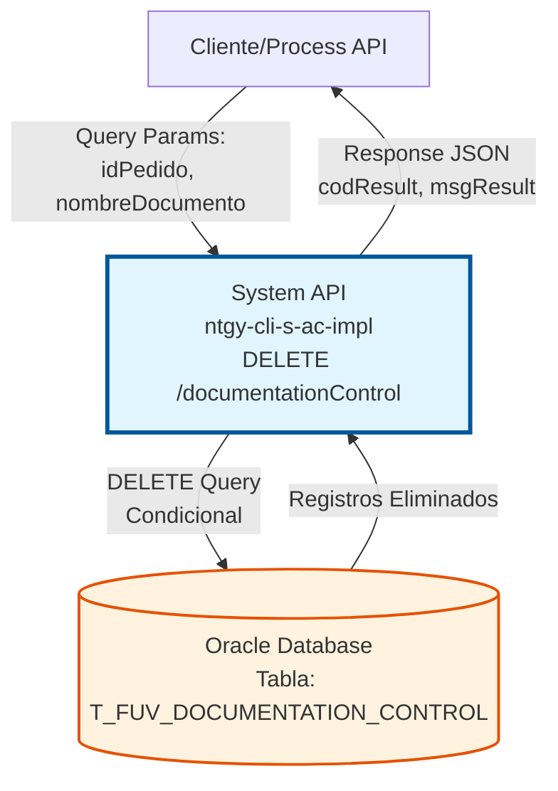
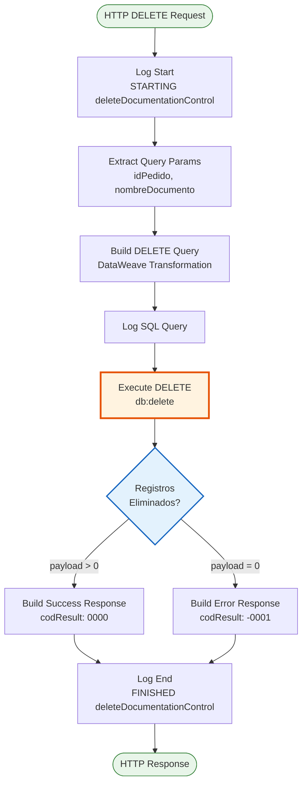
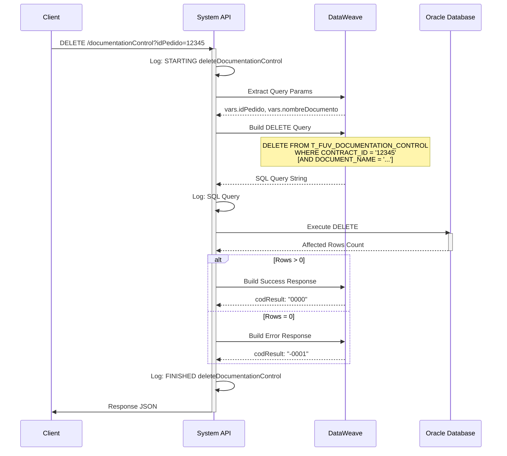

# DELETE /documentationControl

## 📌 Descripción General

### Propósito del Endpoint

Este endpoint elimina **físicamente** registros de control de documentación de la base de datos Oracle. A diferencia de un soft delete, esta operación **borra permanentemente** los registros que coincidan con los criterios especificados.

El endpoint soporta:
- **Eliminación por Contrato**: Elimina todos los documentos asociados a un `idPedido` (CONTRACT_ID)
- **Eliminación Selectiva**: Opcionalmente, puede filtrar por `nombreDocumento` para eliminar solo un documento específico
- **Validación de Existencia**: Retorna código de error si no se encuentra ningún registro que eliminar

### Tipo de API

**Capa:** System API (API-Led Connectivity)

**Función:** Integración directa con Oracle Database (esquema OV_CON) para eliminación física de registros de control de documentación.

### Patrón de Integración

**Tipo:** Request-Reply Síncrono con SQL DELETE

**Descripción:** Recibe parámetros de identificación, construye dinámicamente una query DELETE con filtros condicionales, ejecuta la eliminación en la base de datos y retorna el resultado de la operación.

### Arquitectura API-Led Connectivity



---

## 💼 Propósito del Negocio

### Casos de Uso Principales

1. **Limpieza de Documentación Obsoleta**
   - Eliminar registros de documentos que ya no son necesarios
   - Mantener la base de datos limpia de información desactualizada
   - Liberar espacio en la base de datos

2. **Corrección de Errores de Registro**
   - Eliminar documentos registrados por error
   - Corregir duplicados o registros incorrectos
   - Permitir re-registro de documentación

3. **Gestión de Contratos Cancelados**
   - Eliminar toda la documentación asociada a un contrato cancelado
   - Limpiar registros de contratos que no se completaron
   - Mantener consistencia en el sistema

### Contexto Empresarial

- **Dominio:** Gestión de Documentación de Contratos
- **Sector:** Energía - Utilities
- **División:** Naturgy España - CLI (Clientes)
- **Proceso de Negocio:** Alta de Clientes y Gestión Documental
- **Sistema:** Oracle Database - Esquema OV_CON (Administración Comercial)

### Stakeholders

- **Administradores de Sistema**: Necesitan limpiar registros obsoletos o erróneos
- **Equipos de Soporte**: Requieren corregir errores de documentación
- **Sistemas de Integración**: Necesitan eliminar documentación de contratos cancelados
- **Equipos de Auditoría**: Requieren mantener la base de datos limpia y consistente

### Valor de Negocio

- **Integridad de Datos**: Mantiene la base de datos limpia y sin registros obsoletos
- **Eficiencia Operativa**: Permite corregir errores rápidamente
- **Gestión de Almacenamiento**: Libera espacio eliminando registros innecesarios
- **Flexibilidad**: Permite eliminación selectiva o masiva según necesidad

### Consumidores Potenciales

Este endpoint puede ser consumido por:
- Process APIs de gestión de contratos
- Sistemas de administración y soporte
- Herramientas de limpieza de datos
- Procesos batch de mantenimiento

---

## 🔧 Especificación Técnica

### URLs por Ambiente

| Ambiente | URL Base | URL Completa |
|----------|----------|--------------|
| **Local** | `http://localhost:8081` | `http://localhost:8081/api/documentationControl?idPedido={id}&nombreDocumento={nombre}` |
| **Development** | `https://ntgy-cli-s-ac-dev.us-e2.cloudhub.io` | `https://ntgy-cli-s-ac-dev.us-e2.cloudhub.io/api/documentationControl?idPedido={id}` |
| **UAT** | `https://ntgy-cli-s-ac-uat.us-e2.cloudhub.io` | `https://ntgy-cli-s-ac-uat.us-e2.cloudhub.io/api/documentationControl?idPedido={id}` |
| **Production** | `https://ntgy-cli-s-ac-pro.us-e2.cloudhub.io` | `https://ntgy-cli-s-ac-pro.us-e2.cloudhub.io/api/documentationControl?idPedido={id}` |

### Método HTTP

```
DELETE /api/documentationControl
```

### Parámetros de Entrada

#### Headers HTTP

| Header | Tipo | Requerido | Descripción | Ejemplo |
|--------|------|-----------|-------------|---------|
| `Content-Type` | string | ❌ No | Tipo de contenido (no se envía body) | `application/json` |
| `Accept` | string | ❌ No | Tipo de contenido esperado en response | `application/json` |

#### Query Parameters

| Parámetro | Tipo | Requerido | Descripción | Ejemplo |
|-----------|------|-----------|-------------|---------|
| `idPedido` | string | ✅ **Sí** | Identificador del contrato (CONTRACT_ID) | `"12345"` |
| `nombreDocumento` | string | ❌ No | Nombre del documento específico a eliminar (DOCUMENT_NAME) | `"DNI_Cliente.pdf"` |

**Comportamiento de Filtros:**

- **Solo `idPedido`**: Elimina **TODOS** los documentos del contrato
  ```sql
  DELETE FROM T_FUV_DOCUMENTATION_CONTROL 
  WHERE CONTRACT_ID = '12345'
  ```

- **`idPedido` + `nombreDocumento`**: Elimina **SOLO** el documento específico
  ```sql
  DELETE FROM T_FUV_DOCUMENTATION_CONTROL 
  WHERE CONTRACT_ID = '12345' 
  AND DOCUMENT_NAME = 'DNI_Cliente.pdf'
  ```

### Respuestas

#### Respuesta Exitosa - Registro(s) Eliminado(s) (200 OK)

```json
{
  "result": {
    "codResult": "0000",
    "msgResult": "No hay error"
  }
}
```

**Condición:** Se eliminó al menos 1 registro (`payload > 0`)

#### Respuesta de Error - Registro No Encontrado (200 OK)

```json
{
  "result": {
    "codResult": "-0001",
    "msgResult": "El registro que intenta borrar no existe"
  }
}
```

**Condición:** No se encontró ningún registro que coincida con los criterios (`payload = 0`)

#### Respuesta de Error Técnico (500)

```json
{
  "result": {
    "codResult": "0001",
    "msgResult": "Error interno del servidor"
  }
}
```

### Autenticación y Autorización

- **Tipo:** Client ID & Client Secret (Anypoint Platform)
- **Autorización Oracle:** El usuario debe tener permisos para:
  - Ejecutar operaciones DELETE en tabla `T_FUV_DOCUMENTATION_CONTROL`
  - Acceso al esquema `OV_CON`

### Timeouts

| Tipo | Valor | Descripción |
|------|-------|-------------|
| **Request Timeout** | 30 segundos | Tiempo máximo de espera para la respuesta |
| **Connection Timeout** | 10 segundos | Tiempo máximo para establecer conexión con Oracle |

---

## 🏗️ Implementación Técnica

### Arquitectura del Flow



### Flujo de Datos Detallado



### Componentes Clave

#### 1. Extracción de Parámetros (Líneas 336-346)

```xml
<!-- Variable: idPedido (OBLIGATORIO) -->
<ee:transform doc:name="var idPedido">
    <ee:variables>
        <ee:set-variable variableName="idPedido">
            <![CDATA[%dw 2.0
            output application/java
            ---
            attributes.queryParams.idPedido]]>
        </ee:set-variable>
    </ee:variables>
</ee:transform>

<!-- Variable: nombreDocumento (OPCIONAL) -->
<set-variable 
    value="#[attributes.queryParams.nombreDocumento]" 
    variableName="nombreDocumento" />
```

#### 2. Construcción Dinámica de Query (Líneas 347-355)

```dataweave
%dw 2.0
output application/java
---
"DELETE FROM T_FUV_DOCUMENTATION_CONTROL WHERE CONTRACT_ID = '" ++ vars.idPedido ++ "'" ++
if (vars.nombreDocumento != null) 
    (" and DOCUMENT_NAME = '" ++ vars.nombreDocumento ++ "'")  
else 
    ('')
```

**Lógica Condicional:**
- **Base Query**: Siempre incluye `WHERE CONTRACT_ID = '{idPedido}'`
- **Filtro Adicional**: Si `nombreDocumento` existe, añade `AND DOCUMENT_NAME = '{nombreDocumento}'`
- **Resultado**: Query SQL dinámica según parámetros recibidos

#### 3. Ejecución de DELETE (Líneas 357-359)

```xml
<db:delete doc:name="Delete" config-ref="Database_Config">
    <db:sql><![CDATA[#[payload]]]></db:sql>
</db:delete>
```

**Configuración:**
- **Connector:** Oracle Database Connector
- **Config:** `Database_Config` (conexión a esquema OV_CON)
- **Query:** Dinámica (construida en paso anterior)
- **Retorno:** Número de registros eliminados (`payload`)

#### 4. Construcción de Respuesta (Líneas 360-372)

```dataweave
%dw 2.0
output application/json
---
{
    "result": {
        "codResult": if (payload > 0) "0000" else "-0001",
        "msgResult": if (payload > 0) "No hay error" else "El registro que intenta borrar no existe"
    }
}
```

**Lógica de Respuesta:**
- **`payload > 0`**: Al menos 1 registro eliminado → Éxito (`0000`)
- **`payload = 0`**: Ningún registro encontrado → Error (`-0001`)

### Tabla de Base de Datos

#### T_FUV_DOCUMENTATION_CONTROL

| Campo | Tipo | Descripción | Uso en DELETE |
|-------|------|-------------|---------------|
| `CONTRACT_ID` | VARCHAR2 | Identificador del contrato | ✅ WHERE clause (obligatorio) |
| `DOCUMENT_NAME` | VARCHAR2 | Nombre del documento | ✅ WHERE clause (opcional) |
| *(otros campos)* | - | Campos adicionales de la tabla | ❌ No usados en DELETE |

### Configuración de Conexión

```xml
<db:config name="Database_Config">
    <db:generic-connection 
        url="jdbc:oracle:thin:${dbAC.user}/${secure::dbAC.pass}@..."
        driverClassName="oracle.jdbc.driver.OracleDriver">
        <db:pooling-profile 
            maxPoolSize="${dbAC.MaxPoolSize}"
            maxWait="${dbAC.MaxWaitTime}"
            maxIdleTime="${dbAC.MaxIdleTime}"/>
    </db:generic-connection>
</db:config>
```

### Logging

**Puntos de Log:**
1. **Inicio**: `STARTING deleteDocumentationControl METHOD. REQUEST: {params}`
2. **Query SQL**: Log de la query construida
3. **Fin**: `FINISHED deleteDocumentationControl METHOD. RESPONSE: {result}`

---

## 💻 Ejemplos de Uso

### Ejemplo 1: Eliminar Todos los Documentos de un Contrato

#### Request con curl

```bash
curl -X DELETE "http://localhost:8081/api/documentationControl?idPedido=12345" \
  -H "Accept: application/json"
```

#### Query SQL Ejecutada

```sql
DELETE FROM T_FUV_DOCUMENTATION_CONTROL 
WHERE CONTRACT_ID = '12345'
```

#### Response Exitosa (200 OK)

```json
{
  "result": {
    "codResult": "0000",
    "msgResult": "No hay error"
  }
}
```

**Interpretación:** Se eliminaron todos los documentos asociados al contrato `12345`.

---

### Ejemplo 2: Eliminar un Documento Específico

#### Request con curl

```bash
curl -X DELETE "http://localhost:8081/api/documentationControl?idPedido=12345&nombreDocumento=DNI_Cliente.pdf" \
  -H "Accept: application/json"
```

#### Query SQL Ejecutada

```sql
DELETE FROM T_FUV_DOCUMENTATION_CONTROL 
WHERE CONTRACT_ID = '12345' 
AND DOCUMENT_NAME = 'DNI_Cliente.pdf'
```

#### Response Exitosa (200 OK)

```json
{
  "result": {
    "codResult": "0000",
    "msgResult": "No hay error"
  }
}
```

**Interpretación:** Se eliminó únicamente el documento `DNI_Cliente.pdf` del contrato `12345`.

---

### Ejemplo 3: Intento de Eliminar Registro No Existente

#### Request con curl

```bash
curl -X DELETE "http://localhost:8081/api/documentationControl?idPedido=99999" \
  -H "Accept: application/json"
```

#### Query SQL Ejecutada

```sql
DELETE FROM T_FUV_DOCUMENTATION_CONTROL 
WHERE CONTRACT_ID = '99999'
```

#### Response de Error (200 OK)

```json
{
  "result": {
    "codResult": "-0001",
    "msgResult": "El registro que intenta borrar no existe"
  }
}
```

**Interpretación:** No se encontró ningún documento asociado al contrato `99999`.

---

### Ejemplo 4: Request desde JavaScript

```javascript
const deleteDocumentation = async (idPedido, nombreDocumento = null) => {
  const baseUrl = 'https://ntgy-cli-s-ac-pro.us-e2.cloudhub.io/api/documentationControl';
  
  // Construir query params
  const params = new URLSearchParams({ idPedido });
  if (nombreDocumento) {
    params.append('nombreDocumento', nombreDocumento);
  }
  
  try {
    const response = await fetch(`${baseUrl}?${params}`, {
      method: 'DELETE',
      headers: {
        'Accept': 'application/json'
      }
    });
    
    const data = await response.json();
    
    if (data.result.codResult === '0000') {
      console.log('✅ Documento(s) eliminado(s) exitosamente');
      return { success: true, data };
    } else {
      console.log('❌ Error:', data.result.msgResult);
      return { success: false, error: data.result.msgResult };
    }
  } catch (error) {
    console.error('❌ Error técnico:', error);
    return { success: false, error: error.message };
  }
};

// Uso: Eliminar todos los documentos de un contrato
await deleteDocumentation('12345');

// Uso: Eliminar un documento específico
await deleteDocumentation('12345', 'DNI_Cliente.pdf');
```

---

### Ejemplo 5: Request desde Python

```python
import requests

def delete_documentation(id_pedido, nombre_documento=None):
    """
    Elimina documentación de control.
    
    Args:
        id_pedido (str): ID del contrato
        nombre_documento (str, optional): Nombre del documento específico
    
    Returns:
        dict: Resultado de la operación
    """
    base_url = 'https://ntgy-cli-s-ac-pro.us-e2.cloudhub.io/api/documentationControl'
    
    # Construir parámetros
    params = {'idPedido': id_pedido}
    if nombre_documento:
        params['nombreDocumento'] = nombre_documento
    
    try:
        response = requests.delete(
            base_url,
            params=params,
            headers={'Accept': 'application/json'}
        )
        response.raise_for_status()
        
        data = response.json()
        
        if data['result']['codResult'] == '0000':
            print('✅ Documento(s) eliminado(s) exitosamente')
            return {'success': True, 'data': data}
        else:
            print(f"❌ Error: {data['result']['msgResult']}")
            return {'success': False, 'error': data['result']['msgResult']}
            
    except requests.exceptions.RequestException as e:
        print(f'❌ Error técnico: {e}')
        return {'success': False, 'error': str(e)}

# Uso
delete_documentation('12345')
delete_documentation('12345', 'DNI_Cliente.pdf')
```
