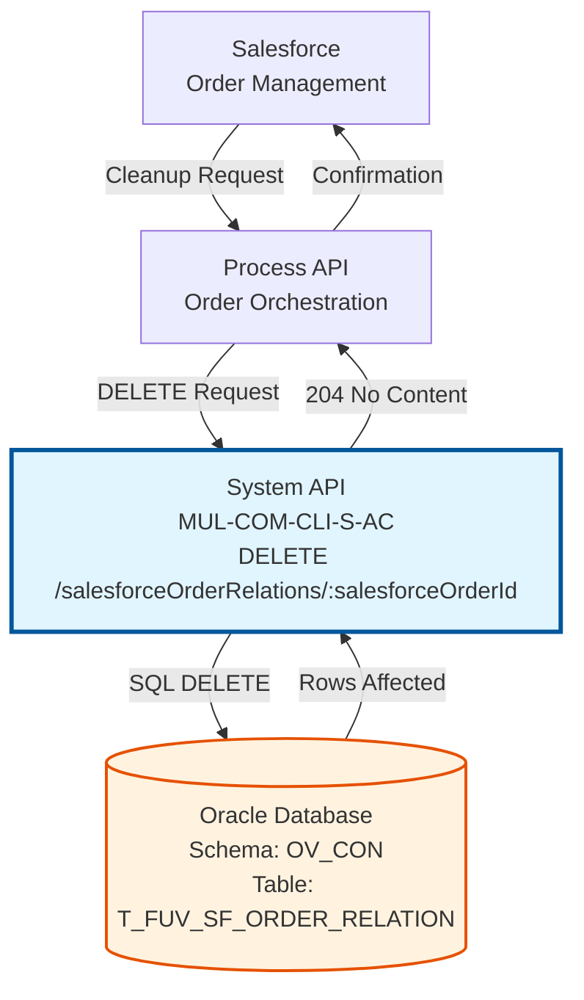
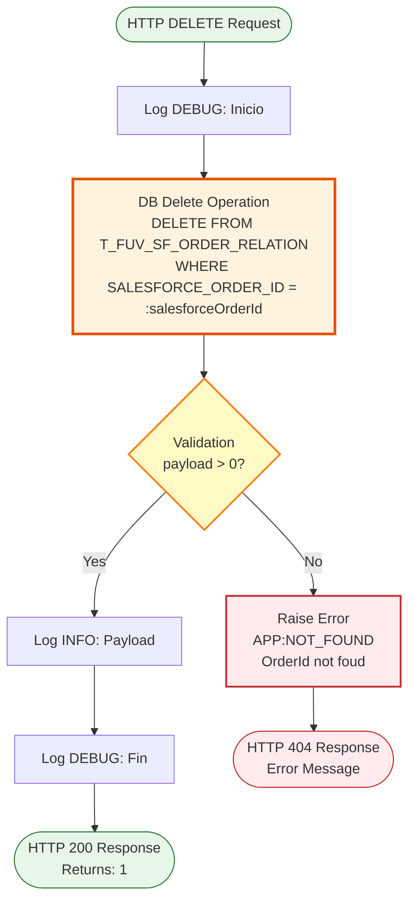
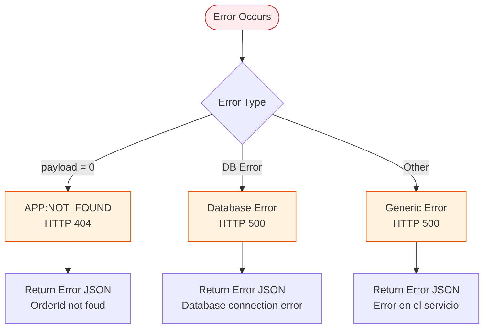
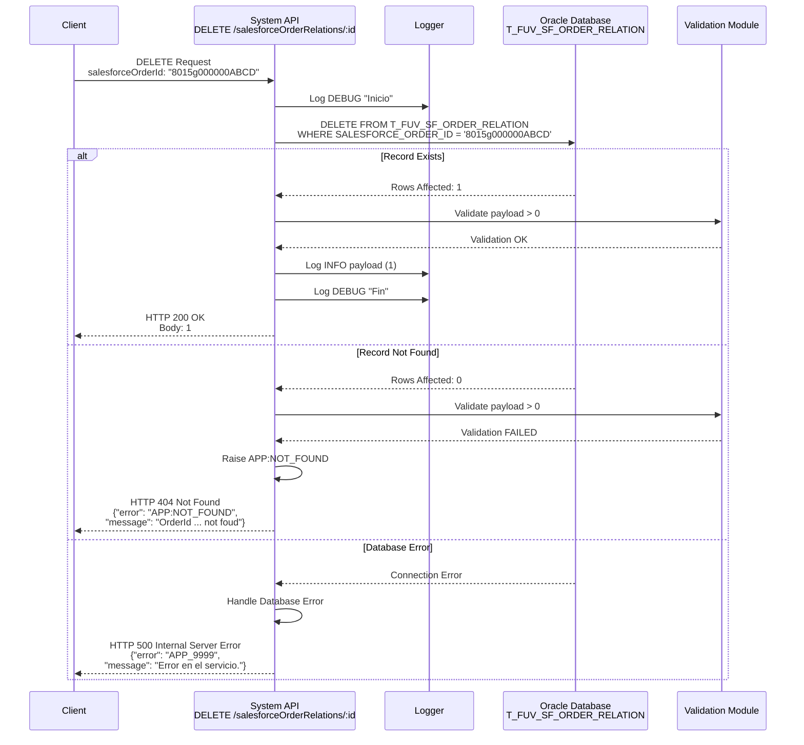

# DELETE /salesforceOrderRelations/:salesforceOrderId

## 📌 Descripción General

### Propósito del Endpoint

Este endpoint elimina una relación de orden de Salesforce del sistema de control. Permite limpiar registros de sincronización entre Salesforce y los sistemas internos de Naturgy cuando una orden es cancelada, completada o ya no requiere seguimiento.

El endpoint soporta:
- **Eliminación por ID**: Elimina un registro específico usando el ID de orden de Salesforce
- **Validación de existencia**: Verifica que el registro existe antes de confirmar la eliminación
- **Respuesta de error 404**: Retorna error si el ID no existe en la base de datos

### Tipo de API

**Capa:** System API (API-Led Connectivity)

**Función:** Integración directa con Oracle Database (schema OV_CON) para gestión de relaciones de órdenes de Salesforce.

### Patrón de Integración

**Tipo:** Request-Reply Síncrono con SQL DELETE

**Descripción:** Recibe el ID de orden de Salesforce como path parameter, ejecuta una operación DELETE en la base de datos Oracle, valida que se eliminó al menos un registro, y retorna confirmación o error 404 si no existe.

### Arquitectura API-Led Connectivity



---

## 💼 Propósito del Negocio

### Casos de Uso Principales

1. **Limpieza de Órdenes Canceladas**
   - Cuando una orden de Salesforce es cancelada, se elimina su registro de control
   - Mantiene la tabla de relaciones limpia y actualizada
   - Evita referencias a órdenes que ya no existen

2. **Finalización de Sincronización**
   - Al completar el proceso de sincronización de una orden
   - Elimina registros temporales de control
   - Libera espacio en la base de datos

3. **Corrección de Errores**
   - Permite eliminar registros creados por error
   - Facilita la corrección de datos duplicados
   - Soporta operaciones de mantenimiento de datos

### Contexto Empresarial

- **Dominio:** Integración con Salesforce - Gestión de Órdenes
- **Sector:** Energía - Utilities
- **División:** Naturgy España - Comercialización
- **Proceso de Negocio:** Sincronización de órdenes entre Salesforce y sistemas internos
- **Sistema Backend:** Oracle Database (AC Schema)

### Stakeholders

- **Equipo de Integración Salesforce**: Necesita limpiar relaciones obsoletas
- **Administradores de Datos**: Requieren mantener la integridad de datos
- **Desarrolladores de Process APIs**: Consumen este endpoint para gestión del ciclo de vida de órdenes

### Valor de Negocio

- **Integridad de Datos**: Mantiene la tabla de control limpia y sin registros obsoletos
- **Eficiencia Operativa**: Facilita la gestión del ciclo de vida completo de órdenes
- **Mantenibilidad**: Permite corrección de errores y limpieza de datos

### Consumidores Potenciales

Este endpoint puede ser consumido por:
- Process APIs de gestión de órdenes
- Flujos de Salesforce (Platform Events, Flows)
- Sistemas de integración middleware
- Procesos batch de limpieza de datos

---

## 🔧 Especificación Técnica

### URLs por Ambiente

| Ambiente | URL Base | URL Completa |
|----------|----------|--------------|
| **Local** | `http://localhost:8081` | `http://localhost:8081/api/salesforceOrderRelations/:salesforceOrderId` |
| **Development** | `https://mul-com-cli-s-ac-dev.us-e2.cloudhub.io` | `https://mul-com-cli-s-ac-dev.us-e2.cloudhub.io/api/salesforceOrderRelations/:salesforceOrderId` |
| **UAT** | `https://mul-com-cli-s-ac-uat.us-e2.cloudhub.io` | `https://mul-com-cli-s-ac-uat.us-e2.cloudhub.io/api/salesforceOrderRelations/:salesforceOrderId` |
| **Production** | `https://mul-com-cli-s-ac-pro.us-e2.cloudhub.io` | `https://mul-com-cli-s-ac-pro.us-e2.cloudhub.io/api/salesforceOrderRelations/:salesforceOrderId` |

### Método HTTP

```
DELETE /api/salesforceOrderRelations/:salesforceOrderId
```

### Parámetros de Entrada

#### Headers HTTP

| Header | Tipo | Requerido | Descripción | Ejemplo |
|--------|------|-----------|-------------|---------|
| `Content-Type` | string | ✅ Sí | Tipo de contenido del request | `application/json` |
| `Accept` | string | ❌ No | Tipo de contenido esperado en response | `application/json` |

#### Path Parameters

| Parámetro | Tipo | Requerido | Descripción | Ejemplo |
|-----------|------|-----------|-------------|---------|
| `salesforceOrderId` | string | ✅ Sí | ID único de la orden de Salesforce a eliminar | `"8015g000000ABCD"` |

#### Body Parameters

No requiere body en el request.

### Respuestas

#### Respuesta Exitosa (200 OK)

Cuando el registro se elimina exitosamente, retorna el número de registros eliminados:

```json
1
```

**Descripción:** El valor `1` indica que se eliminó exactamente un registro de la base de datos.

#### Respuesta de Error - Registro No Encontrado (404 Not Found)

Cuando el `salesforceOrderId` no existe en la base de datos:

```json
{
  "error": "APP:NOT_FOUND",
  "message": "OrderId 8015g000000ABCD not foud"
}
```

**Nota:** El mensaje contiene un typo intencional ("foud" en lugar de "found") que está presente en el código fuente.

#### Respuesta de Error Técnico (500 Internal Server Error)

```json
{
  "error": "APP_9999",
  "message": "Error en el servicio."
}
```

### Códigos de Estado HTTP

| Código | Descripción | Cuándo Ocurre |
|--------|-------------|---------------|
| `200` | OK | Registro eliminado exitosamente |
| `404` | Not Found | El salesforceOrderId no existe en la base de datos |
| `500` | Internal Server Error | Error en la conexión a base de datos o error inesperado |

### Autenticación y Autorización

- **Tipo:** Client ID & Client Secret (Anypoint Platform)
- **Autorización Oracle:** El usuario de base de datos debe tener permisos para:
  - Ejecutar operaciones DELETE en tabla `T_FUV_SF_ORDER_RELATION`
  - Acceso al schema `OV_CON`

### Timeouts

| Tipo | Valor | Descripción |
|------|-------|-------------|
| **Request Timeout** | 30 segundos | Tiempo máximo de espera para la respuesta |
| **Connection Timeout** | 10 segundos | Tiempo máximo para establecer conexión con Oracle |

---

## 🏗️ Implementación Técnica

### Arquitectura del Flow



### Componentes del Flow

#### 1. Logger Inicial (DEBUG)
```xml
<logger level="DEBUG" 
        message='#["Inicio"]' 
        category="com.naturgy.mule.salesforceOrderRelation-delete" />
```
- **Propósito:** Registra el inicio de la ejecución del subflow
- **Nivel:** DEBUG
- **Categoría:** `com.naturgy.mule.salesforceOrderRelation-delete`

#### 2. Operación DELETE en Base de Datos
```xml
<db:delete config-ref="Database_Config">
    <db:sql><![CDATA[DELETE FROM T_FUV_SF_ORDER_RELATION 
                     WHERE SALESFORCE_ORDER_ID = :salesforceOrderId]]></db:sql>
    <db:input-parameters><![CDATA[#[{
        salesforceOrderId: vars.salesforceOrderId
    }]]]></db:input-parameters>
</db:delete>
```

**Detalles:**
- **Configuración:** `Database_Config` (Oracle Database)
- **Tabla:** `T_FUV_SF_ORDER_RELATION`
- **Condición WHERE:** `SALESFORCE_ORDER_ID = :salesforceOrderId`
- **Parámetro:** `salesforceOrderId` (tomado de variable de flow)
- **Retorno:** Número de filas eliminadas (payload)

#### 3. Validación de Existencia
```xml
<validation:is-true 
    expression="#[payload &gt; 0]" 
    message='#["OrderId " ++ vars.salesforceOrderId ++ " not foud"]'>
    <error-mapping sourceType="VALIDATION:INVALID_BOOLEAN" 
                   targetType="APP:NOT_FOUND" />
</validation:is-true>
```

**Lógica:**
- **Condición:** `payload > 0` (al menos 1 fila eliminada)
- **Si falla:** Lanza error `APP:NOT_FOUND`
- **Mensaje:** "OrderId [salesforceOrderId] not foud" (typo intencional en código)

#### 4. Logger de Resultado (INFO)
```xml
<logger level="INFO" 
        message="#[output application/json --- payload]" 
        category="com.naturgy.mule.salesforceOrderRelation-delete" />
```
- **Propósito:** Registra el número de registros eliminados
- **Formato:** JSON
- **Nivel:** INFO

#### 5. Logger Final (DEBUG)
```xml
<logger level="DEBUG" 
        message='#["Fin"]' 
        category="com.naturgy.mule.salesforceOrderRelation-delete" />
```
- **Propósito:** Registra el fin exitoso de la ejecución

### Query SQL Ejecutada

```sql
DELETE FROM T_FUV_SF_ORDER_RELATION 
WHERE SALESFORCE_ORDER_ID = :salesforceOrderId
```

**Parámetros:**
- `:salesforceOrderId` - ID de la orden de Salesforce (string)

**Tabla Afectada:**
- **Nombre:** `T_FUV_SF_ORDER_RELATION`
- **Schema:** `OV_CON`
- **Propósito:** Almacena relaciones entre órdenes de Salesforce y sistema interno

### Manejo de Errores



**Error Handler:** `apiErrorHandler`

**Mapeo de Errores:**
1. **VALIDATION:INVALID_BOOLEAN** → **APP:NOT_FOUND** (404)
   - Ocurre cuando `payload = 0` (no se eliminó ningún registro)
   - Mensaje: "OrderId [salesforceOrderId] not foud"

2. **Database Errors** → **HTTP 500**
   - Errores de conexión a Oracle
   - Errores de permisos
   - Timeouts de base de datos

3. **ANY** → **HTTP 500**
   - Cualquier otro error no manejado específicamente

### Configuración de Base de Datos

**Connector:** `Database_Config`

```yaml
# Configuración en s-ac-{env}-config.yaml
dbAC:
  user: "username"
  pass: "encrypted_password"
  host1: "oracle-host1.naturgy.com"
  host2: "oracle-host2.naturgy.com"
  port: 1521
  serviceName: "OV_CON"
  MaxPoolSize: 10
  MaxWaitTime: 30000
  MaxIdleTime: 60000
```

**Características:**
- Oracle RAC con failover automático
- Connection pooling configurado
- Credenciales encriptadas con secure properties
- Retry automático en caso de fallo de nodo

### Diagrama de Secuencia Completo



### Variables de Flow

| Variable | Tipo | Origen | Descripción |
|----------|------|--------|-------------|
| `vars.salesforceOrderId` | String | URI Parameter | ID de la orden de Salesforce extraído del path |
| `payload` | Integer | DB Delete Result | Número de filas eliminadas (0 o 1) |

### Logging y Auditoría

**Categoría de Log:** `com.naturgy.mule.salesforceOrderRelation-delete`

**Niveles de Log:**
- **DEBUG:** Inicio y fin de ejecución
- **INFO:** Resultado de la operación (número de registros eliminados)
- **ERROR:** Errores de validación o base de datos (manejados por error handler global)

**Ejemplo de Logs:**

```
DEBUG [com.naturgy.mule.salesforceOrderRelation-delete] Inicio
INFO  [com.naturgy.mule.salesforceOrderRelation-delete] 1
DEBUG [com.naturgy.mule.salesforceOrderRelation-delete] Fin
```

---

## 💻 Ejemplos de Uso

### Ejemplo 1: Eliminación Exitosa

#### Request con curl

```bash
curl -X DELETE \
  'http://localhost:8081/api/salesforceOrderRelations/8015g000000ABCD' \
  -H 'Content-Type: application/json' \
  -H 'Accept: application/json'
```

#### Response (200 OK)

```json
1
```

**Interpretación:** Se eliminó exitosamente 1 registro de la tabla `T_FUV_SF_ORDER_RELATION`.

---

### Ejemplo 2: Orden No Encontrada (404)

#### Request con curl

```bash
curl -X DELETE \
  'http://localhost:8081/api/salesforceOrderRelations/INVALID_ID_12345' \
  -H 'Content-Type: application/json' \
  -H 'Accept: application/json'
```

#### Response (404 Not Found)

```json
{
  "error": "APP:NOT_FOUND",
  "message": "OrderId INVALID_ID_12345 not foud"
}
```

**Interpretación:** El ID de orden proporcionado no existe en la base de datos.

---

### Ejemplo 3: Error de Conexión a Base de Datos

#### Request con curl

```bash
curl -X DELETE \
  'http://localhost:8081/api/salesforceOrderRelations/8015g000000ABCD' \
  -H 'Content-Type: application/json' \
  -H 'Accept: application/json'
```

#### Response (500 Internal Server Error)

```json
{
  "error": "APP_9999",
  "message": "Error en el servicio."
}
```

**Interpretación:** Ocurrió un error técnico (conexión a base de datos, timeout, etc.).

---

### Ejemplo 4: Request desde JavaScript (Fetch API)

```javascript
const salesforceOrderId = '8015g000000ABCD';

fetch(`https://mul-com-cli-s-ac-pro.us-e2.cloudhub.io/api/salesforceOrderRelations/${salesforceOrderId}`, {
  method: 'DELETE',
  headers: {
    'Content-Type': 'application/json',
    'Accept': 'application/json'
  }
})
.then(response => {
  if (response.ok) {
    return response.json();
  } else if (response.status === 404) {
    throw new Error('Order relation not found');
  } else {
    throw new Error('Server error');
  }
})
.then(data => {
  console.log('Deleted records:', data); // Output: 1
})
.catch(error => {
  console.error('Error:', error.message);
});
```

---

### Ejemplo 5: Request desde Postman

**Configuración:**

1. **Method:** DELETE
2. **URL:** `http://localhost:8081/api/salesforceOrderRelations/8015g000000ABCD`
3. **Headers:**
   - `Content-Type: application/json`
   - `Accept: application/json`
4. **Body:** None (DELETE no requiere body)

**Expected Response:**
- Status: 200 OK
- Body: `1`

---

### Ejemplo 6: Integración desde Salesforce Flow

```apex
// Apex code para eliminar relación de orden
public class SalesforceOrderRelationService {
    
    public static void deleteOrderRelation(String salesforceOrderId) {
        HttpRequest req = new HttpRequest();
        req.setEndpoint('callout:MuleSoft_AC_API/salesforceOrderRelations/' + salesforceOrderId);
        req.setMethod('DELETE');
        req.setHeader('Content-Type', 'application/json');
        req.setHeader('Accept', 'application/json');
        
        Http http = new Http();
        HttpResponse res = http.send(req);
        
        if (res.getStatusCode() == 200) {
            System.debug('Order relation deleted successfully');
        } else if (res.getStatusCode() == 404) {
            System.debug('Order relation not found: ' + salesforceOrderId);
        } else {
            System.debug('Error deleting order relation: ' + res.getBody());
        }
    }
}
```

---

### Ejemplo 7: Manejo de Errores en Python

```python
import requests

def delete_salesforce_order_relation(salesforce_order_id):
    """
    Elimina una relación de orden de Salesforce
    
    Args:
        salesforce_order_id (str): ID de la orden de Salesforce
        
    Returns:
        dict: Resultado de la operación
    """
    url = f"https://mul-com-cli-s-ac-pro.us-e2.cloudhub.io/api/salesforceOrderRelations/{salesforce_order_id}"
    
    headers = {
        'Content-Type': 'application/json',
        'Accept': 'application/json'
    }
    
    try:
        response = requests.delete(url, headers=headers, timeout=30)
        
        if response.status_code == 200:
            return {
                'success': True,
                'deleted_records': response.json(),
                'message': 'Order relation deleted successfully'
            }
        elif response.status_code == 404:
            return {
                'success': False,
                'error': 'NOT_FOUND',
                'message': f'Order relation not found: {salesforce_order_id}'
            }
        else:
            return {
                'success': False,
                'error': 'SERVER_ERROR',
                'message': f'Server error: {response.status_code}'
            }
            
    except requests.exceptions.Timeout:
        return {
            'success': False,
            'error': 'TIMEOUT',
            'message': 'Request timeout after 30 seconds'
        }
    except requests.exceptions.RequestException as e:
        return {
            'success': False,
            'error': 'CONNECTION_ERROR',
            'message': str(e)
        }

# Uso
result = delete_salesforce_order_relation('8015g000000ABCD')
print(result)
```
