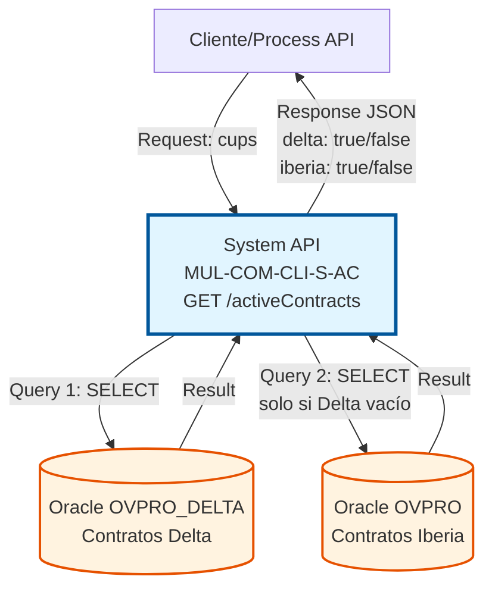
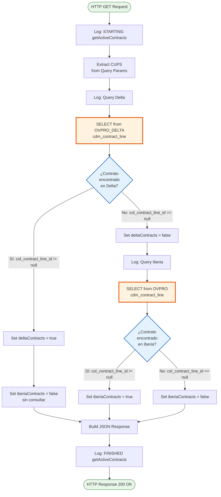
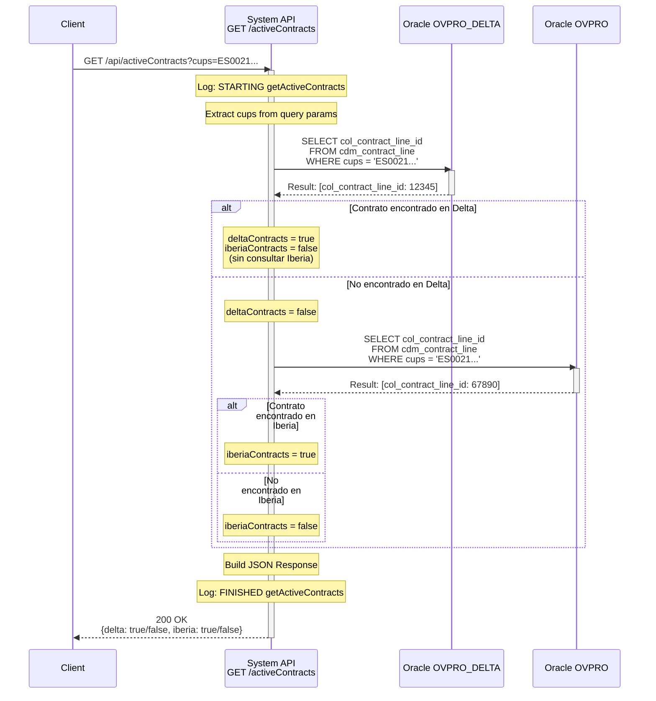
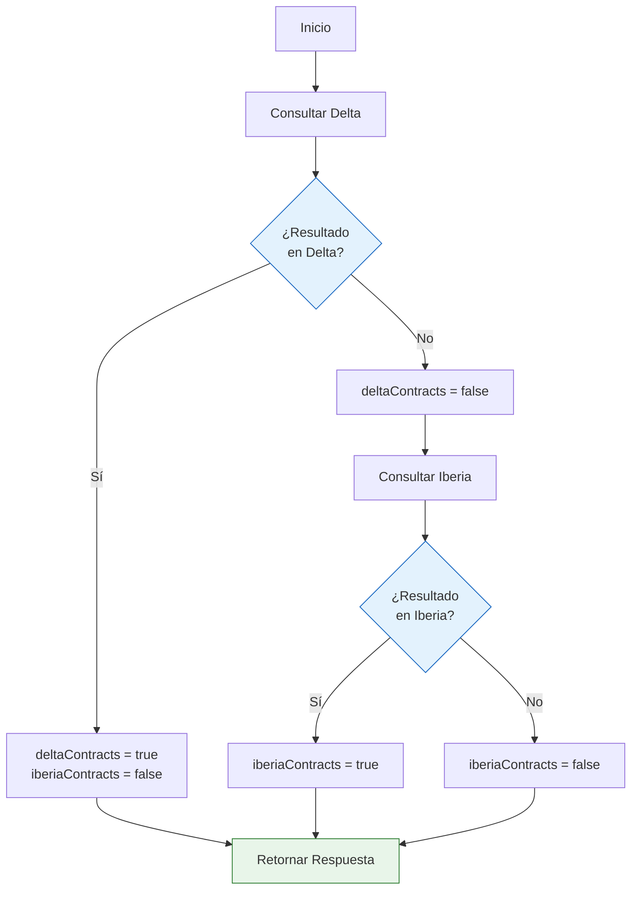

# GET /activeContracts

## 📌 Descripción General

### Propósito del Endpoint

Este endpoint verifica la existencia de contratos activos asociados a un CUPS (Código Unificado de Punto de Suministro) en dos sistemas diferentes: **Delta** e **Iberia**. Permite identificar en qué sistema se encuentra registrado el contrato activo del cliente, facilitando procesos de migración, consolidación y validación de datos.

El endpoint soporta:
- **Verificación en Sistema Delta**: Consulta primaria en la base de datos OVPRO_DELTA
- **Verificación en Sistema Iberia**: Consulta secundaria en la base de datos OVPRO (solo si no hay contratos en Delta)
- **Respuesta Booleana**: Retorna flags indicando la presencia de contratos en cada sistema
- **Validación de Estado**: Considera contratos activos o inactivados recientemente (últimos 2 días)

### Tipo de API

**Capa:** System API (API-Led Connectivity)

**Función:** Integración directa con base de datos Oracle para verificación de contratos activos por CUPS.

### Patrón de Integración

**Tipo:** Request-Reply Síncrono con Consultas SQL Condicionales

**Descripción:** El endpoint recibe un CUPS como parámetro, ejecuta una consulta SQL en el sistema Delta, y si no encuentra contratos activos, ejecuta una segunda consulta en el sistema Iberia. Retorna flags booleanos indicando la presencia de contratos en cada sistema.

### Arquitectura API-Led Connectivity



---

## 💼 Propósito del Negocio

### Casos de Uso Principales

1. **Validación de Migración de Contratos**
   - Verificar si un contrato ha sido migrado de Iberia a Delta
   - Identificar el sistema origen del contrato activo
   - Facilitar procesos de consolidación de datos

2. **Prevención de Duplicados**
   - Evitar la creación de contratos duplicados en ambos sistemas
   - Validar la unicidad del CUPS antes de operaciones de alta
   - Garantizar integridad referencial entre sistemas

3. **Soporte a Procesos de Onboarding**
   - Determinar el sistema correcto para consultas adicionales
   - Dirigir flujos de negocio según el sistema origen
   - Optimizar rutas de integración basadas en ubicación del contrato

### Contexto Empresarial

- **Dominio:** Gestión de Contratos y Clientes
- **Sector:** Energía - Utilities
- **División:** Naturgy España - Área de Clientes
- **Proceso de Negocio:** Validación y verificación de contratos activos
- **Sistemas Involucrados:** OVPRO_DELTA (nuevo) y OVPRO (legacy Iberia)

### Stakeholders

- **Equipos de Migración**: Necesitan verificar el estado de migración de contratos
- **Sistemas de Onboarding**: Requieren validar existencia de contratos antes de altas
- **Equipos de Soporte**: Necesitan identificar rápidamente el sistema origen del contrato
- **Process APIs**: Consumen este endpoint para orquestar flujos de negocio

### Valor de Negocio

- **Reducción de Errores**: Previene duplicados y conflictos entre sistemas
- **Optimización de Procesos**: Dirige automáticamente a los sistemas correctos
- **Visibilidad Operacional**: Proporciona claridad sobre el estado de migración
- **Eficiencia**: Consulta condicional reduce carga innecesaria en base de datos

### Consumidores Potenciales

Este endpoint puede ser consumido por:
- Process APIs de gestión de contratos
- Flujos de validación en Salesforce
- Sistemas de onboarding de clientes
- Herramientas de migración y consolidación de datos
- Aplicaciones de soporte y atención al cliente

---

## 🔧 Especificación Técnica

### URLs por Ambiente

| Ambiente | URL Completa |
|----------|--------------|
| **Local** | `http://localhost:8081/api/activeContracts?cups={cups}` |
| **Development** | `https://mul-com-cli-s-ac-dev.cloudhub.io/api/activeContracts?cups={cups}` |
| **QA** | `https://mul-com-cli-s-ac-cc.cloudhub.io/api/activeContracts?cups={cups}` |
| **Pre-Production** | `https://mul-com-cli-s-ac-cl.cloudhub.io/api/activeContracts?cups={cups}` |
| **Production** | `https://mul-com-cli-s-ac-pro.cloudhub.io/api/activeContracts?cups={cups}` |

### Método HTTP

```
GET /api/activeContracts
```

### Parámetros de Entrada

#### Headers HTTP

| Header | Tipo | Requerido | Descripción | Ejemplo |
|--------|------|-----------|-------------|---------|
| `Accept` | string | ❌ No | Tipo de contenido esperado en response | `application/json` |

#### Query Parameters

| Parámetro | Tipo | Requerido | Descripción | Ejemplo |
|-----------|------|-----------|-------------|---------|
| `cups` | string | ✅ Sí | Código Unificado de Punto de Suministro | `"ES0021000000000001JN"` |

**Validaciones:**
- El parámetro `cups` es obligatorio
- Debe ser un código CUPS válido (formato estándar español)
- Se utiliza para buscar contratos en ambos sistemas

### Respuestas

#### Respuesta Exitosa (200 OK)

**Caso 1: Contrato encontrado en Delta**
```json
{
  "result": {
    "codResult": "0000",
    "msgResult": "No hay error"
  },
  "activeContracts": {
    "delta": true,
    "iberia": false
  }
}
```

**Caso 2: Contrato encontrado en Iberia**
```json
{
  "result": {
    "codResult": "0000",
    "msgResult": "No hay error"
  },
  "activeContracts": {
    "delta": false,
    "iberia": true
  }
}
```

**Caso 3: No se encontraron contratos**
```json
{
  "result": {
    "codResult": "0000",
    "msgResult": "No hay error"
  },
  "activeContracts": {
    "delta": false,
    "iberia": false
  }
}
```

#### Estructura de Respuesta

| Campo | Tipo | Descripción |
|-------|------|-------------|
| `result.codResult` | string | Código de resultado ("0000" = éxito) |
| `result.msgResult` | string | Mensaje descriptivo del resultado |
| `activeContracts.delta` | boolean | `true` si hay contratos activos en Delta, `false` en caso contrario |
| `activeContracts.iberia` | boolean | `true` si hay contratos activos en Iberia, `false` en caso contrario |

#### Respuesta de Error (400 Bad Request)

```json
{
  "result": {
    "codResult": "0001",
    "msgResult": "Parámetro 'cups' es requerido"
  }
}
```

#### Respuesta de Error (500 Internal Server Error)

```json
{
  "result": {
    "codResult": "0002",
    "msgResult": "Error al consultar base de datos"
  }
}
```

### Autenticación y Autorización

- **Tipo:** Client ID & Client Secret (Anypoint Platform)
- **Autorización Oracle:** El usuario de base de datos debe tener permisos para:
  - SELECT en esquema `OVPRO_DELTA`
  - SELECT en esquema `OVPRO`
  - Acceso a tablas: `cdm_contract_line`, `cdm_contract_header`, `cdm_supply_point`, `cdm_profile`, `ovt_product`, `ovt_product_type`

### Timeouts

| Tipo | Valor | Descripción |
|------|-------|-------------|
| **Request Timeout** | 30 segundos | Tiempo máximo de espera para la respuesta |
| **Connection Timeout** | 10 segundos | Tiempo máximo para establecer conexión con Oracle |
| **Query Timeout** | 30 segundos | Tiempo máximo de ejecución de cada query SQL |

---

## 🏗️ Implementación Técnica

### Arquitectura del Flow



### Diagrama de Secuencia Detallado



### Subflow: s-ac-getActiveContracts

**Ubicación:** `src/main/mule/s-ac-activeContracts.xml`

**Componentes del Flow:**

1. **Logger - Request** (línea 9)
   - Registra el inicio de la operación
   - Normaliza y registra los query parameters

2. **Transform - Extract CUPS** (líneas 10-19)
   - Extrae el parámetro `cups` de `attributes.queryParams`
   - Almacena en variable `vars.cups`

3. **Logger - Query Delta** (línea 20)
   - Registra la query que se ejecutará en Delta
   - Reemplaza el placeholder `:cups` con el valor real

4. **DB Select - Delta** (líneas 21-24)
   - Ejecuta query en esquema `OVPRO_DELTA`
   - Almacena resultado en variable `SelectDelta`
   - Usa parámetro preparado para prevenir SQL injection

5. **Set Variable - deltaContracts** (línea 25)
   - Evalúa si `SelectDelta[0].col_contract_line_id != null`
   - Establece `deltaContracts = true` si hay resultado, `false` en caso contrario

6. **Choice - Conditional Logic** (líneas 26-38)
   - **When** `deltaContracts != true`:
     - Logger - Query Iberia (línea 28)
     - DB Select - Iberia (líneas 29-32)
     - Set Variable - iberiaContracts (línea 33)
   - **Otherwise**:
     - Set Variable - iberiaContracts = false (línea 36)

7. **Transform - Response** (líneas 39-55)
   - Construye respuesta JSON con estructura estándar
   - Incluye flags `delta` e `iberia`

8. **Logger - Response** (línea 56)
   - Registra la respuesta final
   - Normaliza el JSON para logging

### Query SQL - Sistema Delta

**Ubicación:** Inline en configuración (referenciada como `${queries.getActiveContractsDelta}`)

```sql
SELECT 
    col_contract_line_id, 
    col_product_id, 
    c.generic_name, 
    col_inactivation_date
FROM 
    OVPRO_DELTA.cdm_contract_line a, 
    OVPRO_DELTA.ovt_product b, 
    OVPRO_DELTA.ovt_product_type c
WHERE 
    a.col_product_id = b.code 
    AND b.id_product_type = c.id_product_type
    AND (col_status = 'Activo' OR col_inactivation_date > sysdate - 2)
    AND col_contract_header_id = (
        SELECT coh_id 
        FROM OVPRO_DELTA.cdm_contract_header
        WHERE coh_status = 'Activo'
        AND coh_supply_id IN (
            SELECT sup_supply_id 
            FROM OVPRO_DELTA.cdm_supply_point
            WHERE sup_address_id = (
                SELECT pro_address_id 
                FROM OVPRO_DELTA.cdm_profile
                WHERE pro_cups_id = :cups
            )
        )
    )
```

**Análisis de la Query:**

- **Tablas Principales:**
  - `cdm_contract_line`: Líneas de contrato (productos contratados)
  - `ovt_product`: Catálogo de productos
  - `ovt_product_type`: Tipos de producto

- **Subqueries Anidadas:**
  1. `cdm_profile`: Busca el perfil por CUPS
  2. `cdm_supply_point`: Obtiene el punto de suministro
  3. `cdm_contract_header`: Valida contrato activo

- **Condiciones:**
  - Contrato activo O inactivado en los últimos 2 días
  - Cabecera de contrato con estado 'Activo'
  - Relación completa: CUPS → Perfil → Punto Suministro → Contrato

- **Campos Retornados:**
  - `col_contract_line_id`: ID de la línea de contrato
  - `col_product_id`: ID del producto
  - `generic_name`: Nombre genérico del tipo de producto
  - `col_inactivation_date`: Fecha de inactivación (si aplica)

### Query SQL - Sistema Iberia

**Ubicación:** Inline en configuración (referenciada como `${queries.getActiveContractsIberia}`)

```sql
SELECT 
    col_contract_line_id, 
    col_product_id, 
    c.generic_name, 
    col_inactivation_date
FROM 
    OVPRO.cdm_contract_line a, 
    OVPRO.ovt_product b, 
    OVPRO.ovt_product_type c
WHERE 
    a.col_product_id = b.code 
    AND b.id_product_type = c.id_product_type
    AND (col_status = 'Activo' OR col_inactivation_date > sysdate - 2)
    AND col_contract_header_id = (
        SELECT coh_id 
        FROM OVPRO.cdm_contract_header
        WHERE coh_status = 'Activo'
        AND coh_supply_id IN (
            SELECT sup_supply_id 
            FROM OVPRO.cdm_supply_point
            WHERE sup_address_id = (
                SELECT pro_address_id 
                FROM OVPRO.cdm_profile
                WHERE pro_cups_id = :cups
            )
        )
    )
```

**Diferencias con Query Delta:**
- **Esquema:** `OVPRO` en lugar de `OVPRO_DELTA`
- **Estructura:** Idéntica, solo cambia el esquema de base de datos
- **Propósito:** Consultar sistema legacy de Iberia

### Lógica Condicional



**Optimización:**
- Si se encuentra contrato en Delta, NO se consulta Iberia
- Reduce carga en base de datos y mejora tiempo de respuesta
- Prioriza sistema nuevo (Delta) sobre legacy (Iberia)

### Transformación de Respuesta

**DataWeave (inline en XML, líneas 41-53):**

```dataweave
%dw 2.0
output application/json
---
{
    "result": {
        "codResult": "0000",
        "msgResult": "No hay error"
    },
    "activeContracts": {
        "delta": vars.deltaContracts,
        "iberia": vars.iberiaContracts
    }
}
```

**Características:**
- Estructura estándar de respuesta
- Código de resultado fijo "0000" (éxito)
- Flags booleanos basados en variables del flow
- Formato JSON para fácil consumo

### Manejo de Errores

**Global Error Handler:** Configurado en `s-ac-globalErrorHandler.xml`

**Errores Manejados:**
- **Database Connection Error**: Timeout o fallo de conexión
- **SQL Exception**: Error en ejecución de query
- **Null Pointer**: CUPS no proporcionado
- **General Exception**: Errores no anticipados

**Respuesta de Error Estándar:**
```json
{
  "result": {
    "codResult": "0002",
    "msgResult": "Error al procesar la solicitud"
  }
}
```

### Configuración de Base de Datos

**Database Config:** `Database_Config`

```xml
<db:config name="Database_Config">
    <db:generic-connection 
        url="jdbc:oracle:thin:${dbAC.user}/${secure::dbAC.pass}@..."
        driverClassName="oracle.jdbc.driver.OracleDriver">
        <db:pooling-profile 
            maxPoolSize="${dbAC.MaxPoolSize}"
            maxWait="${dbAC.MaxWaitTime}"
            maxIdleTime="${dbAC.MaxIdleTime}"/>
    </db:generic-connection>
</db:config>
```

**Parámetros por Ambiente:**
- `maxPoolSize`: 10-50 conexiones
- `maxWait`: 30000 ms
- `maxIdleTime`: 60000 ms

---

## 💻 Ejemplos de Uso

### Ejemplo 1: Contrato Activo en Delta

**Request:**
```bash
curl -X GET "https://mul-com-cli-s-ac-pro.cloudhub.io/api/activeContracts?cups=ES0021000000000001JN" \
  -H "Accept: application/json" \
  -H "client_id: your-client-id" \
  -H "client_secret: your-client-secret"
```

**Response (200 OK):**
```json
{
  "result": {
    "codResult": "0000",
    "msgResult": "No hay error"
  },
  "activeContracts": {
    "delta": true,
    "iberia": false
  }
}
```

**Interpretación:**
- El CUPS tiene un contrato activo en el sistema Delta
- No se consultó Iberia (optimización)
- El cliente debe dirigir operaciones posteriores al sistema Delta

---

### Ejemplo 2: Contrato Activo en Iberia

**Request:**
```bash
curl -X GET "https://mul-com-cli-s-ac-pro.cloudhub.io/api/activeContracts?cups=ES0031000000000002KM" \
  -H "Accept: application/json" \
  -H "client_id: your-client-id" \
  -H "client_secret: your-client-secret"
```

**Response (200 OK):**
```json
{
  "result": {
    "codResult": "0000",
    "msgResult": "No hay error"
  },
  "activeContracts": {
    "delta": false,
    "iberia": true
  }
}
```

**Interpretación:**
- No se encontró contrato en Delta
- Se encontró contrato activo en Iberia (sistema legacy)
- El cliente debe dirigir operaciones posteriores al sistema Iberia
- Posible candidato para migración a Delta

---

### Ejemplo 3: Sin Contratos Activos

**Request:**
```bash
curl -X GET "https://mul-com-cli-s-ac-pro.cloudhub.io/api/activeContracts?cups=ES0041000000000003LN" \
  -H "Accept: application/json" \
  -H "client_id: your-client-id" \
  -H "client_secret: your-client-secret"
```

**Response (200 OK):**
```json
{
  "result": {
    "codResult": "0000",
    "msgResult": "No hay error"
  },
  "activeContracts": {
    "delta": false,
    "iberia": false
  }
}
```

**Interpretación:**
- No se encontraron contratos activos en ningún sistema
- El CUPS puede no existir o no tener contratos activos
- Posible nuevo cliente o CUPS sin contratos vigentes

---

### Ejemplo 4: Error - CUPS No Proporcionado

**Request:**
```bash
curl -X GET "https://mul-com-cli-s-ac-pro.cloudhub.io/api/activeContracts" \
  -H "Accept: application/json" \
  -H "client_id: your-client-id" \
  -H "client_secret: your-client-secret"
```

**Response (400 Bad Request):**
```json
{
  "result": {
    "codResult": "0001",
    "msgResult": "Parámetro 'cups' es requerido"
  }
}
```

---

### Ejemplo 5: Uso desde JavaScript

```javascript
async function checkActiveContracts(cups) {
  const url = `https://mul-com-cli-s-ac-pro.cloudhub.io/api/activeContracts?cups=${cups}`;
  
  try {
    const response = await fetch(url, {
      method: 'GET',
      headers: {
        'Accept': 'application/json',
        'client_id': 'your-client-id',
        'client_secret': 'your-client-secret'
      }
    });
    
    const data = await response.json();
    
    if (data.result.codResult === '0000') {
      if (data.activeContracts.delta) {
        console.log('Contrato encontrado en Delta');
        return 'DELTA';
      } else if (data.activeContracts.iberia) {
        console.log('Contrato encontrado en Iberia');
        return 'IBERIA';
      } else {
        console.log('No se encontraron contratos activos');
        return 'NONE';
      }
    } else {
      console.error('Error:', data.result.msgResult);
      return null;
    }
  } catch (error) {
    console.error('Error de red:', error);
    return null;
  }
}

// Uso
const system = await checkActiveContracts('ES0021000000000001JN');
console.log(`Sistema origen: ${system}`);
```

---

### Ejemplo 6: Uso desde Python

```python
import requests

def check_active_contracts(cups):
    """
    Verifica contratos activos por CUPS
    
    Args:
        cups (str): Código CUPS a consultar
        
    Returns:
        dict: Resultado con flags delta e iberia
    """
    url = f"https://mul-com-cli-s-ac-pro.cloudhub.io/api/activeContracts"
    
    params = {'cups': cups}
    headers = {
        'Accept': 'application/json',
        'client_id': 'your-client-id',
        'client_secret': 'your-client-secret'
    }
    
    try:
        response = requests.get(url, params=params, headers=headers)
        response.raise_for_status()
        
        data = response.json()
        
        if data['result']['codResult'] == '0000':
            return {
                'success': True,
                'delta': data['activeContracts']['delta'],
                'iberia': data['activeContracts']['iberia'],
                'system': 'DELTA' if data['activeContracts']['delta'] else 'IBERIA' if data['activeContracts']['iberia'] else 'NONE'
            }
        else:
            return {
                'success': False,
                'error': data['result']['msgResult']
            }
            
    except requests.exceptions.RequestException as e:
        return {
            'success': False,
            'error': str(e)
        }

# Uso
result = check_active_contracts('ES0021000000000001JN')
if result['success']:
    print(f"Sistema origen: {result['system']}")
    print(f"Delta: {result['delta']}, Iberia: {result['iberia']}")
else:
    print(f"Error: {result['error']}")
```
