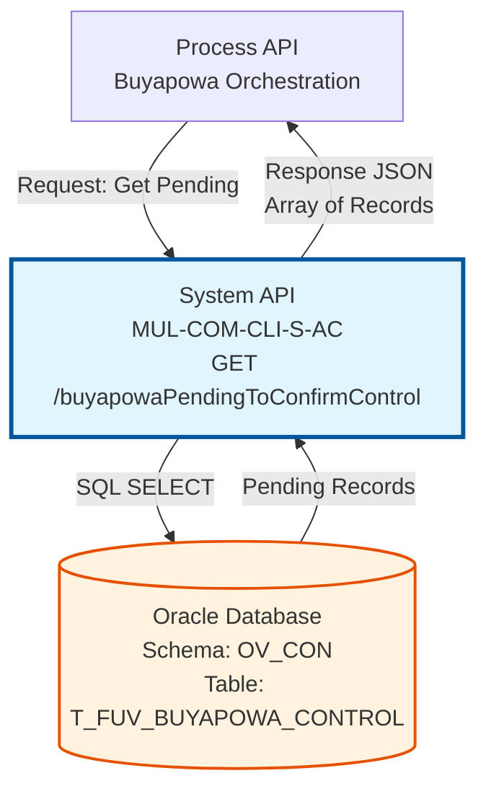
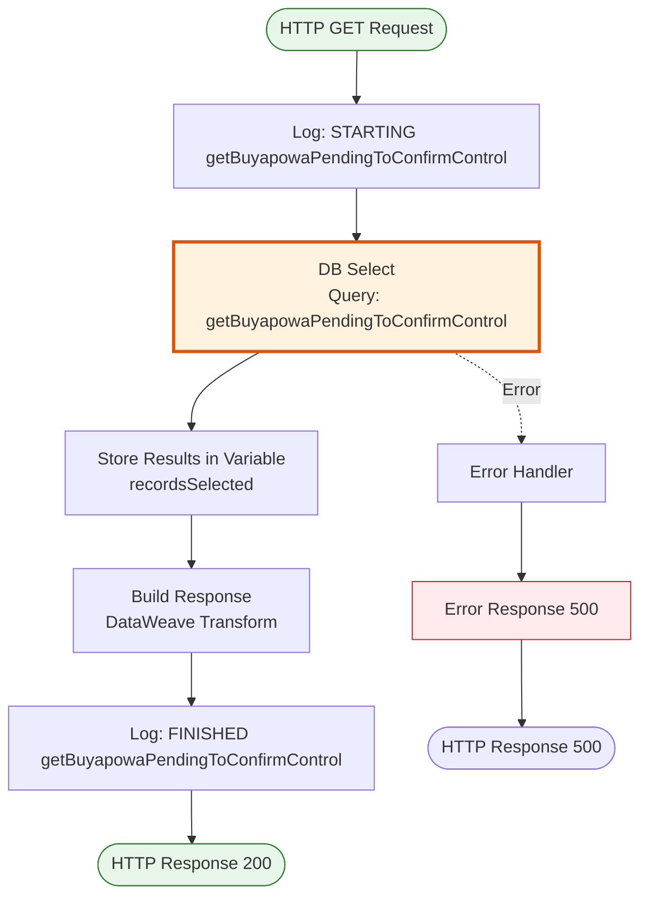
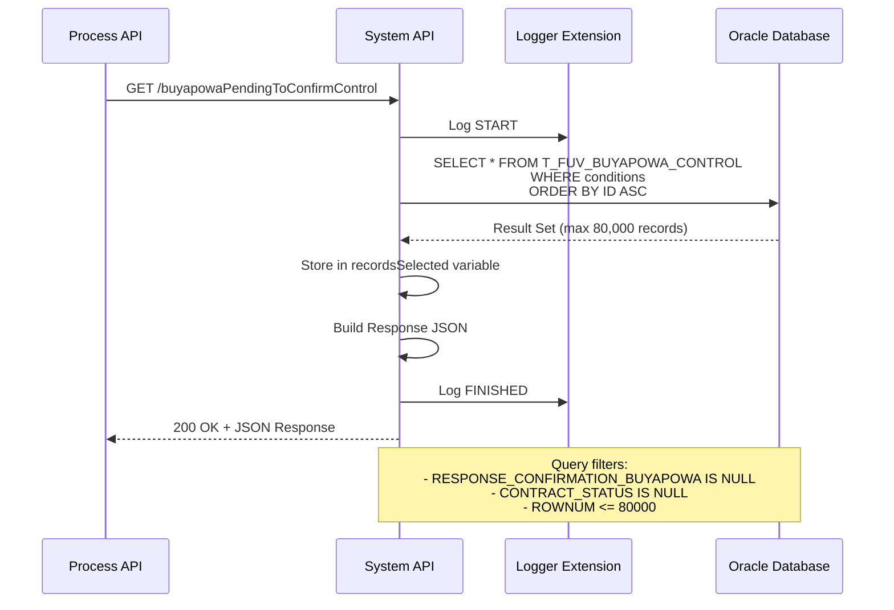

# GET /buyapowaPendingToConfirmControl

## 📌 Descripción General

### Propósito del Endpoint

Este endpoint consulta los registros de control de Buyapowa que están **pendientes de confirmación**, es decir, aquellos contratos que han sido creados pero aún no han recibido confirmación de Buyapowa ni tienen un estado de contrato asignado.

El endpoint soporta:
- **Consulta de Pendientes**: Recupera hasta 80,000 registros pendientes de confirmación
- **Ordenamiento por ID**: Los registros se devuelven ordenados por ID ascendente (más antiguos primero)
- **Filtrado Automático**: Solo retorna registros sin respuesta de confirmación ni estado de contrato

### Tipo de API

**Capa:** System API (API-Led Connectivity)

**Función:** Consulta directa a Oracle Database para obtener registros de control Buyapowa pendientes de procesamiento.

### Patrón de Integración

**Tipo:** Request-Reply Síncrono con SQL Query

**Descripción:** El endpoint ejecuta una consulta SELECT sobre la tabla de control Buyapowa, filtrando registros que no tienen respuesta de confirmación ni estado de contrato, limitando los resultados a 80,000 registros ordenados por ID.

### Arquitectura API-Led Connectivity



---

## 💼 Propósito del Negocio

### Casos de Uso Principales

1. **Procesamiento Batch de Confirmaciones**
   - El sistema de integración consulta periódicamente los registros pendientes
   - Procesa las confirmaciones con Buyapowa en lotes
   - Permite gestionar el backlog de confirmaciones pendientes

2. **Monitoreo de Pendientes**
   - Supervisión del volumen de registros sin confirmar
   - Identificación de posibles cuellos de botella en el proceso
   - Alertas cuando el volumen de pendientes supera umbrales

3. **Reconciliación de Referidos**
   - Identificación de contratos que requieren confirmación en Buyapowa
   - Seguimiento del ciclo de vida de los referidos
   - Asegura que todos los referidos sean confirmados

### Contexto Empresarial

- **Dominio:** Gestión de Programa de Referidos
- **Sector:** Energía - Utilities
- **División:** Naturgy España - NewCo
- **Proceso de Negocio:** Sincronización y confirmación de referidos con plataforma Buyapowa
- **Sistema Externo:** Buyapowa (plataforma de gestión de programas de referidos)

### Stakeholders

- **Equipo de Marketing**: Monitorea el estado de las campañas de referidos
- **Equipo de Integración**: Gestiona la sincronización con Buyapowa
- **Equipo de Operaciones**: Supervisa el procesamiento de confirmaciones

### Valor de Negocio

- **Automatización**: Permite procesamiento automático de confirmaciones pendientes
- **Visibilidad**: Proporciona transparencia sobre el estado de los referidos
- **Eficiencia**: Facilita el procesamiento en lotes de grandes volúmenes
- **Fiabilidad**: Asegura que ningún referido quede sin confirmar

### Consumidores Potenciales

Este endpoint puede ser consumido por:
- Process APIs de orquestación de Buyapowa
- Jobs batch de sincronización programados
- Sistemas de monitoreo y alertas
- Herramientas de reconciliación de datos

---

## 🔧 Especificación Técnica

### URLs por Ambiente

| Ambiente | URL Base | URL Completa |
|----------|----------|--------------|
| **Local** | `http://localhost:8081` | `http://localhost:8081/api/buyapowaPendingToConfirmControl` |
| **Development** | `https://mul-com-cli-s-ac-dev.us-e2.cloudhub.io` | `https://mul-com-cli-s-ac-dev.us-e2.cloudhub.io/api/buyapowaPendingToConfirmControl` |
| **UAT** | `https://mul-com-cli-s-ac-uat.us-e2.cloudhub.io` | `https://mul-com-cli-s-ac-uat.us-e2.cloudhub.io/api/buyapowaPendingToConfirmControl` |
| **Production** | `https://mul-com-cli-s-ac-pro.us-e2.cloudhub.io` | `https://mul-com-cli-s-ac-pro.us-e2.cloudhub.io/api/buyapowaPendingToConfirmControl` |

### Método HTTP

```
GET /api/buyapowaPendingToConfirmControl
```

### Parámetros de Entrada

#### Headers HTTP

| Header | Tipo | Requerido | Descripción | Ejemplo |
|--------|------|-----------|-------------|---------|
| `Accept` | string | ❌ No | Tipo de contenido esperado en response | `application/json` |

#### Query Parameters

Este endpoint **no requiere parámetros**. La consulta está predefinida para retornar todos los registros pendientes.

### Respuestas

#### Respuesta Exitosa con Registros (200 OK)

```json
{
  "result": {
    "codResult": "0000",
    "msgResult": "No hay error"
  },
  "records": [
    {
      "T_FUV_BUYAPOWA_CONTROL_ID": 12345,
      "CONTRACT_ID": 23456,
      "CONTRACT_LINE": "CL-2024-001",
      "PRODUCT_ID": "PROD-GAS-001",
      "CODIGO_AMIGO": 456789,
      "RESPONSE_TRACKING_BUYAPOWA": null,
      "RESPONSE_CONFIRMATION_BUYAPOWA": null,
      "CONTRACT_STATUS": null,
      "TRACKING_DATE": "2024-01-15T10:30:00",
      "UPDATE_STATUS_DATE": null,
      "CONFIRMATION_DATE": null
    },
    {
      "T_FUV_BUYAPOWA_CONTROL_ID": 12346,
      "CONTRACT_ID": 23457,
      "CONTRACT_LINE": "CL-2024-002",
      "PRODUCT_ID": "PROD-ELEC-001",
      "CODIGO_AMIGO": 456790,
      "RESPONSE_TRACKING_BUYAPOWA": null,
      "RESPONSE_CONFIRMATION_BUYAPOWA": null,
      "CONTRACT_STATUS": null,
      "TRACKING_DATE": "2024-01-15T11:00:00",
      "UPDATE_STATUS_DATE": null,
      "CONFIRMATION_DATE": null
    }
  ]
}
```

#### Respuesta Exitosa sin Registros (200 OK)

```json
{
  "result": {
    "codResult": "0000",
    "msgResult": "No hay error"
  }
}
```

**Nota:** Cuando no hay registros pendientes, el campo `records` no se incluye en la respuesta.

#### Respuesta de Error Técnico (500)

```json
{
  "error": "APP_9999",
  "message": "Error en el servicio."
}
```

### Códigos de Respuesta HTTP

| Código | Descripción | Escenario |
|--------|-------------|-----------|
| `200` | OK | Consulta ejecutada exitosamente (con o sin registros) |
| `500` | Internal Server Error | Error en la consulta a base de datos o error técnico |

### Autenticación y Autorización

- **Tipo:** Client ID & Client Secret (Anypoint Platform)
- **Autorización DB:** El usuario de base de datos debe tener permisos para:
  - Ejecutar SELECT en tabla `T_FUV_BUYAPOWA_CONTROL`
  - Acceso al schema `OV_CON`

### Timeouts

| Tipo | Valor | Descripción |
|------|-------|-------------|
| **Request Timeout** | 30 segundos | Tiempo máximo de espera para la respuesta |
| **Connection Timeout** | 10 segundos | Tiempo máximo para establecer conexión con DB |

---

## 🏗️ Implementación Técnica

### Arquitectura del Flow



### Subflow: s-ac-getBuyapowaPendingToConfirmControl

**Ubicación:** `src/main/mule/implementation/s-ac-buyapowaControl.xml`

**Componentes principales:**

1. **Logger (Start)**: Registra inicio de operación
2. **DB Select**: Ejecuta query de consulta
3. **Transform (Store Variable)**: Almacena resultados en variable `recordsSelected`
4. **Transform (Response)**: Construye respuesta JSON
5. **Logger (End)**: Registra fin de operación

### Query SQL Real

**Nombre de Query:** `getBuyapowaPendingToConfirmControl`

**Ubicación:** `src/main/resources/s-ac-{env}-config.yaml`

```sql
SELECT * 
FROM T_FUV_BUYAPOWA_CONTROL 
WHERE (RESPONSE_CONFIRMATION_BUYAPOWA IS NULL 
   AND CONTRACT_STATUS IS NULL 
   AND ROWNUM <= 80000) 
ORDER BY T_FUV_BUYAPOWA_CONTROL_ID ASC
```

**Análisis de la Query:**

- **Tabla:** `T_FUV_BUYAPOWA_CONTROL`
- **Filtros:**
  - `RESPONSE_CONFIRMATION_BUYAPOWA IS NULL`: Sin respuesta de confirmación de Buyapowa
  - `CONTRACT_STATUS IS NULL`: Sin estado de contrato asignado
  - `ROWNUM <= 80000`: Límite de 80,000 registros
- **Ordenamiento:** Por `T_FUV_BUYAPOWA_CONTROL_ID ASC` (más antiguos primero)
- **Operación:** SELECT (solo lectura)

### Transformación DataWeave - Almacenar Resultados

```dataweave
%dw 2.0
output application/json
---
payload
```

**Propósito:** Almacena el resultado de la query en la variable `recordsSelected` en formato JSON.

### Transformación DataWeave - Construir Respuesta

```dataweave
%dw 2.0
output application/json
---
{
  "result": {
    "codResult": "0000",
    "msgResult": "No hay error"
  },
  ("records": vars.recordsSelected) if sizeOf(vars.recordsSelected) > 0
}
```

**Lógica:**
- Siempre incluye el objeto `result` con código de éxito
- Solo incluye el array `records` si hay registros (`sizeOf > 0`)
- Si no hay registros, la respuesta solo contiene `result`

### Diagrama de Secuencia



### Campos de Respuesta según RAML

**Estructura definida en:** `dataType/getBuyapowaControlResponse.raml`

| Campo | Tipo RAML | Descripción |
|-------|-----------|-------------|
| `T_FUV_BUYAPOWA_CONTROL_ID` | string \| nil | ID único del registro de control |
| `CONTRACT_ID` | string \| nil | Identificador del contrato |
| `CONTRACT_LINE` | string \| nil | Identificador de línea de contrato |
| `PRODUCT_ID` | string \| nil | Identificador del producto |
| `CODIGO_AMIGO` | string \| nil | Código del referidor (amigo) |
| `RESPONSE_TRACKING_BUYAPOWA` | string \| nil | Respuesta de tracking de Buyapowa |
| `RESPONSE_CONFIRMATION_BUYAPOWA` | string \| nil | Respuesta de confirmación de Buyapowa (NULL = pendiente) |
| `CONTRACT_STATUS` | string \| nil | Estado del contrato (NULL = sin estado) |
| `TRACKING_DATE` | string \| nil | Fecha de tracking |
| `UPDATE_STATUS_DATE` | string \| nil | Fecha de actualización de estado |
| `CONFIRMATION_DATE` | string \| nil | Fecha de confirmación |

**Nota:** Todos los campos son de tipo `string | nil` según la definición RAML. La estructura de respuesta corresponde a los registros de la tabla `T_FUV_BUYAPOWA_CONTROL` en Oracle Database, pero los tipos de datos aquí reflejan el contrato de la API, no los tipos de la base de datos.

### Manejo de Errores

**Error Handler:** Global error handler (`s-ac-globalErrorHandler`)

**Tipos de Error:**

1. **Database Connection Error**
   - Código: `APP_9999`
   - HTTP Status: 500
   - Mensaje: "Error en el servicio."

2. **Query Execution Error**
   - Código: `APP_9999`
   - HTTP Status: 500
   - Mensaje: "Error en el servicio."

### Logging

**Nivel de Log:** INFO

**Mensajes:**

1. **Inicio:**
```
STARTING getBuyapowaPendingToConfirmControl METHOD. REQUEST: [query params]
```

2. **Fin:**
```
FINISHED getBuyapowaPendingToConfirmControl METHOD. RESPONSE: [response JSON]
```

**Función de Normalización:** `common::commonFunctions::normalizeJSON()`

---

## 💻 Ejemplos de Uso

### Ejemplo 1: Consulta Exitosa con Registros

#### Request

```bash
curl -X GET "https://mul-com-cli-s-ac-dev.us-e2.cloudhub.io/api/buyapowaPendingToConfirmControl" \
  -H "Accept: application/json" \
  -H "client_id: your-client-id" \
  -H "client_secret: your-client-secret"
```

#### Response (200 OK)

```json
{
  "result": {
    "codResult": "0000",
    "msgResult": "No hay error"
  },
  "records": [
    {
      "T_FUV_BUYAPOWA_CONTROL_ID": "12345",
      "CONTRACT_ID": "23456",
      "CONTRACT_LINE": "CL-2024-001",
      "PRODUCT_ID": "PROD-GAS-001",
      "CODIGO_AMIGO": "456789",
      "RESPONSE_TRACKING_BUYAPOWA": null,
      "RESPONSE_CONFIRMATION_BUYAPOWA": null,
      "CONTRACT_STATUS": null,
      "TRACKING_DATE": "2024-01-15T10:30:00",
      "UPDATE_STATUS_DATE": null,
      "CONFIRMATION_DATE": null
    },
    {
      "T_FUV_BUYAPOWA_CONTROL_ID": "12346",
      "CONTRACT_ID": "23457",
      "CONTRACT_LINE": "CL-2024-002",
      "PRODUCT_ID": "PROD-ELEC-001",
      "CODIGO_AMIGO": "456790",
      "RESPONSE_TRACKING_BUYAPOWA": null,
      "RESPONSE_CONFIRMATION_BUYAPOWA": null,
      "CONTRACT_STATUS": null,
      "TRACKING_DATE": "2024-01-15T11:00:00",
      "UPDATE_STATUS_DATE": null,
      "CONFIRMATION_DATE": null
    }
  ]
}
```

### Ejemplo 2: Consulta Exitosa sin Registros Pendientes

#### Request

```bash
curl -X GET "https://mul-com-cli-s-ac-dev.us-e2.cloudhub.io/api/buyapowaPendingToConfirmControl" \
  -H "Accept: application/json" \
  -H "client_id: your-client-id" \
  -H "client_secret: your-client-secret"
```

#### Response (200 OK)

```json
{
  "result": {
    "codResult": "0000",
    "msgResult": "No hay error"
  }
}
```

**Nota:** El campo `records` no está presente cuando no hay registros pendientes.

### Ejemplo 3: Error de Base de Datos

#### Request

```bash
curl -X GET "https://mul-com-cli-s-ac-dev.us-e2.cloudhub.io/api/buyapowaPendingToConfirmControl" \
  -H "Accept: application/json" \
  -H "client_id: your-client-id" \
  -H "client_secret: your-client-secret"
```

#### Response (500 Internal Server Error)

```json
{
  "error": "APP_9999",
  "message": "Error en el servicio."
}
```

### Ejemplo 4: Uso desde JavaScript

```javascript
async function getPendingConfirmations() {
  const url = 'https://mul-com-cli-s-ac-dev.us-e2.cloudhub.io/api/buyapowaPendingToConfirmControl';
  
  try {
    const response = await fetch(url, {
      method: 'GET',
      headers: {
        'Accept': 'application/json',
        'client_id': 'your-client-id',
        'client_secret': 'your-client-secret'
      }
    });
    
    if (!response.ok) {
      throw new Error(`HTTP error! status: ${response.status}`);
    }
    
    const data = await response.json();
    
    if (data.records && data.records.length > 0) {
      console.log(`Found ${data.records.length} pending confirmations`);
      return data.records;
    } else {
      console.log('No pending confirmations found');
      return [];
    }
  } catch (error) {
    console.error('Error fetching pending confirmations:', error);
    throw error;
  }
}

// Uso
getPendingConfirmations()
  .then(records => {
    records.forEach(record => {
      console.log(`Contract Line: ${record.CONTRACT_LINE}, Product: ${record.PRODUCT_ID}`);
    });
  });
```

### Ejemplo 5: Procesamiento Batch

```javascript
async function processPendingConfirmations() {
  const pendingRecords = await getPendingConfirmations();
  
  if (pendingRecords.length === 0) {
    console.log('No pending confirmations to process');
    return;
  }
  
  console.log(`Processing ${pendingRecords.length} pending confirmations...`);
  
  for (const record of pendingRecords) {
    try {
      // Procesar confirmación con Buyapowa
      await confirmWithBuyapowa(record);
      
      // Actualizar estado en el sistema
      await updateConfirmationStatus(record.CONTRACT_LINE, 'CONFIRMED');
      
      console.log(`✓ Processed: ${record.CONTRACT_LINE}`);
    } catch (error) {
      console.error(`✗ Error processing ${record.CONTRACT_LINE}:`, error);
    }
  }
  
  console.log('Batch processing completed');
}
```

### Consideraciones de Uso

1. **Límite de Registros**: El endpoint retorna máximo 80,000 registros por consulta
2. **Sin Paginación**: No hay parámetros de paginación; se retornan todos los pendientes hasta el límite
3. **Ordenamiento**: Los registros se retornan ordenados por ID ascendente (más antiguos primero)
4. **Procesamiento Batch**: Diseñado para ser consumido por jobs batch que procesan confirmaciones
5. **Idempotencia**: La consulta es idempotente; múltiples llamadas retornan los mismos resultados hasta que se actualicen los registros
6. **Performance**: Con grandes volúmenes, considerar el tiempo de respuesta y timeout configurado