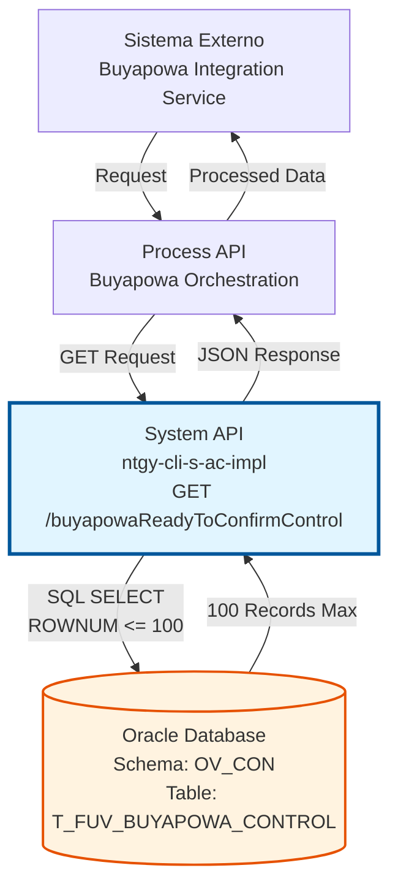
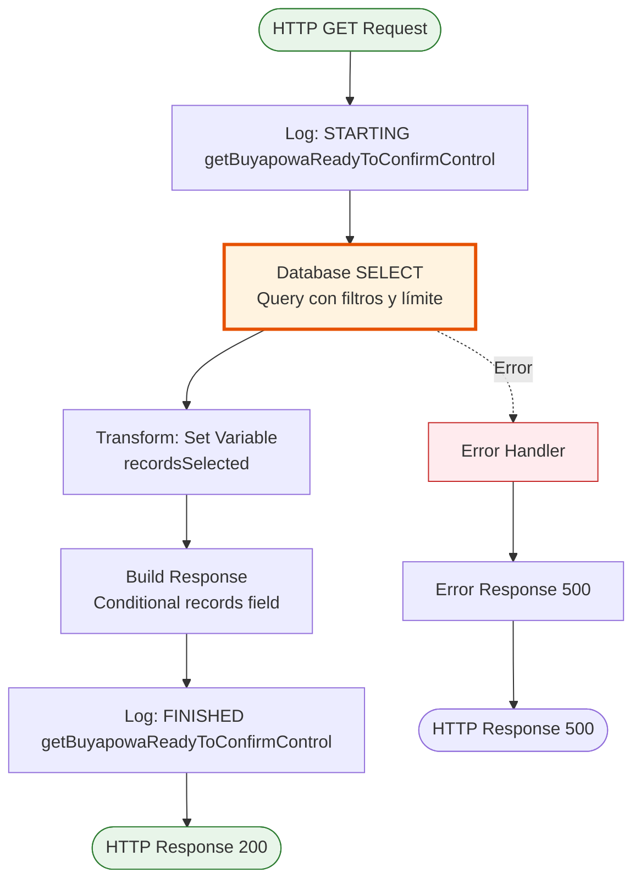
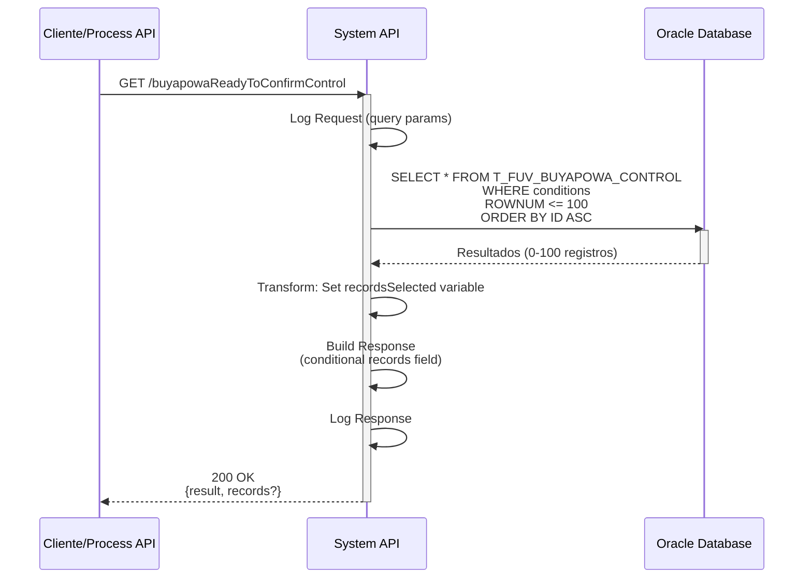
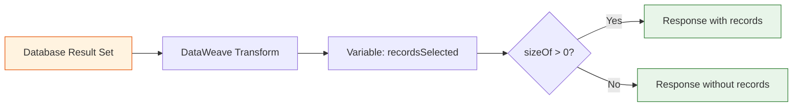

# GET /buyapowaReadyToConfirmControl

## 📌 Descripción General

### Propósito del Endpoint

Este endpoint recupera los registros de contratos Buyapowa que están listos para ser confirmados en el sistema externo de Buyapowa. Devuelve hasta 100 registros más antiguos que cumplen con los criterios de confirmación: tienen un estado de contrato definido pero aún no han recibido confirmación de Buyapowa.

El endpoint soporta:
- **Consulta Automática**: Recupera automáticamente los 100 registros más antiguos sin necesidad de parámetros
- **Filtrado Inteligente**: Solo devuelve registros con estado de contrato definido y sin confirmación de Buyapowa
- **Ordenamiento por Antigüedad**: Prioriza los registros más antiguos para procesamiento FIFO

### Tipo de API

**Capa:** System API (API-Led Connectivity)

**Función:** Integración directa con Oracle Database (esquema AC) para consultar registros de control de Buyapowa listos para confirmación.

### Patrón de Integración

**Tipo:** Request-Reply Síncrono con SQL Query

**Descripción:** El endpoint ejecuta una consulta SQL que filtra registros sin confirmación de Buyapowa pero con estado de contrato definido, limitando los resultados a 100 registros ordenados por ID ascendente (más antiguos primero).

### Arquitectura API-Led Connectivity



---

## 💼 Propósito del Negocio

### Casos de Uso Principales

1. **Procesamiento Batch de Confirmaciones**
   - El sistema de integración con Buyapowa consulta periódicamente este endpoint
   - Obtiene los contratos listos para confirmar en lotes de hasta 100 registros
   - Procesa las confirmaciones en el sistema externo de Buyapowa

2. **Sincronización de Estados**
   - Identifica contratos que han sido activados en el sistema interno
   - Permite sincronizar el estado con el sistema de referidos Buyapowa
   - Mantiene la consistencia entre ambos sistemas

3. **Gestión de Cola de Confirmaciones**
   - Implementa un sistema FIFO (First In, First Out) para procesar confirmaciones
   - Prioriza los registros más antiguos para evitar retrasos en recompensas
   - Limita el volumen de procesamiento a 100 registros por consulta

### Contexto Empresarial

- **Dominio:** Gestión de Programas de Referidos
- **Sector:** Energía - Utilities
- **División:** Naturgy España - Comercialización
- **Proceso de Negocio:** Sincronización de estados de contratos con programa de referidos Buyapowa
- **Integración:** Sistema externo de gestión de referidos y recompensas

### Stakeholders

- **Equipo de Marketing**: Necesita que las recompensas se procesen oportunamente
- **Equipo de Integración**: Responsable de la sincronización con Buyapowa
- **Servicio al Cliente**: Debe poder informar sobre el estado de las recompensas

### Valor de Negocio

- **Automatización**: Elimina el procesamiento manual de confirmaciones de referidos
- **Puntualidad**: Asegura que las recompensas se procesen en orden cronológico
- **Escalabilidad**: Procesa hasta 100 registros por consulta de forma eficiente
- **Trazabilidad**: Mantiene un registro claro de qué contratos están pendientes de confirmación

### Consumidores Potenciales

Este endpoint puede ser consumido por:
- Process APIs de integración con Buyapowa
- Servicios de sincronización batch programados
- Sistemas de monitoreo de cola de confirmaciones
- Herramientas de administración de programas de referidos

---

## 🔧 Especificación Técnica

### URLs por Ambiente

| Ambiente | URL Base | URL Completa |
|----------|----------|--------------|
| **Local** | `http://localhost:8081` | `http://localhost:8081/api/buyapowaReadyToConfirmControl` |
| **Development** | `https://ntgy-cli-s-ac-dev.cloudhub.io` | `https://ntgy-cli-s-ac-dev.cloudhub.io/api/buyapowaReadyToConfirmControl` |
| **QA** | `https://ntgy-cli-s-ac-qa.cloudhub.io` | `https://ntgy-cli-s-ac-qa.cloudhub.io/api/buyapowaReadyToConfirmControl` |
| **Production** | `https://ntgy-cli-s-ac-pro.cloudhub.io` | `https://ntgy-cli-s-ac-pro.cloudhub.io/api/buyapowaReadyToConfirmControl` |

### Método HTTP

```
GET /api/buyapowaReadyToConfirmControl
```

### Parámetros de Entrada

#### Headers HTTP

| Header | Tipo | Requerido | Descripción | Ejemplo |
|--------|------|-----------|-------------|---------|
| `Accept` | string | ❌ No | Tipo de contenido esperado en response | `application/json` |

**Nota:** Este endpoint no requiere parámetros de entrada. La consulta está predefinida para devolver los 100 registros más antiguos que cumplen los criterios.

### Respuestas

#### Respuesta Exitosa con Registros (200 OK)

```json
{
  "result": {
    "codResult": "0000",
    "msgResult": "No hay error"
  },
  "records": [
    {
      "T_FUV_BUYAPOWA_CONTROL_ID": 12345,
      "CONTRACT_LINE": "CL-2024-001",
      "PRODUCT_ID": "PROD-GAS-001",
      "CONTRACT_STATUS": "ACTIVE",
      "RESPONSE_CONFIRMATION_BUYAPOWA": null,
      "CREATE_DATE": "2024-01-15T10:30:00",
      "UPDATE_STATUS_DATE": "2024-01-20T14:45:00",
      "UPDATE_CONFIRMATION_DATE": null
    },
    {
      "T_FUV_BUYAPOWA_CONTROL_ID": 12346,
      "CONTRACT_LINE": "CL-2024-002",
      "PRODUCT_ID": "PROD-ELEC-001",
      "CONTRACT_STATUS": "ACTIVE",
      "RESPONSE_CONFIRMATION_BUYAPOWA": null,
      "CREATE_DATE": "2024-01-15T11:00:00",
      "UPDATE_STATUS_DATE": "2024-01-20T15:00:00",
      "UPDATE_CONFIRMATION_DATE": null
    }
  ]
}
```

#### Respuesta Exitosa sin Registros (200 OK)

```json
{
  "result": {
    "codResult": "0000",
    "msgResult": "No hay error"
  }
}
```

**Nota:** Cuando no hay registros que cumplan los criterios, el campo `records` no se incluye en la respuesta.

#### Respuesta de Error Técnico (500)

```json
{
  "error": "APP_9999",
  "message": "Error en el servicio."
}
```

### Códigos de Estado HTTP

| Código | Descripción | Escenario |
|--------|-------------|-----------|
| `200` | OK | Consulta ejecutada exitosamente (con o sin registros) |
| `500` | Internal Server Error | Error en la conexión a base de datos o error de ejecución |

### Autenticación y Autorización

- **Tipo:** Client ID & Client Secret (Anypoint Platform)
- **Autorización DB:** El usuario de base de datos debe tener permisos para:
  - Ejecutar SELECT en tabla `T_FUV_BUYAPOWA_CONTROL`
  - Acceso de lectura al esquema `OV_CON`

### Timeouts

| Tipo | Valor | Descripción |
|------|-------|-------------|
| **Request Timeout** | 30 segundos | Tiempo máximo de espera para la respuesta |
| **Connection Timeout** | 10 segundos | Tiempo máximo para establecer conexión con la base de datos |
| **Query Timeout** | 30 segundos | Tiempo máximo de ejecución de la consulta SQL |

---

## 🏗️ Implementación Técnica

### Arquitectura del Flow



### Componentes del Flow

#### 1. Logger - Request
```dataweave
%dw 2.0
output application/java
var payloadStr = write(attributes.queryParams,'application/json')
var request = common::commonFunctions::normalizeJSON(payloadStr)
---
'STARTING getBuyapowaReadyToConfirmControl METHOD. REQUEST: ' ++ request
```

#### 2. Database Select
```xml
<db:select doc:name="Select" config-ref="Database_Config">
    <db:sql><![CDATA[${queries.getBuyapowaReadyToConfirmControl}]]></db:sql>
</db:select>
```

**Query SQL Real:**
```sql
SELECT * FROM T_FUV_BUYAPOWA_CONTROL 
WHERE (RESPONSE_CONFIRMATION_BUYAPOWA IS NULL 
  AND CONTRACT_STATUS IS NOT NULL 
  AND ROWNUM <= 100) 
ORDER BY T_FUV_BUYAPOWA_CONTROL_ID ASC
```

**Lógica de la Query:**
- **Filtro 1**: `RESPONSE_CONFIRMATION_BUYAPOWA IS NULL` - Solo registros sin confirmación de Buyapowa
- **Filtro 2**: `CONTRACT_STATUS IS NOT NULL` - Solo registros con estado de contrato definido
- **Límite**: `ROWNUM <= 100` - Máximo 100 registros por consulta
- **Ordenamiento**: `ORDER BY T_FUV_BUYAPOWA_CONTROL_ID ASC` - Registros más antiguos primero

#### 3. Transform - Set Variable
```dataweave
%dw 2.0
output application/json
---
payload
```

Almacena el resultado de la consulta en la variable `recordsSelected`.

#### 4. Transform - Response
```dataweave
%dw 2.0
output application/json
---
{
    "result": {
        "codResult": "0000",
        "msgResult": "No hay error",
    }, 
    ("records": vars.recordsSelected) if sizeOf(vars.recordsSelected) > 0
}
```

**Lógica Condicional:**
- Si hay registros (`sizeOf > 0`): Incluye el campo `records` con el array de resultados
- Si no hay registros: Solo devuelve el objeto `result` sin el campo `records`

#### 5. Logger - Response
```dataweave
%dw 2.0
output application/java
var payloadStr = write(payload,'application/json')
var response = common::commonFunctions::normalizeJSON(payloadStr)
---
'FINISHED getBuyapowaReadyToConfirmControl METHOD. RESPONSE: ' ++ response
```

### Diagrama de Secuencia



### Transformación de Datos



### Manejo de Errores

| Tipo de Error | Código HTTP | Respuesta | Acción |
|---------------|-------------|-----------|--------|
| Error de Conexión DB | 500 | `{"error": "APP_9999", "message": "Error en el servicio."}` | Verificar conectividad y credenciales |
| Error de Ejecución SQL | 500 | `{"error": "APP_9999", "message": "Error en el servicio."}` | Revisar logs y sintaxis SQL |
| Timeout de Query | 500 | `{"error": "APP_9999", "message": "Error en el servicio."}` | Optimizar query o aumentar timeout |

### Configuración de Base de Datos

**Connection Pool:**
- Max Pool Size: Configurado por ambiente
- Max Wait Time: 30 segundos
- Max Idle Time: 60 segundos

**Tabla: T_FUV_BUYAPOWA_CONTROL**

| Campo | Tipo | Descripción |
|-------|------|-------------|
| `T_FUV_BUYAPOWA_CONTROL_ID` | NUMBER | ID único del registro (PK) |
| `CONTRACT_LINE` | VARCHAR2 | Identificador de línea de contrato |
| `PRODUCT_ID` | VARCHAR2 | Identificador del producto |
| `CONTRACT_STATUS` | VARCHAR2 | Estado del contrato (ACTIVE, PENDING, etc.) |
| `RESPONSE_CONFIRMATION_BUYAPOWA` | VARCHAR2 | Respuesta de confirmación de Buyapowa (NULL si pendiente) |
| `CREATE_DATE` | TIMESTAMP | Fecha de creación del registro |
| `UPDATE_STATUS_DATE` | TIMESTAMP | Fecha de última actualización de estado |
| `UPDATE_CONFIRMATION_DATE` | TIMESTAMP | Fecha de actualización de confirmación |

---

## 💻 Ejemplos de Uso

### Ejemplo 1: Consulta Básica con cURL

```bash
curl -X GET "https://ntgy-cli-s-ac-pro.cloudhub.io/api/buyapowaReadyToConfirmControl" \
  -H "Accept: application/json" \
  -H "client_id: your-client-id" \
  -H "client_secret: your-client-secret"
```

### Ejemplo 2: Respuesta con Registros

```json
{
  "result": {
    "codResult": "0000",
    "msgResult": "No hay error"
  },
  "records": [
    {
      "T_FUV_BUYAPOWA_CONTROL_ID": 12345,
      "CONTRACT_LINE": "CL-2024-001",
      "PRODUCT_ID": "PROD-GAS-001",
      "CONTRACT_STATUS": "ACTIVE",
      "RESPONSE_CONFIRMATION_BUYAPOWA": null,
      "CREATE_DATE": "2024-01-15T10:30:00",
      "UPDATE_STATUS_DATE": "2024-01-20T14:45:00",
      "UPDATE_CONFIRMATION_DATE": null
    }
  ]
}
```

### Ejemplo 3: Respuesta sin Registros

```json
{
  "result": {
    "codResult": "0000",
    "msgResult": "No hay error"
  }
}
```

### Ejemplo 4: Integración con JavaScript

```javascript
async function getBuyapowaReadyToConfirm() {
  try {
    const response = await fetch(
      'https://ntgy-cli-s-ac-pro.cloudhub.io/api/buyapowaReadyToConfirmControl',
      {
        method: 'GET',
        headers: {
          'Accept': 'application/json',
          'client_id': 'your-client-id',
          'client_secret': 'your-client-secret'
        }
      }
    );
    
    const data = await response.json();
    
    if (data.result.codResult === '0000') {
      if (data.records && data.records.length > 0) {
        console.log(`Found ${data.records.length} records ready to confirm`);
        return data.records;
      } else {
        console.log('No records ready to confirm');
        return [];
      }
    } else {
      throw new Error(`API Error: ${data.result.msgResult}`);
    }
  } catch (error) {
    console.error('Error fetching ready to confirm records:', error);
    throw error;
  }
}

// Uso
getBuyapowaReadyToConfirm()
  .then(records => {
    records.forEach(record => {
      console.log(`Contract Line: ${record.CONTRACT_LINE}, Status: ${record.CONTRACT_STATUS}`);
    });
  });
```

### Ejemplo 5: Procesamiento Batch

```javascript
async function processBuyapowaConfirmations() {
  let totalProcessed = 0;
  let hasMoreRecords = true;
  
  while (hasMoreRecords) {
    const records = await getBuyapowaReadyToConfirm();
    
    if (records.length === 0) {
      hasMoreRecords = false;
      console.log('No more records to process');
      break;
    }
    
    // Procesar cada registro
    for (const record of records) {
      await confirmInBuyapowa(record);
      totalProcessed++;
    }
    
    console.log(`Processed batch of ${records.length} records`);
    
    // Si se obtuvieron menos de 100 registros, no hay más
    if (records.length < 100) {
      hasMoreRecords = false;
    }
  }
  
  console.log(`Total records processed: ${totalProcessed}`);
}

async function confirmInBuyapowa(record) {
  // Lógica para confirmar en Buyapowa
  console.log(`Confirming contract line: ${record.CONTRACT_LINE}`);
  // ... llamada al sistema Buyapowa ...
  // ... actualizar confirmación con PUT /buyapowaConfirmationControl ...
}
```

### Ejemplo 6: Manejo de Errores

```javascript
async function safeGetBuyapowaReadyToConfirm() {
  try {
    const response = await fetch(
      'https://ntgy-cli-s-ac-pro.cloudhub.io/api/buyapowaReadyToConfirmControl',
      {
        method: 'GET',
        headers: {
          'Accept': 'application/json',
          'client_id': 'your-client-id',
          'client_secret': 'your-client-secret'
        }
      }
    );
    
    if (!response.ok) {
      if (response.status === 500) {
        const errorData = await response.json();
        throw new Error(`Server Error: ${errorData.message}`);
      }
      throw new Error(`HTTP Error: ${response.status}`);
    }
    
    const data = await response.json();
    return data.records || [];
    
  } catch (error) {
    console.error('Error in getBuyapowaReadyToConfirm:', error);
    // Implementar retry logic o notificación
    return [];
  }
}
```

### Consideraciones de Implementación

1. **Paginación Implícita**: El endpoint devuelve máximo 100 registros. Para procesar todos los registros pendientes, se debe llamar repetidamente hasta que no se devuelvan más registros.

2. **Procesamiento FIFO**: Los registros se devuelven ordenados por ID ascendente, garantizando procesamiento en orden de llegada.

3. **Idempotencia**: La consulta es idempotente - múltiples llamadas devuelven los mismos registros hasta que se actualicen con confirmación.

4. **Monitoreo**: Se recomienda monitorear el número de registros devueltos para detectar acumulación de pendientes.

5. **Frecuencia de Consulta**: Ajustar la frecuencia de consulta según el volumen de contratos y SLA de confirmación de recompensas.