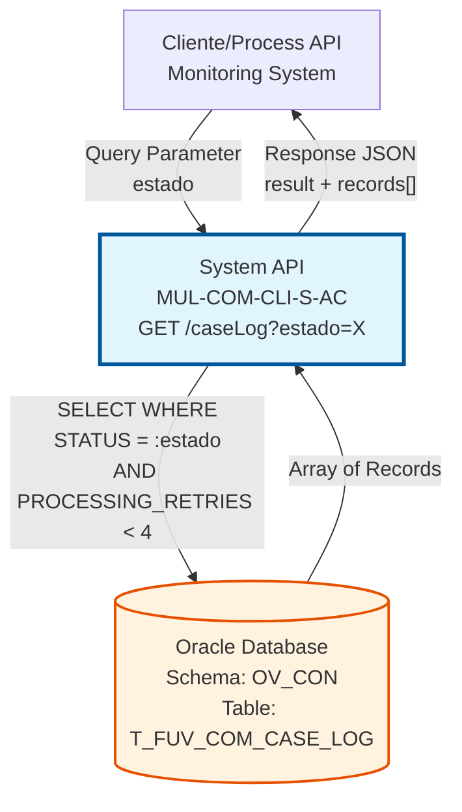
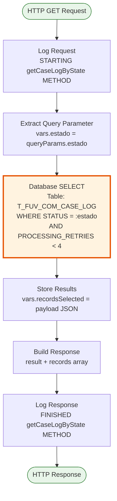
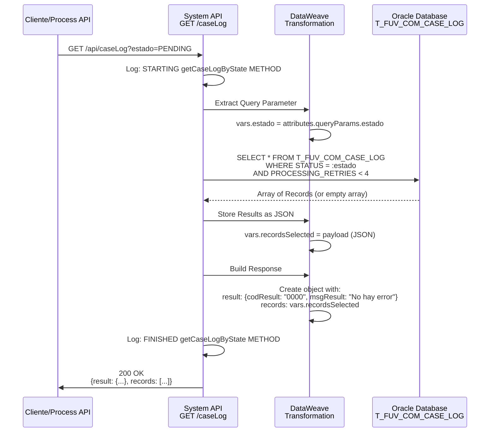
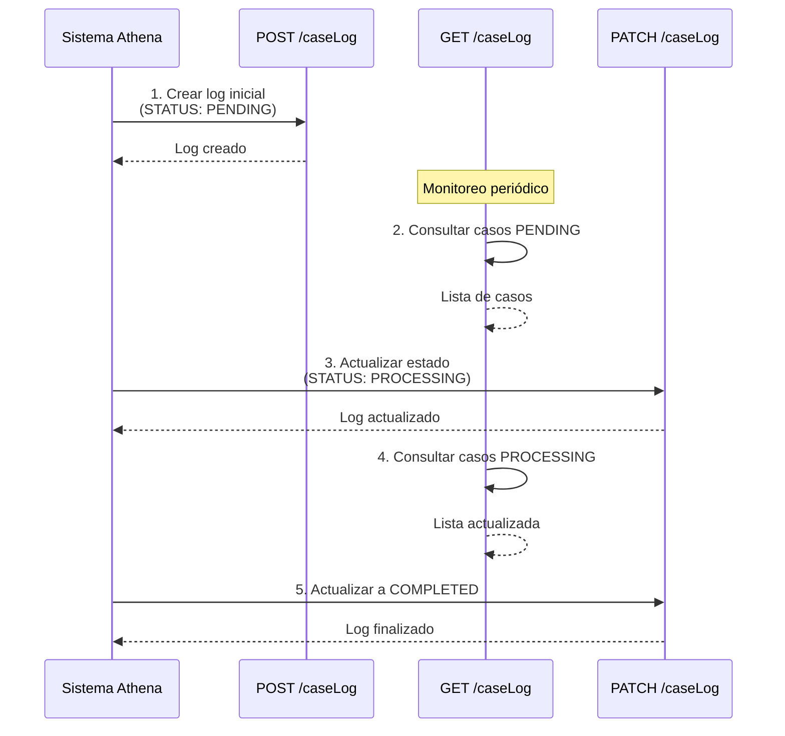

# GET /caseLog

## 📌 Descripción General

### Propósito del Endpoint

Este endpoint consulta registros de logs de casos desde la tabla `T_FUV_COM_CASE_LOG` filtrando por estado específico. Implementa un filtro automático que **solo devuelve casos con menos de 4 reintentos** (`PROCESSING_RETRIES < 4`), permitiendo identificar casos que aún están en proceso de gestión y excluyendo aquellos que han excedido el límite de reintentos.

El endpoint soporta:
- **Consulta por Estado**: Filtra casos por su estado actual (PENDING, PROCESSING, etc.)
- **Filtro Automático de Reintentos**: Excluye casos con 4 o más reintentos
- **Respuesta Completa**: Devuelve todos los campos de cada registro encontrado
- **Array Vacío en Sin Resultados**: No genera error 404, devuelve array vacío

### Tipo de API

**Capa:** System API (API-Led Connectivity)

**Función:** Integración directa con Oracle Database para consulta de logs de casos y monitoreo de procesamiento.

### Patrón de Integración

**Tipo:** Request-Reply Síncrono con SQL SELECT

**Descripción:** Recibe el parámetro de estado, ejecuta una consulta SQL filtrada en la tabla de logs, transforma los resultados a JSON y retorna un array con todos los registros que cumplen los criterios (estado específico y menos de 4 reintentos).

### Arquitectura API-Led Connectivity



---

## 💼 Propósito del Negocio

### Casos de Uso Principales

1. **Monitoreo de Casos Pendientes**
   - Consultar casos en estado "PENDING" para procesamiento
   - Identificar volumen de casos esperando atención
   - Priorizar casos según fecha de creación
   - **Beneficio**: Gestión proactiva de la cola de trabajo

2. **Seguimiento de Casos en Procesamiento**
   - Monitorear casos en estado "PROCESSING"
   - Detectar casos que llevan mucho tiempo en proceso
   - Identificar posibles bloqueos o problemas
   - **Beneficio**: Detección temprana de anomalías

3. **Gestión de Reintentos**
   - Identificar casos que han fallado pero aún tienen reintentos disponibles
   - Excluir automáticamente casos que excedieron el límite (≥4 reintentos)
   - Priorizar casos con pocos reintentos para evitar pérdida
   - **Beneficio**: Optimización del procesamiento de errores

4. **Reporting y Análisis**
   - Generar reportes de casos por estado
   - Analizar distribución de estados en el sistema
   - Identificar patrones de procesamiento
   - **Beneficio**: Insights para mejora continua

### Contexto Empresarial

- **Dominio:** Gestión de Casos y Auditoría
- **Sector:** Energía - Utilities
- **División:** Naturgy España - Administración Comercial
- **Proceso de Negocio:** Monitoreo y seguimiento de casos de clientes
- **Sistema Origen:** Athena (sistema de gestión de casos)

### Stakeholders

- **Equipos de Operaciones**: Monitorean casos pendientes y en proceso
- **Equipos de Soporte**: Identifican casos problemáticos para intervención
- **Sistemas de Monitoreo**: Consultan periódicamente para alertas automáticas
- **Equipos de Reporting**: Generan estadísticas de procesamiento

### Valor de Negocio

- **Visibilidad Operacional**: Vista en tiempo real del estado de casos
- **Gestión Proactiva**: Identificación temprana de problemas
- **Optimización de Recursos**: Priorización basada en estado y reintentos
- **Cumplimiento**: Auditoría de procesamiento de casos

### Consumidores Potenciales

Este endpoint puede ser consumido por:
- Process APIs de monitoreo y orquestación
- Sistemas de alertas y notificaciones
- Dashboards de operaciones en tiempo real
- Herramientas de reporting y analytics
- Sistemas de gestión de colas de trabajo

---

## 🔧 Especificación Técnica

### URLs por Ambiente

| Ambiente | URL Base | URL Completa |
|----------|----------|--------------|
| **Local** | `http://localhost:8081` | `http://localhost:8081/api/caseLog?estado={estado}` |
| **Development** | `https://mul-com-cli-s-ac-dev.us-e2.cloudhub.io` | `https://mul-com-cli-s-ac-dev.us-e2.cloudhub.io/api/caseLog?estado={estado}` |
| **QA** | `https://mul-com-cli-s-ac-cc.us-e2.cloudhub.io` | `https://mul-com-cli-s-ac-cc.us-e2.cloudhub.io/api/caseLog?estado={estado}` |
| **Pre-Production** | `https://mul-com-cli-s-ac-cl.us-e2.cloudhub.io` | `https://mul-com-cli-s-ac-cl.us-e2.cloudhub.io/api/caseLog?estado={estado}` |
| **Production** | `https://mul-com-cli-s-ac-pro.us-e2.cloudhub.io` | `https://mul-com-cli-s-ac-pro.us-e2.cloudhub.io/api/caseLog?estado={estado}` |

### Método HTTP

```
GET /api/caseLog
```

### Parámetros de Entrada

#### Headers HTTP

| Header | Tipo | Requerido | Descripción | Ejemplo |
|--------|------|-----------|-------------|---------|
| `Accept` | string | ❌ No | Tipo de contenido esperado en response | `application/json` |

#### Query Parameters

| Parámetro | Tipo | Requerido | Descripción | Valores Comunes |
|-----------|------|-----------|-------------|-----------------|
| `estado` | string | ✅ Sí | Estado de los casos a consultar | `"PENDING"`, `"PROCESSING"`, `"COMPLETED"`, `"ERROR"` |

> **⚠️ Nota sobre el parámetro `estado`:**  
> El valor del parámetro es case-sensitive y debe coincidir exactamente con los valores almacenados en la columna STATUS de la tabla. Los valores específicos dependen de la lógica de negocio del sistema Athena.

### Respuestas

#### Respuesta Exitosa con Registros (200 OK)

**Condición:** Se encontraron registros que cumplen los criterios

```json
{
  "result": {
    "codResult": "0000",
    "msgResult": "No hay error"
  },
  "records": [
    {
      "T_FUV_COM_CASE_LOG_ID": 12345,
      "CASE_ID": "CASE-2024-001234",
      "ATHENA_CASE": {
        "caseNumber": "001234",
        "type": "BILLING",
        "customerId": "CUST-789456"
      },
      "STATUS": "PENDING",
      "PROCESSING_RETRIES": 1,
      "ERROR": null,
      "PROCESSING_DATE": "2024-07-17T10:30:15.000Z",
      "UPDATE_DATE": null
    },
    {
      "T_FUV_COM_CASE_LOG_ID": 12346,
      "CASE_ID": "CASE-2024-001235",
      "ATHENA_CASE": {
        "caseNumber": "001235",
        "type": "TECHNICAL_SUPPORT"
      },
      "STATUS": "PENDING",
      "PROCESSING_RETRIES": 2,
      "ERROR": "Connection timeout",
      "PROCESSING_DATE": "2024-07-17T09:15:30.000Z",
      "UPDATE_DATE": "2024-07-17T10:20:45.000Z"
    }
  ]
}
```

**Campos de Respuesta:**

| Campo | Tipo | Descripción |
|-------|------|-------------|
| `result.codResult` | string | Código de resultado: siempre `"0000"` (éxito) |
| `result.msgResult` | string | Mensaje descriptivo: siempre `"No hay error"` |
| `records` | array | Array de registros encontrados (puede estar vacío) |
| `records[].T_FUV_COM_CASE_LOG_ID` | number | ID único del registro |
| `records[].CASE_ID` | string | Identificador del caso |
| `records[].ATHENA_CASE` | object | Objeto JSON con datos de Athena (estructura variable) |
| `records[].STATUS` | string | Estado del caso |
| `records[].PROCESSING_RETRIES` | number | Número de reintentos (siempre < 4) |
| `records[].ERROR` | string\|null | Mensaje de error si existe |
| `records[].PROCESSING_DATE` | string | Fecha de procesamiento inicial |
| `records[].UPDATE_DATE` | string\|null | Fecha de última actualización |

#### Respuesta Exitosa sin Registros (200 OK)

**Condición:** No se encontraron registros que cumplan los criterios

```json
{
  "result": {
    "codResult": "0000",
    "msgResult": "No hay error"
  },
  "records": []
}
```

> **📝 Nota:** Este endpoint **NO devuelve error 404** cuando no hay resultados. Siempre retorna HTTP 200 con un array vacío en `records`.

#### Respuesta de Error Técnico (500)

**Condición:** Error en la base de datos o error interno del servidor

```json
{
  "error": "APP_9999",
  "message": "Error en el servicio."
}
```

### Autenticación y Autorización

- **Tipo:** Client ID & Client Secret (Anypoint Platform)
- **Autorización Oracle:** El usuario de base de datos debe tener permisos para:
  - Ejecutar SELECT en tabla `T_FUV_COM_CASE_LOG`
  - Permisos de lectura en schema `OV_CON`

### Timeouts

| Tipo | Valor | Descripción |
|------|-------|-------------|
| **Request Timeout** | 30 segundos | Tiempo máximo de espera para la respuesta |
| **Connection Timeout** | 10 segundos | Tiempo máximo para establecer conexión con Oracle |
| **Query Timeout** | 30 segundos | Tiempo máximo de ejecución de la query SELECT |

---

## 🏗️ Implementación Técnica

### Arquitectura del Flow



### Flujo de Datos Detallado



### Componentes Principales

#### 1. Logger de Inicio (request)

**Ubicación:** Línea 122 del XML (s-ac-caseLog.xml)

**Función:** Registra el inicio del método con los query parameters

**Código DataWeave:**
```dataweave
%dw 2.0
output application/java

var payloadStr = write(attributes.queryParams,'application/json')
var request = common::commonFunctions::normalizeJSON(payloadStr)
---
'STARTING getCaseLogByState METHOD. REQUEST: ' ++ request
```

**Propósito:** Auditoría y troubleshooting de parámetros de entrada

#### 2. Extracción de Parámetro (var estado)

**Ubicación:** Líneas 123-132 del XML

**Función:** Extrae el parámetro `estado` de los query parameters

**Código DataWeave:**
```dataweave
%dw 2.0
output application/java
---
attributes.queryParams.estado
```

**Variable Creada:**
- `vars.estado`: Estado a consultar (string)

#### 3. Operación de Base de Datos (Select)

**Ubicación:** Líneas 133-136 del XML

**Conector:** Database Connector (Oracle)

**Query SQL:**
```sql
SELECT * 
FROM T_FUV_COM_CASE_LOG 
WHERE STATUS = :estado 
AND PROCESSING_RETRIES < 4
```

**Parámetros de Entrada:**
```dataweave
{
    estado: vars.estado
}
```

**Características Clave:**
- **SELECT ***: Devuelve todos los campos de la tabla
- **Filtro por Estado**: WHERE STATUS = :estado
- **Filtro de Reintentos**: AND PROCESSING_RETRIES < 4 (automático)
- **Sin LIMIT**: Puede devolver múltiples registros

#### 4. Almacenamiento de Resultados (vars recordsSelected)

**Ubicación:** Líneas 137-146 del XML

**Función:** Convierte el resultado de la BD a JSON y lo almacena en variable

**Código DataWeave:**
```dataweave
%dw 2.0
output application/json
---
payload
```

**Variable Creada:**
- `vars.recordsSelected`: Array de registros en formato JSON

#### 5. Construcción de Respuesta (response)

**Ubicación:** Líneas 147-159 del XML

**Función:** Construye la respuesta final con estructura estándar

**Código DataWeave:**
```dataweave
%dw 2.0
output application/json
---
{
    "result": {
        "codResult": "0000",
        "msgResult": "No hay error"
    },
    "records": vars.recordsSelected
}
```

**Características:**
- **Siempre exitoso**: codResult siempre es "0000"
- **Array de registros**: Puede estar vacío si no hay resultados
- **Sin error 404**: No se genera error cuando no hay registros

#### 6. Logger de Fin (response)

**Ubicación:** Línea 160 del XML

**Función:** Registra el fin del método con la respuesta completa

**Código DataWeave:**
```dataweave
%dw 2.0
output application/java

var payloadStr = write(payload,'application/json')
var response = common::commonFunctions::normalizeJSON(payloadStr)
---
'FINISHED getCaseLogByState METHOD. RESPONSE: ' ++ response
```

### Tabla Oracle: T_FUV_COM_CASE_LOG

#### Estructura de la Tabla (Campos Devueltos)

| Campo | Tipo | Descripción | Filtrado |
|-------|------|-------------|----------|
| `T_FUV_COM_CASE_LOG_ID` | NUMBER | ID único del registro (PK) | No |
| `CASE_ID` | VARCHAR2 | Identificador del caso | No |
| `ATHENA_CASE` | CLOB | Objeto JSON con datos de Athena | No |
| `STATUS` | VARCHAR2 | Estado del caso | ✅ Sí (= :estado) |
| `PROCESSING_RETRIES` | NUMBER | Contador de reintentos | ✅ Sí (< 4) |
| `ERROR` | VARCHAR2 | Mensaje de error (si aplica) | No |
| `PROCESSING_DATE` | DATE | Fecha de procesamiento | No |
| `UPDATE_DATE` | DATE | Fecha de última actualización | No |

#### Filtros Aplicados

**Filtro 1 - Por Estado:**
```sql
WHERE STATUS = :estado
```
- Parámetro proporcionado por el usuario
- Case-sensitive
- Debe coincidir exactamente con el valor en BD

**Filtro 2 - Por Reintentos (Automático):**
```sql
AND PROCESSING_RETRIES < 4
```
- Aplicado automáticamente por el endpoint
- Excluye casos que han fallado 4 o más veces
- No configurable por el usuario

### Manejo de Errores

#### Error Handler Global

**Configuración:** `apiErrorHandler` (definido en `s-ac-globalErrorHandler.xml`)

**Tipos de Error Manejados:**

1. **Sin Resultados** → HTTP 200 (NO es error)
   - Devuelve array vacío en `records`
   - `codResult` sigue siendo "0000"
   - No se genera error 404

2. **ANY** → HTTP 500
   - Errores de conexión a base de datos
   - Errores de timeout
   - Cualquier excepción no controlada

**Respuesta de Error:**
```json
{
    "error": "APP_9999",
    "message": "Error en el servicio."
}
```

### Transformación de Datos

#### Diagrama de Transformación

```mermaid
graph LR
    A[Query Parameter<br/>estado] --> B[Extract Parameter]
    B --> C[vars.estado<br/>string]
    
    C --> D[SQL Query]
    D --> E[Database Response<br/>Array of Rows]
    
    E --> F[Convert to JSON]
    F --> G[vars.recordsSelected<br/>JSON array]
    
    G --> H[Build Response]
    H --> I[Final JSON<br/>result + records]
    
    style A fill:#e3f2fd,stroke:#1976d2
    style E fill:#fff3e0,stroke:#f57c00
    style I fill:#e8f5e9,stroke:#388e3c
```



#### Mapeo de Campos

**Query Parameter → Variable:**
```
attributes.queryParams.estado → vars.estado
```

**Variable → SQL Parameter:**
```
vars.estado → :estado (en WHERE clause)
```

**Database Response → JSON:**
```
payload (DB rows) → vars.recordsSelected (JSON array)
```

**JSON Array → Final Response:**
```
vars.recordsSelected → response.records
```

### Configuración de Conexión

**Database Config:** `Database_Config`

**Propiedades (por ambiente):**
```yaml
dbAC:
  user: "username"
  pass: "encrypted_password"  # Secure property
  host1: "oracle-rac-node1.example.com"
  host2: "oracle-rac-node2.example.com"
  port: 1521
  serviceName: "OV_CON"
  MaxPoolSize: 10
  MaxWaitTime: 30000
  MaxIdleTime: 60000
  connectTimeOut: 10000
  transportConnectTimeOut: 5000
  retryCount: 3
```

---

## 💻 Ejemplos de Uso

### Ejemplo 1: Consulta de Casos Pendientes

#### Request

```bash
curl -X GET "https://mul-com-cli-s-ac-dev.us-e2.cloudhub.io/api/caseLog?estado=PENDING" \
  -H "Accept: application/json" \
  -H "client_id: your-client-id" \
  -H "client_secret: your-client-secret"
```

#### Response (500 Internal Server Error)

**Condición:** Error de conexión a base de datos o timeout

```json
{
  "error": "APP_9999",
  "message": "Error en el servicio."
}
```

### Ejemplo 6: Testing con Postman

#### Pre-request Script

```javascript
// Establecer el estado a consultar
const estado = pm.variables.get("estado") || "PENDING";
pm.environment.set("estado", estado);

console.log(`Consultando casos con estado: ${estado}`);
```

#### Tests Script

```javascript
// Validar respuesta exitosa
pm.test("Status code is 200", function () {
    pm.response.to.have.status(200);
});

// Validar estructura de respuesta
pm.test("Response has correct structure", function () {
    const jsonData = pm.response.json();
    pm.expect(jsonData).to.have.property("result");
    pm.expect(jsonData).to.have.property("records");
    pm.expect(jsonData.result).to.have.property("codResult");
    pm.expect(jsonData.result).to.have.property("msgResult");
});

// Validar código de resultado
pm.test("Result code is 0000", function () {
    const jsonData = pm.response.json();
    pm.expect(jsonData.result.codResult).to.eql("0000");
});

// Validar que records es un array
pm.test("Records is an array", function () {
    const jsonData = pm.response.json();
    pm.expect(jsonData.records).to.be.an('array');
});

// Si hay registros, validar estructura
if (pm.response.json().records.length > 0) {
    pm.test("Records have correct structure", function () {
        const record = pm.response.json().records[0];
        pm.expect(record).to.have.property("T_FUV_COM_CASE_LOG_ID");
        pm.expect(record).to.have.property("CASE_ID");
        pm.expect(record).to.have.property("ATHENA_CASE");
        pm.expect(record).to.have.property("STATUS");
        pm.expect(record).to.have.property("PROCESSING_RETRIES");
        pm.expect(record).to.have.property("PROCESSING_DATE");
    });
    
    pm.test("Processing retries is less than 4", function () {
        const records = pm.response.json().records;
        records.forEach(record => {
            pm.expect(record.PROCESSING_RETRIES).to.be.below(4);
        });
    });
    
    console.log(`Se encontraron ${pm.response.json().records.length} registros`);
} else {
    console.log("No se encontraron registros para el estado especificado");
}
```

#### Environment Variables

```json
{
  "estado": "PENDING",
  "base_url": "https://mul-com-cli-s-ac-dev.us-e2.cloudhub.io",
  "client_id": "your-client-id",
  "client_secret": "your-client-secret"
}
```

### Ejemplo 7: Monitoreo Periódico con Script

#### Script de Monitoreo (Node.js)

```javascript
const axios = require('axios');

// Configuración
const BASE_URL = 'https://mul-com-cli-s-ac-pro.us-e2.cloudhub.io';
const CLIENT_ID = process.env.CLIENT_ID;
const CLIENT_SECRET = process.env.CLIENT_SECRET;

// Estados a monitorear
const ESTADOS_CRITICOS = ['ERROR', 'PENDING', 'PROCESSING'];

async function monitorearCasos() {
    console.log(`[${new Date().toISOString()}] Iniciando monitoreo de casos...`);
    
    for (const estado of ESTADOS_CRITICOS) {
        try {
            const response = await axios.get(`${BASE_URL}/api/caseLog`, {
                params: { estado },
                headers: {
                    'Accept': 'application/json',
                    'client_id': CLIENT_ID,
                    'client_secret': CLIENT_SECRET
                }
            });
            
            const { records } = response.data;
            console.log(`Estado ${estado}: ${records.length} casos encontrados`);
            
            // Alertar si hay casos con muchos reintentos
            const casosConReintentos = records.filter(r => r.PROCESSING_RETRIES >= 3);
            if (casosConReintentos.length > 0) {
                console.warn(`⚠️ ALERTA: ${casosConReintentos.length} casos con 3 reintentos en estado ${estado}`);
                casosConReintentos.forEach(caso => {
                    console.warn(`  - CASE_ID: ${caso.CASE_ID}, Reintentos: ${caso.PROCESSING_RETRIES}`);
                });
            }
            
        } catch (error) {
            console.error(`Error consultando estado ${estado}:`, error.message);
        }
    }
    
    console.log('Monitoreo completado\n');
}

// Ejecutar cada 5 minutos
setInterval(monitorearCasos, 5 * 60 * 1000);
monitorearCasos(); // Ejecutar inmediatamente
```

### Ejemplo 8: Consulta con Filtrado Adicional en Cliente

#### Request

```bash
curl -X GET "https://mul-com-cli-s-ac-dev.us-e2.cloudhub.io/api/caseLog?estado=PENDING" \
  -H "Accept: application/json" \
  -H "client_id: your-client-id" \
  -H "client_secret: your-client-secret"
```

#### Procesamiento en Cliente (JavaScript)

```javascript
// Obtener casos pendientes
const response = await fetch(
    'https://mul-com-cli-s-ac-dev.us-e2.cloudhub.io/api/caseLog?estado=PENDING',
    {
        headers: {
            'Accept': 'application/json',
            'client_id': 'your-client-id',
            'client_secret': 'your-client-secret'
        }
    }
);

const data = await response.json();

// Filtrar casos por fecha (últimas 24 horas)
const hace24Horas = new Date(Date.now() - 24 * 60 * 60 * 1000);
const casosRecientes = data.records.filter(caso => {
    const fechaProcesamiento = new Date(caso.PROCESSING_DATE);
    return fechaProcesamiento > hace24Horas;
});

console.log(`Casos pendientes en las últimas 24h: ${casosRecientes.length}`);

// Agrupar por tipo de caso
const casosPorTipo = casosRecientes.reduce((acc, caso) => {
    const tipo = caso.ATHENA_CASE?.type || 'UNKNOWN';
    acc[tipo] = (acc[tipo] || 0) + 1;
    return acc;
}, {});

console.log('Distribución por tipo:', casosPorTipo);

// Identificar casos prioritarios (con 2+ reintentos)
const casosPrioritarios = casosRecientes.filter(caso => 
    caso.PROCESSING_RETRIES >= 2
);

if (casosPrioritarios.length > 0) {
    console.log(`⚠️ ${casosPrioritarios.length} casos requieren atención prioritaria`);
}
```

---

## 📊 Consideraciones de Rendimiento

### Optimización de Consultas

**Índices Recomendados:**
```sql
-- Índice compuesto para optimizar la query principal
CREATE INDEX IDX_CASE_LOG_STATUS_RETRIES 
ON T_FUV_COM_CASE_LOG (STATUS, PROCESSING_RETRIES);

-- Índice para ordenamiento por fecha
CREATE INDEX IDX_CASE_LOG_PROC_DATE 
ON T_FUV_COM_CASE_LOG (PROCESSING_DATE DESC);
```

### Volumen de Datos

**Escenarios de Carga:**

| Escenario | Registros Esperados | Tiempo de Respuesta |
|-----------|---------------------|---------------------|
| Estado con pocos casos | < 100 registros | < 500ms |
| Estado con casos moderados | 100-1000 registros | 500ms - 2s |
| Estado con muchos casos | > 1000 registros | 2s - 5s |

**Recomendaciones:**
- Para estados con alto volumen, considerar paginación en el cliente
- Implementar caché en el cliente para consultas frecuentes
- Monitorear el rendimiento de la query en producción

### Límites y Restricciones

**Límites del Sistema:**
- **Sin límite de registros**: La query puede devolver todos los registros que cumplan los criterios
- **Timeout de query**: 30 segundos máximo
- **Tamaño de respuesta**: Limitado por memoria disponible en Mule Runtime

**Mejores Prácticas:**
- Consultar estados específicos en lugar de hacer múltiples consultas
- Implementar polling inteligente (no consultar más frecuentemente de lo necesario)
- Usar el filtro de reintentos a favor (casos con ≥4 reintentos requieren intervención manual)

---

## 🔗 Endpoints Relacionados

### Endpoints del Mismo Recurso

| Endpoint | Método | Propósito |
|----------|--------|-----------|
| `/caseLog` | POST | Crear nuevo log de caso |
| `/caseLog` | GET | **Este endpoint** - Consultar logs por estado |
| `/caseLog` | PATCH | Actualizar log de caso existente |

### Flujo Típico de Uso



---

## 📝 Notas Adicionales

### Sobre el Filtro de Reintentos

El filtro `PROCESSING_RETRIES < 4` es **automático e inmutable**. Esto significa:

✅ **Casos Incluidos:**
- Casos con 0, 1, 2 o 3 reintentos
- Casos que aún pueden ser reprocesados

❌ **Casos Excluidos:**
- Casos con 4 o más reintentos
- Casos que han excedido el límite de reprocesamiento
- Estos casos requieren intervención manual

### Sobre la Estructura ATHENA_CASE

> **⚠️ Recordatorio Importante:**  
> El campo `ATHENA_CASE` en la respuesta es un objeto JSON genérico cuya estructura la define el sistema Athena. Los ejemplos mostrados en esta documentación son ilustrativos. La estructura real puede variar según las necesidades del sistema Athena y el tipo de caso.

### Sobre el Rendimiento

Para consultas de estados con alto volumen de registros, considerar:
- Implementar paginación en versiones futuras del endpoint
- Usar caché en el cliente para reducir llamadas repetitivas
- Monitorear el tiempo de respuesta en producción

---

**Última Actualización:** 2026-07-17  
**Versión del Documento:** 1.0  
**Estado:** Documentación Completa y Validada
  -H "client_secret: your-client-secret"
```

#### Response (200 OK)

```json
{
  "result": {
    "codResult": "0000",
    "msgResult": "No hay error"
  },
  "records": [
    {
      "T_FUV_COM_CASE_LOG_ID": 12345,
      "CASE_ID": "CASE-2024-001234",
      "ATHENA_CASE": {
        "caseNumber": "001234",
        "type": "BILLING",
        "priority": "HIGH",
        "customerId": "CUST-789456"
      },
      "STATUS": "PENDING",
      "PROCESSING_RETRIES": 1,
      "ERROR": null,
      "PROCESSING_DATE": "2024-07-17T10:30:15.000Z",
      "UPDATE_DATE": null
    },
    {
      "T_FUV_COM_CASE_LOG_ID": 12346,
      "CASE_ID": "CASE-2024-001235",
      "ATHENA_CASE": {
        "caseNumber": "001235",
        "type": "TECHNICAL_SUPPORT",
        "priority": "MEDIUM"
      },
      "STATUS": "PENDING",
      "PROCESSING_RETRIES": 1,
      "ERROR": null,
      "PROCESSING_DATE": "2024-07-17T11:00:00.000Z",
      "UPDATE_DATE": null
    }
  ]
}
```

### Ejemplo 2: Consulta de Casos en Procesamiento

#### Request

```bash
curl -X GET "https://mul-com-cli-s-ac-pro.us-e2.cloudhub.io/api/caseLog?estado=PROCESSING" \
  -H "Accept: application/json" \
  -H "client_id: your-client-id" \
  -H "client_secret: your-client-secret"
```

#### Response (200 OK)

```json
{
  "result": {
    "codResult": "0000",
    "msgResult": "No hay error"
  },
  "records": [
    {
      "T_FUV_COM_CASE_LOG_ID": 12350,
      "CASE_ID": "CASE-2024-001240",
      "ATHENA_CASE": {
        "caseNumber": "001240",
        "type": "CONTRACT_MODIFICATION"
      },
      "STATUS": "PROCESSING",
      "PROCESSING_RETRIES": 2,
      "ERROR": "Timeout en servicio externo",
      "PROCESSING_DATE": "2024-07-17T09:00:00.000Z",
      "UPDATE_DATE": "2024-07-17T10:15:30.000Z"
    }
  ]
}
```

### Ejemplo 3: Sin Resultados (Array Vacío)

#### Request

```bash
curl -X GET "https://mul-com-cli-s-ac-dev.us-e2.cloudhub.io/api/caseLog?estado=COMPLETED" \
  -H "Accept: application/json" \
  -H "client_id: your-client-id" \
  -H "client_secret: your-client-secret"
```

#### Response (200 OK - Array Vacío)

```json
{
  "result": {
    "codResult": "0000",
    "msgResult": "No hay error"
  },
  "records": []
}
```

> **📝 Nota:** No se genera error 404. El endpoint siempre devuelve HTTP 200 con un array vacío cuando no hay registros que cumplan los criterios.

### Ejemplo 4: Casos con Reintentos (Filtro Automático)

#### Request

```bash
curl -X GET "https://mul-com-cli-s-ac-cc.us-e2.cloudhub.io/api/caseLog?estado=ERROR" \
  -H "Accept: application/json" \
  -H "client_id: your-client-id" \
  -H "client_secret: your-client-secret"
```

#### Response (200 OK)

```json
{
  "result": {
    "codResult": "0000",
    "msgResult": "No hay error"
  },
  "records": [
    {
      "T_FUV_COM_CASE_LOG_ID": 12355,
      "CASE_ID": "CASE-2024-001245",
      "ATHENA_CASE": {
        "caseNumber": "001245",
        "type": "BILLING"
      },
      "STATUS": "ERROR",
      "PROCESSING_RETRIES": 3,
      "ERROR": "Error de validación de datos",
      "PROCESSING_DATE": "2024-07-17T08:00:00.000Z",
      "UPDATE_DATE": "2024-07-17T12:30:00.000Z"
    }
  ]
}
```

> **⚠️ Importante:** Este resultado solo incluye casos con `PROCESSING_RETRIES < 4`. Los casos que han fallado 4 o más veces NO aparecen en la respuesta, independientemente de su estado.

### Ejemplo 5: Error Técnico (Base de Datos No Disponible)

#### Request

```bash
curl -X GET "https://mul-com-cli-s-ac-dev.us-e2.cloudhub.io/api/caseLog?estado=PENDING" \
  -H "Accept: application/json" \
  -H "client_id: your-client-id" \