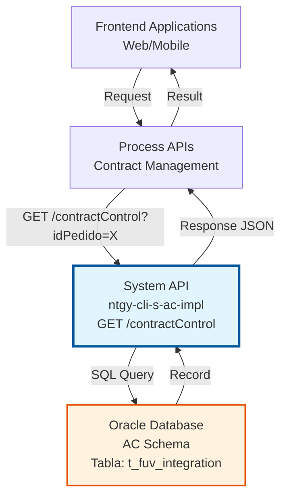
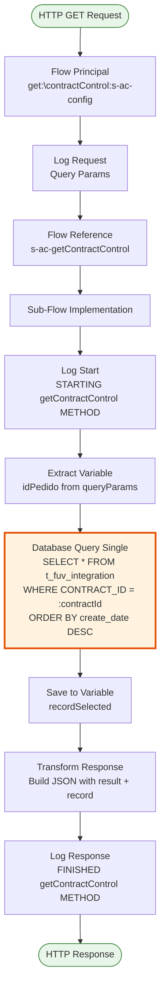
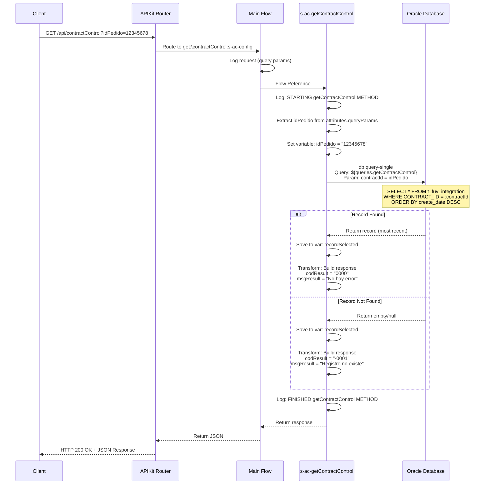
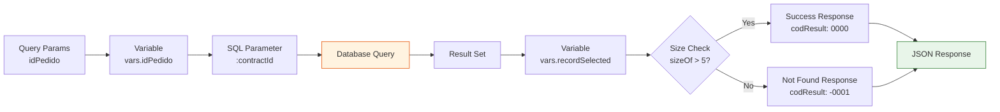

# GET /contractControl

## 📌 Descripción General

### Propósito del Endpoint

Este endpoint consulta el estado de integración de un contrato específico en la tabla `t_fuv_integration` de Oracle Database. Permite obtener el registro más reciente de sincronización de un contrato con sistemas externos, incluyendo el estado actual, mensajes de error, número de intentos y respuestas del sistema destino.

El endpoint soporta:
- **Consulta de estado de integración**: Recupera el registro más reciente de un contrato específico
- **Trazabilidad de sincronización**: Proporciona visibilidad del historial de intentos de integración
- **Auditoría de errores**: Permite identificar problemas en la sincronización con sistemas externos
- **Soporte a reintentos**: Facilita la gestión de reintentos de integración fallidos

### Tipo de API

**Capa:** System API (API-Led Connectivity)

**Función:** Integración directa con Oracle Database (AC Schema) para consulta de estado de integración de contratos.

### Patrón de Integración

**Tipo:** Request-Reply Síncrono con SQL Query

**Descripción:** El endpoint recibe un ID de contrato como query parameter, ejecuta una consulta SQL en la tabla `t_fuv_integration` ordenada por fecha de creación descendente para obtener el registro más reciente, y retorna el resultado completo en formato JSON con un código de resultado que indica si el registro existe o no.

### Arquitectura API-Led Connectivity



---

## 💼 Propósito del Negocio

### Casos de Uso Principales

1. **Monitoreo de Estado de Integración**
   - Los sistemas de monitoreo consultan el estado actual de sincronización de contratos
   - Permite identificar contratos con problemas de integración
   - Facilita la toma de decisiones sobre reintentos o escalamiento

2. **Soporte a Procesos de Alta de Clientes**
   - Durante el proceso de alta, se verifica el estado de integración del contrato
   - Permite validar que la información se ha sincronizado correctamente con sistemas externos
   - Proporciona visibilidad del progreso de la integración

3. **Auditoría y Trazabilidad**
   - Registro completo de intentos de integración con timestamps
   - Mensajes de error detallados para análisis de problemas
   - Respuestas de sistemas externos para validación de datos

### Contexto Empresarial

- **Dominio:** Gestión de Clientes y Contratos
- **Sector:** Energía - Utilities
- **División:** Naturgy España - CLI (Clientes)
- **Proceso de Negocio:** Alta de Clientes y Sincronización de Contratos
- **Sistema:** Oracle Database - AC (Alta de Clientes) Schema

### Stakeholders

- **Equipos de Desarrollo**: Necesitan visibilidad del estado de integración para debugging
- **Operaciones**: Monitorean el estado de sincronización y gestionan reintentos
- **Soporte al Cliente**: Consultan el estado para resolver incidencias de clientes
- **Sistemas Externos**: Salesforce, Buyapowa y otros sistemas que requieren sincronización

### Valor de Negocio

- **Visibilidad en Tiempo Real**: Acceso inmediato al estado de integración de contratos
- **Reducción de Tiempos de Resolución**: Identificación rápida de problemas de sincronización
- **Mejora de Calidad de Datos**: Validación de sincronización correcta con sistemas externos
- **Optimización de Reintentos**: Información detallada para decidir estrategia de reintentos

### Consumidores Potenciales

Este endpoint puede ser consumido por:
- Process APIs de gestión de contratos
- Sistemas de monitoreo y alertas
- Dashboards de operaciones
- Herramientas de soporte al cliente
- Flujos de Salesforce para validación de sincronización
- Sistemas de integración middleware

---

## 🔧 Especificación Técnica

### URLs por Ambiente

| Ambiente | URL Base | URL Completa |
|----------|----------|--------------|
| **Local** | `http://localhost:8081` | `http://localhost:8081/api/contractControl?idPedido={contractId}` |
| **Development** | `https://ntgy-cli-s-ac-impl-dev.us-e2.cloudhub.io` | `https://ntgy-cli-s-ac-impl-dev.us-e2.cloudhub.io/api/contractControl?idPedido={contractId}` |
| **UAT** | `https://ntgy-cli-s-ac-impl-uat.us-e2.cloudhub.io` | `https://ntgy-cli-s-ac-impl-uat.us-e2.cloudhub.io/api/contractControl?idPedido={contractId}` |
| **Production** | `https://ntgy-cli-s-ac-impl-pro.us-e2.cloudhub.io` | `https://ntgy-cli-s-ac-impl-pro.us-e2.cloudhub.io/api/contractControl?idPedido={contractId}` |

### Método HTTP

```
GET /api/contractControl
```

### Parámetros de Entrada

#### Headers HTTP

| Header | Tipo | Requerido | Descripción | Ejemplo |
|--------|------|-----------|-------------|---------|
| `Accept` | string | ❌ No | Tipo de contenido esperado en response | `application/json` |

#### Query Parameters

| Parámetro | Tipo | Requerido | Descripción | Ejemplo |
|-----------|------|-----------|-------------|---------|
| `idPedido` | string | ✅ Sí | ID del contrato/pedido a consultar. Se utiliza como CONTRACT_ID en la query SQL. | `"12345678"` |

### Respuestas

#### Respuesta Exitosa - Registro Encontrado (200 OK)

```json
{
  "result": {
    "codResult": "0000",
    "msgResult": "No hay error"
  },
  "record": {
    "T_FUV_INTEGRATION_ID": 12345,
    "CONTRACT_ID": "12345678",
    "SYSTEM_MESSAGE": "Frontal",
    "CODE": "received",
    "MESSAGE": "{\"orderId\":\"12345678\",\"data\":\"...\"}",
    "STATE": "received",
    "RESPONSE": null,
    "ERROR": null,
    "CONTRACT_ATR": 0,
    "CREATE_DATE": "2024-01-15T10:30:00Z",
    "UPDATE_DATE": "2024-01-15T10:30:00Z",
    "UPDATE_USER": "mulesoft",
    "UPDATE_PROGRAM": "mulesoft",
    "ATTEMPTS_NUMBER": 1,
    "OPTIMIST_LOCK": 1,
    "VIEWABLE": "Y"
  }
}
```

#### Respuesta - Registro No Encontrado (200 OK)

```json
{
  "result": {
    "codResult": "-0001",
    "msgResult": "Registro no existe"
  },
  "record": {}
}
```

#### Respuesta de Error Técnico (500)

```json
{
  "result": {
    "codResult": "0001",
    "msgResult": "Error interno del servidor"
  }
}
```

### Estructura del Record

> **📝 Nota sobre la Estructura:**  
> El campo `record` en la respuesta contiene el resultado directo de la query SQL ejecutada sobre la tabla `t_fuv_integration`. La especificación detallada de los campos y sus tipos se basa en la definición del archivo RAML `getContractControlResponse.raml`, que documenta el contrato de la API. Aunque el código SQL es la fuente de verdad para los datos retornados, el RAML proporciona la especificación formal de la estructura esperada.

| Campo | Tipo | Descripción |
|-------|------|-------------|
| `T_FUV_INTEGRATION_ID` | number | ID único del registro en la tabla |
| `CONTRACT_ID` | string | ID del contrato/pedido |
| `SYSTEM_MESSAGE` | string | Sistema origen del mensaje (ej: "Frontal") |
| `CODE` | string | Código de estado (ej: "received", "processed", "error") |
| `MESSAGE` | string | Mensaje JSON con datos del contrato |
| `STATE` | string | Estado actual de la integración |
| `RESPONSE` | string/null | Respuesta del sistema externo |
| `ERROR` | string/null | Mensaje de error si la integración falló |
| `CONTRACT_ATR` | number | Flag indicando si es contrato ATR (0/1) |
| `CREATE_DATE` | datetime | Fecha y hora de creación del registro |
| `UPDATE_DATE` | datetime | Fecha y hora de última actualización |
| `UPDATE_USER` | string | Usuario que realizó la última actualización |
| `UPDATE_PROGRAM` | string | Programa que realizó la última actualización |
| `ATTEMPTS_NUMBER` | number | Número de intentos de integración |
| `OPTIMIST_LOCK` | number | Control de concurrencia optimista |
| `VIEWABLE` | string | Flag de visibilidad (Y/N) |

### Autenticación y Autorización

- **Tipo:** Client ID & Client Secret (Anypoint Platform)
- **Autorización Oracle:** El usuario de base de datos debe tener permisos para:
  - Ejecutar SELECT en tabla `t_fuv_integration`
  - Acceso al schema AC

### Timeouts

| Tipo | Valor | Descripción |
|------|-------|-------------|
| **Request Timeout** | 30 segundos | Tiempo máximo de espera para la respuesta |
| **Connection Timeout** | 10 segundos | Tiempo máximo para establecer conexión con Oracle |
| **Query Timeout** | 30 segundos | Tiempo máximo de ejecución de la query SQL |

---

## 🏗️ Implementación Técnica

### Arquitectura del Flow



### Flujo de Datos Detallado



### Componentes Clave del Código

#### 1. Flow Principal (s-ac.xml, líneas 176-179)

```xml
<flow name="get:\contractControl:s-ac-config">
    <logger level="DEBUG" message="get:\contractControl:s-ac-config" />
    <flow-ref doc:name="Flow Reference" 
              doc:id="30b4220d-e2d1-4068-b142-27960a1814b4" 
              name="s-ac-getContractControl" />
</flow>
```

#### 2. Sub-Flow de Implementación (s-ac-contractControl.xml, líneas 152-207)

**Extracción del Parámetro:**
```xml
<ee:transform doc:name="var idPedido" doc:id="75089a95-1d18-4ddc-9efc-8fce401c5620">
    <ee:variables>
        <ee:set-variable variableName="idPedido"><![CDATA[%dw 2.0
output application/java
---
attributes.queryParams.idPedido
        ]]></ee:set-variable>
    </ee:variables>
</ee:transform>
```

**Query a Base de Datos:**
```xml
<db:query-single doc:name="Query single" 
                 doc:id="32c155f1-3c9a-4875-939c-40338eaa73dd" 
                 config-ref="Database_Config">
    <db:sql><![CDATA[${queries.getContractControl}]]></db:sql>
    <db:input-parameters><![CDATA[#[{contractId: vars.idPedido}]]]></db:input-parameters>
</db:query-single>
```

**Transformación de Respuesta:**
```xml
<ee:transform doc:name="response" doc:id="a1d6aef8-42dd-418c-819c-1f5bf9a9dd8e">
    <ee:message>
        <ee:set-payload><![CDATA[%dw 2.0
output application/json
---
{
    "result": {
        "codResult": if (sizeOf(vars.recordSelected) > 5) "0000" else "-0001",
        "msgResult": if (sizeOf(vars.recordSelected) > 5) "No hay error" else "Registro no existe"
    },
    "record": vars.recordSelected
}
        ]]></ee:set-payload>
    </ee:message>
</ee:transform>
```

#### 3. Query SQL Real (s-ac-pro-config.yaml, línea 80)

```yaml
queries:
  getContractControl: "SELECT * FROM t_fuv_integration WHERE CONTRACT_ID = :contractId order by create_date desc"
```

### Configuración de Base de Datos

**Archivo:** `src/main/resources/s-ac-pro-config.yaml`

```yaml
dbAC:
  user: "OVPROySTAGING_LECTURA"
  pass: "![TZv06fLYTdPfxh2GefzGfA==]"  # Encrypted
  host1: "oc-pro-exa-04-clu-02-hdfdi-scan.prodb03.ocpro.oraclevcn.com"
  host2: "oc-pro-exa-03-clu-02-dfhl9-scan.prodb03.ocpro.oraclevcn.com"
  port: "1521"
  serviceName: "s_areapriv_online_pro.prodb03.ocpro.oraclevcn.com"
  connectTimeOut: "3600"
  transportConnectTimeOut: "6000"
  retryCount: "3"
  MaxPoolSize: "5"
  MaxWaitTime: "300"
  MaxIdleTime: "300"
  timeout: "6000000"
  fetchsize: "2000"
```

### Tabla de Base de Datos: t_fuv_integration

**Propósito:** Almacena el historial de intentos de integración de contratos con sistemas externos.

**Características:**
- **Ordenamiento:** Por `create_date DESC` para obtener el registro más reciente
- **Índice recomendado:** `CONTRACT_ID` para optimizar búsquedas
- **Retención:** Histórico completo de intentos

**Campos Clave:**
- `CONTRACT_ID`: Clave de búsqueda principal
- `CREATE_DATE`: Usado para ordenamiento y obtener registro más reciente
- `STATE`: Indica el estado actual de la integración
- `ATTEMPTS_NUMBER`: Contador de reintentos
- `ERROR`: Almacena mensajes de error para debugging

### Transformación de Datos



### Manejo de Errores

**Errores de Base de Datos:**
- Timeout de conexión → Error 500
- Query timeout → Error 500
- Credenciales inválidas → Error 500

**Errores de Validación:**
- Parámetro `idPedido` faltante → Error 400
- Formato de parámetro inválido → Error 400

**Registro No Encontrado:**
- Se retorna 200 OK con `codResult: "-0001"`
- No se considera error técnico, es un resultado válido

### Logging

**Puntos de Log:**
1. **Inicio del método** (línea 153-159):
   - Nivel: INFO
   - Contenido: Query parameters normalizados

2. **Fin del método** (línea 199-206):
   - Nivel: INFO
   - Contenido: Response normalizado

**Formato de Log:**
```
STARTING getContractControl METHOD. REQUEST: {"idPedido":"12345678"}
FINISHED getContractControl METHOD. RESPONSE: {"result":{"codResult":"0000","msgResult":"No hay error"},"record":{...}}
```

---

## 💻 Ejemplos de Uso

### Ejemplo 1: Consulta Exitosa con curl

```bash
curl -X GET "http://localhost:8081/api/contractControl?idPedido=12345678" \
  -H "Accept: application/json"
```

**Response (200 OK):**
```json
{
  "result": {
    "codResult": "0000",
    "msgResult": "No hay error"
  },
  "record": {
    "T_FUV_INTEGRATION_ID": 12345,
    "CONTRACT_ID": "12345678",
    "SYSTEM_MESSAGE": "Frontal",
    "CODE": "received",
    "MESSAGE": "{\"orderId\":\"12345678\",\"customerData\":{\"name\":\"John Doe\",\"email\":\"john@example.com\"}}",
    "STATE": "received",
    "RESPONSE": null,
    "ERROR": null,
    "CONTRACT_ATR": 0,
    "CREATE_DATE": "2024-01-15T10:30:00Z",
    "UPDATE_DATE": "2024-01-15T10:30:00Z",
    "UPDATE_USER": "mulesoft",
    "UPDATE_PROGRAM": "mulesoft",
    "ATTEMPTS_NUMBER": 1,
    "OPTIMIST_LOCK": 1,
    "VIEWABLE": "Y"
  }
}
```

### Ejemplo 2: Contrato No Encontrado

```bash
curl -X GET "http://localhost:8081/api/contractControl?idPedido=99999999" \
  -H "Accept: application/json"
```

**Response (200 OK):**
```json
{
  "result": {
    "codResult": "-0001",
    "msgResult": "Registro no existe"
  },
  "record": {}
}
```

### Ejemplo 3: Consulta con Múltiples Intentos

```bash
curl -X GET "http://localhost:8081/api/contractControl?idPedido=87654321" \
  -H "Accept: application/json"
```

**Response (200 OK) - Registro con Reintentos:**
```json
{
  "result": {
    "codResult": "0000",
    "msgResult": "No hay error"
  },
  "record": {
    "T_FUV_INTEGRATION_ID": 67890,
    "CONTRACT_ID": "87654321",
    "SYSTEM_MESSAGE": "Frontal",
    "CODE": "error",
    "MESSAGE": "{\"orderId\":\"87654321\",\"data\":\"...\"}",
    "STATE": "error",
    "RESPONSE": "{\"error\":\"Connection timeout\"}",
    "ERROR": "Failed to connect to external system",
    "CONTRACT_ATR": 0,
    "CREATE_DATE": "2024-01-15T09:00:00Z",
    "UPDATE_DATE": "2024-01-15T11:45:00Z",
    "UPDATE_USER": "mulesoft",
    "UPDATE_PROGRAM": "mulesoft",
    "ATTEMPTS_NUMBER": 3,
    "OPTIMIST_LOCK": 3,
    "VIEWABLE": "Y"
  }
}
```

### Ejemplo 4: Error de Parámetro Faltante

```bash
curl -X GET "http://localhost:8081/api/contractControl" \
  -H "Accept: application/json"
```

**Response (400 Bad Request):**
```json
{
  "message": "Bad request"
}
```

### Ejemplo 5: Uso desde JavaScript/Node.js

```javascript
const axios = require('axios');

async function getContractControl(contractId) {
  try {
    const response = await axios.get('http://localhost:8081/api/contractControl', {
      params: {
        idPedido: contractId
      },
      headers: {
        'Accept': 'application/json'
      }
    });
    
    if (response.data.result.codResult === '0000') {
      console.log('Contract found:', response.data.record);
      return response.data.record;
    } else {
      console.log('Contract not found');
      return null;
    }
  } catch (error) {
    console.error('Error fetching contract:', error.message);
    throw error;
  }
}

// Uso
getContractControl('12345678')
  .then(record => {
    if (record) {
      console.log('State:', record.STATE);
      console.log('Attempts:', record.ATTEMPTS_NUMBER);
    }
  });
```

### Ejemplo 6: Uso desde Python

```python
import requests

def get_contract_control(contract_id):
    url = 'http://localhost:8081/api/contractControl'
    params = {'idPedido': contract_id}
    headers = {'Accept': 'application/json'}
    
    try:
        response = requests.get(url, params=params, headers=headers)
        response.raise_for_status()
        
        data = response.json()
        
        if data['result']['codResult'] == '0000':
            print(f"Contract found: {data['record']['CONTRACT_ID']}")
            return data['record']
        else:
            print("Contract not found")
            return None
            
    except requests.exceptions.RequestException as e:
        print(f"Error: {e}")
        raise

# Uso
record = get_contract_control('12345678')
if record:
    print(f"State: {record['STATE']}")
    print(f"Attempts: {record['ATTEMPTS_NUMBER']}")
    if record['ERROR']:
        print(f"Error: {record['ERROR']}")
```

### Ejemplo 7: Interpretación de Estados

```javascript
function interpretContractState(record) {
  const state = record.STATE;
  const attempts = record.ATTEMPTS_NUMBER;
  const hasError = record.ERROR !== null;
  
  if (state === 'received' && attempts === 1) {
    return 'Contract received, pending processing';
  } else if (state === 'processed' && !hasError) {
    return 'Contract successfully processed';
  } else if (state === 'error' && attempts < 4) {
    return `Integration failed, ${attempts} attempts made, will retry`;
  } else if (state === 'error' && attempts >= 4) {
    return 'Integration failed, maximum attempts reached, manual intervention required';
  } else {
    return `Unknown state: ${state}`;
  }
}

// Uso
const record = await getContractControl('12345678');
if (record) {
  console.log(interpretContractState(record));
}