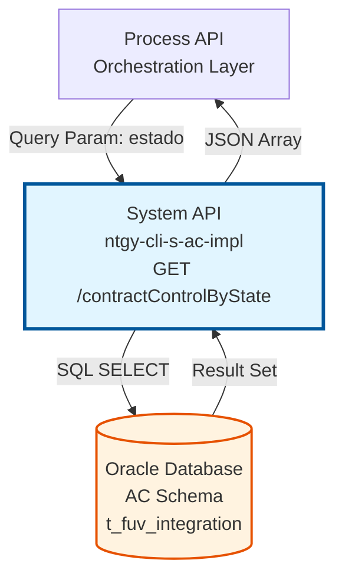
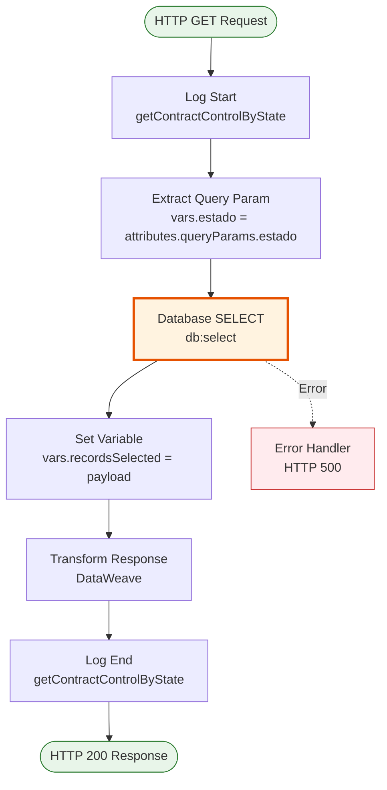
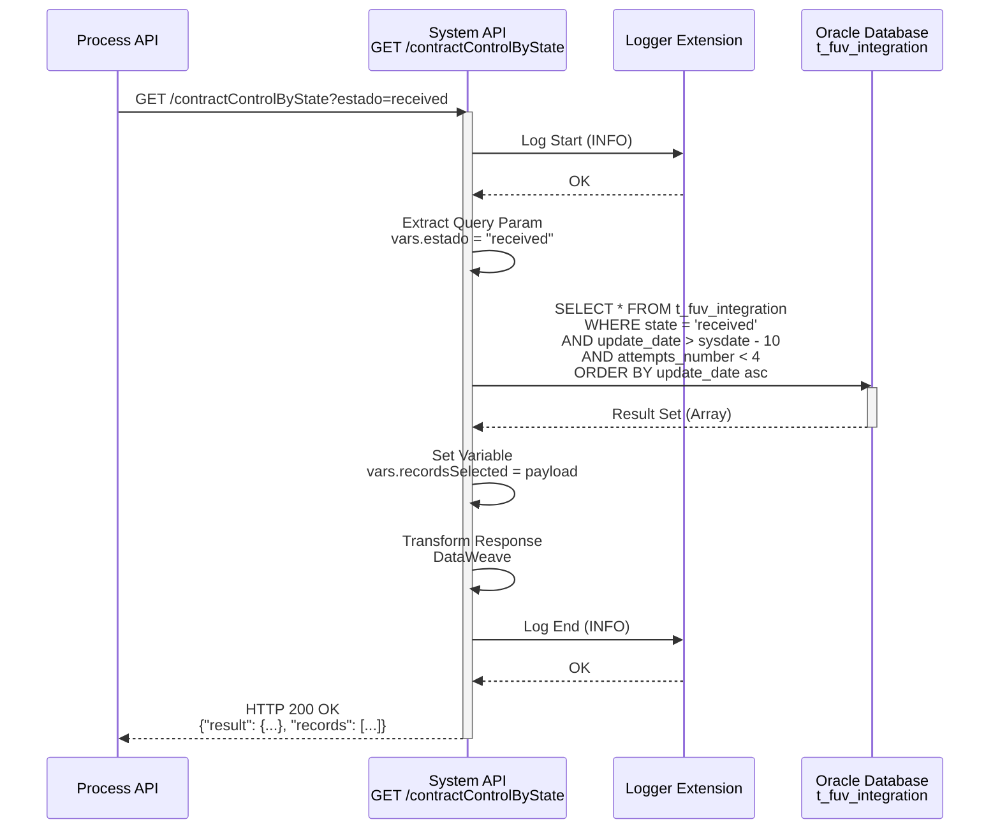
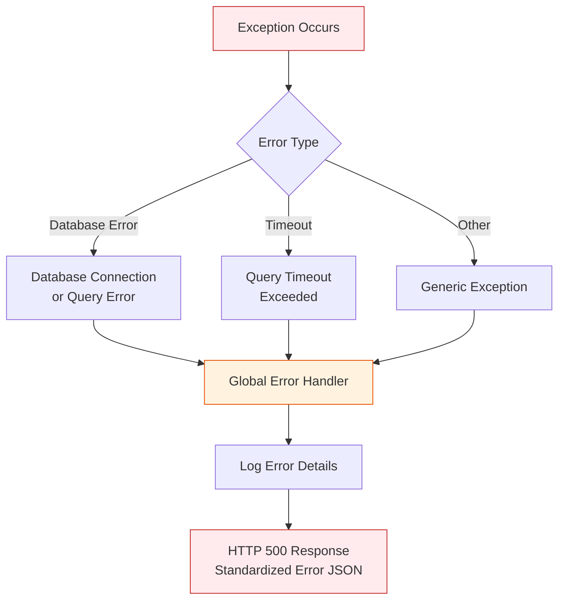
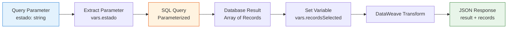

# GET /contractControlByState

## 📌 Descripción General

### Propósito del Endpoint

Este endpoint consulta registros de control de integración almacenados en la tabla `t_fuv_integration`, filtrando por estado específico y aplicando criterios de fecha y número de reintentos. Es fundamental para la gestión de procesos de integración pendientes entre el Frontal Único de Ventas (FUV) y sistemas backend.

El endpoint soporta:
- **Consulta por Estado**: Filtra registros según el estado de procesamiento (received, processing, completed, error)
- **Ventana Temporal**: Solo retorna registros actualizados en los últimos 10 días
- **Control de Reintentos**: Excluye registros que han superado el límite de 4 intentos de procesamiento
- **Ordenamiento Cronológico**: Ordena resultados por fecha de actualización ascendente para procesamiento FIFO

### Tipo de API

**Capa:** System API (API-Led Connectivity)

**Función:** Integración directa con Oracle Database (esquema AC) para consulta de registros de control de integración.

### Patrón de Integración

**Tipo:** Request-Reply Síncrono con SQL Query

**Descripción:** El endpoint recibe un parámetro de estado, ejecuta una consulta SQL parametrizada contra la tabla de control, aplica filtros de fecha y reintentos, y retorna los registros coincidentes en formato JSON.

### Arquitectura API-Led Connectivity



---

## 💼 Propósito del Negocio

### Casos de Uso Principales

1. **Procesamiento de Integraciones Pendientes**
   - Los sistemas de orquestación consultan periódicamente registros en estado "received" o "processing"
   - Se procesan los registros pendientes en orden cronológico (FIFO)
   - Permite implementar workers que procesan colas de integración

2. **Gestión de Reintentos Automáticos**
   - Identifica registros que han fallado pero aún no han alcanzado el límite de reintentos
   - Permite implementar lógica de retry con backoff exponencial
   - Evita procesamiento infinito de registros problemáticos

3. **Monitoreo de Integraciones Recientes**
   - Consulta solo registros actualizados en los últimos 10 días
   - Facilita auditoría de procesos de integración recientes
   - Permite identificar cuellos de botella en el procesamiento

### Contexto Empresarial

- **Dominio:** Gestión de Integraciones y Control de Procesos
- **Sector:** Energía - Utilities
- **División:** Naturgy España - CLI (Clientes)
- **Proceso de Negocio:** Sincronización de datos entre Frontal Único de Ventas y sistemas backend (SAP ISU, Salesforce, etc.)
- **Sistema:** Oracle Database - Esquema AC (Alta de Clientes)

### Stakeholders

- **Equipos de Integración**: Monitorean el estado de las integraciones y gestionan errores
- **Desarrolladores de Process APIs**: Consumen este endpoint para orquestar flujos de integración
- **Operaciones IT**: Utilizan los datos para identificar y resolver problemas de integración
- **Equipos de Soporte**: Consultan el estado de pedidos específicos para atención al cliente

### Valor de Negocio

- **Procesamiento Asíncrono Confiable**: Permite implementar patrones de procesamiento asíncrono con garantías de entrega
- **Resiliencia**: El control de reintentos evita pérdida de datos por fallos transitorios
- **Trazabilidad**: Mantiene registro completo del ciclo de vida de cada integración
- **Eficiencia Operativa**: El filtrado por fecha reduce la carga de procesamiento y mejora el rendimiento

### Consumidores Potenciales

Este endpoint puede ser consumido por:
- Process APIs de orquestación de integraciones
- Schedulers y workers de procesamiento batch
- Sistemas de monitoreo y alertas
- Herramientas de administración y soporte

---

## 🔧 Especificación Técnica

### URLs por Ambiente

| Ambiente | URL Base | URL Completa |
|----------|----------|--------------|
| **Local** | `http://localhost:8081` | `http://localhost:8081/api/contractControlByState?estado={estado}` |
| **Development** | `https://ntgy-cli-s-ac-dev.us-e2.cloudhub.io` | `https://ntgy-cli-s-ac-dev.us-e2.cloudhub.io/api/contractControlByState?estado={estado}` |
| **UAT** | `https://ntgy-cli-s-ac-uat.us-e2.cloudhub.io` | `https://ntgy-cli-s-ac-uat.us-e2.cloudhub.io/api/contractControlByState?estado={estado}` |
| **Production** | `https://ntgy-cli-s-ac-pro.us-e2.cloudhub.io` | `https://ntgy-cli-s-ac-pro.us-e2.cloudhub.io/api/contractControlByState?estado={estado}` |

### Método HTTP

```
GET /api/contractControlByState
```

### Parámetros de Entrada

#### Headers HTTP

| Header | Tipo | Requerido | Descripción | Ejemplo |
|--------|------|-----------|-------------|---------|
| `Accept` | string | ❌ No | Tipo de contenido esperado en response | `application/json` |

#### Query Parameters

| Parámetro | Tipo | Requerido | Descripción | Ejemplo |
|-----------|------|-----------|-------------|---------|
| `estado` | string | ✅ Sí | Estado de los registros a consultar. Valores típicos: "received", "processing", "completed", "error" | `"received"` |

**Valores Comunes de Estado:**
- `received`: Pedido recibido del frontal, pendiente de procesamiento
- `processing`: Pedido en proceso de integración
- `completed`: Integración completada exitosamente
- `error`: Error en el procesamiento, pendiente de reintento

### Respuestas

#### Respuesta Exitosa (200 OK)

**Descripción:** Retorna un array de registros que coinciden con los criterios de búsqueda.

> **ℹ️ Estructura de Datos Dinámica**
> 
> La estructura de los objetos en el array `records` corresponde **exactamente a los campos de la tabla `t_fuv_integration`** en Oracle Database. Como la query utiliza `SELECT *`, todos los campos existentes en la tabla son retornados. Si el esquema de la tabla se modifica (añadiendo o eliminando columnas), la estructura de la respuesta cambiará en consecuencia.

```json
{
  "result": {
    "codResult": "0000",
    "msgResult": "No hay error"
  },
  "records": [
    {
      "T_FUV_INTEGRATION_ID": 12345,
      "CONTRACT_ID": "ORD-2024-001234",
      "SYSTEM_MESSAGE": "Frontal",
      "CODE": "received",
      "MESSAGE": "{\"orderId\":\"ORD-2024-001234\",\"customerId\":\"12345678A\",\"productType\":\"electricity\"}",
      "STATE": "received",
      "RESPONSE": null,
      "ERROR": null,
      "CONTRACT_ATR": 0,
      "CREATE_DATE": "2024-01-15T10:30:00Z",
      "UPDATE_DATE": "2024-01-15T10:30:00Z",
      "UPDATE_USER": "mulesoft",
      "UPDATE_PROGRAM": "mulesoft",
      "ATTEMPTS_NUMBER": 0,
      "OPTIMIST_LOCK": 1,
      "VIEWABLE": "Y"
    },
    {
      "T_FUV_INTEGRATION_ID": 12346,
      "CONTRACT_ID": "ORD-2024-001235",
      "SYSTEM_MESSAGE": "Frontal",
      "CODE": "received",
      "MESSAGE": "{\"orderId\":\"ORD-2024-001235\",\"customerId\":\"87654321B\",\"productType\":\"gas\"}",
      "STATE": "received",
      "RESPONSE": null,
      "ERROR": null,
      "CONTRACT_ATR": 0,
      "CREATE_DATE": "2024-01-15T11:00:00Z",
      "UPDATE_DATE": "2024-01-15T11:00:00Z",
      "UPDATE_USER": "mulesoft",
      "UPDATE_PROGRAM": "mulesoft",
      "ATTEMPTS_NUMBER": 1,
      "OPTIMIST_LOCK": 1,
      "VIEWABLE": "Y"
    }
  ]
}
```

#### Respuesta Sin Registros (200 OK)

**Descripción:** No se encontraron registros que cumplan los criterios.

```json
{
  "result": {
    "codResult": "0000",
    "msgResult": "No hay error"
  },
  "records": []
}
```

#### Respuesta de Error Técnico (500)

```json
{
  "error": "APP_9999",
  "message": "Error en el servicio."
}
```

### Estructura de Campos de Respuesta

> **📋 Fuente de la Estructura**
> 
> **Fuente:** Esquema de la tabla `t_fuv_integration` en Oracle Database
> 
> Los siguientes campos son retornados porque existen actualmente en la tabla. Esta lista puede variar si el esquema de la tabla se modifica. La documentación refleja el estado actual del esquema al momento de su creación.

| Campo | Tipo | Descripción |
|-------|------|-------------|
| `T_FUV_INTEGRATION_ID` | number | Identificador único del registro (clave primaria) |
| `CONTRACT_ID` | string | Identificador del pedido/contrato del frontal |
| `SYSTEM_MESSAGE` | string | Sistema origen del mensaje (típicamente "Frontal") |
| `CODE` | string | Código de estado del mensaje |
| `MESSAGE` | string | Payload JSON del mensaje original del frontal |
| `STATE` | string | Estado actual del procesamiento |
| `RESPONSE` | string/null | Respuesta del sistema backend (si aplica) |
| `ERROR` | string/null | Mensaje de error (si aplica) |
| `CONTRACT_ATR` | number | Indicador de contrato ATR (0 o 1) |
| `CREATE_DATE` | datetime | Fecha de creación del registro |
| `UPDATE_DATE` | datetime | Fecha de última actualización |
| `UPDATE_USER` | string | Usuario que realizó la última actualización |
| `UPDATE_PROGRAM` | string | Programa que realizó la última actualización |
| `ATTEMPTS_NUMBER` | number | Número de intentos de procesamiento (0-3) |
| `OPTIMIST_LOCK` | number | Control de concurrencia optimista |
| `VIEWABLE` | string | Indicador de visibilidad (Y/N) |

### Autenticación y Autorización

- **Tipo:** Client ID & Client Secret (Anypoint Platform)
- **Autorización DB:** El usuario de base de datos debe tener permisos para:
  - Ejecutar SELECT en tabla `t_fuv_integration`
  - Acceso de lectura al esquema FUV

### Timeouts

| Tipo | Valor | Descripción |
|------|-------|-------------|
| **Query Timeout** | 30 segundos | Tiempo máximo de ejecución de la query SQL |
| **Connection Timeout** | 10 segundos | Tiempo máximo para establecer conexión con Oracle |

---

## 🏗️ Implementación Técnica

### Arquitectura del Flow



### Componentes del Flow

#### 1. HTTP Listener
**Ubicación:** `s-ac.xml` (línea 95)
```xml
<flow name="get:\contractControlByState:s-ac-config">
    <flow-ref name="s-ac-getContractControlByState" />
</flow>
```

#### 2. Subflow Principal
**Ubicación:** `s-ac-contractControl.xml` (líneas 208-262)
```xml
<sub-flow name="s-ac-getContractControlByState">
    <!-- Logger de inicio -->
    <!-- Extracción de parámetro -->
    <!-- Consulta a base de datos -->
    <!-- Transformación de respuesta -->
    <!-- Logger de fin -->
</sub-flow>
```

### Query SQL Real

**Ubicación:** `s-ac-pro-config.yaml` (línea 78)

```sql
SELECT * FROM t_fuv_integration 
WHERE state = :status 
  AND update_date > sysdate - 10 
  AND attempts_number < 4 
ORDER BY update_date asc
```

> **⚠️ Uso de SELECT ***
> 
> La query utiliza `SELECT *` lo que significa que retorna **todos los campos** de la tabla `t_fuv_integration`. La estructura exacta de los registros en la respuesta JSON está determinada por el esquema actual de esta tabla en Oracle Database. Cualquier cambio en el esquema de la tabla (añadir/eliminar columnas, cambiar tipos de datos) se reflejará automáticamente en la respuesta del endpoint.

**Análisis de la Query:**

| Componente | Descripción | Propósito |
|------------|-------------|-----------|
| `state = :status` | Filtro por estado | Permite consultar registros en un estado específico |
| `update_date > sysdate - 10` | Ventana temporal de 10 días | Limita resultados a registros recientes, mejora rendimiento |
| `attempts_number < 4` | Límite de reintentos | Excluye registros que han fallado múltiples veces |
| `ORDER BY update_date asc` | Ordenamiento FIFO | Procesa primero los registros más antiguos |

**Parámetros de la Query:**
- `:status` → Mapeado desde `vars.estado` (query parameter)

### Transformaciones DataWeave

#### Extracción de Parámetro
**Ubicación:** `s-ac-contractControl.xml` (líneas 216-225)
```dataweave
%dw 2.0
output application/java
---
attributes.queryParams.estado
```

#### Transformación de Respuesta
**Ubicación:** `s-ac-contractControl.xml` (líneas 241-252)
```dataweave
%dw 2.0
output application/json
---
{
    "result": {
        "codResult": "0000",
        "msgResult": "No hay error"
    },
    "records": vars.recordsSelected
}
```

### Diagrama de Secuencia Completo



### Manejo de Errores



### Configuración de Base de Datos

**Ubicación:** `global.xml`

```xml
<db:config name="Database_Config">
    <db:generic-connection 
        url="jdbc:oracle:thin:${dbAC.user}/${secure::dbAC.pass}@(DESCRIPTION_LIST=...)"
        driverClassName="oracle.jdbc.driver.OracleDriver">
        <db:pooling-profile 
            maxPoolSize="${dbAC.MaxPoolSize}"
            maxWait="${dbAC.MaxWaitTime}"
            maxIdleTime="${dbAC.MaxIdleTime}"/>
    </db:generic-connection>
</db:config>
```

**Parámetros de Conexión:**
- **MaxPoolSize:** 5 conexiones (configurado en `s-ac-pro-config.yaml`)
- **MaxWaitTime:** 300 segundos
- **MaxIdleTime:** 300 segundos
- **Timeout:** 6000000 ms (100 minutos)
- **FetchSize:** 2000 registros

### Diagrama de Transformación de Datos



---

## 💻 Ejemplos de Uso

### Ejemplo 1: Consultar Registros Recibidos

**Request:**
```bash
curl -X GET "http://localhost:8081/api/contractControlByState?estado=received" \
  -H "Accept: application/json"
```

**Response (200 OK):**
```json
{
  "result": {
    "codResult": "0000",
    "msgResult": "No hay error"
  },
  "records": [
    {
      "T_FUV_INTEGRATION_ID": 12345,
      "CONTRACT_ID": "ORD-2024-001234",
      "SYSTEM_MESSAGE": "Frontal",
      "CODE": "received",
      "MESSAGE": "{\"orderId\":\"ORD-2024-001234\",\"customerId\":\"12345678A\",\"productType\":\"electricity\",\"cups\":\"ES0031406509876543AB0F\"}",
      "STATE": "received",
      "RESPONSE": null,
      "ERROR": null,
      "CONTRACT_ATR": 0,
      "CREATE_DATE": "2024-01-15T10:30:00Z",
      "UPDATE_DATE": "2024-01-15T10:30:00Z",
      "UPDATE_USER": "mulesoft",
      "UPDATE_PROGRAM": "mulesoft",
      "ATTEMPTS_NUMBER": 0,
      "OPTIMIST_LOCK": 1,
      "VIEWABLE": "Y"
    }
  ]
}
```

### Ejemplo 2: Consultar Registros en Error

**Request:**
```bash
curl -X GET "http://localhost:8081/api/contractControlByState?estado=error" \
  -H "Accept: application/json"
```

**Response (200 OK):**
```json
{
  "result": {
    "codResult": "0000",
    "msgResult": "No hay error"
  },
  "records": [
    {
      "T_FUV_INTEGRATION_ID": 12350,
      "CONTRACT_ID": "ORD-2024-001240",
      "SYSTEM_MESSAGE": "Frontal",
      "CODE": "error",
      "MESSAGE": "{\"orderId\":\"ORD-2024-001240\",\"customerId\":\"99999999Z\"}",
      "STATE": "error",
      "RESPONSE": null,
      "ERROR": "SAP RFC Error: Customer not found in SAP ISU",
      "CONTRACT_ATR": 0,
      "CREATE_DATE": "2024-01-14T15:20:00Z",
      "UPDATE_DATE": "2024-01-15T09:45:00Z",
      "UPDATE_USER": "mulesoft",
      "UPDATE_PROGRAM": "mulesoft",
      "ATTEMPTS_NUMBER": 2,
      "OPTIMIST_LOCK": 3,
      "VIEWABLE": "Y"
    }
  ]
}
```

### Ejemplo 3: Sin Registros Encontrados

**Request:**
```bash
curl -X GET "http://localhost:8081/api/contractControlByState?estado=completed" \
  -H "Accept: application/json"
```

**Response (200 OK):**
```json
{
  "result": {
    "codResult": "0000",
    "msgResult": "No hay error"
  },
  "records": []
}
```

### Ejemplo 4: Error de Servidor

**Request:**
```bash
curl -X GET "http://localhost:8081/api/contractControlByState?estado=received" \
  -H "Accept: application/json"
```

**Response (500 Internal Server Error):**
```json
{
  "error": "APP_9999",
  "message": "Error en el servicio."
}
```

### Ejemplo 5: Uso desde JavaScript (Node.js)

```javascript
const axios = require('axios');

async function getContractsByState(estado) {
  try {
    const response = await axios.get(
      'http://localhost:8081/api/contractControlByState',
      {
        params: { estado },
        headers: { 'Accept': 'application/json' }
      }
    );
    
    console.log(`Found ${response.data.records.length} records in state: ${estado}`);
    return response.data.records;
  } catch (error) {
    console.error('Error fetching contracts:', error.message);
    throw error;
  }
}

// Uso
getContractsByState('received')
  .then(records => {
    records.forEach(record => {
      console.log(`Contract ID: ${record.CONTRACT_ID}, Attempts: ${record.ATTEMPTS_NUMBER}`);
    });
  });
```

### Ejemplo 6: Uso desde Python

```python
import requests
import json

def get_contracts_by_state(estado):
    """
    Consulta registros de control por estado
    """
    url = "http://localhost:8081/api/contractControlByState"
    params = {"estado": estado}
    headers = {"Accept": "application/json"}
    
    try:
        response = requests.get(url, params=params, headers=headers)
        response.raise_for_status()
        
        data = response.json()
        records = data.get("records", [])
        
        print(f"Found {len(records)} records in state: {estado}")
        return records
        
    except requests.exceptions.RequestException as e:
        print(f"Error: {e}")
        return []

# Uso
records = get_contracts_by_state("received")
for record in records:
    print(f"Contract: {record['CONTRACT_ID']}, Attempts: {record['ATTEMPTS_NUMBER']}")
```

### Ejemplo 7: Procesamiento Batch con Reintentos

```javascript
const axios = require('axios');

async function processIntegrationQueue() {
  const MAX_RETRIES = 3;
  const BATCH_SIZE = 10;
  
  try {
    // 1. Obtener registros pendientes
    const response = await axios.get(
      'http://localhost:8081/api/contractControlByState',
      { params: { estado: 'received' } }
    );
    
    const records = response.data.records.slice(0, BATCH_SIZE);
    console.log(`Processing ${records.length} records...`);
    
    // 2. Procesar cada registro
    for (const record of records) {
      try {
        await processRecord(record);
        console.log(`✓ Processed: ${record.CONTRACT_ID}`);
      } catch (error) {
        console.error(`✗ Failed: ${record.CONTRACT_ID}`, error.message);
        
        // 3. Actualizar estado si falla
        if (record.ATTEMPTS_NUMBER < MAX_RETRIES) {
          await updateRecordState(record.CONTRACT_ID, 'error');
        }
      }
    }
    
  } catch (error) {
    console.error('Queue processing error:', error.message);
  }
}

async function processRecord(record) {
  // Lógica de procesamiento del registro
  const message = JSON.parse(record.MESSAGE);
  // ... procesar integración ...
}

async function updateRecordState(contractId, newState) {
  // Actualizar estado del registro
  await axios.put('http://localhost:8081/api/contractControl', {
    orderId: contractId,
    update: [
      { field: 'STATE', value: newState }
    ]
  });
}

// Ejecutar cada 5 minutos
setInterval(processIntegrationQueue, 5 * 60 * 1000);