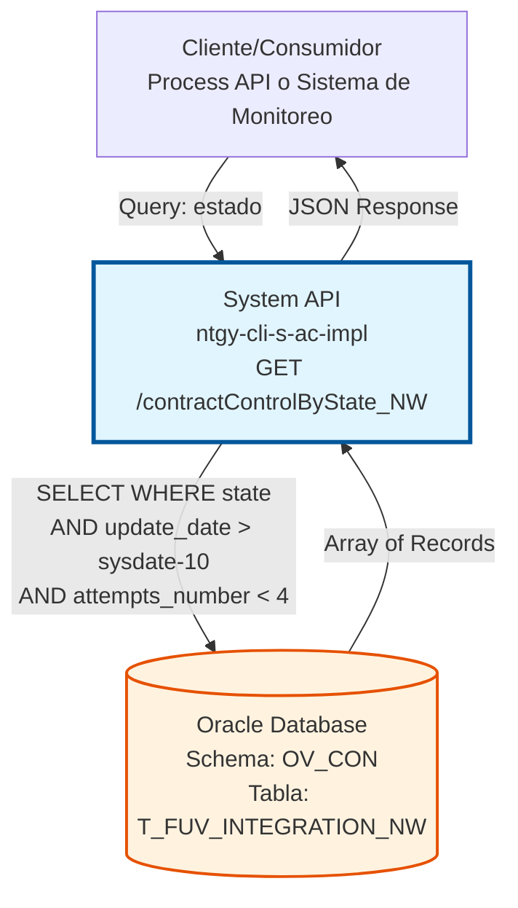
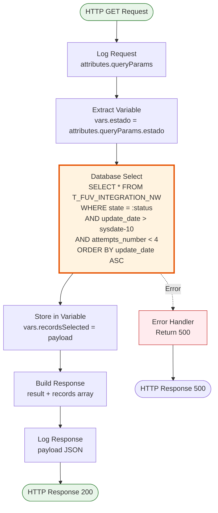
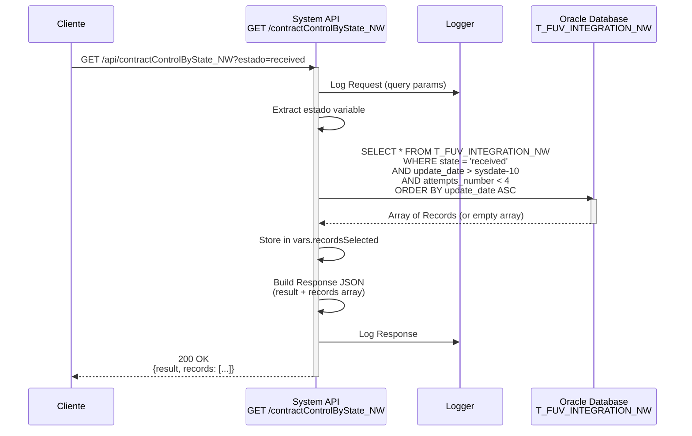
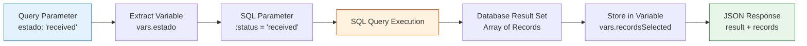

# GET /contractControlByState_NW

## 📌 Descripción General

### Propósito del Endpoint

Este endpoint permite consultar registros de control de contratos NEWCO filtrados por estado, con restricciones temporales y de reintentos. Está diseñado específicamente para monitoreo y procesamiento de contratos que requieren atención o reprocesamiento.

El endpoint soporta:
- **Filtrado por Estado**: Búsqueda de contratos en un estado específico (received, processing, completed, error, etc.)
- **Ventana Temporal**: Solo retorna registros actualizados en los últimos 10 días
- **Control de Reintentos**: Excluye registros con 4 o más intentos fallidos
- **Ordenamiento Temporal**: Resultados ordenados por fecha de actualización ascendente (más antiguos primero)

### Tipo de API

**Capa:** System API (API-Led Connectivity)

**Función:** Integración directa con Oracle Database (schema OV_CON) para consulta de contratos NEWCO que requieren procesamiento o monitoreo.

### Patrón de Integración

**Tipo:** Request-Reply Síncrono con Query SQL Filtrada

**Descripción:** El endpoint recibe un estado como query parameter, ejecuta una consulta SQL con múltiples filtros (estado, fecha de actualización, número de reintentos), y retorna todos los registros que cumplen los criterios, ordenados por antigüedad de actualización.

### Arquitectura API-Led Connectivity



---

## 💼 Propósito del Negocio

### Casos de Uso Principales

1. **Monitoreo de Contratos Pendientes**
   - Identificar contratos en estado "received" que esperan procesamiento
   - Obtener lista de contratos para procesamiento batch
   - Priorizar contratos más antiguos primero

2. **Gestión de Errores y Reintentos**
   - Consultar contratos en estado "error" para análisis
   - Identificar contratos que requieren intervención manual
   - Excluir automáticamente contratos con demasiados reintentos (≥4)

3. **Seguimiento de Procesamiento**
   - Verificar contratos en estado "processing"
   - Detectar contratos estancados (actualizados hace tiempo)
   - Monitorear progreso de sincronización NEWCO

4. **Auditoría y Reporting**
   - Generar reportes de contratos por estado
   - Analizar volumen de contratos en cada estado
   - Identificar patrones de fallo o cuellos de botella

### Contexto Empresarial

- **Dominio:** Gestión de Contratos - Alta de Clientes
- **Sector:** Energía - Utilities
- **División:** Naturgy España - NEWCO
- **Proceso de Negocio:** Monitoreo y control de sincronización de contratos con sistema NEWCO
- **Sistema:** Oracle Database (AC Schema)

### Stakeholders

- **Sistemas de Procesamiento Batch**: Necesitan lista de contratos pendientes para procesamiento automático
- **Equipos de Monitoreo**: Requieren visibilidad de contratos en diferentes estados
- **Equipos de Soporte**: Consultan contratos con errores para resolución de incidencias
- **Process APIs**: Consumen este endpoint para orquestar flujos de reprocesamiento

### Valor de Negocio

- **Procesamiento Eficiente**: Identificación rápida de contratos que requieren atención
- **Control de Calidad**: Filtrado automático de contratos con demasiados reintentos
- **Priorización Inteligente**: Ordenamiento por antigüedad asegura procesamiento FIFO
- **Prevención de Sobrecarga**: Ventana temporal de 10 días evita procesamiento de datos obsoletos

### Consumidores Potenciales

Este endpoint puede ser consumido por:
- Process APIs de sincronización de contratos
- Sistemas de procesamiento batch y schedulers
- Herramientas de monitoreo y alertas
- Dashboards de operaciones
- Sistemas de gestión de colas de trabajo

---

## 🔧 Especificación Técnica

### URLs por Ambiente

| Ambiente | URL Base | URL Completa |
|----------|----------|--------------|
| **Local** | `http://localhost:8081` | `http://localhost:8081/api/contractControlByState_NW?estado={state}` |
| **Development** | `https://ntgy-cli-s-ac-dev.us-e2.cloudhub.io` | `https://ntgy-cli-s-ac-dev.us-e2.cloudhub.io/api/contractControlByState_NW?estado={state}` |
| **QA** | `https://ntgy-cli-s-ac-cc.us-e2.cloudhub.io` | `https://ntgy-cli-s-ac-cc.us-e2.cloudhub.io/api/contractControlByState_NW?estado={state}` |
| **Pre-Production** | `https://ntgy-cli-s-ac-cl.us-e2.cloudhub.io` | `https://ntgy-cli-s-ac-cl.us-e2.cloudhub.io/api/contractControlByState_NW?estado={state}` |
| **Production** | `https://ntgy-cli-s-ac-pro.us-e2.cloudhub.io` | `https://ntgy-cli-s-ac-pro.us-e2.cloudhub.io/api/contractControlByState_NW?estado={state}` |

### Método HTTP

```
GET /api/contractControlByState_NW
```

### Parámetros de Entrada

#### Headers HTTP

| Header | Tipo | Requerido | Descripción | Ejemplo |
|--------|------|-----------|-------------|---------|
| `Accept` | string | ❌ No | Tipo de contenido esperado en response | `application/json` |

#### Query Parameters

| Parámetro | Tipo | Requerido | Descripción | Ejemplo |
|-----------|------|-----------|-------------|---------|
| `estado` | string | ✅ Sí | Estado del contrato a filtrar | `"received"`, `"processing"`, `"error"`, `"completed"` |

**Validaciones:**
- `estado` no puede estar vacío
- Debe corresponder a un valor válido de estado en la tabla
- Valores comunes: `received`, `processing`, `error`, `completed`, `pending`

**Filtros Automáticos Aplicados:**
- Solo registros con `update_date > sysdate - 10` (últimos 10 días)
- Solo registros con `attempts_number < 4` (menos de 4 reintentos)
- Ordenamiento por `update_date ASC` (más antiguos primero)

### Respuestas

#### Respuesta Exitosa (200 OK)

**Cuando se encuentran contratos:**

```json
{
  "result": {
    "codResult": "0000",
    "msgResult": "No hay error"
  },
  "records": [
    {
      "T_FUV_INTEGRATION_NW_ID": 12345,
      "CONTRACT_ID": "CNT-001",
      "STATE": "received",
      "CREATE_DATE": "2026-07-10T08:30:00",
      "UPDATE_DATE": "2026-07-10T08:30:00",
      "ATTEMPTS_NUMBER": 0,
      "SYSTEM_MESSAGE": "Frontal",
      "CODE": "received",
      "MESSAGE": "{\"orderId\":\"CNT-001\",\"customerId\":\"CUST-123\"}",
      "RESPONSE": null,
      "ERROR": null,
      "CONTRACT_ATR": 0
    },
    {
      "T_FUV_INTEGRATION_NW_ID": 12346,
      "CONTRACT_ID": "CNT-002",
      "STATE": "received",
      "CREATE_DATE": "2026-07-11T09:15:00",
      "UPDATE_DATE": "2026-07-11T09:15:00",
      "ATTEMPTS_NUMBER": 1,
      "SYSTEM_MESSAGE": "Frontal",
      "CODE": "received",
      "MESSAGE": "{\"orderId\":\"CNT-002\",\"customerId\":\"CUST-456\"}",
      "RESPONSE": null,
      "ERROR": null,
      "CONTRACT_ATR": 0
    }
  ]
}
```

**Estructura de la Respuesta:**
- `result`: Objeto con código y mensaje de resultado
  - `codResult`: "0000" indica éxito
  - `msgResult`: Descripción del resultado
- `records`: Array de objetos con todos los campos de la tabla `T_FUV_INTEGRATION_NW`

#### Respuesta cuando No se Encuentran Registros (200 OK)

```json
{
  "result": {
    "codResult": "0000",
    "msgResult": "No hay error"
  },
  "records": []
}
```

#### Respuesta de Error Técnico (500)

```json
{
  "error": "APP_9999",
  "message": "Error en el servicio."
}
```

### Códigos de Estado HTTP

| Código | Descripción | Cuándo Ocurre |
|--------|-------------|---------------|
| `200` | OK | Consulta ejecutada correctamente (con o sin resultados) |
| `400` | Bad Request | Parámetro `estado` faltante o inválido |
| `500` | Internal Server Error | Error en la conexión a base de datos o error interno |

### Autenticación y Autorización

- **Tipo:** Client ID & Client Secret (Anypoint Platform)
- **Autorización Oracle:** El usuario de base de datos debe tener permisos para:
  - Ejecutar SELECT en tabla `T_FUV_INTEGRATION_NW`
  - Acceso al schema `OV_CON`

### Timeouts

| Tipo | Valor | Descripción |
|------|-------|-------------|
| **Query Timeout** | 30 segundos | Tiempo máximo de ejecución de la query SQL |
| **Connection Timeout** | 10 segundos | Tiempo máximo para establecer conexión con Oracle |

---

## 🏗️ Implementación Técnica

### Arquitectura del Flow



### Componentes del Flow

#### 1. Logger Inicial
```xml
<logger level="INFO" doc:name="request" message="#[%dw 2.0
output application/java
var payloadStr = write(attributes.queryParams,'application/json')
var request = common::commonFunctions::normalizeJSON(payloadStr)
---
'STARTING getContractControlByState_NW METHOD. REQUEST: ' ++ request]"/>
```

**Propósito:** Registrar el inicio de la operación con los query parameters recibidos.

**Ubicación en código:** Línea 204 de `s-ac-contractControl_NW.xml`

#### 2. Extracción de Variable
```xml
<ee:transform doc:name="var estado">
    <ee:variables>
        <ee:set-variable variableName="estado"><![CDATA[%dw 2.0
output application/java
---
attributes.queryParams.estado
]]></ee:set-variable>
    </ee:variables>
</ee:transform>
```

**Propósito:** Extraer el parámetro `estado` de los query parameters y almacenarlo en una variable para uso posterior.

**Ubicación en código:** Líneas 211-220 de `s-ac-contractControl_NW.xml`

#### 3. Query a Base de Datos
```xml
<db:select doc:name="Select" config-ref="Database_Config">
    <db:sql><![CDATA[${queries.getContractControlByState_NW}]]></db:sql>
    <db:input-parameters><![CDATA[#[{status: vars.estado}]]]></db:input-parameters>
</db:select>
```

**Query SQL Ejecutada:**
```sql
SELECT * FROM T_FUV_INTEGRATION_NW 
WHERE state = :status 
  AND update_date > sysdate - 10 
  AND attempts_number < 4 
ORDER BY update_date ASC
```

**Ubicación de la Query:** 
- Archivo de configuración: `s-ac-{env}-config.yaml`
- Propiedad: `queries.getContractControlByState_NW`
- Línea en XML: 222-225 de `s-ac-contractControl_NW.xml`

**Características:**
- Operación: `db:select` (retorna múltiples resultados)
- Parámetro: `:status` mapeado desde `vars.estado`
- Filtro temporal: `update_date > sysdate - 10` (últimos 10 días)
- Filtro de reintentos: `attempts_number < 4` (menos de 4 intentos)
- Ordenamiento: Por `update_date ASC` (más antiguos primero)
- Retorna: Todos los campos de la tabla (`SELECT *`)

**Lógica de Negocio:**
- **Ventana Temporal de 10 días**: Evita procesar datos obsoletos y mejora performance
- **Límite de Reintentos < 4**: Excluye contratos que han fallado repetidamente y requieren intervención manual
- **Ordenamiento Ascendente**: Asegura procesamiento FIFO (First In, First Out) de contratos más antiguos

#### 4. Almacenamiento en Variable
```xml
<ee:transform doc:name="vars recordsSelected">
    <ee:variables>
        <ee:set-variable variableName="recordsSelected"><![CDATA[%dw 2.0
output application/java
---
payload]]></ee:set-variable>
    </ee:variables>
</ee:transform>
```

**Propósito:** Almacenar el array de resultados en `vars.recordsSelected` para construcción de respuesta.

**Ubicación en código:** Líneas 226-235 de `s-ac-contractControl_NW.xml`

#### 5. Construcción de Respuesta
```xml
<ee:transform doc:name="response">
    <ee:message>
        <ee:set-payload><![CDATA[%dw 2.0
output application/json
---
{
    "result": {
        "codResult": "0000",
        "msgResult": "No hay error",
    },
    "records": vars.recordsSelected
}]]></ee:set-payload>
    </ee:message>
</ee:transform>
```

**Propósito:** Construir la respuesta JSON con estructura estandarizada que incluye código de resultado y array de registros.

**Ubicación en código:** Líneas 236-248 de `s-ac-contractControl_NW.xml`

#### 6. Logger Final
```xml
<logger level="INFO" doc:name="response" message="#[%dw 2.0
output application/java
var payloadStr = write(payload,'application/json')
var response = common::commonFunctions::normalizeJSON(payloadStr)
---
'FINISHED getContractControlByState_NW METHOD. RESPONSE: ' ++ response]"/>
```

**Propósito:** Registrar la respuesta completa antes de retornarla al cliente.

**Ubicación en código:** Líneas 249-256 de `s-ac-contractControl_NW.xml`

### Diagrama de Secuencia



### Diagrama de Transformación de Datos



### Configuración de Base de Datos

**Connector:** `Database_Config`

```xml
<db:config name="Database_Config">
    <db:generic-connection 
        url="jdbc:oracle:thin:${dbAC.user}/${secure::dbAC.pass}@..."
        driverClassName="oracle.jdbc.driver.OracleDriver">
        <db:pooling-profile 
            maxPoolSize="${dbAC.MaxPoolSize}"
            maxWait="${dbAC.MaxWaitTime}"
            maxIdleTime="${dbAC.MaxIdleTime}"/>
    </db:generic-connection>
</db:config>
```

**Características:**
- Driver: Oracle JDBC 19.13.0.0.1
- Connection Pooling: Configurado por ambiente
- Secure Properties: Credenciales encriptadas
- Oracle RAC: Soporte para failover automático

### Tabla de Base de Datos

**Tabla:** `T_FUV_INTEGRATION_NW`

**Schema:** `OV_CON` (Administración Comercial)

**Campos Principales:**
- `T_FUV_INTEGRATION_NW_ID`: ID único del registro (clave primaria)
- `CONTRACT_ID`: Identificador del contrato
- `STATE`: Estado del contrato (campo de filtrado principal)
- `UPDATE_DATE`: Fecha de última actualización (usado para filtro temporal y ordenamiento)
- `ATTEMPTS_NUMBER`: Número de intentos de procesamiento (usado para filtro de reintentos)
- `CREATE_DATE`: Fecha de creación del registro
- `SYSTEM_MESSAGE`: Sistema origen del mensaje
- `CODE`: Código de estado
- `MESSAGE`: Mensaje JSON con datos del contrato
- `RESPONSE`: Respuesta del sistema externo
- `ERROR`: Mensaje de error si existe
- `CONTRACT_ATR`: Atributo adicional del contrato

**Índices Recomendados:**
- Índice compuesto en `(STATE, UPDATE_DATE, ATTEMPTS_NUMBER)` para optimizar la query
- Índice en `CONTRACT_ID` para búsquedas por contrato

### Manejo de Errores

**Error Handler Global:** `s-ac-globalErrorHandler`

**Tipos de Error:**

1. **Database Connection Error**
   - Código: 500
   - Mensaje: "Error en el servicio."
   - Causa: Fallo en conexión a Oracle

2. **Query Execution Error**
   - Código: 500
   - Mensaje: "Error en el servicio."
   - Causa: Error en ejecución de SQL

3. **Missing Parameter**
   - Código: 400
   - Mensaje: Validación de APIKit
   - Causa: Parámetro `estado` no proporcionado

### Performance y Optimización

**Estrategias Implementadas:**
- Connection pooling para reutilización de conexiones
- Filtro temporal (10 días) reduce volumen de datos escaneados
- Filtro de reintentos (< 4) limita resultados a registros procesables
- Ordenamiento en base de datos (no en aplicación)
- Índices en campos de filtrado para búsquedas eficientes

**Métricas Esperadas:**
- Tiempo de respuesta: < 3 segundos (p95)
- Throughput: 50+ requests/minuto
- Connection pool utilization: < 80%
- Volumen típico de resultados: 10-100 registros por estado

**Consideraciones de Escalabilidad:**
- Si el volumen de resultados crece, considerar paginación
- Monitorear performance de la query con diferentes estados
- Ajustar ventana temporal (10 días) según necesidades de negocio

---

## 💻 Ejemplos de Uso

### Ejemplo 1: Consulta de Contratos Pendientes con curl

```bash
curl -X GET "http://localhost:8081/api/contractControlByState_NW?estado=received" \
  -H "Accept: application/json"
```

**Respuesta (200 OK):**
```json
{
  "result": {
    "codResult": "0000",
    "msgResult": "No hay error"
  },
  "records": [
    {
      "T_FUV_INTEGRATION_NW_ID": 12345,
      "CONTRACT_ID": "CNT-001",
      "STATE": "received",
      "CREATE_DATE": "2026-07-10T08:30:00.000Z",
      "UPDATE_DATE": "2026-07-10T08:30:00.000Z",
      "ATTEMPTS_NUMBER": 0,
      "SYSTEM_MESSAGE": "Frontal",
      "CODE": "received",
      "MESSAGE": "{\"orderId\":\"CNT-001\",\"customerId\":\"CUST-123\",\"productId\":\"PROD-456\"}",
      "RESPONSE": null,
      "ERROR": null,
      "CONTRACT_ATR": 0
    },
    {
      "T_FUV_INTEGRATION_NW_ID": 12346,
      "CONTRACT_ID": "CNT-002",
      "STATE": "received",
      "CREATE_DATE": "2026-07-11T09:15:00.000Z",
      "UPDATE_DATE": "2026-07-11T09:15:00.000Z",
      "ATTEMPTS_NUMBER": 1,
      "SYSTEM_MESSAGE": "Frontal",
      "CODE": "received",
      "MESSAGE": "{\"orderId\":\"CNT-002\",\"customerId\":\"CUST-456\"}",
      "RESPONSE": null,
      "ERROR": null,
      "CONTRACT_ATR": 0
    }
  ]
}
```

### Ejemplo 2: Consulta de Contratos con Error

```bash
curl -X GET "http://localhost:8081/api/contractControlByState_NW?estado=error" \
  -H "Accept: application/json"
```

**Respuesta (200 OK):**
```json
{
  "result": {
    "codResult": "0000",
    "msgResult": "No hay error"
  },
  "records": [
    {
      "T_FUV_INTEGRATION_NW_ID": 12350,
      "CONTRACT_ID": "CNT-ERR-001",
      "STATE": "error",
      "CREATE_DATE": "2026-07-12T10:00:00.000Z",
      "UPDATE_DATE": "2026-07-14T15:30:00.000Z",
      "ATTEMPTS_NUMBER": 2,
      "SYSTEM_MESSAGE": "Frontal",
      "CODE": "error",
      "MESSAGE": "{\"orderId\":\"CNT-ERR-001\"}",
      "RESPONSE": null,
      "ERROR": "Connection timeout to external system",
      "CONTRACT_ATR": 0
    }
  ]
}
```

### Ejemplo 3: Sin Resultados

```bash
curl -X GET "http://localhost:8081/api/contractControlByState_NW?estado=completed" \
  -H "Accept: application/json"
```

**Respuesta (200 OK):**
```json
{
  "result": {
    "codResult": "0000",
    "msgResult": "No hay error"
  },
  "records": []
}
```

### Ejemplo 4: Error - Parámetro Faltante

```bash
curl -X GET "http://localhost:8081/api/contractControlByState_NW" \
  -H "Accept: application/json"
```

**Respuesta (400 Bad Request):**
```json
{
  "message": "Bad request"
}
```

### Ejemplo 5: Uso desde JavaScript/Node.js

```javascript
const axios = require('axios');

async function getContractsByState(state) {
  try {
    const response = await axios.get(
      'http://localhost:8081/api/contractControlByState_NW',
      {
        params: {
          estado: state
        },
        headers: {
          'Accept': 'application/json'
        }
      }
    );
    
    if (response.data.result.codResult === '0000') {
      const contracts = response.data.records;
      console.log(`Encontrados ${contracts.length} contratos en estado '${state}'`);
      
      // Procesar cada contrato
      contracts.forEach((contract, index) => {
        console.log(`\nContrato ${index + 1}:`);
        console.log(`  ID: ${contract.CONTRACT_ID}`);
        console.log(`  Estado: ${contract.STATE}`);
        console.log(`  Intentos: ${contract.ATTEMPTS_NUMBER}`);
        console.log(`  Última actualización: ${contract.UPDATE_DATE}`);
        
        if (contract.ERROR) {
          console.log(`  Error: ${contract.ERROR}`);
        }
      });
      
      return contracts;
    } else {
      console.error('Error en la consulta:', response.data.result.msgResult);
      return [];
    }
  } catch (error) {
    console.error('Error en la petición:', error.message);
    throw error;
  }
}

// Uso: Obtener contratos pendientes
getContractsByState('received')
  .then(contracts => {
    console.log(`\nTotal de contratos pendientes: ${contracts.length}`);
  })
  .catch(err => console.error(err));

// Uso: Obtener contratos con error
getContractsByState('error')
  .then(contracts => {
    console.log(`\nTotal de contratos con error: ${contracts.length}`);
  })
  .catch(err => console.error(err));
```

### Ejemplo 6: Uso desde Python para Procesamiento Batch

```python
import requests
import json
from datetime import datetime

def get_contracts_by_state(state):
    """
    Consulta contratos por estado para procesamiento batch
    
    Args:
        state (str): Estado de los contratos a consultar
        
    Returns:
        list: Lista de contratos en el estado especificado
    """
    url = "http://localhost:8081/api/contractControlByState_NW"
    params = {"estado": state}
    headers = {"Accept": "application/json"}
    
    try:
        response = requests.get(url, params=params, headers=headers)
        response.raise_for_status()
        
        data = response.json()
        
        if data['result']['codResult'] == '0000':
            contracts = data['records']
            print(f"Encontrados {len(contracts)} contratos en estado '{state}'")
            return contracts
        else:
            print(f"Error: {data['result']['msgResult']}")
            return []
            
    except requests.exceptions.RequestException as e:
        print(f"Error en la petición: {e}")
        raise

def process_pending_contracts():
    """
    Procesa contratos pendientes en orden FIFO
    """
    print("=== Iniciando procesamiento de contratos pendientes ===")
    
    # Obtener contratos en estado 'received'
    contracts = get_contracts_by_state('received')
    
    if not contracts:
        print("No hay contratos pendientes para procesar")
        return
    
    print(f"\nProcesando {len(contracts)} contratos...")
    
    for idx, contract in enumerate(contracts, 1):
        contract_id = contract['CONTRACT_ID']
        attempts = contract['ATTEMPTS_NUMBER']
        update_date = contract['UPDATE_DATE']
        
        print(f"\n[{idx}/{len(contracts)}] Procesando contrato: {contract_id}")
        print(f"  Intentos previos: {attempts}")
        print(f"  Última actualización: {update_date}")
        
        # Aquí iría la lógica de procesamiento del contrato
        # Por ejemplo: llamar a otro endpoint, actualizar estado, etc.
        
    print("\n=== Procesamiento completado ===")

# Uso
if __name__ == "__main__":
    process_pending_contracts()
```

### Ejemplo 7: Integración en Process API

```xml
<!-- Llamada desde un Process API para obtener contratos pendientes -->
<flow name="process-batch-contracts-flow">
    <!-- Obtener contratos en estado 'received' -->
    <http:request 
        method="GET" 
        config-ref="System_API_Config"
        path="/api/contractControlByState_NW">
        <http:query-params><![CDATA[#[{
            estado: 'received'
        }]]]></http:query-params>
    </http:request>
    
    <!-- Validar que hay contratos para procesar -->
    <choice doc:name="Check if contracts exist">
        <when expression="#[sizeOf(payload.records) > 0]">
            <!-- Procesar cada contrato -->
            <foreach doc:name="For Each Contract" collection="#[payload.records]">
                <logger message="Processing contract: #[payload.CONTRACT_ID]"/>
                
                <!-- Lógica de procesamiento aquí -->
                <flow-ref name="process-single-contract-subflow"/>
            </foreach>
            
            <logger message="Processed #[sizeOf(payload.records)] contracts"/>
        </when>
        <otherwise>
            <logger message="No contracts to process"/>
        </otherwise>
    </choice>
</flow>
```

### Ejemplo 8: Monitoreo con Scheduler

```xml
<!-- Scheduler para monitoreo automático de contratos con error -->
<flow name="monitor-error-contracts-flow">
    <scheduler doc:name="Every 15 minutes">
        <scheduling-strategy>
            <fixed-frequency frequency="15" timeUnit="MINUTES"/>
        </scheduling-strategy>
    </scheduler>
    
    <!-- Consultar contratos con error -->
    <http:request 
        method="GET" 
        config-ref="System_API_Config"
        path="/api/contractControlByState_NW">
        <http:query-params><![CDATA[#[{
            estado: 'error'
        }]]]></http:query-params>
    </http:request>
    
    <!-- Verificar si hay contratos con error -->
    <choice doc:name="Check error count">
        <when expression="#[sizeOf(payload.records) > 10]">
            <!-- Enviar alerta si hay más de 10 contratos con error -->
            <logger level="WARN" 
                message="ALERT: #[sizeOf(payload.records)] contracts in error state"/>
            
            <!-- Aquí se podría enviar notificación por email, Slack, etc. -->
        </when>
        <otherwise>
            <logger message="Error contracts: #[sizeOf(payload.records)]"/>
        </otherwise>
    </choice>
</flow>
```
