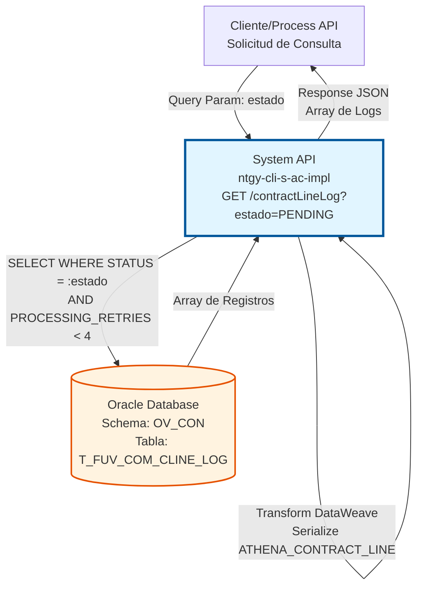
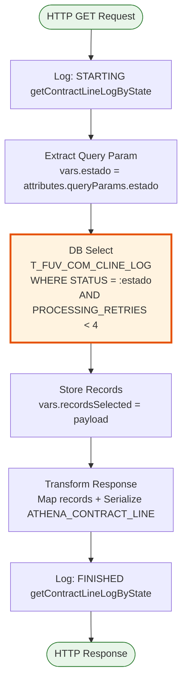
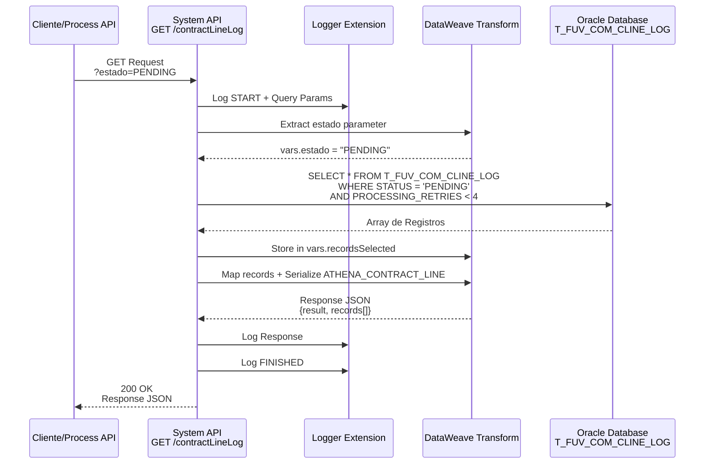
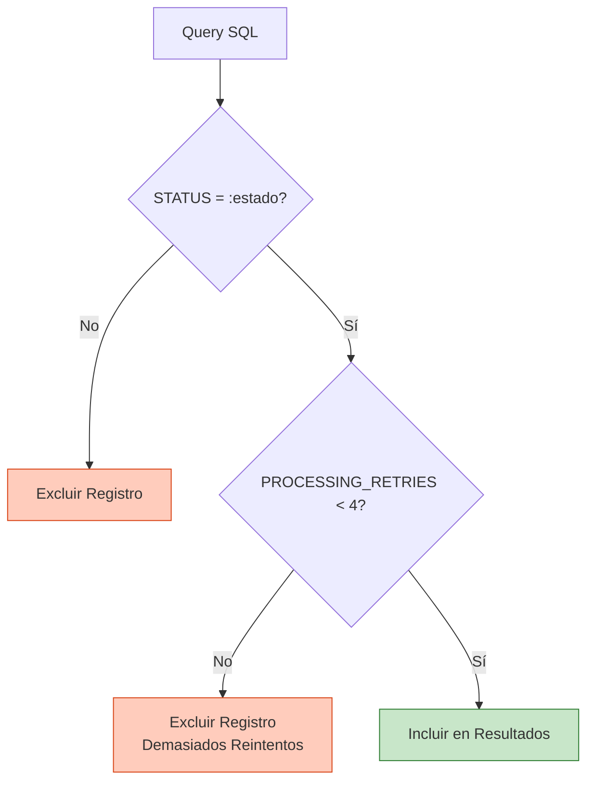

# GET /contractLineLog

## 📌 Descripción General

### Propósito del Endpoint

Este endpoint permite consultar registros de log de líneas de contrato almacenados en la tabla `T_FUV_COM_CLINE_LOG` de Oracle Database, filtrando por estado específico. Incluye un filtro automático que solo devuelve registros con menos de 4 reintentos de procesamiento, evitando así la recuperación de registros que han fallado repetidamente.

El endpoint soporta:
- **Consulta por Estado**: Filtra logs por estado específico (PENDING, PROCESSED, ERROR, etc.)
- **Filtro de Reintentos**: Automáticamente excluye registros con 4 o más reintentos
- **Recuperación Completa**: Devuelve todos los campos de cada registro incluyendo datos de Athena
- **Soporte a Procesos Batch**: Diseñado para procesos que necesitan identificar logs pendientes

### Tipo de API

**Capa:** System API (API-Led Connectivity)

**Función:** Integración directa con Oracle Database (schema OV_CON) para consultas de logs de líneas de contrato con filtrado por estado y reintentos.

### Patrón de Integración

**Tipo:** Request-Reply Síncrono con SELECT en Oracle Database

**Descripción:** El endpoint recibe el parámetro de estado, ejecuta una consulta SELECT con filtros de estado y reintentos, transforma los resultados mediante DataWeave (serializando el campo ATHENA_CONTRACT_LINE a JSON), y retorna un array de registros.

### Arquitectura API-Led Connectivity



---

## 💼 Propósito del Negocio

### Casos de Uso Principales

1. **Consulta de Logs Pendientes de Procesamiento**
   - Identificar líneas de contrato que requieren procesamiento
   - Alimentar procesos batch que procesan logs pendientes
   - Monitorear cola de trabajo pendiente

2. **Monitoreo de Errores**
   - Consultar logs en estado ERROR para análisis
   - Identificar patrones de fallos
   - Generar reportes de incidencias

3. **Reconciliación de Datos**
   - Verificar estado de sincronización con Athena
   - Comparar datos entre sistemas
   - Auditar procesamiento de líneas de contrato

4. **Gestión de Reintentos**
   - Identificar logs que requieren reintento
   - Excluir automáticamente logs con demasiados reintentos
   - Prevenir loops infinitos de procesamiento

### Contexto Empresarial

- **Dominio:** Gestión de Contratos y Auditoría
- **Sector:** Energía - Utilities
- **División:** Naturgy España - NewCo
- **Proceso de Negocio:** Consulta y monitoreo de logs de sincronización de líneas de contrato con Athena
- **Sistema Backend:** Oracle Database (AC Schema - Administración Comercial)

### Stakeholders

- **Procesos Batch**: Consultan logs pendientes para procesamiento automático
- **Equipos de Operaciones**: Monitorean estado de sincronizaciones
- **Equipos de Soporte**: Investigan errores y problemas de procesamiento
- **Sistemas de Monitoreo**: Consultan logs para alertas y métricas

### Valor de Negocio

- **Visibilidad Operacional**: Permite monitorear estado de procesamiento en tiempo real
- **Prevención de Loops**: Filtro automático de reintentos evita procesamiento infinito
- **Soporte a Automatización**: Facilita procesos batch de reconciliación
- **Gestión de Errores**: Permite identificar y resolver problemas rápidamente

### Consumidores Potenciales

Este endpoint puede ser consumido por:
- Process APIs de gestión de contratos
- Procesos batch de reconciliación con Athena
- Sistemas de monitoreo y alertas
- Herramientas de reporting y análisis
- Dashboards operacionales

---

## 🔧 Especificación Técnica

### URLs por Ambiente

| Ambiente | URL Base | URL Completa |
|----------|----------|--------------|
| **Local** | `http://localhost:8081` | `http://localhost:8081/api/contractLineLog?estado=PENDING` |
| **Development** | `https://ntgy-cli-s-ac-impl-dev.us-e2.cloudhub.io` | `https://ntgy-cli-s-ac-impl-dev.us-e2.cloudhub.io/api/contractLineLog?estado=PENDING` |
| **QA** | `https://ntgy-cli-s-ac-impl-cc.us-e2.cloudhub.io` | `https://ntgy-cli-s-ac-impl-cc.us-e2.cloudhub.io/api/contractLineLog?estado=PENDING` |
| **Pre-Production** | `https://ntgy-cli-s-ac-impl-cl.us-e2.cloudhub.io` | `https://ntgy-cli-s-ac-impl-cl.us-e2.cloudhub.io/api/contractLineLog?estado=PENDING` |
| **Production** | `https://ntgy-cli-s-ac-impl-pro.us-e2.cloudhub.io` | `https://ntgy-cli-s-ac-impl-pro.us-e2.cloudhub.io/api/contractLineLog?estado=PENDING` |

### Método HTTP

```
GET /api/contractLineLog?estado={estado}
```

### Parámetros de Entrada

#### Headers HTTP

| Header | Tipo | Requerido | Descripción | Ejemplo |
|--------|------|-----------|-------------|---------|
| `Accept` | string | ❌ No | Tipo de contenido esperado en response | `application/json` |

#### Query Parameters

| Parámetro | Tipo | Requerido | Descripción | Valores Comunes |
|-----------|------|-----------|-------------|-----------------|
| `estado` | string | ✅ Sí | Estado de los logs a consultar. Filtro exacto (case-sensitive) | `PENDING`, `PROCESSED`, `ERROR`, `RETRY` |

> **⚠️ Nota Importante sobre el Filtro de Reintentos:**
> Este endpoint incluye un **filtro automático** que solo devuelve registros con `PROCESSING_RETRIES < 4`.
> Los registros con 4 o más reintentos NO serán incluidos en la respuesta, independientemente de su estado.

### Respuestas

#### Respuesta Exitosa (200 OK)

Cuando se encuentran registros que coinciden con el filtro:

```json
{
  "result": {
    "codResult": "0000",
    "msgResult": "No hay error"
  },
  "records": [
    {
      "T_FUV_COM_CLINE_LOG_ID": 12345,
      "CONTRACT_LINE_ID": "CL-2024-12345",
      "ATHENA_CONTRACT_LINE": "{\"lineId\":\"CL-2024-12345\",\"contractReference\":\"CON-2024-001\"}",
      "AC_EXTRA_DATA": null,
      "STATUS": "PENDING",
      "PROCESSING_RETRIES": 1,
      "ERROR": null,
      "PROCESSING_DATE": "2024-01-15T10:30:00",
      "UPDATE_DATE": null
    },
    {
      "T_FUV_COM_CLINE_LOG_ID": 12346,
      "CONTRACT_LINE_ID": "CL-2024-12346",
      "ATHENA_CONTRACT_LINE": "{\"lineId\":\"CL-2024-12346\",\"contractReference\":\"CON-2024-002\"}",
      "AC_EXTRA_DATA": null,
      "STATUS": "PENDING",
      "PROCESSING_RETRIES": 2,
      "ERROR": null,
      "PROCESSING_DATE": "2024-01-15T11:00:00",
      "UPDATE_DATE": null
    }
  ]
}
```

#### Respuesta Sin Resultados (200 OK)

Cuando no se encuentran registros que coincidan con el filtro:

```json
{
  "result": {
    "codResult": "0000",
    "msgResult": "No hay error"
  },
  "records": []
}
```

#### Respuesta de Error Técnico (500)

```json
{
  "error": "APP_9999",
  "message": "Error en el servicio."
}
```

### Estructura de los Campos de Respuesta

| Campo | Tipo | Descripción |
|-------|------|-------------|
| `T_FUV_COM_CLINE_LOG_ID` | number | ID único del registro (generado por secuencia Oracle) |
| `CONTRACT_LINE_ID` | string | Identificador de la línea de contrato |
| `ATHENA_CONTRACT_LINE` | string | Datos de Athena serializados como JSON string |
| `AC_EXTRA_DATA` | string/null | Datos adicionales (opcional) |
| `STATUS` | string | Estado actual del log |
| `PROCESSING_RETRIES` | number | Número de reintentos de procesamiento (siempre < 4 en respuesta) |
| `ERROR` | string/null | Mensaje de error si aplica |
| `PROCESSING_DATE` | string | Fecha de creación del registro (formato ISO 8601) |
| `UPDATE_DATE` | string/null | Fecha de última actualización |

### Códigos de Respuesta HTTP

| Código | Descripción | Escenario |
|--------|-------------|-----------|
| `200` | OK | Consulta ejecutada correctamente (con o sin resultados) |
| `400` | Bad Request | Parámetro `estado` faltante o inválido |
| `500` | Internal Server Error | Error técnico en el servidor o base de datos |

### Autenticación y Autorización

- **Tipo:** Client ID & Client Secret (Anypoint Platform)
- **Autorización Oracle:** El usuario de base de datos debe tener permisos para:
  - Ejecutar SELECT en tabla `T_FUV_COM_CLINE_LOG`
  - Acceso de lectura en schema `OV_CON`

### Timeouts

| Tipo | Valor | Descripción |
|------|-------|-------------|
| **Request Timeout** | 30 segundos | Tiempo máximo de espera para la respuesta |
| **Connection Timeout** | 10 segundos | Tiempo máximo para establecer conexión con Oracle |

---

## 🏗️ Implementación Técnica

### Arquitectura del Flow



### Componentes del Flow

#### 1. Logger de Inicio
```xml
<logger level="INFO" doc:name="request" message="STARTING getContractLineLogByState METHOD. REQUEST: ..."/>
```
- Registra el inicio de la operación
- Normaliza y registra los query parameters

#### 2. Extracción de Parámetro
```dataweave
%dw 2.0
output application/java
---
attributes.queryParams.estado
```
- Extrae el parámetro `estado` de los query parameters
- Almacena en variable `vars.estado`

#### 3. Operación de Base de Datos

**Query SQL:**
```sql
SELECT * FROM T_FUV_COM_CLINE_LOG 
WHERE STATUS = :estado 
AND PROCESSING_RETRIES < 4
```

**Parámetros de Entrada:**
```dataweave
{
  estado: vars.estado
}
```

**Características de la Query:**
- **Filtro por Estado**: Búsqueda exacta por el campo STATUS
- **Filtro de Reintentos**: Solo registros con menos de 4 reintentos
- **SELECT ***: Devuelve todos los campos de la tabla
- **Sin ORDER BY**: Los resultados no están ordenados (orden natural de Oracle)

#### 4. Almacenamiento de Resultados
```dataweave
%dw 2.0
output application/java
---
payload
```
- Almacena el resultado del SELECT en `vars.recordsSelected`
- Mantiene el array de registros para transformación posterior

#### 5. Construcción de Respuesta
```dataweave
%dw 2.0
output application/json
---
{
  "result": {
    "codResult": "0000",
    "msgResult": "No hay error"
  }, 
  "records": vars.recordsSelected map(record, index) -> {
    "AC_EXTRA_DATA": record.AC_EXTRA_DATA,
    "T_FUV_COM_CLINE_LOG_ID": record.T_FUV_COM_CLINE_LOG_ID,
    "CONTRACT_LINE_ID": record.CONTRACT_LINE_ID,
    "ATHENA_CONTRACT_LINE": write(record.ATHENA_CONTRACT_LINE, "application/json"),
    "PROCESSING_DATE": record.PROCESSING_DATE,
    "PROCESSING_RETRIES": record.PROCESSING_RETRIES,
    "ERROR": record.ERROR,
    "UPDATE_DATE": record.UPDATE_DATE,
    "STATUS": record.STATUS
  }
}
```

**Transformaciones Aplicadas:**
- Mapea cada registro del array
- Serializa `ATHENA_CONTRACT_LINE` a JSON string usando `write()`
- Mantiene todos los campos de la tabla
- Envuelve resultados en estructura estándar con `result` y `records`

#### 6. Logger de Fin
```xml
<logger level="INFO" doc:name="response" message="FINISHED getContractLineLogByState METHOD. RESPONSE: ..."/>
```
- Registra el fin de la operación
- Normaliza y registra la respuesta generada

### Diagrama de Secuencia Completo



### Lógica de Filtrado



### Configuración de Conexión Oracle

```xml
<db:config name="Database_Config">
    <db:generic-connection 
        url="jdbc:oracle:thin:${dbAC.user}/${secure::dbAC.pass}@..."
        driverClassName="oracle.jdbc.driver.OracleDriver">
        <db:pooling-profile 
            maxPoolSize="${dbAC.MaxPoolSize}"
            maxWait="${dbAC.MaxWaitTime}"
            maxIdleTime="${dbAC.MaxIdleTime}"/>
    </db:generic-connection>
</db:config>
```

**Características:**
- **Driver:** Oracle JDBC 19.13.0.0.1
- **Connection Pooling:** Configurado por ambiente
- **Oracle RAC:** Soporte para failover automático
- **Transactional Action:** NOT_SUPPORTED (solo lectura)

### Manejo de Errores

```mermaid
flowchart TD
    Select[DB Select] --> Check{Resultados?}
    Check -->|Sí| Success[Response: 200 OK<br/>codResult = 0000<br/>records = array]
    Check -->|No| Empty[Response: 200 OK<br/>codResult = 0000<br/>records = []]
    
    Select -.->|Exception| DBError[Database Error]
    DBError --> GlobalError[Global Error Handler]
    GlobalError --> ErrorResp[Response: 500<br/>error: APP_9999]
    
    style Success fill:#c8e6c9,stroke:#2e7d32
    style Empty fill:#fff9c4,stroke:#f57f17
    style ErrorResp fill:#ffccbc,stroke:#d84315
```

**Escenarios:**

1. **Consulta Exitosa con Resultados**
   - Código: `0000`
   - Mensaje: "No hay error"
   - HTTP Status: 200
   - Array `records` con 1+ elementos

2. **Consulta Exitosa sin Resultados**
   - Código: `0000`
   - Mensaje: "No hay error"
   - HTTP Status: 200
   - Array `records` vacío `[]`

3. **Error de Base de Datos**
   - HTTP Status: 500
   - Error: `APP_9999`
   - Mensaje: "Error en el servicio."
   - Posibles causas: Conexión perdida, timeout, permisos insuficientes

### Performance y Optimización

**Características de Performance:**
- **Connection Pooling**: Reutilización de conexiones Oracle
- **SELECT Simple**: Sin joins complejos
- **Filtrado en Base de Datos**: WHERE clause reduce datos transferidos
- **Índices Recomendados**: 
  - Índice en columna `STATUS` para búsquedas rápidas
  - Índice compuesto en `(STATUS, PROCESSING_RETRIES)` para mejor performance

**Métricas Esperadas:**
- Tiempo de respuesta: < 1 segundo (p95) para consultas típicas
- Throughput: 200+ requests/minuto
- Tasa de error: < 0.1%

**Consideraciones de Volumen:**
- Si la tabla crece significativamente, considerar paginación
- Monitorear performance con estados que devuelven muchos registros
- Evaluar índices adicionales según patrones de uso

---

## 💻 Ejemplos de Uso

### Ejemplo 1: Consultar Logs Pendientes

**Request:**

```bash
curl -X GET "https://ntgy-cli-s-ac-impl-dev.us-e2.cloudhub.io/api/contractLineLog?estado=PENDING" \
  -H "Accept: application/json" \
  -H "client_id: your-client-id" \
  -H "client_secret: your-client-secret"
```

**Response (200 OK):**

```json
{
  "result": {
    "codResult": "0000",
    "msgResult": "No hay error"
  },
  "records": [
    {
      "T_FUV_COM_CLINE_LOG_ID": 12345,
      "CONTRACT_LINE_ID": "CL-2024-12345",
      "ATHENA_CONTRACT_LINE": "{\"lineId\":\"CL-2024-12345\",\"contractReference\":\"CON-2024-001\",\"status\":\"active\"}",
      "AC_EXTRA_DATA": null,
      "STATUS": "PENDING",
      "PROCESSING_RETRIES": 1,
      "ERROR": null,
      "PROCESSING_DATE": "2024-01-15T10:30:00",
      "UPDATE_DATE": null
    },
    {
      "T_FUV_COM_CLINE_LOG_ID": 12346,
      "CONTRACT_LINE_ID": "CL-2024-12346",
      "ATHENA_CONTRACT_LINE": "{\"lineId\":\"CL-2024-12346\",\"contractReference\":\"CON-2024-002\"}",
      "AC_EXTRA_DATA": null,
      "STATUS": "PENDING",
      "PROCESSING_RETRIES": 2,
      "ERROR": null,
      "PROCESSING_DATE": "2024-01-15T11:00:00",
      "UPDATE_DATE": null
    }
  ]
}
```

---

### Ejemplo 2: Consultar Logs con Error

**Request:**

```bash
curl -X GET "https://ntgy-cli-s-ac-impl-pro.us-e2.cloudhub.io/api/contractLineLog?estado=ERROR" \
  -H "Accept: application/json" \
  -H "client_id: your-client-id" \
  -H "client_secret: your-client-secret"
```

**Response (200 OK):**

```json
{
  "result": {
    "codResult": "0000",
    "msgResult": "No hay error"
  },
  "records": [
    {
      "T_FUV_COM_CLINE_LOG_ID": 12350,
      "CONTRACT_LINE_ID": "CL-2024-12350",
      "ATHENA_CONTRACT_LINE": "{\"lineId\":\"CL-2024-12350\"}",
      "AC_EXTRA_DATA": null,
      "STATUS": "ERROR",
      "PROCESSING_RETRIES": 3,
      "ERROR": "Connection timeout to Athena service",
      "PROCESSING_DATE": "2024-01-15T09:00:00",
      "UPDATE_DATE": "2024-01-15T12:30:00"
    }
  ]
}
```

---

### Ejemplo 3: Consulta Sin Resultados

**Request:**

```bash
curl -X GET "https://ntgy-cli-s-ac-impl-dev.us-e2.cloudhub.io/api/contractLineLog?estado=COMPLETED" \
  -H "Accept: application/json" \
  -H "client_id: your-client-id" \
  -H "client_secret: your-client-secret"
```

**Response (200 OK):**

```json
{
  "result": {
    "codResult": "0000",
    "msgResult": "No hay error"
  },
  "records": []
}
```

---

### Ejemplo 4: Uso desde JavaScript/Node.js

```javascript
const axios = require('axios');

async function getContractLineLogsByStatus(status) {
  try {
    const response = await axios.get(
      'https://ntgy-cli-s-ac-impl-pro.us-e2.cloudhub.io/api/contractLineLog',
      {
        params: {
          estado: status
        },
        headers: {
          'Accept': 'application/json',
          'client_id': process.env.CLIENT_ID,
          'client_secret': process.env.CLIENT_SECRET
        }
      }
    );

    if (response.data.result.codResult === '0000') {
      console.log(`Encontrados ${response.data.records.length} registros con estado ${status}`);
      
      // Procesar cada registro
      response.data.records.forEach(record => {
        console.log(`Log ID: ${record.T_FUV_COM_CLINE_LOG_ID}`);
        console.log(`Contract Line: ${record.CONTRACT_LINE_ID}`);
        console.log(`Reintentos: ${record.PROCESSING_RETRIES}`);
        
        // Parsear ATHENA_CONTRACT_LINE si es necesario
        const athenaData = JSON.parse(record.ATHENA_CONTRACT_LINE);
        console.log('Datos de Athena:', athenaData);
      });
      
      return { success: true, data: response.data.records };
    } else {
      console.error('Error en respuesta:', response.data.result.msgResult);
      return { success: false, error: response.data.result };
    }
  } catch (error) {
    console.error('Error técnico:', error.message);
    return { success: false, error: error.message };
  }
}

// Ejemplo de uso: Consultar logs pendientes
getContractLineLogsByStatus('PENDING')
  .then(result => {
    if (result.success) {
      console.log(`Total de logs pendientes: ${result.data.length}`);
    }
  });

// Ejemplo de uso: Consultar logs con error
getContractLineLogsByStatus('ERROR')
  .then(result => {
    if (result.success) {
      console.log(`Total de logs con error: ${result.data.length}`);
    }
  });
```

---

### Ejemplo 5: Uso desde Python

```python
import requests
import json
import os

def get_contract_line_logs_by_status(status):
    """
    Consulta logs de líneas de contrato por estado
    
    Args:
        status: Estado a consultar (PENDING, PROCESSED, ERROR, etc.)
    
    Returns:
        dict: Resultado de la operación con array de registros
    """
    url = "https://ntgy-cli-s-ac-impl-pro.us-e2.cloudhub.io/api/contractLineLog"
    
    headers = {
        "Accept": "application/json",
        "client_id": os.getenv("CLIENT_ID"),
        "client_secret": os.getenv("CLIENT_SECRET")
    }
    
    params = {
        "estado": status
    }
    
    try:
        response = requests.get(url, headers=headers, params=params, timeout=30)
        response.raise_for_status()
        
        result = response.json()
        
        if result.get("result", {}).get("codResult") == "0000":
            records = result.get("records", [])
            print(f"Encontrados {len(records)} registros con estado {status}")
            
            # Procesar cada registro
            for record in records:
                print(f"Log ID: {record['T_FUV_COM_CLINE_LOG_ID']}")
                print(f"Contract Line: {record['CONTRACT_LINE_ID']}")
                print(f"Reintentos: {record['PROCESSING_RETRIES']}")
                
                # Parsear ATHENA_CONTRACT_LINE
                athena_data = json.loads(record['ATHENA_CONTRACT_LINE'])
                print(f"Datos de Athena: {athena_data}")
                print("---")
            
            return {"success": True, "data": records}
        else:
            print(f"Error en respuesta: {result.get('result', {}).get('msgResult')}")
            return {"success": False, "error": result.get("result")}
            
    except requests.exceptions.RequestException as e:
        print(f"Error técnico: {str(e)}")
        return {"success": False, "error": str(e)}

# Ejemplo de uso: Consultar logs pendientes
result = get_contract_line_logs_by_status("PENDING")
if result["success"]:
    print(f"Total de logs pendientes: {len(result['data'])}")

# Ejemplo de uso: Consultar logs con error
result = get_contract_line_logs_by_status("ERROR")
if result["success"]:
    print(f"Total de logs con error: {len(result['data'])}")
    
    # Analizar errores
    for record in result["data"]:
        if record["ERROR"]:
            print(f"Error en {record['CONTRACT_LINE_ID']}: {record['ERROR']}")
```

---

### Ejemplo 6: Proceso Batch de Reconciliación

```python
import requests
import json
import os
from datetime import datetime

def process_pending_logs():
    """
    Proceso batch que consulta logs pendientes y los procesa
    """
    url = "https://ntgy-cli-s-ac-impl-pro.us-e2.cloudhub.io/api/contractLineLog"
    
    headers = {
        "Accept": "application/json",
        "client_id": os.getenv("CLIENT_ID"),
        "client_secret": os.getenv("CLIENT_SECRET")
    }
    
    # Consultar logs pendientes
    response = requests.get(
        url, 
        headers=headers, 
        params={"estado": "PENDING"},
        timeout=30