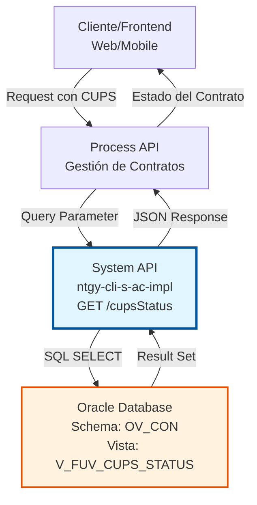
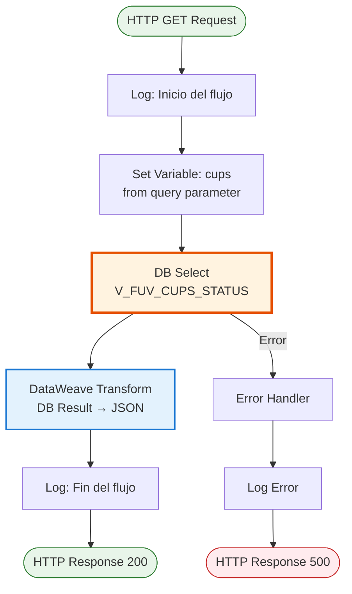
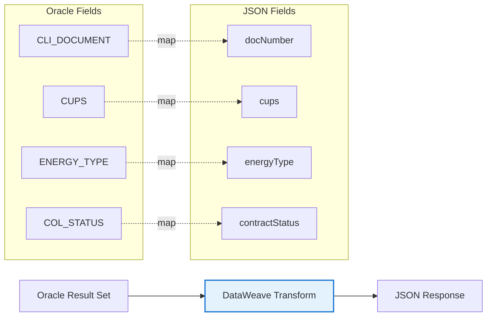

# GET /cupsStatus

## 📌 Descripción General

### Propósito del Endpoint

Este endpoint consulta el estado de contratos asociados a un CUPS (Código Universal del Punto de Suministro) específico desde la base de datos Oracle. Permite verificar la información del cliente, tipo de energía y estado del contrato para un punto de suministro determinado.

El endpoint soporta:
- **Consulta por CUPS**: Búsqueda directa usando el código único del punto de suministro
- **Información del Cliente**: Retorna el documento del cliente asociado al CUPS
- **Tipo de Energía**: Identifica si es electricidad, gas o dual
- **Estado del Contrato**: Proporciona el estado actual del contrato (activo, inactivo, etc.)

### Tipo de API

**Capa:** System API (API-Led Connectivity)

**Función:** Integración directa con Oracle Database (schema OV_CON) para consultar estados de CUPS y contratos activos.

### Patrón de Integración

**Tipo:** Request-Reply Síncrono con SQL Query

**Descripción:** El endpoint recibe un CUPS como parámetro de consulta, ejecuta una query SQL contra la vista `V_FUV_CUPS_STATUS` en Oracle Database, transforma el resultado a JSON y retorna la información del estado del contrato.

### Arquitectura API-Led Connectivity



---

## 💼 Propósito del Negocio

### Casos de Uso Principales

1. **Validación de CUPS en Alta de Cliente**
   - Durante el proceso de alta, se verifica si el CUPS ya tiene contratos activos
   - Permite identificar conflictos antes de crear un nuevo contrato
   - Evita duplicidades y errores en el proceso de contratación

2. **Consulta de Estado de Contrato**
   - Los agentes de atención al cliente pueden verificar el estado actual de un punto de suministro
   - Proporciona información rápida sobre el tipo de energía contratada
   - Facilita la resolución de consultas y reclamaciones

3. **Validación en Procesos de Cambio de Titular**
   - Antes de procesar un cambio de titular, se verifica el estado actual del CUPS
   - Identifica el cliente actual y el tipo de contrato existente
   - Asegura la continuidad del servicio durante el cambio

### Contexto Empresarial

- **Dominio:** Gestión de Clientes y Contratos
- **Sector:** Energía - Utilities
- **División:** Naturgy España - Administración Comercial
- **Proceso de Negocio:** Alta de Clientes, Gestión de Contratos, Atención al Cliente
- **Sistema Backend:** Oracle Database (AC Schema)

### Stakeholders

- **Agentes de Atención al Cliente**: Necesitan consultar rápidamente el estado de un CUPS para resolver consultas
- **Equipo de Altas**: Validan disponibilidad de CUPS antes de crear nuevos contratos
- **Sistemas de Integración**: Verifican estados de CUPS en procesos automatizados
- **Equipo de Facturación**: Consultan información de contratos activos para procesos de facturación

### Valor de Negocio

- **Reducción de Errores**: Evita duplicidades y conflictos en la contratación
- **Mejora en Atención al Cliente**: Respuestas rápidas sobre estado de contratos
- **Eficiencia Operativa**: Automatización de validaciones en procesos de alta
- **Calidad de Datos**: Información actualizada y consistente sobre estados de CUPS

### Consumidores Potenciales

Este endpoint puede ser consumido por:
- Process APIs de gestión de contratos y clientes
- Aplicaciones web de autoservicio para clientes
- Aplicaciones móviles de agentes comerciales
- Sistemas de integración middleware
- Flujos de Salesforce para validación de CUPS

---

## 🔧 Especificación Técnica

### URLs por Ambiente

| Ambiente | URL Base | URL Completa |
|----------|----------|--------------|
| **Local** | `http://localhost:8081` | `http://localhost:8081/api/cupsStatus?cups={cups}` |
| **Development** | `https://ntgy-cli-s-ac-dev.us-e2.cloudhub.io` | `https://ntgy-cli-s-ac-dev.us-e2.cloudhub.io/api/cupsStatus?cups={cups}` |
| **QA** | `https://ntgy-cli-s-ac-cc.us-e2.cloudhub.io` | `https://ntgy-cli-s-ac-cc.us-e2.cloudhub.io/api/cupsStatus?cups={cups}` |
| **Pre-Production** | `https://ntgy-cli-s-ac-cl.us-e2.cloudhub.io` | `https://ntgy-cli-s-ac-cl.us-e2.cloudhub.io/api/cupsStatus?cups={cups}` |
| **Production** | `https://ntgy-cli-s-ac-pro.us-e2.cloudhub.io` | `https://ntgy-cli-s-ac-pro.us-e2.cloudhub.io/api/cupsStatus?cups={cups}` |

### Método HTTP

```
GET /api/cupsStatus
```

### Parámetros de Entrada

#### Headers HTTP

| Header | Tipo | Requerido | Descripción | Ejemplo |
|--------|------|-----------|-------------|---------|
| `Accept` | string | ❌ No | Tipo de contenido esperado en response | `application/json` |

#### Query Parameters

| Parámetro | Tipo | Requerido | Descripción | Ejemplo |
|-----------|------|-----------|-------------|---------|
| `cups` | string | ✅ Sí | Código Universal del Punto de Suministro | `"ES0021000000000001JN0F"` |

**Formato del CUPS:**
- Longitud: 20-22 caracteres
- Formato: ES + 16 dígitos + 2 letras de control (+ 2 caracteres opcionales)
- Ejemplo: `ES0021000000000001JN0F`

### Respuestas

#### Respuesta Exitosa (200 OK)

```json
{
  "result": {
    "codResult": "0000",
    "msgResult": "No hay error"
  },
  "cupsStatus": [
    {
      "docNumber": "12345678A",
      "cups": "ES0021000000000001JN0F",
      "energyType": "ELECTRICIDAD",
      "contractStatus": "ACTIVO"
    }
  ]
}
```

**Descripción de Campos:**

| Campo | Tipo | Descripción |
|-------|------|-------------|
| `result.codResult` | string | Código de resultado ("0000" = éxito) |
| `result.msgResult` | string | Mensaje descriptivo del resultado |
| `cupsStatus` | array | Array de estados de CUPS (puede contener múltiples registros) |
| `cupsStatus[].docNumber` | string | Número de documento del cliente (DNI/NIE/CIF) |
| `cupsStatus[].cups` | string | Código CUPS consultado |
| `cupsStatus[].energyType` | string | Tipo de energía (ELECTRICIDAD, GAS, DUAL) |
| `cupsStatus[].contractStatus` | string | Estado del contrato (ACTIVO, INACTIVO, PENDIENTE, etc.) |

#### Respuesta Sin Resultados (200 OK)

```json
{
  "result": {
    "codResult": "0000",
    "msgResult": "No hay error"
  },
  "cupsStatus": []
}
```

#### Respuesta de Error Técnico (500)

```json
{
  "error": "APP_9999",
  "message": "Error en el servicio."
}
```

### Autenticación y Autorización

- **Tipo:** Client ID & Client Secret (Anypoint Platform)
- **Autorización Oracle:** El usuario de base de datos debe tener permisos para:
  - Ejecutar SELECT en la vista `V_FUV_CUPS_STATUS`
  - Acceso al schema `OV_CON`

### Timeouts

| Tipo | Valor | Descripción |
|------|-------|-------------|
| **Request Timeout** | 30 segundos | Tiempo máximo de espera para la respuesta |
| **Connection Timeout** | 10 segundos | Tiempo máximo para establecer conexión con Oracle |
| **Query Timeout** | 30 segundos | Tiempo máximo de ejecución de la query SQL |

---

## 🏗️ Implementación Técnica

### Arquitectura del Flow



### Componentes del Flow

#### 1. HTTP Listener
```xml
<http:listener config-ref="HTTP_Listener_config" path="/api/cupsStatus">
```

#### 2. Logger - Inicio
```xml
<logger level="INFO" message='#["Entrando en el flujo s-ac-CUPS_Status"]'/>
```

#### 3. Set Variable - CUPS
```xml
<set-variable value="#[attributes.queryParams.cups]" 
              variableName="cups"/>
```

#### 4. Database Select
```xml
<db:select config-ref="Database_Config">
    <db:sql><![CDATA[
        select CLI_DOCUMENT, CUPS, ENERGY_TYPE, COL_STATUS 
        from V_FUV_CUPS_STATUS
        where CUPS = :cups
    ]]></db:sql>
    <db:input-parameters><![CDATA[#[{'cups': vars.cups}]]]></db:input-parameters>
</db:select>
```

#### 5. DataWeave Transformation
```xml
<ee:transform>
    <ee:message>
        <ee:set-payload><![CDATA[
            %dw 2.0
            output application/json
            ---
            {
                "result": {
                    "codResult": "0000",
                    "msgResult": "No hay error"
                },
                "cupsStatus": payload map ((item) -> {
                    "docNumber": item.CLI_DOCUMENT,
                    "cups": item.CUPS,
                    "energyType": item.ENERGY_TYPE,
                    "contractStatus": item.COL_STATUS		
                })
            }
        ]]></ee:set-payload>
    </ee:message>
</ee:transform>
```

#### 6. Logger - Fin
```xml
<logger level="INFO" message='#["Fin flujo s-ac-CUPS_Status"]'/>
```

#### 7. Error Handler
```xml
<error-handler>
    <on-error-propagate enableNotifications="true" logException="true">
        <logger level="ERROR" message="s-ac-CUPS_Status.logError"/>
    </on-error-propagate>
</error-handler>
```

### Query SQL Detallada

```sql
SELECT 
    CLI_DOCUMENT,    -- Documento del cliente (DNI/NIE/CIF)
    CUPS,            -- Código Universal del Punto de Suministro
    ENERGY_TYPE,     -- Tipo de energía (ELECTRICIDAD, GAS, DUAL)
    COL_STATUS       -- Estado del contrato
FROM V_FUV_CUPS_STATUS
WHERE CUPS = :cups
```

**Descripción de la Vista:**
- **Nombre:** `V_FUV_CUPS_STATUS`
- **Schema:** `OV_CON` (Administración Comercial)
- **Tipo:** Vista de Oracle Database
- **Propósito:** Consolidar información de CUPS, clientes y estados de contratos

**Campos de la Vista:**

| Campo | Tipo | Descripción |
|-------|------|-------------|
| `CLI_DOCUMENT` | VARCHAR2 | Documento de identificación del cliente |
| `CUPS` | VARCHAR2 | Código CUPS del punto de suministro |
| `ENERGY_TYPE` | VARCHAR2 | Tipo de energía contratada |
| `COL_STATUS` | VARCHAR2 | Estado actual del contrato |

### Transformación de Datos



**Mapeo de Campos:**

| Campo Oracle | Campo JSON | Transformación |
|--------------|------------|----------------|
| `CLI_DOCUMENT` | `docNumber` | Directo (sin transformación) |
| `CUPS` | `cups` | Directo (sin transformación) |
| `ENERGY_TYPE` | `energyType` | Directo (sin transformación) |
| `COL_STATUS` | `contractStatus` | Directo (sin transformación) |

### Configuración de Base de Datos

```xml
<db:config name="Database_Config">
    <db:generic-connection 
        url="jdbc:oracle:thin:${dbAC.user}/${secure::dbAC.pass}@(DESCRIPTION_LIST=...)"
        driverClassName="oracle.jdbc.driver.OracleDriver">
        <db:pooling-profile 
            maxPoolSize="${dbAC.MaxPoolSize}"
            maxWait="${dbAC.MaxWaitTime}"
            maxIdleTime="${dbAC.MaxIdleTime}"/>
    </db:generic-connection>
</db:config>
```

**Parámetros de Conexión:**
- **Driver:** Oracle JDBC 19.13.0.0.1
- **Connection Pooling:** Habilitado
- **Max Pool Size:** Configurable por ambiente
- **Failover:** Oracle RAC con 2 nodos

### Manejo de Errores

**Tipos de Errores Manejados:**

1. **Error de Conexión a Base de Datos**
   - Código: `APP_9999`
   - Mensaje: "Error en el servicio."
   - HTTP Status: 500

2. **Error de Ejecución de Query**
   - Código: `APP_9999`
   - Mensaje: "Error en el servicio."
   - HTTP Status: 500

3. **CUPS No Encontrado**
   - No genera error
   - Retorna array vacío en `cupsStatus`
   - HTTP Status: 200

### Logging

**Niveles de Log:**

| Nivel | Momento | Mensaje |
|-------|---------|---------|
| INFO | Inicio del flow | "Entrando en el flujo s-ac-CUPS_Status" |
| INFO | Fin del flow | "Fin flujo s-ac-CUPS_Status" |
| ERROR | Error en ejecución | "s-ac-CUPS_Status.logError" |

---

## 💻 Ejemplos de Uso

### Ejemplo 1: Consulta Exitosa con Resultado

**Request:**
```bash
curl -X GET "https://ntgy-cli-s-ac-pro.us-e2.cloudhub.io/api/cupsStatus?cups=ES0021000000000001JN0F" \
  -H "Accept: application/json"
```

**Response (200 OK):**
```json
{
  "result": {
    "codResult": "0000",
    "msgResult": "No hay error"
  },
  "cupsStatus": [
    {
      "docNumber": "12345678A",
      "cups": "ES0021000000000001JN0F",
      "energyType": "ELECTRICIDAD",
      "contractStatus": "ACTIVO"
    }
  ]
}
```

### Ejemplo 2: CUPS No Encontrado

**Request:**
```bash
curl -X GET "https://ntgy-cli-s-ac-pro.us-e2.cloudhub.io/api/cupsStatus?cups=ES0021000000000099XX9X" \
  -H "Accept: application/json"
```

**Response (200 OK):**
```json
{
  "result": {
    "codResult": "0000",
    "msgResult": "No hay error"
  },
  "cupsStatus": []
}
```

### Ejemplo 3: CUPS con Múltiples Contratos

**Request:**
```bash
curl -X GET "https://ntgy-cli-s-ac-pro.us-e2.cloudhub.io/api/cupsStatus?cups=ES0031000000000002KP1G" \
  -H "Accept: application/json"
```

**Response (200 OK):**
```json
{
  "result": {
    "codResult": "0000",
    "msgResult": "No hay error"
  },
  "cupsStatus": [
    {
      "docNumber": "87654321B",
      "cups": "ES0031000000000002KP1G",
      "energyType": "GAS",
      "contractStatus": "ACTIVO"
    },
    {
      "docNumber": "87654321B",
      "cups": "ES0031000000000002KP1G",
      "energyType": "ELECTRICIDAD",
      "contractStatus": "ACTIVO"
    }
  ]
}
```

### Ejemplo 4: Error de Servidor

**Request:**
```bash
curl -X GET "https://ntgy-cli-s-ac-pro.us-e2.cloudhub.io/api/cupsStatus?cups=ES0021000000000001JN0F" \
  -H "Accept: application/json"
```

**Response (500 Internal Server Error):**
```json
{
  "error": "APP_9999",
  "message": "Error en el servicio."
}
```

### Ejemplo 5: Integración con JavaScript

```javascript
async function getCupsStatus(cups) {
  const url = `https://ntgy-cli-s-ac-pro.us-e2.cloudhub.io/api/cupsStatus?cups=${cups}`;
  
  try {
    const response = await fetch(url, {
      method: 'GET',
      headers: {
        'Accept': 'application/json'
      }
    });
    
    if (!response.ok) {
      throw new Error(`HTTP error! status: ${response.status}`);
    }
    
    const data = await response.json();
    
    if (data.cupsStatus && data.cupsStatus.length > 0) {
      console.log('CUPS encontrado:', data.cupsStatus[0]);
      return data.cupsStatus[0];
    } else {
      console.log('CUPS no encontrado');
      return null;
    }
  } catch (error) {
    console.error('Error al consultar CUPS:', error);
    throw error;
  }
}

// Uso
getCupsStatus('ES0021000000000001JN0F')
  .then(status => {
    if (status) {
      console.log(`Cliente: ${status.docNumber}`);
      console.log(`Tipo de energía: ${status.energyType}`);
      console.log(`Estado: ${status.contractStatus}`);
    }
  });
```

### Ejemplo 6: Integración con Python

```python
import requests

def get_cups_status(cups):
    url = f"https://ntgy-cli-s-ac-pro.us-e2.cloudhub.io/api/cupsStatus"
    params = {'cups': cups}
    headers = {'Accept': 'application/json'}
    
    try:
        response = requests.get(url, params=params, headers=headers)
        response.raise_for_status()
        
        data = response.json()
        
        if data['cupsStatus']:
            print(f"CUPS encontrado: {data['cupsStatus'][0]}")
            return data['cupsStatus'][0]
        else:
            print("CUPS no encontrado")
            return None
            
    except requests.exceptions.RequestException as e:
        print(f"Error al consultar CUPS: {e}")
        raise

# Uso
status = get_cups_status('ES0021000000000001JN0F')
if status:
    print(f"Cliente: {status['docNumber']}")
    print(f"Tipo de energía: {status['energyType']}")
    print(f"Estado: {status['contractStatus']}")
```

### Ejemplo 7: Validación en Proceso de Alta

```javascript
async function validateCupsForNewContract(cups) {
  const status = await getCupsStatus(cups);
  
  if (!status) {
    return {
      valid: true,
      message: 'CUPS disponible para nuevo contrato'
    };
  }
  
  if (status.contractStatus === 'ACTIVO') {
    return {
      valid: false,
      message: `CUPS ya tiene contrato activo con cliente ${status.docNumber}`,
      existingContract: status
    };
  }
  
  return {
    valid: true,
    message: 'CUPS disponible (contrato anterior inactivo)',
    previousContract: status
  };
}

// Uso en proceso de alta
validateCupsForNewContract('ES0021000000000001JN0F')
  .then(validation => {
    if (validation.valid) {
      console.log('✓ Validación exitosa:', validation.message);
      // Continuar con el proceso de alta
    } else {
      console.error('✗ Validación fallida:', validation.message);
      // Mostrar error al usuario
    }
  });
```
