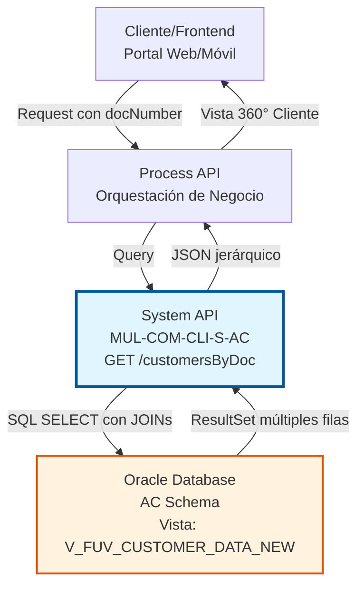
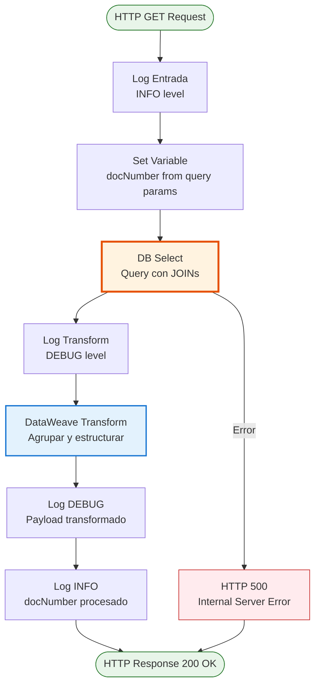
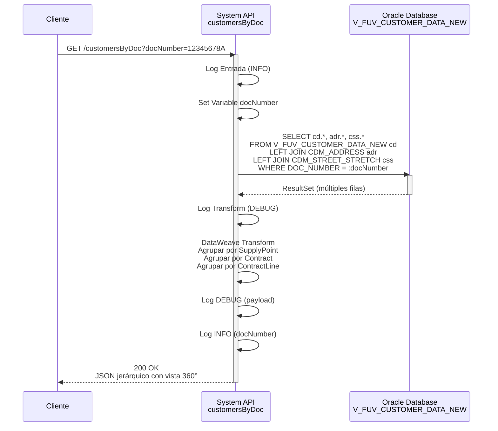

# GET /customersByDoc

## 📌 Descripción General

### Propósito del Endpoint

Este endpoint proporciona una **vista 360° completa del cliente** buscando por número de documento. Retorna toda la información del cliente incluyendo datos personales, usuario asociado, puntos de suministro, contratos activos, líneas de contrato y productos contratados.

El endpoint soporta:
- **Búsqueda por Documento**: Localiza clientes por número de documento de identidad
- **Datos Consolidados**: Retorna información completa del cliente en una sola llamada
- **Estructura Jerárquica**: Organiza datos en 5 niveles (cliente → usuario → puntos de suministro → contratos → líneas de contrato)
- **Información Enriquecida**: Incluye datos de dirección y tipo de calle mediante JOINs

### Tipo de API

**Capa:** System API (API-Led Connectivity)

**Función:** Integración directa con Oracle Database (AC Schema) para consulta de datos maestros de clientes.

### Patrón de Integración

**Tipo:** Request-Reply Síncrono con Oracle Database

**Descripción:** El endpoint recibe el número de documento como parámetro, ejecuta una query SQL con JOINs sobre la vista consolidada `V_FUV_CUSTOMER_DATA_NEW`, transforma el resultado mediante DataWeave agrupando por puntos de suministro, contratos y líneas de contrato, y retorna un objeto JSON jerárquico con toda la información del cliente.

### Arquitectura API-Led Connectivity



---

## 💼 Propósito del Negocio

### Casos de Uso Principales

1. **Búsqueda de Cliente Existente en Portal Web**
   - Usuario intenta registrarse en portal de autoservicio
   - Sistema busca si ya existe cliente con ese documento
   - Evita duplicados y permite recuperar cuenta existente
   - Beneficio: Mejora experiencia de usuario y mantiene integridad de datos

2. **Validación de Identidad en Proceso de Alta de Contrato**
   - Proceso de alta de nuevo contrato requiere verificar cliente
   - Sistema valida que el cliente existe en base de datos
   - Obtiene información completa para pre-rellenar formularios
   - Beneficio: Acelera proceso de contratación y reduce errores

3. **Consulta de Información Completa en Call Center**
   - Agente de atención al cliente recibe llamada
   - Busca cliente por documento para ver toda su información
   - Visualiza contratos activos, productos y puntos de suministro
   - Beneficio: Atención más rápida y eficiente al cliente

4. **Reconciliación de Datos con Sistemas Externos**
   - Integración con Salesforce o Buyapowa requiere sincronizar datos
   - Sistema busca cliente por documento para actualizar información
   - Mantiene consistencia entre sistemas
   - Beneficio: Datos actualizados en todos los sistemas

5. **Verificación de Contratos Activos**
   - Proceso de negocio necesita verificar si cliente tiene contratos activos
   - Sistema consulta todos los contratos y su estado
   - Identifica productos contratados (gas, electricidad, servicios)
   - Beneficio: Toma de decisiones informada en procesos de negocio

### Contexto Empresarial

- **Dominio:** Gestión de Clientes y Contratos
- **Sector:** Energía - Utilities
- **División:** Naturgy España - Alta de Clientes
- **Proceso de Negocio:** Gestión de Identidad de Clientes, Alta de Contratos, Atención al Cliente
- **Módulo:** Administración Comercial (AC)

### Stakeholders

- **Equipos de Ventas**: Necesitan verificar clientes existentes antes de alta de contrato
- **Servicio al Cliente**: Requieren acceso rápido a información completa del cliente
- **Sistemas de Integración**: Salesforce, Buyapowa, portales web y móviles
- **Equipos de Desarrollo**: Frontend web, aplicaciones móviles, sistemas de terceros
- **Equipos de Operaciones**: Gestión de contratos y puntos de suministro

### Valor de Negocio

- **Prevención de Duplicados**: Evita crear clientes duplicados en base de datos
- **Mejora en Tiempo de Respuesta**: Atención al cliente más rápida con información completa
- **Facilita Onboarding Digital**: Acelera procesos de alta de clientes y contratos
- **Soporte Omnicanal**: Misma información disponible en todos los canales
- **Reducción de Errores**: Datos consistentes y actualizados en todos los sistemas
- **Vista 360° del Cliente**: Información completa en una sola llamada

### Consumidores Potenciales

Este endpoint puede ser consumido por:
- Process APIs de gestión de clientes y contratos
- Portales web de autoservicio (B2C)
- Aplicaciones móviles de clientes
- Sistemas de call center y CRM
- Flujos de Salesforce (Platform Events, Flows)
- Sistemas de integración middleware
- APIs de terceros autorizados

---

## 🔧 Especificación Técnica

### URLs por Ambiente

| Ambiente | URL Completa |
|----------|--------------|
| **Local** | `http://localhost:8081/api/customersByDoc` |
| **Development** | `https://mul-com-cli-s-ac-dev.cloudhub.io/api/customersByDoc` |
| **QA** | `https://mul-com-cli-s-ac-cc.cloudhub.io/api/customersByDoc` |
| **Pre-Production** | `https://mul-com-cli-s-ac-cl.cloudhub.io/api/customersByDoc` |
| **Production** | `https://mul-com-cli-s-ac-pro.cloudhub.io/api/customersByDoc` |

### Método HTTP

```
GET /api/customersByDoc
```

### Parámetros de Entrada

#### Query Parameters

| Parámetro | Tipo | Requerido | Descripción | Ejemplo |
|-----------|------|-----------|-------------|---------|
| `docNumber` | string | ✅ Sí | Número de documento del cliente (DNI, NIE, Pasaporte, etc.) | `"12345678A"` |

#### Headers HTTP

| Header | Tipo | Requerido | Descripción | Ejemplo |
|--------|------|-----------|-------------|---------|
| `client_id` | string | ✅ Sí | Client ID de Anypoint Platform | `"abc123..."` |
| `client_secret` | string | ✅ Sí | Client Secret de Anypoint Platform | `"xyz789..."` |

### Respuestas

#### Respuesta Exitosa (200 OK)

```json
{
  "customer": {
    "customerId": "12345",
    "docNumber": "12345678A",
    "personType": "F",
    "name": "Juan",
    "surname1": "García",
    "surname2": "López",
    "fullName": "Juan García López",
    "birthDate": "1980-01-15",
    "language": "es",
    "phone1": "912345678",
    "phone2": "612345678",
    "phone3": "",
    "phone4": "",
    "phone5": "",
    "email": "juan.garcia@example.com",
    "emailStatus": "VERIFIED",
    "cuo": "CUO123456",
    "acceptPublicity": "Y",
    "acceptCession": "Y",
    "acceptKeepData": "Y",
    "robinson": "N",
    "user": {
      "userId": "USER123",
      "lastAccessDate": "2024-06-15T10:30:00Z"
    },
    "supplyPoints": {
      "items": [
        {
          "supplyPointId": "SP001",
          "addressId": "ADDR001",
          "addressDescription": "Calle Mayor 123, 3º B",
          "addressStreet": "Calle Mayor",
          "addressNumber": "123",
          "addressPortal": "A",
          "addressFloor": "3",
          "addressStaircase": "B",
          "addressDoor": "2",
          "postalCode": "28001",
          "townName": "Madrid",
          "provinceName": "Madrid",
          "viaId": "VIA001",
          "premiseTypeCode": "CALLE",
          "contracts": {
            "items": [
              {
                "contractId": "CONT001",
                "fol": "02",
                "iban": "ES1234567890123456789012",
                "gasCUPS": "ES0123456789012345678901GN",
                "electricityCUPS": "ES0123456789012345678901EL",
                "paymentMethod": "DOMICILIACION",
                "contractLines": {
                  "items": [
                    {
                      "contractLineId": "CL001",
                      "contractLineStatus": "ACTIVO",
                      "productId": "PROD001",
                      "product": "Gas Natural",
                      "productCategory": "GAS",
                      "productRate": "TARIFA_3.1"
                    },
                    {
                      "contractLineId": "CL002",
                      "contractLineStatus": "ACTIVO",
                      "productId": "PROD002",
                      "product": "Electricidad",
                      "productCategory": "ELECTRICIDAD",
                      "productRate": "TARIFA_2.0TD"
                    }
                  ]
                }
              }
            ]
          }
        }
      ]
    }
  }
}
```

**Descripción de Campos Principales:**

**Nivel 1 - customer (Datos del Cliente):**
- `customerId`: Identificador único del cliente
- `docNumber`: Número de documento de identidad
- `personType`: Tipo de persona (F=Física, J=Jurídica)
- `name`, `surname1`, `surname2`, `fullName`: Datos de identificación
- `birthDate`: Fecha de nacimiento
- `language`: Idioma preferido (es, ca, eu, gl, en)
- `phone1` a `phone5`: Hasta 5 números de teléfono
- `email`, `emailStatus`: Correo electrónico y su estado de verificación
- `cuo`: Código Único de Operación
- `acceptPublicity`, `acceptCession`, `acceptKeepData`: Consentimientos GDPR
- `robinson`: Inclusión en lista Robinson (Y/N)

**Nivel 2 - user (Usuario Asociado):**
- `userId`: Identificador de usuario para login
- `lastAccessDate`: Última fecha de acceso al sistema

**Nivel 3 - supplyPoints (Puntos de Suministro):**
- `supplyPointId`: Identificador del punto de suministro
- `addressId` a `provinceName`: Información completa de dirección
- `viaId`: ID de la vía (de CDM_ADDRESS)
- `premiseTypeCode`: Tipo de calle (de CDM_STREET_STRETCH)

**Nivel 4 - contracts (Contratos por Punto de Suministro):**
- `contractId`: Identificador del contrato
- `fol`: Factura On-Line ("02" si activo, "01" si no)
- `iban`: Cuenta bancaria para domiciliación
- `gasCUPS`, `electricityCUPS`: CUPS de gas y electricidad
- `paymentMethod`: Método de pago (DOMICILIACION, TRANSFERENCIA, etc.)

**Nivel 5 - contractLines (Líneas de Contrato):**
- `contractLineId`: Identificador de la línea de contrato
- `contractLineStatus`: Estado (ACTIVO, INACTIVO, ANULADO, etc.)
- `productId`: Identificador del producto
- `product`: Nombre del producto
- `productCategory`: Categoría (GAS, ELECTRICIDAD, SERVICIOS)
- `productRate`: Tarifa aplicada

#### Respuesta Sin Resultados (200 OK)

Cuando no se encuentra el cliente, se retorna un objeto con campos vacíos:

```json
{
  "customer": {
    "customerId": "",
    "docNumber": "",
    "personType": "",
    "name": "",
    "surname1": "",
    "surname2": "",
    "fullName": "",
    "birthDate": "",
    "language": "",
    "phone1": "",
    "phone2": "",
    "phone3": "",
    "phone4": "",
    "phone5": "",
    "email": "",
    "emailStatus": "",
    "cuo": "",
    "acceptPublicity": "",
    "acceptCession": "",
    "acceptKeepData": "",
    "robinson": "",
    "user": {
      "userId": null,
      "lastAccessDate": ""
    },
    "supplyPoints": {
      "items": []
    }
  }
}
```

#### Respuesta de Error (400 Bad Request)

```json
{
  "message": "Bad request - docNumber is required"
}
```

#### Respuesta de Error (500 Internal Server Error)

```json
{
  "error": "APP_9999",
  "message": "Error en el servicio."
}
```

### Autenticación y Autorización

- **Tipo:** Client ID & Client Secret (Anypoint Platform)
- **Autorización Oracle:** El usuario de base de datos debe tener permisos para:
  - Ejecutar SELECT sobre vista `V_FUV_CUSTOMER_DATA_NEW`
  - Acceso a tablas `OVPRO.CDM_ADDRESS` y `OVPRO.CDM_STREET_STRETCH`
  - Usuario configurado: `OVPROySTAGING_LECTURA` (solo lectura)

### Timeouts

| Tipo | Valor | Descripción |
|------|-------|-------------|
| **Request Timeout** | 6000 segundos | Tiempo máximo de espera para la respuesta |
| **Connection Timeout** | 3600 segundos | Tiempo máximo para establecer conexión |
| **Transport Timeout** | 6000 segundos | Timeout de transporte Oracle |

---

## 🏗️ Implementación Técnica

### Arquitectura del Flow



### Detalles de Implementación

**Backend:** Oracle Database  
**Esquema:** OV_CON (AC Schema) + OVPRO  
**Vista Principal:** `V_FUV_CUSTOMER_DATA_NEW`  
**Tablas Relacionadas:** `OVPRO.CDM_ADDRESS`, `OVPRO.CDM_STREET_STRETCH`  
**Operación:** SELECT con LEFT JOINs (READ)

**Query SQL Real:**
```sql
SELECT cd.*, adr.ADR_STREET_ID, CSS.STS_STREET_TYPE_ID, CSS.STS_STREET_TYPE_NAME 
FROM V_FUV_CUSTOMER_DATA_NEW cd 
LEFT JOIN OVPRO.CDM_ADDRESS adr ON cd.ADDRESSID = adr.ADR_ADDRESS_ID 
LEFT JOIN OVPRO.CDM_STREET_STRETCH css ON CSS.STS_STREET_ID = adr.ADR_STREET_ID 
WHERE cd.DOC_NUMBER = :docNumber
```

**Ubicación en Código:**
- **Archivo XML:** `src/main/mule/s-ac-customersByDoc.xml`
- **Flow:** `customersByDocFlow` (líneas 8-94)
- **Configuración:** `src/main/resources/s-ac-pro-config.yaml` (línea 66)
- **Propiedad:** `queries.customersByDoc`

**Lógica de Búsqueda:**
1. Extrae parámetro `docNumber` de query parameters
2. Ejecuta query SQL con parámetro `:docNumber`
3. Retorna TODOS los campos de la vista `V_FUV_CUSTOMER_DATA_NEW` (cd.*)
4. Enriquece con información de dirección (`ADR_STREET_ID`)
5. Enriquece con información de tipo de calle (`STS_STREET_TYPE_ID`, `STS_STREET_TYPE_NAME`)
6. LEFT JOINs aseguran que se retornen clientes incluso sin dirección completa
7. Puede retornar múltiples filas si el cliente tiene múltiples puntos de suministro/contratos

**Transformación de Datos:**

La transformación DataWeave (líneas 17-90 del XML) realiza:

1. **Extracción de Datos del Cliente:** Toma la primera fila (`payload[0]`) para datos del cliente
2. **Agrupación por Punto de Suministro:** `groupBy $.SUPPLYPOINTID`
3. **Agrupación por Contrato:** Dentro de cada punto, `groupBy $.CONTRACTID`
4. **Agrupación por Línea de Contrato:** Dentro de cada contrato, `groupBy $.CONTRACT_LINE_ID`
5. **Eliminación de Duplicados:** Usa `distinctBy` y `reduce` para campos repetidos
6. **Valores por Defecto:** Aplica `default ""` para campos nulos

**Operadores DataWeave Utilizados:**
- `groupBy`: Agrupa filas por un campo específico
- `pluck`: Convierte objeto agrupado en array
- `distinctBy`: Elimina valores duplicados
- `reduce`: Reduce array a un solo valor
- `default`: Proporciona valor por defecto para nulls

**Campo Calculado:**
- `fol`: Se calcula como `"02"` si `NOTFOL = "N"`, de lo contrario `"01"`

### Diagrama de Transformación de Datos

```mermaid
flowchart LR
    Query[Query SQL<br/>V_FUV_CUSTOMER_DATA_NEW<br/>+ JOINs] --> ResultSet[Oracle ResultSet<br/>Múltiples filas]
    ResultSet --> Customer[Extraer Datos Cliente<br/>payload 0]
    ResultSet --> Group1[Agrupar por<br/>SUPPLYPOINTID]
    Group1 --> SP[supplyPoints.items[]]
    SP --> Group2[Agrupar por<br/>CONTRACTID]
    Group2 --> C[contracts.items[]]
    C --> Group3[Agrupar por<br/>CONTRACT_LINE_ID]
    Group3 --> CL[contractLines.items[]]
    
    Customer --> JSON[JSON Jerárquico]
    CL --> JSON
    
    style Query fill:#fff3e0,stroke:#e65100
    style ResultSet fill:#fce4ec,stroke:#c2185b
    style SP fill:#e3f2fd,stroke:#1976d2
    style C fill:#f3e5f5,stroke:#7b1fa2
    style CL fill:#e8f5e9,stroke:#388e3c
    style JSON fill:#fff9c4,stroke:#f57f17,stroke-width:3px
```

### Diagrama de Secuencia



### Manejo de Errores

**Estrategia de Error Handling:**
1. **Validación de Parámetros:** APIKit valida que `docNumber` esté presente
2. **Reconexión Automática:** `<reconnect-forever />` en DB connector
3. **Logging Detallado:** Logs en INFO y DEBUG para troubleshooting
4. **Valores por Defecto:** Todos los campos usan `default ""` para evitar nulls
5. **Error Handler Global:** Configurado en `s-ac-globalErrorHandler.xml`

**Códigos de Error:**
- **400 Bad Request:** Parámetro `docNumber` faltante o inválido
- **500 Internal Server Error:** Error de conexión a base de datos o error en query
- **200 OK con datos vacíos:** Cliente no encontrado (no es error, es resultado válido)

### Configuración de Base de Datos

**Connection Pooling:**
- `MaxPoolSize`: 5 conexiones
- `MaxWaitTime`: 300 ms
- `MaxIdleTime`: 300 ms
- `fetchsize`: 2000 registros

**Hosts Oracle RAC:**
- Host 1: `oc-pro-exa-04-clu-02-hdfdi-scan.prodb03.ocpro.oraclevcn.com`
- Host 2: `oc-pro-exa-03-clu-02-dfhl9-scan.prodb03.ocpro.oraclevcn.com`
- Puerto: 1521
- Service Name: `s_areapriv_online_pro.prodb03.ocpro.oraclevcn.com`

---

## 💻 Ejemplos de Uso

### Ejemplo 1: Búsqueda Exitosa de Cliente

**Request:**
```bash
curl -X GET "https://mul-com-cli-s-ac-pro.cloudhub.io/api/customersByDoc?docNumber=12345678A" \
  -H "client_id: your-client-id" \
  -H "client_secret: your-client-secret"
```

**Response (200 OK):**
```json
{
  "customer": {
    "customerId": "12345",
    "docNumber": "12345678A",
    "personType": "F",
    "name": "Juan",
    "surname1": "García",
    "surname2": "López",
    "fullName": "Juan García López",
    "birthDate": "1980-01-15",
    "language": "es",
    "phone1": "912345678",
    "phone2": "612345678",
    "phone3": "",
    "phone4": "",
    "phone5": "",
    "email": "juan.garcia@example.com",
    "emailStatus": "VERIFIED",
    "cuo": "CUO123456",
    "acceptPublicity": "Y",
    "acceptCession": "Y",
    "acceptKeepData": "Y",
    "robinson": "N",
    "user": {
      "userId": "USER123",
      "lastAccessDate": "2024-06-15T10:30:00Z"
    },
    "supplyPoints": {
      "items": [
        {
          "supplyPointId": "SP001",
          "addressId": "ADDR001",
          "addressDescription": "Calle Mayor 123, 3º B",
          "addressStreet": "Calle Mayor",
          "addressNumber": "123",
          "addressPortal": "A",
          "addressFloor": "3",
          "addressStaircase": "B",
          "addressDoor": "2",
          "postalCode": "28001",
          "townName": "Madrid",
          "provinceName": "Madrid",
          "viaId": "VIA001",
          "premiseTypeCode": "CALLE",
          "contracts": {
            "items": [
              {
                "contractId": "CONT001",
                "fol": "02",
                "iban": "ES1234567890123456789012",
                "gasCUPS": "ES0123456789012345678901GN",
                "electricityCUPS": "ES0123456789012345678901EL",
                "paymentMethod": "DOMICILIACION",
                "contractLines": {
                  "items": [
                    {
                      "contractLineId": "CL001",
                      "contractLineStatus": "ACTIVO",
                      "productId": "PROD001",
                      "product": "Gas Natural",
                      "productCategory": "GAS",
                      "productRate": "TARIFA_3.1"
                    },
                    {
                      "contractLineId": "CL002",
                      "contractLineStatus": "ACTIVO",
                      "productId": "PROD002",
                      "product": "Electricidad",
                      "productCategory": "ELECTRICIDAD",
                      "productRate": "TARIFA_2.0TD"
                    }
                  ]
                }
              }
            ]
          }
        }
      ]
    }
  }
}
```

### Ejemplo 2: Cliente No Encontrado

**Request:**
```bash
curl -X GET "https://mul-com-cli-s-ac-pro.cloudhub.io/api/customersByDoc?docNumber=99999999Z" \
  -H "client_id: your-client-id" \
  -H "client_secret: your-client-secret"
```

**Response (200 OK):**
```json
{
  "customer": {
    "customerId": "",
    "docNumber": "",
    "personType": "",
    "name": "",
    "surname1": "",
    "surname2": "",
    "fullName": "",
    "birthDate": "",
    "language": "",
    "phone1": "",
    "phone2": "",
    "phone3": "",
    "phone4": "",
    "phone5": "",
    "email": "",
    "emailStatus": "",
    "cuo": "",
    "acceptPublicity": "",
    "acceptCession": "",
    "acceptKeepData": "",
    "robinson": "",
    "user": {
      "userId": null,
      "lastAccessDate": ""
    },
    "supplyPoints": {
      "items": []
    }
  }
}
```

### Ejemplo 3: Error - Parámetro Faltante

**Request:**
```bash
curl -X GET "https://mul-com-cli-s-ac-pro.cloudhub.io/api/customersByDoc" \
  -H "client_id: your-client-id" \
  -H "client_secret: your-client-secret"
```

**Response (400 Bad Request):**
```json
{
  "message": "Bad request - docNumber is required"
}
```

### Ejemplo 4: Cliente con Múltiples Puntos de Suministro

**Request:**
```bash
curl -X GET "https://mul-com-cli-s-ac-pro.cloudhub.io/api/customersByDoc?docNumber=87654321B" \
  -H "client_id: your-client-id" \
  -H "client_secret: your-client-secret"
```

**Response (200 OK):**
```json
{
  "customer": {
    "customerId": "67890",
    "docNumber": "87654321B",
    "personType": "F",
    "name": "María",
    "surname1": "Rodríguez",
    "surname2": "Martínez",
    "fullName": "María Rodríguez Martínez",
    "birthDate": "1985-03-20",
    "language": "es",
    "phone1": "913456789",
    "phone2": "623456789",
    "phone3": "",
    "phone4": "",
    "phone5": "",
    "email": "maria.rodriguez@example.com",
    "emailStatus": "VERIFIED",
    "cuo": "CUO789012",
    "acceptPublicity": "Y",
    "acceptCession": "N",
    "acceptKeepData": "Y",
    "robinson": "N",
    "user": {
      "userId": "USER456",
      "lastAccessDate": "2024-06-10T15:45:00Z"
    },
    "supplyPoints": {
      "items": [
        {
          "supplyPointId": "SP002",
          "addressId": "ADDR002",
          "addressDescription": "Avenida Libertad 45, 1º A",
          "addressStreet": "Avenida Libertad",
          "addressNumber": "45",
          "addressPortal": "",
          "addressFloor": "1",
          "addressStaircase": "",
          "addressDoor": "A",
          "postalCode": "08001",
          "townName": "Barcelona",
          "provinceName": "Barcelona",
          "viaId": "VIA002",
          "premiseTypeCode": "AVENIDA",
          "contracts": {
            "items": [
              {
                "contractId": "CONT002",
                "fol": "02",
                "iban": "ES9876543210987654321098",
                "gasCUPS": "ES9876543210987654321098GN",
                "electricityCUPS": "",
                "paymentMethod": "DOMICILIACION",
                "contractLines": {
                  "items": [
                    {
                      "contractLineId": "CL003",
                      "contractLineStatus": "ACTIVO",
                      "productId": "PROD003",
                      "product": "Gas Natural Premium",
                      "productCategory": "GAS",
                      "productRate": "TARIFA_3.2"
                    }
                  ]
                }
              }
            ]
          }
        },
        {
          "supplyPointId": "SP003",
          "addressId": "ADDR003",
          "addressDescription": "Calle Sol 78, Bajo",
          "addressStreet": "Calle Sol",
          "addressNumber": "78",
          "addressPortal": "",
          "addressFloor": "0",
          "addressStaircase": "",
          "addressDoor": "",
          "postalCode": "08002",
          "townName": "Barcelona",
          "provinceName": "Barcelona",
          "viaId": "VIA003",
          "premiseTypeCode": "CALLE",
          "contracts": {
            "items": [
              {
                "contractId": "CONT003",
                "fol": "01",
                "iban": "ES9876543210987654321098",
                "gasCUPS": "",
                "electricityCUPS": "ES5555555555555555555555EL",
                "paymentMethod": "DOMICILIACION",
                "contractLines": {
                  "items": [
                    {
                      "contractLineId": "CL004",
                      "contractLineStatus": "ACTIVO",
                      "productId": "PROD004",
                      "product": "Electricidad",
                      "productCategory": "ELECTRICIDAD",
                      "productRate": "TARIFA_2.0TD"
                    }
                  ]
                }
              }
            ]
          }
        }
      ]
    }
  }
}
```

### Ejemplo 5: Uso desde JavaScript (Frontend)

**Request:**
```javascript
const getCustomerByDoc = async (docNumber) => {
  const response = await fetch(
    `https://mul-com-cli-s-ac-pro.cloudhub.io/api/customersByDoc?docNumber=${docNumber}`,
    {
      method: 'GET',
      headers: {
        'client_id': 'your-client-id',
        'client_secret': 'your-client-secret'
      }
    }
  );
  
  if (!response.ok) {
    throw new Error(`HTTP error! status: ${response.status}`);
  }
  
  const data = await response.json();
  return data.customer;
};

// Uso
try {
  const customer = await getCustomerByDoc('12345678A');
  console.log('Cliente encontrado:', customer.fullName);
  console.log('Contratos activos:', customer.supplyPoints.items.length);
} catch (error) {
  console.error('Error al buscar cliente:', error);
}
```

### Ejemplo 6: Uso desde Python

**Request:**
```python
import requests

def get_customer_by_doc(doc_number):
    url = "https://mul-com-cli-s-ac-pro.cloudhub.io/api/customersByDoc"
    headers = {
        "client_id": "your-client-id",
        "client_secret": "your-client-secret"
    }
    params = {
        "docNumber": doc_number
    }
    
    response = requests.get(url, headers=headers, params=params)
    response.raise_for_status()
    
    return response.json()["customer"]

# Uso
try:
    customer = get_customer_by_doc("12345678A")
    print(f"Cliente encontrado: {customer['fullName']}")
    print(f"Email: {customer['email']}")
    print(f"Puntos de suministro: {len(customer['supplyPoints']['items'])}")
except requests.exceptions.HTTPError as e:
    print(f"Error HTTP: {e}")
except Exception as e:
    print(f"Error: {e}")
```
