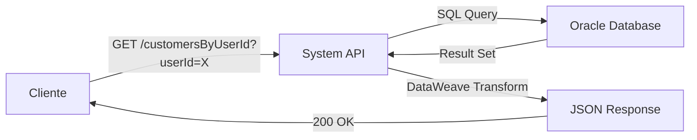
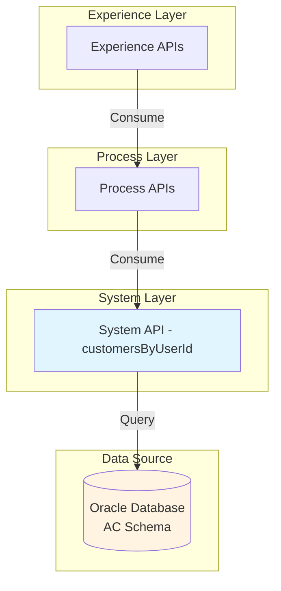
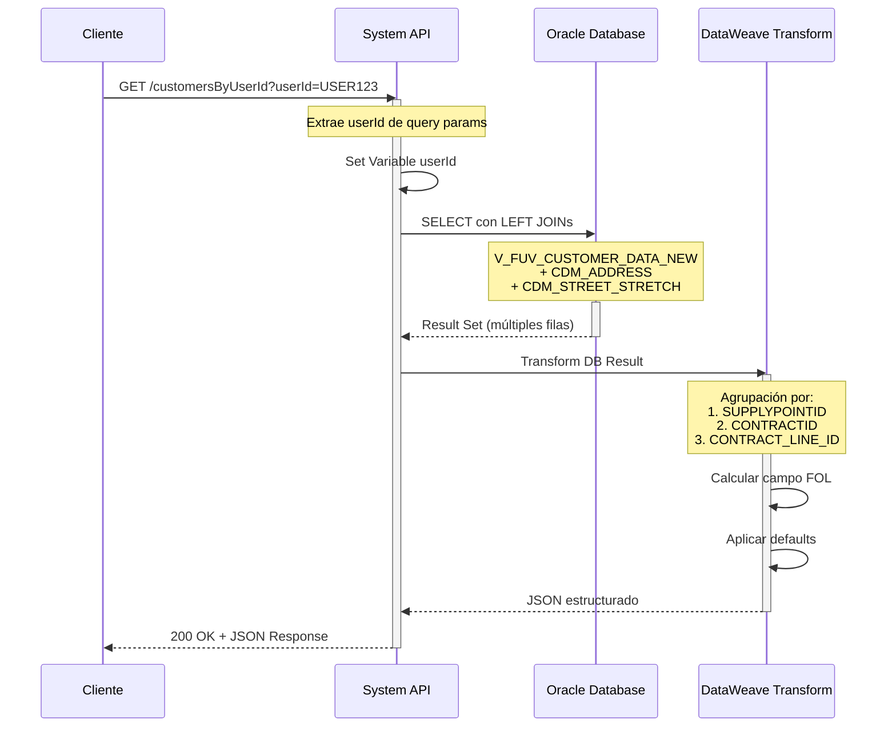
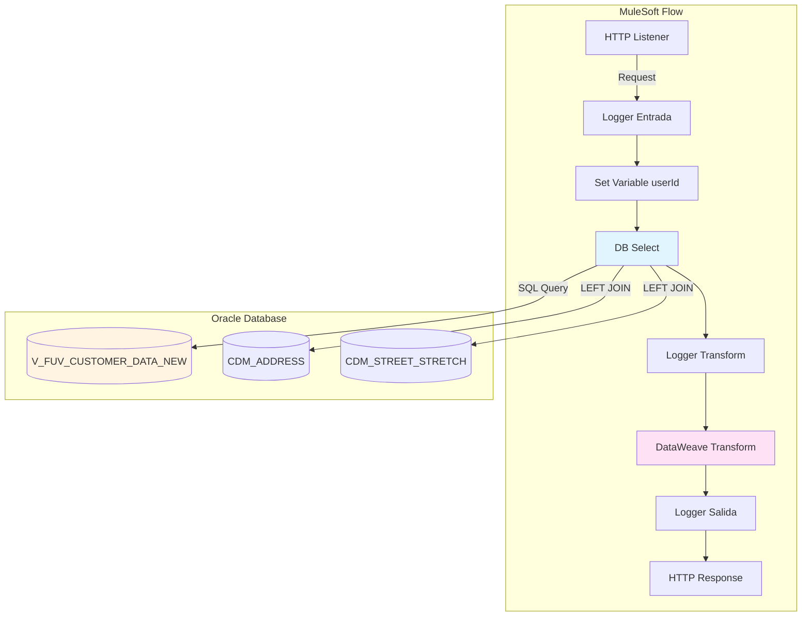
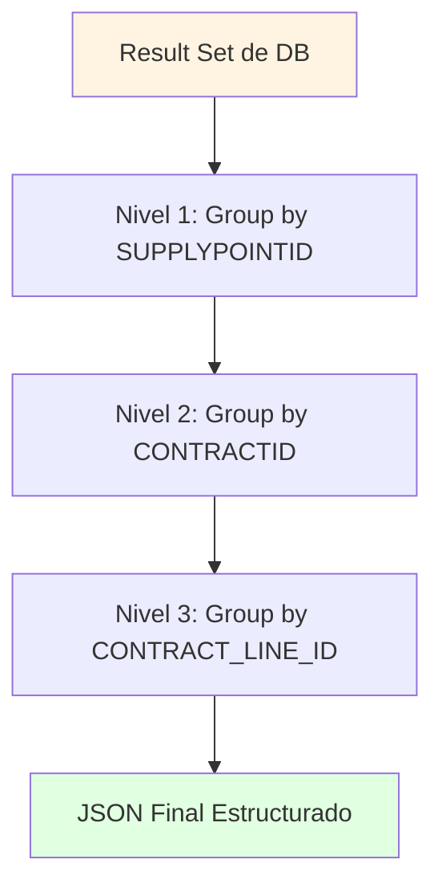
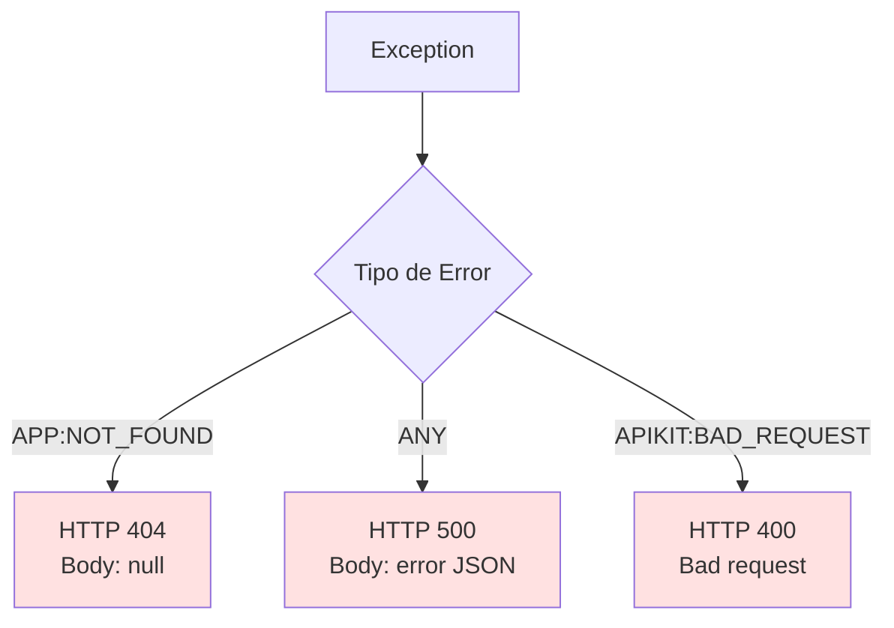

# GET /customersByUserId

## 📌 Descripción General

### Identificación del Endpoint
- **Nombre**: Get Customers By User ID
- **Tipo de API**: System API
- **Capa**: API-Led Connectivity - System Layer
- **Versión**: 2.0.0
- **Proyecto**: ntgy-cli-s-ac-impl (MUL-COM-CLI-S-AC)

### Propósito
Endpoint de System API que consulta información completa de un cliente en Oracle Database utilizando el ID de usuario como criterio de búsqueda. Retorna datos del cliente, información de usuario, puntos de suministro, contratos activos y líneas de contrato con sus productos asociados.

### Características Principales
- ✅ Consulta directa a Oracle Database (AC Schema)
- ✅ Retorna estructura compleja con datos anidados
- ✅ Incluye información de múltiples entidades relacionadas
- ✅ Agrupación automática por puntos de suministro y contratos
- ✅ Transformación DataWeave inline para estructura JSON
- ✅ Soporte para múltiples contratos y líneas por cliente

### Patrón de Integración
**Request-Reply Síncrono**


### Arquitectura API-Led


---

## 💼 Propósito del Negocio

### Caso de Uso Principal
Obtener información completa y consolidada de un cliente utilizando su ID de usuario del sistema de autenticación, incluyendo todos sus puntos de suministro, contratos activos y productos contratados.

### Casos de Uso Específicos

#### 1. Consulta de Perfil de Cliente
**Actor**: Aplicación web/móvil de área de cliente
**Flujo**:
1. Usuario inicia sesión en el portal
2. Sistema obtiene `userId` del token de autenticación
3. Aplicación consulta datos completos del cliente
4. Sistema muestra información personalizada del cliente

**Valor de Negocio**: Experiencia de usuario personalizada con acceso inmediato a toda su información

#### 2. Gestión de Contratos
**Actor**: Sistema de gestión de contratos
**Flujo**:
1. Usuario solicita ver sus contratos
2. Sistema consulta contratos por `userId`
3. Aplicación muestra lista de contratos con detalles
4. Usuario puede gestionar sus contratos activos

**Valor de Negocio**: Autogestión de contratos por parte del cliente

#### 3. Validación de Puntos de Suministro
**Actor**: Sistema de alta de servicios
**Flujo**:
1. Cliente solicita nuevo servicio
2. Sistema verifica puntos de suministro existentes
3. Aplicación valida direcciones y CUPS asociados
4. Sistema previene duplicados y errores

**Valor de Negocio**: Reducción de errores en altas de servicio

### Stakeholders
- **Clientes finales**: Acceso a su información completa
- **Área de atención al cliente**: Consulta rápida de datos del cliente
- **Sistemas de facturación**: Información de contratos y productos
- **Aplicaciones móviles/web**: Datos para personalización de experiencia
- **Sistemas de CRM**: Integración de datos de cliente

### Beneficios del Negocio
- ⚡ **Acceso inmediato**: Consulta en tiempo real de datos del cliente
- 🎯 **Información consolidada**: Todos los datos en una sola llamada
- 🔄 **Datos actualizados**: Información directa desde sistema de registro
- 📊 **Visión 360°**: Cliente, contratos, productos y direcciones
- 🚀 **Autoservicio**: Clientes pueden consultar su propia información

---

## 🔧 Especificación Técnica

### Método HTTP
```
GET /api/customersByUserId
```

### URLs por Ambiente

| Ambiente | URL Base | URL Completa |
|----------|----------|--------------|
| **Local** | `http://localhost:8050` | `http://localhost:8050/api/customersByUserId?userId={userId}` |
| **Desarrollo** | `https://ntgy-cli-s-ac-des.cloudhub.io` | `https://ntgy-cli-s-ac-des.cloudhub.io/api/customersByUserId?userId={userId}` |
| **QA** | `https://ntgy-cli-s-ac-cc.cloudhub.io` | `https://ntgy-cli-s-ac-cc.cloudhub.io/api/customersByUserId?userId={userId}` |
| **Pre-Producción** | `https://ntgy-cli-s-ac-cl.cloudhub.io` | `https://ntgy-cli-s-ac-cl.cloudhub.io/api/customersByUserId?userId={userId}` |
| **Producción** | `https://ntgy-cli-s-ac-pro.cloudhub.io` | `https://ntgy-cli-s-ac-pro.cloudhub.io/api/customersByUserId?userId={userId}` |

### Parámetros de Entrada

#### Query Parameters

| Parámetro | Tipo | Requerido | Descripción | Ejemplo |
|-----------|------|-----------|-------------|---------|
| `userId` | string | ✅ Sí | Identificador único del usuario en el sistema de autenticación | `"USER123456"` |

**Validaciones**:
- ✅ Parámetro obligatorio
- ✅ Debe ser un string no vacío
- ✅ Corresponde al campo `USERID` en la base de datos

### Estructura de Respuesta

#### Response 200 OK

**Content-Type**: `application/json`

**Estructura**:
```json
{
  "customer": {
    "customerId": "string",
    "docNumber": "string",
    "personType": "string",
    "name": "string",
    "surname1": "string",
    "surname2": "string",
    "fullName": "string",
    "birthDate": "string",
    "language": "string",
    "phone1": "string",
    "phone2": "string",
    "phone3": "string",
    "phone4": "string",
    "phone5": "string",
    "email": "string",
    "emailStatus": "string",
    "cuo": "string",
    "acceptPublicity": "string",
    "acceptCession": "string",
    "acceptKeepData": "string",
    "robinson": "string",
    "user": {
      "userId": "string",
      "lastAccessDate": "string"
    },
    "supplyPoints": {
      "items": [
        {
          "supplyPointId": "string",
          "addressId": "string",
          "addressDescription": "string",
          "addressNumber": "string",
          "addressPortal": "string",
          "addressFloor": "string",
          "addressStaircase": "string",
          "addressDoor": "string",
          "postalCode": "string",
          "townName": "string",
          "provinceName": "string",
          "viaId": "string",
          "premiseTypeCode": "string",
          "contracts": {
            "items": [
              {
                "contractId": "string",
                "fol": "string",
                "iban": "string",
                "gasCUPS": "string",
                "electricityCUPS": "string",
                "paymentMethod": "string",
                "contractLines": {
                  "items": [
                    {
                      "contractLineId": "string",
                      "contractLineStatus": "string",
                      "productId": "string",
                      "product": "string",
                      "productCategory": "string",
                      "productRate": "string"
                    }
                  ]
                }
              }
            ]
          }
        }
      ]
    }
  }
}
```

#### Descripción de Campos

**Nivel Customer**:
| Campo | Tipo | Descripción |
|-------|------|-------------|
| `customerId` | string | Identificador único del cliente |
| `docNumber` | string | Número de documento de identidad (DNI/NIE/CIF) |
| `personType` | string | Tipo de persona (Física/Jurídica) |
| `name` | string | Nombre del cliente |
| `surname1` | string | Primer apellido |
| `surname2` | string | Segundo apellido |
| `fullName` | string | Nombre completo concatenado |
| `birthDate` | string | Fecha de nacimiento |
| `language` | string | Idioma preferido del cliente |
| `phone1-5` | string | Números de teléfono de contacto |
| `email` | string | Correo electrónico |
| `emailStatus` | string | Estado de validación del email |
| `cuo` | string | Código Único de Operación |
| `acceptPublicity` | string | Aceptación de publicidad |
| `acceptCession` | string | Aceptación de cesión de datos |
| `acceptKeepData` | string | Aceptación de conservación de datos |
| `robinson` | string | Inscripción en lista Robinson |

**Nivel User**:
| Campo | Tipo | Descripción |
|-------|------|-------------|
| `userId` | string | ID de usuario en sistema de autenticación |
| `lastAccessDate` | string | Fecha del último acceso al sistema |

**Nivel Supply Points**:
| Campo | Tipo | Descripción |
|-------|------|-------------|
| `supplyPointId` | string | Identificador del punto de suministro |
| `addressId` | string | ID de la dirección |
| `addressDescription` | string | Descripción de la vía |
| `addressNumber` | string | Número de la dirección |
| `addressPortal` | string | Portal |
| `addressFloor` | string | Piso |
| `addressStaircase` | string | Escalera |
| `addressDoor` | string | Puerta |
| `postalCode` | string | Código postal |
| `townName` | string | Nombre de la localidad |
| `provinceName` | string | Nombre de la provincia |
| `viaId` | string | ID de la vía |
| `premiseTypeCode` | string | Tipo de vía (Calle, Avenida, etc.) |

**Nivel Contracts**:
| Campo | Tipo | Descripción |
|-------|------|-------------|
| `contractId` | string | Identificador del contrato |
| `fol` | string | Indicador FOL (01=Sí, 02=No) |
| `iban` | string | Cuenta bancaria para domiciliación |
| `gasCUPS` | string | CUPS de gas |
| `electricityCUPS` | string | CUPS de electricidad |
| `paymentMethod` | string | Método de pago del contrato |

**Nivel Contract Lines**:
| Campo | Tipo | Descripción |
|-------|------|-------------|
| `contractLineId` | string | ID de la línea de contrato |
| `contractLineStatus` | string | Estado de la línea de contrato |
| `productId` | string | ID del producto |
| `product` | string | Nombre del producto |
| `productCategory` | string | Categoría del producto |
| `productRate` | string | Tarifa del producto |

### Códigos de Respuesta

| Código | Descripción | Escenario |
|--------|-------------|-----------|
| **200** | OK | Cliente encontrado y datos retornados exitosamente |
| **400** | Bad Request | Parámetro `userId` faltante o inválido |
| **404** | Not Found | No se encontró cliente con el `userId` especificado |
| **500** | Internal Server Error | Error en la consulta a base de datos o transformación |

#### Response 404 Not Found
```json
null
```

#### Response 500 Internal Server Error
```json
{
  "error": "APP_9999",
  "message": "Error en el servicio."
}
```

### Headers

#### Request Headers
```
Accept: application/json
```

#### Response Headers
```
Content-Type: application/json
```

---

## 🏗️ Implementación Técnica

### Diagrama de Secuencia Detallado



### Arquitectura de Componentes



### Query SQL Ejecutada

**Ubicación en código**: `s-ac-local-config.yaml` línea 55

```sql
SELECT 
    cd.*, 
    adr.ADR_STREET_ID, 
    CSS.STS_STREET_TYPE_ID, 
    CSS.STS_STREET_TYPE_NAME 
FROM V_FUV_CUSTOMER_DATA_NEW cd 
LEFT JOIN CDM_ADDRESS adr 
    ON cd.ADDRESSID = adr.ADR_ADDRESS_ID 
LEFT JOIN CDM_STREET_STRETCH css 
    ON CSS.STS_STREET_ID = adr.ADR_STREET_ID 
WHERE cd.USERID = :userId
```

**Parámetros**:
- `:userId` - Valor extraído de query parameter

**Tablas y Vistas**:

1. **V_FUV_CUSTOMER_DATA_NEW** (Vista principal)
   - Contiene datos consolidados del cliente
   - Incluye información de contratos y líneas
   - Operación: READ

2. **CDM_ADDRESS** (Tabla de direcciones)
   - Información de direcciones de puntos de suministro
   - Relación: `cd.ADDRESSID = adr.ADR_ADDRESS_ID`
   - Operación: READ

3. **CDM_STREET_STRETCH** (Tabla de tramos de calle)
   - Información de vías y tipos de calle
   - Relación: `CSS.STS_STREET_ID = adr.ADR_STREET_ID`
   - Operación: READ

### Transformación DataWeave

**Ubicación**: `s-ac-customersByUserId.xml` líneas 18-90

#### Estrategia de Agrupación

La transformación implementa una agrupación jerárquica en 3 niveles:



#### Lógica de Transformación

**1. Agrupación por Punto de Suministro**:
```dataweave
supplyPoints:
    items: payload groupBy $.SUPPLYPOINTID pluck {
        supplyPointId: $$,
        // ... otros campos del supply point
    }
```

**2. Agrupación por Contrato**:
```dataweave
contracts: 
    items: $ groupBy $.CONTRACTID pluck {
        contractId: $$,
        // ... otros campos del contrato
    }
```

**3. Agrupación por Línea de Contrato**:
```dataweave
contractLines:
    items: $ groupBy $.CONTRACT_LINE_ID pluck {
        contractLineId: $$,
        // ... otros campos de la línea
    }
```

#### Lógica Especial: Campo FOL

```dataweave
fol: (if (($.NOTFOL distinctBy $ reduce $ + $$) == "N") "02" else "01") default ""
```

**Interpretación**:
- Si `NOTFOL = "N"` → `fol = "02"` (No es FOL)
- Si `NOTFOL != "N"` → `fol = "01"` (Es FOL)
- Default: `""` (vacío)

#### Manejo de Valores Nulos

Todos los campos opcionales tienen `default ""`:
```dataweave
addressNumber: $.ADDRESS_NUMBER distinctBy $ reduce $ + $$ default ""
```

Esto garantiza que campos nulos se retornen como strings vacíos en lugar de `null`.

### Configuración de Base de Datos

**Ubicación**: `global.xml`

```xml
<db:config name="Database_Config">
    <db:generic-connection 
        url="jdbc:oracle:thin:${dbAC.user}/${secure::dbAC.pass}@..."
        driverClassName="oracle.jdbc.driver.OracleDriver">
        <db:pooling-profile 
            maxPoolSize="${dbAC.MaxPoolSize}"
            maxWait="${dbAC.MaxWaitTime}"
            maxIdleTime="${dbAC.MaxIdleTime}"/>
    </db:generic-connection>
</db:config>
```

**Parámetros de Conexión** (por ambiente):
- `maxPoolSize`: 5-100 conexiones
- `maxWaitTime`: 300-30000 ms
- `maxIdleTime`: 300-60000 ms
- `connectTimeOut`: 3600-10000 ms
- `queryTimeout`: 20 segundos

### Manejo de Errores

**Error Handler**: `apiErrorHandler` (global)



**Escenarios de Error**:

1. **Cliente no encontrado**:
   - Query retorna 0 filas
   - Response: 404 con body `null`

2. **Error de base de datos**:
   - Timeout de conexión
   - Error en query SQL
   - Response: 500 con error estándar

3. **Parámetro inválido**:
   - `userId` faltante
   - Response: 400 Bad Request

### Logging

**Niveles de Log**:

1. **INFO - Entrada** (línea 10):
```
s-ac-customersByUserId.logEntrada ## payload: #[payload] #[attributes.queryParams]
```

2. **DEBUG - Transform** (línea 17):
```
s-ac-customersByUserId.logTransform ## payload: #[payload]
```

3. **DEBUG - Salida** (línea 91):
```
s-ac-customersByUserId.logSalida ## payload: #[payload]
```

4. **INFO - Salida** (línea 92):
```
s-ac-customersByUserId.logSalida #[vars.userId]
```

### Performance

**Optimizaciones Implementadas**:
- ✅ Connection pooling para reutilización de conexiones
- ✅ Query timeout de 20 segundos
- ✅ Transformación inline (sin archivos externos)
- ✅ LEFT JOINs optimizados con índices

**Métricas Esperadas**:
- Response time: < 3 segundos (p95)
- Throughput: 100+ requests/min
- Database connections: Pool de 5-10 conexiones

---

## 💻 Ejemplos de Uso

### Ejemplo 1: Consulta Exitosa

#### Request
```bash
curl -X GET "http://localhost:8050/api/customersByUserId?userId=USER123456" \
  -H "Accept: application/json"
```

#### Response 200 OK
```json
{
  "customer": {
    "customerId": "CUST789012",
    "docNumber": "12345678A",
    "personType": "F",
    "name": "Juan",
    "surname1": "García",
    "surname2": "López",
    "fullName": "Juan García López",
    "birthDate": "1985-03-15",
    "language": "ES",
    "phone1": "+34600123456",
    "phone2": "+34910234567",
    "phone3": "",
    "phone4": "",
    "phone5": "",
    "email": "juan.garcia@example.com",
    "emailStatus": "VERIFIED",
    "cuo": "CUO123456",
    "acceptPublicity": "Y",
    "acceptCession": "Y",
    "acceptKeepData": "Y",
    "robinson": "N",
    "user": {
      "userId": "USER123456",
      "lastAccessDate": "2026-07-14T10:30:00"
    },
    "supplyPoints": {
      "items": [
        {
          "supplyPointId": "SP001",
          "addressId": "ADDR001",
          "addressDescription": "CALLE MAYOR",
          "addressNumber": "25",
          "addressPortal": "A",
          "addressFloor": "3",
          "addressStaircase": "IZQ",
          "addressDoor": "B",
          "postalCode": "28013",
          "townName": "MADRID",
          "provinceName": "MADRID",
          "viaId": "VIA001",
          "premiseTypeCode": "CALLE",
          "contracts": {
            "items": [
              {
                "contractId": "CONT001",
                "fol": "01",
                "iban": "ES7921000813610123456789",
                "gasCUPS": "ES0236150039964563QN",
                "electricityCUPS": "ES0021000000000001JN",
                "paymentMethod": "DOMICILIACION",
                "contractLines": {
                  "items": [
                    {
                      "contractLineId": "CL001",
                      "contractLineStatus": "Activo",
                      "productId": "PROD001",
                      "product": "Gas Natural Tarifa 3.1",
                      "productCategory": "GAS",
                      "productRate": "3.1"
                    },
                    {
                      "contractLineId": "CL002",
                      "contractLineStatus": "Activo",
                      "productId": "PROD002",
                      "product": "Electricidad 2.0TD",
                      "productCategory": "ELECTRICIDAD",
                      "productRate": "2.0TD"
                    }
                  ]
                }
              }
            ]
          }
        }
      ]
    }
  }
}
```

### Ejemplo 2: Cliente No Encontrado

#### Request
```bash
curl -X GET "http://localhost:8050/api/customersByUserId?userId=NONEXISTENT" \
  -H "Accept: application/json"
```

#### Response 404 Not Found
```json
null
```

### Ejemplo 3: Parámetro Faltante

#### Request
```bash
curl -X GET "http://localhost:8050/api/customersByUserId" \
  -H "Accept: application/json"
```

#### Response 400 Bad Request
```json
{
  "message": "Bad request"
}
```

### Ejemplo 4: Error de Servidor

#### Request
```bash
curl -X GET "http://localhost:8050/api/customersByUserId?userId=USER123" \
  -H "Accept: application/json"
```

#### Response 500 Internal Server Error
```json
{
  "error": "APP_9999",
  "message": "Error en el servicio."
}
```

### Ejemplo 5: Uso desde JavaScript

```javascript
async function getCustomerByUserId(userId) {
  try {
    const response = await fetch(
      `https://ntgy-cli-s-ac-pro.cloudhub.io/api/customersByUserId?userId=${userId}`,
      {
        method: 'GET',
        headers: {
          'Accept': 'application/json'
        }
      }
    );

    if (!response.ok) {
      if (response.status === 404) {
        console.log('Cliente no encontrado');
        return null;
      }
      throw new Error(`HTTP error! status: ${response.status}`);
    }

    const data = await response.json();
    console.log('Customer data:', data.customer);
    
    // Acceder a puntos de suministro
    data.customer.supplyPoints.items.forEach(sp => {
      console.log(`Supply Point: ${sp.supplyPointId}`);
      console.log(`Address: ${sp.addressDescription} ${sp.addressNumber}`);
      
      // Acceder a contratos
      sp.contracts.items.forEach(contract => {
        console.log(`Contract: ${contract.contractId}`);
        console.log(`CUPS Gas: ${contract.gasCUPS}`);
        console.log(`CUPS Electricity: ${contract.electricityCUPS}`);
      });
    });

    return data;
  } catch (error) {
    console.error('Error fetching customer:', error);
    throw error;
  }
}

// Uso
getCustomerByUserId('USER123456');
```

### Ejemplo 6: Uso desde Python

```python
import requests
import json

def get_customer_by_user_id(user_id):
    """
    Consulta información del cliente por user ID
    
    Args:
        user_id (str): ID del usuario
        
    Returns:
        dict: Datos del cliente o None si no se encuentra
    """
    url = "https://ntgy-cli-s-ac-pro.cloudhub.io/api/customersByUserId"
    params = {"userId": user_id}
    headers = {"Accept": "application/json"}
    
    try:
        response = requests.get(url, params=params, headers=headers, timeout=30)
        
        if response.status_code == 200:
            data = response.json()
            customer = data.get('customer', {})
            
            print(f"Customer ID: {customer.get('customerId')}")
            print(f"Full Name: {customer.get('fullName')}")
            print(f"Email: {customer.get('email')}")
            
            # Mostrar puntos de suministro
            supply_points = customer.get('supplyPoints', {}).get('items', [])
            print(f"\nSupply Points: {len(supply_points)}")
            
            for sp in supply_points:
                print(f"\n  - Supply Point ID: {sp.get('supplyPointId')}")
                print(f"    Address: {sp.get('addressDescription')} {sp.get('addressNumber')}")
                
                # Mostrar contratos
                contracts = sp.get('contracts', {}).get('items', [])
                for contract in contracts:
                    print(f"    Contract ID: {contract.get('contractId')}")
                    print(f"    Gas CUPS: {contract.get('gasCUPS')}")
                    print(f"    Electricity CUPS: {contract.get('electricityCUPS')}")
            
            return data
            
        elif response.status_code == 404:
            print("Cliente no encontrado")
            return None
        else:
            print(f"Error: {response.status_code}")
            return None
            
    except requests.exceptions.Timeout:
        print("Timeout al consultar el servicio")
        return None
    except requests.exceptions.RequestException as e:
        print(f"Error en la petición: {e}")
        return None

# Uso
customer_data = get_customer_by_user_id('USER123456')
if customer_data:
    print("\nDatos del cliente obtenidos exitosamente")
```

### Ejemplo 7: Integración con React

```javascript
import React, { useState, useEffect } from 'react';

function CustomerProfile({ userId }) {
  const [customer, setCustomer] = useState(null);
  const [loading, setLoading] = useState(true);
  const [error, setError] = useState(null);

  useEffect(() => {
    const fetchCustomer = async () => {
      try {
        setLoading(true);
        const response = await fetch(
          `https://ntgy-cli-s-ac-pro.cloudhub.io/api/customersByUserId?userId=${userId}`,
          {
            method: 'GET',
            headers: {
              'Accept': 'application/json'
            }
          }
        );

        if (response.status === 404) {
          setError('Cliente no encontrado');
          return;
        }

        if (!response.ok) {
          throw new Error('Error al obtener datos del cliente');
        }

        const data = await response.json();
        setCustomer(data.customer);
      } catch (err) {
        setError(err.message);
      } finally {
        setLoading(false);
      }
    };

    if (userId) {
      fetchCustomer();
    }
  }, [userId]);

  if (loading) return <div>Cargando...</div>;
  if (error) return <div>Error: {error}</div>;
  if (!customer) return <div>No se encontró el cliente</div>;

  return (
    <div className="customer-profile">
      <h2>{customer.fullName}</h2>
      <p>Email: {customer.email}</p>
      <p>Teléfono: {customer.phone1}</p>
      
      <h3>Puntos de Suministro</h3>
      {customer.supplyPoints.items.map(sp => (
        <div key={sp.supplyPointId} className="supply-point">
          <h4>{sp.addressDescription} {sp.addressNumber}</h4>
          <p>{sp.postalCode} {sp.townName}</p>
          
          <h5>Contratos</h5>
          {sp.contracts.items.map(contract => (
            <div key={contract.contractId} className="contract">
              <p>Contrato: {contract.contractId}</p>
              <p>CUPS Gas: {contract.gasCUPS}</p>
              <p>CUPS Electricidad: {contract.electricityCUPS}</p>
              
              <h6>Productos</h6>
              <ul>
                {contract.contractLines.items.map(line => (
                  <li key={line.contractLineId}>
                    {line.product} - {line.productRate}
                  </li>
                ))}
              </ul>
            </div>
          ))}
        </div>
      ))}
    </div>
  );
}

export default CustomerProfile;
```

### Ejemplo 8: Testing con Postman

**Pre-request Script**:
```javascript
// Generar userId dinámico para testing
pm.environment.set("userId", "USER" + Math.floor(Math.random() * 1000000));
```

**Tests**:
```javascript
// Validar status code
pm.test("Status code is 200", function () {
    pm.response.to.have.status(200);
});

// Validar estructura de respuesta
pm.test("Response has customer object", function () {
    var jsonData = pm.response.json();
    pm.expect(jsonData).to.have.property('customer');
});

// Validar campos obligatorios
pm.test("Customer has required fields", function () {
    var customer = pm.response.json().customer;
    pm.expect(customer).to.have.property('customerId');
    pm.expect(customer).to.have.property('docNumber');
    pm.expect(customer).to.have.property('fullName');
    pm.expect(customer).to.have.property('user');
});

// Validar estructura de supply points
pm.test("Customer has supply points", function () {
    var customer = pm.response.json().customer;
    pm.expect(customer.supplyPoints).to.have.property('items');
    pm.expect(customer.supplyPoints.items).to.be.an('array');
});

// Validar tiempo de respuesta
pm.test("Response time is less than 3000ms", function () {
    pm.expect(pm.response.responseTime).to.be.below(3000);
});
```
