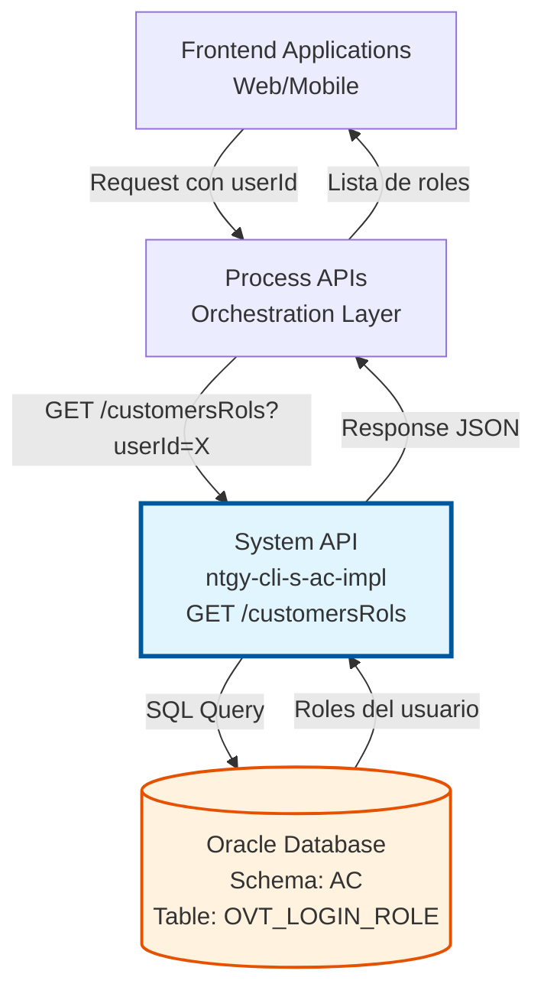
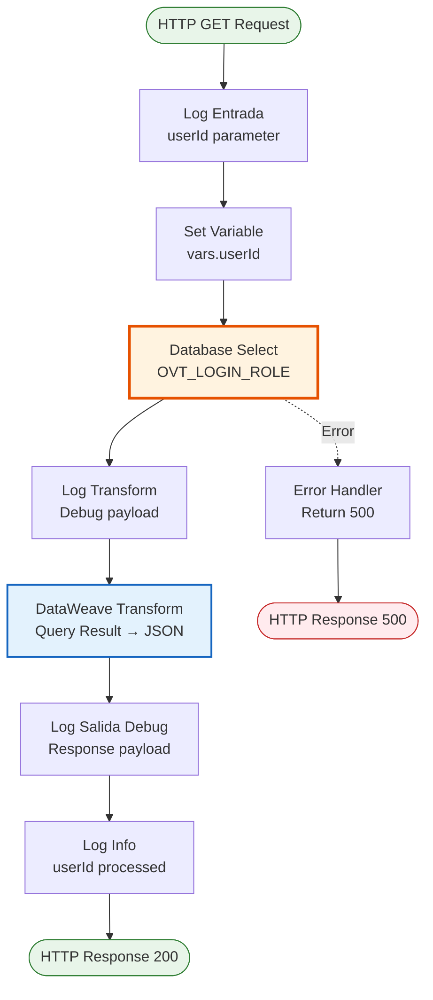
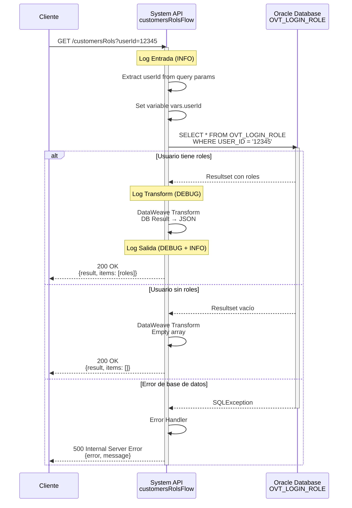

# GET /customersRols

## 📌 Descripción General

### Propósito del Endpoint

Este endpoint consulta los roles asignados a un usuario específico en el sistema de Alta de Clientes (AC) de Naturgy. Permite obtener la lista de roles asociados a un usuario mediante su identificador único (`userId`), facilitando la implementación de control de acceso basado en roles (RBAC) en las aplicaciones frontend y Process APIs.

El endpoint soporta:
- **Consulta de roles por usuario**: Obtiene todos los roles asignados a un usuario específico
- **Validación de permisos**: Permite verificar qué acciones puede realizar un usuario
- **Gestión de autorización**: Facilita la implementación de lógica de autorización en capas superiores

### Tipo de API

**Capa:** System API (API-Led Connectivity)

**Función:** Integración directa con Oracle Database (esquema AC) para consultar roles de usuarios del sistema de autenticación.

### Patrón de Integración

**Tipo:** Request-Reply Síncrono con SQL Query

**Descripción:** El endpoint recibe el ID de usuario como query parameter, ejecuta una consulta SQL en la tabla `OVT_LOGIN_ROLE`, transforma el resultado a formato JSON y retorna la lista de roles asignados al usuario.

### Arquitectura API-Led Connectivity



---

## 💼 Propósito del Negocio

### Casos de Uso Principales

1. **Validación de Permisos de Usuario**
   - Un usuario inicia sesión en el portal de clientes
   - El sistema consulta sus roles para determinar qué funcionalidades puede acceder
   - Se personaliza la interfaz según los permisos del usuario

2. **Control de Acceso Basado en Roles (RBAC)**
   - Las aplicaciones frontend necesitan validar si un usuario tiene permisos para realizar una acción
   - Se consultan los roles del usuario antes de permitir operaciones sensibles
   - Se implementa seguridad a nivel de aplicación

3. **Auditoría y Trazabilidad**
   - Se registra qué roles tiene un usuario al momento de realizar una operación
   - Facilita la auditoría de accesos y permisos
   - Permite investigar incidentes de seguridad

### Contexto Empresarial

- **Dominio:** Gestión de Clientes y Autenticación
- **Sector:** Energía - Utilities
- **División:** Naturgy España - Sistema de Alta de Clientes
- **Proceso de Negocio:** Autenticación y Autorización de Usuarios
- **Sistema:** Oracle Database - Esquema AC (Alta de Clientes)

### Stakeholders

- **Usuarios finales**: Clientes que acceden al portal web/móvil
- **Desarrolladores frontend**: Necesitan implementar lógica de autorización
- **Administradores de seguridad**: Gestionan roles y permisos
- **Equipos de auditoría**: Requieren trazabilidad de accesos

### Valor de Negocio

- **Seguridad mejorada**: Control granular de acceso a funcionalidades
- **Experiencia personalizada**: Interfaz adaptada según permisos del usuario
- **Cumplimiento normativo**: Trazabilidad de accesos y permisos
- **Reducción de riesgos**: Prevención de accesos no autorizados

### Consumidores Potenciales

Este endpoint puede ser consumido por:
- Process APIs de autenticación y autorización
- Experience APIs de portales web y móviles
- Sistemas de gestión de identidad (IAM)
- Aplicaciones de administración de usuarios
- Servicios de auditoría y logging

---

## 🔧 Especificación Técnica

### URLs por Ambiente

| Ambiente | URL Base | URL Completa |
|----------|----------|--------------|
| **Local** | `http://localhost:8050` | `http://localhost:8050/api/customersRols?userId={userId}` |
| **Development** | `https://ntgy-cli-s-ac-impl-dev.cloudhub.io` | `https://ntgy-cli-s-ac-impl-dev.cloudhub.io/api/customersRols?userId={userId}` |
| **QA/Testing** | `https://ntgy-cli-s-ac-impl-cc.cloudhub.io` | `https://ntgy-cli-s-ac-impl-cc.cloudhub.io/api/customersRols?userId={userId}` |
| **Pre-Production** | `https://ntgy-cli-s-ac-impl-cl.cloudhub.io` | `https://ntgy-cli-s-ac-impl-cl.cloudhub.io/api/customersRols?userId={userId}` |
| **Production** | `https://ntgy-cli-s-ac-impl-pro.cloudhub.io` | `https://ntgy-cli-s-ac-impl-pro.cloudhub.io/api/customersRols?userId={userId}` |

### Método HTTP

```
GET /api/customersRols
```

### Parámetros de Entrada

#### Headers HTTP

| Header | Tipo | Requerido | Descripción | Ejemplo |
|--------|------|-----------|-------------|---------|
| `Accept` | string | ❌ No | Tipo de contenido esperado en response | `application/json` |

#### Query Parameters

| Parámetro | Tipo | Requerido | Descripción | Ejemplo |
|-----------|------|-----------|-------------|---------|
| `userId` | string | ✅ Sí | Identificador único del usuario en el sistema | `"12345"` |

**Validaciones:**
- `userId` no puede estar vacío
- `userId` debe ser un identificador válido existente en la base de datos

### Respuestas

#### Respuesta Exitosa (200 OK)

```json
{
  "result": {
    "codResult": "0000",
    "msgResult": "No hay error"
  },
  "items": [
    {
      "rolename": "ADMIN"
    },
    {
      "rolename": "USER"
    },
    {
      "rolename": "CUSTOMER_SERVICE"
    }
  ]
}
```

**Descripción de campos:**
- `result.codResult`: Código de resultado de la operación (`"0000"` = éxito)
- `result.msgResult`: Mensaje descriptivo del resultado
- `items`: Array de objetos con los roles del usuario
- `items[].rolename`: Nombre del rol asignado al usuario

#### Respuesta sin Roles (200 OK)

```json
{
  "result": {
    "codResult": "0000",
    "msgResult": "No hay error"
  },
  "items": []
}
```

**Descripción:** El usuario existe pero no tiene roles asignados.

#### Respuesta de Error Técnico (500)

```json
{
  "error": "APP_9999",
  "message": "Error en el servicio."
}
```

**Descripción:** Error interno del servidor (problema de conexión a base de datos, timeout, etc.)

### Autenticación y Autorización

- **Tipo:** Client ID & Client Secret (Anypoint Platform)
- **Autorización Oracle:** El usuario de base de datos debe tener permisos para:
  - Ejecutar `SELECT` en la tabla `OVT_LOGIN_ROLE`
  - Acceso de lectura al esquema AC

### Timeouts

| Tipo | Valor | Descripción |
|------|-------|-------------|
| **Query Timeout** | 30 segundos | Tiempo máximo de ejecución de la query SQL |
| **Connection Timeout** | 10 segundos | Tiempo máximo para establecer conexión con Oracle |
| **Response Timeout** | 30 segundos | Tiempo máximo de espera para la respuesta completa |

---

## 🏗️ Implementación Técnica

### Arquitectura del Flow



### Componentes del Flow

#### 1. Logger Entrada (Línea 9)
```xml
<logger level="INFO" message='s-ac-customersRols.logEntrada ## payload: #[payload] #[attributes.queryParams["userId"]]' />
```
**Propósito:** Registrar el inicio del procesamiento con el userId recibido.

#### 2. Set Variable (Línea 10)
```xml
<set-variable variableName="userId" value='#[attributes.queryParams["userId"]]'/>
```
**Propósito:** Extraer y almacenar el parámetro `userId` del query string.

#### 3. Database Select (Líneas 11-15)
```xml
<db:select config-ref="Database_Config">
    <reconnect-forever />
    <db:sql><![CDATA[${queries.customersRols}]]></db:sql>
    <db:input-parameters><![CDATA[#[{'userId': vars.userId}]]]></db:input-parameters>
</db:select>
```

**Query SQL ejecutada:**
```sql
SELECT * FROM OVT_LOGIN_ROLE WHERE USER_ID = :userId
```

**Configuración:**
- **Connection pooling:** Habilitado (MaxPoolSize: 5 en local)
- **Reconnect strategy:** Forever (reintentos infinitos con backoff)
- **Parámetros:** Binding seguro con `:userId`

#### 4. Logger Transform (Línea 16)
```xml
<logger level="DEBUG" message="s-ac-customersRols.logTransform ## payload: #[payload[0 to -1]]" />
```
**Propósito:** Registrar el resultado de la query antes de la transformación.

#### 5. DataWeave Transformation (Líneas 17-33)
```dataweave
%dw 2.0
output application/json
---
{
    result: {
        codResult: "0000",
        msgResult: "No hay error"
    },
    items: payload map ( payload01 , indexOfPayload01 ) -> {
        rolename: payload01.ROLENAME
    }
}
```

**Transformación:**
- Convierte el resultado de la query Oracle a JSON
- Extrae solo el campo `ROLENAME` de cada registro
- Envuelve el resultado en estructura estandarizada con `result` e `items`

#### 6. Logger Salida (Líneas 34-35)
```xml
<logger level="DEBUG" message="s-ac-customersRols.logSalida ## payload: #[payload]" />
<logger level="INFO" message='s-ac-customersRols.logSalida  #[vars.userId]' />
```
**Propósito:** Registrar la respuesta final y el userId procesado.

### Diagrama de Secuencia Completo



### Configuración de Base de Datos

**Database Config (global.xml):**
```xml
<db:config name="Database_Config">
    <db:generic-connection 
        url="jdbc:oracle:thin:${dbAC.user}/${secure::dbAC.pass}@(DESCRIPTION_LIST=...)"
        driverClassName="oracle.jdbc.driver.OracleDriver">
        <db:pooling-profile 
            maxPoolSize="${dbAC.MaxPoolSize}"
            maxWait="${dbAC.MaxWaitTime}"
            maxIdleTime="${dbAC.MaxIdleTime}"
            testConnectionOnCheckout="false"/>
    </db:generic-connection>
</db:config>
```

**Parámetros de conexión (local):**
- **MaxPoolSize:** 5 conexiones
- **MaxWaitTime:** 300ms
- **MaxIdleTime:** 300ms
- **ConnectTimeout:** 3600ms
- **RetryCount:** 3 intentos

### Tabla de Base de Datos

#### OVT_LOGIN_ROLE

**Propósito:** Almacena la relación entre usuarios y roles del sistema de autenticación.

**Campos principales:**
- `USER_ID`: Identificador del usuario (clave foránea)
- `ROLENAME`: Nombre del rol asignado
- Otros campos de auditoría (fecha creación, usuario modificación, etc.)

**Índices:**
- Índice en `USER_ID` para optimizar búsquedas por usuario

**Operaciones permitidas:**
- `SELECT`: Consulta de roles (este endpoint)

### Manejo de Errores

**Error Handler Global:**
```xml
<error-handler name="apiErrorHandler">
    <on-error-continue type="ANY">
        <ee:transform>
            <ee:message>
                <ee:set-payload><![CDATA[
                    %dw 2.0
                    output application/json
                    ---
                    {
                        error: "APP_9999",
                        message: "Error en el servicio."
                    }
                ]]></ee:set-payload>
            </ee:message>
        </ee:transform>
        <set-variable variableName="httpStatus" value="500"/>
    </on-error-continue>
</error-handler>
```

**Tipos de errores manejados:**
- **SQLException:** Error de conexión o ejecución de query
- **Timeout:** Query excede tiempo máximo de ejecución
- **Connection Error:** No se puede establecer conexión con Oracle
- **Transformation Error:** Error en transformación DataWeave

---

## 💻 Ejemplos de Uso

### Ejemplo 1: Consulta Exitosa con Roles

**Request:**
```bash
curl -X GET "http://localhost:8050/api/customersRols?userId=12345" \
  -H "Accept: application/json"
```

**Response (200 OK):**
```json
{
  "result": {
    "codResult": "0000",
    "msgResult": "No hay error"
  },
  "items": [
    {
      "rolename": "ADMIN"
    },
    {
      "rolename": "USER"
    },
    {
      "rolename": "CUSTOMER_SERVICE"
    }
  ]
}
```

### Ejemplo 2: Usuario sin Roles Asignados

**Request:**
```bash
curl -X GET "http://localhost:8050/api/customersRols?userId=99999" \
  -H "Accept: application/json"
```

**Response (200 OK):**
```json
{
  "result": {
    "codResult": "0000",
    "msgResult": "No hay error"
  },
  "items": []
}
```

### Ejemplo 3: Error de Servidor

**Request:**
```bash
curl -X GET "http://localhost:8050/api/customersRols?userId=12345" \
  -H "Accept: application/json"
```

**Response (500 Internal Server Error):**
```json
{
  "error": "APP_9999",
  "message": "Error en el servicio."
}
```

**Causas posibles:**
- Base de datos no disponible
- Timeout en la query
- Error de conexión
- Problema de configuración

### Ejemplo 4: Integración desde JavaScript

```javascript
async function getUserRoles(userId) {
  try {
    const response = await fetch(
      `https://ntgy-cli-s-ac-impl-pro.cloudhub.io/api/customersRols?userId=${userId}`,
      {
        method: 'GET',
        headers: {
          'Accept': 'application/json'
        }
      }
    );
    
    if (!response.ok) {
      throw new Error(`HTTP error! status: ${response.status}`);
    }
    
    const data = await response.json();
    
    if (data.result.codResult === "0000") {
      return data.items.map(item => item.rolename);
    } else {
      throw new Error(data.result.msgResult);
    }
  } catch (error) {
    console.error('Error fetching user roles:', error);
    throw error;
  }
}

// Uso
getUserRoles('12345')
  .then(roles => {
    console.log('User roles:', roles);
    // ['ADMIN', 'USER', 'CUSTOMER_SERVICE']
  })
  .catch(error => {
    console.error('Failed to get roles:', error);
  });
```

### Ejemplo 5: Validación de Permisos

```javascript
async function hasRole(userId, requiredRole) {
  const roles = await getUserRoles(userId);
  return roles.includes(requiredRole);
}

// Verificar si el usuario es administrador
const isAdmin = await hasRole('12345', 'ADMIN');

if (isAdmin) {
  console.log('Usuario tiene permisos de administrador');
  // Mostrar opciones de administración
} else {
  console.log('Usuario no tiene permisos de administrador');
  // Ocultar opciones de administración
}
```

### Ejemplo 6: Integración desde Python

```python
import requests
from typing import List, Dict

def get_user_roles(user_id: str, base_url: str = "http://localhost:8050") -> List[str]:
    """
    Obtiene los roles de un usuario desde el System API.
    
    Args:
        user_id: ID del usuario
        base_url: URL base del API
        
    Returns:
        Lista de nombres de roles
        
    Raises:
        requests.RequestException: Si hay error en la petición
        ValueError: Si la respuesta no es válida
    """
    url = f"{base_url}/api/customersRols"
    params = {"userId": user_id}
    headers = {"Accept": "application/json"}
    
    try:
        response = requests.get(url, params=params, headers=headers, timeout=30)
        response.raise_for_status()
        
        data = response.json()
        
        if data.get("result", {}).get("codResult") == "0000":
            return [item["rolename"] for item in data.get("items", [])]
        else:
            raise ValueError(f"Error en respuesta: {data.get('result', {}).get('msgResult')}")
            
    except requests.RequestException as e:
        print(f"Error al consultar roles: {e}")
        raise

# Uso
try:
    roles = get_user_roles("12345")
    print(f"Roles del usuario: {roles}")
    
    if "ADMIN" in roles:
        print("Usuario tiene permisos de administrador")
except Exception as e:
    print(f"Error: {e}")
```

### Ejemplo 7: Testing con Postman

**Pre-request Script:**
```javascript
// Establecer variable de ambiente
pm.environment.set("userId", "12345");
```

**Tests:**
```javascript
// Verificar status code
pm.test("Status code is 200", function () {
    pm.response.to.have.status(200);
});

// Verificar estructura de respuesta
pm.test("Response has correct structure", function () {
    var jsonData = pm.response.json();
    pm.expect(jsonData).to.have.property('result');
    pm.expect(jsonData).to.have.property('items');
    pm.expect(jsonData.result).to.have.property('codResult');
    pm.expect(jsonData.result).to.have.property('msgResult');
});

// Verificar código de resultado exitoso
pm.test("Result code is 0000", function () {
    var jsonData = pm.response.json();
    pm.expect(jsonData.result.codResult).to.eql("0000");
});

// Verificar que items es un array
pm.test("Items is an array", function () {
    var jsonData = pm.response.json();
    pm.expect(jsonData.items).to.be.an('array');
});

// Verificar estructura de cada rol
pm.test("Each role has rolename property", function () {
    var jsonData = pm.response.json();
    jsonData.items.forEach(function(item) {
        pm.expect(item).to.have.property('rolename');
        pm.expect(item.rolename).to.be.a('string');
    });
});

// Guardar roles en variable de ambiente
if (pm.response.code === 200) {
    var jsonData = pm.response.json();
    pm.environment.set("userRoles", JSON.stringify(jsonData.items));
}
```

---

**Documentación generada:** 2026-07-15  
**Versión del API:** 2.0.0  
**Basado en código fuente verificado:** ✅