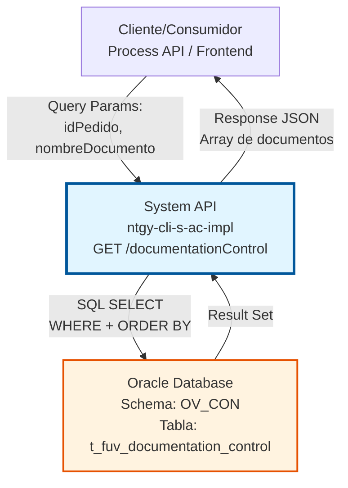
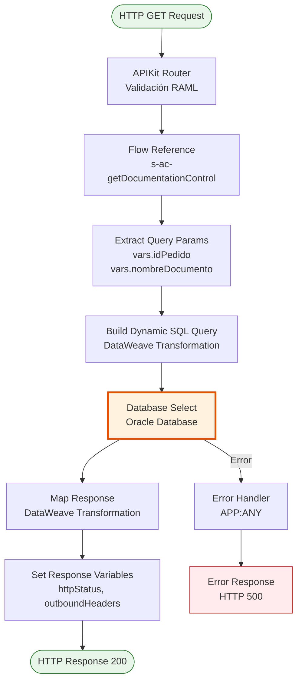
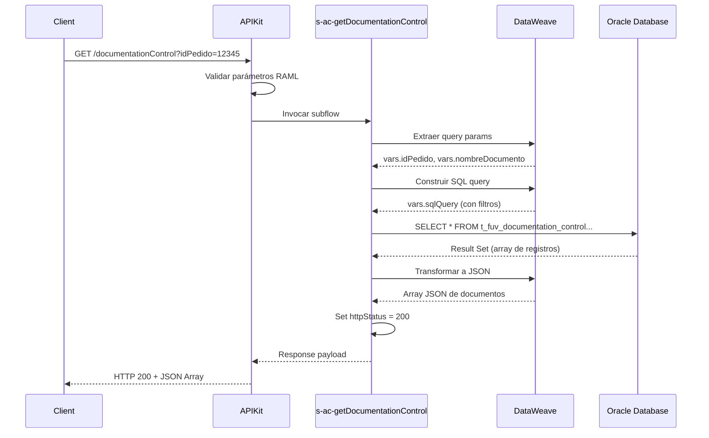

# GET /documentationControl

## 📌 Descripción General

### Propósito del Endpoint

Este endpoint permite consultar registros de control de documentación asociados a contratos. Proporciona capacidad de filtrado flexible mediante parámetros opcionales para localizar documentos específicos por ID de pedido y/o nombre de documento.

El endpoint soporta:
- **Consulta por ID de Pedido**: Recupera todos los documentos asociados a un contrato específico
- **Filtrado por Nombre de Documento**: Permite búsqueda específica de un tipo de documento
- **Ordenamiento Cronológico**: Retorna resultados ordenados por fecha de creación descendente (más recientes primero)

### Tipo de API

**Capa:** System API (API-Led Connectivity)

**Función:** Integración directa con Oracle Database (esquema AC) para consulta de registros de control de documentación.

### Patrón de Integración

**Tipo:** Request-Reply Síncrono con SQL Query

**Descripción:** El endpoint recibe parámetros de consulta, construye dinámicamente una query SQL con filtros condicionales, ejecuta la consulta en Oracle Database y retorna los resultados transformados a JSON.

### Arquitectura API-Led Connectivity



---

## 💼 Propósito del Negocio

### Casos de Uso Principales

1. **Consulta de Documentación de Contrato**
   - Un agente de servicio al cliente necesita verificar qué documentos están asociados a un pedido
   - Se proporciona el ID del pedido y se obtiene la lista completa de documentos
   - Permite dar seguimiento al estado de la documentación del contrato

2. **Búsqueda de Documento Específico**
   - El sistema necesita verificar si un documento específico (ej: "DNI", "Contrato Firmado") existe para un pedido
   - Se proporciona tanto el ID del pedido como el nombre del documento
   - Retorna solo el documento específico solicitado

3. **Auditoría de Documentación**
   - Los procesos de auditoría necesitan revisar la documentación completa de contratos
   - Se consultan todos los documentos ordenados por fecha de creación
   - Facilita la trazabilidad y cumplimiento normativo

### Contexto Empresarial

- **Dominio:** Gestión de Documentación de Contratos
- **Sector:** Energía - Utilities
- **División:** Naturgy España - Administración Comercial
- **Proceso de Negocio:** Control y seguimiento de documentación contractual
- **Sistema:** Oracle Database - Esquema AC (Administración Comercial)

### Stakeholders

- **Agentes de Servicio al Cliente**: Necesitan consultar documentación para resolver incidencias
- **Sistemas de Gestión Documental**: Requieren verificar existencia y estado de documentos
- **Procesos de Auditoría**: Necesitan acceso a registros históricos de documentación
- **Sistemas de Workflow**: Consultan estado de documentación para avanzar procesos

### Valor de Negocio

- **Trazabilidad Completa**: Registro histórico de toda la documentación asociada a contratos
- **Eficiencia Operativa**: Consulta rápida de documentación sin acceso directo a base de datos
- **Cumplimiento Normativo**: Facilita auditorías y verificación de documentación requerida
- **Soporte a Procesos**: Permite a sistemas downstream tomar decisiones basadas en documentación disponible

### Consumidores Potenciales

Este endpoint puede ser consumido por:
- Process APIs de gestión de contratos
- Sistemas de gestión documental (DMS)
- Portales de autoservicio (consulta de documentación)
- Sistemas de workflow y BPM
- Herramientas de auditoría y compliance

---

## 🔧 Especificación Técnica

### URLs por Ambiente

| Ambiente | URL Base | URL Completa |
|----------|----------|--------------|
| **Local** | `http://localhost:8081` | `http://localhost:8081/api/documentationControl` |
| **Development** | `https://ntgy-cli-s-ac-dev.us-e2.cloudhub.io` | `https://ntgy-cli-s-ac-dev.us-e2.cloudhub.io/api/documentationControl` |
| **QA** | `https://ntgy-cli-s-ac-cc.us-e2.cloudhub.io` | `https://ntgy-cli-s-ac-cc.us-e2.cloudhub.io/api/documentationControl` |
| **Pre-Production** | `https://ntgy-cli-s-ac-cl.us-e2.cloudhub.io` | `https://ntgy-cli-s-ac-cl.us-e2.cloudhub.io/api/documentationControl` |
| **Production** | `https://ntgy-cli-s-ac-pro.us-e2.cloudhub.io` | `https://ntgy-cli-s-ac-pro.us-e2.cloudhub.io/api/documentationControl` |

### Método HTTP

```
GET /api/documentationControl
```

### Parámetros de Entrada

#### Headers HTTP

| Header | Tipo | Requerido | Descripción | Ejemplo |
|--------|------|-----------|-------------|---------|
| `Accept` | string | ❌ No | Tipo de contenido esperado en response | `application/json` |

#### Query Parameters

| Parámetro | Tipo | Requerido | Descripción | Ejemplo |
|-----------|------|-----------|-------------|---------|
| `idPedido` | string | ✅ Sí | Identificador único del pedido/contrato | `"12345"` |
| `nombreDocumento` | string | ❌ No | Nombre específico del documento a buscar | `"DNI"` |

**Lógica de Filtrado:**
- Si solo se proporciona `idPedido`: Retorna TODOS los documentos del pedido
- Si se proporcionan ambos parámetros: Retorna SOLO el documento específico que coincida con ambos criterios

### Respuestas

#### Respuesta Exitosa (200 OK)

**Estructura de Respuesta:**

```json
{
  "result": {
    "codResult": "0000",
    "msgResult": "No hay error"
  },
  "record": {
    "NUM_DOCUMENTO": "string",
    "T_FUV_DOCUMENTATION_CONTROL_ID": "number",
    "CONTRACT_ID": "string",
    "DOCUMENT_NAME": "string",
    "DOCUMENT_STATUS": "string",
    "ATTEMPTS_NUMBER": "number",
    "CREATE_DATE": "timestamp",
    "UPDATE_DATE": "timestamp",
    "UPDATE_USER": "string",
    "UPDATE_PROGRAM": "string",
    "CABECERA_CONTRATO": "string",
    "TIPO_DOCUMENTAL": "string",
    "ENVIO_DISTRIBUIDORA": "boolean",
    "LINEAS_CONTRATO": "string"
  }
}
```

**Descripción de Campos:**

| Campo | Tipo | Descripción |
|-------|------|-------------|
| `result.codResult` | string | Código de resultado ("0000" = éxito) |
| `result.msgResult` | string | Mensaje descriptivo del resultado |
| `record.NUM_DOCUMENTO` | string | Número de documento |
| `record.T_FUV_DOCUMENTATION_CONTROL_ID` | number | ID único del registro de control |
| `record.CONTRACT_ID` | string | ID del contrato/pedido |
| `record.DOCUMENT_NAME` | string | Nombre del documento |
| `record.DOCUMENT_STATUS` | string | Estado del documento (ej: PENDIENTE, VALIDADO, RECHAZADO) |
| `record.ATTEMPTS_NUMBER` | number | Número de intentos de procesamiento |
| `record.CREATE_DATE` | timestamp | Fecha de creación del registro |
| `record.UPDATE_DATE` | timestamp | Fecha de última actualización |
| `record.UPDATE_USER` | string | Usuario que realizó la última actualización |
| `record.UPDATE_PROGRAM` | string | Programa/sistema que realizó la actualización |
| `record.CABECERA_CONTRATO` | string | Cabecera del contrato |
| `record.TIPO_DOCUMENTAL` | string | Tipo documental |
| `record.ENVIO_DISTRIBUIDORA` | boolean | Indica si se envía a distribuidora (transformado de 'Y'/'N' a true/false) |
| `record.LINEAS_CONTRATO` | string | Líneas del contrato |

**Ejemplo Real:**

```json
{
  "result": {
    "codResult": "0000",
    "msgResult": "No hay error"
  },
  "record": {
    "NUM_DOCUMENTO": "12345678A",
    "T_FUV_DOCUMENTATION_CONTROL_ID": 1001,
    "CONTRACT_ID": "12345",
    "DOCUMENT_NAME": "DNI",
    "DOCUMENT_STATUS": "VALIDADO",
    "ATTEMPTS_NUMBER": 1,
    "CREATE_DATE": "2026-07-15T10:30:00",
    "UPDATE_DATE": "2026-07-15T11:00:00",
    "UPDATE_USER": "user123",
    "UPDATE_PROGRAM": "mulesoft",
    "CABECERA_CONTRATO": "CONT-2026-001",
    "TIPO_DOCUMENTAL": "IDENTIFICACION",
    "ENVIO_DISTRIBUIDORA": true,
    "LINEAS_CONTRATO": "LC-001,LC-002"
  }
}
```

**⚠️ IMPORTANTE:** Este endpoint usa `db:query-single`, por lo que retorna **UN SOLO REGISTRO** (el primero que coincida con los criterios de búsqueda ordenado por fecha de creación descendente). Si necesitas múltiples registros, usa el endpoint `/documentationControlByStatus`.

#### Respuesta de Error Técnico (500)

```json
{
  "error": "APP_9999",
  "message": "Error en el servicio."
}
```

**Causas Comunes:**
- Base de datos no disponible
- Timeout en la conexión
- Error en la ejecución de la query SQL
- Permisos insuficientes en la base de datos
- Registro no encontrado (el `query-single` falla si no hay resultados)

### Autenticación y Autorización

- **Tipo:** Client ID & Client Secret (Anypoint Platform)
- **Autorización Database:** El usuario de conexión debe tener permisos para:
  - Ejecutar SELECT en tabla `t_fuv_documentation_control`
  - Acceso de lectura al esquema `OV_CON`

### Timeouts

| Tipo | Valor | Descripción |
|------|-------|-------------|
| **Request Timeout** | 30 segundos | Tiempo máximo de espera para la respuesta |
| **Connection Timeout** | 10 segundos | Tiempo máximo para establecer conexión con DB |
| **Query Timeout** | 30 segundos | Tiempo máximo de ejecución de la query SQL |

---

## 🏗️ Implementación Técnica

### Arquitectura del Flow



### Componentes Principales

#### 1. APIKit Router (s-ac.xml)
**Ubicación:** `src/main/mule/s-ac.xml` (línea 28)

```xml
<flow name="get:\documentationControl:s-ac-config">
    <logger level="DEBUG" message="s-ac-get:\documentationControl" />
    <flow-ref name="s-ac-getDocumentationControl" />
</flow>
```

**Función:** Enrutamiento y validación inicial del request según especificación RAML.

#### 2. Subflow de Implementación (s-ac-documentationControl.xml)
**Ubicación:** `src/main/mule/s-ac-documentationControl.xml` (líneas 6-42)

**Función:** Lógica principal de consulta con construcción dinámica de query SQL.

### Transformaciones DataWeave

#### Transformación 1: Extracción de Parámetros
**Ubicación:** Líneas 11-21 del subflow

```dataweave
%dw 2.0
output application/java
---
{
    idPedido: attributes.queryParams.idPedido,
    nombreDocumento: attributes.queryParams.nombreDocumento default null
}
```

**Propósito:** Extraer y normalizar parámetros de query, estableciendo `null` como valor por defecto para `nombreDocumento`.

#### Transformación 2: Construcción Dinámica de Query SQL
**Ubicación:** Líneas 24-30 del subflow

```dataweave
%dw 2.0
output application/java
---
"SELECT * FROM t_fuv_documentation_control WHERE CONTRACT_ID = '" ++ vars.idPedido ++ "'" ++
if (vars.nombreDocumento != null) 
    (" and DOCUMENT_NAME = '" ++ vars.nombreDocumento ++ "'")  
else 
    ('')
++ " order by create_date desc"
```

**Propósito:** Construir query SQL dinámica con filtro condicional:
- **Filtro Base:** Siempre filtra por `CONTRACT_ID`
- **Filtro Opcional:** Añade condición `DOCUMENT_NAME` solo si el parámetro está presente
- **Ordenamiento:** Ordena por `create_date` descendente (más recientes primero)

**Ejemplo de Query Generada:**

*Con solo idPedido:*
```sql
SELECT * FROM t_fuv_documentation_control 
WHERE CONTRACT_ID = '12345' 
order by create_date desc
```

*Con idPedido y nombreDocumento:*
```sql
SELECT * FROM t_fuv_documentation_control 
WHERE CONTRACT_ID = '12345' 
and DOCUMENT_NAME = 'DNI' 
order by create_date desc
```

#### Transformación 3: Mapeo de Registro a Variable
**Ubicación:** Líneas 177-201 del subflow

```dataweave
%dw 2.0
output application/json
---
{
    "NUM_DOCUMENTO": payload.'NUM_DOCUMENTO',
    "T_FUV_DOCUMENTATION_CONTROL_ID": payload.'T_FUV_DOCUMENTATION_CONTROL_ID',
    "CONTRACT_ID": payload.'CONTRACT_ID',
    "DOCUMENT_NAME": payload.'DOCUMENT_NAME',
    "DOCUMENT_STATUS": payload.'DOCUMENT_STATUS',
    "ATTEMPTS_NUMBER": payload.'ATTEMPTS_NUMBER',
    "CREATE_DATE": payload.'CREATE_DATE',
    "UPDATE_DATE": payload.'UPDATE_DATE',
    "UPDATE_USER": payload.'UPDATE_USER',
    "UPDATE_PROGRAM": payload.'UPDATE_PROGRAM',
    "CABECERA_CONTRATO": payload.'CABECERA_CONTRATO',
    "TIPO_DOCUMENTAL": payload.'TIPO_DOCUMENTAL',
    "ENVIO_DISTRIBUIDORA": if(payload.'ENVIO_DISTRIBUIDORA' == 'Y') true else false,
    "LINEAS_CONTRATO": payload.'LINEAS_CONTRATO'
}
```

**Propósito:** Transformar el registro único de Oracle a formato JSON y almacenarlo en la variable `recordSelected`.

**Transformación Especial:**
- **ENVIO_DISTRIBUIDORA:** Convierte el valor de base de datos ('Y'/'N') a booleano (true/false)
  - 'Y' → `true`
  - Cualquier otro valor → `false`

#### Transformación 4: Construcción de Respuesta Final
**Ubicación:** Líneas 202-214 del subflow

```dataweave
%dw 2.0
output application/json
---
{
    "result": {
        "codResult": "0000",
        "msgResult": "No hay error",
    }, 
    "record": vars.recordSelected
}
```

**Propósito:** Envolver el registro en una estructura de respuesta estándar con información de resultado.

### Operación de Base de Datos

#### Database Query Single Operation
**Ubicación:** Línea 174 del subflow

```xml
<db:query-single config-ref="Database_Config">
    <db:sql><![CDATA[#[payload]]]></db:sql>
</db:query-single>
```

**Configuración:**
- **Operación:** `query-single` (retorna UN SOLO registro)
- **Config Reference:** `Database_Config` (Oracle RAC con failover)
- **Query:** Dinámica, construida en el payload
- **Connection Pooling:** Activo (max 5 conexiones según config)
- **Timeout:** 30 segundos

**⚠️ COMPORTAMIENTO IMPORTANTE:**
- `query-single` retorna **SOLO EL PRIMER REGISTRO** que coincida con los criterios
- Si la query retorna múltiples registros, solo se procesa el primero (ordenado por `create_date desc`)
- Si NO hay resultados, la operación **FALLA** y se dispara el error handler

**Tabla Consultada:**
- **Nombre:** `t_fuv_documentation_control`
- **Schema:** `OV_CON`
- **Operación:** SELECT (READ)
- **Índices Recomendados:** 
  - Índice en `CONTRACT_ID` para performance
  - Índice compuesto en `(CONTRACT_ID, DOCUMENT_NAME)` para búsquedas específicas
  - Índice en `CREATE_DATE` para ordenamiento eficiente

### Diagrama de Secuencia Detallado



### Manejo de Errores

#### Error Handler Global
**Ubicación:** `s-ac-globalErrorHandler.xml`

```xml
<on-error-continue type="ANY">
    <ee:transform>
        <ee:message>
            <ee:set-payload><![CDATA[%dw 2.0
output application/json
---
{
    error: "APP_9999",
    message: "Error en el servicio."
}]]></ee:set-payload>
        </ee:message>
    </ee:transform>
    <ee:transform>
        <ee:message>
            <ee:set-attributes><![CDATA[%dw 2.0
output application/java
---
{
    httpStatus: 500
}]]></ee:set-attributes>
        </ee:message>
    </ee:transform>
</on-error-continue>
```

**Errores Manejados:**
- **Database Connection Errors:** Timeout, conexión perdida
- **SQL Execution Errors:** Query inválida, permisos insuficientes
- **Transformation Errors:** Errores en DataWeave
- **Cualquier Error No Anticipado:** Capturado por `ANY`

### Configuración de Base de Datos

#### Database Config
**Ubicación:** `global.xml`

```xml
<db:config name="Database_Config">
    <db:generic-connection 
        url="jdbc:oracle:thin:${dbAC.user}/${secure::dbAC.pass}@..."
        driverClassName="oracle.jdbc.driver.OracleDriver">
        <db:pooling-profile 
            maxPoolSize="${dbAC.MaxPoolSize}"
            maxWait="${dbAC.MaxWaitTime}"
            maxIdleTime="${dbAC.MaxIdleTime}"/>
    </db:generic-connection>
</db:config>
```

**Características:**
- **Driver:** Oracle JDBC 19.13.0.0.1
- **Connection Pooling:** Configurado por ambiente
- **Failover:** Oracle RAC con 2 nodos
- **Secure Properties:** Credenciales encriptadas

---

## 💻 Ejemplos de Uso

### Ejemplo 1: Consultar Documento Más Reciente de un Pedido

#### Request con curl

```bash
curl -X GET \
  'http://localhost:8081/api/documentationControl?idPedido=12345' \
  -H 'Accept: application/json'
```

#### Request con JavaScript (Fetch API)

```javascript
const response = await fetch(
  'http://localhost:8081/api/documentationControl?idPedido=12345',
  {
    method: 'GET',
    headers: {
      'Accept': 'application/json'
    }
  }
);

const data = await response.json();
if (data.result.codResult === "0000") {
  console.log('Documento encontrado:', data.record.DOCUMENT_NAME);
  console.log('Estado:', data.record.DOCUMENT_STATUS);
} else {
  console.error('Error:', data.result.msgResult);
}
```

#### Response Exitoso (200 OK)

```json
{
  "result": {
    "codResult": "0000",
    "msgResult": "No hay error"
  },
  "record": {
    "NUM_DOCUMENTO": "12345678A",
    "T_FUV_DOCUMENTATION_CONTROL_ID": 1001,
    "CONTRACT_ID": "12345",
    "DOCUMENT_NAME": "DNI",
    "DOCUMENT_STATUS": "VALIDADO",
    "ATTEMPTS_NUMBER": 1,
    "CREATE_DATE": "2026-07-15T10:30:00",
    "UPDATE_DATE": "2026-07-15T11:00:00",
    "UPDATE_USER": "user123",
    "UPDATE_PROGRAM": "mulesoft",
    "CABECERA_CONTRATO": "CONT-2026-001",
    "TIPO_DOCUMENTAL": "IDENTIFICACION",
    "ENVIO_DISTRIBUIDORA": true,
    "LINEAS_CONTRATO": "LC-001,LC-002"
  }
}
```

**⚠️ Nota:** Solo retorna el documento MÁS RECIENTE (ordenado por `create_date desc`). Si el pedido tiene múltiples documentos, solo verás el último creado.

---

### Ejemplo 2: Buscar Documento Específico por Nombre

#### Request con curl

```bash
curl -X GET \
  'http://localhost:8081/api/documentationControl?idPedido=12345&nombreDocumento=DNI' \
  -H 'Accept: application/json'
```

#### Request con Python (requests)

```python
import requests

url = "http://localhost:8081/api/documentationControl"
params = {
    "idPedido": "12345",
    "nombreDocumento": "DNI"
}
headers = {
    "Accept": "application/json"
}

response = requests.get(url, params=params, headers=headers)
data = response.json()

if data['result']['codResult'] == "0000":
    record = data['record']
    print(f"Documento encontrado: {record['DOCUMENT_NAME']}")
    print(f"Estado: {record['DOCUMENT_STATUS']}")
    print(f"Envío a distribuidora: {record['ENVIO_DISTRIBUIDORA']}")
else:
    print(f"Error: {data['result']['msgResult']}")
```

#### Response Exitoso (200 OK)

```json
{
  "result": {
    "codResult": "0000",
    "msgResult": "No hay error"
  },
  "record": {
    "NUM_DOCUMENTO": "12345678A",
    "T_FUV_DOCUMENTATION_CONTROL_ID": 1001,
    "CONTRACT_ID": "12345",
    "DOCUMENT_NAME": "DNI",
    "DOCUMENT_STATUS": "VALIDADO",
    "ATTEMPTS_NUMBER": 1,
    "CREATE_DATE": "2026-07-15T10:30:00",
    "UPDATE_DATE": "2026-07-15T11:00:00",
    "UPDATE_USER": "user123",
    "UPDATE_PROGRAM": "mulesoft",
    "CABECERA_CONTRATO": "CONT-2026-001",
    "TIPO_DOCUMENTAL": "IDENTIFICACION",
    "ENVIO_DISTRIBUIDORA": true,
    "LINEAS_CONTRATO": "LC-001,LC-002"
  }
}
```

---

### Ejemplo 3: Caso Sin Resultados (Error)

#### Request con curl

```bash
curl -X GET \
  'http://localhost:8081/api/documentationControl?idPedido=99999' \
  -H 'Accept: application/json'
```

#### Response de Error (500 Internal Server Error)

```json
{
  "error": "APP_9999",
  "message": "Error en el servicio."
}
```

**⚠️ IMPORTANTE:** Cuando NO se encuentra ningún registro, `db:query-single` lanza una excepción que es capturada por el error handler global, retornando un error 500. Este es el comportamiento esperado de la operación `query-single`.

**Interpretación:** 
- El pedido no tiene documentos registrados
- El ID de pedido no existe
- La combinación idPedido + nombreDocumento no existe

---

### Ejemplo 4: Error de Servidor

#### Request con curl

```bash
curl -X GET \
  'http://localhost:8081/api/documentationControl?idPedido=12345' \
  -H 'Accept: application/json'
```

#### Response de Error (500 Internal Server Error)

```json
{
  "error": "APP_9999",
  "message": "Error en el servicio."
}
```

**Causas Posibles:**
- Base de datos no disponible
- Timeout en la conexión
- Error en la query SQL
- Problema de permisos en la base de datos

---

### Ejemplo 5: Verificar Campo Booleano ENVIO_DISTRIBUIDORA

#### Request con curl

```bash
curl -X GET \
  'http://localhost:8081/api/documentationControl?idPedido=12345&nombreDocumento=Contrato' \
  -H 'Accept: application/json'
```

#### Response Mostrando Transformación Booleana

```json
{
  "result": {
    "codResult": "0000",
    "msgResult": "No hay error"
  },
  "record": {
    "NUM_DOCUMENTO": "87654321B",
    "T_FUV_DOCUMENTATION_CONTROL_ID": 1002,
    "CONTRACT_ID": "12345",
    "DOCUMENT_NAME": "Contrato",
    "DOCUMENT_STATUS": "PENDIENTE",
    "ATTEMPTS_NUMBER": 2,
    "CREATE_DATE": "2026-07-14T15:00:00",
    "UPDATE_DATE": "2026-07-15T09:30:00",
    "UPDATE_USER": "system",
    "UPDATE_PROGRAM": "batch_process",
    "CABECERA_CONTRATO": "CONT-2026-002",
    "TIPO_DOCUMENTAL": "CONTRACTUAL",
    "ENVIO_DISTRIBUIDORA": false,
    "LINEAS_CONTRATO": "LC-003"
  }
}
```

**Nota sobre ENVIO_DISTRIBUIDORA:**
- En base de datos se almacena como 'Y' o 'N'
- La transformación DataWeave convierte:
  - 'Y' → `true`
  - Cualquier otro valor (incluido 'N') → `false`
- El cliente recibe un booleano JSON estándar

---

### Ejemplo 6: Integración en Process API

#### Código MuleSoft (Flow Reference)

```xml
<flow name="getLatestDocumentFlow">
    <!-- Preparar request -->
    <set-variable 
        variableName="contractId" 
        value="#[payload.orderId]" />
    
    <!-- Llamar System API -->
    <http:request 
        method="GET" 
        config-ref="SystemAPI_Config"
        path="/api/documentationControl">
        <http:query-params><![CDATA[#[{
            idPedido: vars.contractId
        }]]]></http:query-params>
    </http:request>
    
    <!-- Procesar respuesta -->
    <ee:transform>
        <ee:message>
            <ee:set-payload><![CDATA[%dw 2.0
output application/json
---
{
    contractId: vars.contractId,
    latestDocument: {
        name: payload.record.DOCUMENT_NAME,
        status: payload.record.DOCUMENT_STATUS,
        createDate: payload.record.CREATE_DATE,
        requiresDistribution: payload.record.ENVIO_DISTRIBUIDORA,
        attempts: payload.record.ATTEMPTS_NUMBER
    },
    isValidated: payload.record.DOCUMENT_STATUS == "VALIDADO"
}]]></ee:set-payload>
        </ee:message>
    </ee:transform>
</flow>
```

**⚠️ Nota Importante:** Este endpoint retorna UN SOLO documento (el más reciente). Si necesitas obtener TODOS los documentos de un contrato, deberías usar el endpoint `/documentationControlByStatus` o crear un nuevo endpoint con `db:select` en lugar de `db:query-single`.
