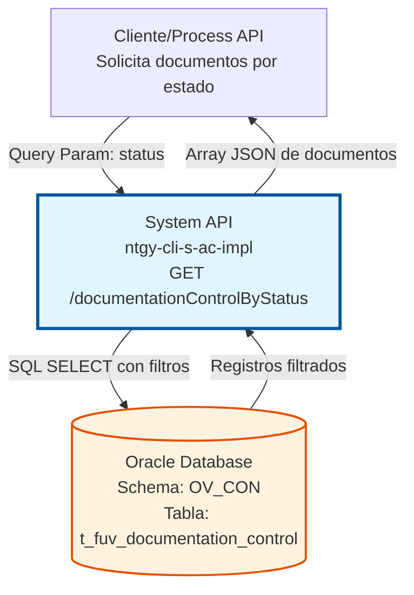
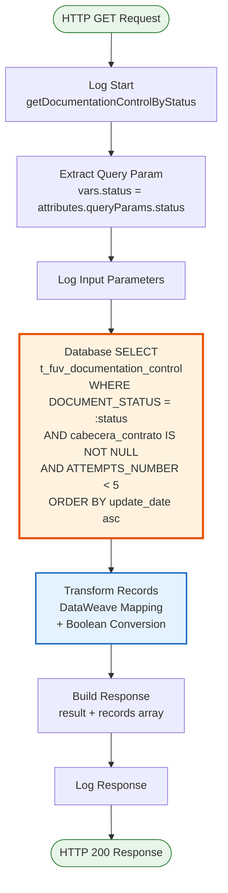
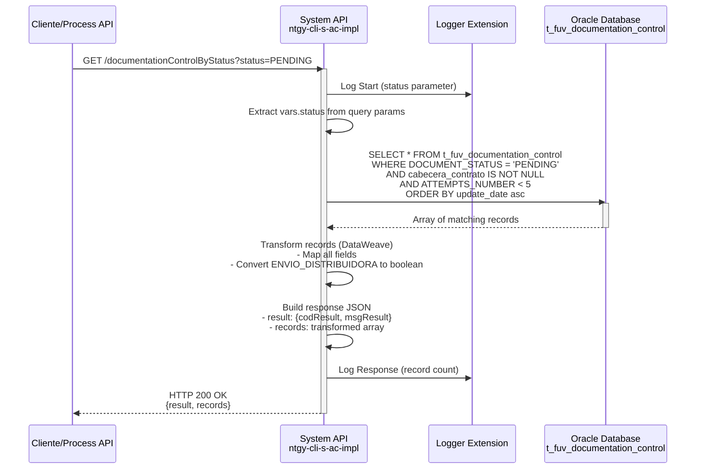

# GET /documentationControlByStatus

## 📌 Descripción General

### Propósito del Endpoint

Este endpoint permite consultar documentos de control filtrados por su estado actual, aplicando validaciones de integridad y límites de reintentos. Es fundamental para el procesamiento por lotes y la gestión del ciclo de vida de documentos asociados a contratos.

El endpoint soporta:
- **Consulta por Estado**: Filtra documentos según su estado actual (PENDING, PROCESSING, COMPLETED, ERROR)
- **Validación de Integridad**: Solo retorna documentos con cabecera de contrato válida
- **Control de Reintentos**: Excluye automáticamente documentos con 5 o más intentos fallidos
- **Ordenamiento Temporal**: Prioriza documentos más antiguos para procesamiento FIFO

### Tipo de API

**Capa:** System API (API-Led Connectivity)

**Función:** Integración directa con Oracle Database (schema OV_CON) para consulta de documentos de control por estado.

### Patrón de Integración

**Tipo:** Request-Reply Síncrono con SQL Query

**Descripción:** Recibe un parámetro de estado, ejecuta una consulta SQL filtrada en la tabla `t_fuv_documentation_control`, transforma los resultados a JSON y retorna un array de documentos que cumplen los criterios de validación.

### Arquitectura API-Led Connectivity



---

## 💼 Propósito del Negocio

### Casos de Uso Principales

1. **Procesamiento por Lotes de Documentos**
   - Obtener todos los documentos en estado "PENDING" para procesamiento masivo
   - Permite procesar documentos en orden cronológico (más antiguos primero)
   - Optimiza el flujo de trabajo de documentación de contratos

2. **Monitoreo de Estado de Documentos**
   - Consultar documentos en estados específicos para seguimiento
   - Identificar documentos en procesamiento activo
   - Verificar documentos completados exitosamente

3. **Gestión de Errores y Reintentos**
   - Identificar documentos en estado "ERROR" que requieren atención
   - Excluir automáticamente documentos con demasiados intentos fallidos
   - Priorizar documentos recuperables (< 5 intentos)

4. **Auditoría y Reporting**
   - Generar reportes de documentos por estado
   - Rastrear el ciclo de vida de documentación
   - Analizar patrones de procesamiento

### Contexto Empresarial

- **Dominio:** Gestión de Documentación de Contratos
- **Sector:** Energía - Utilities
- **División:** Naturgy España - CLI (Clientes)
- **Proceso de Negocio:** Control y seguimiento de documentación asociada a contratos de clientes
- **Sistema:** Oracle Database - Schema OV_CON (Administración Comercial)

### Stakeholders

- **Equipos de Procesamiento de Contratos**: Necesitan consultar documentos pendientes para procesamiento
- **Sistemas de Integración**: Requieren sincronización de estados de documentos
- **Equipos de Soporte**: Necesitan identificar documentos con errores para intervención manual
- **Auditores**: Requieren visibilidad del estado de documentación para compliance

### Valor de Negocio

- **Eficiencia Operativa**: Permite procesamiento automatizado por lotes de documentos
- **Control de Calidad**: Filtra automáticamente documentos con problemas de integridad
- **Gestión de Errores**: Identifica documentos que requieren atención sin sobrecargar el sistema
- **Trazabilidad**: Proporciona visibilidad completa del estado de documentación

### Consumidores Potenciales

Este endpoint puede ser consumido por:
- Process APIs de gestión de contratos
- Sistemas de procesamiento por lotes (batch jobs)
- Herramientas de monitoreo y reporting
- Sistemas de workflow de documentación
- Aplicaciones de soporte y administración

---

## 🔧 Especificación Técnica

### URLs por Ambiente

| Ambiente | URL Base | URL Completa |
|----------|----------|--------------|
| **Local** | `http://localhost:8081` | `http://localhost:8081/api/documentationControlByStatus?status=PENDING` |
| **Development** | `https://ntgy-cli-s-ac-des.us-e2.cloudhub.io` | `https://ntgy-cli-s-ac-des.us-e2.cloudhub.io/api/documentationControlByStatus?status=PENDING` |
| **QA** | `https://ntgy-cli-s-ac-cc.us-e2.cloudhub.io` | `https://ntgy-cli-s-ac-cc.us-e2.cloudhub.io/api/documentationControlByStatus?status=PENDING` |
| **Pre-Production** | `https://ntgy-cli-s-ac-cl.us-e2.cloudhub.io` | `https://ntgy-cli-s-ac-cl.us-e2.cloudhub.io/api/documentationControlByStatus?status=PENDING` |
| **Production** | `https://ntgy-cli-s-ac-pro.us-e2.cloudhub.io` | `https://ntgy-cli-s-ac-pro.us-e2.cloudhub.io/api/documentationControlByStatus?status=PENDING` |

### Método HTTP

```
GET /api/documentationControlByStatus
```

### Parámetros de Entrada

#### Headers HTTP

| Header | Tipo | Requerido | Descripción | Ejemplo |
|--------|------|-----------|-------------|---------|
| `Accept` | string | ❌ No | Tipo de contenido esperado en response | `application/json` |

#### Query Parameters

| Parámetro | Tipo | Requerido | Descripción | Valores Comunes | Ejemplo |
|-----------|------|-----------|-------------|-----------------|---------|
| `status` | string | ✅ Sí | Estado del documento a consultar | PENDING, PROCESSING, COMPLETED, ERROR | `"PENDING"` |

**Notas sobre el parámetro `status`:**
- Es el único filtro requerido para la consulta
- Valores típicos incluyen estados del ciclo de vida del documento
- La query aplica filtros adicionales automáticos (cabecera válida, intentos < 5)

### Respuestas

#### Respuesta Exitosa (200 OK)

```json
{
  "result": {
    "codResult": "0000",
    "msgResult": "No hay error"
  },
  "records": [
    {
      "NUM_DOCUMENTO": "DOC-2024-001",
      "T_FUV_DOCUMENTATION_CONTROL_ID": 12345,
      "CONTRACT_ID": "CTR-2024-5678",
      "DOCUMENT_NAME": "contrato_firmado.pdf",
      "DOCUMENT_STATUS": "PENDING",
      "ATTEMPTS_NUMBER": 0,
      "CREATE_DATE": "2024-01-15T10:30:00Z",
      "UPDATE_DATE": "2024-01-15T10:30:00Z",
      "UPDATE_USER": "SYSTEM",
      "UPDATE_PROGRAM": "CONTRACT_SYNC",
      "CABECERA_CONTRATO": "HDR-2024-001",
      "TIPO_DOCUMENTAL": "CONTRATO",
      "ENVIO_DISTRIBUIDORA": true,
      "LINEAS_CONTRATO": "LINE-001,LINE-002"
    },
    {
      "NUM_DOCUMENTO": "DOC-2024-002",
      "T_FUV_DOCUMENTATION_CONTROL_ID": 12346,
      "CONTRACT_ID": "CTR-2024-5679",
      "DOCUMENT_NAME": "anexo_condiciones.pdf",
      "DOCUMENT_STATUS": "PENDING",
      "ATTEMPTS_NUMBER": 2,
      "CREATE_DATE": "2024-01-14T09:15:00Z",
      "UPDATE_DATE": "2024-01-15T08:20:00Z",
      "UPDATE_USER": "BATCH_PROCESS",
      "UPDATE_PROGRAM": "DOC_PROCESSOR",
      "CABECERA_CONTRATO": "HDR-2024-002",
      "TIPO_DOCUMENTAL": "ANEXO",
      "ENVIO_DISTRIBUIDORA": false,
      "LINEAS_CONTRATO": "LINE-003"
    }
  ]
}
```

#### Respuesta Sin Resultados (200 OK)

```json
{
  "result": {
    "codResult": "0000",
    "msgResult": "No hay error"
  },
  "records": []
}
```

#### Respuesta de Error Técnico (500)

```json
{
  "result": {
    "codResult": "0001",
    "msgResult": "Error interno del servidor"
  }
}
```

### Estructura de Datos - Campos del Response

| Campo | Tipo | Descripción | Ejemplo |
|-------|------|-------------|---------|
| `NUM_DOCUMENTO` | string | Número identificador del documento | "DOC-2024-001" |
| `T_FUV_DOCUMENTATION_CONTROL_ID` | number | ID único del registro de control | 12345 |
| `CONTRACT_ID` | string | ID del contrato asociado | "CTR-2024-5678" |
| `DOCUMENT_NAME` | string | Nombre del archivo del documento | "contrato_firmado.pdf" |
| `DOCUMENT_STATUS` | string | Estado actual del documento | "PENDING" |
| `ATTEMPTS_NUMBER` | number | Número de intentos de procesamiento | 0-4 (máx. retornado) |
| `CREATE_DATE` | timestamp | Fecha de creación del registro | "2024-01-15T10:30:00Z" |
| `UPDATE_DATE` | timestamp | Fecha de última actualización | "2024-01-15T10:30:00Z" |
| `UPDATE_USER` | string | Usuario que realizó la última actualización | "SYSTEM" |
| `UPDATE_PROGRAM` | string | Programa que realizó la actualización | "CONTRACT_SYNC" |
| `CABECERA_CONTRATO` | string | Cabecera del contrato (requerido para retornar) | "HDR-2024-001" |
| `TIPO_DOCUMENTAL` | string | Tipo de documento | "CONTRATO" |
| `ENVIO_DISTRIBUIDORA` | boolean | Indica si se envía a distribuidora | true/false |
| `LINEAS_CONTRATO` | string | Líneas del contrato asociadas | "LINE-001,LINE-002" |

**Nota sobre `ENVIO_DISTRIBUIDORA`:**
- Se transforma de 'Y'/'N' en base de datos a boolean en JSON
- 'Y' → `true`, cualquier otro valor → `false`

### Autenticación y Autorización

- **Tipo:** Client ID & Client Secret (Anypoint Platform)
- **Autorización Oracle:** El usuario de base de datos debe tener permisos para:
  - Ejecutar SELECT en tabla `t_fuv_documentation_control`
  - Acceso al schema `OV_CON`

### Timeouts

| Tipo | Valor | Descripción |
|------|-------|-------------|
| **Request Timeout** | 30 segundos | Tiempo máximo de espera para la respuesta |
| **Connection Timeout** | 10 segundos | Tiempo máximo para establecer conexión con BD |

### Consideraciones de Performance

- **Índices Recomendados:** `DOCUMENT_STATUS`, `UPDATE_DATE` para optimizar la query
- **Volumen Esperado:** Puede retornar múltiples registros según el estado consultado
- **Ordenamiento:** Los resultados se ordenan por `update_date` ascendente (FIFO)
- **Filtros Automáticos:** Reduce el volumen excluyendo registros sin cabecera o con muchos intentos

---

## 🏗️ Implementación Técnica

### Arquitectura del Flow



### Query SQL Ejecutada

**Ubicación en Código:** `${queries.getDocumentationControlByState}` en archivo de configuración

```sql
SELECT * 
FROM t_fuv_documentation_control 
WHERE DOCUMENT_STATUS = :status 
  AND cabecera_contrato IS NOT NULL 
  AND ATTEMPTS_NUMBER < 5 
ORDER BY update_date asc
```

**Análisis de la Query:**

1. **Filtro Principal:** `DOCUMENT_STATUS = :status`
   - Parámetro dinámico proporcionado por el cliente
   - Permite consultar documentos en cualquier estado

2. **Validación de Integridad:** `cabecera_contrato IS NOT NULL`
   - Excluye documentos sin cabecera de contrato válida
   - Garantiza que solo se retornen documentos procesables

3. **Control de Reintentos:** `ATTEMPTS_NUMBER < 5`
   - Excluye documentos que han fallado 5 o más veces
   - Previene procesamiento infinito de documentos problemáticos
   - Permite identificar documentos que requieren intervención manual

4. **Ordenamiento:** `ORDER BY update_date asc`
   - Prioriza documentos más antiguos (FIFO)
   - Garantiza procesamiento ordenado por antigüedad
   - Útil para procesamiento por lotes secuencial

### Tabla de Base de Datos

**Tabla:** `t_fuv_documentation_control`  
**Schema:** `OV_CON`  
**Base de Datos:** Oracle Database

**Propósito:** Tabla de control para seguimiento del ciclo de vida de documentos asociados a contratos de clientes.

**Campos Principales:**

| Campo | Tipo | Nullable | Descripción |
|-------|------|----------|-------------|
| `T_FUV_DOCUMENTATION_CONTROL_ID` | NUMBER | NO | Primary Key - ID único del registro |
| `CONTRACT_ID` | VARCHAR2 | NO | ID del contrato asociado |
| `DOCUMENT_NAME` | VARCHAR2 | NO | Nombre del archivo del documento |
| `DOCUMENT_STATUS` | VARCHAR2 | NO | Estado actual (PENDING, PROCESSING, COMPLETED, ERROR) |
| `ATTEMPTS_NUMBER` | NUMBER | NO | Contador de intentos de procesamiento |
| `CABECERA_CONTRATO` | VARCHAR2 | YES | Cabecera del contrato (filtro de validación) |
| `UPDATE_DATE` | TIMESTAMP | NO | Fecha de última actualización (usado para ordenamiento) |

### Transformación DataWeave

**Ubicación:** Inline en el subflow `s-ac-getDocumentationByStatusControl`

```dataweave
%dw 2.0
output application/json
---
payload map (record, findex) -> {
    "NUM_DOCUMENTO": record.'NUM_DOCUMENTO',
    "T_FUV_DOCUMENTATION_CONTROL_ID": record.'T_FUV_DOCUMENTATION_CONTROL_ID',
    "CONTRACT_ID": record.'CONTRACT_ID',
    "DOCUMENT_NAME": record.'DOCUMENT_NAME',
    "DOCUMENT_STATUS": record.'DOCUMENT_STATUS',
    "ATTEMPTS_NUMBER": record.'ATTEMPTS_NUMBER',
    "CREATE_DATE": record.'CREATE_DATE',
    "UPDATE_DATE": record.'UPDATE_DATE',
    "UPDATE_USER": record.'UPDATE_USER',
    "UPDATE_PROGRAM": record.'UPDATE_PROGRAM',
    "CABECERA_CONTRATO": record.'CABECERA_CONTRATO',
    "TIPO_DOCUMENTAL": record.'TIPO_DOCUMENTAL',
    "ENVIO_DISTRIBUIDORA": if(record.'ENVIO_DISTRIBUIDORA' == 'Y') true else false,
    "LINEAS_CONTRATO": record.'LINEAS_CONTRATO'
}
```

**Transformaciones Aplicadas:**

1. **Mapeo Directo:** La mayoría de campos se mapean 1:1 desde la base de datos
2. **Conversión Boolean:** `ENVIO_DISTRIBUIDORA` se convierte de 'Y'/'N' a boolean
3. **Formato JSON:** Salida en formato JSON para consumo de APIs

### Diagrama de Secuencia



### Manejo de Errores

**Errores de Base de Datos:**
- Capturados por el error handler global
- Retornan HTTP 500 con mensaje estándar
- Se registran en logs para troubleshooting

**Sin Resultados:**
- No se considera error
- Retorna HTTP 200 con array vacío
- `records: []`

### Configuración del Conector

**Database Config:** `Database_Config`

```xml
<db:config name="Database_Config">
    <db:generic-connection 
        url="jdbc:oracle:thin:${dbAC.user}/${secure::dbAC.pass}@..."
        driverClassName="oracle.jdbc.driver.OracleDriver">
        <db:pooling-profile 
            maxPoolSize="${dbAC.MaxPoolSize}"
            maxWait="${dbAC.MaxWaitTime}"
            maxIdleTime="${dbAC.MaxIdleTime}"/>
    </db:generic-connection>
</db:config>
```

### Logging

**Puntos de Log:**
1. **Inicio:** Registra el parámetro `status` recibido
2. **Fin:** Registra la respuesta completa (normalizada)

**Nivel de Log:** INFO

**Logger Extension:** `ntgy-cli-logger-extension:1.0.0`

---

## 💻 Ejemplos de Uso

### Ejemplo 1: Consultar Documentos Pendientes

**Request:**

```bash
curl -X GET "https://ntgy-cli-s-ac-des.us-e2.cloudhub.io/api/documentationControlByStatus?status=PENDING" \
  -H "Accept: application/json"
```

**Response (200 OK):**

```json
{
  "result": {
    "codResult": "0000",
    "msgResult": "No hay error"
  },
  "records": [
    {
      "NUM_DOCUMENTO": "DOC-2024-001",
      "T_FUV_DOCUMENTATION_CONTROL_ID": 12345,
      "CONTRACT_ID": "CTR-2024-5678",
      "DOCUMENT_NAME": "contrato_firmado.pdf",
      "DOCUMENT_STATUS": "PENDING",
      "ATTEMPTS_NUMBER": 0,
      "CREATE_DATE": "2024-01-15T10:30:00Z",
      "UPDATE_DATE": "2024-01-15T10:30:00Z",
      "UPDATE_USER": "SYSTEM",
      "UPDATE_PROGRAM": "CONTRACT_SYNC",
      "CABECERA_CONTRATO": "HDR-2024-001",
      "TIPO_DOCUMENTAL": "CONTRATO",
      "ENVIO_DISTRIBUIDORA": true,
      "LINEAS_CONTRATO": "LINE-001,LINE-002"
    }
  ]
}
```

### Ejemplo 2: Consultar Documentos en Procesamiento

**Request:**

```bash
curl -X GET "https://ntgy-cli-s-ac-des.us-e2.cloudhub.io/api/documentationControlByStatus?status=PROCESSING" \
  -H "Accept: application/json"
```

**Response (200 OK):**

```json
{
  "result": {
    "codResult": "0000",
    "msgResult": "No hay error"
  },
  "records": [
    {
      "NUM_DOCUMENTO": "DOC-2024-010",
      "T_FUV_DOCUMENTATION_CONTROL_ID": 12350,
      "CONTRACT_ID": "CTR-2024-5680",
      "DOCUMENT_NAME": "documento_tecnico.pdf",
      "DOCUMENT_STATUS": "PROCESSING",
      "ATTEMPTS_NUMBER": 1,
      "CREATE_DATE": "2024-01-14T14:20:00Z",
      "UPDATE_DATE": "2024-01-15T09:45:00Z",
      "UPDATE_USER": "BATCH_PROCESS",
      "UPDATE_PROGRAM": "DOC_PROCESSOR",
      "CABECERA_CONTRATO": "HDR-2024-005",
      "TIPO_DOCUMENTAL": "TECNICO",
      "ENVIO_DISTRIBUIDORA": false,
      "LINEAS_CONTRATO": "LINE-010"
    }
  ]
}
```

### Ejemplo 3: Consultar Documentos con Errores

**Request:**

```bash
curl -X GET "https://ntgy-cli-s-ac-des.us-e2.cloudhub.io/api/documentationControlByStatus?status=ERROR" \
  -H "Accept: application/json"
```

**Response (200 OK):**

```json
{
  "result": {
    "codResult": "0000",
    "msgResult": "No hay error"
  },
  "records": [
    {
      "NUM_DOCUMENTO": "DOC-2024-015",
      "T_FUV_DOCUMENTATION_CONTROL_ID": 12355,
      "CONTRACT_ID": "CTR-2024-5685",
      "DOCUMENT_NAME": "anexo_corrupto.pdf",
      "DOCUMENT_STATUS": "ERROR",
      "ATTEMPTS_NUMBER": 3,
      "CREATE_DATE": "2024-01-13T08:00:00Z",
      "UPDATE_DATE": "2024-01-15T11:30:00Z",
      "UPDATE_USER": "ERROR_HANDLER",
      "UPDATE_PROGRAM": "DOC_PROCESSOR",
      "CABECERA_CONTRATO": "HDR-2024-008",
      "TIPO_DOCUMENTAL": "ANEXO",
      "ENVIO_DISTRIBUIDORA": true,
      "LINEAS_CONTRATO": "LINE-015"
    }
  ]
}
```

**Nota:** Este documento tiene 3 intentos, por lo que aún es retornado (< 5). Documentos con 5+ intentos no aparecerían en los resultados.

### Ejemplo 4: Sin Resultados

**Request:**

```bash
curl -X GET "https://ntgy-cli-s-ac-des.us-e2.cloudhub.io/api/documentationControlByStatus?status=ARCHIVED" \
  -H "Accept: application/json"
```

**Response (200 OK):**

```json
{
  "result": {
    "codResult": "0000",
    "msgResult": "No hay error"
  },
  "records": []
}
```

### Ejemplo 5: Uso desde JavaScript

```javascript
async function getDocumentsByStatus(status) {
  const baseUrl = 'https://ntgy-cli-s-ac-des.us-e2.cloudhub.io';
  const endpoint = `/api/documentationControlByStatus?status=${encodeURIComponent(status)}`;
  
  try {
    const response = await fetch(baseUrl + endpoint, {
      method: 'GET',
      headers: {
        'Accept': 'application/json'
      }
    });
    
    if (!response.ok) {
      throw new Error(`HTTP error! status: ${response.status}`);
    }
    
    const data = await response.json();
    
    if (data.result.codResult === "0000") {
      console.log(`Found ${data.records.length} documents with status: ${status}`);
      return data.records;
    } else {
      console.error('Business error:', data.result.msgResult);
      return [];
    }
  } catch (error) {
    console.error('Error fetching documents:', error);
    throw error;
  }
}

// Uso
const pendingDocs = await getDocumentsByStatus('PENDING');
pendingDocs.forEach(doc => {
  console.log(`Document: ${doc.DOCUMENT_NAME}, Attempts: ${doc.ATTEMPTS_NUMBER}`);
});
```

### Ejemplo 6: Procesamiento por Lotes

```python
import requests
from datetime import datetime

def process_pending_documents():
    """
    Procesa documentos pendientes en orden FIFO
    """
    base_url = "https://ntgy-cli-s-ac-des.us-e2.cloudhub.io"
    endpoint = "/api/documentationControlByStatus"
    
    # Obtener documentos pendientes
    response = requests.get(
        f"{base_url}{endpoint}",
        params={"status": "PENDING"},
        headers={"Accept": "application/json"}
    )
    
    if response.status_code == 200:
        data = response.json()
        documents = data.get("records", [])
        
        print(f"Processing {len(documents)} pending documents...")
        
        for doc in documents:
            print(f"\nDocument ID: {doc['T_FUV_DOCUMENTATION_CONTROL_ID']}")
            print(f"  Name: {doc['DOCUMENT_NAME']}")
            print(f"  Contract: {doc['CONTRACT_ID']}")
            print(f"  Attempts: {doc['ATTEMPTS_NUMBER']}")
            print(f"  Last Update: {doc['UPDATE_DATE']}")
            
            # Aquí iría la lógica de procesamiento
            # process_document(doc)
        
        return documents
    else:
        print(f"Error: {response.status_code}")
        return []

# Ejecutar
pending_docs = process_pending_documents()
```
