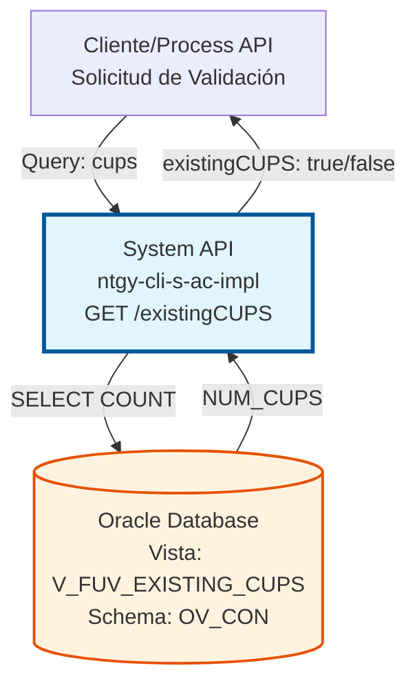
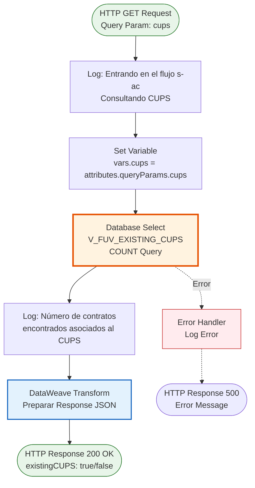
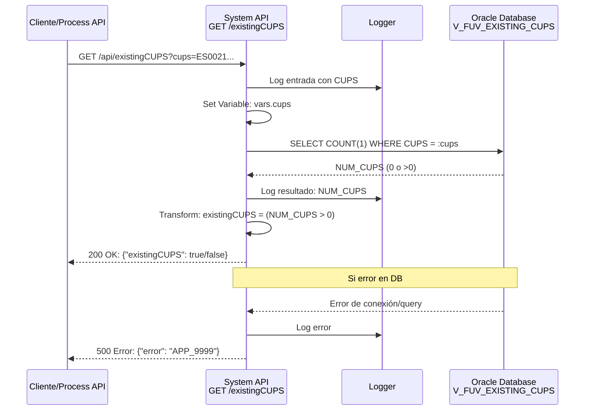

# GET /existingCUPS

## 📌 Descripción General

### Propósito del Endpoint

Este endpoint valida la existencia de un CUPS (Código Unificado de Punto de Suministro) en la base de datos de clientes activos. Permite verificar si un punto de suministro específico ya está registrado en el sistema antes de proceder con operaciones de alta o modificación de contratos.

El endpoint soporta:
- **Validación de CUPS**: Verifica si un CUPS existe en la vista `V_FUV_EXISTING_CUPS`
- **Respuesta Booleana**: Retorna `true` si el CUPS existe, `false` si no existe
- **Consulta Rápida**: Utiliza `COUNT(1)` para optimizar la consulta

### Tipo de API

**Capa:** System API (API-Led Connectivity)

**Función:** Integración directa con Oracle Database (AC Schema) para validación de existencia de CUPS en clientes activos.

### Patrón de Integración

**Tipo:** Request-Reply Síncrono con SQL Query

**Descripción:** El endpoint recibe un parámetro CUPS, ejecuta una consulta SQL de conteo en la vista `V_FUV_EXISTING_CUPS`, y retorna un booleano indicando si el CUPS existe o no en el sistema.

### Arquitectura API-Led Connectivity



---

## 💼 Propósito del Negocio

### Casos de Uso Principales

1. **Validación Pre-Alta de Cliente**
   - Antes de dar de alta un nuevo cliente, se valida que el CUPS no esté ya asociado a otro cliente activo
   - Previene duplicados y conflictos en el sistema
   - Mejora la calidad de datos

2. **Verificación de Disponibilidad de Punto de Suministro**
   - Permite verificar si un punto de suministro está disponible para nuevos contratos
   - Facilita la gestión de cambios de titular
   - Optimiza el proceso de ventas

3. **Validación en Procesos de Movilidad**
   - Verifica la existencia del CUPS en procesos de cambio de comercializadora
   - Asegura la integridad de datos en migraciones
   - Reduce errores en procesos ATR (Acceso de Terceros a la Red)

### Contexto Empresarial

- **Dominio:** Gestión de Clientes y Puntos de Suministro
- **Sector:** Energía - Utilities (Gas y Electricidad)
- **División:** Naturgy España - Área Comercial
- **Proceso de Negocio:** Alta de Clientes, Gestión de Contratos, Movilidad de Clientes
- **Sistema:** Oracle Database - AC Schema (Administración Comercial)

### Stakeholders

- **Equipos de Ventas**: Necesitan validar CUPS antes de crear nuevos contratos
- **Atención al Cliente**: Requieren verificar la existencia de puntos de suministro
- **Sistemas de Integración**: Process APIs que orquestan flujos de alta de clientes
- **Equipos de Calidad de Datos**: Monitorean y previenen duplicados

### Valor de Negocio

- **Prevención de Duplicados**: Evita la creación de registros duplicados de CUPS
- **Mejora de Calidad de Datos**: Asegura la integridad de la información de puntos de suministro
- **Optimización de Procesos**: Reduce tiempo de validación manual
- **Reducción de Errores**: Minimiza errores en procesos de alta y movilidad

### Consumidores Potenciales

Este endpoint puede ser consumido por:
- Process APIs de gestión de clientes
- Process APIs de alta de contratos
- Flujos de Salesforce (validación de oportunidades)
- Portales web de autoservicio
- Aplicaciones móviles de agentes comerciales
- Sistemas de integración middleware

---

## 🔧 Especificación Técnica

### URLs por Ambiente

| Ambiente | URL Base | URL Completa |
|----------|----------|--------------|
| **Local** | `http://localhost:8081` | `http://localhost:8081/api/existingCUPS?cups={cups}` |
| **Development** | `https://ntgy-cli-s-ac-impl-dev.us-e2.cloudhub.io` | `https://ntgy-cli-s-ac-impl-dev.us-e2.cloudhub.io/api/existingCUPS?cups={cups}` |
| **QA** | `https://ntgy-cli-s-ac-impl-cc.us-e2.cloudhub.io` | `https://ntgy-cli-s-ac-impl-cc.us-e2.cloudhub.io/api/existingCUPS?cups={cups}` |
| **Pre-Production** | `https://ntgy-cli-s-ac-impl-cl.us-e2.cloudhub.io` | `https://ntgy-cli-s-ac-impl-cl.us-e2.cloudhub.io/api/existingCUPS?cups={cups}` |
| **Production** | `https://ntgy-cli-s-ac-impl-pro.us-e2.cloudhub.io` | `https://ntgy-cli-s-ac-impl-pro.us-e2.cloudhub.io/api/existingCUPS?cups={cups}` |

### Método HTTP

```
GET /api/existingCUPS
```

### Parámetros de Entrada

#### Headers HTTP

| Header | Tipo | Requerido | Descripción | Ejemplo |
|--------|------|-----------|-------------|---------|
| `Accept` | string | ❌ No | Tipo de contenido esperado en response | `application/json` |

#### Query Parameters

| Parámetro | Tipo | Requerido | Descripción | Ejemplo |
|-----------|------|-----------|-------------|---------|
| `cups` | string | ✅ Sí | Código Unificado de Punto de Suministro a validar | `"ES0021000000000001JN0F"` |

**Formato del CUPS:**
- Longitud: 20-22 caracteres
- Formato: Código alfanumérico según normativa española
- Ejemplo: `ES0021000000000001JN0F`

### Respuestas

#### Respuesta Exitosa - CUPS Existe (200 OK)

```json
{
  "result": {
    "codResult": "0000",
    "msgResult": "No hay error"
  },
  "existingCUPS": true
}
```

**Descripción de Campos:**
- `result.codResult`: Código de resultado (`"0000"` = éxito)
- `result.msgResult`: Mensaje descriptivo del resultado
- `existingCUPS`: `true` indica que el CUPS existe en la base de datos

#### Respuesta Exitosa - CUPS No Existe (200 OK)

```json
{
  "result": {
    "codResult": "0000",
    "msgResult": "No hay error"
  },
  "existingCUPS": false
}
```

**Descripción de Campos:**
- `result.codResult`: Código de resultado (`"0000"` = éxito)
- `result.msgResult`: Mensaje descriptivo del resultado
- `existingCUPS`: `false` indica que el CUPS NO existe en la base de datos

#### Respuesta de Error - Parámetro Faltante (400 Bad Request)

```json
{
  "message": "Bad request"
}
```

#### Respuesta de Error Técnico (500 Internal Server Error)

```json
{
  "error": "APP_9999",
  "message": "Error en el servicio."
}
```

### Autenticación y Autorización

- **Tipo:** Client ID & Client Secret (Anypoint Platform)
- **Autorización Base de Datos:** El usuario de conexión debe tener permisos para:
  - Acceso de lectura a la vista `V_FUV_EXISTING_CUPS`
  - Permisos de SELECT en el schema `OV_CON`

### Timeouts

| Tipo | Valor | Descripción |
|------|-------|-------------|
| **Request Timeout** | 30 segundos | Tiempo máximo de espera para la respuesta |
| **Connection Timeout** | 10 segundos | Tiempo máximo para establecer conexión con la base de datos |
| **Query Timeout** | 30 segundos | Tiempo máximo de ejecución de la consulta SQL |

---

## 🏗️ Implementación Técnica

### Arquitectura del Flow



### Componentes del Flow

#### 1. HTTP Listener
**Configuración:**
- Puerto: `8081` (configurable por ambiente)
- Path: `/api/existingCUPS`
- Método: GET

#### 2. Logger de Entrada
**Ubicación:** Línea 9 del archivo `s-ac-existingCUPS.xml`

**Mensaje:**
```
"Entrando en el flujo s-ac. Consultando CUPS " ++ attributes.queryParams.cups
```

#### 3. Set Variable
**Ubicación:** Línea 10 del archivo `s-ac-existingCUPS.xml`

**Operación:**
```dataweave
vars.cups = attributes.queryParams.cups
```

#### 4. Database Select
**Ubicación:** Líneas 11-15 del archivo `s-ac-existingCUPS.xml`

**Configuración:**
- Connector: `Database_Config`
- Operación: `db:select`

**Query SQL:**
```sql
select count(1) NUM_CUPS from V_FUV_EXISTING_CUPS
where CUPS = :cups
```

**Parámetros:**
```dataweave
{'cups': vars.cups}
```

**Vista Consultada:**
- **Nombre:** `V_FUV_EXISTING_CUPS`
- **Schema:** `OV_CON`
- **Propósito:** Vista que contiene los CUPS de clientes activos
- **Operación:** COUNT para verificar existencia

#### 5. Logger de Resultado
**Ubicación:** Línea 16 del archivo `s-ac-existingCUPS.xml`

**Mensaje:**
```dataweave
"Número de contratos encontrados asociados al CUPS:" ++ payload.NUM_CUPS[0]
```

#### 6. DataWeave Transformation
**Ubicación:** Líneas 17-37 del archivo `s-ac-existingCUPS.xml`

**Transformación:**
```dataweave
%dw 2.0
output application/json
---
{
    "result": {
        "codResult": "0000",
        "msgResult": "No hay error"
    },
    "existingCUPS": 
        if (payload.NUM_CUPS[0] > 0)
            true
        else 
            false
}
```

**Lógica:**
- Si `NUM_CUPS > 0` → `existingCUPS: true`
- Si `NUM_CUPS = 0` → `existingCUPS: false`
- Siempre retorna código de resultado `"0000"` (éxito)

#### 7. Error Handler
**Ubicación:** Líneas 38-42 del archivo `s-ac-existingCUPS.xml`

**Tipo:** `on-error-propagate`

**Acción:**
- Log de error: `"s-ac-existingCUPS.logError"`
- Propaga el error al handler global

### Diagrama de Secuencia



### Configuración de Base de Datos

**Archivo de Configuración:** `s-ac-pro-config.yaml`

**Parámetros de Conexión:**
```yaml
dbAC:
  user: "OVPROySTAGING_LECTURA"
  pass: "![encrypted]"
  host1: "oc-pro-exa-04-clu-02-hdfdi-scan.prodb03.ocpro.oraclevcn.com"
  host2: "oc-pro-exa-03-clu-02-dfhl9-scan.prodb03.ocpro.oraclevcn.com"
  port: "1521"
  serviceName: "s_areapriv_online_pro.prodb03.ocpro.oraclevcn.com"
  MaxPoolSize: "5"
  MaxWaitTime: "300"
  MaxIdleTime: "300"
  timeout: "6000000"
  fetchsize: "2000"
```

**Características:**
- Oracle RAC con failover automático (2 hosts)
- Connection pooling (máximo 5 conexiones)
- Usuario de solo lectura
- Timeout configurado para consultas largas

### Manejo de Errores

**Errores Capturados:**
1. **Error de Conexión a Base de Datos**
   - Código: `APP_9999`
   - Mensaje: "Error en el servicio."
   - HTTP Status: 500

2. **Error de Query SQL**
   - Código: `APP_9999`
   - Mensaje: "Error en el servicio."
   - HTTP Status: 500

3. **Parámetro Faltante**
   - Manejado por APIKit
   - HTTP Status: 400

### Optimizaciones

1. **Query Optimizada:**
   - Uso de `COUNT(1)` en lugar de `COUNT(*)`
   - Consulta directa a vista indexada
   - Parámetro único en WHERE clause

2. **Connection Pooling:**
   - Reutilización de conexiones
   - Reducción de overhead de conexión
   - Mejor rendimiento en alta concurrencia

3. **Logging Estratégico:**
   - Log de entrada con CUPS
   - Log de resultado de conteo
   - Log de errores para troubleshooting

---

## 💻 Ejemplos de Uso

### Ejemplo 1: CUPS Existe

#### Request con curl

```bash
curl -X GET "http://localhost:8081/api/existingCUPS?cups=ES0021000000000001JN0F" \
  -H "Accept: application/json"
```

#### Response (200 OK)

```json
{
  "result": {
    "codResult": "0000",
    "msgResult": "No hay error"
  },
  "existingCUPS": true
}
```

**Interpretación:** El CUPS `ES0021000000000001JN0F` existe en la base de datos de clientes activos.

---

### Ejemplo 2: CUPS No Existe

#### Request con curl

```bash
curl -X GET "http://localhost:8081/api/existingCUPS?cups=ES9999999999999999ZZ9Z" \
  -H "Accept: application/json"
```

#### Response (200 OK)

```json
{
  "result": {
    "codResult": "0000",
    "msgResult": "No hay error"
  },
  "existingCUPS": false
}
```

**Interpretación:** El CUPS `ES9999999999999999ZZ9Z` NO existe en la base de datos.

---

### Ejemplo 3: Parámetro Faltante

#### Request con curl

```bash
curl -X GET "http://localhost:8081/api/existingCUPS" \
  -H "Accept: application/json"
```

#### Response (400 Bad Request)

```json
{
  "message": "Bad request"
}
```

**Interpretación:** El parámetro `cups` es obligatorio y no fue proporcionado.

---

### Ejemplo 4: Error de Base de Datos

#### Request con curl

```bash
curl -X GET "http://localhost:8081/api/existingCUPS?cups=ES0021000000000001JN0F" \
  -H "Accept: application/json"
```

#### Response (500 Internal Server Error)

```json
{
  "error": "APP_9999",
  "message": "Error en el servicio."
}
```

**Interpretación:** Ocurrió un error técnico al consultar la base de datos (conexión, timeout, etc.).

---

### Ejemplo 5: Integración desde JavaScript

```javascript
async function validateCUPS(cups) {
  const url = `https://ntgy-cli-s-ac-impl-pro.us-e2.cloudhub.io/api/existingCUPS?cups=${cups}`;
  
  try {
    const response = await fetch(url, {
      method: 'GET',
      headers: {
        'Accept': 'application/json'
      }
    });
    
    if (!response.ok) {
      throw new Error(`HTTP error! status: ${response.status}`);
    }
    
    const data = await response.json();
    
    if (data.existingCUPS) {
      console.log(`CUPS ${cups} existe en el sistema`);
      return true;
    } else {
      console.log(`CUPS ${cups} NO existe en el sistema`);
      return false;
    }
  } catch (error) {
    console.error('Error al validar CUPS:', error);
    throw error;
  }
}

// Uso
validateCUPS('ES0021000000000001JN0F')
  .then(exists => {
    if (exists) {
      // Proceder con lógica de CUPS existente
    } else {
      // Proceder con alta de nuevo CUPS
    }
  });
```

---

### Ejemplo 6: Integración desde Python

```python
import requests

def validate_cups(cups):
    """
    Valida la existencia de un CUPS en el sistema.
    
    Args:
        cups (str): Código CUPS a validar
        
    Returns:
        bool: True si el CUPS existe, False si no existe
        
    Raises:
        requests.exceptions.RequestException: Si hay error en la petición
    """
    url = "https://ntgy-cli-s-ac-impl-pro.us-e2.cloudhub.io/api/existingCUPS"
    params = {"cups": cups}
    headers = {"Accept": "application/json"}
    
    try:
        response = requests.get(url, params=params, headers=headers, timeout=30)
        response.raise_for_status()
        
        data = response.json()
        
        if data.get("existingCUPS"):
            print(f"CUPS {cups} existe en el sistema")
            return True
        else:
            print(f"CUPS {cups} NO existe en el sistema")
            return False
            
    except requests.exceptions.RequestException as e:
        print(f"Error al validar CUPS: {e}")
        raise

# Uso
if __name__ == "__main__":
    cups_to_validate = "ES0021000000000001JN0F"
    
    try:
        exists = validate_cups(cups_to_validate)
        
        if exists:
            print("Proceder con lógica de CUPS existente")
        else:
            print("Proceder con alta de nuevo CUPS")
            
    except Exception as e:
        print(f"Error: {e}")
```

---

### Ejemplo 7: Integración desde Postman

**Configuración de Request:**

1. **Método:** GET
2. **URL:** `{{base_url}}/api/existingCUPS`
3. **Query Params:**
   - Key: `cups`
   - Value: `ES0021000000000001JN0F`
4. **Headers:**
   - Key: `Accept`
   - Value: `application/json`

**Variables de Entorno:**
```json
{
  "base_url_local": "http://localhost:8081",
  "base_url_dev": "https://ntgy-cli-s-ac-impl-dev.us-e2.cloudhub.io",
  "base_url_prod": "https://ntgy-cli-s-ac-impl-pro.us-e2.cloudhub.io"
}
```

**Test Script:**
```javascript
pm.test("Status code is 200", function () {
    pm.response.to.have.status(200);
});

pm.test("Response has existingCUPS field", function () {
    var jsonData = pm.response.json();
    pm.expect(jsonData).to.have.property('existingCUPS');
});

pm.test("existingCUPS is boolean", function () {
    var jsonData = pm.response.json();
    pm.expect(typeof jsonData.existingCUPS).to.equal('boolean');
});

pm.test("Result code is 0000", function () {
    var jsonData = pm.response.json();
    pm.expect(jsonData.result.codResult).to.equal("0000");
});
```
