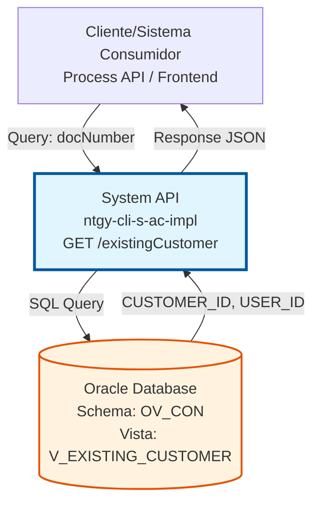
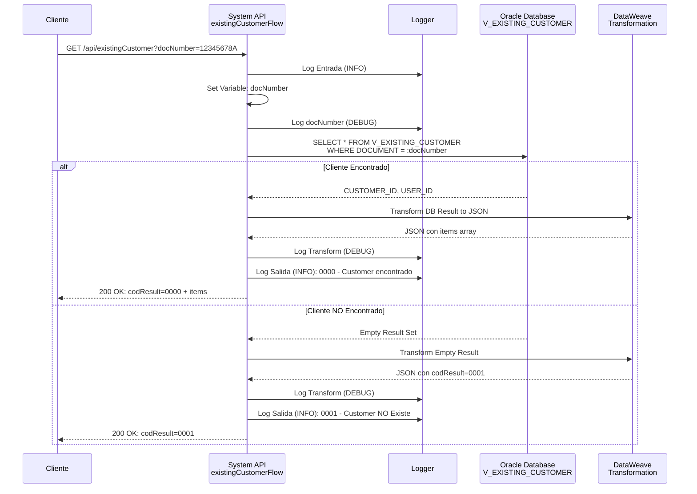
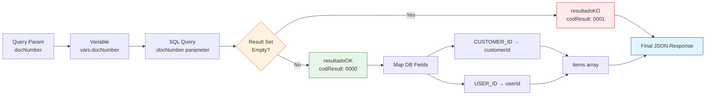

# GET /existingCustomer

## 📌 Descripción General

### Propósito del Endpoint

El endpoint **GET /existingCustomer** valida la existencia de un cliente en el sistema mediante su número de documento (DNI, NIE, CIF, etc.). Retorna los identificadores únicos del cliente (`customerId` y `userId`) si existe en la base de datos, o un mensaje indicando que no existe.

Este endpoint es fundamental para:
- **Prevención de Duplicados**: Verificar si un cliente ya existe antes de crear un nuevo registro
- **Búsqueda Rápida**: Obtener los IDs del cliente sin cargar toda su información completa
- **Validación Pre-Registro**: Validar la existencia del cliente en procesos de alta o modificación
- **Integración**: Permitir a sistemas externos verificar la existencia de clientes

### Tipo de API

**Capa:** System API (API-Led Connectivity)

**Función:** Integración directa con Oracle Database (schema OV_CON) para consultar la vista `V_EXISTING_CUSTOMER` y validar la existencia de clientes.

### Patrón de Integración

**Tipo:** Request-Reply Síncrono con Oracle Database

**Descripción:** El endpoint recibe un número de documento como query parameter, ejecuta una consulta SQL contra la vista `V_EXISTING_CUSTOMER`, y retorna un resultado indicando si el cliente existe junto con sus identificadores únicos.

### Arquitectura API-Led Connectivity



---

## 💼 Propósito del Negocio

### Casos de Uso Principales

1. **Validación Pre-Registro de Cliente**
   - Un sistema de registro necesita verificar si un cliente ya existe antes de crear uno nuevo
   - Se consulta por número de documento para evitar duplicados
   - Si existe, se obtienen sus IDs para actualizar en lugar de crear

2. **Búsqueda Rápida de Identificadores**
   - Un proceso necesita los IDs internos del cliente (customerId, userId)
   - Solo tiene el número de documento del cliente
   - Obtiene los IDs sin cargar toda la información del cliente (optimización)

3. **Integración con Sistemas Externos**
   - Sistemas externos (Salesforce, portales web) necesitan validar existencia
   - Verifican si un cliente está registrado antes de proceder con operaciones
   - Obtienen los identificadores para operaciones posteriores

### Contexto Empresarial

- **Dominio:** Gestión de Clientes (Customer Management)
- **Sector:** Energía - Utilities
- **División:** Naturgy España - CLI (Customer Lifecycle Integration)
- **Proceso de Negocio:** Alta y validación de clientes
- **Sistema:** Oracle Database - Schema OV_CON (Administración Comercial)

### Stakeholders

- **Sistemas de Registro**: Necesitan validar existencia antes de crear clientes
- **Process APIs**: Consumen este endpoint para orquestar procesos de negocio
- **Portales Web/Móvil**: Validan clientes durante el registro o login
- **Equipos de Atención al Cliente**: Verifican existencia de clientes rápidamente
- **Sistemas de Integración**: Salesforce, sistemas externos que necesitan validar clientes

### Valor de Negocio

- **Prevención de Duplicados**: Evita la creación de registros duplicados en el sistema
- **Optimización de Rendimiento**: Consulta ligera que solo retorna 2 campos (IDs)
- **Mejora de Experiencia**: Respuesta rápida para validaciones en tiempo real
- **Integridad de Datos**: Mantiene la consistencia de la base de datos de clientes
- **Facilitación de Integraciones**: API simple y clara para sistemas externos

### Consumidores Potenciales

Este endpoint puede ser consumido por:
- Process APIs de gestión de clientes
- Experience APIs de portales web y móviles
- Flujos de Salesforce (Platform Events, Flows)
- Sistemas de integración middleware
- Aplicaciones de atención al cliente
- Sistemas de registro y onboarding

---

## 🔧 Especificación Técnica

### URLs por Ambiente

| Ambiente | URL Base | URL Completa |
|----------|----------|--------------|
| **Local** | `http://localhost:8081` | `http://localhost:8081/api/existingCustomer?docNumber={value}` |
| **Development** | `https://ntgy-cli-s-ac-impl-dev.us-e2.cloudhub.io` | `https://ntgy-cli-s-ac-impl-dev.us-e2.cloudhub.io/api/existingCustomer?docNumber={value}` |
| **QA** | `https://ntgy-cli-s-ac-impl-cc.us-e2.cloudhub.io` | `https://ntgy-cli-s-ac-impl-cc.us-e2.cloudhub.io/api/existingCustomer?docNumber={value}` |
| **Pre-Production** | `https://ntgy-cli-s-ac-impl-cl.us-e2.cloudhub.io` | `https://ntgy-cli-s-ac-impl-cl.us-e2.cloudhub.io/api/existingCustomer?docNumber={value}` |
| **Production** | `https://ntgy-cli-s-ac-impl-pro.us-e2.cloudhub.io` | `https://ntgy-cli-s-ac-impl-pro.us-e2.cloudhub.io/api/existingCustomer?docNumber={value}` |

### Método HTTP

```
GET /api/existingCustomer
```

### Parámetros de Entrada

#### Headers HTTP

| Header | Tipo | Requerido | Descripción | Ejemplo |
|--------|------|-----------|-------------|---------|
| `Accept` | string | ❌ No | Tipo de contenido esperado en response | `application/json` |

#### Query Parameters

| Parámetro | Tipo | Requerido | Descripción | Ejemplo | Validación |
|-----------|------|-----------|-------------|---------|------------|
| `docNumber` | string | ✅ Sí | Número de documento del cliente (DNI, NIE, CIF, etc.) | `"12345678A"` | Debe coincidir con el formato almacenado en la base de datos |

**Notas sobre docNumber:**
- Puede ser DNI español (8 dígitos + letra)
- Puede ser NIE (letra + 7 dígitos + letra)
- Puede ser CIF para empresas
- Debe coincidir exactamente con el formato almacenado en la vista `V_EXISTING_CUSTOMER`

### Respuestas

#### Respuesta Exitosa - Cliente Encontrado (200 OK)

```json
{
  "result": {
    "codResult": "0000",
    "msgResult": "Customer encontrado"
  },
  "items": [
    {
      "customerId": "12345",
      "userId": "USR001"
    }
  ]
}
```

**Descripción de Campos:**
- `result.codResult`: Código de resultado (`"0000"` = éxito)
- `result.msgResult`: Mensaje descriptivo del resultado
- `items`: Array de clientes encontrados (normalmente 1 elemento)
- `items[].customerId`: ID único del cliente en el sistema
- `items[].userId`: ID del usuario asociado al cliente

#### Respuesta Exitosa - Cliente NO Encontrado (200 OK)

```json
{
  "result": {
    "codResult": "0001",
    "msgResult": "Customer NO Existe"
  }
}
```

**Descripción:**
- `result.codResult`: Código `"0001"` indica que no se encontró el cliente
- `result.msgResult`: Mensaje indicando que el cliente no existe
- No se incluye el array `items` cuando no hay resultados

#### Respuesta de Error Técnico (500 Internal Server Error)

```json
{
  "error": "APP_9999",
  "message": "Error en el servicio."
}
```

**Causas Posibles:**
- Error de conexión con la base de datos
- Timeout en la consulta SQL
- Error en la transformación de datos
- Excepción no controlada en el flow

### Códigos de Estado HTTP

| Código | Descripción | Escenario |
|--------|-------------|-----------|
| `200 OK` | Solicitud procesada correctamente | Cliente encontrado o no encontrado (ambos casos retornan 200) |
| `400 Bad Request` | Parámetros inválidos | Falta el parámetro `docNumber` o formato inválido |
| `500 Internal Server Error` | Error interno del servidor | Error de base de datos, timeout, o excepción no controlada |

### Autenticación y Autorización

- **Tipo:** Client ID & Client Secret (Anypoint Platform)
- **Autorización Oracle DB:** El usuario de base de datos debe tener permisos para:
  - Ejecutar SELECT en la vista `V_EXISTING_CUSTOMER`
  - Acceso al schema `OV_CON`

### Timeouts

| Tipo | Valor | Descripción |
|------|-------|-------------|
| **Query Timeout** | 20 segundos | Tiempo máximo de espera para la consulta SQL |
| **Connection Timeout** | 10 segundos | Tiempo máximo para establecer conexión con Oracle |

---

## 🏗️ Implementación Técnica

### Arquitectura del Flow



### Componentes del Flow

#### Flow Principal: `existingCustomerFlow`

**Ubicación:** `src/main/mule/s-ac-existingCustomer.xml`

**Componentes:**

1. **Logger Entrada (INFO)** - Línea 9
   - Registra los query parameters recibidos
   - Mensaje: `s-ac-existingCustomer.logEntrada #[attributes.queryParams]`

2. **Set Variable: docNumber** - Línea 10
   - Extrae el parámetro `docNumber` de los query parameters
   - Variable: `vars.docNumber`

3. **Logger DEBUG** - Línea 11
   - Registra el valor del docNumber extraído
   - Mensaje: `s-ac-existingCustomer.logEntrada: docNumber = #[vars.docNumber]`

4. **Database Select** - Líneas 12-15
   - Ejecuta la consulta SQL contra Oracle
   - Config: `Database_Config`
   - Query Timeout: 20 segundos
   - Query: `${queries.existingCustomer}`
   - Input Parameters: `{'docNumber': vars.docNumber}`

5. **Logger Transform (DEBUG)** - Línea 16
   - Registra el payload retornado por la base de datos
   - Mensaje: `s-ac-existingCustomer.logTransform ## payload: #[payload]`

6. **DataWeave Transformation** - Líneas 17-48
   - Transforma el resultado de la DB a JSON
   - Lógica condicional: Si payload vacío → codResult 0001, sino → codResult 0000
   - Mapea campos: CUSTOMER_ID → customerId, USER_ID → userId

7. **Logger Salida DEBUG** - Línea 49
   - Registra el payload final transformado
   - Mensaje: `s-ac-existingCustomer.logSalida ## payload: #[payload]`

8. **Logger Salida INFO** - Línea 50
   - Registra el resultado final con código y mensaje
   - Mensaje: `s-ac-existingCustomer.logSalida docNumber=#[vars.docNumber] #[payload.result.codResult] #[payload.result.msgResult]`

### Query SQL

**Ubicación de la Query:** `src/main/resources/properties/s-ac-pro-config.yaml`

**Propiedad:** `queries.existingCustomer`

**Query SQL Completa:**
```sql
SELECT * 
FROM V_EXISTING_CUSTOMER 
WHERE DOCUMENT = :docNumber
```

**Descripción:**
- **Vista:** `V_EXISTING_CUSTOMER` (schema `OV_CON`)
- **Filtro:** Campo `DOCUMENT` debe coincidir exactamente con el parámetro `:docNumber`
- **Campos Retornados:** Todos los campos de la vista (SELECT *)
- **Campos Utilizados:** Solo `CUSTOMER_ID` y `USER_ID` se mapean en la respuesta

**Nota sobre la Vista:**
- `V_EXISTING_CUSTOMER` es una vista de base de datos (no una tabla física)
- Puede encapsular lógica de negocio y consultar múltiples tablas subyacentes
- Proporciona una capa de abstracción sobre el modelo de datos físico

### Transformación DataWeave

**Ubicación:** Inline en el XML (líneas 19-46)

**Lógica de Transformación:**

```dataweave
%dw 2.0
output application/json

var resultadoOK = {
    "result": {
        "codResult": "0000",
        "msgResult": "Customer encontrado"
    }
}

var resultadoKO = {
    "result": {
        "codResult": "0001",
        "msgResult": "Customer NO Existe"
    }
}

---
if (sizeOf(payload) == 0) 
    resultadoKO
else  
    resultadoOK ++ {
        items: payload map {
            customerId: $.CUSTOMER_ID,
            userId: $.USER_ID
        }
    }
```

**Explicación:**
1. Define dos variables con las estructuras de resultado OK y KO
2. Evalúa si el payload está vacío (`sizeOf(payload) == 0`)
3. Si está vacío → Retorna `resultadoKO` (codResult: "0001")
4. Si tiene datos → Retorna `resultadoOK` + array `items` con los datos mapeados
5. Mapea cada registro del payload a un objeto con `customerId` y `userId`

### Diagrama de Transformación de Datos



### Configuración de Base de Datos

**Database Config:** `Database_Config`

**Ubicación:** `src/main/mule/global.xml`

**Características:**
- **Driver:** Oracle JDBC (ojdbc8 - version 19.13.0.0.1)
- **Connection Pooling:** Configurado con límites por ambiente
- **Failover:** Oracle RAC con 2 hosts para alta disponibilidad
- **Secure Properties:** Credenciales encriptadas

### Manejo de Errores

**Error Handler:** Global error handler (`s-ac-globalErrorHandler`)

**Estrategia:**
- Errores de base de datos → HTTP 500 con mensaje genérico
- Timeout de query → HTTP 500 después de 20 segundos
- Parámetros faltantes → HTTP 400 (manejado por APIKit)
- Errores no controlados → HTTP 500 con error estándar

### Logging

**Niveles de Log:**
- **INFO**: Entrada y salida del flow con resultado
- **DEBUG**: Valores de variables y payloads intermedios

**Mensajes Clave:**
1. `s-ac-existingCustomer.logEntrada` - Query params recibidos
2. `s-ac-existingCustomer.logEntrada: docNumber = X` - Valor del documento
3. `s-ac-existingCustomer.logTransform` - Resultado de la DB
4. `s-ac-existingCustomer.logSalida` - Payload final transformado
5. `s-ac-existingCustomer.logSalida docNumber=X 0000/0001` - Resultado final

---

## 💻 Ejemplos de Uso

### Ejemplo 1: Cliente Encontrado

#### Request con curl

```bash
curl -X GET "http://localhost:8081/api/existingCustomer?docNumber=12345678A" \
  -H "Accept: application/json"
```

#### Response (200 OK)

```json
{
  "result": {
    "codResult": "0000",
    "msgResult": "Customer encontrado"
  },
  "items": [
    {
      "customerId": "CUST12345",
      "userId": "USR98765"
    }
  ]
}
```

---

### Ejemplo 2: Cliente NO Encontrado

#### Request con curl

```bash
curl -X GET "http://localhost:8081/api/existingCustomer?docNumber=99999999Z" \
  -H "Accept: application/json"
```

#### Response (200 OK)

```json
{
  "result": {
    "codResult": "0001",
    "msgResult": "Customer NO Existe"
  }
}
```

---

### Ejemplo 3: Request desde JavaScript

```javascript
const docNumber = "12345678A";

fetch(`https://ntgy-cli-s-ac-impl-pro.us-e2.cloudhub.io/api/existingCustomer?docNumber=${docNumber}`, {
  method: 'GET',
  headers: {
    'Accept': 'application/json'
  }
})
.then(response => response.json())
.then(data => {
  if (data.result.codResult === "0000") {
    console.log("Cliente encontrado:", data.items[0]);
    console.log("Customer ID:", data.items[0].customerId);
    console.log("User ID:", data.items[0].userId);
  } else {
    console.log("Cliente no existe");
  }
})
.catch(error => {
  console.error("Error:", error);
});
```

---

### Ejemplo 4: Error de Parámetro Faltante

#### Request sin docNumber

```bash
curl -X GET "http://localhost:8081/api/existingCustomer" \
  -H "Accept: application/json"
```

#### Response (400 Bad Request)

```json
{
  "message": "Bad request"
}
```

**Causa:** El parámetro `docNumber` es obligatorio y no fue proporcionado.

---

### Ejemplo 5: Integración con Process API

```dataweave
%dw 2.0
output application/json

// Llamada al System API desde un Process API
var systemApiResponse = http::get(
    "https://ntgy-cli-s-ac-impl-pro.us-e2.cloudhub.io/api/existingCustomer",
    {
        queryParams: {
            docNumber: payload.documentNumber
        }
    }
)

---
{
    customerExists: systemApiResponse.result.codResult == "0000",
    customerId: if (systemApiResponse.result.codResult == "0000") 
                   systemApiResponse.items[0].customerId 
                else null,
    userId: if (systemApiResponse.result.codResult == "0000") 
               systemApiResponse.items[0].userId 
            else null
}
```

---

### Ejemplo 6: Validación Pre-Registro

**Escenario:** Antes de crear un nuevo cliente, validar si ya existe

```javascript
async function validateAndCreateCustomer(customerData) {
  // 1. Validar existencia
  const existsResponse = await fetch(
    `https://api.example.com/existingCustomer?docNumber=${customerData.docNumber}`
  );
  const existsData = await existsResponse.json();
  
  // 2. Decidir acción según resultado
  if (existsData.result.codResult === "0000") {
    // Cliente existe - actualizar
    console.log("Cliente ya existe, actualizando...");
    return {
      action: "UPDATE",
      customerId: existsData.items[0].customerId,
      userId: existsData.items[0].userId
    };
  } else {
    // Cliente no existe - crear nuevo
    console.log("Cliente no existe, creando nuevo...");
    return {
      action: "CREATE",
      customerId: null,
      userId: null
    };
  }
}
```
