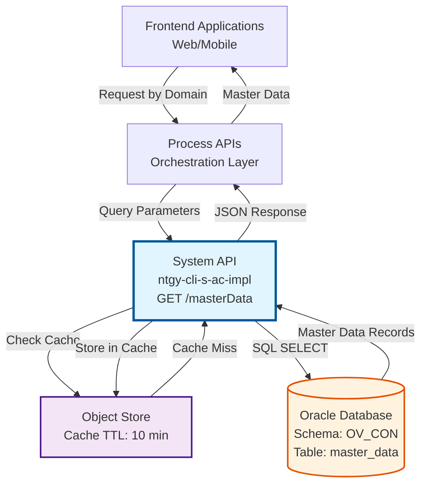
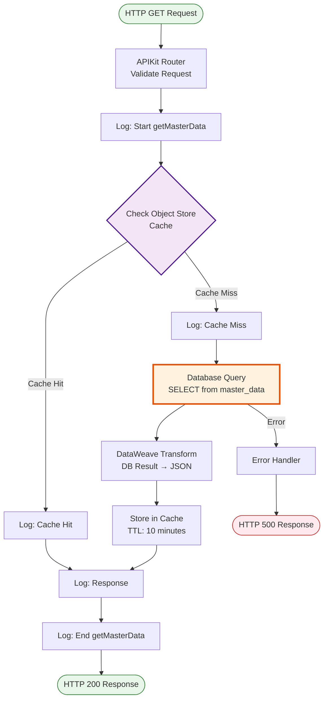
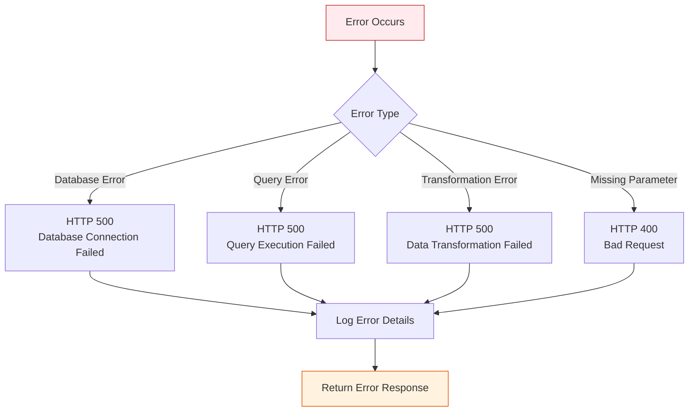
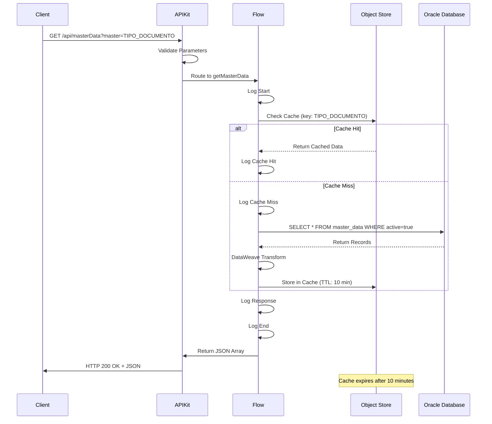

# GET /masterData

## 📌 Descripción General

### Propósito del Endpoint

Este endpoint permite consultar datos maestros del sistema de administración de contratos, proporcionando acceso a información de configuración, catálogos y valores de referencia organizados por dominios. Los datos maestros son elementos fundamentales que definen el comportamiento y las opciones disponibles en el sistema.

El endpoint soporta:
- **Consulta por Dominio**: Recupera todos los registros de un dominio específico de datos maestros
- **Filtrado por Estado**: Solo retorna registros activos (active = true)
- **Estructura Jerárquica**: Soporta relaciones padre-hijo mediante el campo parentId
- **Caching Optimizado**: Implementa caché de 10 minutos para mejorar el rendimiento

### Tipo de API

**Capa:** System API (API-Led Connectivity)

**Función:** Integración directa con Oracle Database para consulta de datos maestros y configuración del sistema.

### Patrón de Integración

**Tipo:** Request-Reply Síncrono con SQL Query

**Descripción:** Recibe el parámetro de dominio (master), ejecuta una consulta SQL filtrada en la tabla master_data, transforma el resultado a JSON y retorna los datos maestros activos del dominio solicitado. Implementa caching con TTL de 10 minutos para optimizar el rendimiento.

### Arquitectura API-Led Connectivity



---

## 💼 Propósito del Negocio

### Casos de Uso Principales

1. **Carga de Catálogos en Formularios**
   - Las aplicaciones frontend necesitan poblar listas desplegables y opciones de selección
   - Se consultan los datos maestros del dominio correspondiente (ej: tipos de documento, estados)
   - Los usuarios pueden seleccionar valores válidos y estandarizados

2. **Validación de Datos de Entrada**
   - Los sistemas validan que los valores ingresados existen en los catálogos maestros
   - Se verifica que los códigos y valores sean válidos antes de procesar transacciones
   - Garantiza la integridad referencial de los datos

3. **Configuración Dinámica del Sistema**
   - Los parámetros de configuración se almacenan como datos maestros
   - Las aplicaciones consultan estos valores para adaptar su comportamiento
   - Permite cambios de configuración sin redespliegue de aplicaciones

4. **Construcción de Jerarquías de Datos**
   - Los datos maestros con relaciones padre-hijo permiten estructuras jerárquicas
   - Se utilizan para categorías, clasificaciones y agrupaciones
   - Facilita la navegación y organización de información

### Contexto Empresarial

- **Dominio:** Gestión de Configuración y Datos Maestros
- **Sector:** Energía - Utilities
- **División:** Naturgy España - Sistema de Administración de Contratos
- **Proceso de Negocio:** Gestión de Catálogos y Configuración del Sistema
- **Módulo:** Administración Comercial (AC)

### Stakeholders

- **Desarrolladores Frontend**: Necesitan catálogos para poblar interfaces de usuario
- **Analistas de Negocio**: Definen y mantienen los valores de los catálogos
- **Administradores del Sistema**: Gestionan la configuración mediante datos maestros
- **Usuarios Finales**: Interactúan con los valores de los catálogos en las aplicaciones

### Valor de Negocio

- **Estandarización**: Garantiza el uso de valores consistentes en todo el sistema
- **Mantenibilidad**: Permite actualizar catálogos sin cambios en el código
- **Rendimiento**: El caching reduce la carga en la base de datos y mejora los tiempos de respuesta
- **Flexibilidad**: Soporta múltiples dominios y estructuras jerárquicas
- **Integridad**: Asegura que solo se utilicen valores válidos y activos

### Consumidores Potenciales

Este endpoint puede ser consumido por:
- Process APIs de gestión de clientes y contratos
- Experience APIs de canales web y móvil
- Aplicaciones frontend de autoservicio
- Sistemas de integración que requieren validación de datos
- Herramientas de administración del sistema

---

## 🔧 Especificación Técnica

### URLs por Ambiente

| Ambiente | URL Base | URL Completa |
|----------|----------|--------------|
| **Local** | `http://localhost:8081` | `http://localhost:8081/api/masterData?master={domain}` |
| **Development** | `https://ntgy-cli-s-ac-des.cloudhub.io` | `https://ntgy-cli-s-ac-des.cloudhub.io/api/masterData?master={domain}` |
| **QA** | `https://ntgy-cli-s-ac-cc.cloudhub.io` | `https://ntgy-cli-s-ac-cc.cloudhub.io/api/masterData?master={domain}` |
| **Pre-Production** | `https://ntgy-cli-s-ac-cl.cloudhub.io` | `https://ntgy-cli-s-ac-cl.cloudhub.io/api/masterData?master={domain}` |
| **Production** | `https://ntgy-cli-s-ac-pro.cloudhub.io` | `https://ntgy-cli-s-ac-pro.cloudhub.io/api/masterData?master={domain}` |

### Método HTTP

```
GET /api/masterData
```

### Parámetros de Entrada

#### Headers HTTP

| Header | Tipo | Requerido | Descripción | Ejemplo |
|--------|------|-----------|-------------|---------|
| `Accept` | string | ❌ No | Tipo de contenido esperado en response | `application/json` |

#### Query Parameters

| Parámetro | Tipo | Requerido | Descripción | Ejemplo | Validación |
|-----------|------|-----------|-------------|---------|------------|
| `master` | string | ✅ Sí | Dominio de datos maestros a consultar | `"TIPO_DOCUMENTO"` | Debe existir en la tabla t_fuv_masterdata |

**Dominios Comunes:**
- `TIPO_DOCUMENTO`: Tipos de documentos de identidad
- `ESTADO_CONTRATO`: Estados de contratos
- `TIPO_CLIENTE`: Tipos de clientes
- `FORMA_PAGO`: Formas de pago
- `CANAL_VENTA`: Canales de venta
- (Otros dominios según configuración del sistema)

### Respuestas

#### Respuesta Exitosa (200 OK)

**Estructura Real según el Código:**

```json
{
  "result": {
    "codResult": "0000",
    "msgResult": "No hay error"
  },
  "records": [
    {
      "clave": "DNI",
      "valor": "Documento Nacional de Identidad"
    },
    {
      "clave": "NIE",
      "valor": "Número de Identidad de Extranjero"
    },
    {
      "clave": "PASAPORTE",
      "valor": "Pasaporte"
    },
    {
      "clave": "CIF",
      "valor": "Código de Identificación Fiscal"
    }
  ]
}
```

**Estructura de Campos:**

| Campo | Tipo | Descripción | Ejemplo |
|-------|------|-------------|---------|
| `result` | object | Objeto con información del resultado de la operación | - |
| `result.codResult` | string | Código de resultado ("0000" = éxito) | `"0000"` |
| `result.msgResult` | string | Mensaje descriptivo del resultado | `"No hay error"` |
| `records` | array | Array de registros de datos maestros | - |
| `records[].clave` | string | Clave o código del dato maestro | `"DNI"` |
| `records[].valor` | string | Valor o descripción del dato maestro | `"Documento Nacional de Identidad"` |

#### Respuesta Vacía (200 OK)

Cuando no existen datos maestros para el dominio solicitado:

```json
{
  "result": {
    "codResult": "0000",
    "msgResult": "No hay error"
  },
  "records": []
}
```

#### Respuesta de Error (400 Bad Request)

Cuando falta el parámetro requerido:

```json
{
  "message": "Bad request"
}
```

#### Respuesta de Error (500 Internal Server Error)

Cuando ocurre un error en la consulta a la base de datos:

```json
{
  "error": "APP_9999",
  "message": "Error en el servicio."
}
```

### Autenticación y Autorización

- **Tipo:** Client ID & Client Secret (Anypoint Platform)
- **Autorización DB:** El usuario de base de datos debe tener permisos para:
  - Ejecutar SELECT en la tabla `t_fuv_masterdata`
  - Acceso al schema `OV_CON`

### Timeouts

| Tipo | Valor | Descripción |
|------|-------|-------------|
| **Request Timeout** | 30 segundos | Tiempo máximo de espera para la respuesta |
| **Connection Timeout** | 10 segundos | Tiempo máximo para establecer conexión con la base de datos |
| **Query Timeout** | 30 segundos | Tiempo máximo de ejecución de la query SQL |

### Caching

| Parámetro | Valor | Descripción |
|-----------|-------|-------------|
| **Cache Strategy** | Object Store | Almacenamiento en memoria |
| **TTL (Time To Live)** | 10 minutos | Tiempo de vida de los datos en caché |
| **Cache Key** | `master + "_" + clave` | Formato de la clave de caché |
| **Cache Hit Rate** | > 80% esperado | Tasa de aciertos de caché objetivo |

---

## 🏗️ Implementación Técnica

### Arquitectura del Flow



### Componentes del Flow

#### 1. HTTP Listener
- **Config:** `HTTP_Listener_config`
- **Path:** `/api/*`
- **Method:** GET
- **Port:** 8081 (configurable por ambiente)

#### 2. APIKit Router
- **Config:** `s-ac-config`
- **RAML:** `s-ac.raml`
- **Validation:** Valida parámetros de query requeridos

#### 3. Flow Principal: `get:\masterData:s-ac-config`
- **Logging:** Registra inicio de operación
- **Flow Reference:** Invoca subflow `s-ac-getMasterData`

#### 4. Subflow: `s-ac-getMasterData`
- **Ubicación:** `s-ac-masterData.xml` (líneas 11-59)
- **Caching:** Implementa estrategia de caché con Object Store
- **Database Query:** Ejecuta SELECT en tabla master_data
- **Transformation:** Convierte resultado a JSON

### Query SQL

```sql
SELECT 
    id_master_data AS "idMasterData",
    type AS "type",
    code AS "code",
    description AS "description",
    value AS "value",
    parent_id AS "parentId",
    active AS "active"
FROM master_data
WHERE active = true
```

**Características de la Query:**
- **Filtro por Estado:** Solo registros activos (`active = true`)
- **Alias de Columnas:** Mapeo de snake_case a camelCase
- **Sin Filtro por Dominio en SQL:** El filtro por `master` se aplica mediante el parámetro de query
- **Performance:** Query simple con índice en columna `active`

### Transformación de Datos

#### Input (Query Parameters)
```dataweave
%dw 2.0
output application/java
---
{
    master: attributes.queryParams.master
}
```

#### Output (Database → JSON)
```dataweave
%dw 2.0
output application/json
---
payload map {
    idMasterData: $.idMasterData,
    type: $.type,
    code: $.code,
    description: $.description,
    value: $.value,
    parentId: $.parentId,
    active: $.active
}
```

### Manejo de Errores



**Estrategia de Manejo de Errores:**

1. **Error de Parámetros (400)**
   - Parámetro `master` faltante
   - Formato de parámetro inválido
   - Response: `{"message": "Bad request"}`

2. **Error de Base de Datos (500)**
   - Conexión a base de datos fallida
   - Timeout de query
   - Response: `{"error": "APP_9999", "message": "Error en el servicio."}`

3. **Error de Transformación (500)**
   - Error en DataWeave
   - Datos inesperados
   - Response: `{"error": "APP_9999", "message": "Error en el servicio."}`

### Configuración de Base de Datos

```xml
<db:config name="Database_Config">
    <db:generic-connection 
        url="jdbc:oracle:thin:${dbAC.user}/${secure::dbAC.pass}@..."
        driverClassName="oracle.jdbc.driver.OracleDriver">
        <db:pooling-profile 
            maxPoolSize="${dbAC.MaxPoolSize}"
            maxWait="${dbAC.MaxWaitTime}"
            maxIdleTime="${dbAC.MaxIdleTime}"/>
    </db:generic-connection>
</db:config>
```

**Parámetros de Conexión:**
- **Driver:** Oracle JDBC 19.13.0.0.1
- **Connection Pooling:** Habilitado
- **Max Pool Size:** Configurable por ambiente (típicamente 5-10)
- **Max Wait Time:** 30 segundos
- **Max Idle Time:** 60 segundos

### Configuración de Caching

```xml
<ee:object-store-caching-strategy name="Caching_Strategy_MasterData">
    <os:private-object-store 
        entryTtl="10" 
        entryTtlUnit="MINUTES" />
</ee:object-store-caching-strategy>
```

**Parámetros de Caché:**
- **Strategy:** Object Store privado
- **TTL:** 10 minutos
- **Scope:** Por aplicación
- **Invalidation:** Automática por TTL

### Diagrama de Secuencia Completo



### Optimizaciones de Performance

1. **Caching Strategy**
   - Reduce carga en base de datos
   - Mejora tiempo de respuesta
   - Cache hit rate esperado > 80%

2. **Connection Pooling**
   - Reutilización de conexiones
   - Reduce overhead de conexión
   - Mejor throughput

3. **Query Optimization**
   - Índice en columna `active`
   - SELECT específico (no SELECT *)
   - Filtro eficiente

4. **Transformation Efficiency**
   - DataWeave optimizado
   - Mapeo directo de campos
   - Sin procesamiento complejo

---

## 💻 Ejemplos de Uso

### Ejemplo 1: Consulta de Tipos de Documento

#### Request con curl

```bash
curl -X GET "https://ntgy-cli-s-ac-pro.cloudhub.io/api/masterData?master=TIPO_DOCUMENTO" \
  -H "Accept: application/json" \
  -H "client_id: your-client-id" \
  -H "client_secret: your-client-secret"
```

#### Request con JavaScript (Fetch API)

```javascript
const getMasterData = async (domain) => {
  try {
    const response = await fetch(
      `https://ntgy-cli-s-ac-pro.cloudhub.io/api/masterData?master=${domain}`,
      {
        method: 'GET',
        headers: {
          'Accept': 'application/json',
          'client_id': 'your-client-id',
          'client_secret': 'your-client-secret'
        }
      }
    );
    
    if (!response.ok) {
      throw new Error(`HTTP error! status: ${response.status}`);
    }
    
    const data = await response.json();
    console.log('Master Data:', data);
    return data;
  } catch (error) {
    console.error('Error fetching master data:', error);
    throw error;
  }
};

// Uso
getMasterData('TIPO_DOCUMENTO');
```

#### Response Exitoso (200 OK)

```json
{
  "result": {
    "codResult": "0000",
    "msgResult": "No hay error"
  },
  "records": [
    {
      "clave": "DNI",
      "valor": "Documento Nacional de Identidad"
    },
    {
      "clave": "NIE",
      "valor": "Número de Identidad de Extranjero"
    },
    {
      "clave": "PASAPORTE",
      "valor": "Pasaporte"
    },
    {
      "clave": "CIF",
      "valor": "Código de Identificación Fiscal"
    }
  ]
}
```

### Ejemplo 2: Consulta de Estados de Contrato

#### Request con curl

```bash
curl -X GET "https://ntgy-cli-s-ac-pro.cloudhub.io/api/masterData?master=ESTADO_CONTRATO" \
  -H "Accept: application/json" \
  -H "client_id: your-client-id" \
  -H "client_secret: your-client-secret"
```

#### Response Exitoso (200 OK)

```json
{
  "result": {
    "codResult": "0000",
    "msgResult": "No hay error"
  },
  "records": [
    {
      "clave": "PENDIENTE",
      "valor": "Pendiente de Activación"
    },
    {
      "clave": "ACTIVO",
      "valor": "Contrato Activo"
    },
    {
      "clave": "SUSPENDIDO",
      "valor": "Contrato Suspendido"
    },
    {
      "clave": "CANCELADO",
      "valor": "Contrato Cancelado"
    }
  ]
}
```

### Ejemplo 3: Consulta con Jerarquía (Datos con parentId)

#### Request con curl

```bash
curl -X GET "https://ntgy-cli-s-ac-pro.cloudhub.io/api/masterData?master=CATEGORIA_PRODUCTO" \
  -H "Accept: application/json" \
  -H "client_id: your-client-id" \
  -H "client_secret: your-client-secret"
```

#### Response Exitoso (200 OK)

```json
{
  "result": {
    "codResult": "0000",
    "msgResult": "No hay error"
  },
  "records": [
    {
      "clave": "ENERGIA",
      "valor": "Productos de Energía"
    },
    {
      "clave": "GAS",
      "valor": "Gas Natural"
    },
    {
      "clave": "ELECTRICIDAD",
      "valor": "Electricidad"
    },
    {
      "clave": "SERVICIOS",
      "valor": "Servicios Adicionales"
    }
  ]
}
```

**Nota:** La estructura actual NO soporta jerarquías con `parentId`. Si se requiere esta funcionalidad, debe implementarse en el cliente o modificarse la API.

### Ejemplo 4: Dominio sin Datos Activos

#### Request con curl

```bash
curl -X GET "https://ntgy-cli-s-ac-pro.cloudhub.io/api/masterData?master=DOMINIO_INEXISTENTE" \
  -H "Accept: application/json" \
  -H "client_id: your-client-id" \
  -H "client_secret: your-client-secret"
```

#### Response Vacío (200 OK)

```json
{
  "result": {
    "codResult": "0000",
    "msgResult": "No hay error"
  },
  "records": []
}
```

### Ejemplo 5: Error - Parámetro Faltante

#### Request con curl (sin parámetro master)

```bash
curl -X GET "https://ntgy-cli-s-ac-pro.cloudhub.io/api/masterData" \
  -H "Accept: application/json" \
  -H "client_id: your-client-id" \
  -H "client_secret: your-client-secret"
```

#### Response de Error (400 Bad Request)

```json
{
  "message": "Bad request"
}
```

### Ejemplo 6: Error de Servidor

#### Response de Error (500 Internal Server Error)

```json
{
  "error": "APP_9999",
  "message": "Error en el servicio."
}
```

### Ejemplo 7: Uso en React Component

```javascript
import React, { useState, useEffect } from 'react';

const MasterDataSelect = ({ domain, label, onChange }) => {
  const [options, setOptions] = useState([]);
  const [loading, setLoading] =