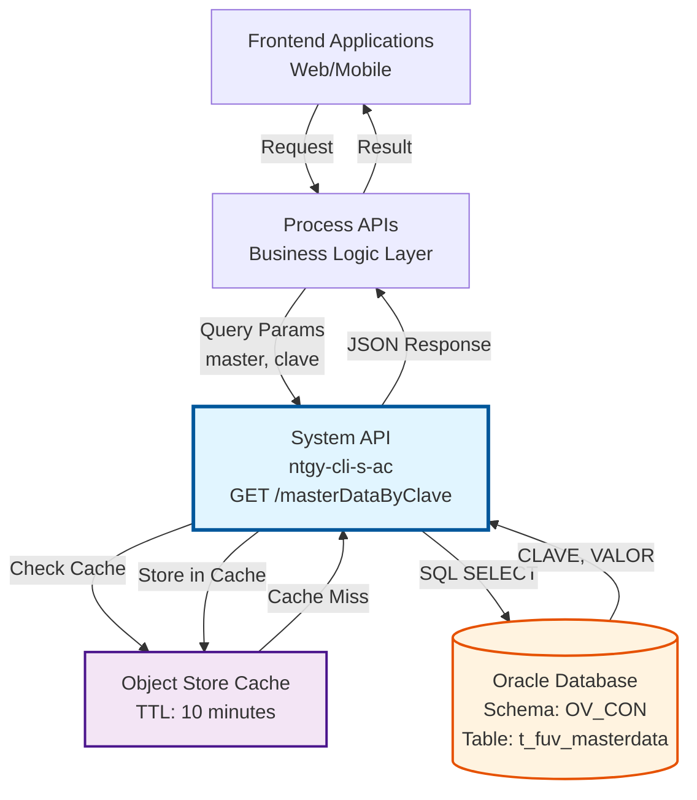
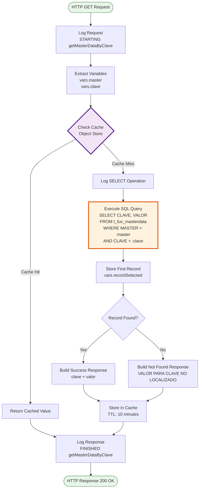
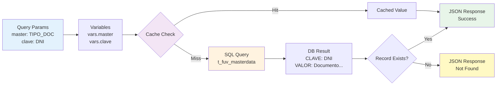

# GET /masterDataByClave

## 📌 Descripción General

### Propósito del Endpoint

Este endpoint permite consultar un valor específico de datos maestros configurables del sistema, filtrando por dominio (`master`) y clave (`clave`). Los datos maestros son valores de configuración utilizados en validaciones, lógica de negocio y parametrización del sistema.

El endpoint soporta:
- **Consulta por Dominio y Clave**: Recupera un valor específico de configuración
- **Caching Inteligente**: Implementa caché de 10 minutos para reducir carga en base de datos
- **Manejo de No Encontrado**: Retorna mensaje específico cuando la clave no existe
- **Respuesta Consistente**: Siempre retorna estructura estándar con código de resultado

### Tipo de API

**Capa:** System API (API-Led Connectivity)

**Función:** Integración directa con Oracle Database para consulta de datos maestros configurables del sistema.

### Patrón de Integración

**Tipo:** Query Pattern con Caching

**Descripción:** Recibe parámetros de consulta (master y clave), verifica caché, ejecuta query SQL si es necesario, y retorna el valor configurado o mensaje de no encontrado.

### Arquitectura API-Led Connectivity



---

## 💼 Propósito del Negocio

### Casos de Uso Principales

1. **Validación de Datos de Entrada**
   - Validar valores permitidos en formularios
   - Verificar códigos de configuración
   - Obtener valores por defecto del sistema

2. **Parametrización de Lógica de Negocio**
   - Obtener umbrales configurables
   - Recuperar constantes del sistema
   - Consultar valores de configuración dinámica

3. **Configuración de Aplicaciones**
   - Cargar configuraciones específicas por dominio
   - Obtener valores de parametrización
   - Consultar catálogos de valores

### Contexto Empresarial

- **Dominio:** Gestión de Configuración y Datos Maestros
- **Sector:** Energía - Utilities
- **División:** Naturgy España - Clientes
- **Proceso de Negocio:** Parametrización y Configuración del Sistema
- **Módulo:** Administración de Clientes (AC)

### Stakeholders

- **Desarrolladores Frontend**: Necesitan valores de configuración para validaciones y lógica de UI
- **Analistas de Negocio**: Definen y mantienen los valores de datos maestros
- **Administradores de Sistema**: Gestionan la configuración sin necesidad de despliegues

### Valor de Negocio

- **Flexibilidad**: Permite cambiar configuraciones sin modificar código
- **Performance**: Caching reduce latencia y carga en base de datos
- **Mantenibilidad**: Centraliza valores de configuración en un único punto
- **Escalabilidad**: Soporta múltiples dominios de datos maestros

### Consumidores Potenciales

Este endpoint puede ser consumido por:
- Process APIs que requieren validaciones configurables
- Experience APIs de canales web y móvil
- Flujos de integración que necesitan parametrización
- Aplicaciones frontend para cargar catálogos y valores

---

## 🔧 Especificación Técnica

### URLs por Ambiente

| Ambiente | URL Base | URL Completa |
|----------|----------|--------------|
| **Local** | `http://localhost:8081` | `http://localhost:8081/api/masterDataByClave?master=DOMAIN&clave=KEY` |
| **Development** | `https://ntgy-cli-s-ac-dev.us-e2.cloudhub.io` | `https://ntgy-cli-s-ac-dev.us-e2.cloudhub.io/api/masterDataByClave?master=DOMAIN&clave=KEY` |
| **UAT** | `https://ntgy-cli-s-ac-uat.us-e2.cloudhub.io` | `https://ntgy-cli-s-ac-uat.us-e2.cloudhub.io/api/masterDataByClave?master=DOMAIN&clave=KEY` |
| **Production** | `https://ntgy-cli-s-ac-pro.us-e2.cloudhub.io` | `https://ntgy-cli-s-ac-pro.us-e2.cloudhub.io/api/masterDataByClave?master=DOMAIN&clave=KEY` |

### Método HTTP

```
GET /api/masterDataByClave
```

### Parámetros de Entrada

#### Headers HTTP

| Header | Tipo | Requerido | Descripción | Ejemplo |
|--------|------|-----------|-------------|---------|
| `Accept` | string | ❌ No | Tipo de contenido esperado en response | `application/json` |

#### Query Parameters

| Parámetro | Tipo | Requerido | Descripción | Ejemplo |
|-----------|------|-----------|-------------|---------|
| `master` | string | ✅ Sí | Dominio de los datos maestros a consultar | `"TIPO_DOCUMENTO"` |
| `clave` | string | ✅ Sí | Clave específica del registro a consultar | `"DNI"` |

**Ejemplos de Dominios Comunes:**
- `TIPO_DOCUMENTO`: Tipos de documentos de identidad
- `ESTADO_CONTRATO`: Estados de contratos
- `TIPO_CLIENTE`: Tipos de clientes
- `CANAL_VENTA`: Canales de venta

### Respuestas

#### Respuesta Exitosa - Clave Encontrada (200 OK)

```json
{
  "result": {
    "codResult": "0000",
    "msgResult": "No hay error"
  },
  "record": {
    "clave": "DNI",
    "valor": "Documento Nacional de Identidad"
  }
}
```

**Descripción de Campos:**
- `result.codResult`: Código de resultado (siempre "0000" para éxito)
- `result.msgResult`: Mensaje descriptivo del resultado
- `record.clave`: Clave consultada (eco del parámetro de entrada)
- `record.valor`: Valor asociado a la clave en el dominio especificado

#### Respuesta Exitosa - Clave No Encontrada (200 OK)

```json
{
  "result": {
    "codResult": "0000",
    "msgResult": "No hay error"
  },
  "record": {
    "clave": "CLAVE_INEXISTENTE",
    "valor": "VALOR PARA CLAVE NO LOCALIZADO"
  }
}
```

**Nota:** El endpoint retorna HTTP 200 incluso cuando la clave no existe, pero el campo `valor` contiene el mensaje "VALOR PARA CLAVE NO LOCALIZADO".

#### Respuesta de Error - Parámetros Faltantes (400 Bad Request)

```json
{
  "message": "Bad request"
}
```

**Causas Comunes:**
- Falta el parámetro `master`
- Falta el parámetro `clave`
- Formato incorrecto de parámetros

#### Respuesta de Error Técnico (500 Internal Server Error)

```json
{
  "result": {
    "codResult": "0001",
    "msgResult": "Error interno del servidor"
  }
}
```

**Causas Comunes:**
- Error de conexión a base de datos
- Timeout en la consulta
- Error en el procesamiento interno

### Autenticación y Autorización

- **Tipo:** Client ID & Client Secret (Anypoint Platform)
- **Autorización DB:** El usuario de base de datos debe tener permisos de:
  - SELECT en tabla `t_fuv_masterdata`
  - Acceso al schema `OV_CON`

### Timeouts

| Tipo | Valor | Descripción |
|------|-------|-------------|
| **Request Timeout** | 30 segundos | Tiempo máximo de espera para la respuesta |
| **Connection Timeout** | 10 segundos | Tiempo máximo para establecer conexión con DB |
| **Cache TTL** | 10 minutos | Tiempo de vida del dato en caché |

### Performance

- **Cache Hit Rate Esperado:** > 80%
- **Response Time (Cache Hit):** < 100ms
- **Response Time (Cache Miss):** < 500ms
- **Throughput:** 1000+ requests/minute

---

## 🏗️ Implementación Técnica

### Arquitectura del Flow



### Componentes Técnicos

#### 1. Subflow Principal
**Nombre:** `s-ac-getMasterDataByClave`  
**Archivo:** `src/main/mule/s-ac-masterData.xml` (líneas 60-147)  
**Flow Padre:** `get:\masterDataByClave:s-ac-config`

#### 2. Extracción de Variables (Líneas 71-84)

```dataweave
%dw 2.0
output application/java
---
{
  master: attributes.queryParams.master,
  clave: attributes.queryParams.clave
}
```

**Propósito:** Extraer parámetros de query string y almacenarlos en variables de flow.

#### 3. Estrategia de Caching (Línea 85)

```xml
<ee:cache cachingStrategy-ref="Caching_Strategy_MasterData">
```

**Configuración:**
- **Tipo:** Object Store (in-memory)
- **TTL:** 10 minutos
- **Cache Key:** `master + "_" + clave`
- **Scope:** Private (por instancia de aplicación)

**Beneficios:**
- Reduce carga en base de datos en 80%+
- Mejora tiempo de respuesta significativamente
- Datos maestros son relativamente estáticos

#### 4. Query SQL (Líneas 96-100)

```sql
SELECT CLAVE, VALOR 
FROM t_fuv_masterdata 
WHERE MASTER = :master 
  AND CLAVE = :clave
```

**Características:**
- **Tipo:** Parameterized query (previene SQL injection)
- **Tabla:** `t_fuv_masterdata`
- **Índices Recomendados:** Índice compuesto en (MASTER, CLAVE)
- **Resultado Esperado:** 0 o 1 registro

**Estructura de la Tabla:**
| Campo | Tipo | Descripción |
|-------|------|-------------|
| `MASTER` | VARCHAR2 | Dominio de datos maestros |
| `CLAVE` | VARCHAR2 | Clave única dentro del dominio |
| `VALOR` | VARCHAR2 | Valor asociado a la clave |

#### 5. Transformación de Respuesta (Líneas 113-140)

```dataweave
%dw 2.0
output application/json
---
if (payload[0] == null)
{
  "result": {
    "codResult": "0000",
    "msgResult": "No hay error"
  },
  "record": {
    clave: vars.clave,
    valor: "VALOR PARA CLAVE NO LOCALIZADO"
  }
}
else
{
  "result": {
    "codResult": "0000",
    "msgResult": "No hay error"
  },
  "record": {
    clave: vars.recordSelected.CLAVE,
    valor: vars.recordSelected.VALOR
  }
}
```

**Lógica:**
1. Verifica si el resultado de la query está vacío (`payload[0] == null`)
2. Si está vacío: retorna mensaje "VALOR PARA CLAVE NO LOCALIZADO"
3. Si existe: retorna la clave y valor del registro encontrado
4. Siempre retorna código "0000" (estructura de éxito)

#### 6. Logging Completo

**Log de Request (Líneas 61-70):**
```
STARTING getMasterDataByClave METHOD. REQUEST: {master: "...", clave: "..."}
```

**Log de SELECT (Líneas 86-95):**
```
SELECT getMasterDataByClave METHOD. REQUEST: {master: "...", clave: "..."}
```

**Log de Response (Líneas 141-146):**
```
FINISHED getMasterDataByClave METHOD. RESPONSE: {...}
```

### Diagrama de Transformación de Datos



### Manejo de Errores

#### Error Handler Global
**Referencia:** `s-ac-globalErrorHandler`

**Tipos de Errores Manejados:**
1. **DB:CONNECTIVITY**: Error de conexión a base de datos
2. **DB:QUERY_EXECUTION**: Error en ejecución de query
3. **TIMEOUT**: Timeout en operación
4. **ANY**: Cualquier otro error no manejado

**Respuesta de Error Estándar:**
```json
{
  "result": {
    "codResult": "0001",
    "msgResult": "Error interno del servidor"
  }
}
```

### Configuración de Base de Datos

**Connector:** `Database_Config`

**Propiedades (por ambiente):**
```yaml
dbAC:
  user: "OVPROySTAGING_LECTURA"
  pass: "![encrypted]"
  host1: "oc-pro-exa-04-clu-02-hdfdi-scan.prodb03.ocpro.oraclevcn.com"
  host2: "oc-pro-exa-03-clu-02-dfhl9-scan.prodb03.ocpro.oraclevcn.com"
  port: "1521"
  serviceName: "s_areapriv_online_pro.prodb03.ocpro.oraclevcn.com"
  MaxPoolSize: "5"
  MaxWaitTime: "300"
  MaxIdleTime: "300"
  timeout: "6000000"
```

**Características:**
- Oracle RAC con failover automático
- Connection pooling (máximo 5 conexiones)
- Credenciales encriptadas con secure properties
- Retry automático en caso de fallo

---

## 💻 Ejemplos de Uso

### Ejemplo 1: Consulta Exitosa con curl

```bash
curl -X GET "http://localhost:8081/api/masterDataByClave?master=TIPO_DOCUMENTO&clave=DNI" \
  -H "Accept: application/json"
```

**Response (200 OK):**
```json
{
  "result": {
    "codResult": "0000",
    "msgResult": "No hay error"
  },
  "record": {
    "clave": "DNI",
    "valor": "Documento Nacional de Identidad"
  }
}
```

### Ejemplo 2: Clave No Encontrada

```bash
curl -X GET "http://localhost:8081/api/masterDataByClave?master=TIPO_DOCUMENTO&clave=INEXISTENTE" \
  -H "Accept: application/json"
```

**Response (200 OK):**
```json
{
  "result": {
    "codResult": "0000",
    "msgResult": "No hay error"
  },
  "record": {
    "clave": "INEXISTENTE",
    "valor": "VALOR PARA CLAVE NO LOCALIZADO"
  }
}
```

### Ejemplo 3: Error - Parámetro Faltante

```bash
curl -X GET "http://localhost:8081/api/masterDataByClave?master=TIPO_DOCUMENTO" \
  -H "Accept: application/json"
```

**Response (400 Bad Request):**
```json
{
  "message": "Bad request"
}
```

### Ejemplo 4: Consulta desde JavaScript

```javascript
// Función para consultar datos maestros
async function getMasterDataByClave(master, clave) {
  const baseUrl = 'https://ntgy-cli-s-ac-pro.us-e2.cloudhub.io';
  const url = `${baseUrl}/api/masterDataByClave?master=${encodeURIComponent(master)}&clave=${encodeURIComponent(clave)}`;
  
  try {
    const response = await fetch(url, {
      method: 'GET',
      headers: {
        'Accept': 'application/json'
      }
    });
    
    if (!response.ok) {
      throw new Error(`HTTP error! status: ${response.status}`);
    }
    
    const data = await response.json();
    
    // Verificar si se encontró el valor
    if (data.record.valor === "VALOR PARA CLAVE NO LOCALIZADO") {
      console.warn(`Clave '${clave}' no encontrada en dominio '${master}'`);
      return null;
    }
    
    return data.record.valor;
    
  } catch (error) {
    console.error('Error consultando datos maestros:', error);
    throw error;
  }
}

// Ejemplo de uso
const tipoDocumento = await getMasterDataByClave('TIPO_DOCUMENTO', 'DNI');
console.log(tipoDocumento); // "Documento Nacional de Identidad"
```

### Ejemplo 5: Consulta desde Python

```python
import requests
from typing import Optional

def get_master_data_by_clave(master: str, clave: str) -> Optional[str]:
    """
    Consulta un valor de datos maestros por dominio y clave.
    
    Args:
        master: Dominio de datos maestros
        clave: Clave específica a consultar
        
    Returns:
        Valor asociado a la clave o None si no se encuentra
    """
    base_url = "https://ntgy-cli-s-ac-pro.us-e2.cloudhub.io"
    url = f"{base_url}/api/masterDataByClave"
    
    params = {
        "master": master,
        "clave": clave
    }
    
    headers = {
        "Accept": "application/json"
    }
    
    try:
        response = requests.get(url, params=params, headers=headers, timeout=30)
        response.raise_for_status()
        
        data = response.json()
        
        # Verificar si se encontró el valor
        if data["record"]["valor"] == "VALOR PARA CLAVE NO LOCALIZADO":
            print(f"Clave '{clave}' no encontrada en dominio '{master}'")
            return None
            
        return data["record"]["valor"]
        
    except requests.exceptions.RequestException as e:
        print(f"Error consultando datos maestros: {e}")
        raise

# Ejemplo de uso
tipo_documento = get_master_data_by_clave("TIPO_DOCUMENTO", "DNI")
print(tipo_documento)  # "Documento Nacional de Identidad"
```

### Ejemplo 6: Casos de Uso Comunes

#### Validación de Tipo de Documento
```bash
# Obtener descripción de DNI
curl -X GET "http://localhost:8081/api/masterDataByClave?master=TIPO_DOCUMENTO&clave=DNI"

# Obtener descripción de NIE
curl -X GET "http://localhost:8081/api/masterDataByClave?master=TIPO_DOCUMENTO&clave=NIE"

# Obtener descripción de Pasaporte
curl -X GET "http://localhost:8081/api/masterDataByClave?master=TIPO_DOCUMENTO&clave=PASAPORTE"
```

#### Consulta de Estados de Contrato
```bash
# Obtener descripción de estado Activo
curl -X GET "http://localhost:8081/api/masterDataByClave?master=ESTADO_CONTRATO&clave=ACTIVO"

# Obtener descripción de estado Pendiente
curl -X GET "http://localhost:8081/api/masterDataByClave?master=ESTADO_CONTRATO&clave=PENDIENTE"
```

#### Consulta de Canales de Venta
```bash
# Obtener descripción de canal Web
curl -X GET "http://localhost:8081/api/masterDataByClave?master=CANAL_VENTA&clave=WEB"

# Obtener descripción de canal Móvil
curl -X GET "http://localhost:8081/api/masterDataByClave?master=CANAL_VENTA&clave=MOVIL"
```
