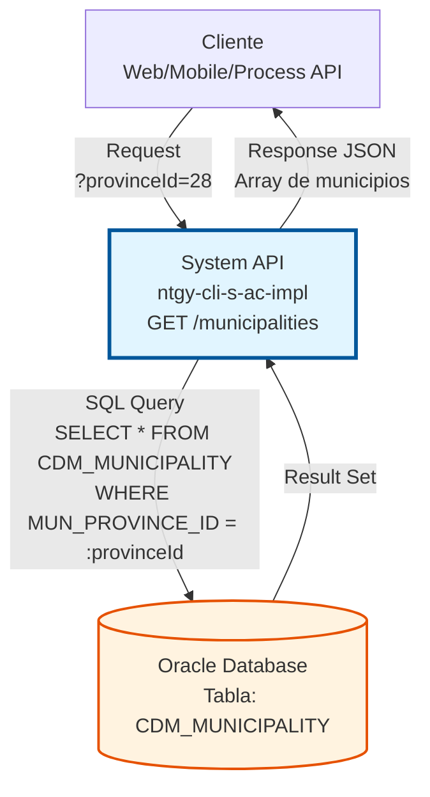
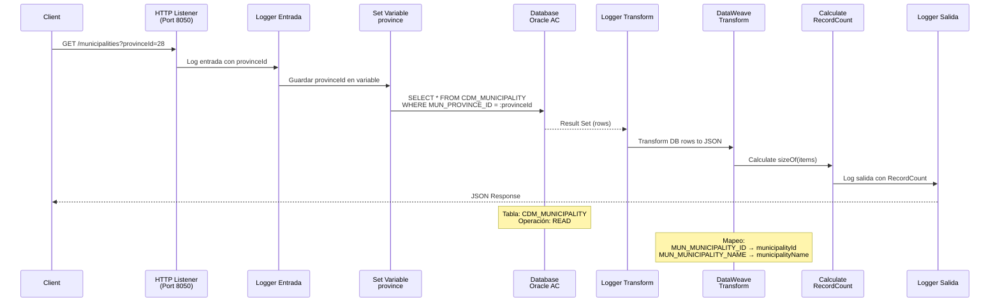
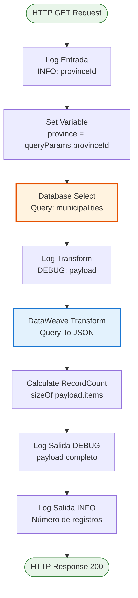
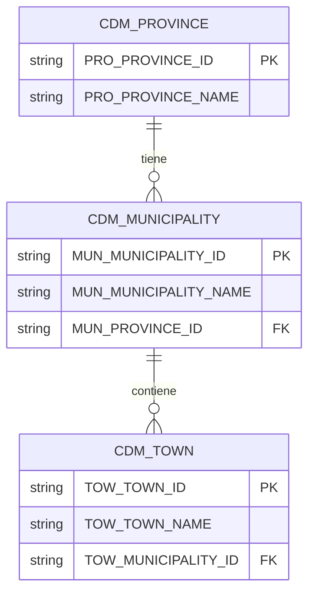

# GET /municipalities

## 📌 Descripción General

### Propósito del Endpoint

Este endpoint proporciona acceso a la lista completa de municipios españoles filtrados por provincia desde la base de datos Oracle. Es un componente fundamental del sistema de gestión de datos geográficos administrativos de Naturgy.

El endpoint soporta:
- **Consulta por Provincia**: Obtiene todos los municipios de una provincia específica
- **Datos Estructurados**: Retorna información básica de identificación de municipios
- **Respuesta Rápida**: Consulta directa a tabla maestra sin joins complejos

### Tipo de API

**Capa:** System API (API-Led Connectivity)

**Función:** Integración directa con base de datos Oracle para acceso a datos geográficos administrativos.

### Patrón de Integración

**Tipo:** Request-Reply Síncrono con SQL Query

**Descripción:** El endpoint recibe el ID de provincia como query parameter, ejecuta una consulta SQL directa a la tabla `CDM_MUNICIPALITY`, transforma el resultado a JSON y retorna la lista de municipios.

### Arquitectura API-Led Connectivity



---

## 💼 Propósito del Negocio

### Casos de Uso Principales

1. **Formularios de Registro de Clientes**
   - Usuario selecciona provincia en formulario de alta
   - Sistema carga municipios de esa provincia
   - Usuario selecciona municipio para completar dirección
   - **Beneficio:** Validación de direcciones y datos estructurados

2. **Actualización de Datos de Clientes**
   - Cliente modifica su dirección en portal de autoservicio
   - Sistema presenta municipios válidos de la provincia seleccionada
   - Evita errores de captura manual
   - **Beneficio:** Calidad de datos mejorada

3. **Búsquedas y Filtros Geográficos**
   - Agentes de call center buscan clientes por ubicación
   - Sistema permite filtrar por provincia y municipio
   - Resultados más precisos y rápidos
   - **Beneficio:** Mejor experiencia de servicio al cliente

### Contexto Empresarial

- **Dominio:** Gestión de Datos Administrativos y Geográficos
- **Sector:** Energía - Utilities
- **División:** Naturgy España - Área Cliente
- **Proceso de Negocio:** Gestión de Direcciones y Localización de Clientes
- **Módulo:** Sistema de Alta de Clientes (AC)

### Stakeholders

- **Equipos de Desarrollo Frontend**: Necesitan datos estructurados para formularios
- **Equipos de Atención al Cliente**: Requieren datos precisos para búsquedas
- **Equipos de Calidad de Datos**: Aseguran consistencia en direcciones
- **Equipos de Integración**: Consumen datos para sincronización con otros sistemas

### Valor de Negocio

- **Calidad de Datos**: Direcciones validadas contra catálogo oficial
- **Eficiencia Operativa**: Reducción de errores de captura manual
- **Experiencia de Usuario**: Autocompletado rápido en formularios
- **Cumplimiento Normativo**: Datos geográficos estandarizados

### Consumidores Potenciales

Este endpoint puede ser consumido por:
- Process APIs de gestión de clientes
- Experience APIs de portales web y móviles
- Sistemas de CRM y atención al cliente
- Herramientas de análisis geográfico
- Integraciones con sistemas de terceros

---

## 🔧 Especificación Técnica

### URLs por Ambiente

| Ambiente | URL Base | URL Completa |
|----------|----------|--------------|
| **Local** | `http://localhost:8050` | `http://localhost:8050/api/municipalities?provinceId={id}` |
| **Development** | `https://ntgy-cli-s-ac-des.cloudhub.io` | `https://ntgy-cli-s-ac-des.cloudhub.io/api/municipalities?provinceId={id}` |
| **QA** | `https://ntgy-cli-s-ac-cc.cloudhub.io` | `https://ntgy-cli-s-ac-cc.cloudhub.io/api/municipalities?provinceId={id}` |
| **Pre-Production** | `https://ntgy-cli-s-ac-cl.cloudhub.io` | `https://ntgy-cli-s-ac-cl.cloudhub.io/api/municipalities?provinceId={id}` |
| **Production** | `https://ntgy-cli-s-ac-pro.cloudhub.io` | `https://ntgy-cli-s-ac-pro.cloudhub.io/api/municipalities?provinceId={id}` |

### Método HTTP

```
GET /api/municipalities
```

### Parámetros de Entrada

#### Headers HTTP

| Header | Tipo | Requerido | Descripción | Ejemplo |
|--------|------|-----------|-------------|---------|
| `Accept` | string | ❌ No | Tipo de contenido esperado en response | `application/json` |

#### Query Parameters

| Parámetro | Tipo | Requerido | Descripción | Ejemplo | Validación |
|-----------|------|-----------|-------------|---------|------------|
| `provinceId` | string | ✅ Sí | ID de la provincia para filtrar municipios | `"28"` (Madrid) | Debe existir en tabla CDM_PROVINCE |

**Nota:** El parámetro `provinceId` debe corresponder a un ID válido de provincia en la base de datos.

### Respuestas

#### Respuesta Exitosa (200 OK)

```json
{
  "result": {
    "codResult": "0000",
    "msgResult": "No hay error"
  },
  "items": [
    {
      "municipalityId": "28001",
      "municipalityName": "Acebeda (La)"
    },
    {
      "municipalityId": "28002",
      "municipalityName": "Ajalvir"
    },
    {
      "municipalityId": "28003",
      "municipalityName": "Alameda del Valle"
    }
  ]
}
```

**Estructura de Respuesta:**

| Campo | Tipo | Descripción |
|-------|------|-------------|
| `result` | object | Objeto con información del resultado de la operación |
| `result.codResult` | string | Código de resultado ("0000" = éxito) |
| `result.msgResult` | string | Mensaje descriptivo del resultado |
| `items` | array | Array de municipios encontrados |
| `items[].municipalityId` | string | ID único del municipio |
| `items[].municipalityName` | string | Nombre del municipio |

#### Respuesta Sin Resultados (200 OK)

```json
{
  "result": {
    "codResult": "0000",
    "msgResult": "No hay error"
  },
  "items": []
}
```

**Descripción:** Cuando no existen municipios para la provincia especificada o el `provinceId` no es válido, se retorna un array vacío.

#### Respuesta de Error Técnico (500)

```json
{
  "result": {
    "codResult": "0001",
    "msgResult": "Error interno del servidor"
  }
}
```

**Causas Comunes:**
- Error de conexión a base de datos
- Timeout en la consulta SQL
- Error en la transformación de datos

### Autenticación y Autorización

- **Tipo:** Client ID & Client Secret (Anypoint Platform)
- **Autorización Base de Datos:** El usuario de conexión debe tener permisos para:
  - Ejecutar SELECT en tabla `CDM_MUNICIPALITY`
  - Acceso de lectura al schema `OV_CON`

### Timeouts

| Tipo | Valor | Descripción |
|------|-------|-------------|
| **Request Timeout** | 30 segundos | Tiempo máximo de espera para la respuesta |
| **Connection Timeout** | 10 segundos | Tiempo máximo para establecer conexión con DB |
| **Query Timeout** | 6000 segundos | Timeout configurado para queries SQL |

---

## 🏗️ Implementación Técnica

### Arquitectura del Flow



### Diagrama de Flujo Detallado



### Componentes del Flow

#### 1. Logger Entrada (INFO)
```xml
<logger level="INFO" message='s-ac-municipalities.logEntrada ## provinceId: #[attributes.queryParams["provinceId"]]' />
```
**Propósito:** Registrar el inicio de la operación con el parámetro de entrada.

#### 2. Set Variable
```xml
<set-variable variableName="province" value='#[attributes.queryParams["provinceId"]]'/>
```
**Propósito:** Almacenar el `provinceId` en una variable para uso en la query.

#### 3. Database Select
```xml
<db:select config-ref="Database_Config">
    <reconnect-forever />
    <db:sql><![CDATA[${queries.municipalities}]]></db:sql>
    <db:input-parameters><![CDATA[#[{'provinceId': vars.province}]]]></db:input-parameters>
</db:select>
```

**Query SQL Real:**
```sql
SELECT * FROM CDM_MUNICIPALITY 
WHERE CDM_MUNICIPALITY.MUN_PROVINCE_ID = :provinceId
```

**Configuración:**
- **Config:** `Database_Config` (conexión Oracle)
- **Reconnect:** `reconnect-forever` (reintentos automáticos)
- **Input Parameter:** `provinceId` desde variable `vars.province`

#### 4. Logger Transform (DEBUG)
```xml
<logger level="DEBUG" message="s-ac-municipalities..logTransform ## payload: #[payload]" />
```
**Propósito:** Registrar el resultado de la query antes de transformar.

#### 5. DataWeave Transform - Query To JSON
```dataweave
%dw 2.0
output application/json
---
{
    result: {	 
        codResult: "0000",
        msgResult: "No hay error"
    },
    items: payload map ( payload01 , indexOfPayload01 ) -> {
        municipalityId: payload01.MUN_MUNICIPALITY_ID,
        municipalityName: payload01.MUN_MUNICIPALITY_NAME default ""
    }
}
```

**Mapeo de Campos:**

| Campo DB | Campo JSON | Transformación |
|----------|------------|----------------|
| `MUN_MUNICIPALITY_ID` | `municipalityId` | Directo |
| `MUN_MUNICIPALITY_NAME` | `municipalityName` | Con default "" si null |

#### 6. Calculate RecordCount
```dataweave
%dw 2.0
output application/java
---
sizeOf(payload.items)
```
**Propósito:** Calcular el número de municipios retornados para logging.

#### 7. Logger Salida (DEBUG + INFO)
```xml
<logger level="DEBUG" message="s-ac-municipalities.logSalida ## payload: #[payload]" />
<logger level="INFO" message="s-ac-municipalities.logSalida ## Registros: #[vars.RecordCount]" />
```
**Propósito:** Registrar la respuesta completa (DEBUG) y el conteo de registros (INFO).

### Configuración de Base de Datos

**Archivo:** `src/main/resources/s-ac-{env}-config.yaml`

```yaml
dbAC:
  user: "OV_CON"
  pass: "ENC(...)"  # Encrypted password
  host1: "localhost"
  host2: "localhost"
  port: "1521"
  serviceName: "s_areapriv_con_odi_des.devdb.ocdev.oraclevcn.com"
  connectTimeOut: "3600"
  transportConnectTimeOut: "6000"
  retryCount: "3"
  MaxPoolSize: "5"
  MaxWaitTime: "300"
  MaxIdleTime: "300"
  timeout: "6000000"
  fetchsize: "2000"

queries:
  municipalities: "SELECT * FROM CDM_MUNICIPALITY WHERE CDM_MUNICIPALITY.MUN_PROVINCE_ID = :provinceId"
```

### Tabla de Base de Datos

#### CDM_MUNICIPALITY

**Schema:** `OV_CON`  
**Tipo:** Tabla Maestra de Municipios

**Columnas Principales:**

| Columna | Tipo | Descripción | Uso en Endpoint |
|---------|------|-------------|-----------------|
| `MUN_MUNICIPALITY_ID` | VARCHAR2 | ID único del municipio | ✅ Retornado como `municipalityId` |
| `MUN_MUNICIPALITY_NAME` | VARCHAR2 | Nombre del municipio | ✅ Retornado como `municipalityName` |
| `MUN_PROVINCE_ID` | VARCHAR2 | ID de la provincia (FK) | ✅ Usado en filtro WHERE |

**Índices:**
- Primary Key en `MUN_MUNICIPALITY_ID`
- Foreign Key en `MUN_PROVINCE_ID` → `CDM_PROVINCE.PRO_PROVINCE_ID`

**Relaciones:**


### Manejo de Errores

**Error Handler:** Global error handler configurado en `s-ac-globalErrorHandler.xml`

**Escenarios de Error:**

1. **Provincia No Válida**
   - **Comportamiento:** Retorna array vacío `items: []`
   - **HTTP Status:** 200 OK
   - **Rationale:** No es un error técnico, simplemente no hay datos

2. **Error de Conexión a Base de Datos**
   - **Comportamiento:** Retry automático con `reconnect-forever`
   - **HTTP Status:** 500 si falla después de reintentos
   - **Logging:** ERROR level con detalles del error

3. **Timeout de Query**
   - **Comportamiento:** Timeout después de 6000 segundos
   - **HTTP Status:** 500
   - **Mensaje:** "Error interno del servidor"

### Logging Strategy

**Niveles de Log:**

| Nivel | Ubicación | Información Registrada |
|-------|-----------|------------------------|
| **INFO** | Entrada | `provinceId` recibido |
| **DEBUG** | Transform | Payload completo de DB |
| **DEBUG** | Salida | Response JSON completo |
| **INFO** | Salida | Número de registros retornados |

**Formato de Mensajes:**
```
s-ac-municipalities.{fase} ## {información}
```

**Ejemplo de Logs:**
```
INFO  s-ac-municipalities.logEntrada ## provinceId: 28
DEBUG s-ac-municipalities.logTransform ## payload: [...]
DEBUG s-ac-municipalities.logSalida ## payload: {...}
INFO  s-ac-municipalities.logSalida ## Registros: 179
```

---

## 💻 Ejemplos de Uso

### Ejemplo 1: Consulta de Municipios de Madrid

#### Request

```bash
curl -X GET "http://localhost:8050/api/municipalities?provinceId=28" \
  -H "Accept: application/json"
```

#### Response (200 OK)

```json
{
  "result": {
    "codResult": "0000",
    "msgResult": "No hay error"
  },
  "items": [
    {
      "municipalityId": "28001",
      "municipalityName": "Acebeda (La)"
    },
    {
      "municipalityId": "28002",
      "municipalityName": "Ajalvir"
    },
    {
      "municipalityId": "28003",
      "municipalityName": "Alameda del Valle"
    },
    {
      "municipalityId": "28079",
      "municipalityName": "Madrid"
    }
  ]
}
```

**Nota:** Madrid (provincia 28) tiene 179 municipios en total.

---

### Ejemplo 2: Consulta de Municipios de Barcelona

#### Request

```bash
curl -X GET "https://ntgy-cli-s-ac-pro.cloudhub.io/api/municipalities?provinceId=08" \
  -H "Accept: application/json" \
  -H "client_id: your-client-id" \
  -H "client_secret: your-client-secret"
```

#### Response (200 OK)

```json
{
  "result": {
    "codResult": "0000",
    "msgResult": "No hay error"
  },
  "items": [
    {
      "municipalityId": "08001",
      "municipalityName": "Abrera"
    },
    {
      "municipalityId": "08002",
      "municipalityName": "Aguilar de Segarra"
    },
    {
      "municipalityId": "08019",
      "municipalityName": "Barcelona"
    }
  ]
}
```

---

### Ejemplo 3: Provincia Sin Municipios o No Válida

#### Request

```bash
curl -X GET "http://localhost:8050/api/municipalities?provinceId=99" \
  -H "Accept: application/json"
```

#### Response (200 OK)

```json
{
  "result": {
    "codResult": "0000",
    "msgResult": "No hay error"
  },
  "items": []
}
```

**Descripción:** Cuando el `provinceId` no existe o no tiene municipios asociados, se retorna un array vacío.

---

### Ejemplo 4: Error de Servidor

#### Request

```bash
curl -X GET "http://localhost:8050/api/municipalities?provinceId=28" \
  -H "Accept: application/json"
```

#### Response (500 Internal Server Error)

```json
{
  "result": {
    "codResult": "0001",
    "msgResult": "Error interno del servidor"
  }
}
```

**Causas Posibles:**
- Base de datos no disponible
- Timeout en la consulta
- Error en la transformación de datos

---

### Ejemplo 5: Integración con JavaScript (Frontend)

```javascript
// Función para obtener municipios por provincia
async function getMunicipalities(provinceId) {
  try {
    const response = await fetch(
      `https://ntgy-cli-s-ac-pro.cloudhub.io/api/municipalities?provinceId=${provinceId}`,
      {
        method: 'GET',
        headers: {
          'Accept': 'application/json',
          'client_id': 'your-client-id',
          'client_secret': 'your-client-secret'
        }
      }
    );
    
    if (!response.ok) {
      throw new Error(`HTTP error! status: ${response.status}`);
    }
    
    const data = await response.json();
    
    if (data.result.codResult === "0000") {
      return data.items;
    } else {
      console.error('Error en respuesta:', data.result.msgResult);
      return [];
    }
  } catch (error) {
    console.error('Error al obtener municipios:', error);
    return [];
  }
}

// Uso en formulario
document.getElementById('province-select').addEventListener('change', async (e) => {
  const provinceId = e.target.value;
  const municipalities = await getMunicipalities(provinceId);
  
  const municipalitySelect = document.getElementById('municipality-select');
  municipalitySelect.innerHTML = '<option value="">Seleccione municipio...</option>';
  
  municipalities.forEach(mun => {
    const option = document.createElement('option');
    option.value = mun.municipalityId;
    option.textContent = mun.municipalityName;
    municipalitySelect.appendChild(option);
  });
});
```

---

### Ejemplo 6: Integración con Python

```python
import requests
from typing import List, Dict, Optional

class MunicipalityClient:
    def __init__(self, base_url: str, client_id: str, client_secret: str):
        self.base_url = base_url
        self.headers = {
            'Accept': 'application/json',
            'client_id': client_id,
            'client_secret': client_secret
        }
    
    def get_municipalities(self, province_id: str) -> Optional[List[Dict]]:
        """
        Obtiene la lista de municipios para una provincia.
        
        Args:
            province_id: ID de la provincia
            
        Returns:
            Lista de municipios o None si hay error
        """
        try:
            url = f"{self.base_url}/api/municipalities"
            params = {'provinceId': province_id}
            
            response = requests.get(url, headers=self.headers, params=params, timeout=30)
            response.raise_for_status()
            
            data = response.json()
            
            if data['result']['codResult'] == '0000':
                return data['items']
            else:
                print(f"Error: {data['result']['msgResult']}")
                return None
                
        except requests.exceptions.RequestException as e:
            print(f"Error en request: {e}")
            return None

# Uso
client = MunicipalityClient(
    base_url='https://ntgy-cli-s-ac-pro.cloudhub.io',
    client_id='your-client-id',
    client_secret='your-client-secret'
)

municipalities = client.get_municipalities('28')
if municipalities:
    for mun in municipalities:
        print(f"{mun['municipalityId']}: {mun['municipalityName']}")
```

---

## 📊 Métricas y Monitoreo

### KPIs del Endpoint

| Métrica | Objetivo | Actual |
|---------|----------|--------|
| **Response Time (p95)** | < 3 segundos | Monitorear |
| **Error Rate** | < 0.1% | Monitorear |
| **Availability** | 99.9% | Monitorear |
| **Throughput** | 1000 req/min | Monitorear |

### Logs a Monitorear

- Número de registros retornados por provincia
- Provincias más consultadas
- Errores de conexión a base de datos
- Timeouts de queries

### Alertas Recomendadas

- Response time > 5 segundos
- Error rate > 1%
- Base de datos no disponible
- Número inusual de requests (posible ataque)