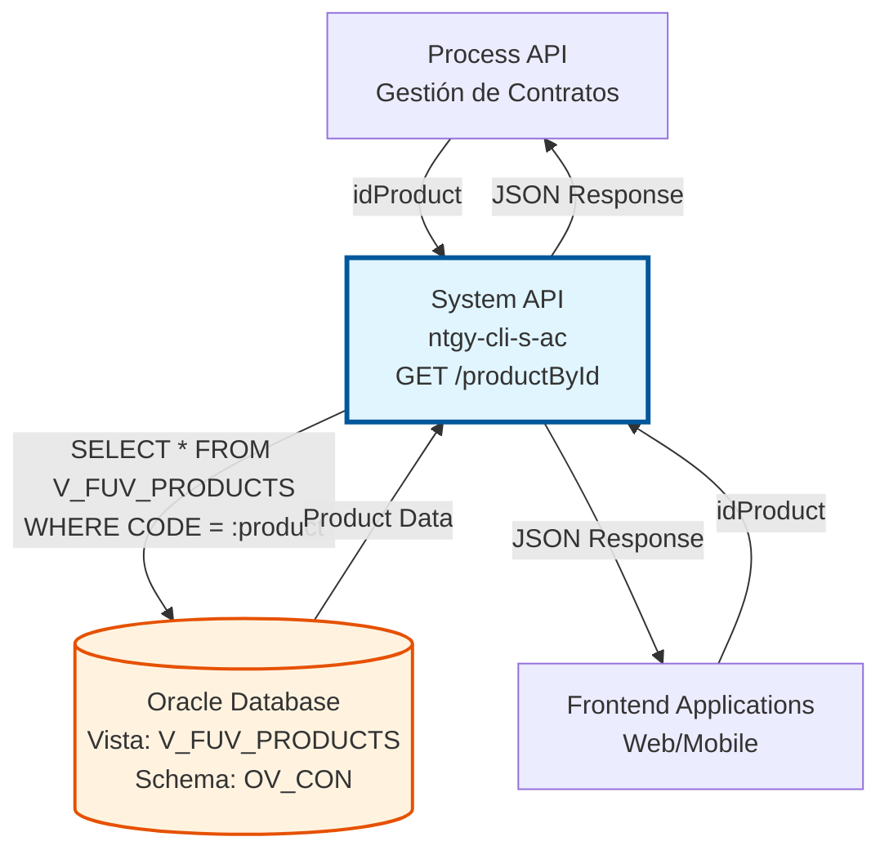
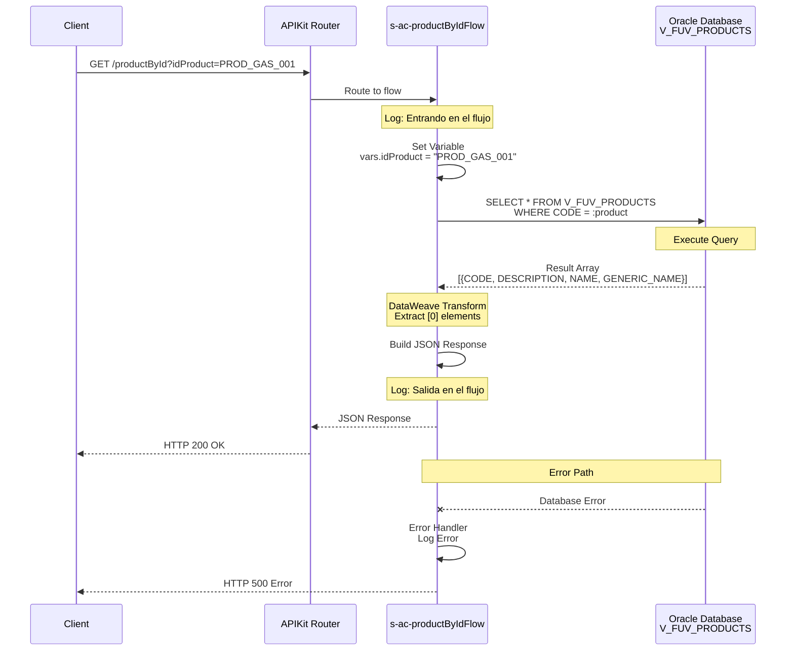

# GET /productById

## 📌 Descripción General

### Propósito del Endpoint

Este endpoint permite consultar información detallada de un producto específico del catálogo de Naturgy mediante su código único. Proporciona acceso directo a los datos maestros de productos almacenados en la vista `V_FUV_PRODUCTS` de Oracle Database.

El endpoint soporta:
- **Consulta por Código**: Búsqueda directa de producto mediante su código único
- **Información Completa**: Retorna código, nombre, descripción y grupo del producto
- **Respuesta Rápida**: Consulta optimizada a vista de base de datos
- **Formato Estándar**: Respuesta JSON con estructura consistente

### Tipo de API

**Capa:** System API (API-Led Connectivity)

**Función:** Integración directa con Oracle Database para consulta de productos del catálogo energético.

### Patrón de Integración

**Tipo:** Request-Reply Síncrono con SQL Query

**Descripción:** El endpoint recibe el código del producto como query parameter, ejecuta una consulta SQL en la vista V_FUV_PRODUCTS, transforma el resultado mediante DataWeave inline y retorna la información del producto en formato JSON.

### Arquitectura API-Led Connectivity



---

## 💼 Propósito del Negocio

### Casos de Uso Principales

1. **Validación de Productos en Contratación**
   - Durante el proceso de alta de contrato, validar que el producto seleccionado existe y está activo
   - Obtener información completa del producto para mostrar al cliente
   - Verificar el grupo al que pertenece el producto (gas, electricidad, servicios)

2. **Consulta de Catálogo de Productos**
   - Sistemas de e-commerce necesitan información detallada de productos
   - Aplicaciones de gestión de contratos requieren datos de productos
   - Portales de autoservicio muestran información de productos contratados

3. **Integración con Sistemas Externos**
   - Salesforce necesita información de productos para gestión de oportunidades
   - Sistemas de facturación requieren datos de productos para cálculos
   - Aplicaciones móviles consultan productos disponibles

### Contexto Empresarial

- **Dominio:** Gestión de Productos y Catálogo
- **Sector:** Energía - Utilities
- **División:** Naturgy España - Comercialización
- **Proceso de Negocio:** Gestión de Catálogo de Productos Energéticos
- **Ámbito:** Productos de gas, electricidad y servicios asociados

### Stakeholders

- **Equipos de Ventas**: Necesitan información actualizada de productos para ofertas comerciales
- **Desarrollo Frontend**: Requieren datos de productos para interfaces de usuario
- **Sistemas de Contratación**: Validan productos durante el proceso de alta
- **Equipos de Marketing**: Consultan catálogo para campañas y promociones

### Valor de Negocio

- **Centralización**: Punto único de acceso a información de productos
- **Consistencia**: Garantiza que todos los sistemas usan la misma información
- **Eficiencia**: Consulta rápida y optimizada a datos maestros
- **Escalabilidad**: Soporta múltiples consumidores simultáneos

### Consumidores Potenciales

Este endpoint puede ser consumido por:
- Process APIs de gestión de contratos y ventas
- Experience APIs de canales web y móvil
- Sistemas de integración con Salesforce
- Aplicaciones de gestión comercial
- Portales de autoservicio de clientes

---

## 🔧 Especificación Técnica

### URLs por Ambiente

| Ambiente | URL Base | URL Completa |
|----------|----------|--------------|
| **Local** | `http://localhost:8081` | `http://localhost:8081/api/productById?idProduct=CODE123` |
| **Development** | `https://ntgy-cli-s-ac-dev.us-e2.cloudhub.io` | `https://ntgy-cli-s-ac-dev.us-e2.cloudhub.io/api/productById?idProduct=CODE123` |
| **QA** | `https://ntgy-cli-s-ac-cc.us-e2.cloudhub.io` | `https://ntgy-cli-s-ac-cc.us-e2.cloudhub.io/api/productById?idProduct=CODE123` |
| **Pre-Production** | `https://ntgy-cli-s-ac-cl.us-e2.cloudhub.io` | `https://ntgy-cli-s-ac-cl.us-e2.cloudhub.io/api/productById?idProduct=CODE123` |
| **Production** | `https://ntgy-cli-s-ac-pro.us-e2.cloudhub.io` | `https://ntgy-cli-s-ac-pro.us-e2.cloudhub.io/api/productById?idProduct=CODE123` |

### Método HTTP

```
GET /api/productById
```

### Parámetros de Entrada

#### Headers HTTP

| Header | Tipo | Requerido | Descripción | Ejemplo |
|--------|------|-----------|-------------|---------|
| `Accept` | string | ❌ No | Tipo de contenido esperado en response | `application/json` |

#### Query Parameters

| Parámetro | Tipo | Requerido | Descripción | Ejemplo |
|-----------|------|-----------|-------------|---------|
| `idProduct` | string | ✅ Sí | Código único del producto en el catálogo | `"PROD_GAS_001"` |

**Validaciones:**
- `idProduct` no puede estar vacío
- Debe corresponder a un código válido en la vista V_FUV_PRODUCTS

### Respuestas

#### Respuesta Exitosa (200 OK)

```json
{
  "result": {
    "codResult": "0000",
    "msgResult": "No hay error"
  },
  "code": "PROD_GAS_001",
  "description": "Gas Natural Tarifa Estable 12 meses",
  "name": "Gas Natural Estable",
  "groupName": "Gas Natural"
}
```

**Descripción de Campos:**

| Campo | Tipo | Descripción |
|-------|------|-------------|
| `result.codResult` | string | Código de resultado ("0000" = éxito) |
| `result.msgResult` | string | Mensaje descriptivo del resultado |
| `code` | string | Código único del producto |
| `description` | string | Descripción detallada del producto |
| `name` | string | Nombre comercial del producto |
| `groupName` | string | Nombre del grupo o categoría del producto |

#### Respuesta de Error Técnico (500)

```json
{
  "error": "APP_9999",
  "message": "Error en el servicio."
}
```

**Casos de Error:**
- Error de conexión a base de datos
- Producto no encontrado (retorna array vacío)
- Error en la consulta SQL
- Timeout de base de datos

### Autenticación y Autorización

- **Tipo:** Client ID & Client Secret (Anypoint Platform)
- **Autorización DB:** El usuario de base de datos debe tener permisos para:
  - Ejecutar SELECT en vista `V_FUV_PRODUCTS`
  - Acceso al schema `OV_CON`

### Timeouts

| Tipo | Valor | Descripción |
|------|-------|-------------|
| **Request Timeout** | 30 segundos | Tiempo máximo de espera para la respuesta |
| **Connection Timeout** | 10 segundos | Tiempo máximo para establecer conexión con DB |
| **Query Timeout** | 30 segundos | Tiempo máximo de ejecución de la query SQL |

---

## 🏗️ Implementación Técnica

### Arquitectura del Flow

```mermaid
flowchart TD
    Start([HTTP GET Request]) --> LogStart[Log: Entrando en el flujo<br/>Consultando Producto idProduct]
    LogStart --> SetVar[Set Variable<br/>vars.idProduct = attributes.queryParams.idProduct]
    SetVar --> DBSelect[DB Select<br/>SELECT * FROM V_FUV_PRODUCTS<br/>WHERE CODE = :product]
    DBSelect --> Transform[DataWeave Transform<br/>Extract payload.CAMPO[0]<br/>Build JSON Response]
    Transform --> LogEnd[Log: Salida en el flujo<br/>Consultando Producto idProduct]
    LogEnd --> End([HTTP 200 Response])
    
    DBSelect -.->|Error| ErrorHandler[Error Handler<br/>on-error-propagate]
    ErrorHandler --> LogError[Log: s-ac-existingCUPS.logError]
    LogError --> ErrorEnd([HTTP 500 Response])
    
    style Start fill:#e8f5e9,stroke:#2e7d32
    style DBSelect fill:#fff3e0,stroke:#e65100,stroke-width:3px
    style Transform fill:#fff9c4,stroke:#f57f17,stroke-width:2px
    style End fill:#e8f5e9,stroke:#2e7d32
    style ErrorEnd fill:#ffebee,stroke:#c62828
```

### Flujo de Datos Detallado



### Operación de Base de Datos

#### Vista Consultada

**Vista:** `V_FUV_PRODUCTS`
- **Schema:** OV_CON
- **Tipo:** Vista de solo lectura
- **Propósito:** Catálogo de productos FUV (gas, electricidad, servicios)

#### Query SQL Ejecutada

```sql
SELECT * FROM V_FUV_PRODUCTS
WHERE CODE = :product
```

**Parámetros:**
- `:product` → Valor de `vars.idProduct` (código del producto)

**Campos Retornados:**

| Campo DB | Tipo | Descripción | Mapeo JSON |
|----------|------|-------------|------------|
| `CODE` | VARCHAR2 | Código único del producto | `code` |
| `DESCRIPTION` | VARCHAR2 | Descripción detallada | `description` |
| `NAME` | VARCHAR2 | Nombre comercial | `name` |
| `GENERIC_NAME` | VARCHAR2 | Nombre genérico/grupo | `groupName` |

**Índices:** La vista está optimizada con índice en el campo CODE para búsquedas rápidas.

### Transformación de Datos

#### DataWeave Inline (Líneas 16-28 del XML)

```dataweave
%dw 2.0
output application/json
---
{
    "result": {
        "codResult": "0000",
        "msgResult": "No hay error"
    },
    "code": payload.CODE[0],
    "description": payload.DESCRIPTION[0],
    "name": payload.NAME[0],
    "groupName": payload.GENERIC_NAME[0]
}
```

**Lógica de Transformación:**

1. **Extracción de Primer Elemento**: `payload.CAMPO[0]`
   - La query retorna un array de resultados
   - Se extrae el primer (y único) elemento con `[0]`
   - Si no hay resultados, retorna null

2. **Mapeo de Campos**:
   - `CODE` → `code`
   - `DESCRIPTION` → `description`
   - `NAME` → `name`
   - `GENERIC_NAME` → `groupName`

3. **Objeto Result Estándar**:
   - Añade objeto `result` con código de éxito
   - `codResult: "0000"` indica operación exitosa
   - `msgResult` proporciona mensaje descriptivo

### Diagrama de Transformación de Datos

```mermaid
graph LR
    A[Query Param<br/>idProduct:<br/>PROD_GAS_001] --> B[Variable<br/>vars.idProduct]
    B --> C[SQL Query<br/>WHERE CODE = :product]
    C --> D[DB Result Array<br/>[{CODE, DESCRIPTION,<br/>NAME, GENERIC_NAME}]]
    D --> E[DataWeave<br/>Extract [0]]
    E --> F[JSON Response<br/>code, description,<br/>name, groupName]
    
    style A fill:#e3f2fd,stroke:#1976d2
    style E fill:#fff9c4,stroke:#f57f17,stroke-width:2px
    style F fill:#e8f5e9,stroke:#2e7d32
```

### Manejo de Errores

#### Error Handler Configurado

```xml
<error-handler>
    <on-error-propagate enableNotifications="true" logException="true">
        <logger level="ERROR" message="s-ac-existingCUPS.logError"/>
    </on-error-propagate>
</error-handler>
```

**Comportamiento:**
- **Tipo:** `on-error-propagate` - Propaga el error al handler global
- **Logging:** Registra error con nivel ERROR
- **Notificaciones:** Habilitadas para alertas
- **Response:** El handler global retorna HTTP 500 con mensaje estándar

#### Escenarios de Error

| Escenario | Causa | Response |
|-----------|-------|----------|
| **Producto no encontrado** | CODE no existe en V_FUV_PRODUCTS | Array vacío, campos null |
| **Error de conexión DB** | Base de datos no disponible | HTTP 500 |
| **Query timeout** | Consulta excede 30 segundos | HTTP 500 |
| **Error de permisos** | Usuario sin acceso a vista | HTTP 500 |

### Logging

#### Puntos de Log

1. **Entrada al Flow** (Línea 9):
   ```
   INFO: "Entrando en el flujo s-ac. Consultando Producto {idProduct}"
   ```

2. **Salida del Flow** (Línea 29):
   ```
   INFO: "Salida en el flujo s-ac. Consultando Producto {idProduct}"
   ```

3. **Error** (Línea 32):
   ```
   ERROR: "s-ac-existingCUPS.logError"
   ```

### Configuración de Base de Datos

**Connector:** `Database_Config`

```xml
<db:config name="Database_Config">
    <db:generic-connection 
        url="jdbc:oracle:thin:${dbAC.user}/${secure::dbAC.pass}@..."
        driverClassName="oracle.jdbc.driver.OracleDriver">
        <db:pooling-profile 
            maxPoolSize="${dbAC.MaxPoolSize}"
            maxWait="${dbAC.MaxWaitTime}"
            maxIdleTime="${dbAC.MaxIdleTime}"/>
    </db:generic-connection>
</db:config>
```

**Parámetros de Conexión:**
- **Driver:** Oracle JDBC 19.13.0.0.1
- **Pool Size:** Configurable por ambiente (típicamente 5-10)
- **Max Wait:** 30 segundos
- **Max Idle:** 60 segundos

---

## 💻 Ejemplos de Uso

### Ejemplo 1: Consulta Exitosa de Producto de Gas

#### Request

```bash
curl -X GET "https://ntgy-cli-s-ac-pro.us-e2.cloudhub.io/api/productById?idProduct=PROD_GAS_001" \
  -H "Accept: application/json"
```

#### Response (200 OK)

```json
{
  "result": {
    "codResult": "0000",
    "msgResult": "No hay error"
  },
  "code": "PROD_GAS_001",
  "description": "Gas Natural Tarifa Estable 12 meses con precio fijo garantizado",
  "name": "Gas Natural Estable",
  "groupName": "Gas Natural"
}
```

### Ejemplo 2: Consulta de Producto de Electricidad

#### Request

```bash
curl -X GET "https://ntgy-cli-s-ac-pro.us-e2.cloudhub.io/api/productById?idProduct=PROD_ELEC_002" \
  -H "Accept: application/json"
```

#### Response (200 OK)

```json
{
  "result": {
    "codResult": "0000",
    "msgResult": "No hay error"
  },
  "code": "PROD_ELEC_002",
  "description": "Electricidad Tarifa Plana 24h con discriminación horaria",
  "name": "Electricidad Plana",
  "groupName": "Electricidad"
}
```

### Ejemplo 3: Producto No Encontrado

#### Request

```bash
curl -X GET "https://ntgy-cli-s-ac-pro.us-e2.cloudhub.io/api/productById?idProduct=PROD_INVALID" \
  -H "Accept: application/json"
```

#### Response (200 OK - Array Vacío)

```json
{
  "result": {
    "codResult": "0000",
    "msgResult": "No hay error"
  },
  "code": null,
  "description": null,
  "name": null,
  "groupName": null
}
```

**Nota:** Cuando el producto no existe, la query retorna un array vacío y los campos son null.

### Ejemplo 4: Error de Base de Datos

#### Request

```bash
curl -X GET "https://ntgy-cli-s-ac-pro.us-e2.cloudhub.io/api/productById?idProduct=PROD_GAS_001" \
  -H "Accept: application/json"
```

#### Response (500 Internal Server Error)

```json
{
  "error": "APP_9999",
  "message": "Error en el servicio."
}
```

**Causas Posibles:**
- Base de datos no disponible
- Timeout de conexión
- Error en la query SQL
- Permisos insuficientes

### Ejemplo 5: Integración desde JavaScript

```javascript
async function getProductById(productCode) {
  try {
    const response = await fetch(
      `https://ntgy-cli-s-ac-pro.us-e2.cloudhub.io/api/productById?idProduct=${productCode}`,
      {
        method: 'GET',
        headers: {
          'Accept': 'application/json'
        }
      }
    );
    
    if (!response.ok) {
      throw new Error(`HTTP error! status: ${response.status}`);
    }
    
    const data = await response.json();
    
    if (data.result.codResult === "0000" && data.code) {
      console.log(`Producto encontrado: ${data.name}`);
      return data;
    } else {
      console.log('Producto no encontrado');
      return null;
    }
  } catch (error) {
    console.error('Error al consultar producto:', error);
    throw error;
  }
}

// Uso
getProductById('PROD_GAS_001')
  .then(product => {
    if (product) {
      console.log('Código:', product.code);
      console.log('Nombre:', product.name);
      console.log('Descripción:', product.description);
      console.log('Grupo:', product.groupName);
    }
  });
```

### Ejemplo 6: Integración desde Python

```python
import requests
import json

def get_product_by_id(product_code):
    """
    Consulta información de un producto por su código
    
    Args:
        product_code (str): Código del producto
        
    Returns:
        dict: Información del producto o None si no existe
    """
    url = "https://ntgy-cli-s-ac-pro.us-e2.cloudhub.io/api/productById"
    params = {"idProduct": product_code}
    headers = {"Accept": "application/json"}
    
    try:
        response = requests.get(url, params=params, headers=headers, timeout=30)
        response.raise_for_status()
        
        data = response.json()
        
        if data.get("result", {}).get("codResult") == "0000" and data.get("code"):
            print(f"Producto encontrado: {data.get('name')}")
            return data
        else:
            print("Producto no encontrado")
            return None
            
    except requests.exceptions.RequestException as e:
        print(f"Error al consultar producto: {e}")
        raise

# Uso
if __name__ == "__main__":
    product = get_product_by_id("PROD_GAS_001")
    if product:
        print(f"Código: {product['code']}")
        print(f"Nombre: {product['name']}")
        print(f"Descripción: {product['description']}")
        print(f"Grupo: {product['groupName']}")
```

---

## 📊 Consideraciones de Rendimiento

### Optimizaciones Implementadas

1. **Vista Indexada**: V_FUV_PRODUCTS tiene índice en campo CODE
2. **Query Simple**: SELECT directo sin JOINs complejos
3. **Connection Pooling**: Reutilización de conexiones a base de datos
4. **Transformación Inline**: DataWeave inline evita overhead de archivos externos

### Métricas Esperadas

| Métrica | Valor Objetivo | Valor Típico |
|---------|----------------|--------------|
| **Response Time (p95)** | < 3 segundos | 500-800 ms |
| **Response Time (p99)** | < 5 segundos | 1-2 segundos |
| **Throughput** | 100 req/min | 50-80 req/min |
| **Error Rate** | < 0.1% | < 0.05% |

### Recomendaciones

- **Caching**: Considerar implementar cache para productos consultados frecuentemente
- **Monitoring**: Monitorear tiempos de respuesta de la query SQL
- **Alertas**: Configurar alertas si response time > 3 segundos

---

## 🔒 Seguridad

### Protección de Datos

- **Credenciales**: Usuario y contraseña de DB encriptados con Secure Properties
- **Conexión**: Conexión segura a Oracle Database
- **Logs**: No se registran datos sensibles en logs

### Validaciones

- **Input Validation**: Query parameter `idProduct` es requerido
- **SQL Injection**: Uso de parámetros preparados (`:product`) previene SQL injection
- **Permisos**: Usuario de DB tiene solo permisos de lectura en V_FUV_PRODUCTS

---

## 📝 Notas Adicionales

### Comportamiento Especial

- **Producto No Encontrado**: Retorna HTTP 200 con campos null (no HTTP 404)
- **Array Vacío**: Si la query no retorna resultados, `payload.CAMPO[0]` es null
- **Primer Elemento**: Siempre se extrae el primer elemento del array con `[0]`

### Dependencias

- **Vista de Base de Datos**: V_FUV_PRODUCTS debe existir y estar actualizada
- **Permisos**: Usuario de DB debe tener SELECT en la vista
- **Connector**: Database_Config debe estar correctamente configurado

### Mantenimiento

- **Actualización de Catálogo**: Los cambios en V_FUV_PRODUCTS se reflejan inmediatamente
- **Sin Cache**: No hay caching implementado, siempre consulta DB en tiempo real
- **Monitoreo**: Revisar logs regularmente para detectar errores de DB