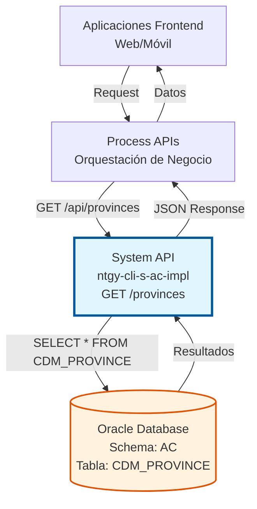
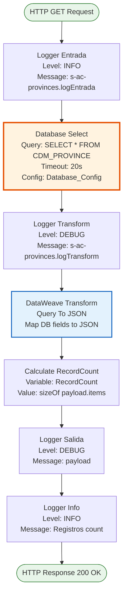
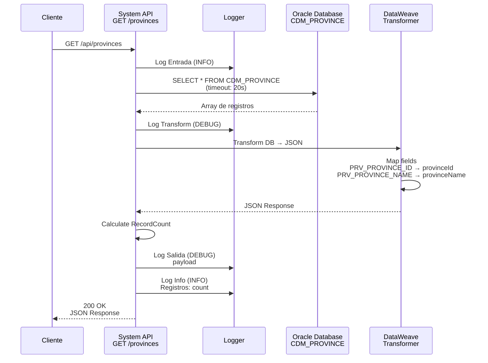
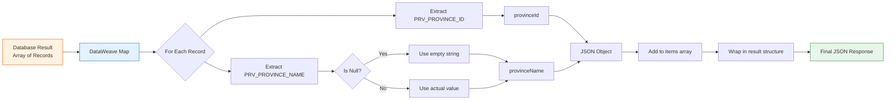

# GET /provinces

## 📌 Descripción General

### Propósito del Endpoint

Este endpoint proporciona acceso al catálogo completo de provincias españolas almacenadas en la base de datos Oracle AC. Es un endpoint de datos maestros que retorna todas las provincias disponibles sin filtros ni paginación.

El endpoint soporta:
- **Listado completo**: Retorna todas las provincias en una única llamada
- **Datos maestros**: Información estática de referencia geográfica
- **Formato estándar**: Respuesta JSON con estructura consistente
- **Logging completo**: Trazabilidad de cada invocación con métricas

### Tipo de API

**Capa:** System API (API-Led Connectivity)

**Función:** Integración directa con Oracle Database (Schema AC) para acceso a datos maestros geográficos.

### Patrón de Integración

**Tipo:** Request-Reply Síncrono con SQL Query

**Descripción:** El endpoint recibe una petición HTTP GET sin parámetros, ejecuta una consulta SQL directa a la tabla `CDM_PROVINCE`, transforma los resultados a formato JSON estándar, calcula métricas de respuesta y retorna el listado completo de provincias.

### Arquitectura API-Led Connectivity



---

## 💼 Propósito del Negocio

### Casos de Uso Principales

1. **Formularios de Dirección en Portales Web/Móvil**
   - Los usuarios seleccionan su provincia al completar formularios de alta o modificación de datos
   - El endpoint proporciona el listado para dropdowns y selectores
   - Mejora la experiencia de usuario con datos estandarizados

2. **Validación de Direcciones en Procesos de Alta de Clientes**
   - Los sistemas validan que la provincia ingresada existe en el catálogo oficial
   - Previene errores de captura y datos inconsistentes
   - Asegura integridad referencial en la base de datos

3. **Autocompletado de Direcciones**
   - Los componentes de UI ofrecen sugerencias mientras el usuario escribe
   - Reduce tiempo de captura y errores tipográficos
   - Proporciona experiencia de usuario moderna y eficiente

4. **Integración con Sistemas de Terceros**
   - Sistemas externos obtienen el catálogo oficial de provincias
   - Sincronización de datos maestros entre plataformas
   - Garantiza consistencia en toda la organización

### Contexto Empresarial

- **Dominio:** Gestión de Datos Maestros Geográficos
- **Sector:** Energía - Utilities
- **División:** Naturgy España - Sistema AC (Alta de Clientes)
- **Proceso de Negocio:** Gestión de Información Geográfica para Clientes
- **Tipo de Datos:** Datos Maestros Estáticos (Master Data)

### Stakeholders

- **Equipos de Frontend (Web/Móvil)**: Necesitan datos maestros para componentes de UI
- **Equipos de UX/UI**: Requieren catálogos estandarizados para diseño de formularios
- **Customer Service Representatives**: Utilizan estos datos en herramientas de gestión de clientes
- **Equipos de Integración**: Consumen el endpoint para sincronización de datos
- **Data Governance**: Mantienen la calidad y consistencia de datos maestros

### Valor de Negocio

- **Estandarización**: Catálogo único y oficial de provincias para toda la organización
- **Calidad de Datos**: Previene errores de captura y garantiza consistencia
- **Eficiencia Operativa**: Reduce tiempo de captura en formularios
- **Experiencia de Usuario**: Mejora la usabilidad de aplicaciones web y móviles
- **Integridad Referencial**: Asegura relaciones correctas en la base de datos

### Consumidores Potenciales

Este endpoint puede ser consumido por:
- Process APIs de gestión de clientes y contratos
- Experience APIs de portales web de autoservicio
- Aplicaciones móviles de clientes
- Sistemas de agentes de call center
- Herramientas de back-office
- Integraciones con sistemas de terceros autorizados

---

## 🔧 Especificación Técnica

### URLs por Ambiente

| Ambiente | URL Base | URL Completa |
|----------|----------|--------------|
| **Local** | `http://localhost:8081` | `http://localhost:8081/api/provinces` |
| **Development** | `https://ntgy-cli-s-ac-dev.us-e2.cloudhub.io` | `https://ntgy-cli-s-ac-dev.us-e2.cloudhub.io/api/provinces` |
| **UAT** | `https://ntgy-cli-s-ac-uat.us-e2.cloudhub.io` | `https://ntgy-cli-s-ac-uat.us-e2.cloudhub.io/api/provinces` |
| **Production** | `https://ntgy-cli-s-ac-pro.us-e2.cloudhub.io` | `https://ntgy-cli-s-ac-pro.us-e2.cloudhub.io/api/provinces` |

### Método HTTP

```
GET /api/provinces
```

### Parámetros de Entrada

#### Headers HTTP

| Header | Tipo | Requerido | Descripción | Ejemplo |
|--------|------|-----------|-------------|---------|
| `Accept` | string | ❌ No | Tipo de contenido esperado en response | `application/json` |

**Nota:** Este endpoint no requiere parámetros de entrada. Es una consulta simple que retorna todas las provincias.

### Respuestas

#### Respuesta Exitosa (200 OK)

```json
{
  "result": {
    "codResult": "0000",
    "msgResult": "No hay error"
  },
  "items": [
    {
      "provinceId": 1,
      "provinceName": "Álava"
    },
    {
      "provinceId": 2,
      "provinceName": "Albacete"
    },
    {
      "provinceId": 3,
      "provinceName": "Alicante"
    }
    // ... más provincias
  ]
}
```

**Estructura de la Respuesta:**

| Campo | Tipo | Descripción |
|-------|------|-------------|
| `result` | object | Objeto con información del resultado de la operación |
| `result.codResult` | string | Código de resultado: "0000" = éxito |
| `result.msgResult` | string | Mensaje descriptivo del resultado |
| `items` | array | Array de objetos provincia |
| `items[].provinceId` | number | Identificador único de la provincia |
| `items[].provinceName` | string | Nombre de la provincia (string vacío si es null) |

#### Respuesta de Error Técnico (500)

```json
{
  "result": {
    "codResult": "0001",
    "msgResult": "Error interno del servidor"
  }
}
```

### Autenticación y Autorización

- **Tipo:** Client ID & Client Secret (Anypoint Platform)
- **Autorización Base de Datos:** El usuario de conexión debe tener permisos de:
  - Acceso de lectura (SELECT) a la tabla `CDM_PROVINCE`
  - Conexión al schema AC de Oracle Database

### Timeouts

| Tipo | Valor | Descripción |
|------|-------|-------------|
| **Query Timeout** | 20 segundos | Tiempo máximo de espera para la ejecución del query SQL |
| **Connection Timeout** | 10 segundos | Tiempo máximo para establecer conexión con la base de datos |

### Características Especiales

- **Sin Paginación**: Retorna todas las provincias en una única respuesta
- **Sin Filtros**: No acepta parámetros de filtrado
- **Datos Estáticos**: El catálogo de provincias cambia muy raramente
- **Candidato para Caching**: Ideal para implementar caché con TTL largo
- **Logging Completo**: Incluye métricas de número de registros retornados

---

## 🏗️ Implementación Técnica

### Arquitectura del Flow



### Componentes del Flow

#### 1. Logger de Entrada
- **Nivel:** INFO
- **Mensaje:** `s-ac-provinces.logEntrada`
- **Propósito:** Registrar el inicio de la ejecución del flow

#### 2. Database Select
- **Operación:** `db:select`
- **Configuración:** `Database_Config` (Oracle Database)
- **Query Timeout:** 20 segundos
- **Query SQL:**
  ```sql
  SELECT * FROM CDM_PROVINCE
  ```
- **Tabla:** `CDM_PROVINCE`
- **Operación:** READ (SELECT)

#### 3. Logger de Transformación
- **Nivel:** DEBUG
- **Mensaje:** `s-ac-provinces.logTransform`
- **Propósito:** Registrar antes de la transformación DataWeave

#### 4. Transformación DataWeave (Query To JSON)
- **Input:** Array de registros de la base de datos
- **Output:** JSON con estructura estándar
- **Operación:** Map sobre el array de resultados

**Código DataWeave:**
```dataweave
%dw 2.0
output application/json
---
{
    result: {	 
        codResult: "0000",
        msgResult: "No hay error"
    },
    items: payload map ( payload01 , indexOfPayload01 ) -> {
        provinceId: payload01.PRV_PROVINCE_ID,
        provinceName: payload01.PRV_PROVINCE_NAME default ""
    }
}
```

**Mapeo de Campos:**
- `PRV_PROVINCE_ID` (DB) → `provinceId` (JSON)
- `PRV_PROVINCE_NAME` (DB) → `provinceName` (JSON)
  - **Manejo de Nulls:** Si el valor es null, se usa `""` (string vacío)

#### 5. Cálculo de RecordCount
- **Variable:** `RecordCount`
- **Tipo:** Java (number)
- **Cálculo:** `sizeOf(payload.items)`
- **Propósito:** Contar el número de provincias retornadas para métricas

#### 6. Logger de Salida
- **Nivel:** DEBUG
- **Mensaje:** `s-ac-provinces.logSalida ## payload: #[payload]`
- **Propósito:** Registrar el payload completo de salida

#### 7. Logger Info con Métricas
- **Nivel:** INFO
- **Mensaje:** `s-ac-provinces.logSalida ## Registros: #[vars.RecordCount]`
- **Propósito:** Registrar el número de registros retornados para monitoreo

### Base de Datos

#### Tabla: CDM_PROVINCE

| Campo | Tipo | Descripción | Uso |
|-------|------|-------------|-----|
| `PRV_PROVINCE_ID` | NUMBER | Identificador único de la provincia | Mapeado a `provinceId` |
| `PRV_PROVINCE_NAME` | VARCHAR2 | Nombre de la provincia | Mapeado a `provinceName` |

**Nota:** La tabla puede contener más campos, pero solo estos dos se utilizan en la transformación.

### Diagrama de Secuencia



### Configuración de Base de Datos

**Connector:** Database Connector 1.14.13

**Configuración:** `Database_Config`
- **Tipo:** Oracle Database
- **Schema:** AC (Alta de Clientes)
- **Connection Pooling:** Configurado según ambiente
- **Failover:** Oracle RAC con failover automático

### Manejo de Errores

El endpoint utiliza el error handler global del proyecto (`s-ac-globalErrorHandler`):

- **Database Connection Error:** Retorna 500 con mensaje de error
- **Query Timeout:** Retorna 500 después de 20 segundos
- **Database Error:** Retorna 500 con mensaje descriptivo
- **Transformation Error:** Retorna 500 con mensaje de error

### Logging y Monitoreo

**Niveles de Logging:**
1. **INFO** - Entrada del flow
2. **DEBUG** - Antes de transformación
3. **DEBUG** - Payload de salida
4. **INFO** - Número de registros retornados

**Métricas Capturadas:**
- Número de provincias retornadas (`RecordCount`)
- Tiempo de ejecución del query (implícito en logs)
- Payload completo para troubleshooting (DEBUG)

### Diagrama de Transformación de Datos



---

## 💻 Ejemplos de Uso

### Ejemplo 1: Llamada con curl

```bash
curl -X GET "https://ntgy-cli-s-ac-dev.us-e2.cloudhub.io/api/provinces" \
  -H "Accept: application/json" \
  -H "client_id: your-client-id" \
  -H "client_secret: your-client-secret"
```

### Ejemplo 2: JavaScript/Fetch

```javascript
// Obtener listado de provincias
async function getProvinces() {
  try {
    const response = await fetch('https://ntgy-cli-s-ac-dev.us-e2.cloudhub.io/api/provinces', {
      method: 'GET',
      headers: {
        'Accept': 'application/json',
        'client_id': 'your-client-id',
        'client_secret': 'your-client-secret'
      }
    });
    
    if (!response.ok) {
      throw new Error(`HTTP error! status: ${response.status}`);
    }
    
    const data = await response.json();
    
    if (data.result.codResult === "0000") {
      console.log(`Total provincias: ${data.items.length}`);
      return data.items;
    } else {
      console.error('Error en la respuesta:', data.result.msgResult);
      return [];
    }
  } catch (error) {
    console.error('Error al obtener provincias:', error);
    return [];
  }
}

// Uso en un componente de UI
getProvinces().then(provinces => {
  // Poblar dropdown
  const select = document.getElementById('province-select');
  provinces.forEach(province => {
    const option = document.createElement('option');
    option.value = province.provinceId;
    option.textContent = province.provinceName;
    select.appendChild(option);
  });
});
```

### Ejemplo 3: Respuesta Exitosa Completa

```json
{
  "result": {
    "codResult": "0000",
    "msgResult": "No hay error"
  },
  "items": [
    {
      "provinceId": 1,
      "provinceName": "Álava"
    },
    {
      "provinceId": 2,
      "provinceName": "Albacete"
    },
    {
      "provinceId": 3,
      "provinceName": "Alicante"
    },
    {
      "provinceId": 4,
      "provinceName": "Almería"
    },
    {
      "provinceId": 5,
      "provinceName": "Ávila"
    },
    {
      "provinceId": 6,
      "provinceName": "Badajoz"
    },
    {
      "provinceId": 7,
      "provinceName": "Baleares"
    },
    {
      "provinceId": 8,
      "provinceName": "Barcelona"
    },
    {
      "provinceId": 9,
      "provinceName": "Burgos"
    },
    {
      "provinceId": 10,
      "provinceName": "Cáceres"
    },
    {
      "provinceId": 11,
      "provinceName": "Cádiz"
    },
    {
      "provinceId": 12,
      "provinceName": "Castellón"
    },
    {
      "provinceId": 13,
      "provinceName": "Ciudad Real"
    },
    {
      "provinceId": 14,
      "provinceName": "Córdoba"
    },
    {
      "provinceId": 15,
      "provinceName": "A Coruña"
    },
    {
      "provinceId": 16,
      "provinceName": "Cuenca"
    },
    {
      "provinceId": 17,
      "provinceName": "Girona"
    },
    {
      "provinceId": 18,
      "provinceName": "Granada"
    },
    {
      "provinceId": 19,
      "provinceName": "Guadalajara"
    },
    {
      "provinceId": 20,
      "provinceName": "Guipúzcoa"
    },
    {
      "provinceId": 21,
      "provinceName": "Huelva"
    },
    {
      "provinceId": 22,
      "provinceName": "Huesca"
    },
    {
      "provinceId": 23,
      "provinceName": "Jaén"
    },
    {
      "provinceId": 24,
      "provinceName": "León"
    },
    {
      "provinceId": 25,
      "provinceName": "Lleida"
    },
    {
      "provinceId": 26,
      "provinceName": "La Rioja"
    },
    {
      "provinceId": 27,
      "provinceName": "Lugo"
    },
    {
      "provinceId": 28,
      "provinceName": "Madrid"
    },
    {
      "provinceId": 29,
      "provinceName": "Málaga"
    },
    {
      "provinceId": 30,
      "provinceName": "Murcia"
    },
    {
      "provinceId": 31,
      "provinceName": "Navarra"
    },
    {
      "provinceId": 32,
      "provinceName": "Ourense"
    },
    {
      "provinceId": 33,
      "provinceName": "Asturias"
    },
    {
      "provinceId": 34,
      "provinceName": "Palencia"
    },
    {
      "provinceId": 35,
      "provinceName": "Las Palmas"
    },
    {
      "provinceId": 36,
      "provinceName": "Pontevedra"
    },
    {
      "provinceId": 37,
      "provinceName": "Salamanca"
    },
    {
      "provinceId": 38,
      "provinceName": "Santa Cruz de Tenerife"
    },
    {
      "provinceId": 39,
      "provinceName": "Cantabria"
    },
    {
      "provinceId": 40,
      "provinceName": "Segovia"
    },
    {
      "provinceId": 41,
      "provinceName": "Sevilla"
    },
    {
      "provinceId": 42,
      "provinceName": "Soria"
    },
    {
      "provinceId": 43,
      "provinceName": "Tarragona"
    },
    {
      "provinceId": 44,
      "provinceName": "Teruel"
    },
    {
      "provinceId": 45,
      "provinceName": "Toledo"
    },
    {
      "provinceId": 46,
      "provinceName": "Valencia"
    },
    {
      "provinceId": 47,
      "provinceName": "Valladolid"
    },
    {
      "provinceId": 48,
      "provinceName": "Vizcaya"
    },
    {
      "provinceId": 49,
      "provinceName": "Zamora"
    },
    {
      "provinceId": 50,
      "provinceName": "Zaragoza"
    },
    {
      "provinceId": 51,
      "provinceName": "Ceuta"
    },
    {
      "provinceId": 52,
      "provinceName": "Melilla"
    }
  ]
}
```

### Ejemplo 4: Respuesta de Error

```json
{
  "result": {
    "codResult": "0001",
    "msgResult": "Error interno del servidor"
  }
}
```

### Ejemplo 5: Uso en React Component

```jsx
import React, { useState, useEffect } from 'react';

function ProvinceSelector() {
  const [provinces, setProvinces] = useState([]);
  const [loading, setLoading] = useState(true);
  const [error, setError] = useState(null);
  const [selectedProvince, setSelectedProvince] = useState('');

  useEffect(() => {
    async function fetchProvinces() {
      try {
        const response = await fetch(
          'https://ntgy-cli-s-ac-dev.us-e2.cloudhub.io/api/provinces',
          {
            headers: {
              'Accept': 'application/json',
              'client_id': process.env.REACT_APP_CLIENT_ID,
              'client_secret': process.env.REACT_APP_CLIENT_SECRET
            }
          }
        );

        if (!response.ok) {
          throw new Error('Error al cargar provincias');
        }

        const data = await response.json();
        
        if (data.result.codResult === "0000") {
          setProvinces(data.items);
        } else {
          throw new Error(data.result.msgResult);
        }
      } catch (err) {
        setError(err.message);
      } finally {
        setLoading(false);
      }
    }

    fetchProvinces();
  }, []);

  if (loading) return <div>Cargando provincias...</div>;
  if (error) return <div>Error: {error}</div>;

  return (
    <div>
      <label htmlFor="province">Provincia:</label>
      <select
        id="province"
        value={selectedProvince}
        onChange={(e) => setSelectedProvince(e.target.value)}
      >
        <option value="">Seleccione una provincia</option>
        {provinces.map((province) => (
          <option key={province.provinceId} value={province.provinceId}>
            {province.provinceName}
          </option>
        ))}
      </select>
      {selectedProvince && (
        <p>Provincia seleccionada: {
          provinces.find(p => p.provinceId === parseInt(selectedProvince))?.provinceName
        }</p>
      )}
    </div>
  );
}

export default ProvinceSelector;
```

### Ejemplo 6: Python con requests

```python
import requests
import json

def get_provinces():
    """
    Obtiene el listado de provincias desde el System API
    
    Returns:
        list: Lista de diccionarios con provinceId y provinceName
    """
    url = "https://ntgy-cli-s-ac-dev.us-e2.cloudhub.io/api/provinces"
    headers = {
        "Accept": "application/json",
        "client_id": "your-client-id",
        "client_secret": "your-client-secret"
    }
    
    try:
        response = requests.get(url, headers=headers, timeout=30)
        response.raise_for_status()
        
        data = response.json()
        
        if data.get("result", {}).get("codResult") == "0000":
            provinces = data.get("items", [])
            print(f"Total provincias obtenidas: {len(provinces)}")
            return provinces
        else:
            error_msg = data.get("result", {}).get("msgResult", "Error desconocido")
            print(f"Error en la respuesta: {error_msg}")
            return []
            
    except requests.exceptions.RequestException as e:
        print(f"Error en la petición: {e}")
        return []

# Uso
if __name__ == "__main__":
    provinces = get_provinces()
    
    # Imprimir primeras 5 provincias
    for province in provinces[:5]:
        print(f"ID: {province['provinceId']}, Nombre: {province['provinceName']}")
    
    # Buscar una provincia específica
    madrid = next((p for p in provinces if p['provinceName'] == 'Madrid'), None)
    if madrid:
        print(f"\nMadrid encontrada con ID: {madrid['provinceId']}")