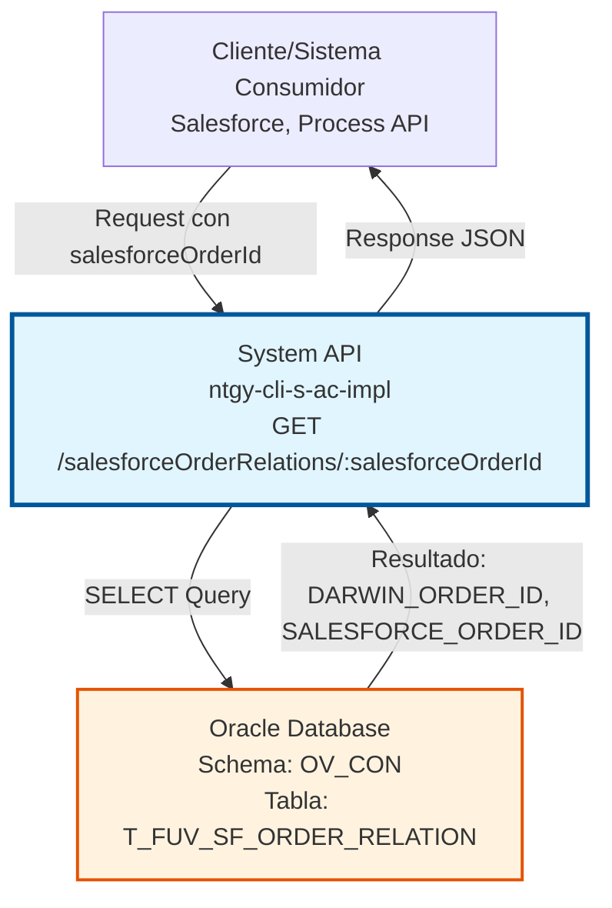
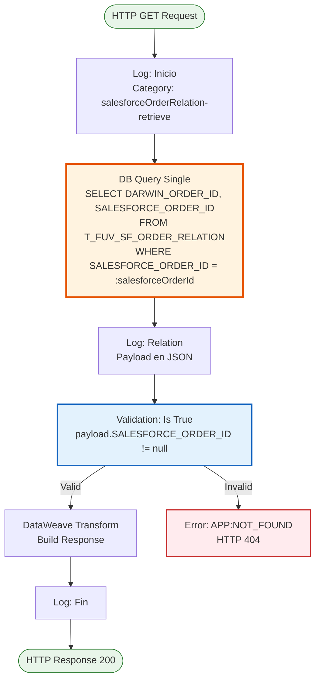
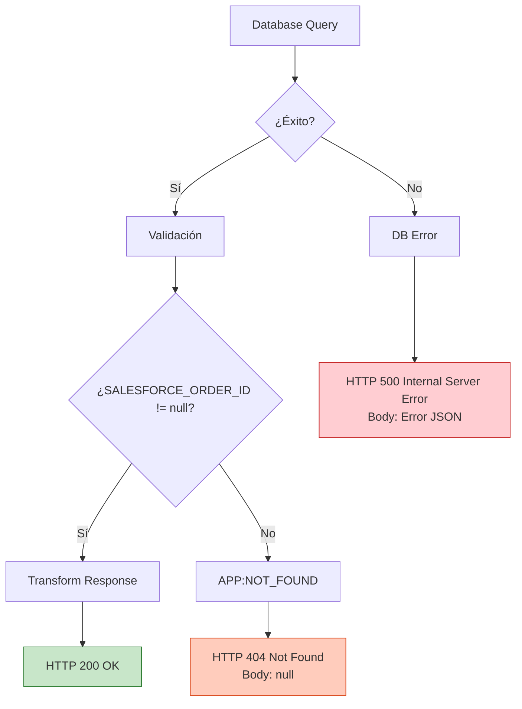
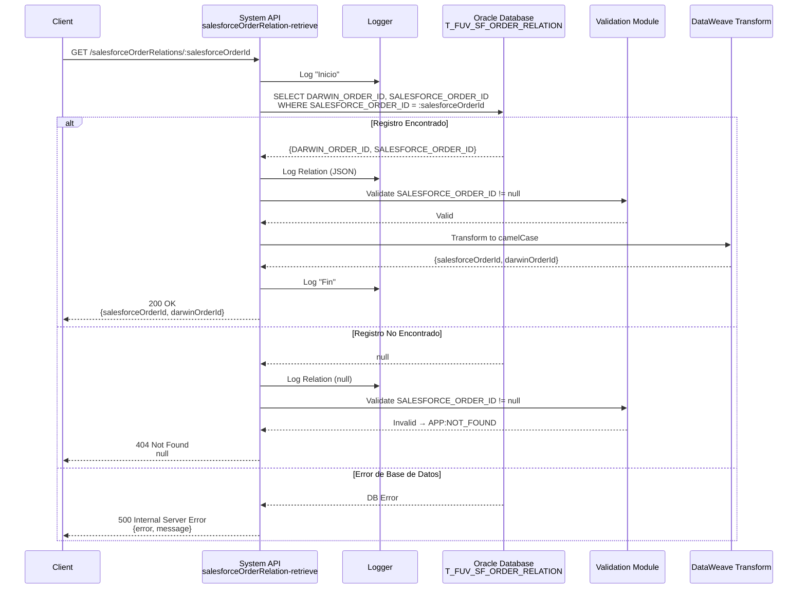

# GET /salesforceOrderRelations/:salesforceOrderId

## 📌 Descripción General

### Propósito del Endpoint

Este endpoint consulta la relación entre una orden de Salesforce y su correspondiente orden de Darwin en el sistema de Facturación Única Virtual (FUV). Permite obtener el mapeo bidireccional entre los identificadores de órdenes de ambos sistemas, facilitando la trazabilidad y sincronización de datos entre Salesforce y Darwin.

El endpoint soporta:
- **Consulta por ID de Salesforce**: Recupera el ID de Darwin asociado a una orden de Salesforce
- **Validación de Existencia**: Verifica que la relación existe en la base de datos
- **Respuesta Estructurada**: Retorna ambos identificadores en formato JSON

### Tipo de API

**Capa:** System API (API-Led Connectivity)

**Función:** Acceso directo a Oracle Database para consultar relaciones entre órdenes de Salesforce y Darwin en el esquema de Administración Comercial (OV_CON).

### Patrón de Integración

**Tipo:** Request-Reply Síncrono con Query SQL

**Descripción:** El endpoint recibe un ID de orden de Salesforce como parámetro de ruta, ejecuta una consulta SQL en Oracle Database para recuperar la relación, valida que existe, transforma el resultado a JSON y retorna la respuesta al cliente.

### Arquitectura API-Led Connectivity



---

## 💼 Propósito del Negocio

### Casos de Uso Principales

1. **Sincronización de Órdenes entre Sistemas**
   - Salesforce necesita conocer el ID de Darwin para una orden específica
   - Permite seguimiento de órdenes a través de múltiples sistemas
   - Facilita la reconciliación de datos entre plataformas

2. **Trazabilidad de Procesos de Negocio**
   - Auditoría de órdenes procesadas
   - Seguimiento del ciclo de vida de contratos
   - Validación de integridad de datos entre sistemas

3. **Integración con Sistemas Externos**
   - Process APIs pueden consultar relaciones para orquestar flujos
   - Sistemas de reporting pueden obtener mapeos de órdenes
   - Herramientas de monitoreo pueden validar sincronización

### Contexto Empresarial

- **Dominio:** Gestión de Órdenes y Contratos
- **Sector:** Energía - Utilities
- **División:** Naturgy España - Administración Comercial
- **Proceso de Negocio:** Sincronización de órdenes entre Salesforce (CRM) y Darwin (Sistema de Gestión)
- **Sistema de Origen:** Salesforce
- **Sistema de Destino:** Darwin

### Stakeholders

- **Equipos de Integración**: Necesitan mapear órdenes entre sistemas para flujos de datos
- **Desarrolladores de Salesforce**: Requieren conocer IDs de Darwin para procesos downstream
- **Equipos de Soporte**: Utilizan el endpoint para troubleshooting y validación de datos
- **Sistemas de Auditoría**: Consultan relaciones para trazabilidad y compliance

### Valor de Negocio

- **Trazabilidad Completa**: Permite seguimiento de órdenes a través de múltiples sistemas
- **Integridad de Datos**: Asegura que las relaciones entre sistemas están correctamente registradas
- **Eficiencia Operativa**: Reduce tiempo de búsqueda manual de relaciones entre órdenes
- **Soporte a Integraciones**: Facilita la construcción de flujos de integración complejos

### Consumidores Potenciales

Este endpoint puede ser consumido por:
- Process APIs de gestión de órdenes
- Flujos de Salesforce (Platform Events, Apex)
- Sistemas de integración middleware
- Herramientas de monitoreo y auditoría
- Aplicaciones de reporting y analytics

---

## 🔧 Especificación Técnica

### URLs por Ambiente

| Ambiente | URL Base | URL Completa |
|----------|----------|--------------|
| **Local** | `http://localhost:8081` | `http://localhost:8081/api/salesforceOrderRelations/:salesforceOrderId` |
| **Development** | `https://ntgy-cli-s-ac-impl-dev.us-e2.cloudhub.io` | `https://ntgy-cli-s-ac-impl-dev.us-e2.cloudhub.io/api/salesforceOrderRelations/:salesforceOrderId` |
| **QA** | `https://ntgy-cli-s-ac-impl-cc.us-e2.cloudhub.io` | `https://ntgy-cli-s-ac-impl-cc.us-e2.cloudhub.io/api/salesforceOrderRelations/:salesforceOrderId` |
| **Pre-Production** | `https://ntgy-cli-s-ac-impl-cl.us-e2.cloudhub.io` | `https://ntgy-cli-s-ac-impl-cl.us-e2.cloudhub.io/api/salesforceOrderRelations/:salesforceOrderId` |
| **Production** | `https://ntgy-cli-s-ac-impl-pro.us-e2.cloudhub.io` | `https://ntgy-cli-s-ac-impl-pro.us-e2.cloudhub.io/api/salesforceOrderRelations/:salesforceOrderId` |

### Método HTTP

```
GET /api/salesforceOrderRelations/:salesforceOrderId
```

### Parámetros de Entrada

#### Headers HTTP

| Header | Tipo | Requerido | Descripción | Ejemplo |
|--------|------|-----------|-------------|---------|
| `Accept` | string | ❌ No | Tipo de contenido esperado en response | `application/json` |

#### URI Parameters

| Parámetro | Tipo | Requerido | Descripción | Ejemplo |
|-----------|------|-----------|-------------|---------|
| `salesforceOrderId` | string | ✅ Sí | Identificador único de la orden en Salesforce | `"8015e000000ABCD"` |

**Validaciones:**
- El parámetro `salesforceOrderId` debe ser un string no vacío
- Debe corresponder a un ID válido de Salesforce

### Respuestas

#### Respuesta Exitosa (200 OK)

**Descripción:** La relación fue encontrada exitosamente.

```json
{
  "salesforceOrderId": "8015e000000ABCD",
  "darwinOrderId": "ORD-2024-001234"
}
```

**Campos de Respuesta:**

| Campo | Tipo | Descripción |
|-------|------|-------------|
| `salesforceOrderId` | string | ID de la orden en Salesforce |
| `darwinOrderId` | string | ID de la orden en Darwin |

#### Respuesta de Error - No Encontrado (404 Not Found)

**Descripción:** No existe una relación para el `salesforceOrderId` proporcionado.

```json
null
```

**HTTP Status:** 404

**Razones Comunes:**
- El `salesforceOrderId` no existe en la tabla de relaciones
- La relación fue eliminada previamente
- El ID de Salesforce es incorrecto

#### Respuesta de Error Técnico (500 Internal Server Error)

**Descripción:** Error interno del servidor o problema de conectividad con la base de datos.

```json
{
  "error": "APP_9999",
  "message": "Error en el servicio."
}
```

**HTTP Status:** 500

**Razones Comunes:**
- Error de conectividad con Oracle Database
- Timeout en la consulta
- Error en la configuración del pool de conexiones

### Autenticación y Autorización

- **Tipo:** Client ID & Client Secret (Anypoint Platform)
- **Autorización Oracle:** El usuario de base de datos debe tener permisos para:
  - Ejecutar SELECT en la tabla `T_FUV_SF_ORDER_RELATION`
  - Acceso al schema `OV_CON`

### Timeouts

| Tipo | Valor | Descripción |
|------|-------|-------------|
| **Query Timeout** | 30 segundos | Tiempo máximo de ejecución de la consulta SQL |
| **Connection Timeout** | 10 segundos | Tiempo máximo para establecer conexión con Oracle |

---

## 🏗️ Implementación Técnica

### Arquitectura del Flow



### Componentes del Flow

#### 1. Logger - Inicio
```xml
<logger level="DEBUG" 
        message='#["Inicio"]' 
        category="com.naturgy.mule.salesforceOrderRelation-retrieve" />
```
- Registra el inicio de la ejecución del subflow
- Nivel DEBUG para trazabilidad en desarrollo

#### 2. Database Query Single
```xml
<db:query-single config-ref="Database_Config">
    <db:sql><![CDATA[
        SELECT DARWIN_ORDER_ID, SALESFORCE_ORDER_ID 
        FROM T_FUV_SF_ORDER_RELATION 
        WHERE SALESFORCE_ORDER_ID = :salesforceOrderId
    ]]></db:sql>
    <db:input-parameters><![CDATA[#[{
        salesforceOrderId: vars.salesforceOrderId
    }]]]></db:input-parameters>
</db:query-single>
```

**Características:**
- Utiliza `query-single` para esperar exactamente un resultado
- Query parametrizada para prevenir SQL injection
- Parámetro tomado de `vars.salesforceOrderId`

#### 3. Logger - Relation
```xml
<logger level="INFO" 
        message="#[output application/json --- payload]" 
        category="com.naturgy.mule.salesforceOrderRelation-retrieve" />
```
- Registra el resultado de la consulta en formato JSON
- Nivel INFO para auditoría

#### 4. Validation - OrderId Found
```xml
<validation:is-true 
    expression="#[payload.SALESFORCE_ORDER_ID != null]" 
    message='#["OrderId " ++ vars.salesforceOrderId ++ " not foud"]'>
    <error-mapping sourceType="VALIDATION:INVALID_BOOLEAN" 
                   targetType="APP:NOT_FOUND" />
</validation:is-true>
```

**Lógica de Validación:**
- Verifica que `SALESFORCE_ORDER_ID` no sea null
- Si es null, lanza error `VALIDATION:INVALID_BOOLEAN`
- Error mapping convierte a `APP:NOT_FOUND` (HTTP 404)

#### 5. DataWeave Transform - Build Response
```dataweave
%dw 2.0
output application/java
---
{
    salesforceOrderId: payload.SALESFORCE_ORDER_ID,
    darwinOrderId: payload.DARWIN_ORDER_ID
}
```

**Transformación:**
- Convierte nombres de columnas Oracle (UPPER_CASE) a camelCase
- Output en `application/java` para procesamiento interno
- Estructura simplificada para el cliente

#### 6. Logger - Fin
```xml
<logger level="DEBUG" 
        message='#["Fin"]' 
        category="com.naturgy.mule.salesforceOrderRelation-retrieve" />
```
- Registra el fin exitoso de la ejecución

### Query SQL Detallada

```sql
SELECT DARWIN_ORDER_ID, SALESFORCE_ORDER_ID 
FROM T_FUV_SF_ORDER_RELATION 
WHERE SALESFORCE_ORDER_ID = :salesforceOrderId
```

**Análisis de la Query:**
- **Tabla:** `T_FUV_SF_ORDER_RELATION` (Tabla de relaciones FUV-Salesforce)
- **Campos Seleccionados:**
  - `DARWIN_ORDER_ID`: Identificador de la orden en Darwin
  - `SALESFORCE_ORDER_ID`: Identificador de la orden en Salesforce
- **Condición WHERE:** Búsqueda por `SALESFORCE_ORDER_ID` (parámetro)
- **Tipo de Query:** SELECT simple con filtro por clave primaria/índice

**Optimización:**
- Query parametrizada previene SQL injection
- Búsqueda por índice (asumiendo índice en SALESFORCE_ORDER_ID)
- Retorna máximo 1 registro (query-single)

### Manejo de Errores



**Tipos de Errores:**

1. **APP:NOT_FOUND (404)**
   - Trigger: `payload.SALESFORCE_ORDER_ID == null`
   - Response: `null` (body vacío)
   - Uso: Orden no encontrada en la tabla

2. **DB:QUERY_EXECUTION (500)**
   - Trigger: Error en ejecución de query SQL
   - Response: Error JSON estándar
   - Uso: Problemas con la sintaxis SQL o datos

3. **DB:CONNECTIVITY (500)**
   - Trigger: Error de conectividad con Oracle
   - Response: Error JSON estándar
   - Uso: Base de datos no disponible

### Configuración de Base de Datos

**Database Config:**
```xml
<db:config name="Database_Config">
    <db:generic-connection 
        url="jdbc:oracle:thin:${dbAC.user}/${secure::dbAC.pass}@..."
        driverClassName="oracle.jdbc.driver.OracleDriver">
        <db:pooling-profile 
            maxPoolSize="${dbAC.MaxPoolSize}"
            maxWait="${dbAC.MaxWaitTime}"
            maxIdleTime="${dbAC.MaxIdleTime}"/>
    </db:generic-connection>
</db:config>
```

**Características:**
- Driver: Oracle JDBC 19.13.0.0.1
- Connection pooling configurado
- Credenciales seguras (encrypted)
- Failover automático (Oracle RAC)

### Diagrama de Secuencia Completo



---

## 💻 Ejemplos de Uso

### Ejemplo 1: Consulta Exitosa

#### Request

```bash
curl -X GET \
  'https://ntgy-cli-s-ac-impl-pro.us-e2.cloudhub.io/api/salesforceOrderRelations/8015e000000ABCD' \
  -H 'Accept: application/json' \
  -H 'client_id: your-client-id' \
  -H 'client_secret: your-client-secret'
```

#### Response (200 OK)

```json
{
  "salesforceOrderId": "8015e000000ABCD",
  "darwinOrderId": "ORD-2024-001234"
}
```

**Interpretación:**
- La orden de Salesforce `8015e000000ABCD` está mapeada a la orden de Darwin `ORD-2024-001234`
- La relación existe y está activa en la base de datos

---

### Ejemplo 2: Orden No Encontrada

#### Request

```bash
curl -X GET \
  'https://ntgy-cli-s-ac-impl-pro.us-e2.cloudhub.io/api/salesforceOrderRelations/8015e000000INVALID' \
  -H 'Accept: application/json' \
  -H 'client_id: your-client-id' \
  -H 'client_secret: your-client-secret'
```

#### Response (404 Not Found)

```json
null
```

**Interpretación:**
- No existe una relación para el `salesforceOrderId` proporcionado
- El ID puede ser incorrecto o la relación nunca fue creada
- El cliente debe manejar este caso como "orden no encontrada"

---

### Ejemplo 3: Error de Servidor

#### Request

```bash
curl -X GET \
  'https://ntgy-cli-s-ac-impl-pro.us-e2.cloudhub.io/api/salesforceOrderRelations/8015e000000ABCD' \
  -H 'Accept: application/json' \
  -H 'client_id: your-client-id' \
  -H 'client_secret: your-client-secret'
```

#### Response (500 Internal Server Error)

```json
{
  "error": "APP_9999",
  "message": "Error en el servicio."
}
```

**Interpretación:**
- Error interno del servidor (posiblemente base de datos no disponible)
- El cliente debe implementar retry logic con backoff exponencial
- Contactar soporte si el error persiste

---

### Ejemplo 4: Uso desde JavaScript

```javascript
async function getSalesforceOrderRelation(salesforceOrderId) {
  const baseUrl = 'https://ntgy-cli-s-ac-impl-pro.us-e2.cloudhub.io';
  const endpoint = `/api/salesforceOrderRelations/${salesforceOrderId}`;
  
  try {
    const response = await fetch(baseUrl + endpoint, {
      method: 'GET',
      headers: {
        'Accept': 'application/json',
        'client_id': 'your-client-id',
        'client_secret': 'your-client-secret'
      }
    });
    
    if (response.status === 404) {
      console.log('Orden no encontrada');
      return null;
    }
    
    if (!response.ok) {
      throw new Error(`HTTP error! status: ${response.status}`);
    }
    
    const data = await response.json();
    console.log('Darwin Order ID:', data.darwinOrderId);
    return data;
    
  } catch (error) {
    console.error('Error al consultar relación:', error);
    throw error;
  }
}

// Uso
getSalesforceOrderRelation('8015e000000ABCD')
  .then(relation => {
    if (relation) {
      console.log('Relación encontrada:', relation);
    }
  });
```

---

### Ejemplo 5: Uso desde Python

```python
import requests
from typing import Optional, Dict

def get_salesforce_order_relation(
    salesforce_order_id: str,
    client_id: str,
    client_secret: str,
    environment: str = 'pro'
) -> Optional[Dict[str, str]]:
    """
    Consulta la relación entre una orden de Salesforce y Darwin.
    
    Args:
        salesforce_order_id: ID de la orden en Salesforce
        client_id: Client ID de Anypoint Platform
        client_secret: Client Secret de Anypoint Platform
        environment: Ambiente (pro, cl, cc, des)
    
    Returns:
        Dict con salesforceOrderId y darwinOrderId, o None si no existe
    """
    base_url = f'https://ntgy-cli-s-ac-impl-{environment}.us-e2.cloudhub.io'
    endpoint = f'/api/salesforceOrderRelations/{salesforce_order_id}'
    
    headers = {
        'Accept': 'application/json',
        'client_id': client_id,
        'client_secret': client_secret
    }
    
    try:
        response = requests.get(base_url + endpoint, headers=headers, timeout=30)
        
        if response.status_code == 404:
            print(f'Orden {salesforce_order_id} no encontrada')
            return None
        
        response.raise_for_status()
        return response.json()
        
    except requests.exceptions.Timeout:
        print('Timeout al consultar la API')
        raise
    except requests.exceptions.RequestException as e:
        print(f'Error al consultar relación: {e}')
        raise

# Uso
if __name__ == '__main__':
    relation = get_salesforce_order_relation(
        salesforce_order_id='8015e000000ABCD',
        client_id='your-client-id',
        client_secret='your-client-secret'
    )
    
    if relation:
        print(f"Darwin Order ID: {relation['darwinOrderId']}")
```

---

### Ejemplo 6: Integración con Salesforce Flow

```apex
// Apex Class para invocar el endpoint desde Salesforce
public class SalesforceOrderRelationService {
    
    private static final String BASE_URL = 'https://ntgy-cli-s-ac-impl-pro.us-e2.cloudhub.io';
    private static final String CLIENT_ID = 'your-client-id';
    private static final String CLIENT_SECRET = 'your-client-secret';
    
    public class OrderRelation {
        @AuraEnabled public String salesforceOrderId;
        @AuraEnabled public String darwinOrderId;
    }
    
    @AuraEnabled
    public static OrderRelation getOrderRelation(String salesforceOrderId) {
        String endpoint = BASE_URL + '/api/salesforceOrderRelations/' + salesforceOrderId;
        
        HttpRequest req = new HttpRequest();
        req.setEndpoint(endpoint);
        req.setMethod('GET');
        req.setHeader('Accept', 'application/json');
        req.setHeader('client_id', CLIENT_ID);
        req.setHeader('client_secret', CLIENT_SECRET);
        req.setTimeout(30000);
        
        Http http = new Http();
        HttpResponse res = http.send(req);
        
        if (res.getStatusCode() == 404) {
            return null; // Orden no encontrada
        }
        
        if (res.getStatusCode() != 200) {
            throw new CalloutException('Error al consultar relación: ' + res.getStatus());
        }
        
        return (OrderRelation) JSON.deserialize(res.getBody(), OrderRelation.class);
    }
}
```
