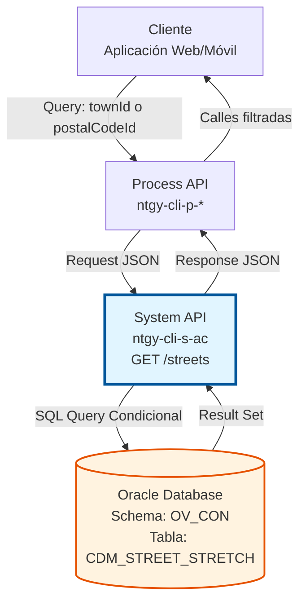
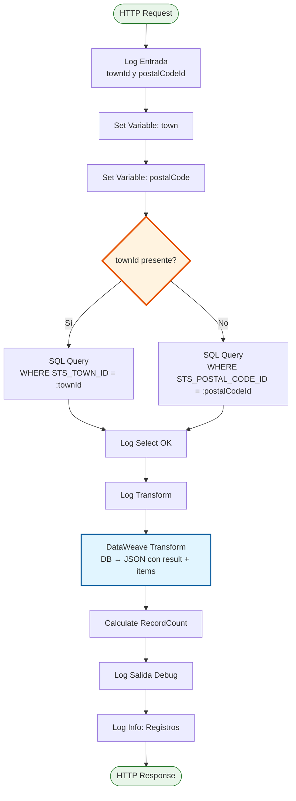
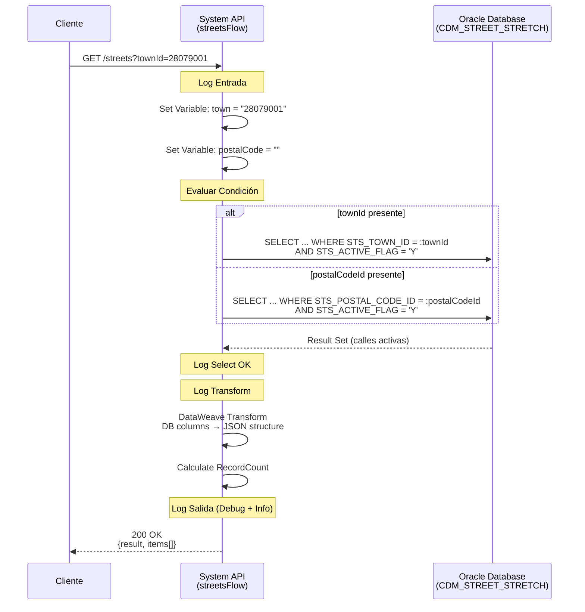

# GET /streets

## 📌 Descripción General

### Propósito del Endpoint

El endpoint `/streets` proporciona acceso a los datos de **tramos de calle (street stretches)** almacenados en Oracle Database, permitiendo búsquedas flexibles mediante dos criterios diferentes: por población (`townId`) o por código postal (`postalCodeId`).

Este endpoint soporta:
- **Búsqueda por Población**: Recupera todas las calles activas de una población específica
- **Búsqueda por Código Postal**: Recupera todas las calles activas asociadas a un código postal
- **Filtrado de Activos**: Solo retorna calles con estado activo (`STS_ACTIVE_FLAG = 'Y'`)
- **Información Completa**: Incluye ID, descripción, tipo de calle y código postal asociado

### Tipo de API

**Capa:** System API (API-Led Connectivity)

**Función:** Integración directa con Oracle Database (schema OV_CON) para proporcionar acceso a datos maestros de calles españolas.

### Patrón de Integración

**Tipo:** Request-Reply Síncrono con Query SQL Condicional

**Descripción:** El endpoint recibe parámetros de búsqueda, ejecuta una query SQL dinámica con lógica condicional (prioriza `townId` si está presente, sino usa `postalCodeId`), y retorna los resultados transformados a JSON con estructura estandarizada.

### Arquitectura API-Led Connectivity



---

## 💼 Propósito del Negocio

### Casos de Uso Principales

1. **Selección de Calle en Formulario de Dirección (Flujo por Jerarquía)**
   - Usuario selecciona: Provincia → Municipio → Población
   - Sistema llama `/streets?townId={id}` para obtener calles de esa población
   - Usuario selecciona calle de la lista
   - **Beneficio:** Direcciones estructuradas y validadas

2. **Búsqueda de Calle por Código Postal (Flujo Directo)**
   - Usuario introduce código postal
   - Sistema llama `/streets?postalCodeId={id}` para obtener calles
   - Usuario selecciona calle de la lista
   - **Beneficio:** Búsqueda rápida sin navegación jerárquica

3. **Autocompletado de Direcciones**
   - Sistema precarga calles de una población o código postal
   - Usuario escribe y el sistema filtra localmente
   - Selección rápida con información completa (tipo de calle)
   - **Beneficio:** Experiencia de usuario fluida y rápida

### Contexto Empresarial

- **Dominio:** Gestión de Datos Maestros - Información Geográfica
- **Sector:** Energía - Utilities
- **División:** Naturgy España - Área de Clientes
- **Proceso de Negocio:** Alta de Clientes, Gestión de Direcciones, Validación de Puntos de Suministro
- **Módulo:** Customer Data Management (CDM)

### Stakeholders

- **Equipos de Desarrollo Frontend**: Necesitan datos estructurados para formularios de dirección
- **Equipos de UX/UI**: Requieren información completa para mejorar experiencia de usuario
- **Área de Clientes**: Necesitan direcciones validadas y completas para gestión de contratos
- **Área de Operaciones**: Requieren direcciones correctas para instalaciones y mantenimiento

### Valor de Negocio

- **Calidad de Datos**: Direcciones validadas contra datos maestros oficiales
- **Experiencia de Usuario**: Búsqueda flexible (por población o código postal)
- **Eficiencia Operativa**: Reduce errores en direcciones de puntos de suministro
- **Información Completa**: Incluye tipo de calle (Calle, Avenida, Plaza, etc.) para direcciones formales

### Consumidores Potenciales

Este endpoint puede ser consumido por:
- Process APIs de gestión de clientes y contratos
- Aplicaciones web de autoservicio (portales de clientes)
- Aplicaciones móviles de agentes comerciales
- Sistemas de gestión de puntos de suministro
- Integraciones con sistemas de terceros (validación de direcciones)

---

## 🔧 Especificación Técnica

### URLs por Ambiente

| Ambiente | URL Base | URL Completa |
|----------|----------|--------------|
| **Local** | `http://localhost:8050` | `http://localhost:8050/api/streets` |
| **Development** | `https://ntgy-cli-s-ac-dev.us-e2.cloudhub.io` | `https://ntgy-cli-s-ac-dev.us-e2.cloudhub.io/api/streets` |
| **QA** | `https://ntgy-cli-s-ac-cc.us-e2.cloudhub.io` | `https://ntgy-cli-s-ac-cc.us-e2.cloudhub.io/api/streets` |
| **Pre-Production** | `https://ntgy-cli-s-ac-cl.us-e2.cloudhub.io` | `https://ntgy-cli-s-ac-cl.us-e2.cloudhub.io/api/streets` |
| **Production** | `https://ntgy-cli-s-ac-pro.us-e2.cloudhub.io` | `https://ntgy-cli-s-ac-pro.us-e2.cloudhub.io/api/streets` |

### Método HTTP

```
GET /api/streets
```

### Parámetros de Entrada

#### Headers HTTP

| Header | Tipo | Requerido | Descripción | Ejemplo |
|--------|------|-----------|-------------|---------|
| `Accept` | string | ❌ No | Tipo de contenido esperado en response | `application/json` |

#### Query Parameters

| Parámetro | Tipo | Requerido | Descripción | Ejemplo |
|-----------|------|-----------|-------------|---------|
| `townId` | string | ⚠️ Condicional* | ID de la población para filtrar calles | `"28079001"` |
| `postalCodeId` | string | ⚠️ Condicional* | ID del código postal para filtrar calles | `"28001"` |

**\* Nota sobre Requerimientos:**
- Al menos **uno** de los dos parámetros debe ser proporcionado
- Si ambos están presentes, se prioriza `townId`
- Si ninguno está presente, se retornará error 400

**Lógica de Priorización:**
```
IF townId != '' THEN
    Buscar por STS_TOWN_ID = townId
ELSE
    Buscar por STS_POSTAL_CODE_ID = postalCodeId
END IF
```

### Respuestas

#### Respuesta Exitosa (200 OK)

```json
{
  "result": {
    "codResult": "0000",
    "msgResult": "No hay error"
  },
  "items": [
    {
      "streetId": "280790010001",
      "streetDescription": "ALCALA",
      "streetTypeId": "1",
      "streetTypeName": "CALLE",
      "postalCodeId": "28009"
    },
    {
      "streetId": "280790010002",
      "streetDescription": "GRAN VIA",
      "streetTypeId": "2",
      "streetTypeName": "AVENIDA",
      "postalCodeId": "28013"
    }
  ]
}
```

**Estructura de Respuesta:**

| Campo | Tipo | Descripción |
|-------|------|-------------|
| `result` | object | Metadata de la respuesta |
| `result.codResult` | string | Código de resultado ("0000" = éxito) |
| `result.msgResult` | string | Mensaje descriptivo del resultado |
| `items` | array | Array de objetos de calle |
| `items[].streetId` | string | ID único del tramo de calle |
| `items[].streetDescription` | string | Nombre de la calle |
| `items[].streetTypeId` | string | ID del tipo de calle |
| `items[].streetTypeName` | string | Nombre del tipo (CALLE, AVENIDA, PLAZA, etc.) |
| `items[].postalCodeId` | string | Código postal asociado al tramo |

#### Respuesta Sin Resultados (200 OK)

```json
{
  "result": {
    "codResult": "0000",
    "msgResult": "No hay error"
  },
  "items": []
}
```

#### Respuesta de Error (400 Bad Request)

```json
{
  "result": {
    "codResult": "0001",
    "msgResult": "Parámetros inválidos: debe proporcionar townId o postalCodeId"
  }
}
```

#### Respuesta de Error Técnico (500 Internal Server Error)

```json
{
  "result": {
    "codResult": "0001",
    "msgResult": "Error interno del servidor"
  }
}
```

### Autenticación y Autorización

- **Tipo:** Client ID & Client Secret (Anypoint Platform)
- **Autorización Oracle:** El usuario de base de datos debe tener permisos para:
  - Ejecutar SELECT en tabla `CDM_STREET_STRETCH`
  - Acceso de lectura al schema `OV_CON`

### Timeouts

| Tipo | Valor | Descripción |
|------|-------|-------------|
| **Request Timeout** | 30 segundos | Tiempo máximo de espera para la respuesta |
| **Connection Timeout** | 10 segundos | Tiempo máximo para establecer conexión con Oracle |
| **Query Timeout** | 6000 segundos | Timeout configurado para queries SQL |

---

## 🏗️ Implementación Técnica

### Arquitectura del Flow



### Diagrama de Secuencia Detallado



### Query SQL Dinámica

**Ubicación en Código:** `s-ac-streets.xml`, línea 15

**Query con Lógica Condicional:**
```sql
SELECT 
    STS_STREET_ID, 
    STS_STREET_DESCRIPTION, 
    STS_STREET_TYPE_ID, 
    STS_STREET_TYPE_NAME,
    STS_POSTAL_CODE_ID 
FROM CDM_STREET_STRETCH 
WHERE 
    -- Condicional: SI townId está presente
    STS_TOWN_ID = :townId 
    -- O SI postalCodeId está presente
    STS_POSTAL_CODE_ID = :postalCodeId
AND STS_ACTIVE_FLAG = 'Y'
```

**Lógica Condicional (DataWeave en SQL):**
```dataweave
$(if (vars.town != '') 
    " WHERE STS_TOWN_ID = :townId " 
  else 
    " WHERE STS_POSTAL_CODE_ID = :postalCodeId"
)
```

**Parámetros Dinámicos:**
```dataweave
{
    'townId': vars.town,
    'postalCodeId': vars.postalCode
}
```

### Tabla Oracle: CDM_STREET_STRETCH

**Schema:** OV_CON (Administración Comercial)

**Descripción:** Tabla de tramos de calle que contiene información detallada de calles españolas, incluyendo tipo de calle, código postal y estado de activación.

**Campos Utilizados:**

| Campo DB | Tipo | Descripción | Mapeo JSON |
|----------|------|-------------|------------|
| `STS_STREET_ID` | VARCHAR2 | ID único del tramo de calle | `streetId` |
| `STS_STREET_DESCRIPTION` | VARCHAR2 | Nombre de la calle | `streetDescription` |
| `STS_STREET_TYPE_ID` | VARCHAR2 | ID del tipo de calle | `streetTypeId` |
| `STS_STREET_TYPE_NAME` | VARCHAR2 | Nombre del tipo (CALLE, AVENIDA, etc.) | `streetTypeName` |
| `STS_POSTAL_CODE_ID` | VARCHAR2 | Código postal asociado | `postalCodeId` |
| `STS_TOWN_ID` | VARCHAR2 | ID de la población (filtro) | - |
| `STS_ACTIVE_FLAG` | CHAR(1) | Flag de activación ('Y'/'N') | - |

**Índices Relevantes:**
- Índice en `STS_TOWN_ID` para búsquedas por población
- Índice en `STS_POSTAL_CODE_ID` para búsquedas por código postal
- Índice en `STS_ACTIVE_FLAG` para filtrado de activos

### Transformación DataWeave

**Ubicación en Código:** `s-ac-streets.xml`, líneas 22-38

**Transformación Completa:**
```dataweave
%dw 2.0
output application/json
---
{
    result: {
        codResult: "0000",
        msgResult: "No hay error"
    },
    items: payload map {
        streetId: $.STS_STREET_ID,
        streetDescription: $.STS_STREET_DESCRIPTION default "",
        streetTypeId: $.STS_STREET_TYPE_ID,
        streetTypeName: $.STS_STREET_TYPE_NAME default "",
        postalCodeId: $.STS_POSTAL_CODE_ID
    }
}
```

**Características de la Transformación:**
- Estructura estandarizada con `result` (metadata) e `items` (datos)
- Mapeo de nombres de columnas Oracle a camelCase JSON
- Valores por defecto (`default ""`) para campos opcionales
- Preservación de tipos de datos (strings)

### Manejo de Errores

**Error Handler:** Global error handler configurado en `s-ac-globalErrorHandler.xml`

**Tipos de Errores Manejados:**

1. **Parámetros Faltantes:**
   - Condición: Ni `townId` ni `postalCodeId` proporcionados
   - Response: 400 Bad Request
   - Mensaje: "Parámetros inválidos"

2. **Error de Conexión a Base de Datos:**
   - Condición: Fallo en conexión a Oracle
   - Response: 500 Internal Server Error
   - Acción: Retry automático (configurado en `<reconnect-forever />`)

3. **Error en Query SQL:**
   - Condición: Error de sintaxis o permisos
   - Response: 500 Internal Server Error
   - Log: Error completo en logs para troubleshooting

4. **Timeout de Query:**
   - Condición: Query excede timeout configurado
   - Response: 500 Internal Server Error
   - Acción: Cancelación de query y liberación de conexión

### Configuración de Base de Datos

**Connection Pooling:**
```yaml
dbAC:
  MaxPoolSize: 5
  MaxWaitTime: 300
  MaxIdleTime: 300
  timeout: 6000000
  fetchsize: 2000
```

**Características:**
- Pool de hasta 5 conexiones concurrentes
- Fetch size de 2000 registros para optimizar transferencia
- Timeout de 6000 segundos para queries largas
- Reconnect automático en caso de fallo

### Logging

**Niveles de Log Implementados:**

1. **INFO - Entrada:** Log de parámetros recibidos
   ```
   s-ac-streets.logEntrada ## townId: 28079001 postalCode: 
   ```

2. **INFO - Select OK:** Confirmación de query exitosa
   ```
   s-ac-streets.logSelect OK
   ```

3. **DEBUG - Transform:** Log del payload antes de transformar
   ```
   s-ac-streets.logTransform ## payload: [...]
   ```

4. **DEBUG - Salida:** Log del payload transformado
   ```
   s-ac-streets.logSalida ## payload: {...}
   ```

5. **INFO - Salida:** Log del conteo de registros
   ```
   s-ac-streets.logSalida ## Registros: 15
   ```

---

## 💻 Ejemplos de Uso

### Ejemplo 1: Búsqueda por Población (townId)

#### Request

```bash
curl -X GET "http://localhost:8050/api/streets?townId=28079001" \
  -H "Accept: application/json"
```

#### Response (200 OK)

```json
{
  "result": {
    "codResult": "0000",
    "msgResult": "No hay error"
  },
  "items": [
    {
      "streetId": "280790010001",
      "streetDescription": "ALCALA",
      "streetTypeId": "1",
      "streetTypeName": "CALLE",
      "postalCodeId": "28009"
    },
    {
      "streetId": "280790010002",
      "streetDescription": "GRAN VIA",
      "streetTypeId": "2",
      "streetTypeName": "AVENIDA",
      "postalCodeId": "28013"
    },
    {
      "streetId": "280790010003",
      "streetDescription": "MAYOR",
      "streetTypeId": "3",
      "streetTypeName": "PLAZA",
      "postalCodeId": "28012"
    }
  ]
}
```

### Ejemplo 2: Búsqueda por Código Postal (postalCodeId)

#### Request

```bash
curl -X GET "http://localhost:8050/api/streets?postalCodeId=28001" \
  -H "Accept: application/json"
```

#### Response (200 OK)

```json
{
  "result": {
    "codResult": "0000",
    "msgResult": "No hay error"
  },
  "items": [
    {
      "streetId": "280010010001",
      "streetDescription": "ARENAL",
      "streetTypeId": "1",
      "streetTypeName": "CALLE",
      "postalCodeId": "28001"
    },
    {
      "streetId": "280010010002",
      "streetDescription": "SOL",
      "streetTypeId": "3",
      "streetTypeName": "PLAZA",
      "postalCodeId": "28001"
    }
  ]
}
```

### Ejemplo 3: Sin Resultados

#### Request

```bash
curl -X GET "http://localhost:8050/api/streets?townId=99999999" \
  -H "Accept: application/json"
```

#### Response (200 OK)

```json
{
  "result": {
    "codResult": "0000",
    "msgResult": "No hay error"
  },
  "items": []
}
```

### Ejemplo 4: Error - Parámetros Faltantes

#### Request

```bash
curl -X GET "http://localhost:8050/api/streets" \
  -H "Accept: application/json"
```

#### Response (400 Bad Request)

```json
{
  "result": {
    "codResult": "0001",
    "msgResult": "Parámetros inválidos: debe proporcionar townId o postalCodeId"
  }
}
```

### Ejemplo 5: Integración con JavaScript (Frontend)

```javascript
// Función para obtener calles por población
async function getStreetsByTown(townId) {
  try {
    const response = await fetch(
      `https://ntgy-cli-s-ac-pro.us-e2.cloudhub.io/api/streets?townId=${townId}`,
      {
        method: 'GET',
        headers: {
          'Accept': 'application/json'
        }
      }
    );
    
    const data = await response.json();
    
    if (data.result.codResult === "0000") {
      return data.items;
    } else {
      throw new Error(data.result.msgResult);
    }
  } catch (error) {
    console.error('Error fetching streets:', error);
    throw error;
  }
}

// Función para obtener calles por código postal
async function getStreetsByPostalCode(postalCodeId) {
  try {
    const response = await fetch(
      `https://ntgy-cli-s-ac-pro.us-e2.cloudhub.io/api/streets?postalCodeId=${postalCodeId}`,
      {
        method: 'GET',
        headers: {
          'Accept': 'application/json'
        }
      }
    );
    
    const data = await response.json();
    
    if (data.result.codResult === "0000") {
      return data.items;
    } else {
      throw new Error(data.result.msgResult);
    }
  } catch (error) {
    console.error('Error fetching streets:', error);
    throw error;
  }
}

// Uso en componente de formulario
const townId = "28079001";
const streets = await getStreetsByTown(townId);

// Poblar dropdown
const streetSelect = document.getElementById('street-select');
streets.forEach(street => {
  const option = document.createElement('option');
  option.value = street.streetId;
  option.textContent = `${street.streetTypeName} ${street.streetDescription}`;
  streetSelect.appendChild(option);
});
```

### Ejemplo 6: Integración con Python

```python
import requests
from typing import List, Dict, Optional

class StreetsAPI:
    def __init__(self, base_url: str):
        self.base_url = base_url
        
    def get_streets_by_town(self, town_id: str) -> List[Dict]:
        """
        Obtiene calles por ID de población
        
        Args:
            town_id: ID de la población
            
        Returns:
            Lista de diccionarios con información de calles
        """
        url = f"{self.base_url}/api/streets"
        params = {"townId": town_id}
        
        response = requests.get(url, params=params)
        response.raise_for_status()
        
        data = response.json()
        
        if data["result"]["codResult"] == "0000":
            return data["items"]
        else:
            raise Exception(data["result"]["msgResult"])
    
    def get_streets_by_postal_code(self, postal_code_id: str) -> List[Dict]:
        """
        Obtiene calles por código postal
        
        Args:
            postal_code_id: ID del código postal
            
        Returns:
            Lista de diccionarios con información de calles
        """
        url = f"{self.base_url}/api/streets"
        params = {"postalCodeId": postal_code_id}
        
        response = requests.get(url, params=params)
        response.raise_for_status()
        
        data = response.json()
        
        if data["result"]["codResult"] == "0000":
            return data["items"]
        else:
            raise Exception(data["result"]["msgResult"])

# Uso
api = StreetsAPI("https://ntgy-cli-s-ac-pro.us-e2.cloudhub.io")

# Obtener calles por población
streets = api.get_streets_by_town("28079001")
for street in streets:
    print(f"{street['streetTypeName']} {street['streetDescription']}")

# Obtener calles por código postal
streets = api.get_streets_by_postal_code("28001")
for street in streets:
    print(f"{street['streetTypeName']} {street['streetDescription']}")
```
