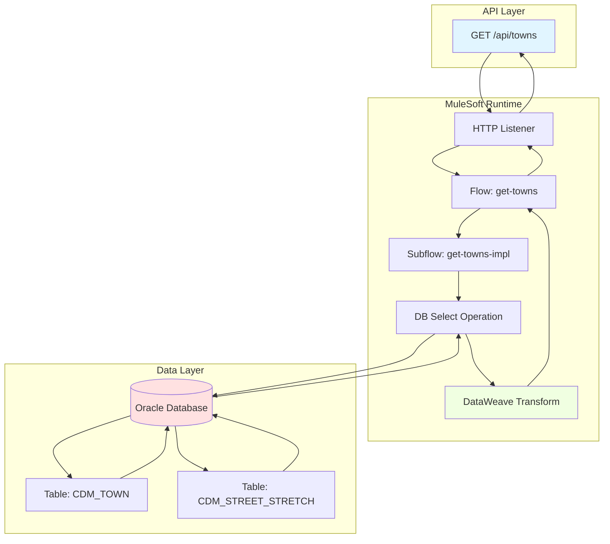
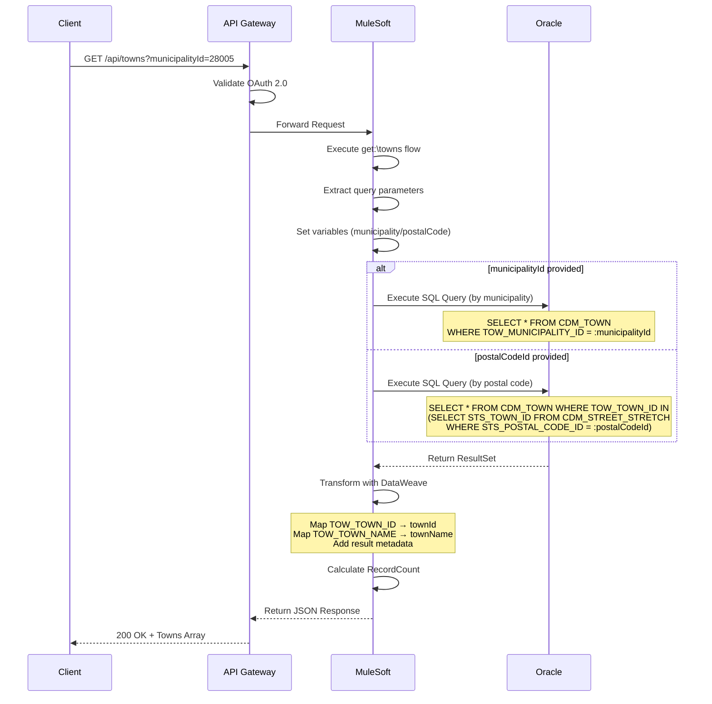
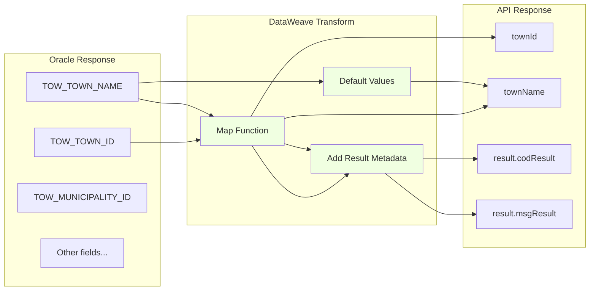

# GET /towns

## 📌 Descripción General

Endpoint de System API que proporciona acceso de solo lectura al catálogo de localidades (towns) almacenadas en Oracle Database de Administración Comercial. Este endpoint permite consultar localidades filtradas por municipio o por código postal, formando parte del sistema de gestión de datos geográficos.

**Tipo de API:** System API  
**Método HTTP:** GET  
**Ruta:** `/api/towns`  
**Backend:** Oracle Database (Administración Comercial)  
**Operación:** Consulta de solo lectura (READ)  
**Filtros:** Por municipio (municipalityId) o código postal (postalCodeId)

## 💼 Propósito del Negocio

### Objetivo Principal
Proporcionar acceso centralizado y estandarizado al catálogo de localidades filtradas por municipio o código postal, para su consumo por APIs de nivel superior (Process y Experience APIs) que requieran información geográfica detallada en procesos de alta de clientes y validación de direcciones.

### Casos de Uso
1. **Catálogos Geográficos**: Alimentar desplegables y selectores de localidades en interfaces de usuario
2. **Validación de Direcciones**: Verificar la existencia y validez de localidades en procesos de alta de clientes
3. **Análisis Geográfico**: Proporcionar datos para análisis de distribución territorial y segmentación
4. **Integración con Sistemas Externos**: Sincronizar catálogos de localidades con sistemas de terceros
5. **Reportes y Analytics**: Generar informes basados en distribución geográfica de clientes o servicios

### Valor de Negocio
- **Consistencia de Datos**: Garantiza que todas las aplicaciones utilicen el mismo catálogo de localidades
- **Eficiencia Operativa**: Reduce errores en la captura de direcciones mediante validación contra catálogo oficial
- **Trazabilidad**: Facilita el seguimiento y análisis de operaciones por ubicación geográfica
- **Escalabilidad**: Permite agregar nuevas localidades de forma centralizada sin impactar múltiples sistemas

## 🔧 Especificación Técnica

### Request

#### Endpoint
```
GET /api/towns
```

#### Headers
| Header | Tipo | Requerido | Descripción |
|--------|------|-----------|-------------|
| `client_id` | string | Sí | Identificador del cliente para autenticación OAuth 2.0 |
| `client_secret` | string | Sí | Secreto del cliente para autenticación OAuth 2.0 |

#### Query Parameters

| Parámetro | Tipo | Requerido | Descripción |
|-----------|------|-----------|-------------|
| `municipalityId` | string | Condicional* | Identificador del municipio para filtrar localidades |
| `postalCodeId` | string | Condicional* | Identificador del código postal para filtrar localidades |

**Nota:** Se requiere al menos uno de los dos parámetros (`municipalityId` o `postalCodeId`). Si se proporcionan ambos, se prioriza `municipalityId`.

#### Request Body
No aplica (método GET).

### Response

#### Success Response (200 OK)

**Estructura:**
```json
{
  "result": {
    "codResult": "string",
    "msgResult": "string"
  },
  "items": [
    {
      "townId": "string",
      "townName": "string"
    }
  ]
}
```

**Descripción de Campos:**

| Campo | Tipo | Descripción |
|-------|------|-------------|
| `result` | object | Objeto con información del resultado de la operación |
| `result.codResult` | string | Código de resultado ("0000" = éxito) |
| `result.msgResult` | string | Mensaje descriptivo del resultado |
| `items` | array | Array de objetos que contiene las localidades filtradas |
| `items[].townId` | string | Identificador único de la localidad (TOW_TOWN_ID) |
| `items[].townName` | string | Nombre de la localidad (TOW_TOWN_NAME) |

#### Error Responses

**400 Bad Request**
```json
{
  "result": {
    "codResult": "400",
    "msgResult": "Falta parámetro de entrada (municipalityId o postalCodeId requerido)"
  },
  "items": []
}
```

**401 Unauthorized**
```json
{
  "error": "Unauthorized",
  "message": "Invalid or missing authentication credentials"
}
```

**500 Internal Server Error**
```json
{
  "result": {
    "codResult": "500",
    "msgResult": "Error en la consulta a base de datos"
  },
  "items": []
}
```

**503 Service Unavailable**
```json
{
  "error": "Service Unavailable",
  "message": "Oracle Database connection unavailable"
}
```

## 🏗️ Implementación Técnica

### Arquitectura de Capas



### Flujo de Ejecución



### Componentes Técnicos

#### 1. HTTP Listener Configuration
- **Archivo:** `src/main/mule/s-ac.xml` (línea 160)
- **Path:** `/towns`
- **Método:** GET
- **Configuración:** `http-listener-config`

#### 2. Flow Principal
- **Archivo:** `src/main/mule/s-ac.xml` (línea 160-163)
- **Nombre:** `get:\towns:s-ac-config`
- **Función:** Recibe la petición HTTP y delega al flow de implementación `townsFlow`

#### 3. Flow de Implementación
- **Archivo:** `src/main/mule/s-ac-towns.xml` (línea 8-63)
- **Nombre:** `townsFlow`
- **Función:** Extrae parámetros, ejecuta consulta SQL condicional y transforma respuesta

**Lógica del Flow:**
1. **Logger de Entrada** (línea 9): Registra parámetros recibidos
2. **Set Variables** (líneas 10-11): Extrae `municipalityId` y `postalCodeId` de query params
3. **Choice** (líneas 12-30): Lógica condicional para determinar qué query ejecutar
   - **When municipalityId** (líneas 13-19): Ejecuta query por municipio
   - **When postalCodeId** (líneas 20-26): Ejecuta query por código postal
   - **Otherwise** (líneas 27-29): Log de error si faltan parámetros

#### 4. Operación de Base de Datos (Por Municipio)
- **Archivo:** `src/main/mule/s-ac-towns.xml` (líneas 14-18)
- **Operación:** `<db:select>`
- **Configuración:** `Database_Config`
- **Query:** `${queries.towns}`

**Query SQL Real (Por Municipio):**
```sql
SELECT * FROM CDM_TOWN 
WHERE CDM_TOWN.TOW_MUNICIPALITY_ID = :municipalityId
```

- **Ubicación de Query:** `src/main/resources/s-ac-local-config.yaml` (línea 58)
- **Tabla:** `CDM_TOWN`
- **Operación:** SELECT (solo lectura)
- **Parámetro:** `:municipalityId` (binding de parámetro Oracle)

#### 5. Operación de Base de Datos (Por Código Postal)
- **Archivo:** `src/main/mule/s-ac-towns.xml` (líneas 21-25)
- **Operación:** `<db:select>`
- **Configuración:** `Database_Config`
- **Query:** `${queries.townsCP}`

**Query SQL Real (Por Código Postal):**
```sql
SELECT * FROM CDM_TOWN 
WHERE TOW_TOWN_ID IN (
    SELECT j.STS_TOWN_ID 
    FROM CDM_STREET_STRETCH j 
    WHERE j.STS_POSTAL_CODE_ID = :postalCodeId
)
```

- **Ubicación de Query:** `src/main/resources/s-ac-local-config.yaml` (línea 59)
- **Tablas:** `CDM_TOWN`, `CDM_STREET_STRETCH`
- **Operación:** SELECT con subquery (solo lectura)
- **Parámetro:** `:postalCodeId` (binding de parámetro Oracle)

#### 6. Transformación DataWeave
- **Archivo:** `src/main/mule/s-ac-towns.xml` (líneas 32-49)
- **Función:** Transforma el ResultSet de Oracle al formato JSON de respuesta

**Lógica de Transformación:**
```dataweave
%dw 2.0
output application/json
---
{
    result: {
        codResult: "0000",
        msgResult: "No hay error"
    },
    items: payload map (payload01, indexOfPayload01) -> {
        townId: payload01.TOW_TOWN_ID,
        townName: payload01.TOW_TOWN_NAME default ""
    }
}
```

**Transformaciones Aplicadas:**
- Mapeo de campos Oracle: `TOW_TOWN_ID` → `townId`, `TOW_TOWN_NAME` → `townName`
- Encapsulación en estructura con `result` (metadata) e `items` (datos)
- Manejo de valores nulos con `default ""`
- Cálculo de `RecordCount` (líneas 50-59)

### Diagrama de Transformación de Datos



### Configuración de Base de Datos

**Archivo:** `src/main/mule/global.xml` (líneas 13-17)

```xml
<db:config name="Database_Config">
    <db:generic-connection 
        url="jdbc:oracle:thin:${dbAC.user}/${secure::dbAC.pass}@(DESCRIPTION_LIST=...)"
        driverClassName="oracle.jdbc.driver.OracleDriver">
        <db:pooling-profile 
            maxPoolSize="${dbAC.MaxPoolSize}" 
            maxWait="${dbAC.MaxWaitTime}" 
            maxIdleTime="${dbAC.MaxIdleTime}"/>
    </db:generic-connection>
</db:config>
```

**Archivo:** `src/main/resources/s-ac-local-config.yaml` (líneas 8-22, 58-59)

```yaml
dbAC:
  user: "OV_CON"
  pass: "ENC(...)"
  host1: "localhost"
  host2: "localhost"
  port: "1521"
  serviceName: "s_areapriv_con_odi_des.devdb.oraclevcn.com"
  MaxPoolSize: "5"
  MaxWaitTime: "300"
  MaxIdleTime: "300"

queries:
  towns: "SELECT * FROM CDM_TOWN WHERE CDM_TOWN.TOW_MUNICIPALITY_ID = :municipalityId"
  townsCP: "SELECT * FROM CDM_TOWN WHERE TOW_TOWN_ID IN ( SELECT j.STS_TOWN_ID FROM CDM_STREET_STRETCH j WHERE j.STS_POSTAL_CODE_ID = :postalCodeId )"
```

**Características de la Conexión:**
- **Driver:** Oracle JDBC Thin Driver
- **Puerto:** 1521 (estándar Oracle)
- **Usuario:** OV_CON (esquema de Administración Comercial)
- **Failover:** Configurado con 2 hosts para alta disponibilidad
- **Connection Pool:** Máximo 5 conexiones, timeout 300 segundos
- **Parámetros Seguros:** Password encriptado con Secure Properties

### Manejo de Errores

El endpoint implementa manejo de errores estándar de MuleSoft:

1. **Error de Autenticación (401)**: Credenciales OAuth 2.0 inválidas o ausentes
2. **Error de Base de Datos (500)**: Fallo en la ejecución de la query SQL
3. **Error de Conexión (503)**: Base de datos no disponible
4. **Error de Transformación (500)**: Fallo en el mapeo DataWeave

## 💻 Ejemplos de Uso

### Ejemplo 1: Consulta Exitosa por Municipio

**Request:**
```bash
curl -X GET "https://api.naturgy.com/s-ac/api/towns?municipalityId=28005" \
  -H "client_id: your_client_id" \
  -H "client_secret: your_client_secret"
```

**Response (200 OK):**
```json
{
  "result": {
    "codResult": "0000",
    "msgResult": "No hay error"
  },
  "items": [
    {
      "townId": "28001",
      "townName": "Alcalá de Henares"
    },
    {
      "townId": "28002",
      "townName": "Alcobendas"
    },
    {
      "townId": "28003",
      "townName": "Alcorcón"
    }
  ]
}
```

### Ejemplo 2: Consulta Exitosa por Código Postal

**Request:**
```bash
curl -X GET "https://api.naturgy.com/s-ac/api/towns?postalCodeId=28801" \
  -H "client_id: your_client_id" \
  -H "client_secret: your_client_secret"
```

**Response (200 OK):**
```json
{
  "result": {
    "codResult": "0000",
    "msgResult": "No hay error"
  },
  "items": [
    {
      "townId": "28001",
      "townName": "Alcalá de Henares"
    }
  ]
}
```

### Ejemplo 3: Error de Parámetros Faltantes

**Request:**
```bash
curl -X GET "https://api.naturgy.com/s-ac/api/towns" \
  -H "client_id: your_client_id" \
  -H "client_secret: your_client_secret"
```

**Response (400 Bad Request):**
```json
{
  "result": {
    "codResult": "400",
    "msgResult": "Falta parámetro de entrada"
  },
  "items": []
}
```

### Ejemplo 4: Error de Autenticación

**Request:**
```bash
curl -X GET "https://api.naturgy.com/s-ac/api/towns" \
  -H "client_id: invalid_client"
```

**Response (401 Unauthorized):**
```json
{
  "error": "Unauthorized",
  "message": "Invalid or missing authentication credentials"
}
```

### Ejemplo 5: Uso desde JavaScript

**Request:**
```javascript
const axios = require('axios');

async function getTownsByMunicipality(municipalityId) {
  try {
    const response = await axios.get('https://api.naturgy.com/s-ac/api/towns', {
      params: {
        municipalityId: municipalityId
      },
      headers: {
        'client_id': 'your_client_id',
        'client_secret': 'your_client_secret'
      }
    });
    
    console.log(`Total towns: ${response.data.items.length}`);
    console.log(`Result: ${response.data.result.msgResult}`);
    return response.data.items;
  } catch (error) {
    console.error('Error fetching towns:', error.response.data);
    throw error;
  }
}

// Obtener localidades del municipio de Alcalá de Henares
getTownsByMunicipality('28005');
```

**Response:**
```javascript
// Console output:
// Total towns: 3
// Result: No hay error

// Returned data:
[
  {
    townId: "28001",
    townName: "Alcalá de Henares"
  },
  {
    townId: "28002",
    townName: "Alcobendas"
  },
  {
    townId: "28003",
    townName: "Alcorcón"
  }
]
```


### Ejemplo 6: Integración con Python

**Request:**
```python
import requests

def get_towns():
    url = "https://api.naturgy.com/s-ac/api/towns"
    headers = {
        "client_id": "your_client_id",
        "client_secret": "your_client_secret"
    }
    
    try:
        response = requests.get(url, headers=headers)
        response.raise_for_status()
        
        data = response.json()
        print(f"Total towns retrieved: {len(data['towns'])}")
        
        return data['towns']
    except requests.exceptions.HTTPError as e:
        print(f"HTTP Error: {e}")
        return None
    except requests.exceptions.RequestException as e:
        print(f"Request Error: {e}")
        return None

# Ejecutar
towns = get_towns()
if towns:
    # Mostrar las primeras 5 localidades
    for town in towns[:5]:
        print(f"{town['name']} - {town['provinceName']}")
```

**Response:**
```python
# Console output:
# Total towns retrieved: 8131
# Alcalá de Henares - Madrid
# Barcelona - Barcelona
# Valencia - Valencia
# Sevilla - Sevilla
# Zaragoza - Zaragoza