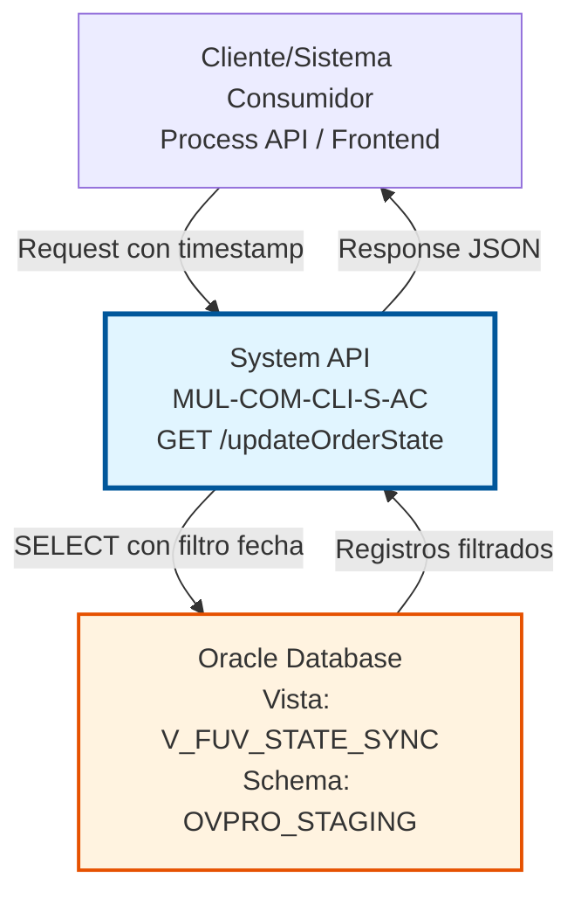
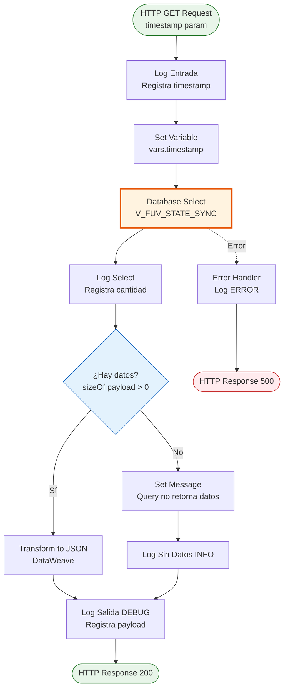
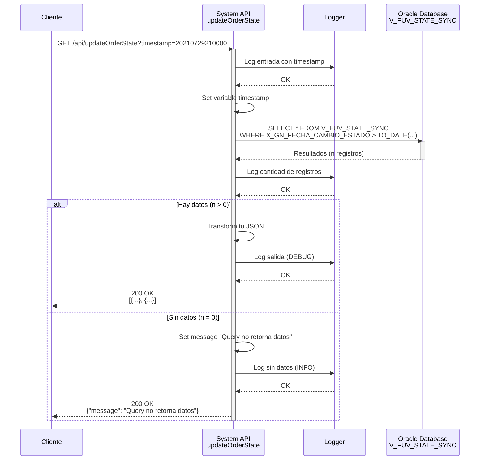

# GET /updateOrderState

## 📌 Descripción General

### Propósito del Endpoint

Este endpoint consulta cambios de estado de pedidos (orders) desde una fecha específica, permitiendo sincronización incremental de estados entre sistemas. Utiliza la vista `V_FUV_STATE_SYNC` de Oracle para obtener registros cuyo estado cambió después de un timestamp dado.

El endpoint soporta:
- **Sincronización Incremental**: Obtiene solo los registros modificados después de una fecha específica
- **Consulta Flexible**: Permite especificar cualquier timestamp como punto de partida
- **Respuesta Condicional**: Retorna datos o mensaje informativo si no hay registros

### Tipo de API

**Capa:** System API (API-Led Connectivity)

**Función:** Integración directa con Oracle Database (AC Schema) para consulta de estados de pedidos en el contexto de Facturación Única Virtual (FUV).

### Patrón de Integración

**Tipo:** Request-Reply Síncrono con SQL Query

**Descripción:** El endpoint recibe un timestamp como parámetro, ejecuta una consulta SELECT sobre la vista `V_FUV_STATE_SYNC` filtrando por fecha de cambio de estado, y retorna los registros que cumplen la condición o un mensaje informativo si no hay datos.

### Arquitectura API-Led Connectivity



---

## 💼 Propósito del Negocio

### Casos de Uso Principales

1. **Sincronización Incremental de Estados**
   - Sistemas externos necesitan conocer qué pedidos cambiaron de estado desde su última consulta
   - Se proporciona el timestamp de la última sincronización exitosa
   - Se obtienen solo los cambios recientes, optimizando el procesamiento

2. **Monitoreo de Cambios de Estado**
   - Sistemas de auditoría o reporting necesitan rastrear cambios de estado en tiempo real
   - Se consulta periódicamente con el timestamp actual menos un intervalo
   - Se detectan y procesan cambios de estado para análisis o alertas

3. **Integración FUV (Facturación Única Virtual)**
   - El sistema FUV necesita sincronizar estados de pedidos con otros sistemas
   - Se consultan cambios desde la última sincronización
   - Se actualizan sistemas downstream con los nuevos estados

### Contexto Empresarial

- **Dominio:** Gestión de Pedidos y Contratos
- **Sector:** Energía - Utilities
- **División:** Naturgy España - CLI (Atención al Cliente)
- **Proceso de Negocio:** Sincronización de estados de pedidos entre sistemas
- **Sistema Origen:** Oracle Database (AC Schema - OVPRO_STAGING)

### Stakeholders

- **Equipos de Integración**: Necesitan sincronizar estados entre sistemas de forma eficiente
- **Sistemas FUV**: Requieren información actualizada de estados de pedidos
- **Equipos de Operaciones**: Monitorean cambios de estado para gestión de procesos
- **Sistemas de Auditoría**: Rastrean cambios de estado para compliance y trazabilidad

### Valor de Negocio

- **Eficiencia en Sincronización**: Solo se transfieren registros modificados, reduciendo carga de red y procesamiento
- **Trazabilidad**: Permite rastrear cuándo y cómo cambiaron los estados de pedidos
- **Integración en Tiempo Real**: Facilita la sincronización near-real-time entre sistemas
- **Optimización de Recursos**: Reduce consultas innecesarias a la base de datos

### Consumidores Potenciales

Este endpoint puede ser consumido por:
- Process APIs de sincronización de pedidos
- Sistemas de integración FUV (Facturación Única Virtual)
- Herramientas de monitoreo y auditoría
- Sistemas de reporting y analytics
- Schedulers para sincronización batch periódica

---

## 🔧 Especificación Técnica

### URLs por Ambiente

| Ambiente | URL Base | URL Completa |
|----------|----------|--------------|
| **Local** | `http://localhost:8081` | `http://localhost:8081/api/updateOrderState?timestamp=YYYYMMDDHH24MISS` |
| **Development** | `https://mul-com-cli-s-ac-dev.us-e2.cloudhub.io` | `https://mul-com-cli-s-ac-dev.us-e2.cloudhub.io/api/updateOrderState?timestamp=YYYYMMDDHH24MISS` |
| **UAT** | `https://mul-com-cli-s-ac-uat.us-e2.cloudhub.io` | `https://mul-com-cli-s-ac-uat.us-e2.cloudhub.io/api/updateOrderState?timestamp=YYYYMMDDHH24MISS` |
| **Production** | `https://mul-com-cli-s-ac-pro.us-e2.cloudhub.io` | `https://mul-com-cli-s-ac-pro.us-e2.cloudhub.io/api/updateOrderState?timestamp=YYYYMMDDHH24MISS` |

### Método HTTP

```
GET /api/updateOrderState
```

### Parámetros de Entrada

#### Headers HTTP

| Header | Tipo | Requerido | Descripción | Ejemplo |
|--------|------|-----------|-------------|---------|
| `Accept` | string | ❌ No | Tipo de contenido esperado en response | `application/json` |

#### Query Parameters

| Parámetro | Tipo | Requerido | Descripción | Ejemplo | Formato |
|-----------|------|-----------|-------------|---------|---------|
| `timestamp` | string | ✅ Sí | Fecha y hora desde la cual consultar cambios de estado | `20210729210000` | `YYYYMMDDHH24MISS` |

**Formato del Timestamp:**
- **Año**: 4 dígitos (YYYY)
- **Mes**: 2 dígitos (MM) - 01 a 12
- **Día**: 2 dígitos (DD) - 01 a 31
- **Hora**: 2 dígitos (HH24) - 00 a 23
- **Minutos**: 2 dígitos (MI) - 00 a 59
- **Segundos**: 2 dígitos (SS) - 00 a 59

**Ejemplos válidos:**
- `20210729210000` → 29 de julio de 2021, 21:00:00
- `20240101000000` → 1 de enero de 2024, 00:00:00
- `20231215143000` → 15 de diciembre de 2023, 14:30:00

### Respuestas

#### Respuesta Exitosa con Datos (200 OK)

Cuando existen registros que cumplen el criterio de fecha:

```json
[
  {
    "BORRADOR_MOVILIDAD_ID": "123456789012345",
    "GENERIC_NAME": "Producto Energía",
    "STATUS_CD": "Activo",
    "X_GN_FECHA_CAMBIO_ESTADO": "2021-07-29T21:30:00"
  },
  {
    "BORRADOR_MOVILIDAD_ID": "987654321098765",
    "GENERIC_NAME": "Producto Gas",
    "STATUS_CD": "Pendiente",
    "X_GN_FECHA_CAMBIO_ESTADO": "2021-07-29T22:15:00"
  }
]
```

**Campos de la Vista V_FUV_STATE_SYNC:**
- `BORRADOR_MOVILIDAD_ID`: Identificador del borrador de movilidad (15 caracteres)
- `GENERIC_NAME`: Nombre genérico del producto
- `STATUS_CD`: Código de estado del pedido
- `X_GN_FECHA_CAMBIO_ESTADO`: Fecha y hora del cambio de estado

> **📋 Nota sobre la Estructura de Respuesta:**
> 
> **Fuentes de Información:**
> - Los campos `BORRADOR_MOVILIDAD_ID`, `GENERIC_NAME` y `STATUS_CD` están definidos en el archivo RAML `dataType/updateOrderStatusResponse.raml`
> - El campo `X_GN_FECHA_CAMBIO_ESTADO` está extraído de la definición de la vista `V_FUV_STATE_SYNC` en el código fuente (`s-ac-pro-config.yaml`, líneas 35-40)
> - La transformación DataWeave es directa (`payload`), por lo que retorna exactamente la estructura de la base de datos
> 
> **Formato de Fecha:** El formato mostrado (`"2021-07-29T21:30:00"`) es el formato estándar ISO 8601 que el conector de base de datos de Mule aplica automáticamente al convertir tipos Oracle DATE/TIMESTAMP a JSON.
> 
> **Valores de Ejemplo:** Los valores específicos mostrados (IDs, nombres de productos, fechas) son ilustrativos para fines de documentación.

**Estados Posibles** (según query de configuración):
- `Activo`
- `Inactivo`
- `Anulado`
- `Solicitud rechazada`
- `Alta Activa`
- `Solicitud enviada`
- `Solicitud aceptada`
- `Solicitud ATR`
- `Completar`
- `Documentación recibida`
- `Pendiente`
- `Pte recibir doc`
- `Pte. Validación`
- `Pendiente Energía`

#### Respuesta Sin Datos (200 OK)

Cuando no existen registros que cumplen el criterio de fecha:

```json
{
  "message": "Query no retorna datos"
}
```

#### Respuesta de Error Técnico (500)

```json
{
  "error": "APP_9999",
  "message": "Error en el servicio."
}
```

**Causas comunes:**
- Error de conexión a la base de datos
- Timeout en la consulta
- Formato de timestamp inválido
- Error en la ejecución de la query

### Autenticación y Autorización

- **Tipo:** Client ID & Client Secret (Anypoint Platform)
- **Autorización Oracle:** El usuario de base de datos debe tener permisos para:
  - Acceso de lectura a la vista `V_FUV_STATE_SYNC`
  - Acceso a las tablas subyacentes en schema `OVPRO_STAGING` y `OVPRO`

### Timeouts

| Tipo | Valor | Descripción |
|------|-------|-------------|
| **Request Timeout** | 30 segundos | Tiempo máximo de espera para la respuesta |
| **Connection Timeout** | 10 segundos | Tiempo máximo para establecer conexión con Oracle |
| **Query Timeout** | 30 segundos | Tiempo máximo de ejecución de la query SQL |

### Consideraciones de Performance

- **Sin Límite de Registros**: La query no tiene cláusula `ROWNUM` o `LIMIT`, puede retornar grandes volúmenes
- **Recomendación**: Usar intervalos de tiempo cortos (horas o días) para evitar timeouts
- **Índice**: La vista debe tener índice en `X_GN_FECHA_CAMBIO_ESTADO` para performance óptima

---

## 🏗️ Implementación Técnica

### Arquitectura del Flow



### Componentes del Flow

#### 1. HTTP Listener
```xml
<http:listener config-ref="HTTP_Listener_config" path="/api/updateOrderState">
```
- Escucha peticiones GET en el path `/api/updateOrderState`
- Extrae el query parameter `timestamp`

#### 2. Logger de Entrada
```xml
<logger level="INFO" message="s-ac-updateOrderState.logEntrada ## TimeStamp: #[attributes.queryParams.timestamp]" />
```
- Registra el inicio de la operación
- Incluye el timestamp recibido para trazabilidad

#### 3. Set Variable
```xml
<set-variable value="#[attributes.queryParams.timestamp]" variableName="timestamp"/>
```
- Almacena el timestamp en una variable de flow
- Facilita su uso en la query parametrizada

#### 4. Database Select
```xml
<db:select config-ref="Database_Config">
    <reconnect-forever />
    <db:sql><![CDATA[${queries.updateStateVista}]]></db:sql>
    <db:input-parameters><![CDATA[#[{'param': vars.timestamp as String}]]]></db:input-parameters>
</db:select>
```

**Query SQL Ejecutada:**
```sql
SELECT * FROM V_FUV_STATE_SYNC 
WHERE X_GN_FECHA_CAMBIO_ESTADO > TO_DATE(:param,'YYYYMMDDHH24MISS')
```

**Parámetros:**
- `:param` → `vars.timestamp` (string en formato YYYYMMDDHH24MISS)

**Configuración:**
- `reconnect-forever`: Reintenta conexión indefinidamente en caso de fallo
- `config-ref="Database_Config"`: Usa pool de conexiones Oracle configurado

#### 5. Logger de Select
```xml
<logger level="INFO" message="s-ac-updateOrderState.logSelect #[sizeOf(payload)] Registros" />
```
- Registra la cantidad de registros retornados
- Útil para monitoreo y troubleshooting

#### 6. Choice - Evaluación de Resultados
```xml
<choice>
    <when expression="#[sizeOf(payload)>0]">
        <!-- Transformación a JSON -->
    </when>
    <otherwise>
        <!-- Mensaje sin datos -->
    </otherwise>
</choice>
```

**Lógica:**
- Si `sizeOf(payload) > 0`: Transforma resultado a JSON
- Si `sizeOf(payload) = 0`: Retorna mensaje informativo

#### 7. Transformación a JSON (Cuando hay datos)
```xml
<ee:transform>
    <ee:message>
        <ee:set-payload><![CDATA[
            %dw 2.0
            output application/json
            ---
            payload
        ]]></ee:set-payload>
    </ee:message>
</ee:transform>
```
- Convierte el resultado de la query (Java objects) a JSON
- Mantiene la estructura original de los registros

#### 8. Mensaje Sin Datos (Cuando no hay resultados)
```xml
<ee:transform>
    <ee:message>
        <ee:set-payload><![CDATA[
            %dw 2.0
            output application/json
            ---
            {
                message: "Query no retorna datos"
            }
        ]]></ee:set-payload>
    </ee:message>
</ee:transform>
```

#### 9. Logger de Salida
```xml
<logger level="DEBUG" message="s-ac-updateOrderState.logSalida ## payload: #[payload]" />
```
- Registra el payload completo (solo en DEBUG)
- Útil para debugging pero deshabilitado en producción

#### 10. Error Handler
```xml
<error-handler>
    <on-error-propagate type="ANY">
        <logger level="ERROR" message="s-ac-updateOrderState.logError"/>
    </on-error-propagate>
</error-handler>
```
- Captura cualquier error durante la ejecución
- Registra el error y propaga la excepción
- El global error handler retorna HTTP 500

### Diagrama de Secuencia



### Configuración de Base de Datos

**Archivo:** `s-ac-pro-config.yaml` (líneas 6-20)

```yaml
dbAC:
  user: "OVPROySTAGING_LECTURA"
  pass: "![TZv06fLYTdPfxh2GefzGfA==]"  # Encrypted
  host1: "oc-pro-exa-04-clu-02-hdfdi-scan.prodb03.ocpro.oraclevcn.com"
  host2: "oc-pro-exa-03-clu-02-dfhl9-scan.prodb03.ocpro.oraclevcn.com"
  port: "1521"
  serviceName: "s_areapriv_online_pro.prodb03.ocpro.oraclevcn.com"
  connectTimeOut: "3600"
  transportConnectTimeOut: "6000"
  retryCount: "3"
  MaxPoolSize: "5"
  MaxWaitTime: "300"
  MaxIdleTime: "300"
  timeout: "6000000"
  fetchsize: "2000"
```

**Características:**
- **Oracle RAC**: Dos hosts para alta disponibilidad
- **Connection Pooling**: Máximo 5 conexiones concurrentes
- **Retry Policy**: 3 reintentos en caso de fallo
- **Fetch Size**: 2000 registros por batch (optimización de red)

### Vista V_FUV_STATE_SYNC

**Definición** (según query `updateState` en config, líneas 35-55):

La vista `V_FUV_STATE_SYNC` consolida información de múltiples tablas:

```sql
SELECT 
    OIX.BORRADOR_MOVILIDAD_ID AS BORRADOR_MOVILIDAD_ID,
    OPT.GENERIC_NAME AS GENERIC_NAME,
    OI.STATUS_CD AS STATUS_CD,
    OI.X_GN_FECHA_CAMBIO_ESTADO AS X_GN_FECHA_CAMBIO_ESTADO
FROM OVPRO_STAGING.S_ORDER O,
    OVPRO_STAGING.S_ORDER_ITEM OI,
    OVPRO_STAGING.S_ORDER_ITEM_X OIX,
    OVPRO.OVT_PRODUCT OP,
    OVPRO.OVT_PRODUCT_TYPE OPT
WHERE 
    O.ROW_ID = OI.ORDER_ID
    AND OI.ROW_ID = OIX.PAR_ROW_ID
    AND OI.PROD_ID = OP.CODE
    AND OP.ID_PRODUCT_TYPE = OPT.ID_PRODUCT_TYPE
    AND OIX.BORRADOR_MOVILIDAD_ID IS NOT NULL
    AND LENGTH(OIX.BORRADOR_MOVILIDAD_ID) = 15
    AND O.ORDER_CAT_CD = 'Ventas'
    AND O.ACTIVE_FLG = 'Y'
    AND OI.STATUS_CD IN ('Activo', 'Inactivo', 'Anulado', ...)
```

**Tablas Involucradas:**
- `OVPRO_STAGING.S_ORDER`: Pedidos
- `OVPRO_STAGING.S_ORDER_ITEM`: Items de pedidos
- `OVPRO_STAGING.S_ORDER_ITEM_X`: Extensión de items
- `OVPRO.OVT_PRODUCT`: Productos
- `OVPRO.OVT_PRODUCT_TYPE`: Tipos de productos

**Filtros Aplicados:**
- Solo pedidos de categoría "Ventas"
- Solo pedidos activos (`ACTIVE_FLG = 'Y'`)
- Solo con ID de borrador de movilidad válido (15 caracteres)
- Solo estados específicos de negocio

### Transformaciones DataWeave

#### Transformación de Respuesta con Datos
```dataweave
%dw 2.0
output application/json
---
payload
```
- **Input**: Array de objetos Java (resultado de db:select)
- **Output**: Array JSON con la misma estructura
- **Mapeo**: Directo, sin transformación de campos

#### Transformación de Respuesta Sin Datos
```dataweave
%dw 2.0
output application/json
---
{
    message: "Query no retorna datos"
}
```
- **Input**: Payload vacío
- **Output**: Objeto JSON con mensaje informativo

---

## 💻 Ejemplos de Uso

### Ejemplo 1: Request Básico con curl

```bash
curl -X GET "http://localhost:8081/api/updateOrderState?timestamp=20210729210000" \
  -H "Accept: application/json"
```

**Descripción:** Consulta todos los cambios de estado desde el 29 de julio de 2021 a las 21:00:00.

### Ejemplo 2: Response con Datos

**Request:**
```bash
GET /api/updateOrderState?timestamp=20210729210000
```

**Response (200 OK):**
```json
[
  {
    "BORRADOR_MOVILIDAD_ID": "123456789012345",
    "GENERIC_NAME": "Tarifa Energía Estable",
    "STATUS_CD": "Activo",
    "X_GN_FECHA_CAMBIO_ESTADO": "2021-07-29T21:30:00"
  },
  {
    "BORRADOR_MOVILIDAD_ID": "987654321098765",
    "GENERIC_NAME": "Tarifa Gas Natural",
    "STATUS_CD": "Pendiente",
    "X_GN_FECHA_CAMBIO_ESTADO": "2021-07-29T22:15:00"
  },
  {
    "BORRADOR_MOVILIDAD_ID": "456789012345678",
    "GENERIC_NAME": "Tarifa Dual",
    "STATUS_CD": "Solicitud enviada",
    "X_GN_FECHA_CAMBIO_ESTADO": "2021-07-30T08:00:00"
  }
]
```

### Ejemplo 3: Response Sin Datos

**Request:**
```bash
GET /api/updateOrderState?timestamp=20250101000000
```

**Response (200 OK):**
```json
{
  "message": "Query no retorna datos"
}
```

**Descripción:** No hay cambios de estado después del 1 de enero de 2025 (fecha futura).

### Ejemplo 4: Sincronización Incremental

**Escenario:** Sistema que sincroniza cada hora

```bash
# Primera sincronización (10:00 AM)
curl -X GET "http://localhost:8081/api/updateOrderState?timestamp=20240115100000"

# Segunda sincronización (11:00 AM) - solo cambios de la última hora
curl -X GET "http://localhost:8081/api/updateOrderState?timestamp=20240115110000"

# Tercera sincronización (12:00 PM) - solo cambios de la última hora
curl -X GET "http://localhost:8081/api/updateOrderState?timestamp=20240115120000"
```

### Ejemplo 5: Error de Formato de Timestamp

**Request con formato inválido:**
```bash
GET /api/updateOrderState?timestamp=2021-07-29
```

**Response (500 Internal Server Error):**
```json
{
  "error": "APP_9999",
  "message": "Error en el servicio."
}
```

**Causa:** El formato del timestamp no coincide con `YYYYMMDDHH24MISS`.

### Ejemplo 6: Integración con JavaScript

```javascript
async function syncOrderStates(lastSyncTimestamp) {
  const url = `https://mul-com-cli-s-ac-pro.us-e2.cloudhub.io/api/updateOrderState`;
  const params = new URLSearchParams({
    timestamp: lastSyncTimestamp // Formato: "20210729210000"
  });

  try {
    const response = await fetch(`${url}?${params}`, {
      method: 'GET',
      headers: {
        'Accept': 'application/json',
        'client_id': 'your-client-id',
        'client_secret': 'your-client-secret'
      }
    });

    if (!response.ok) {
      throw new Error(`HTTP error! status: ${response.status}`);
    }

    const data = await response.json();
    
    // Verificar si hay datos
    if (Array.isArray(data)) {
      console.log(`Sincronizados ${data.length} cambios de estado`);
      return data;
    } else if (data.message === "Query no retorna datos") {
      console.log('No hay cambios desde la última sincronización');
      return [];
    }
  } catch (error) {
    console.error('Error en sincronización:', error);
    throw error;
  }
}

// Uso
const lastSync = "20240115100000"; // Última sincronización exitosa
syncOrderStates(lastSync)
  .then(changes => {
    // Procesar cambios
    changes.forEach(change => {
      console.log(`Pedido ${change.BORRADOR_MOVILIDAD_ID}: ${change.STATUS_CD}`);
    });
  });
```

### Ejemplo 7: Integración con Python

```python
import requests
from datetime import datetime, timedelta

def sync_order_states(last_sync_timestamp):
    """
    Sincroniza estados de pedidos desde un timestamp específico.
    
    Args:
        last_sync_timestamp (str): Timestamp en formato YYYYMMDDHH24MISS
    
    Returns:
        list: Lista de cambios de estado o lista vacía si no hay datos
    """
    url = "https://mul-com-cli-s-ac-pro.us-e2.cloudhub.io/api/updateOrderState"
    params = {"timestamp": last_sync_timestamp}
    headers = {
        "Accept": "application/json",
        "client_id": "your-client-id",
        "client_secret": "your-client-secret"
    }
    
    try:
        response = requests.get(url, params=params, headers=headers, timeout=30)
        response.raise_for_status()
        
        data = response.json()
        
        # Verificar si hay datos
        if isinstance(data, list):
            print(f"Sincronizados {len(data)} cambios de estado")
            return data
        elif isinstance(data, dict) and data.get("message") == "Query no retorna datos":
            print("No hay cambios desde la última sincronización")
            return []
        else:
            print(f"Respuesta inesperada: {data}")
            return []
            
    except requests.exceptions.RequestException as e:
        print(f"Error en sincronización: {e}")
        raise

# Uso
if __name__ == "__main__":
    # Última sincronización exitosa
    last_sync = "20240115100000"
    
    try:
        changes = sync_order_states(last_sync)
        
        # Procesar cambios
        for change in changes:
            print(f"Pedido {change['BORRADOR_MOVILIDAD_ID']}: {change['STATUS_CD']}")
            print(f"  Producto: {change['GENERIC_NAME']}")
            print(f"  Fecha cambio: {change['X_GN_FECHA_CAMBIO_ESTADO']}")
            print()
            
    except Exception as e:
        print(f"Error fatal: {e}")
```

### Ejemplo 8: Scheduler para Sincronización Periódica

```python
import schedule
import time
from datetime import datetime

def format_timestamp(dt):
    """Convierte datetime a formato YYYYMMDDHH24MISS"""
    return dt.strftime("%Y%m%d%H%M%S")

def scheduled_sync():
    """Función que se ejecuta periódicamente"""
    # Obtener timestamp de hace 1 hora
    one_hour_ago = datetime.now() - timedelta(hours=1)
    timestamp = format_timestamp(one_hour_ago)
    
    print(f"[{datetime.now()}] Iniciando sincronización desde {timestamp}")
    
    try:
        changes = sync_order_states(timestamp)
        print(f"Sincronización completada: {len(changes)} registros")
    except Exception as e:
        print(f"Error en sincronización: {e}")

# Programar ejecución cada hora
schedule.every().hour.at(":00").do(scheduled_sync)

print("Scheduler iniciado. Sincronización cada hora.")
while True:
    schedule.run_pending()
    time.sleep(60)
```

### Ejemplo 9: Manejo de Grandes Volúmenes

```bash
# Para evitar timeouts con grandes volúmenes, usar intervalos cortos

# Sincronización por día (recomendado)
curl -X GET "http://localhost:8081/api/updateOrderState?timestamp=20240115000000"

# Sincronización por hora (para alta frecuencia)
curl -X GET "http://localhost:8081/api/updateOrderState?timestamp=20240115140000"

# Sincronización por minuto (para tiempo real)
curl -X GET "http://localhost:8081/api/updateOrderState?timestamp=20240115143000"
```

**Recomendaciones:**
- **Alta frecuencia (< 1000 registros/hora)**: Sincronizar cada 15-30 minutos
- **Frecuencia media (1000-10000 registros/hora)**: Sincronizar cada hora
- **Baja frecuencia (> 10000 registros/hora)**: Sincronizar cada 4-6 horas o usar endpoint con límite
