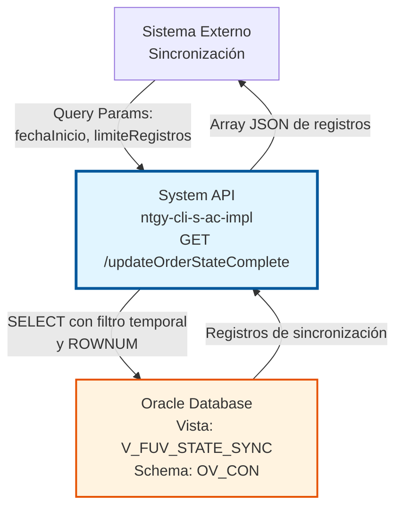
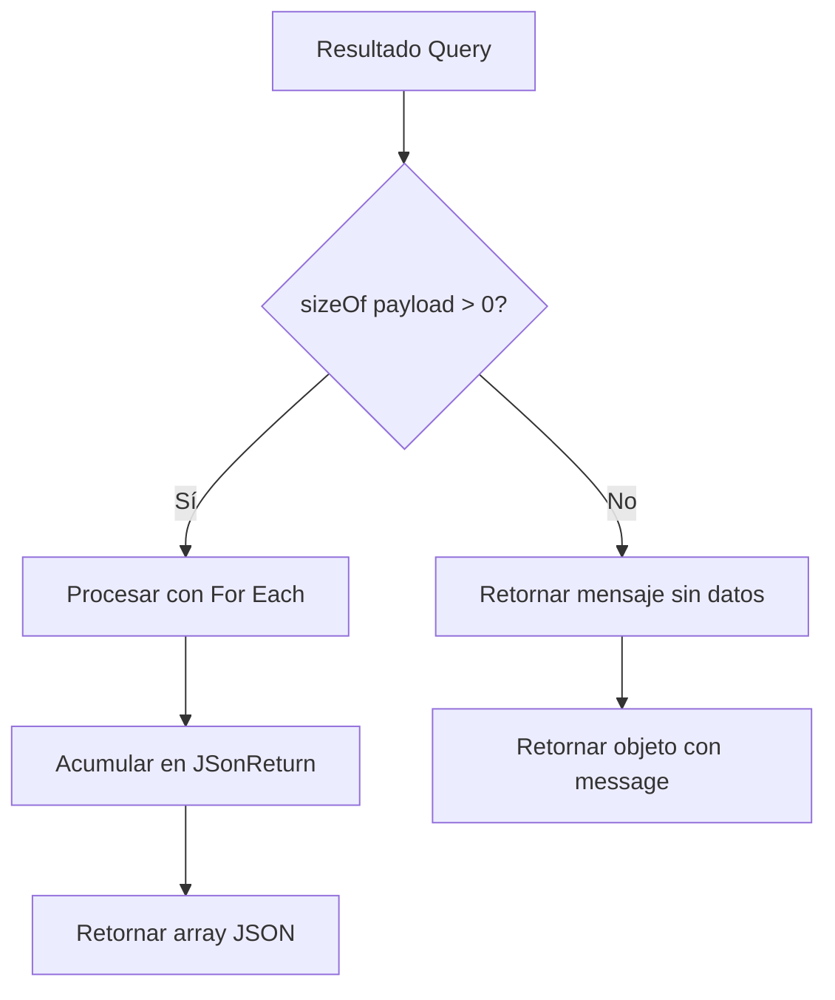
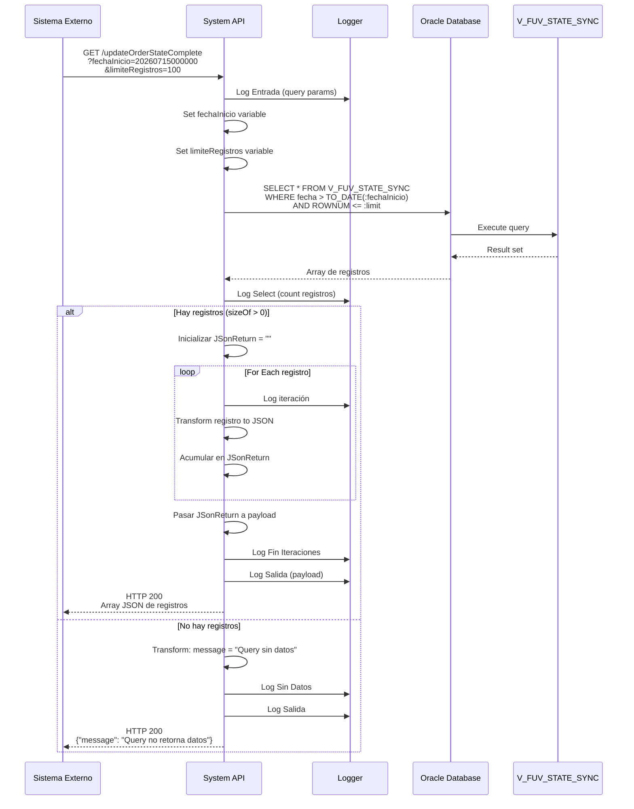

# GET /updateOrderStateComplete

> ⚠️ **IMPORTANTE:** A pesar del nombre "updateOrderStateComplete", este endpoint **NO actualiza** estados. Es una operación de **LECTURA** (SELECT) que consulta la vista `V_FUV_STATE_SYNC` para obtener registros de sincronización de estados.

## 📌 Descripción General

### Propósito del Endpoint

Este endpoint consulta la vista `V_FUV_STATE_SYNC` de Oracle Database para obtener registros de sincronización de estados de órdenes que han cambiado después de una fecha específica. Implementa un patrón de sincronización incremental mediante límite de registros.

El endpoint soporta:
- **Filtrado Temporal**: Obtiene solo registros con cambios posteriores a una fecha específica
- **Límite de Registros**: Controla el número máximo de registros retornados (⚠️ NO es paginación tradicional)
- **Sincronización Incremental**: Permite a sistemas externos mantener sus datos actualizados mediante consultas sucesivas por fecha

### Tipo de API

**Capa:** System API (API-Led Connectivity)

**Función:** Integración directa con Oracle Database para consultar vista de sincronización de estados de órdenes.

### Patrón de Integración

**Tipo:** Request-Reply Síncrono con SQL Query

**Descripción:** El endpoint recibe parámetros de fecha y límite, ejecuta una consulta SELECT en la vista `V_FUV_STATE_SYNC`, itera sobre los resultados acumulándolos en formato JSON mediante concatenación (`++`), y retorna un array de objetos JSON.

### Arquitectura API-Led Connectivity



---

## 💼 Propósito del Negocio

### Casos de Uso Principales

1. **Sincronización Incremental de Estados**
   - Sistemas externos consultan periódicamente cambios de estado
   - Solo se transfieren registros modificados desde la última sincronización
   - Reduce carga de red y procesamiento

2. **Monitoreo de Cambios de Estado**
   - Seguimiento de evolución de estados de órdenes
   - Identificación de órdenes que han cambiado de estado en un período
   - Auditoría de cambios temporales

3. **Integración con Sistemas de Terceros**
   - Permite a sistemas externos (Darwin, Salesforce, etc.) mantener réplicas actualizadas
   - Facilita reconciliación de datos entre sistemas
   - Soporta arquitecturas event-driven mediante polling

### Contexto Empresarial

- **Dominio:** Gestión de Órdenes y Contratos
- **Sector:** Energía - Utilities
- **División:** Naturgy España - Atención al Cliente
- **Proceso de Negocio:** Sincronización de estados de órdenes entre sistemas
- **Módulo:** Gestión de Órdenes FUV (Fuerza de Ventas)

### Stakeholders

- **Sistemas de Integración**: Necesitan mantener datos sincronizados con el sistema fuente
- **Equipos de Desarrollo**: Requieren endpoint confiable para sincronización
- **Operaciones**: Monitorean el flujo de sincronización y detectan anomalías

### Valor de Negocio

- **Eficiencia**: Solo transfiere datos modificados, no todo el dataset
- **Escalabilidad**: Paginación permite manejar grandes volúmenes de cambios
- **Consistencia**: Garantiza que sistemas externos tengan datos actualizados
- **Trazabilidad**: Permite auditar cuándo y qué cambios se sincronizaron

### Consumidores Potenciales

Este endpoint puede ser consumido por:
- Sistemas de integración middleware
- Plataformas de sincronización de datos
- Servicios de replicación de datos
- Sistemas de monitoreo y auditoría
- Aplicaciones que requieren datos actualizados de estados de órdenes

---

## 🔧 Especificación Técnica

### URLs por Ambiente

| Ambiente | URL Completa |
|----------|--------------|
| **Local** | `http://localhost:8081/api/updateOrderStateComplete?fechaInicio=YYYYMMDDHH24MISS&limiteRegistros=100` |
| **Development** | `https://ntgy-cli-s-ac-dev.us-e2.cloudhub.io/api/updateOrderStateComplete?fechaInicio=YYYYMMDDHH24MISS&limiteRegistros=100` |
| **QA** | `https://ntgy-cli-s-ac-cc.us-e2.cloudhub.io/api/updateOrderStateComplete?fechaInicio=YYYYMMDDHH24MISS&limiteRegistros=100` |
| **Pre-Production** | `https://ntgy-cli-s-ac-cl.us-e2.cloudhub.io/api/updateOrderStateComplete?fechaInicio=YYYYMMDDHH24MISS&limiteRegistros=100` |
| **Production** | `https://ntgy-cli-s-ac-pro.us-e2.cloudhub.io/api/updateOrderStateComplete?fechaInicio=YYYYMMDDHH24MISS&limiteRegistros=100` |

### Método HTTP

```
GET /api/updateOrderStateComplete
```

### Parámetros de Entrada

#### Headers HTTP

| Header | Tipo | Requerido | Descripción | Ejemplo |
|--------|------|-----------|-------------|---------|
| `Accept` | string | ❌ No | Tipo de contenido esperado en response | `application/json` |

#### Query Parameters

| Parámetro | Tipo | Requerido | Descripción | Formato | Ejemplo |
|-----------|------|-----------|-------------|---------|---------|
| `fechaInicio` | string | ✅ Sí | Fecha de inicio para filtrar registros con cambios posteriores | `YYYYMMDDHH24MISS` | `20260715000000` |
| `limiteRegistros` | string/number | ✅ Sí | Número máximo de registros a retornar (límite, NO paginación) | Numérico | `100` |

**Detalles de fechaInicio:**
- Formato: `YYYYMMDDHH24MISS` (Año, Mes, Día, Hora24, Minutos, Segundos)
- Ejemplo: `20260715114500` = 15 de julio de 2026, 11:45:00
- La query filtra registros donde `X_GN_FECHA_CAMBIO_ESTADO > TO_DATE(:fechaInicio,'YYYYMMDDHH24MISS')`

**Detalles de limiteRegistros:**
- Controla el número máximo de registros retornados
- Implementado con `ROWNUM <= :limit` en Oracle
- ⚠️ **NO es paginación tradicional**: No hay offset ni número de página
- **Patrón de uso**: Consultas sucesivas incrementando `fechaInicio` con la fecha del último registro procesado
- Recomendado: valores entre 50 y 500 según volumen esperado

### Respuestas

#### Respuesta Exitosa con Datos (200 OK)

```json
[
  {
    "CAMPO_1": "valor",
    "CAMPO_2": "valor",
    "X_GN_FECHA_CAMBIO_ESTADO": "2026-07-15T11:45:00",
    "...": "otros campos de la vista"
  },
  {
    "CAMPO_1": "valor",
    "CAMPO_2": "valor",
    "X_GN_FECHA_CAMBIO_ESTADO": "2026-07-15T11:46:00",
    "...": "otros campos de la vista"
  }
]
```

**Notas Importantes:**
- **Formato**: Array de objetos JSON (resultado del `SELECT *` iterado y acumulado con `++`)
- **Estructura de campos**: Depende de la definición de la vista `V_FUV_STATE_SYNC` en Oracle
- **Campo confirmado**: `X_GN_FECHA_CAMBIO_ESTADO` (usado en el filtro WHERE de la query)
- **Transformación**: Cada registro se convierte "as-is" a JSON sin modificaciones
- Los nombres de campos mostrados arriba son **ilustrativos** - consultar definición de vista para campos reales

#### Respuesta Sin Datos (200 OK)

```json
{
  "message": "Query no retorna datos"
}
```

Este mensaje se retorna cuando:
- No hay registros con cambios posteriores a `fechaInicio`
- La vista está vacía
- Los filtros no coinciden con ningún registro

#### Respuesta de Error Técnico (500)

```json
{
  "error": "APP_9999",
  "message": "Error en el servicio."
}
```

Causas comunes:
- Error de conexión a base de datos
- Timeout en la query
- Formato incorrecto de `fechaInicio`
- Error en la vista `V_FUV_STATE_SYNC`

### Autenticación y Autorización

- **Tipo:** Client ID & Client Secret (Anypoint Platform)
- **Autorización Oracle:** El usuario de base de datos debe tener:
  - Permiso SELECT en vista `V_FUV_STATE_SYNC`
  - Acceso al schema `OV_CON`
  - Permisos de lectura en tablas subyacentes de la vista

### Timeouts

| Tipo | Valor | Descripción |
|------|-------|-------------|
| **Query Timeout** | `${dbAC.timeout}` ms | Tiempo máximo de ejecución de la query |
| **Connection Timeout** | `${dbAC.connectTimeOut}` ms | Tiempo máximo para establecer conexión con Oracle |
| **Fetch Size** | `${dbAC.fetchsize}` | Número de registros recuperados por lote |

---

## 🏗️ Implementación Técnica

### Arquitectura del Flow

```mermaid
flowchart TD
    Start([HTTP GET Request]) --> LogEntry[Log Entrada<br/>Query Params]
    LogEntry --> SetVar1[Set Variable<br/>fechaInicio]
    SetVar1 --> SetVar2[Set Variable<br/>limiteRegistros]
    SetVar2 --> DBSelect[DB Select<br/>V_FUV_STATE_SYNC<br/>WHERE fecha > :fechaInicio<br/>AND ROWNUM <= :limit]
    DBSelect --> LogSelect[Log Select<br/>Número de registros]
    LogSelect --> Choice{¿Hay datos?<br/>sizeOf payload > 0}
    
    Choice -->|Sí| InitVar[Inicializar<br/>JSonReturn = empty]
    InitVar --> ForEach[For Each<br/>Iterar registros<br/>batchSize: ${batchSizeFUV}]
    ForEach --> LogIter[Log Iteración]
    LogIter --> Transform1[Transform<br/>Query to JSON]
    Transform1 --> Accumulate[Acumular en<br/>JSonReturn]
    Accumulate --> NextIter{¿Más registros?}
    NextIter -->|Sí| ForEach
    NextIter -->|No| PassToPayload[Pasar JSonReturn<br/>a payload]
    PassToPayload --> LogEnd[Log Fin Iteraciones]
    LogEnd --> LogOutput[Log Salida]
    
    Choice -->|No| NoData[Transform<br/>message: Query sin datos]
    NoData --> LogNoData[Log Sin Datos]
    LogNoData --> LogOutput
    
    LogOutput --> End([HTTP Response])
    
    DBSelect -.->|Error| ErrorHandler[Error Handler<br/>Log Error]
    ErrorHandler -.-> ErrorResp([HTTP 500])
    
    style Start fill:#e8f5e9,stroke:#2e7d32
    style DBSelect fill:#fff3e0,stroke:#e65100,stroke-width:3px
    style ForEach fill:#e3f2fd,stroke:#1565c0,stroke-width:2px
    style End fill:#e8f5e9,stroke:#2e7d32
    style ErrorResp fill:#ffebee,stroke:#c62828
```

### Componentes del Flow

#### 1. Flow Principal: `updateOrderStateFlowComplete`

**Ubicación:** `src/main/mule/s-ac-updateOrderStateComplete.xml` (líneas 10-83)

**Responsabilidades:**
- Recibir request HTTP GET
- Extraer y validar query parameters
- Ejecutar consulta a base de datos
- Iterar y transformar resultados
- Retornar respuesta JSON

#### 2. Extracción de Parámetros

```xml
<set-variable value="#[attributes.queryParams.fechaInicio]" 
              variableName="fechaInicio"/>
<set-variable value="#[attributes.queryParams.limiteRegistros]" 
              variableName="limiteRegistros"/>
```

**Líneas:** 12-13

**Propósito:** Extraer parámetros de query string y almacenarlos en variables de flow para uso posterior.

#### 3. Consulta a Base de Datos

```xml
<db:select config-ref="Database_Config" 
           queryTimeout="${dbAC.timeout}" 
           queryTimeoutUnit="MILLISECONDS" 
           fetchSize="${dbAC.fetchsize}">
    <reconnect-forever />
    <db:sql><![CDATA[${queries.updateStateVistaComplete}]]></db:sql>
    <db:input-parameters><![CDATA[#[{
        'fechaInicio': vars.fechaInicio as String,
        'limit': vars.limiteRegistros as String
    }]]]></db:input-parameters>
</db:select>
```

**Líneas:** 14-21

**Query SQL Real:**
```sql
SELECT * FROM V_FUV_STATE_SYNC 
WHERE X_GN_FECHA_CAMBIO_ESTADO > TO_DATE(:fechaInicio,'YYYYMMDDHH24MISS') 
AND ROWNUM <= :limit
```

**Configuración:**
- **Config:** `Database_Config` (conexión Oracle con pooling)
- **Timeout:** Configurable por ambiente
- **Fetch Size:** Optimiza recuperación de grandes datasets
- **Reconnect:** Política de reconexión automática

#### 4. Procesamiento Condicional



**Líneas:** 23-76

**Lógica:**
- Si hay registros: Itera y acumula en formato JSON
- Si no hay registros: Retorna mensaje informativo

#### 5. Iteración y Acumulación

```dataweave
%dw 2.0
output application/json
---
if (vars.JSonReturn == "") payload
else vars.JSonReturn ++ payload
```

**Líneas:** 26-46

**Proceso:**
1. Inicializa variable `JSonReturn` vacía
2. Itera sobre cada registro del resultado
3. Transforma cada registro a JSON
4. Acumula en `JSonReturn` concatenando
5. Al final, pasa `JSonReturn` al payload

**Batch Size:** Configurable con `${batchSizeFUV}`

#### 6. Manejo de Errores

```xml
<error-handler>
    <on-error-propagate type="ANY">
        <logger level="ERROR" message="s-ac-updateOrderStateComplete.logError"/>
    </on-error-propagate>
</error-handler>
```

**Líneas:** 78-82

**Estrategia:**
- Captura cualquier error (ANY)
- Registra en log con nivel ERROR
- Propaga error al handler global
- Retorna HTTP 500 con mensaje estándar

### Diagrama de Secuencia Detallado



### Configuración de Base de Datos

**Database Config:** `Database_Config`

```xml
<db:config name="Database_Config">
    <db:generic-connection 
        url="jdbc:oracle:thin:${dbAC.user}/${secure::dbAC.pass}@..."
        driverClassName="oracle.jdbc.driver.OracleDriver">
        <db:pooling-profile 
            maxPoolSize="${dbAC.MaxPoolSize}"
            maxWait="${dbAC.MaxWaitTime}"
            maxIdleTime="${dbAC.MaxIdleTime}"/>
    </db:generic-connection>
</db:config>
```

**Características:**
- Oracle RAC con failover automático
- Connection pooling optimizado
- Credenciales encriptadas con secure properties
- Timeouts configurables por ambiente

### Vista de Base de Datos

**Nombre:** `V_FUV_STATE_SYNC`

**Schema:** `OV_CON` (Administración Comercial)

**Tipo:** Vista de Oracle (no tabla física)

**Propósito:** Consolidar información de sincronización de estados de órdenes FUV

**Campos Clave:**
- `X_GN_FECHA_CAMBIO_ESTADO`: Timestamp del cambio de estado (usado para filtrado)
- Otros campos dependen de la definición de la vista

**Nota:** La vista puede combinar datos de múltiples tablas subyacentes. Para conocer la estructura completa, consultar la definición de la vista en Oracle.

### Logging

**Puntos de Log:**

1. **Entrada:** Query parameters recibidos
2. **Select:** Número de registros obtenidos
3. **Iteración:** Contador de iteración actual
4. **Fin Iteraciones:** Confirmación de procesamiento completo
5. **Sin Datos:** Cuando query no retorna registros
6. **Salida:** Payload final (nivel DEBUG)
7. **Error:** Cualquier excepción capturada

**Formato de Mensajes:**
```
s-ac-updateOrderStateComplete.{evento}
```

**Ejemplos:**
- `s-ac-updateOrderStateComplete.logEntrada ## queryParams: {...}`
- `s-ac-updateOrderStateComplete.logSelect 150 Registros`
- `s-ac-updateOrderStateComplete.logError`

---

## 💻 Ejemplos de Uso

### Ejemplo 1: Consulta Básica con curl

```bash
curl -X GET "http://localhost:8081/api/updateOrderStateComplete?fechaInicio=20260715000000&limiteRegistros=100" \
  -H "Accept: application/json"
```

**Descripción:** Obtiene hasta 100 registros con cambios de estado posteriores al 15 de julio de 2026 a las 00:00:00.

### Ejemplo 2: Consulta con Fecha y Hora Específica

```bash
curl -X GET "https://ntgy-cli-s-ac-pro.us-e2.cloudhub.io/api/updateOrderStateComplete?fechaInicio=20260715114500&limiteRegistros=50" \
  -H "Accept: application/json" \
  -H "client_id: your-client-id" \
  -H "client_secret: your-client-secret"
```

**Descripción:** Obtiene hasta 50 registros con cambios posteriores al 15 de julio de 2026 a las 11:45:00 en producción.

### Ejemplo 3: Response Exitoso con Datos

**Request:**
```http
GET /api/updateOrderStateComplete?fechaInicio=20260715000000&limiteRegistros=2
```

**Response (200 OK):**
```json
[
  {
    "ORDER_ID": "ORD-2026-001",
    "X_GN_FECHA_CAMBIO_ESTADO": "2026-07-15T10:30:00",
    "STATE": "COMPLETE",
    "PREVIOUS_STATE": "IN_PROGRESS",
    "CUSTOMER_ID": "CUST-12345",
    "CONTRACT_LINE": "CL-2026-001",
    "PRODUCT_ID": "ELEC-001",
    "CHANGE_REASON": "Order fulfilled successfully",
    "UPDATED_BY": "SYSTEM"
  },
  {
    "ORDER_ID": "ORD-2026-002",
    "X_GN_FECHA_CAMBIO_ESTADO": "2026-07-15T10:35:00",
    "STATE": "CANCELLED",
    "PREVIOUS_STATE": "PENDING",
    "CUSTOMER_ID": "CUST-12346",
    "CONTRACT_LINE": "CL-2026-002",
    "PRODUCT_ID": "GAS-001",
    "CHANGE_REASON": "Customer request",
    "UPDATED_BY": "AGENT-001"
  }
]
```

### Ejemplo 4: Response Sin Datos

**Request:**
```http
GET /api/updateOrderStateComplete?fechaInicio=20260801000000&limiteRegistros=100
```

**Response (200 OK):**
```json
{
  "message": "Query no retorna datos"
}
```

**Interpretación:** No hay registros con cambios de estado posteriores al 1 de agosto de 2026.

### Ejemplo 5: Error de Formato de Fecha

**Request:**
```http
GET /api/updateOrderStateComplete?fechaInicio=2026-07-15&limiteRegistros=100
```

**Response (500 Internal Server Error):**
```json
{
  "error": "APP_9999",
  "message": "Error en el servicio."
}
```

**Causa:** Formato de fecha incorrecto. Debe ser `YYYYMMDDHH24MISS`, no `YYYY-MM-DD`.

### Ejemplo 6: Script de Sincronización Periódica

```bash
#!/bin/bash

# Script para sincronización incremental cada 5 minutos
# IMPORTANTE: NO hay paginación tradicional - usar fecha incremental

API_URL="https://ntgy-cli-s-ac-pro.us-e2.cloudhub.io/api/updateOrderStateComplete"
CLIENT_ID="your-client-id"
CLIENT_SECRET="your-client-secret"
LIMIT=500

# Obtener timestamp de última sincronización (formato: YYYYMMDDHH24MISS)
LAST_SYNC=$(cat last_sync.txt 2>/dev/null || echo "20260101000000")

# Ejecutar consulta
RESPONSE=$(curl -s -X GET "${API_URL}?fechaInicio=${LAST_SYNC}&limiteRegistros=${LIMIT}" \
  -H "Accept: application/json" \
  -H "client_id: ${CLIENT_ID}" \
  -H "client_secret: ${CLIENT_SECRET}")

# Verificar si hay datos
if echo "$RESPONSE" | grep -q "message.*Query no retorna datos"; then
  echo "No hay nuevos cambios desde ${LAST_SYNC}"
else
  # Procesar registros y extraer la fecha más reciente
  echo "$RESPONSE" | jq -r '.[]'
  
  # CRÍTICO: Extraer la fecha MÁS RECIENTE del lote para próxima consulta
  # Esto evita procesar los mismos registros múltiples veces
  LATEST_DATE=$(echo "$RESPONSE" | jq -r '.[].X_GN_FECHA_CAMBIO_ESTADO' | sort -r | head -1)
  
  if [ -n "$LATEST_DATE" ]; then
    # Convertir fecha a formato YYYYMMDDHH24MISS
    NEXT_SYNC=$(date -d "$LATEST_DATE" +"%Y%m%d%H%M%S" 2>/dev/null || echo "$LATEST_DATE")
    echo "$NEXT_SYNC" > last_sync.txt
    echo "Sincronización completada. Próxima consulta desde: ${NEXT_SYNC}"
  fi
fi
```

**Nota Importante:** Este script implementa el patrón correcto de sincronización incremental:
1. Consulta con `fechaInicio` de la última sincronización
2. Procesa los registros obtenidos
3. **Extrae la fecha más reciente** del lote procesado
4. Usa esa fecha como `fechaInicio` en la próxima consulta
5. Esto evita procesar registros duplicados y avanza incrementalmente

### Ejemplo 7: Integración con Python

```python
import requests
from datetime import datetime, timedelta
import json

class OrderStateSyncClient:
    def __init__(self, base_url, client_id, client_secret):
        self.base_url = base_url
        self.headers = {
            'Accept': 'application/json',
            'client_id': client_id,
            'client_secret': client_secret
        }
    
    def get_state_changes(self, fecha_inicio, limite=100):
        """
        Obtiene cambios de estado desde una fecha específica.
        
        Args:
            fecha_inicio (str): Fecha en formato YYYYMMDDHH24MISS
            limite (int): Número máximo de registros
            
        Returns:
            list: Lista de registros o None si hay error
        """
        endpoint = f"{self.base_url}/api/updateOrderStateComplete"
        params = {
            'fechaInicio': fecha_inicio,
            'limiteRegistros': limite
        }
        
        try:
            response = requests.get(endpoint, headers=self.headers, params=params)
            response.raise_for_status()
            
            data = response.json()
            
            # Verificar si es mensaje de "sin datos"
            if isinstance(data, dict) and 'message' in data:
                print(f"Sin datos: {data['message']}")
                return []
            
            return data
            
        except requests.exceptions.RequestException as e:
            print(f"Error en request: {e}")
            return None
    
    def sync_last_24_hours(self):
        """Sincroniza cambios de las últimas 24 horas."""
        yesterday = datetime.now() - timedelta(days=1)
        fecha_inicio = yesterday.strftime('%Y%m%d%H%M%S')
        
        print(f"Sincronizando desde: {fecha_inicio}")
        changes = self.get_state_changes(fecha_inicio, limite=500)
        
        if changes:
            print(f"Obtenidos {len(changes)} registros")
            # Nota: Los nombres de campos dependen de la vista V_FUV_STATE_SYNC
            for change in changes:
                fecha = change.get('X_GN_FECHA_CAMBIO_ESTADO', 'N/A')
                print(f"  - Registro con fecha: {fecha}")
        
        return changes
    
    def sync_incremental(self, last_sync_file='last_sync.txt'):
        """
        Sincronización incremental usando patrón de fecha.
        NO hay paginación tradicional - usar fecha del último registro.
        """
        # Leer última fecha de sincronización
        try:
            with open(last_sync_file, 'r') as f:
                fecha_inicio = f.read().strip()
        except FileNotFoundError:
            # Primera ejecución - empezar desde hace 24 horas
            fecha_inicio = (datetime.now() - timedelta(days=1)).strftime('%Y%m%d%H%M%S')
        
        print(f"Sincronizando desde: {fecha_inicio}")
        changes = self.get_state_changes(fecha_inicio, limite=500)
        
        if changes:
            print(f"Obtenidos {len(changes)} registros")
            
            # CRÍTICO: Extraer la fecha más reciente para próxima consulta
            latest_date = max(
                change.get('X_GN_FECHA_CAMBIO_ESTADO', '') 
                for change in changes
            )
            
            if latest_date:
                # Guardar para próxima ejecución
                with open(last_sync_file, 'w') as f:
                    # Convertir a formato YYYYMMDDHH24MISS si es necesario
                    next_sync = latest_date.replace('-', '').replace(':', '').replace('T', '')[:14]
                    f.write(next_sync)
                print(f"Próxima sincronización desde: {next_sync}")
        else:
            print("No hay cambios nuevos")
        
        return changes

# Uso
client = OrderStateSyncClient(
    base_url='https://ntgy-cli-s-ac-pro.us-e2.cloudhub.io',
    client_id='your-client-id',
    client_secret='your-client-secret'
)

# Opción 1: Sincronizar últimas 24 horas (primera vez)
changes = client.sync_last_24_hours()

# Opción 2: Sincronización incremental (recomendado para uso periódico)
# Usa patrón de fecha incremental - NO paginación tradicional
changes = client.sync_incremental()
```

**Nota Importante sobre el Patrón de Sincronización:**
- El endpoint **NO soporta paginación tradicional** (no hay offset/página)
- El patrón correcto es **sincronización incremental por fecha**:
  1. Consultar con `fechaInicio=X`
  2. Procesar registros obtenidos
  3. Extraer la fecha más reciente: `max(X_GN_FECHA_CAMBIO_ESTADO)`
  4. Próxima consulta con `fechaInicio=fecha_mas_reciente`
- Esto evita procesar registros duplicados y avanza cronológicamente

### Ejemplo 8: Monitoreo con Postman

**Collection:** Order State Sync Monitoring

**Request:** Get State Changes

```json
{
  "name": "Get Order State Changes",
  "request": {
    "method": "GET",
    "header": [
      {
        "key": "Accept",
        "value": "application/json"
      },
      {
        "key": "client_id",
        "value": "{{client_id}}"
      },
      {
        "key": "client_secret",
        "value": "{{client_secret}}"
      }
    ],
    "url": {
      "raw": "{{base_url}}/api/updateOrderStateComplete?fechaInicio={{last_sync_timestamp}}&limiteRegistros=100",
      "host": ["{{base_url}}"],
      "path": ["api", "updateOrderStateComplete"],
      "query": [
        {
          "key": "fechaInicio",
          "value": "{{last_sync_timestamp}}",
          "description": "Formato: YYYYMMDDHH24MISS"
        },
        {
          "key": "limiteRegistros",
          "value": "100"
        }
      ]
    }
  },
  "response": []
}
```

**Variables de Entorno:**
```json
{
  "base_url": "https://ntgy-cli-s-ac-pro.us-e2.cloudhub.io",
  "client_id": "your-client-id",
  "client_secret": "your-client-secret",
  "last_sync_timestamp": "20260715000000"
}
```

**Tests (Postman):**
```javascript
// Verificar respuesta exitosa
pm.test("Status code is 200", function () {
    pm.response.to.have.status(200);
});

// Procesar respuesta y actualizar timestamp para próxima consulta
const jsonData = pm.response.json();

if (Array.isArray(jsonData)) {
    pm.test(`Obtenidos ${jsonData.length} registros`, function () {
        pm.expect(jsonData.length).to.be.at.least(0);
    });
    console.log(`Sincronizados ${jsonData.length} cambios de estado`);
    
    // CRÍTICO: Extraer la fecha MÁS RECIENTE para próxima consulta
    // NO hay paginación tradicional - usar patrón de fecha incremental
    if (jsonData.length > 0) {
        const dates = jsonData.map(item => item.X_GN_FECHA_CAMBIO_ESTADO);
        const latestDate = dates.sort().reverse()[0];
        
        if (latestDate) {
            // Convertir a formato YYYYMMDDHH24MISS
            const nextSync = latestDate.replace(/[-:T]/g, '').substring(0, 14);
            pm.environment.set("last_sync_timestamp", nextSync);
            console.log(`Próxima consulta desde: ${nextSync}`);
        }
    }
} else if (jsonData.message) {
    console.log("Sin cambios desde última sincronización");
    // Mantener el mismo timestamp para próxima consulta
}
```

**Nota sobre el Patrón:** Los tests implementan correctamente el patrón de sincronización incremental por fecha, no paginación tradicional.
