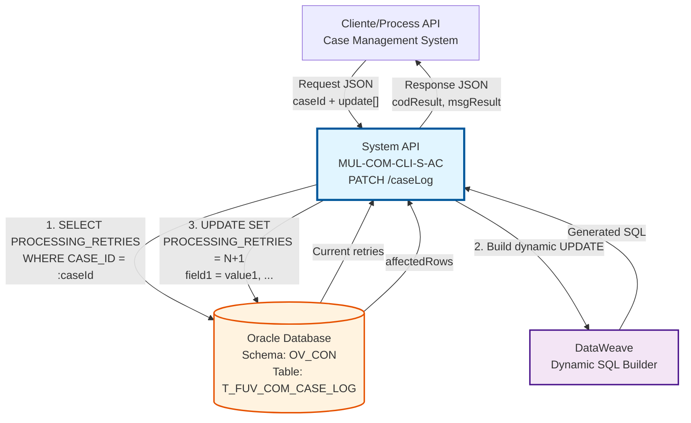
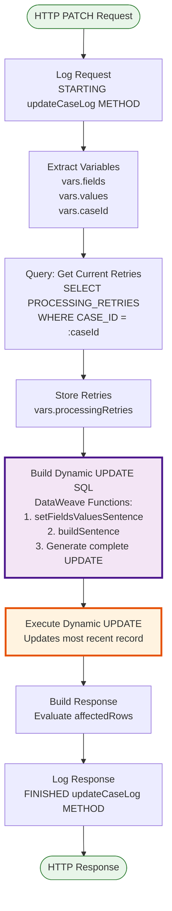
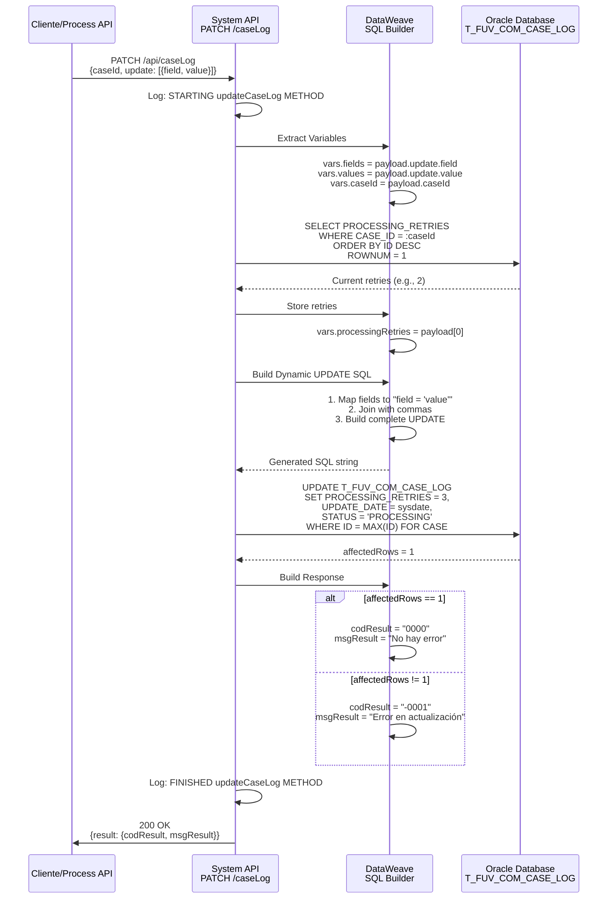
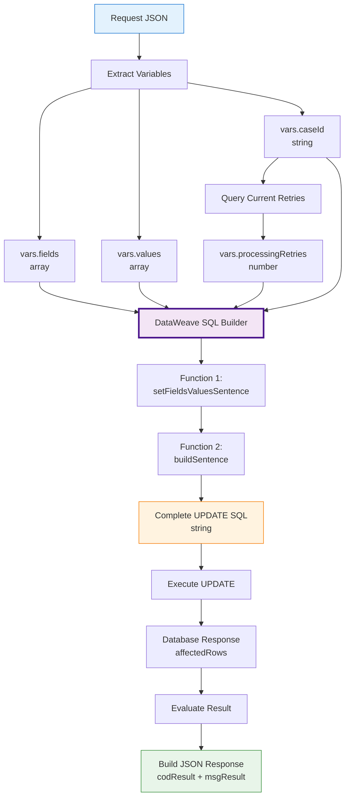

# PATCH /caseLog

## 📌 Descripción General

### Propósito del Endpoint

Este endpoint actualiza registros existentes en la tabla `T_FUV_COM_CASE_LOG` con una lógica sofisticada que incluye:
- **Construcción Dinámica de SQL**: Genera la query UPDATE en tiempo de ejecución basándose en los campos enviados
- **Incremento Automático de Reintentos**: Siempre incrementa `PROCESSING_RETRIES` en 1
- **Actualización del Registro Más Reciente**: Usa `MAX(T_FUV_COM_CASE_LOG_ID)` para actualizar el último registro del caso
- **Flexibilidad Total**: Permite actualizar cualquier campo de la tabla mediante un array de campo-valor

El endpoint soporta:
- **Actualización Flexible**: Array de campos y valores a actualizar
- **Incremento Automático**: `PROCESSING_RETRIES` siempre se incrementa
- **Timestamp Automático**: `UPDATE_DATE` siempre se actualiza a `sysdate`
- **Actualización Atómica**: Solo actualiza el registro más reciente del caso

### Tipo de API

**Capa:** System API (API-Led Connectivity)

**Función:** Integración directa con Oracle Database para actualización de logs de casos con lógica de reintentos.

### Patrón de Integración

**Tipo:** Request-Reply Síncrono con SQL SELECT + UPDATE Dinámico

**Descripción:** Recibe el ID del caso y un array de campos a actualizar, consulta el número actual de reintentos del último registro, construye dinámicamente una query UPDATE con los campos especificados (incrementando reintentos), ejecuta la actualización y retorna confirmación basada en las filas afectadas.

### Arquitectura API-Led Connectivity



---

## 💼 Propósito del Negocio

### Casos de Uso Principales

1. **Actualización de Estado de Casos**
   - Cambiar estado de "PENDING" a "PROCESSING"
   - Marcar casos como "COMPLETED" o "ERROR"
   - Registrar progreso del procesamiento
   - **Beneficio**: Trazabilidad del ciclo de vida del caso

2. **Registro de Errores de Procesamiento**
   - Actualizar campo ERROR con mensaje descriptivo
   - Incrementar contador de reintentos automáticamente
   - Registrar timestamp de la actualización
   - **Beneficio**: Diagnóstico y troubleshooting efectivo

3. **Gestión de Reintentos**
   - Incremento automático del contador con cada actualización
   - Permite identificar casos problemáticos (muchos reintentos)
   - Facilita políticas de retry automático
   - **Beneficio**: Gestión proactiva de errores

4. **Actualización de Datos de Athena**
   - Modificar información del objeto ATHENA_CASE
   - Actualizar campos específicos sin reemplazar todo el objeto
   - Mantener sincronización con sistema origen
   - **Beneficio**: Consistencia de datos entre sistemas

### Contexto Empresarial

- **Dominio:** Gestión de Casos y Auditoría
- **Sector:** Energía - Utilities
- **División:** Naturgy España - Administración Comercial
- **Proceso de Negocio:** Actualización y seguimiento de casos de clientes
- **Sistema Origen:** Athena (sistema de gestión de casos)

### Stakeholders

- **Equipos de Procesamiento**: Actualizan estado de casos en proceso
- **Sistemas de Retry**: Incrementan reintentos automáticamente
- **Equipos de Soporte**: Registran errores y resoluciones
- **Sistemas de Monitoreo**: Actualizan métricas de procesamiento

### Valor de Negocio

- **Flexibilidad**: Actualizar cualquier campo sin modificar el endpoint
- **Automatización**: Incremento de reintentos sin intervención manual
- **Trazabilidad**: Registro automático de fecha de actualización
- **Integridad**: Solo actualiza el registro más reciente del caso

### Consumidores Potenciales

Este endpoint puede ser consumido por:
- Process APIs de gestión de casos
- Sistemas de procesamiento automático
- Flujos de retry y recuperación de errores
- Sistemas de sincronización con Athena
- Herramientas de gestión de incidencias

---

## 🔧 Especificación Técnica

### URLs por Ambiente

| Ambiente | URL Base | URL Completa |
|----------|----------|--------------|
| **Local** | `http://localhost:8081` | `http://localhost:8081/api/caseLog` |
| **Development** | `https://mul-com-cli-s-ac-dev.us-e2.cloudhub.io` | `https://mul-com-cli-s-ac-dev.us-e2.cloudhub.io/api/caseLog` |
| **QA** | `https://mul-com-cli-s-ac-cc.us-e2.cloudhub.io` | `https://mul-com-cli-s-ac-cc.us-e2.cloudhub.io/api/caseLog` |
| **Pre-Production** | `https://mul-com-cli-s-ac-cl.us-e2.cloudhub.io` | `https://mul-com-cli-s-ac-cl.us-e2.cloudhub.io/api/caseLog` |
| **Production** | `https://mul-com-cli-s-ac-pro.us-e2.cloudhub.io` | `https://mul-com-cli-s-ac-pro.us-e2.cloudhub.io/api/caseLog` |

### Método HTTP

```
PATCH /api/caseLog
```

### Parámetros de Entrada

#### Headers HTTP

| Header | Tipo | Requerido | Descripción | Ejemplo |
|--------|------|-----------|-------------|---------|
| `Content-Type` | string | ✅ Sí | Tipo de contenido del request | `application/json` |
| `Accept` | string | ❌ No | Tipo de contenido esperado en response | `application/json` |

#### Body Parameters

| Campo | Tipo | Requerido | Descripción | Ejemplo |
|-------|------|-----------|-------------|---------|
| `caseId` | string | ✅ Sí | Identificador del caso a actualizar | `"CASE-2024-001234"` |
| `update` | array | ✅ Sí | Array de objetos con campos y valores a actualizar | Ver estructura abajo |
| `update[].field` | string | ✅ Sí | Nombre del campo a actualizar | `"STATUS"`, `"ERROR"` |
| `update[].value` | string | ✅ Sí | Nuevo valor para el campo | `"PROCESSING"`, `"Timeout error"` |

**Estructura del Request Body:**

```json
{
  "caseId": "string",
  "update": [
    {
      "field": "string",
      "value": "string"
    }
  ]
}
```

**Campos Actualizables:**

Cualquier campo de la tabla `T_FUV_COM_CASE_LOG` puede ser actualizado, incluyendo:
- `STATUS`: Estado del caso
- `ERROR`: Mensaje de error
- `ATHENA_CASE`: Objeto JSON completo (como string JSON)
- Otros campos según necesidades del negocio

> **⚠️ Campos Actualizados Automáticamente:**  
> Los siguientes campos se actualizan automáticamente y **NO deben incluirse** en el array `update`:
> - `PROCESSING_RETRIES`: Se incrementa automáticamente en 1
> - `UPDATE_DATE`: Se actualiza automáticamente a `sysdate`
> - `T_FUV_COM_CASE_LOG_ID`: No se puede modificar (es la clave primaria)

### Respuestas

#### Respuesta Exitosa (200 OK)

**Condición:** La actualización se realizó correctamente (affectedRows = 1)

```json
{
  "result": {
    "codResult": "0000",
    "msgResult": "No hay error"
  }
}
```

**Campos de Respuesta:**

| Campo | Tipo | Descripción |
|-------|------|-------------|
| `result.codResult` | string | Código de resultado: `"0000"` = éxito |
| `result.msgResult` | string | Mensaje descriptivo del resultado |

#### Respuesta de Error de Negocio (200 OK)

**Condición:** La actualización no afectó ninguna fila (affectedRows ≠ 1)

```json
{
  "result": {
    "codResult": "-0001",
    "msgResult": "Ha habido un error en la actualización del registro o el registro no existe"
  }
}
```

**Posibles Causas:**
- El `caseId` no existe en la tabla
- No hay registros para ese caso
- Error en la construcción de la query SQL

#### Respuesta de Error Técnico (500)

**Condición:** Error en la base de datos o error interno del servidor

```json
{
  "error": "APP_9999",
  "message": "Error en el servicio."
}
```

### Autenticación y Autorización

- **Tipo:** Client ID & Client Secret (Anypoint Platform)
- **Autorización Oracle:** El usuario de base de datos debe tener permisos para:
  - Ejecutar SELECT en tabla `T_FUV_COM_CASE_LOG`
  - Ejecutar UPDATE en tabla `T_FUV_COM_CASE_LOG`
  - Permisos de lectura y escritura en schema `OV_CON`

### Timeouts

| Tipo | Valor | Descripción |
|------|-------|-------------|
| **Request Timeout** | 30 segundos | Tiempo máximo de espera para la respuesta |
| **Connection Timeout** | 10 segundos | Tiempo máximo para establecer conexión con Oracle |
| **Query Timeout** | 30 segundos | Tiempo máximo de ejecución de las queries (SELECT + UPDATE) |

---

## 🏗️ Implementación Técnica

### Arquitectura del Flow



### Flujo de Datos Detallado



### Componentes Principales

#### 1. Logger de Inicio (request)

**Ubicación:** Línea 52 del XML (s-ac-caseLog.xml)

**Función:** Registra el inicio del método con el payload completo

**Código DataWeave:**
```dataweave
%dw 2.0
output application/java

var payloadStr = write(payload,'application/json')
var request = common::commonFunctions::normalizeJSON(payloadStr)
---
'STARTING updateCaseLog METHOD. REQUEST: ' ++ request
```

#### 2. Extracción de Variables (vars Update)

**Ubicación:** Líneas 53-70 del XML

**Función:** Extrae los campos del payload para construcción de la query

**Código DataWeave:**
```dataweave
// vars.fields
%dw 2.0
output application/java
---
payload.update.field

// vars.values
%dw 2.0
output application/java
---
payload.update.value

// vars.caseId
%dw 2.0
output application/java
---
payload.caseId
```

**Variables Creadas:**
- `vars.fields`: Array de nombres de campos a actualizar
- `vars.values`: Array de valores correspondientes
- `vars.caseId`: ID del caso a actualizar

#### 3. Query de Obtención de Reintentos (getAttemptsNumber)

**Ubicación:** Líneas 71-74 del XML

**Conector:** Database Connector (Oracle) - query-single

**Query SQL:**
```sql
SELECT * FROM (
    SELECT PROCESSING_RETRIES 
    FROM T_FUV_COM_CASE_LOG 
    WHERE CASE_ID = :caseId 
    ORDER BY T_FUV_COM_CASE_LOG_ID DESC
) WHERE ROWNUM = 1
```

**Parámetros:**
```dataweave
{
    caseId: vars.caseId
}
```

**Propósito:** Obtener el número actual de reintentos del registro MÁS RECIENTE del caso

**Características:**
- `ORDER BY T_FUV_COM_CASE_LOG_ID DESC`: Ordena por ID descendente
- `ROWNUM = 1`: Solo el primer resultado (el más reciente)
- Devuelve un solo registro

#### 4. Almacenamiento de Reintentos (var ProcessingRetries)

**Ubicación:** Línea 75 del XML

**Función:** Extrae el valor de reintentos del resultado de la query

**Código:**
```dataweave
#[payload[0]]
```

**Variable Creada:**
- `vars.processingRetries`: Número actual de reintentos (number)

#### 5. Construcción Dinámica de UPDATE SQL (prepare update sentence)

**Ubicación:** Líneas 76-101 del XML

**Función:** Genera la query UPDATE completa dinámicamente usando DataWeave

**Código DataWeave Completo:**
```dataweave
%dw 2.0
output application/java

var sentence_1 = "UPDATE T_FUV_COM_CASE_LOG SET PROCESSING_RETRIES = " ++ 
                 ((vars.processingRetries default 1) + 1) as String ++ 
                 ", UPDATE_DATE = sysdate, "

var sentence_2 = " WHERE T_FUV_COM_CASE_LOG_ID = (SELECT MAX (T_FUV_COM_CASE_LOG_ID) FROM T_FUV_COM_CASE_LOG WHERE CASE_ID = "

// 1. Recorro las variables fields y values para montar el string "field = value"
fun setFieldsValuesSentence(listFields) = listFields map (field, findex) -> {
    printString : field ++ " = '" ++ 
                  (vars.values filter ((item, vindex) -> (findex == vindex)) map $)[0] ++ 
                  "'"
}

// 2. Aplico la función 1 y guardo el resultado
var fieldsValuesSentence = setFieldsValuesSentence(vars.fields)

// 3. Uno los strings de tipo "field = value", concatenando una "," entre ellos
fun buildSentence(listfieldsValuesSentence) = listfieldsValuesSentence joinBy ", "

// 4. Aplico la función 3 y guardo el resultado
var SETSentenceGenerated = buildSentence(fieldsValuesSentence.printString)
---

sentence_1 ++ SETSentenceGenerated ++ sentence_2 ++ "'" ++ vars.caseId ++ "'" ++ ")"
```

**Lógica Detallada:**

**Paso 1 - Inicio de UPDATE:**
```sql
UPDATE T_FUV_COM_CASE_LOG 
SET PROCESSING_RETRIES = {reintentos_actuales + 1}, 
    UPDATE_DATE = sysdate, 
```

**Paso 2 - Función setFieldsValuesSentence:**
- Mapea cada campo del array `fields`
- Busca el valor correspondiente en el array `values` por índice
- Genera string: `"campo = 'valor'"`

**Ejemplo:**
```
Input: fields = ["STATUS", "ERROR"]
       values = ["PROCESSING", "Timeout"]
Output: [
  {printString: "STATUS = 'PROCESSING'"},
  {printString: "ERROR = 'Timeout'"}
]
```

**Paso 3 - Función buildSentence:**
- Une todos los strings con comas
- Genera: `"STATUS = 'PROCESSING', ERROR = 'Timeout'"`

**Paso 4 - WHERE Clause:**
```sql
WHERE T_FUV_COM_CASE_LOG_ID = (
    SELECT MAX(T_FUV_COM_CASE_LOG_ID) 
    FROM T_FUV_COM_CASE_LOG 
    WHERE CASE_ID = '{caseId}'
)
```

**Query Final Generada (Ejemplo):**
```sql
UPDATE T_FUV_COM_CASE_LOG 
SET PROCESSING_RETRIES = 3, 
    UPDATE_DATE = sysdate, 
    STATUS = 'PROCESSING', 
    ERROR = 'Connection timeout'
WHERE T_FUV_COM_CASE_LOG_ID = (
    SELECT MAX(T_FUV_COM_CASE_LOG_ID) 
    FROM T_FUV_COM_CASE_LOG 
    WHERE CASE_ID = 'CASE-2024-001234'
)
```

#### 6. Ejecución de UPDATE (Update)

**Ubicación:** Líneas 102-104 del XML

**Conector:** Database Connector (Oracle) - update

**Query SQL:**
```dataweave
#[payload]  // La query generada dinámicamente
```

**Características:**
- Ejecuta la query construida en el paso anterior
- No usa parámetros (todo está en el string SQL)
- Devuelve `affectedRows` (número de filas actualizadas)

#### 7. Construcción de Respuesta (response)

**Ubicación:** Líneas 105-117 del XML

**Función:** Evalúa el resultado y construye la respuesta JSON

**Código DataWeave:**
```dataweave
%dw 2.0
output application/json
---
{
    "result": {
        "codResult": if (payload.affectedRows == 1) "0000" else "-0001",
        "msgResult": if (payload.affectedRows == 1) 
                        "No hay error" 
                     else 
                        "Ha habido un error en la actualización del registro o el registro no existe"
    }
}
```

**Lógica:**
- Si `affectedRows == 1`: Éxito → `codResult = "0000"`
- Si `affectedRows != 1`: Error → `codResult = "-0001"`

#### 8. Logger de Fin (response)

**Ubicación:** Línea 118 del XML

**Función:** Registra el fin del método con la respuesta

**Código DataWeave:**
```dataweave
%dw 2.0
output application/java

var payloadStr = write(payload,'application/json')
var response = common::commonFunctions::normalizeJSON(payloadStr)
---
'FINISHED updateCaseLog METHOD. RESPONSE: ' ++ response
```

### Tabla Oracle: T_FUV_COM_CASE_LOG

#### Campos Actualizados

| Campo | Actualización | Descripción |
|-------|---------------|-------------|
| `PROCESSING_RETRIES` | ✅ Automática | Se incrementa en 1 siempre |
| `UPDATE_DATE` | ✅ Automática | Se actualiza a `sysdate` siempre |
| `STATUS` | ⚙️ Opcional | Actualizable vía array `update` |
| `ERROR` | ⚙️ Opcional | Actualizable vía array `update` |
| `ATHENA_CASE` | ⚙️ Opcional | Actualizable vía array `update` |
| Otros campos | ⚙️ Opcional | Cualquier campo puede actualizarse |

#### Lógica de Selección del Registro

**Query de Selección:**
```sql
WHERE T_FUV_COM_CASE_LOG_ID = (
    SELECT MAX(T_FUV_COM_CASE_LOG_ID) 
    FROM T_FUV_COM_CASE_LOG 
    WHERE CASE_ID = :caseId
)
```

**Características:**
- Usa `MAX(T_FUV_COM_CASE_LOG_ID)` para encontrar el registro más reciente
- Solo actualiza UN registro (el último creado para ese caso)
- Si hay múltiples registros del mismo caso, solo actualiza el más nuevo

### Manejo de Errores

#### Error Handler Global

**Configuración:** `apiErrorHandler` (definido en `s-ac-globalErrorHandler.xml`)

**Tipos de Error Manejados:**

1. **Registro No Encontrado** → HTTP 200 con codResult "-0001"
   - El `caseId` no existe
   - No hay registros para ese caso
   - `affectedRows = 0`

2. **ANY** → HTTP 500
   - Errores de conexión a base de datos
   - Errores de sintaxis SQL (query mal construida)
   - Errores de timeout
   - Cualquier excepción no controlada

**Respuesta de Error:**
```json
{
    "error": "APP_9999",
    "message": "Error en el servicio."
}
```

### Transformación de Datos

#### Diagrama de Transformación



### Consideraciones de Seguridad

#### Potencial SQL Injection

**⚠️ ADVERTENCIA CRÍTICA:**

El endpoint construye la query SQL concatenando valores directamente:
```dataweave
field ++ " = '" ++ value ++ "'"
```

**Riesgos:**
- Si `value` contiene comillas simples (`'`), podría romper la query
- Valores maliciosos podrían alterar la lógica SQL
- No hay sanitización explícita de los valores

**Mitigaciones Actuales:**
- Los valores están entre comillas simples
- Oracle rechazará queries con sintaxis inválida
- El endpoint está protegido por autenticación

**Recomendaciones:**
- ✅ Validar valores en el cliente antes de enviar
- ✅ Evitar caracteres especiales en los valores
- ✅ Implementar whitelist de campos permitidos
- ✅ Considerar usar parámetros preparados en versiones futuras

---

## 💻 Ejemplos de Uso

### Ejemplo 1: Actualizar Estado a PROCESSING

#### Request

```bash
curl -X PATCH "https://mul-com-cli-s-ac-dev.us-e2.cloudhub.io/api/caseLog" \
  -H "Content-Type: application/json" \
  -H "client_id: your-client-id" \
  -H "client_secret: your-client-secret" \
  -d '{
    "caseId": "CASE-2024-001234",
    "update": [
      {
        "field": "STATUS",
        "value": "PROCESSING"
      }
    ]
  }'
```

#### Query SQL Generada

```sql
UPDATE T_FUV_COM_CASE_LOG 
SET PROCESSING_RETRIES = 2,  -- Incrementado de 1 a 2
    UPDATE_DATE = sysdate,    -- Actualizado automáticamente
    STATUS = 'PROCESSING'     -- Campo del request
WHERE T_FUV_COM_CASE_LOG_ID = (
    SELECT MAX(T_FUV_COM_CASE_LOG_ID) 
    FROM T_FUV_COM_CASE_LOG 
    WHERE CASE_ID = 'CASE-2024-001234'
)
```

#### Response (200 OK)

```json
{
  "result": {
    "codResult": "0000",
    "msgResult": "No hay error"
  }
}
```

### Ejemplo 2: Registrar Error de Procesamiento

#### Request

```bash
curl -X PATCH "https://mul-com-cli-s-ac-pro.us-e2.cloudhub.io/api/caseLog" \
  -H "Content-Type: application/json" \
  -H "client_id: your-client-id" \
  -H "client_secret: your-client-secret" \
  -d '{
    "caseId": "CASE-2024-001235",
    "update": [
      {
        "field": "STATUS",
        "value": "ERROR"
      },
      {
        "field": "ERROR",
        "value": "Connection timeout to external service"
      }
    ]
  }'
```

#### Query SQL Generada

```sql
UPDATE T_FUV_COM_CASE_LOG 
SET PROCESSING_RETRIES = 3,  -- Incrementado de 2 a 3
    UPDATE_DATE = sysdate,
    STATUS = 'ERROR', 
    ERROR = 'Connection timeout to external service'
WHERE T_FUV_COM_CASE_LOG_ID = (
    SELECT MAX(T_FUV_COM_CASE_LOG_ID) 
    FROM T_FUV_COM_CASE_LOG 
    WHERE CASE_ID = 'CASE-2024-001235'
)
```

#### Response (200 OK)

```json
{
  "result": {
    "codResult": "0000",
    "msgResult": "No hay error"
  }
}
```

### Ejemplo 3: Actualizar Múltiples Campos

#### Request

```bash
curl -X PATCH "https://mul-com-cli-s-ac-cc.us-e2.cloudhub.io/api/caseLog" \
  -H "Content-Type: application/json" \
  -H "client_id: your-client-id" \
  -H "client_secret: your-client-secret" \
  -d '{
    "caseId": "CASE-2024-001236",
    "update": [
      {
        "field": "STATUS",
        "value": "COMPLETED"
      },
      {
        "field": "ERROR",
        "value": ""
      }
    ]
  }'
```

#### Query SQL Generada

```sql
UPDATE T_FUV_COM_CASE_LOG 
SET PROCESSING_RETRIES = 4,
    UPDATE_DATE = sysdate,
    STATUS = 'COMPLETED', 
    ERROR = ''
WHERE T_FUV_COM_CASE_LOG_ID = (
    SELECT MAX(T_FUV_COM_CASE_LOG_ID) 
    FROM T_FUV_COM_CASE_LOG 
    WHERE CASE_ID = 'CASE-2024-001236'
)
```

#### Response (200 OK)

```json
{
  "result": {
    "codResult": "0000",
    "msgResult": "No hay error"
  }
}
```

### Ejemplo 4: Caso No Encontrado

#### Request

```bash
curl -X PATCH "https://mul-com-cli-s-ac-dev.us-e2.cloudhub.io/api/caseLog" \
  -H "Content-Type: application/json" \
  -H "client_id: your-client-id" \
  -H "client_secret: your-client-secret" \
  -d '{
    "caseId": "CASE-2024-999999",
    "update": [
      {
        "field": "STATUS",
        "value": "PROCESSING"
      }
    ]
  }'
```

#### Response (200 OK - Error de Negocio)

```json
{
  "result": {
    "codResult": "-0001",
    "msgResult": "Ha habido un error en la actualización del registro o el registro no existe"
  }
}
```

### Ejemplo 5: Error Técnico (Base de Datos No Disponible)

#### Request

```bash
curl -X PATCH "https://mul-com-cli-s-ac-dev.us-e2.cloudhub.io/api/caseLog" \
  -H "Content-Type: application/json" \
  -H "client_id: your-client-id" \
  -H "client_secret: your-client-secret" \
  -d '{
    "caseId": "CASE-2024-001237",
    "update": [
      {
        "field": "STATUS",
        "value": "PROCESSING"
      }
    ]
  }'
```

#### Response (500 Internal Server Error)

**Condición:** Error de conexión a base de datos o timeout

```json
{
  "error": "APP_9999",
  "message": "Error en el servicio."
}
```

### Ejemplo 6: Testing con Postman

#### Pre-request Script

```javascript
// Generar datos de prueba
const caseId = pm.environment.get("caseId") || "CASE-2024-001234";
pm.environment.set("caseId", caseId);

// Definir campos a actualizar
const updateFields = [
    { field: "STATUS", value: "PROCESSING" },
    { field: "ERROR", value: "Test error message" }
];

pm.environment.set("updateFields", JSON.stringify(updateFields));

console.log(`Actualizando caso: ${caseId}`);
```

#### Tests Script

```javascript
// Validar respuesta exitosa
pm.test("Status code is 200", function () {
    pm.response.to.have.status(200);
});

// Validar estructura de respuesta
pm.test("Response has correct structure", function () {
    const jsonData = pm.response.json();
    pm.expect(jsonData).to.have.property("result");
    pm.expect(jsonData.result).to.have.property("codResult");
    pm.expect(jsonData.result).to.have.property("msgResult");
});

// Validar código de resultado
pm.test("Result code is valid", function () {
    const jsonData = pm.response.json();
    pm.expect(jsonData.result.codResult).to.be.oneOf(["0000", "-0001"]);
});

// Si es exitoso, verificar mensaje
if (pm.response.json().result.codResult === "0000") {
    pm.test("Update was successful", function () {
        pm.expect(pm.response.json().result.msgResult).to.eql("No hay error");
    });
    console.log("✅ Actualización exitosa");
} else {
    console.log("❌ Error en actualización: " + pm.response.json().result.msgResult);
}
```

### Ejemplo 7: Script de Retry Automático (Node.js)

```javascript
const axios = require('axios');

// Configuración
const BASE_URL = 'https://mul-com-cli-s-ac-pro.us-e2.cloudhub.io';
const CLIENT_ID = process.env.CLIENT_ID;
const CLIENT_SECRET = process.env.CLIENT_SECRET;
const MAX_RETRIES = 3;

async function actualizarCasoConRetry(caseId, updates) {
    let intentos = 0;
    
    while (intentos < MAX_RETRIES) {
        try {
            const response = await axios.patch(`${BASE_URL}/api/caseLog`, {
                caseId,
                update: updates
            }, {
                headers: {
                    'Content-Type': 'application/json',
                    'client_id': CLIENT_ID,
                    'client_secret': CLIENT_SECRET
                }
            });
            
            if (response.data.result.codResult === "0000") {
                console.log(`✅ Caso ${caseId} actualizado exitosamente`);
                return { success: true, data: response.data };
            } else {
                console.warn(`⚠️ Error de negocio: ${response.data.result.msgResult}`);
                return { success: false, error: response.data.result.msgResult };
            }
            
        } catch (error) {
            intentos++;
            console.error(`❌ Intento ${intentos} fallido para caso ${caseId}:`, error.message);
            
            if (intentos < MAX_RETRIES) {
                const waitTime = Math.pow(2, intentos) * 1000; // Exponential backoff
                console.log(`⏳ Esperando ${waitTime}ms antes del siguiente intento...`);
                await new Promise(resolve => setTimeout(resolve, waitTime));
            }
        }
    }
    
    console.error(`❌ Caso ${caseId} falló después de ${MAX_RETRIES} intentos`);
    return { success: false, error: 'Max retries exceeded' };
}

// Uso
actualizarCasoConRetry('CASE-2024-001234', [
    { field: 'STATUS', value: 'PROCESSING' },
    { field: 'ERROR', value: 'Retry attempt' }
]);
```
