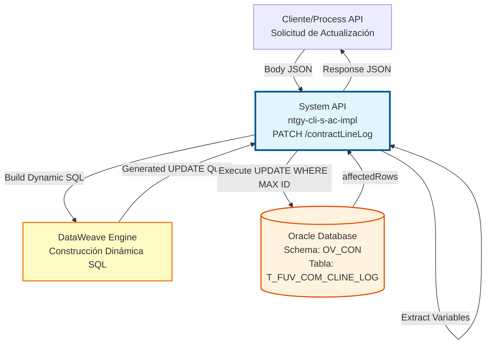
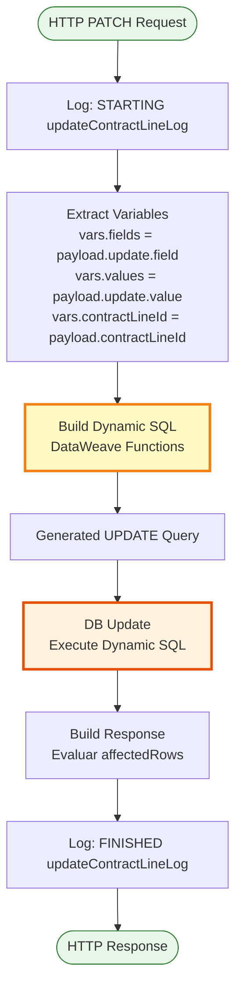
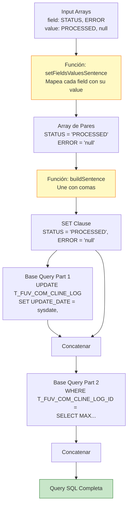
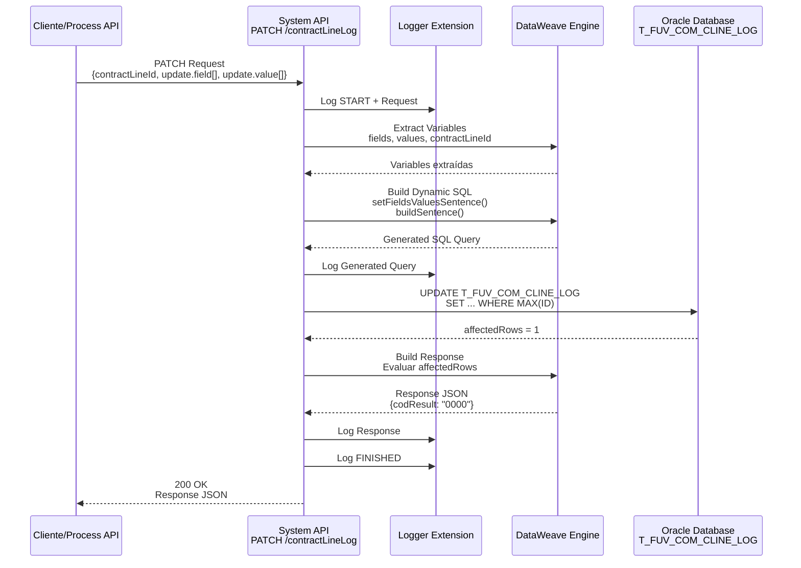
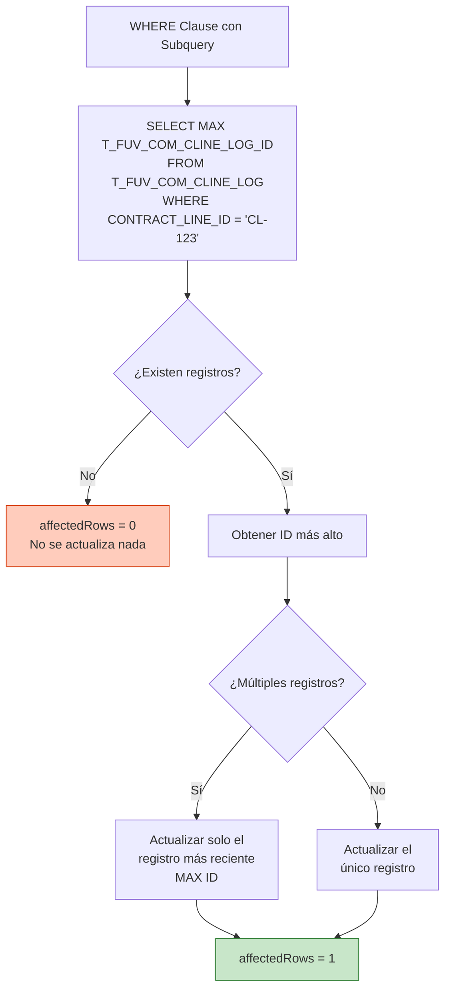
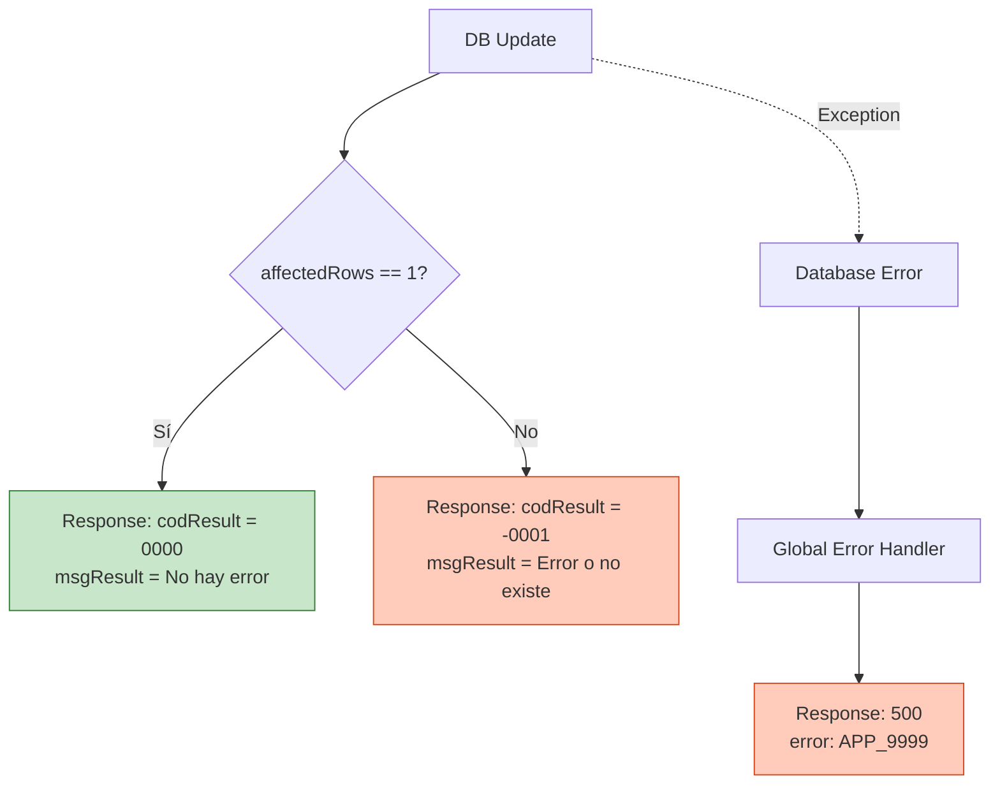

# PATCH /contractLineLog

## 📌 Descripción General

### Propósito del Endpoint

Este endpoint permite actualizar registros de log de líneas de contrato en la tabla `T_FUV_COM_CLINE_LOG` de Oracle Database mediante una **construcción dinámica de query SQL**. Utiliza funciones DataWeave para generar sentencias UPDATE flexibles que permiten actualizar cualquier combinación de campos en un solo request.

El endpoint soporta:
- **Actualización Flexible**: Permite actualizar cualquier combinación de campos de la tabla
- **Construcción Dinámica de SQL**: Genera la query UPDATE en tiempo de ejecución usando DataWeave
- **Selección Inteligente**: Actualiza automáticamente el registro más reciente (MAX ID) del contractLineId
- **UPDATE_DATE Automático**: Siempre actualiza la fecha de modificación a `sysdate`

### Tipo de API

**Capa:** System API (API-Led Connectivity)

**Función:** Integración directa con Oracle Database (schema OV_CON) para actualizaciones flexibles de logs de líneas de contrato mediante SQL dinámico.

### Patrón de Integración

**Tipo:** Request-Reply Síncrono con UPDATE dinámico en Oracle Database

**Descripción:** El endpoint recibe el contractLineId y arrays de campos/valores a actualizar, construye dinámicamente una sentencia SQL UPDATE mediante funciones DataWeave, ejecuta la actualización en el registro más reciente, y retorna confirmación basada en las filas afectadas.

### Arquitectura API-Led Connectivity



---

## 💼 Propósito del Negocio

### Casos de Uso Principales

1. **Actualización de Estado de Procesamiento**
   - Marcar logs como PROCESSED después de procesamiento exitoso
   - Cambiar estado a ERROR cuando falla el procesamiento
   - Actualizar a RETRY para reintentos programados

2. **Registro de Errores**
   - Almacenar mensajes de error detallados
   - Incrementar contador de reintentos
   - Actualizar estado y error simultáneamente

3. **Gestión de Reintentos**
   - Incrementar contador PROCESSING_RETRIES
   - Limpiar campo ERROR después de reintento exitoso
   - Actualizar estado para siguiente intento

4. **Actualización de Datos de Athena**
   - Modificar ATHENA_CONTRACT_LINE con datos actualizados
   - Agregar información adicional en AC_EXTRA_DATA
   - Sincronizar cambios desde sistema Athena

### Contexto Empresarial

- **Dominio:** Gestión de Contratos y Auditoría
- **Sector:** Energía - Utilities
- **División:** Naturgy España - NewCo
- **Proceso de Negocio:** Actualización y gestión del ciclo de vida de logs de líneas de contrato
- **Sistema Backend:** Oracle Database (AC Schema - Administración Comercial)

### Stakeholders

- **Procesos Batch**: Actualizan estado de logs después de procesamiento
- **Sistemas de Reintento**: Incrementan contadores y actualizan errores
- **Equipos de Operaciones**: Corrigen datos manualmente cuando es necesario
- **Sistemas de Sincronización**: Actualizan datos de Athena

### Valor de Negocio

- **Flexibilidad Operacional**: Permite actualizar cualquier combinación de campos
- **Eficiencia**: Una sola llamada puede actualizar múltiples campos
- **Trazabilidad**: UPDATE_DATE automático registra cuándo se modificó
- **Gestión de Errores**: Facilita el ciclo completo de gestión de reintentos

### Consumidores Potenciales

Este endpoint puede ser consumido por:
- Process APIs de gestión de contratos
- Procesos batch de reconciliación
- Sistemas de gestión de reintentos
- Herramientas de administración y corrección manual
- Flujos de sincronización con Athena

---

## 🔧 Especificación Técnica

### URLs por Ambiente

| Ambiente | URL Base | URL Completa |
|----------|----------|--------------|
| **Local** | `http://localhost:8081` | `http://localhost:8081/api/contractLineLog` |
| **Development** | `https://ntgy-cli-s-ac-impl-dev.us-e2.cloudhub.io` | `https://ntgy-cli-s-ac-impl-dev.us-e2.cloudhub.io/api/contractLineLog` |
| **QA** | `https://ntgy-cli-s-ac-impl-cc.us-e2.cloudhub.io` | `https://ntgy-cli-s-ac-impl-cc.us-e2.cloudhub.io/api/contractLineLog` |
| **Pre-Production** | `https://ntgy-cli-s-ac-impl-cl.us-e2.cloudhub.io` | `https://ntgy-cli-s-ac-impl-cl.us-e2.cloudhub.io/api/contractLineLog` |
| **Production** | `https://ntgy-cli-s-ac-impl-pro.us-e2.cloudhub.io` | `https://ntgy-cli-s-ac-impl-pro.us-e2.cloudhub.io/api/contractLineLog` |

### Método HTTP

```
PATCH /api/contractLineLog
```

### Parámetros de Entrada

#### Headers HTTP

| Header | Tipo | Requerido | Descripción | Ejemplo |
|--------|------|-----------|-------------|---------|
| `Content-Type` | string | ✅ Sí | Tipo de contenido del request | `application/json` |
| `Accept` | string | ❌ No | Tipo de contenido esperado en response | `application/json` |

#### Body Parameters

| Campo | Tipo | Requerido | Descripción |
|-------|------|-----------|-------------|
| `contractLineId` | string | ✅ Sí | Identificador de la línea de contrato a actualizar |
| `update` | object | ✅ Sí | Objeto que contiene los campos a actualizar |
| `update.field` | array[string] | ✅ Sí | Array de nombres de campos a actualizar |
| `update.value` | array[string] | ✅ Sí | Array de valores correspondientes a cada campo |

> **⚠️ Reglas Importantes:**
> 1. Los arrays `field` y `value` **deben tener el mismo tamaño**
> 2. El orden importa: `field[0]` se empareja con `value[0]`, `field[1]` con `value[1]`, etc.
> 3. Para establecer un campo a NULL, usar `null` en el array de values
> 4. El campo `UPDATE_DATE` se actualiza automáticamente a `sysdate` - no incluirlo en el array
> 5. Solo se actualiza el registro **más reciente** (MAX ID) del contractLineId especificado

**Campos Actualizables Comunes:**

| Campo | Tipo | Descripción | Ejemplo de Valor |
|-------|------|-------------|------------------|
| `STATUS` | string | Estado del log | `"PENDING"`, `"PROCESSED"`, `"ERROR"`, `"RETRY"` |
| `ERROR` | string/null | Mensaje de error | `"Connection timeout"`, `null` |
| `PROCESSING_RETRIES` | number | Contador de reintentos | `"2"`, `"3"` |
| `AC_EXTRA_DATA` | string/null | Datos adicionales | `"{\"info\":\"data\"}"`, `null` |
| `ATHENA_CONTRACT_LINE` | string | Datos de Athena (JSON) | `"{\"lineId\":\"CL-123\"}"` |

**Estructura del Request Body:**

```json
{
  "contractLineId": "CL-2024-12345",
  "update": {
    "field": ["STATUS", "ERROR"],
    "value": ["PROCESSED", null]
  }
}
```

### Respuestas

#### Respuesta Exitosa (200 OK)

Cuando la actualización se realiza correctamente (affectedRows = 1):

```json
{
  "result": {
    "codResult": "0000",
    "msgResult": "No hay error"
  }
}
```

#### Respuesta de Error de Actualización (200 OK)

Cuando la actualización falla o el registro no existe (affectedRows ≠ 1):

```json
{
  "result": {
    "codResult": "-0001",
    "msgResult": "Ha habido un error en la actualización del registro o el registro no existe"
  }
}
```

#### Respuesta de Error Técnico (500)

```json
{
  "error": "APP_9999",
  "message": "Error en el servicio."
}
```

### Códigos de Respuesta HTTP

| Código | Descripción | Escenario |
|--------|-------------|-----------|
| `200` | OK | Operación completada (exitosa o con error de negocio) |
| `400` | Bad Request | Request body inválido, arrays de diferente tamaño, o campos requeridos faltantes |
| `500` | Internal Server Error | Error técnico en el servidor o base de datos |

### Autenticación y Autorización

- **Tipo:** Client ID & Client Secret (Anypoint Platform)
- **Autorización Oracle:** El usuario de base de datos debe tener permisos para:
  - Ejecutar UPDATE en tabla `T_FUV_COM_CLINE_LOG`
  - Ejecutar SELECT (para subquery MAX)
  - Permisos de escritura en schema `OV_CON`

### Timeouts

| Tipo | Valor | Descripción |
|------|-------|-------------|
| **Request Timeout** | 30 segundos | Tiempo máximo de espera para la respuesta |
| **Connection Timeout** | 10 segundos | Tiempo máximo para establecer conexión con Oracle |

---

## 🏗️ Implementación Técnica

### Arquitectura del Flow



### Componentes del Flow

#### 1. Logger de Inicio
```xml
<logger level="INFO" doc:name="request" message="STARTING updateContractLineLog METHOD. REQUEST: ..."/>
```
- Registra el inicio de la operación
- Normaliza y registra el payload de entrada

#### 2. Extracción de Variables
```dataweave
%dw 2.0
output application/java
---
{
  fields: payload.update.field,
  values: payload.update.value,
  contractLineId: payload.contractLineId
}
```
- Extrae arrays de campos y valores
- Almacena contractLineId para la cláusula WHERE

#### 3. Construcción Dinámica de SQL

Esta es la parte más compleja e interesante del endpoint. Usa funciones DataWeave para construir la query SQL dinámicamente:

```dataweave
%dw 2.0
output application/java

// Componentes base de la query
var sentence_1 = "UPDATE T_FUV_COM_CLINE_LOG SET UPDATE_DATE = sysdate, "
var sentence_2 = " WHERE T_FUV_COM_CLINE_LOG_ID = (SELECT MAX(T_FUV_COM_CLINE_LOG_ID) FROM T_FUV_COM_CLINE_LOG WHERE CONTRACT_LINE_ID = "

// FUNCIÓN 1: Mapear campos y valores
// Recorre el array de fields y crea strings "field = 'value'" para cada par
fun setFieldsValuesSentence(listFields) = 
  listFields map (field, findex) -> {
    printString: field ++ " = '" ++ 
      (vars.values filter ((item, vindex) -> (findex == vindex)) map $)[0] 
      ++ "'"
  }

// FUNCIÓN 2: Unir strings con comas
// Concatena todos los "field = 'value'" con ", " entre ellos
fun buildSentence(listfieldsValuesSentence) = 
  listfieldsValuesSentence joinBy ", "

// Aplicar funciones
var fieldsValuesSentence = setFieldsValuesSentence(vars.fields)
var SETSentenceGenerated = buildSentence(fieldsValuesSentence.printString)

// Construir query completa
---
sentence_1 ++ SETSentenceGenerated ++ sentence_2 ++ "'" ++ vars.contractLineId ++ "'" ++ ")"
```

**Ejemplo de Transformación:**

**Input:**
```json
{
  "contractLineId": "CL-2024-12345",
  "update": {
    "field": ["STATUS", "ERROR", "PROCESSING_RETRIES"],
    "value": ["ERROR", "Connection timeout", "2"]
  }
}
```

**Query Generada:**
```sql
UPDATE T_FUV_COM_CLINE_LOG 
SET UPDATE_DATE = sysdate, 
    STATUS = 'ERROR', 
    ERROR = 'Connection timeout', 
    PROCESSING_RETRIES = '2' 
WHERE T_FUV_COM_CLINE_LOG_ID = (
  SELECT MAX(T_FUV_COM_CLINE_LOG_ID) 
  FROM T_FUV_COM_CLINE_LOG 
  WHERE CONTRACT_LINE_ID = 'CL-2024-12345'
)
```

#### 4. Ejecución de UPDATE
```xml
<db:update doc:name="Update" config-ref="Database_Config">
  <db:sql><![CDATA[#[payload]]]></db:sql>
</db:update>
```
- Ejecuta la query SQL generada dinámicamente
- El payload contiene el string SQL completo
- Retorna número de filas afectadas

#### 5. Construcción de Respuesta
```dataweave
%dw 2.0
output application/json
---
{
  "result": {
    "codResult": if (payload.affectedRows == 1) "0000" else "-0001",
    "msgResult": if (payload.affectedRows == 1) 
      "No hay error" 
      else 
      "Ha habido un error en la actualización del registro o el registro no existe"
  }
}
```
- Evalúa `affectedRows` del resultado de UPDATE
- Retorna código `0000` si se actualizó 1 fila (éxito)
- Retorna código `-0001` si no se actualizó exactamente 1 fila (error o no existe)

#### 6. Logger de Fin
```xml
<logger level="INFO" doc:name="response" message="FINISHED updateContractLineLog METHOD. RESPONSE: ..."/>
```
- Registra el fin de la operación
- Normaliza y registra la respuesta generada

### Diagrama de Construcción de SQL Dinámico



### Diagrama de Secuencia Completo



### Lógica de Selección con MAX(ID)



**Comportamiento con Múltiples Registros:**

Si existen múltiples logs para el mismo `CONTRACT_LINE_ID`:

| T_FUV_COM_CLINE_LOG_ID | CONTRACT_LINE_ID | STATUS | PROCESSING_DATE |
|------------------------|------------------|--------|-----------------|
| 100 | CL-2024-12345 | PENDING | 2024-01-15 10:00 |
| 105 | CL-2024-12345 | ERROR | 2024-01-15 11:00 |
| 110 | CL-2024-12345 | RETRY | 2024-01-15 12:00 | ← **Este se actualiza**

Solo se actualiza el registro con `T_FUV_COM_CLINE_LOG_ID = 110` (el más alto).

### Configuración de Conexión Oracle

```xml
<db:config name="Database_Config">
    <db:generic-connection 
        url="jdbc:oracle:thin:${dbAC.user}/${secure::dbAC.pass}@..."
        driverClassName="oracle.jdbc.driver.OracleDriver">
        <db:pooling-profile 
            maxPoolSize="${dbAC.MaxPoolSize}"
            maxWait="${dbAC.MaxWaitTime}"
            maxIdleTime="${dbAC.MaxIdleTime}"/>
    </db:generic-connection>
</db:config>
```

**Características:**
- **Driver:** Oracle JDBC 19.13.0.0.1
- **Connection Pooling:** Configurado por ambiente
- **Oracle RAC:** Soporte para failover automático
- **SQL Dinámico:** Ejecutado como string en payload

### Manejo de Errores



**Escenarios de Error:**

1. **Actualización Exitosa** (affectedRows = 1)
   - Código: `0000`
   - Mensaje: "No hay error"
   - HTTP Status: 200

2. **Registro No Existe** (affectedRows = 0)
   - Código: `-0001`
   - Mensaje: "Ha habido un error en la actualización del registro o el registro no existe"
   - HTTP Status: 200
   - Causa: No existe ningún log con ese contractLineId

3. **Error de SQL Dinámico**
   - HTTP Status: 500
   - Error: `APP_9999`
   - Mensaje: "Error en el servicio."
   - Posibles causas: Nombre de campo inválido, sintaxis SQL incorrecta

4. **Error de Base de Datos**
   - HTTP Status: 500
   - Error: `APP_9999`
   - Mensaje: "Error en el servicio."
   - Posibles causas: Conexión perdida, timeout, permisos insuficientes

### Performance y Optimización

**Características de Performance:**
- **Connection Pooling**: Reutilización de conexiones Oracle
- **SQL Dinámico**: Flexibilidad sin múltiples endpoints
- **Subquery Optimizada**: MAX(ID) es eficiente con índice en ID
- **UPDATE Simple**: Sin joins complejos

**Métricas Esperadas:**
- Tiempo de respuesta: < 500ms (p95)
- Throughput: 100+ requests/minuto
- Tasa de error: < 0.1%

**Recomendaciones de Índices:**
- Índice primario en `T_FUV_COM_CLINE_LOG_ID` (ya existe)
- Índice en `CONTRACT_LINE_ID` para subquery eficiente
- Índice compuesto en `(CONTRACT_LINE_ID, T_FUV_COM_CLINE_LOG_ID)` para mejor performance

---

## 💻 Ejemplos de Uso

### Ejemplo 1: Actualizar Estado a PROCESSED

**Request:**

```bash
curl -X PATCH "https://ntgy-cli-s-ac-impl-dev.us-e2.cloudhub.io/api/contractLineLog" \
  -H "Content-Type: application/json" \
  -H "client_id: your-client-id" \
  -H "client_secret: your-client-secret" \
  -d '{
    "contractLineId": "CL-2024-12345",
    "update": {
      "field": ["STATUS"],
      "value": ["PROCESSED"]
    }
  }'
```

**Query SQL Generada:**
```sql
UPDATE T_FUV_COM_CLINE_LOG 
SET UPDATE_DATE = sysdate, STATUS = 'PROCESSED' 
WHERE T_FUV_COM_CLINE_LOG_ID = (
  SELECT MAX(T_FUV_COM_CLINE_LOG_ID) 
  FROM T_FUV_COM_CLINE_LOG 
  WHERE CONTRACT_LINE_ID = 'CL-2024-12345'
)
```

**Response (200 OK):**

```json
{
  "result": {
    "codResult": "0000",
    "msgResult": "No hay error"
  }
}
```

---

### Ejemplo 2: Registrar Error e Incrementar Reintentos

**Request:**

```bash
curl -X PATCH "https://ntgy-cli-s-ac-impl-pro.us-e2.cloudhub.io/api/contractLineLog" \
  -H "Content-Type: application/json" \
  -H "client_id: your-client-id" \
  -H "client_secret: your-client-secret" \
  -d '{
    "contractLineId": "CL-2024-67890",
    "update": {
      "field": ["STATUS", "ERROR", "PROCESSING_RETRIES"],
      "value": ["ERROR", "Connection timeout to Athena service", "2"]
    }
  }'
```

**Query SQL Generada:**
```sql
UPDATE T_FUV_COM_CLINE_LOG 
SET UPDATE_DATE = sysdate, 
    STATUS = 'ERROR', 
    ERROR = 'Connection timeout to Athena service', 
    PROCESSING_RETRIES = '2' 
WHERE T_FUV_COM_CLINE_LOG_ID = (
  SELECT MAX(T_FUV_COM_CLINE_LOG_ID) 
  FROM T_FUV_COM_CLINE_LOG 
  WHERE CONTRACT_LINE_ID = 'CL-2024-67890'
)
```

**Response (200 OK):**

```json
{
  "result": {
    "codResult": "0000",
    "msgResult": "No hay error"
  }
}
```

---

### Ejemplo 3: Limpiar Error Después de Reintento Exitoso

**Request:**

```bash
curl -X PATCH "https://ntgy-cli-s-ac-impl-dev.us-e2.cloudhub.io/api/contractLineLog" \
  -H "Content-Type: application/json" \
  -H "client_id: your-client-id" \
  -H "client_secret: your-client-secret" \
  -d '{
    "contractLineId": "CL-2024-67890",
    "update": {
      "field": ["STATUS", "ERROR"],
      "value": ["PROCESSED", null]
    }
  }'
```

**Query SQL Generada:**
```sql
UPDATE T_FUV_COM_CLINE_LOG 
SET UPDATE_DATE = sysdate, 
    STATUS = 'PROCESSED', 
    ERROR = 'null' 
WHERE T_FUV_COM_CLINE_LOG_ID = (
  SELECT MAX(T_FUV_COM_CLINE_LOG_ID) 
  FROM T_FUV_COM_CLINE_LOG 
  WHERE CONTRACT_LINE_ID = 'CL-2024-67890'
)
```

**Response (200 OK):**

```json
{
  "result": {
    "codResult": "0000",
    "msgResult": "No hay error"
  }
}
```

---

### Ejemplo 4: Error - Registro No Existe

**Request:**

```bash
curl -X PATCH "https://ntgy-cli-s-ac-impl-dev.us-e2.cloudhub.io/api/contractLineLog" \
  -H "Content-Type: application/json" \
  -H "client_id: your-client-id" \
  -H "client_secret: your-client-secret" \
  -d '{
    "contractLineId": "CL-NONEXISTENT",
    "update": {
      "field": ["STATUS"],
      "value": ["PROCESSED"]
    }
  }'
```

**Response (200 OK - Error de Negocio):**

```json
{
  "result": {
    "codResult": "-0001",
    "msgResult": "Ha habido un error en la actualización del registro o el registro no existe"
  }
}
```

---

### Ejemplo 5: Uso desde JavaScript/Node.js

```javascript
const axios = require('axios');

async function updateContractLineLog(contractLineId, fieldsToUpdate, valuesToUpdate) {
  try {
    const response = await axios.patch(
      'https://ntgy-cli-s-ac-impl-pro.us-e2.cloudhub.io/api/contractLineLog',
      {
        contractLineId: contractLineId,
        update: {
          field: fieldsToUpdate,
          value: valuesToUpdate
        }
      },
      {
        headers: {
          'Content-Type': 'application/json',
          'client_id': process.env.CLIENT_ID,
          'client_secret': process.env.CLIENT_SECRET
        }
      }
    );

    if (response.data.result.codResult === '0000') {
      console.log('Log actualizado exitosamente');
      return { success: true, data: response.data };
    } else {
      console.error('Error al actualizar log:', response.data.result.msgResult);
      return { success: false, error: response.data.result };
    }
  } catch (error) {
    console.error('Error técnico:', error.message);
    return { success: false, error: error.message };
  }
}

// Ejemplo 1: Actualizar estado a PROCESSED
updateContractLineLog('CL-2024-12345', ['STATUS'], ['PROCESSED'])
  .then(result => console.log('Resultado:', result));

// Ejemplo 2: Registrar error e incrementar reintentos
updateContractLineLog(
  'CL-2024-67890',
  ['STATUS', 'ERROR', 'PROCESSING_RETRIES'],
  ['ERROR', 'Connection timeout', '2']
).then(result => console.log('Resultado:', result));

// Ejemplo 3: Limpiar error después de reintento exitoso
updateContractLineLog(
  'CL-2024-67890',
  ['STATUS', 'ERROR'],
  ['PROCESSED', null]
).then(result => console.log('Resultado:', result));
```

---

### Ejemplo 6: Uso desde Python

```python
import requests
import json
import os

def update_contract_line_log(contract_line_id, fields_to_update, values_to_update):
    """
    Actualiza un log de línea de contrato
    
    Args:
        contract_line_id: ID de la línea de contrato
        fields_to_update: Lista de campos a actualizar
        values_to_update: Lista de valores correspondientes
    
    Returns:
        dict: Resultado de la operación
    """
    url = "https://ntgy-cli-s-ac-impl-pro.us-e2.cloudhub.io/api/contractLineLog"
    
    headers = {
        "Content-Type": "application/json",
        "client_id": os.getenv("CLIENT_ID"),
        "client_secret": os.getenv("CLIENT_SECRET")
    }
    
    payload = {
        "contractLineId": contract_line_id,
        "update": {
            "field": fields_to_update,
            "value": values_to_update
        }
    }
    
    try:
        response = requests.patch(url, headers=headers, json=payload, timeout=30)
        response.raise_for_status()
        
        result = response.json()
        
        if result.get("result", {}).get("codResult") == "0000":
            print("Log actualizado exitosamente")
            return {"success": True, "data": result}
        else:
            print(f"Error al actualizar log: {result.get('result', {}).get('msgResult')}")
            return {"success": False, "error": result.get("result")}
            
    except requests.exceptions.RequestException as e:
        print(f"Error técnico: {str(e)}")
        return {"success": False, "error": str(e)}

# Ejemplo 1: Actualizar estado a PROCESSED
result = update_contract_line_log("CL-2024-12345", ["STATUS"], ["PROCESSED"])
print(f"Resultado: {result}")

# Ejemplo 2: Registrar error e incrementar reintentos
result = update_contract_line_log(
    "CL-2024-67890",
    ["STATUS", "ERROR", "PROCESSING_RETRIES"],
    ["ERROR", "Connection timeout", "2"]
)
print(f"Resultado: {result}")

# Ejemplo 3: Limpiar error después de reintento exitoso
result = update_contract_line_log(
    "CL-2024-67890",
    ["STATUS", "ERROR"],
    ["PROCESSED", None]
)
print(f"Resultado: {result}")
```

---

### Notas de Implementación

1. **Arrays Paralelos**:
   - Los arrays `field` y `value` deben tener exactamente el mismo tamaño
   - El orden es crítico: `field[0]` se empareja con `value[0]`
   - Validar tamaños antes de enviar el request

2. **Construcción Dinámica de SQL**:
   - El endpoint construye la query en tiempo de ejecución
   - Permite flexibilidad total en los campos a actualizar
   - No requiere endpoints separados para cada combinación de campos

3. **Selección por MAX(ID)**:
   - Solo actualiza el registro más reciente del contractLineId
   - Si hay múltiples logs, solo el último (ID más alto) se modifica
   - Útil para actualizar el estado actual sin afectar histórico

4. **UPDATE_DATE Automático**:
   - Siempre se actualiza a `sysdate` de Oracle
   - No es necesario incluirlo en el array de campos
   - Proporciona trazabilidad automática de modificaciones

5. **Valores NULL**:
   - Para establecer un campo a NULL, usar `null` en el array de values
   - En JavaScript: `null`
   - En Python: `None`
   - En JSON: `null`

6. **Validación de Campos**:
   - El endpoint no valida nombres de campos
   - Si se proporciona un campo inválido, Oracle retornará error
   - Asegurarse de usar nombres de columna correctos

7. **Idempotencia**:
   - El endpoint NO es idempotente
   - Cada llamada actualiza el registro (incluso con los mismos valores)
   - UPDATE_DATE siempre cambia

8. **Casos de Uso Comunes**:
   - **Marcar como procesado**: `["STATUS"], ["PROCESSED"]`
   - **Registrar error**: `["STATUS", "ERROR"], ["ERROR", "mensaje"]`
   - **Incrementar reintentos**: `["PROCESSING_RETRIES"], ["2"]`
   - **Limpiar error**: `["STATUS", "ERROR"], ["PROCESSED", null]`
