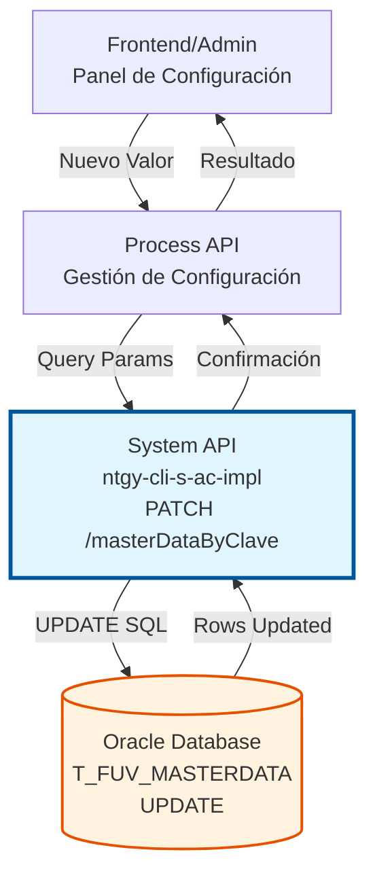
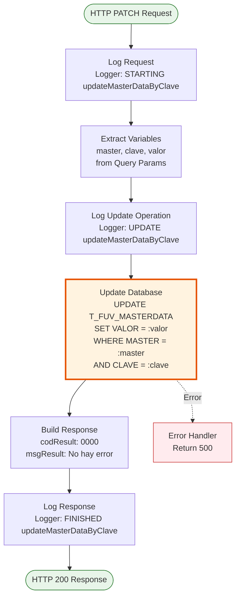
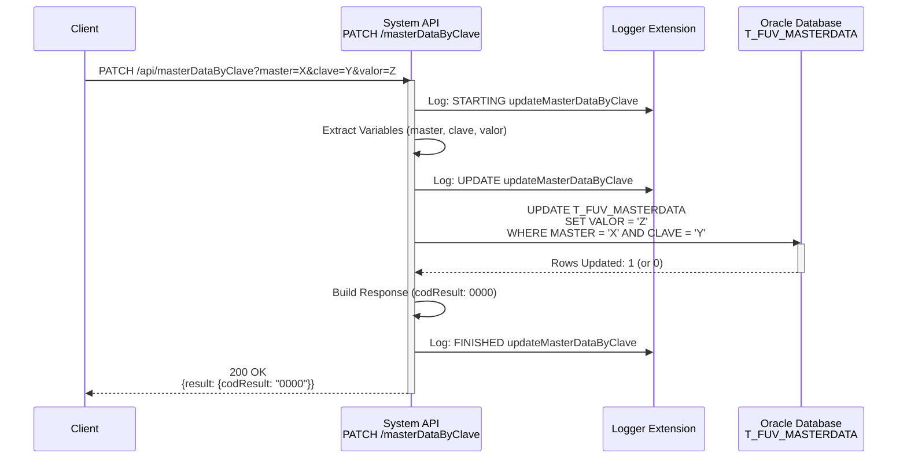
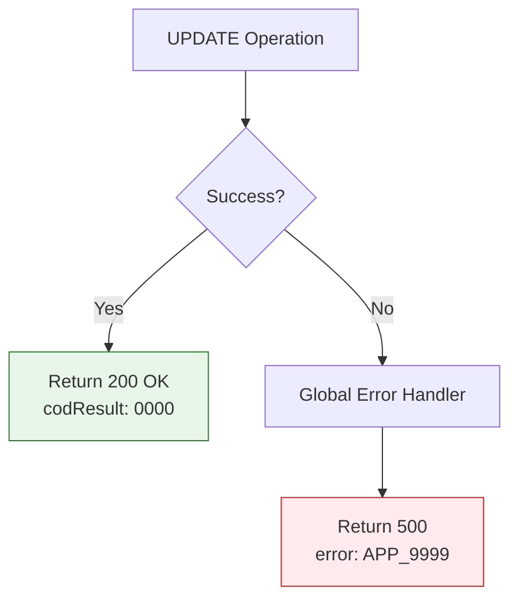
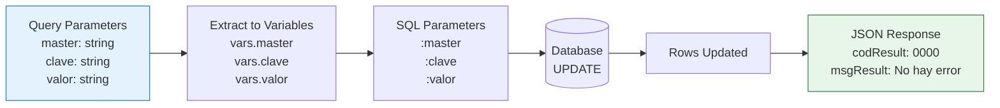

# PATCH /masterDataByClave

## 📌 Descripción General

### Propósito del Endpoint

Este endpoint permite **actualizar el valor de un dato maestro específico** en la tabla de configuración del sistema. Los datos maestros son parámetros de configuración organizados por dominios (master) y claves, que controlan el comportamiento de diferentes funcionalidades del sistema sin necesidad de redespliegue.

El endpoint soporta:
- **Actualización de Valores**: Modifica el valor asociado a una combinación master-clave específica
- **Configuración Dinámica**: Permite cambios en tiempo real sin reiniciar servicios
- **Gestión Centralizada**: Mantiene todos los parámetros de configuración en una única tabla

### Tipo de API

**Capa:** System API (API-Led Connectivity)

**Función:** Integración directa con Oracle Database (esquema OV_CON) para actualización de datos maestros de configuración.

### Patrón de Integración

**Tipo:** Request-Reply Síncrono con SQL UPDATE

**Descripción:** Recibe parámetros de query (master, clave, valor), ejecuta una operación UPDATE en la base de datos Oracle, y retorna confirmación de la actualización exitosa.

### Arquitectura API-Led Connectivity



---

## 💼 Propósito del Negocio

### Casos de Uso Principales

1. **Actualización de Parámetros de Configuración**
   - Administradores modifican valores de configuración del sistema
   - Cambios aplicados inmediatamente sin necesidad de redespliegue
   - Permite ajustes operativos en tiempo real

2. **Gestión de Umbrales y Límites**
   - Actualización de límites operacionales (ej: máximo de registros, timeouts)
   - Modificación de umbrales de alertas y notificaciones
   - Ajuste de parámetros de rendimiento

3. **Configuración de Integraciones**
   - Actualización de URLs de servicios externos
   - Modificación de credenciales o tokens
   - Cambio de parámetros de conexión

### Contexto Empresarial

- **Dominio:** Gestión de Configuración y Parámetros del Sistema
- **Sector:** Energía - Utilities
- **División:** Naturgy España - Administración Comercial
- **Proceso de Negocio:** Mantenimiento de Configuración del Sistema
- **Módulo:** Administración de Parámetros Maestros

### Stakeholders

- **Administradores de Sistema**: Necesitan actualizar configuraciones sin intervención técnica
- **Equipo de Operaciones**: Requieren ajustar parámetros operacionales en tiempo real
- **Equipo de Desarrollo**: Utilizan datos maestros para configurar comportamientos de aplicaciones

### Valor de Negocio

- **Agilidad Operacional**: Cambios de configuración sin necesidad de redespliegue
- **Reducción de Downtime**: Actualizaciones sin interrumpir servicios
- **Flexibilidad**: Adaptación rápida a cambios de requisitos de negocio
- **Trazabilidad**: Registro de cambios en configuración del sistema

### Consumidores Potenciales

Este endpoint puede ser consumido por:
- Paneles de administración web
- Process APIs de gestión de configuración
- Scripts de mantenimiento automatizado
- Herramientas de DevOps para configuración de ambientes

---

## 🔧 Especificación Técnica

### URLs por Ambiente

| Ambiente | URL Base | URL Completa |
|----------|----------|--------------|
| **Local** | `http://localhost:8081` | `http://localhost:8081/api/masterDataByClave?master=DOMAIN&clave=KEY&valor=VALUE` |
| **Development** | `https://ntgy-cli-s-ac-des.us-e2.cloudhub.io` | `https://ntgy-cli-s-ac-des.us-e2.cloudhub.io/api/masterDataByClave?master=DOMAIN&clave=KEY&valor=VALUE` |
| **QA** | `https://ntgy-cli-s-ac-cc.us-e2.cloudhub.io` | `https://ntgy-cli-s-ac-cc.us-e2.cloudhub.io/api/masterDataByClave?master=DOMAIN&clave=KEY&valor=VALUE` |
| **Pre-Production** | `https://ntgy-cli-s-ac-cl.us-e2.cloudhub.io` | `https://ntgy-cli-s-ac-cl.us-e2.cloudhub.io/api/masterDataByClave?master=DOMAIN&clave=KEY&valor=VALUE` |
| **Production** | `https://ntgy-cli-s-ac-pro.us-e2.cloudhub.io` | `https://ntgy-cli-s-ac-pro.us-e2.cloudhub.io/api/masterDataByClave?master=DOMAIN&clave=KEY&valor=VALUE` |

### Método HTTP

```
PATCH /api/masterDataByClave
```

### Parámetros de Entrada

#### Headers HTTP

| Header | Tipo | Requerido | Descripción | Ejemplo |
|--------|------|-----------|-------------|---------|
| `Content-Type` | string | ✅ Sí | Tipo de contenido del request | `application/json` |
| `Accept` | string | ❌ No | Tipo de contenido esperado en response | `application/json` |

#### Query Parameters

| Parámetro | Tipo | Requerido | Descripción | Ejemplo |
|-----------|------|-----------|-------------|---------|
| `master` | string | ✅ Sí | Dominio o categoría del dato maestro | `"BUYAPOWA"` |
| `clave` | string | ✅ Sí | Clave específica dentro del dominio | `"MAX_RECORDS"` |
| `valor` | string | ✅ Sí | Nuevo valor a asignar a la clave | `"100"` |

**Nota:** Todos los parámetros se envían como query parameters en la URL.

### Respuestas

#### Respuesta Exitosa (200 OK)

```json
{
  "result": {
    "codResult": "0000",
    "msgResult": "No hay error"
  }
}
```

**Descripción:** La actualización se realizó correctamente. El código "0000" indica éxito.

#### Respuesta de Error Técnico (500)

```json
{
  "error": "APP_9999",
  "message": "Error en el servicio."
}
```

**Descripción:** Error interno del servidor durante la actualización.

### Comportamiento Especial

#### Actualización de Registro No Existente

Si la combinación `master` + `clave` no existe en la tabla, la operación UPDATE no afectará ninguna fila, pero **NO generará error**. El endpoint retornará respuesta exitosa (200 OK) aunque no se haya actualizado ningún registro.

**Recomendación:** Verificar la existencia del registro con `GET /masterDataByClave` antes de actualizar.

#### Invalidación de Caché

⚠️ **IMPORTANTE:** Este endpoint NO invalida automáticamente la caché de datos maestros. Los cambios pueden tardar hasta **10 minutos** en reflejarse en consultas que usan caché (GET /masterDataByClave).

**Solución:** Para cambios críticos que requieren efecto inmediato, considerar:
1. Reiniciar la aplicación (invalida toda la caché)
2. Esperar el TTL de 10 minutos
3. Implementar invalidación manual de caché (mejora futura)

### Autenticación y Autorización

- **Tipo:** Client ID & Client Secret (Anypoint Platform)
- **Autorización DB:** El usuario de base de datos debe tener permisos para:
  - Ejecutar UPDATE en tabla `T_FUV_MASTERDATA`
  - Acceso al esquema `OV_CON`

### Timeouts

| Tipo | Valor | Descripción |
|------|-------|-------------|
| **Request Timeout** | 30 segundos | Tiempo máximo de espera para la respuesta |
| **Connection Timeout** | 10 segundos | Tiempo máximo para establecer conexión con DB |
| **Query Timeout** | 30 segundos | Tiempo máximo de ejecución del UPDATE |

---

## 🏗️ Implementación Técnica

### Arquitectura del Flow



### Componentes del Flow

#### 1. Logger Inicial (Línea 126)
```xml
<logger level="INFO" doc:name="request" 
        message="STARTING updateMasterDataByClave METHOD. REQUEST: [params]" />
```
**Propósito:** Registra el inicio de la operación con los parámetros recibidos.

#### 2. Transformación de Variables (Líneas 127-142)
```dataweave
%dw 2.0
output application/java
---
{
  master: attributes.queryParams.master,
  clave: attributes.queryParams.clave,
  valor: attributes.queryParams.valor
}
```
**Propósito:** Extrae los query parameters y los almacena en variables para uso posterior.

#### 3. Logger de Actualización (Línea 144)
```xml
<logger level="INFO" doc:name="Update" 
        message="UPDATE updateMasterDataByClave METHOD. REQUEST: [params]" />
```
**Propósito:** Registra la operación de actualización antes de ejecutarla.

#### 4. Operación de Base de Datos (Líneas 145-151)
```xml
<db:update doc:name="Update master by domain and clave" 
           config-ref="Database_Config">
    <db:sql>
        UPDATE T_FUV_MASTERDATA 
        SET VALOR = :valor 
        WHERE MASTER = :master AND CLAVE = :clave
    </db:sql>
    <db:input-parameters>
        #[{
            master: vars.master,
            clave: vars.clave,
            valor: vars.valor
        }]
    </db:input-parameters>
</db:update>
```

**Propósito:** Ejecuta la actualización en la base de datos Oracle.

**Query SQL:**
```sql
UPDATE T_FUV_MASTERDATA 
SET VALOR = :valor 
WHERE MASTER = :master AND CLAVE = :clave
```

**Parámetros:**
- `:master` - Dominio del dato maestro
- `:clave` - Clave específica
- `:valor` - Nuevo valor a asignar

#### 5. Construcción de Respuesta (Líneas 152-165)
```dataweave
%dw 2.0
output application/json
---
{
  "result": {
    "codResult": "0000",
    "msgResult": "No hay error"
  }
}
```
**Propósito:** Construye la respuesta JSON estándar de éxito.

#### 6. Logger Final (Línea 166)
```xml
<logger level="INFO" doc:name="response" 
        message="FINISHED updateMasterDataByClave METHOD. RESPONSE: [response]" />
```
**Propósito:** Registra la finalización exitosa de la operación.

### Diagrama de Secuencia



### Configuración de Base de Datos

**Connector:** Database Connector (Oracle)

**Configuration Reference:** `Database_Config`

**Connection Details:**
- **Driver:** `oracle.jdbc.driver.OracleDriver`
- **Schema:** `OV_CON` (Administración Comercial)
- **Connection Pooling:** Habilitado
- **Max Pool Size:** Configurable por ambiente
- **Connection Timeout:** 10 segundos
- **Query Timeout:** 30 segundos

### Tabla de Base de Datos

**Tabla:** `T_FUV_MASTERDATA`

**Estructura:**
| Columna | Tipo | Descripción |
|---------|------|-------------|
| `MASTER` | VARCHAR2 | Dominio o categoría del dato maestro (parte de PK) |
| `CLAVE` | VARCHAR2 | Clave específica dentro del dominio (parte de PK) |
| `VALOR` | VARCHAR2 | Valor asociado a la clave (campo actualizado) |

**Primary Key:** `(MASTER, CLAVE)`

**Índices:** PK automático en (MASTER, CLAVE)

### Manejo de Errores



**Errores Manejados:**
- **Database Connection Error:** Retorna 500 con mensaje genérico
- **Query Execution Error:** Retorna 500 con mensaje genérico
- **Timeout:** Retorna 500 después de 30 segundos

**Nota:** No hay validación de existencia previa del registro. Si master+clave no existe, la operación retorna éxito pero no actualiza ninguna fila.

### Transformación de Datos



**Transformaciones Aplicadas:**
1. **Query Params → Variables:** Extracción de parámetros de URL
2. **Variables → SQL Parameters:** Preparación de parámetros para query
3. **DB Result → JSON:** Construcción de respuesta estándar

---

## 💻 Ejemplos de Uso

### Ejemplo 1: Actualizar Límite de Registros Buyapowa

#### Request con curl

```bash
curl -X PATCH "https://ntgy-cli-s-ac-pro.us-e2.cloudhub.io/api/masterDataByClave?master=BUYAPOWA&clave=MAX_RECORDS&valor=150" \
  -H "Content-Type: application/json" \
  -H "Accept: application/json" \
  -H "client_id: YOUR_CLIENT_ID" \
  -H "client_secret: YOUR_CLIENT_SECRET"
```

#### Response Exitoso

```json
{
  "result": {
    "codResult": "0000",
    "msgResult": "No hay error"
  }
}
```

**HTTP Status:** 200 OK

---

### Ejemplo 2: Actualizar URL de Servicio Externo

#### Request con curl

```bash
curl -X PATCH "https://ntgy-cli-s-ac-pro.us-e2.cloudhub.io/api/masterDataByClave?master=EXTERNAL_SERVICES&clave=SALESFORCE_URL&valor=https://api.salesforce.com/v2" \
  -H "Content-Type: application/json" \
  -H "Accept: application/json" \
  -H "client_id: YOUR_CLIENT_ID" \
  -H "client_secret: YOUR_CLIENT_SECRET"
```

#### Response Exitoso

```json
{
  "result": {
    "codResult": "0000",
    "msgResult": "No hay error"
  }
}
```

**HTTP Status:** 200 OK

---

### Ejemplo 3: Actualizar Timeout de Integración

#### Request con curl

```bash
curl -X PATCH "https://ntgy-cli-s-ac-pro.us-e2.cloudhub.io/api/masterDataByClave?master=TIMEOUTS&clave=SAP_TIMEOUT&valor=45000" \
  -H "Content-Type: application/json" \
  -H "Accept: application/json" \
  -H "client_id: YOUR_CLIENT_ID" \
  -H "client_secret: YOUR_CLIENT_SECRET"
```

#### Response Exitoso

```json
{
  "result": {
    "codResult": "0000",
    "msgResult": "No hay error"
  }
}
```

**HTTP Status:** 200 OK

---

### Ejemplo 4: Error - Fallo de Conexión a Base de Datos

#### Request con curl

```bash
curl -X PATCH "https://ntgy-cli-s-ac-pro.us-e2.cloudhub.io/api/masterDataByClave?master=TEST&clave=KEY&valor=VALUE" \
  -H "Content-Type: application/json" \
  -H "Accept: application/json" \
  -H "client_id: YOUR_CLIENT_ID" \
  -H "client_secret: YOUR_CLIENT_SECRET"
```

#### Response de Error

```json
{
  "error": "APP_9999",
  "message": "Error en el servicio."
}
```

**HTTP Status:** 500 Internal Server Error

---

### Ejemplo 5: Request con JavaScript (Fetch API)

```javascript
const updateMasterData = async (master, clave, valor) => {
  const url = `https://ntgy-cli-s-ac-pro.us-e2.cloudhub.io/api/masterDataByClave?master=${encodeURIComponent(master)}&clave=${encodeURIComponent(clave)}&valor=${encodeURIComponent(valor)}`;
  
  try {
    const response = await fetch(url, {
      method: 'PATCH',
      headers: {
        'Content-Type': 'application/json',
        'Accept': 'application/json',
        'client_id': 'YOUR_CLIENT_ID',
        'client_secret': 'YOUR_CLIENT_SECRET'
      }
    });
    
    if (!response.ok) {
      throw new Error(`HTTP error! status: ${response.status}`);
    }
    
    const data = await response.json();
    
    if (data.result.codResult === "0000") {
      console.log('✅ Actualización exitosa');
      return data;
    } else {
      console.error('❌ Error en actualización:', data.result.msgResult);
      return null;
    }
  } catch (error) {
    console.error('❌ Error de red:', error);
    throw error;
  }
};

// Uso
updateMasterData('BUYAPOWA', 'MAX_RECORDS', '200')
  .then(result => console.log('Resultado:', result))
  .catch(error => console.error('Error:', error));
```

---

### Ejemplo 6: Request con Python (requests)

```python
import requests

def update_master_data(master, clave, valor):
    """
    Actualiza un dato maestro en el sistema
    
    Args:
        master (str): Dominio del dato maestro
        clave (str): Clave específica
        valor (str): Nuevo valor
    
    Returns:
        dict: Respuesta del API
    """
    url = "https://ntgy-cli-s-ac-pro.us-e2.cloudhub.io/api/masterDataByClave"
    
    params = {
        'master': master,
        'clave': clave,
        'valor': valor
    }
    
    headers = {
        'Content-Type': 'application/json',
        'Accept': 'application/json',
        'client_id': 'YOUR_CLIENT_ID',
        'client_secret': 'YOUR_CLIENT_SECRET'
    }
    
    try:
        response = requests.patch(url, params=params, headers=headers, timeout=30)
        response.raise_for_status()
        
        data = response.json()
        
        if data['result']['codResult'] == '0000':
            print(f"✅ Actualización exitosa: {master}.{clave} = {valor}")
            return data
        else:
            print(f"❌ Error: {data['result']['msgResult']}")
            return None
            
    except requests.exceptions.RequestException as e:
        print(f"❌ Error de red: {e}")
        raise

# Uso
result = update_master_data('BUYAPOWA', 'MAX_RECORDS', '200')
print(f"Resultado: {result}")
```
