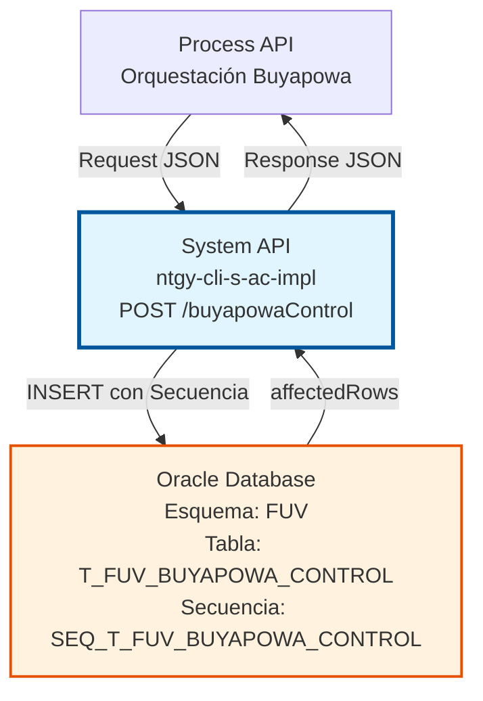
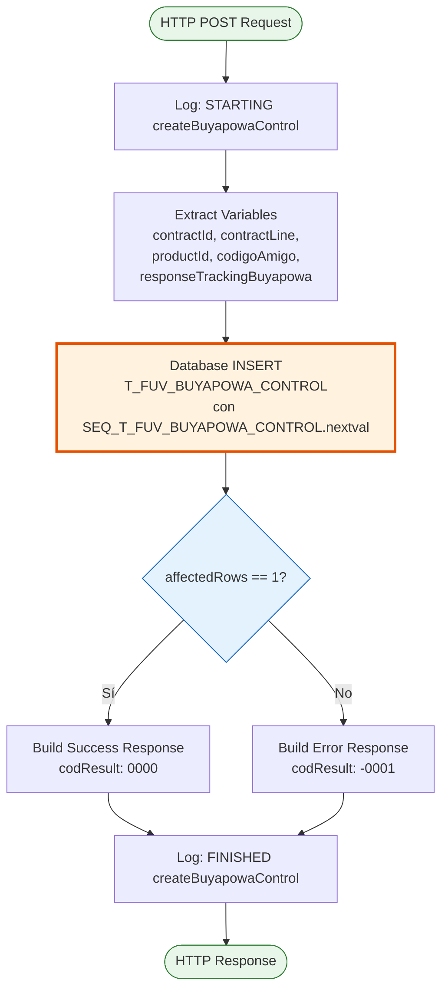
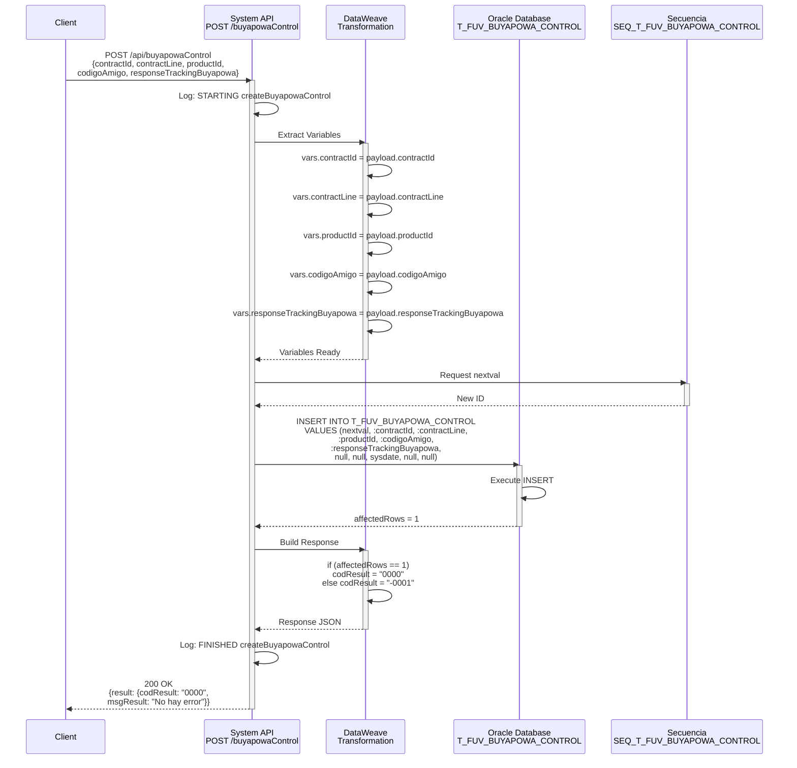

# POST /buyapowaControl

## 📌 Descripción General

### Propósito del Endpoint

Este endpoint crea un nuevo registro de control en la tabla `T_FUV_BUYAPOWA_CONTROL` para gestionar el programa de referidos Buyapowa. Almacena la información inicial del contrato referido, incluyendo el código de amigo y la respuesta de tracking inicial del sistema Buyapowa.

El endpoint soporta:
- **Registro de Referidos**: Crea un nuevo registro de control cuando un cliente es referido por otro
- **Tracking Inicial**: Almacena la respuesta inicial del sistema Buyapowa para seguimiento
- **Inicialización de Estados**: Prepara el registro para futuras actualizaciones de confirmación y estado

### Tipo de API

**Capa:** System API (API-Led Connectivity)

**Función:** Integración directa con Oracle Database (esquema FUV) para gestión de datos del programa de referidos Buyapowa.

### Patrón de Integración

**Tipo:** Request-Reply Síncrono con SQL INSERT

**Descripción:** Recibe los datos del contrato referido, extrae los parámetros necesarios, ejecuta un INSERT en la base de datos Oracle utilizando una secuencia para generar el ID, y retorna el resultado de la operación basándose en las filas afectadas.

### Arquitectura API-Led Connectivity



---

## 💼 Propósito del Negocio

### Casos de Uso Principales

1. **Registro de Nuevo Referido**
   - Un cliente existente refiere a un nuevo cliente a través del programa Buyapowa
   - Se crea un registro de control para hacer seguimiento del referido
   - Se almacena el código de amigo y la información del contrato

2. **Tracking de Respuesta Inicial**
   - El sistema Buyapowa devuelve una respuesta de tracking inicial
   - Esta respuesta se almacena como CLOB para referencia futura
   - Permite auditoría y seguimiento del proceso de referido

3. **Preparación para Confirmación**
   - El registro se crea con campos de confirmación en null
   - Establece la fecha de tracking inicial (sysdate)
   - Prepara el registro para futuras actualizaciones de estado y confirmación

### Contexto Empresarial

- **Dominio:** Gestión de Clientes y Programas de Fidelización
- **Sector:** Energía - Utilities
- **División:** Naturgy España - NewCo
- **Proceso de Negocio:** Programa de Referidos Buyapowa (Código Amigo)
- **Sistema Externo:** Buyapowa (plataforma de referidos)

### Stakeholders

- **Equipo de Marketing**: Gestiona el programa de referidos y necesita tracking de conversiones
- **Equipo de Ventas**: Utiliza los referidos como fuente de nuevos clientes
- **Equipo de Operaciones**: Administra el proceso de alta de contratos referidos
- **Clientes Referidores**: Esperan recompensas por referidos exitosos

### Valor de Negocio

- **Adquisición de Clientes**: Facilita la captación de nuevos clientes a través de referidos
- **Fidelización**: Incentiva a clientes existentes a recomendar los servicios de Naturgy
- **Trazabilidad**: Mantiene un registro completo del proceso de referido desde el inicio
- **Automatización**: Reduce la gestión manual del programa de referidos

### Consumidores Potenciales

Este endpoint puede ser consumido por:
- Process APIs de gestión de contratos
- Flujos de integración con Buyapowa
- Sistemas de CRM (Salesforce)
- Portales web de autoservicio
- Aplicaciones móviles de clientes

---

## 🔧 Especificación Técnica

### URLs por Ambiente

| Ambiente | URL Base | URL Completa |
|----------|----------|--------------|
| **Local** | `http://localhost:8081` | `http://localhost:8081/api/buyapowaControl` |
| **Development** | `https://ntgy-cli-s-ac-impl-dev.us-e2.cloudhub.io` | `https://ntgy-cli-s-ac-impl-dev.us-e2.cloudhub.io/api/buyapowaControl` |
| **QA** | `https://ntgy-cli-s-ac-impl-cc.us-e2.cloudhub.io` | `https://ntgy-cli-s-ac-impl-cc.us-e2.cloudhub.io/api/buyapowaControl` |
| **Pre-Production** | `https://ntgy-cli-s-ac-impl-cl.us-e2.cloudhub.io` | `https://ntgy-cli-s-ac-impl-cl.us-e2.cloudhub.io/api/buyapowaControl` |
| **Production** | `https://ntgy-cli-s-ac-impl-pro.us-e2.cloudhub.io` | `https://ntgy-cli-s-ac-impl-pro.us-e2.cloudhub.io/api/buyapowaControl` |

### Método HTTP

```
POST /api/buyapowaControl
```

### Parámetros de Entrada

#### Headers HTTP

| Header | Tipo | Requerido | Descripción | Ejemplo |
|--------|------|-----------|-------------|---------|
| `Content-Type` | string | ✅ Sí | Tipo de contenido del request | `application/json` |
| `Accept` | string | ❌ No | Tipo de contenido esperado en response | `application/json` |

#### Body Parameters

| Campo | Tipo | Requerido | Descripción | Ejemplo |
|-------|------|-----------|-------------|---------|
| `contractId` | string | ✅ Sí | Identificador del contrato | `"12345678"` |
| `contractLine` | string | ✅ Sí | Línea de contrato | `"001"` |
| `productId` | string | ✅ Sí | Identificador del producto | `"PROD001"` |
| `codigoAmigo` | string | ✅ Sí | Código del amigo referidor | `"AMG123456"` |
| `responseTrackingBuyapowa` | string (CLOB) | ✅ Sí | Respuesta de tracking de Buyapowa en formato JSON | `"{\"trackingId\":\"TRK001\",\"status\":\"pending\"}"` |

**Estructura del Request:**

```json
{
  "contractId": "12345678",
  "contractLine": "001",
  "productId": "PROD001",
  "codigoAmigo": "AMG123456",
  "responseTrackingBuyapowa": "{\"trackingId\":\"TRK001\",\"status\":\"pending\",\"timestamp\":\"2026-07-16T14:30:00Z\"}"
}
```

### Respuestas

#### Respuesta Exitosa (200 OK)

Cuando el registro se crea correctamente (affectedRows = 1):

```json
{
  "result": {
    "codResult": "0000",
    "msgResult": "No hay error"
  }
}
```

#### Respuesta de Error de Negocio (200 OK)

Cuando el registro no se crea (affectedRows ≠ 1):

```json
{
  "result": {
    "codResult": "-0001",
    "msgResult": "Ha habido un error en la creación del registro"
  }
}
```

#### Respuesta de Error Técnico (500)

```json
{
  "error": "APP_9999",
  "message": "Error en el servicio."
}
```

### Códigos de Estado HTTP

| Código | Descripción | Escenario |
|--------|-------------|-----------|
| `200` | OK | Operación procesada (verificar codResult en el body) |
| `400` | Bad Request | Request malformado o campos faltantes |
| `500` | Internal Server Error | Error en la base de datos o error técnico |

### Autenticación y Autorización

- **Tipo:** Client ID & Client Secret (Anypoint Platform)
- **Autorización DB:** El usuario de base de datos debe tener permisos para:
  - Ejecutar INSERT en tabla `T_FUV_BUYAPOWA_CONTROL`
  - Acceso a secuencia `SEQ_T_FUV_BUYAPOWA_CONTROL`
  - Permisos de escritura en esquema FUV

### Timeouts

| Tipo | Valor | Descripción |
|------|-------|-------------|
| **Request Timeout** | 30 segundos | Tiempo máximo de espera para la respuesta |
| **Connection Timeout** | 10 segundos | Tiempo máximo para establecer conexión con la base de datos |
| **Query Timeout** | 30 segundos | Tiempo máximo de ejecución del INSERT |

---

## 🏗️ Implementación Técnica

### Arquitectura del Flow



### Componentes del Flow

#### 1. Logger Inicial
**Ubicación:** Línea 9 del XML
```xml
<logger level="INFO" doc:name="request" message="STARTING createBuyapowaControl METHOD. REQUEST: ..."/>
```
- Registra el inicio de la operación
- Normaliza el JSON del request para logging
- Nivel INFO para auditoría

#### 2. Transformación de Variables
**Ubicación:** Líneas 10-35 del XML
```xml
<ee:transform doc:name="vars contractId, contractLine, idProducto, codigoAmigo, responseTrackingBuyapowa">
```

**Variables Extraídas:**
- `vars.contractId` ← `payload.contractId`
- `vars.contractLine` ← `payload.contractLine`
- `vars.productId` ← `payload.productId`
- `vars.codigoAmigo` ← `payload.codigoAmigo`
- `vars.responseTrackingBuyapowa` ← `payload.responseTrackingBuyapowa`

#### 3. Database INSERT
**Ubicación:** Líneas 36-51 del XML

**Query SQL:**
```sql
INSERT INTO T_FUV_BUYAPOWA_CONTROL (
  T_FUV_BUYAPOWA_CONTROL_ID,
  CONTRACT_ID,
  CONTRACT_LINE,
  PRODUCT_ID,
  CODIGO_AMIGO,
  RESPONSE_TRACKING_BUYAPOWA,
  RESPONSE_CONFIRMATION_BUYAPOWA,
  CONTRACT_STATUS,
  TRACKING_DATE,
  UPDATE_STATUS_DATE,
  CONFIRMATION_DATE
) VALUES (
  SEQ_T_FUV_BUYAPOWA_CONTROL.nextval,
  :contractId,
  :contractLine,
  :productId,
  :codigoAmigo,
  :responseTrackingBuyapowa,
  null,
  null,
  sysdate,
  null,
  null
)
```

**Tipos de Parámetros:**
- `contractId`: VARCHAR
- `contractLine`: VARCHAR
- `productId`: VARCHAR
- `codigoAmigo`: VARCHAR
- `responseTrackingBuyapowa`: CLOB

**Campos Inicializados Automáticamente:**
- `T_FUV_BUYAPOWA_CONTROL_ID`: Generado por secuencia `SEQ_T_FUV_BUYAPOWA_CONTROL.nextval`
- `TRACKING_DATE`: Fecha actual del sistema (`sysdate`)
- `RESPONSE_CONFIRMATION_BUYAPOWA`: null (se actualizará posteriormente)
- `CONTRACT_STATUS`: null (se actualizará posteriormente)
- `UPDATE_STATUS_DATE`: null (se actualizará posteriormente)
- `CONFIRMATION_DATE`: null (se actualizará posteriormente)

#### 4. Construcción de Respuesta
**Ubicación:** Líneas 52-64 del XML

**Lógica Condicional:**
```dataweave
%dw 2.0
output application/json
---
{
  "result": {
    "codResult": if (payload.affectedRows == 1) "0000" else "-0001",
    "msgResult": if (payload.affectedRows == 1) 
                    "No hay error" 
                 else 
                    "Ha habido un error en la creación del registro"
  }
}
```

**Criterio de Éxito:**
- `affectedRows == 1` → Éxito (codResult: "0000")
- `affectedRows != 1` → Error (codResult: "-0001")

#### 5. Logger Final
**Ubicación:** Línea 65 del XML
```xml
<logger level="INFO" doc:name="response" message="FINISHED createBuyapowaControl METHOD. RESPONSE: ..."/>
```
- Registra el fin de la operación
- Normaliza el JSON de respuesta para logging
- Nivel INFO para auditoría

### Diagrama de Secuencia



### Transformación de Datos

#### Input → Variables
```dataweave
%dw 2.0
output application/java
---
{
  contractId: payload.contractId,
  contractLine: payload.contractLine,
  productId: payload.productId,
  codigoAmigo: payload.codigoAmigo,
  responseTrackingBuyapowa: payload.responseTrackingBuyapowa
}
```

#### Database Result → Response
```dataweave
%dw 2.0
output application/json
---
{
  "result": {
    "codResult": if (payload.affectedRows == 1) "0000" else "-0001",
    "msgResult": if (payload.affectedRows == 1) 
                    "No hay error" 
                 else 
                    "Ha habido un error en la creación del registro"
  }
}
```

### Estructura de la Tabla

**Tabla:** `T_FUV_BUYAPOWA_CONTROL`

| Columna | Tipo | Nullable | Descripción |
|---------|------|----------|-------------|
| `T_FUV_BUYAPOWA_CONTROL_ID` | NUMBER | NO | ID único generado por secuencia |
| `CONTRACT_ID` | VARCHAR2 | NO | Identificador del contrato |
| `CONTRACT_LINE` | VARCHAR2 | NO | Línea de contrato |
| `PRODUCT_ID` | VARCHAR2 | NO | Identificador del producto |
| `CODIGO_AMIGO` | VARCHAR2 | NO | Código del amigo referidor |
| `RESPONSE_TRACKING_BUYAPOWA` | CLOB | YES | Respuesta de tracking de Buyapowa |
| `RESPONSE_CONFIRMATION_BUYAPOWA` | CLOB | YES | Respuesta de confirmación de Buyapowa |
| `CONTRACT_STATUS` | VARCHAR2 | YES | Estado del contrato (Activo/Anulado/Inactivo) |
| `TRACKING_DATE` | DATE | YES | Fecha de tracking inicial |
| `UPDATE_STATUS_DATE` | DATE | YES | Fecha de actualización de estado |
| `CONFIRMATION_DATE` | DATE | YES | Fecha de confirmación |

**Secuencia:** `SEQ_T_FUV_BUYAPOWA_CONTROL`
- Genera IDs únicos para nuevos registros
- Incremento automático

### Manejo de Errores

#### Errores de Base de Datos
- **Constraint Violation**: Si se intenta insertar un registro duplicado
- **Connection Timeout**: Si la base de datos no responde en 10 segundos
- **Query Timeout**: Si el INSERT tarda más de 30 segundos

#### Errores de Validación
- **Missing Required Fields**: Si falta algún campo obligatorio
- **Invalid Data Type**: Si los tipos de datos no coinciden
- **CLOB Size Exceeded**: Si responseTrackingBuyapowa excede el límite de CLOB

#### Respuesta de Error Estándar
```json
{
  "error": "APP_9999",
  "message": "Error en el servicio."
}
```

### Configuración de Base de Datos

**Connector:** `Database_Config`

**Connection String:**
```
jdbc:oracle:thin:${dbAC.user}/${secure::dbAC.pass}@(DESCRIPTION_LIST=...)
```

**Connection Pool:**
- `maxPoolSize`: Configurado por ambiente
- `maxWait`: 30000 ms
- `maxIdleTime`: 60000 ms

---

## 💻 Ejemplos de Uso

### Ejemplo 1: Creación Exitosa de Registro

#### Request
```bash
curl -X POST "https://ntgy-cli-s-ac-impl-dev.us-e2.cloudhub.io/api/buyapowaControl" \
  -H "Content-Type: application/json" \
  -H "client_id: your-client-id" \
  -H "client_secret: your-client-secret" \
  -d '{
    "contractId": "12345678",
    "contractLine": "001",
    "productId": "PROD001",
    "codigoAmigo": "AMG123456",
    "responseTrackingBuyapowa": "{\"trackingId\":\"TRK001\",\"status\":\"pending\",\"timestamp\":\"2026-07-16T14:30:00Z\",\"referralCode\":\"AMG123456\"}"
  }'
```

#### Response (200 OK)
```json
{
  "result": {
    "codResult": "0000",
    "msgResult": "No hay error"
  }
}
```

### Ejemplo 2: Error en la Creación

#### Request
```bash
curl -X POST "https://ntgy-cli-s-ac-impl-dev.us-e2.cloudhub.io/api/buyapowaControl" \
  -H "Content-Type: application/json" \
  -H "client_id: your-client-id" \
  -H "client_secret: your-client-secret" \
  -d '{
    "contractId": "12345678",
    "contractLine": "001",
    "productId": "PROD001",
    "codigoAmigo": "AMG123456",
    "responseTrackingBuyapowa": "{\"trackingId\":\"TRK001\"}"
  }'
```

#### Response (200 OK - Error de Negocio)
```json
{
  "result": {
    "codResult": "-0001",
    "msgResult": "Ha habido un error en la creación del registro"
  }
}
```

### Ejemplo 3: Request con Campos Faltantes

#### Request
```bash
curl -X POST "https://ntgy-cli-s-ac-impl-dev.us-e2.cloudhub.io/api/buyapowaControl" \
  -H "Content-Type: application/json" \
  -H "client_id: your-client-id" \
  -H "client_secret: your-client-secret" \
  -d '{
    "contractId": "12345678",
    "contractLine": "001"
  }'
```

#### Response (400 Bad Request)
```json
{
  "message": "Bad request"
}
```

### Ejemplo 4: Uso desde JavaScript

```javascript
const createBuyapowaControl = async (data) => {
  const url = 'https://ntgy-cli-s-ac-impl-dev.us-e2.cloudhub.io/api/buyapowaControl';
  
  const response = await fetch(url, {
    method: 'POST',
    headers: {
      'Content-Type': 'application/json',
      'client_id': 'your-client-id',
      'client_secret': 'your-client-secret'
    },
    body: JSON.stringify({
      contractId: data.contractId,
      contractLine: data.contractLine,
      productId: data.productId,
      codigoAmigo: data.codigoAmigo,
      responseTrackingBuyapowa: JSON.stringify(data.trackingResponse)
    })
  });
  
  const result = await response.json();
  
  if (result.result.codResult === '0000') {
    console.log('Registro creado exitosamente');
    return { success: true, data: result };
  } else {
    console.error('Error al crear registro:', result.result.msgResult);
    return { success: false, error: result.result.msgResult };
  }
};

// Uso
const buyapowaData = {
  contractId: '12345678',
  contractLine: '001',
  productId: 'PROD001',
  codigoAmigo: 'AMG123456',
  trackingResponse: {
    trackingId: 'TRK001',
    status: 'pending',
    timestamp: new Date().toISOString(),
    referralCode: 'AMG123456'
  }
};

createBuyapowaControl(buyapowaData)
  .then(result => console.log('Resultado:', result))
  .catch(error => console.error('Error:', error));
```

### Ejemplo 5: Uso desde Python

```python
import requests
import json
from datetime import datetime

def create_buyapowa_control(contract_id, contract_line, product_id, codigo_amigo, tracking_response):
    url = 'https://ntgy-cli-s-ac-impl-dev.us-e2.cloudhub.io/api/buyapowaControl'
    
    headers = {
        'Content-Type': 'application/json',
        'client_id': 'your-client-id',
        'client_secret': 'your-client-secret'
    }
    
    payload = {
        'contractId': contract_id,
        'contractLine': contract_line,
        'productId': product_id,
        'codigoAmigo': codigo_amigo,
        'responseTrackingBuyapowa': json.dumps(tracking_response)
    }
    
    response = requests.post(url, headers=headers, json=payload)
    result = response.json()
    
    if result['result']['codResult'] == '0000':
        print('Registro creado exitosamente')
        return {'success': True, 'data': result}
    else:
        print(f"Error al crear registro: {result['result']['msgResult']}")
        return {'success': False, 'error': result['result']['msgResult']}

# Uso
tracking_response = {
    'trackingId': 'TRK001',
    'status': 'pending',
    'timestamp': datetime.now().isoformat(),
    'referralCode': 'AMG123456'
}

result = create_buyapowa_control(
    contract_id='12345678',
    contract_line='001',
    product_id='PROD001',
    codigo_amigo='AMG123456',
    tracking_response=tracking_response
)

print('Resultado:', result)
```

### Ejemplo 6: Integración con Salesforce Flow

```apex
// Apex Class para invocar el endpoint
public class BuyapowaControlService {
    
    @future(callout=true)
    public static void createBuyapowaControl(String contractId, String contractLine, 
                                             String productId, String codigoAmigo, 
                                             String trackingResponse) {
        
        HttpRequest req = new HttpRequest();
        req.setEndpoint('callout:NaturgySystemAPI/api/buyapowaControl');
        req.setMethod('POST');
        req.setHeader('Content-Type', 'application/json');
        
        Map<String, Object> payload = new Map<String, Object>{
            'contractId' => contractId,
            'contractLine' => contractLine,
            'productId' => productId,
            'codigoAmigo' => codigoAmigo,
            'responseTrackingBuyapowa' => trackingResponse
        };
        
        req.setBody(JSON.serialize(payload));
        
        Http http = new Http();
        HttpResponse res = http.send(req);
        
        if (res.getStatusCode() == 200) {
            Map<String, Object> result = (Map<String, Object>) JSON.deserializeUntyped(res.getBody());
            Map<String, Object> resultData = (Map<String, Object>) result.get('result');
            
            if (resultData.get('codResult') == '0000') {
                System.debug('Registro creado exitosamente');
            } else {
                System.debug('Error: ' + resultData.get('msgResult'));
            }
        } else {
            System.debug('HTTP Error: ' + res.getStatusCode());
        }
    }
}
```
