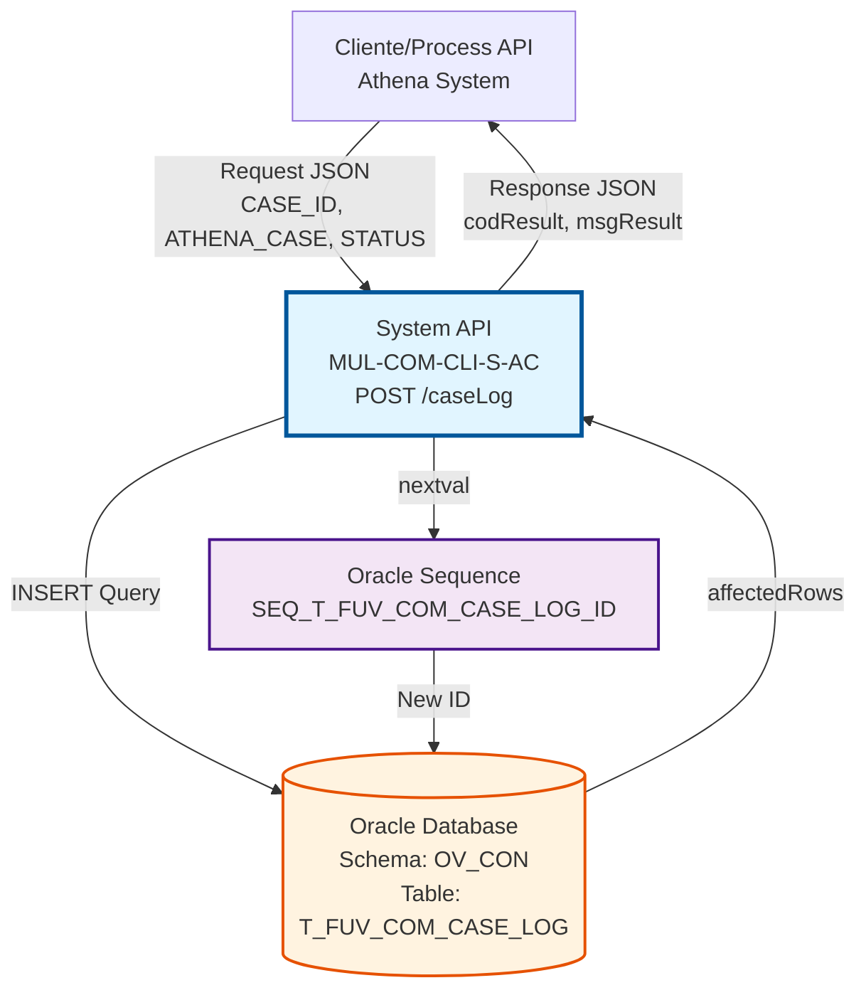
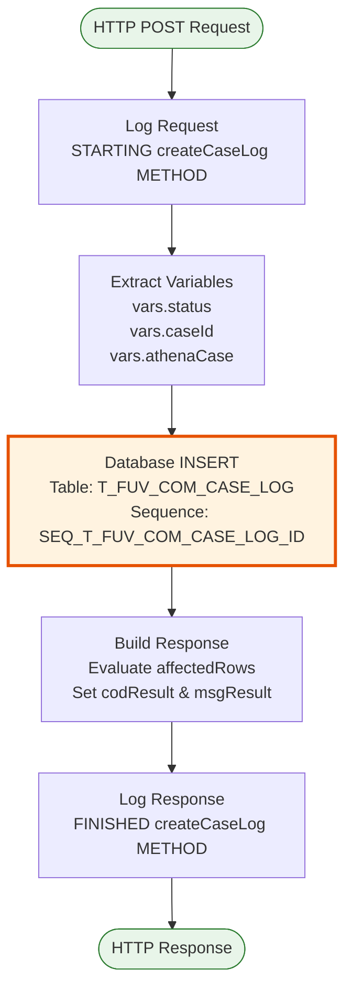
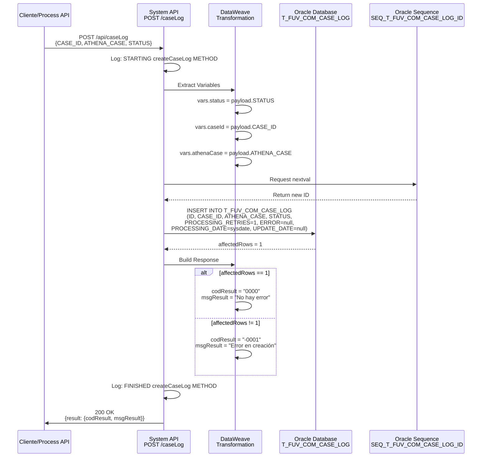
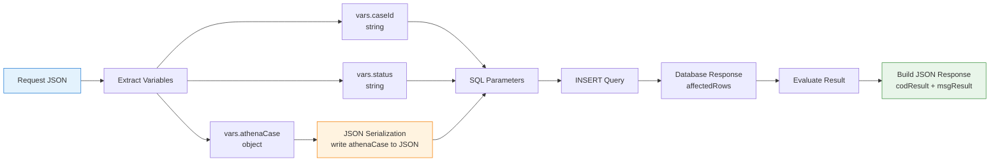

# POST /caseLog

## 📌 Descripción General

### Propósito del Endpoint

Este endpoint crea un nuevo registro de log en la tabla `T_FUV_COM_CASE_LOG` para registrar el estado inicial de un caso procesado en el sistema. Permite mantener una auditoría completa de todos los casos que ingresan al sistema, almacenando información clave como el ID del caso, los datos de Athena asociados y el estado inicial.

El endpoint soporta:
- **Creación de Log de Caso**: Inserta un nuevo registro con ID auto-generado mediante secuencia Oracle
- **Almacenamiento de Datos Athena**: Guarda el objeto JSON completo de Athena asociado al caso
- **Inicialización de Estado**: Registra el estado inicial del caso para seguimiento posterior
- **Control de Reintentos**: Inicializa el contador de reintentos en 1 para gestión de errores

### Tipo de API

**Capa:** System API (API-Led Connectivity)

**Función:** Integración directa con Oracle Database para registro de logs de casos y auditoría.

### Patrón de Integración

**Tipo:** Request-Reply Síncrono con SQL INSERT

**Descripción:** Recibe los datos del caso, valida la estructura, ejecuta una inserción SQL en la tabla de logs utilizando una secuencia Oracle para generar el ID único, y retorna una confirmación de éxito o error basada en las filas afectadas.

### Arquitectura API-Led Connectivity



---

## 💼 Propósito del Negocio

### Casos de Uso Principales

1. **Registro Inicial de Caso**
   - Un nuevo caso ingresa al sistema desde Athena
   - Se crea un registro de log con estado inicial "PENDING" o "NEW"
   - Permite rastrear el caso desde su origen
   - **Beneficio**: Trazabilidad completa desde el inicio del proceso

2. **Auditoría de Casos**
   - Cada caso procesado queda registrado en la base de datos
   - Se almacena el objeto completo de Athena para referencia futura
   - Facilita auditorías y revisiones de cumplimiento
   - **Beneficio**: Cumplimiento normativo y transparencia operacional

3. **Control de Procesamiento**
   - El contador de reintentos se inicializa en 1
   - Permite gestionar casos que requieren reprocesamiento
   - Identifica casos problemáticos que exceden límites de reintentos
   - **Beneficio**: Gestión proactiva de errores y excepciones

### Contexto Empresarial

- **Dominio:** Gestión de Casos y Auditoría
- **Sector:** Energía - Utilities
- **División:** Naturgy España - Administración Comercial
- **Proceso de Negocio:** Registro y seguimiento de casos de clientes
- **Sistema Origen:** Athena (sistema de gestión de casos)

### Stakeholders

- **Equipos de Operaciones**: Necesitan visibilidad del estado de casos en proceso
- **Equipos de Auditoría**: Requieren trazabilidad completa de casos procesados
- **Equipos de Soporte**: Utilizan los logs para investigar incidencias
- **Sistemas Externos (Athena)**: Dependen de la confirmación de registro exitoso

### Valor de Negocio

- **Trazabilidad Completa**: Registro de todos los casos desde su ingreso al sistema
- **Auditoría Automática**: Cumplimiento de requisitos regulatorios sin intervención manual
- **Gestión de Errores**: Identificación temprana de casos problemáticos
- **Análisis de Rendimiento**: Datos históricos para optimización de procesos

### Consumidores Potenciales

Este endpoint puede ser consumido por:
- Process APIs de gestión de casos
- Sistema Athena (integración directa)
- Flujos de Salesforce para sincronización de casos
- Sistemas de monitoreo y alertas
- Herramientas de reporting y analytics

---

## 🔧 Especificación Técnica

### URLs por Ambiente

| Ambiente | URL Base | URL Completa |
|----------|----------|--------------|
| **Local** | `http://localhost:8081` | `http://localhost:8081/api/caseLog` |
| **Development** | `https://mul-com-cli-s-ac-dev.us-e2.cloudhub.io` | `https://mul-com-cli-s-ac-dev.us-e2.cloudhub.io/api/caseLog` |
| **QA** | `https://mul-com-cli-s-ac-cc.us-e2.cloudhub.io` | `https://mul-com-cli-s-ac-cc.us-e2.cloudhub.io/api/caseLog` |
| **Pre-Production** | `https://mul-com-cli-s-ac-cl.us-e2.cloudhub.io` | `https://mul-com-cli-s-ac-cl.us-e2.cloudhub.io/api/caseLog` |
| **Production** | `https://mul-com-cli-s-ac-pro.us-e2.cloudhub.io` | `https://mul-com-cli-s-ac-pro.us-e2.cloudhub.io/api/caseLog` |

### Método HTTP

```
POST /api/caseLog
```

### Parámetros de Entrada

#### Headers HTTP

| Header | Tipo | Requerido | Descripción | Ejemplo |
|--------|------|-----------|-------------|---------|
| `Content-Type` | string | ✅ Sí | Tipo de contenido del request | `application/json` |
| `Accept` | string | ❌ No | Tipo de contenido esperado en response | `application/json` |

#### Body Parameters

| Campo | Tipo | Requerido | Descripción | Ejemplo |
|-------|------|-----------|-------------|---------|
| `CASE_ID` | string | ✅ Sí | Identificador único del caso | `"CASE-2024-001234"` |
| `ATHENA_CASE` | object | ✅ Sí | Objeto JSON genérico con datos del caso. La estructura específica la define el sistema Athena (externo). Este endpoint almacena el objeto completo sin validar su contenido interno. | `{"caseNumber": "001234", ...}` |
| `STATUS` | string | ✅ Sí | Estado inicial del caso | `"PENDING"`, `"NEW"`, `"PROCESSING"` |

**Estructura del Request Body:**

```json
{
  "CASE_ID": "string",
  "ATHENA_CASE": {
    // Objeto JSON genérico
    // La estructura específica la define el sistema Athena
    // Puede contener cualquier estructura JSON válida
    // Ejemplos de campos posibles (no exhaustivo):
    // "caseNumber": "string",
    // "type": "string",
    // "priority": "string",
    // "customerId": "string",
    // etc.
  },
  "STATUS": "string"
}
```

> **⚠️ Nota Importante sobre ATHENA_CASE:**  
> Según el RAML y el código fuente, `ATHENA_CASE` está definido como un objeto genérico (`object`). Este endpoint **no valida ni define la estructura interna** del objeto. Simplemente lo recibe, lo serializa a JSON y lo almacena en la base de datos (campo CLOB). La estructura específica y los campos requeridos son responsabilidad del sistema Athena que envía los datos.

### Respuestas

#### Respuesta Exitosa (200 OK)

**Condición:** La inserción se realizó correctamente (affectedRows = 1)

```json
{
  "result": {
    "codResult": "0000",
    "msgResult": "No hay error"
  }
}
```

**Campos de Respuesta:**

| Campo | Tipo | Descripción |
|-------|------|-------------|
| `result.codResult` | string | Código de resultado: `"0000"` = éxito |
| `result.msgResult` | string | Mensaje descriptivo del resultado |

#### Respuesta de Error de Negocio (200 OK)

**Condición:** La inserción no afectó ninguna fila (affectedRows ≠ 1)

```json
{
  "result": {
    "codResult": "-0001",
    "msgResult": "Ha habido un error en la creación del registro"
  }
}
```

**Campos de Respuesta:**

| Campo | Tipo | Descripción |
|-------|------|-------------|
| `result.codResult` | string | Código de error: `"-0001"` = error en inserción |
| `result.msgResult` | string | Mensaje descriptivo del error |

#### Respuesta de Error Técnico (500)

**Condición:** Error en la base de datos o error interno del servidor

```json
{
  "error": "APP_9999",
  "message": "Error en el servicio."
}
```

### Autenticación y Autorización

- **Tipo:** Client ID & Client Secret (Anypoint Platform)
- **Autorización Oracle:** El usuario de base de datos debe tener permisos para:
  - Ejecutar INSERT en tabla `T_FUV_COM_CASE_LOG`
  - Acceso a secuencia `SEQ_T_FUV_COM_CASE_LOG_ID`
  - Permisos de escritura en schema `OV_CON`

### Timeouts

| Tipo | Valor | Descripción |
|------|-------|-------------|
| **Request Timeout** | 30 segundos | Tiempo máximo de espera para la respuesta |
| **Connection Timeout** | 10 segundos | Tiempo máximo para establecer conexión con Oracle |
| **Query Timeout** | 30 segundos | Tiempo máximo de ejecución de la query INSERT |

---

## 🏗️ Implementación Técnica

### Arquitectura del Flow



### Flujo de Datos Detallado



### Componentes Principales

#### 1. Logger de Inicio (request)

**Ubicación:** Línea 8 del XML

**Función:** Registra el inicio del método con el payload normalizado

**Código DataWeave:**
```dataweave
%dw 2.0
output application/java

var payloadStr = write(payload,'application/json')
var request = common::commonFunctions::normalizeJSON(payloadStr)
---
'STARTING createCaseLog METHOD. REQUEST: ' ++ request
```

**Propósito:** Auditoría y troubleshooting

#### 2. Transformación de Variables (vars Insert)

**Ubicación:** Líneas 15-27 del XML

**Función:** Extrae los campos del payload y los almacena en variables para uso en la query

**Variables Creadas:**
- `vars.status`: Estado del caso (string)
- `vars.caseId`: ID del caso (string)
- `vars.athenaCase`: Objeto completo de Athena (object genérico - estructura no validada)

> **⚠️ Importante:** El código no valida ni define la estructura interna de `ATHENA_CASE`. Simplemente lo extrae del payload como un objeto genérico y lo pasa a la siguiente etapa para su serialización.

**Código DataWeave:**
```dataweave
// vars.status
%dw 2.0
output application/java
---
payload.STATUS

// vars.caseId
%dw 2.0
output application/java
---
payload.CASE_ID

// vars.athenaCase
%dw 2.0
output application/java
---
payload.ATHENA_CASE
```

#### 3. Operación de Base de Datos (Insert)

**Ubicación:** Líneas 30-36 del XML

**Conector:** Database Connector (Oracle)

**Query SQL:**
```sql
INSERT INTO T_FUV_COM_CASE_LOG (
    T_FUV_COM_CASE_LOG_ID, 
    CASE_ID, 
    ATHENA_CASE, 
    STATUS, 
    PROCESSING_RETRIES, 
    ERROR, 
    PROCESSING_DATE, 
    UPDATE_DATE
) VALUES (
    SEQ_T_FUV_COM_CASE_LOG_ID.nextval, 
    :caseId, 
    :athenaCase, 
    :status, 
    1, 
    null, 
    sysdate, 
    null
)
```

**Parámetros de Entrada:**
```dataweave
{
    caseId: vars.caseId,
    athenaCase: write(vars.athenaCase, 'application/json'),
    status: vars.status
}
```

**Nota Importante:** El campo `ATHENA_CASE` se serializa a JSON antes de insertarse en la base de datos.

#### 4. Construcción de Respuesta (response)

**Ubicación:** Líneas 38-48 del XML

**Función:** Evalúa el resultado de la inserción y construye la respuesta JSON

**Código DataWeave:**
```dataweave
%dw 2.0
output application/json
---
{
    "result": {
        "codResult": if (payload.affectedRows == 1) "0000" else "-0001",
        "msgResult": if (payload.affectedRows == 1) 
                        "No hay error" 
                     else 
                        "Ha habido un error en la creación del registro"
    }
}
```

**Lógica:**
- Si `affectedRows == 1`: Éxito → `codResult = "0000"`
- Si `affectedRows != 1`: Error → `codResult = "-0001"`

#### 5. Logger de Fin (response)

**Ubicación:** Línea 50 del XML

**Función:** Registra el fin del método con la respuesta normalizada

**Código DataWeave:**
```dataweave
%dw 2.0
output application/java

var payloadStr = write(payload,'application/json')
var response = common::commonFunctions::normalizeJSON(payloadStr)
---
'FINISHED createCaseLog METHOD. RESPONSE: ' ++ response
```

### Tabla Oracle: T_FUV_COM_CASE_LOG

#### Estructura de la Tabla

| Campo | Tipo | Nullable | Descripción | Valor en INSERT |
|-------|------|----------|-------------|-----------------|
| `T_FUV_COM_CASE_LOG_ID` | NUMBER | NO | ID único del registro (PK) | `SEQ_T_FUV_COM_CASE_LOG_ID.nextval` |
| `CASE_ID` | VARCHAR2 | NO | Identificador del caso | `:caseId` (parámetro) |
| `ATHENA_CASE` | CLOB | YES | Objeto JSON con datos de Athena | `:athenaCase` (JSON serializado) |
| `STATUS` | VARCHAR2 | NO | Estado del caso | `:status` (parámetro) |
| `PROCESSING_RETRIES` | NUMBER | NO | Contador de reintentos | `1` (valor fijo inicial) |
| `ERROR` | VARCHAR2 | YES | Mensaje de error (si aplica) | `null` (sin error inicial) |
| `PROCESSING_DATE` | DATE | NO | Fecha de procesamiento | `sysdate` (fecha actual) |
| `UPDATE_DATE` | DATE | YES | Fecha de última actualización | `null` (sin actualización aún) |

#### Secuencia Oracle

**Nombre:** `SEQ_T_FUV_COM_CASE_LOG_ID`

**Función:** Genera IDs únicos auto-incrementales para cada nuevo registro

**Uso:** `SEQ_T_FUV_COM_CASE_LOG_ID.nextval`

### Manejo de Errores

#### Error Handler Global

**Configuración:** `apiErrorHandler` (definido en `s-ac-globalErrorHandler.xml`)

**Tipos de Error Manejados:**

1. **APP:NOT_FOUND** → HTTP 404
   - No aplica para este endpoint (INSERT siempre crea nuevo registro)

2. **ANY** → HTTP 500
   - Errores de conexión a base de datos
   - Errores de constraint (PK duplicada, FK inválida)
   - Errores de timeout
   - Cualquier excepción no controlada

**Respuesta de Error:**
```json
{
    "error": "APP_9999",
    "message": "Error en el servicio."
}
```

### Transformación de Datos

#### Diagrama de Transformación



#### Mapeo de Campos

**Request → Variables:**
```
payload.CASE_ID        → vars.caseId
payload.ATHENA_CASE    → vars.athenaCase
payload.STATUS         → vars.status
```

**Variables → SQL Parameters:**
```
vars.caseId                              → :caseId
write(vars.athenaCase, 'application/json') → :athenaCase
vars.status                              → :status
```

**Database Response → JSON Response:**
```
payload.affectedRows == 1 → codResult: "0000", msgResult: "No hay error"
payload.affectedRows != 1 → codResult: "-0001", msgResult: "Ha habido un error..."
```

### Configuración de Conexión

**Database Config:** `Database_Config`

**Propiedades (por ambiente):**
```yaml
dbAC:
  user: "username"
  pass: "encrypted_password"  # Secure property
  host1: "oracle-rac-node1.example.com"
  host2: "oracle-rac-node2.example.com"
  port: 1521
  serviceName: "OV_CON"
  MaxPoolSize: 10
  MaxWaitTime: 30000
  MaxIdleTime: 60000
  connectTimeOut: 10000
  transportConnectTimeOut: 5000
  retryCount: 3
```

**Connection String:**
```
jdbc:oracle:thin:${dbAC.user}/${secure::dbAC.pass}@(DESCRIPTION_LIST=
  (DESCRIPTION=(ADDRESS=(PROTOCOL=TCP)(HOST=${dbAC.host1})(PORT=${dbAC.port}))
               (CONNECT_DATA=(SERVICE_NAME=${dbAC.serviceName})))
  (DESCRIPTION=(ADDRESS=(PROTOCOL=TCP)(HOST=${dbAC.host2})(PORT=${dbAC.port}))
               (CONNECT_DATA=(SERVICE_NAME=${dbAC.serviceName})))
  (FAILOVER=on)(LOAD_BALANCE=on))
```

---

## 💻 Ejemplos de Uso

### Ejemplo 1: Creación Exitosa de Log de Caso

> **📝 Nota sobre los Ejemplos:**  
> Los ejemplos mostrados a continuación son **ilustrativos**. La estructura real del objeto `ATHENA_CASE` la define el sistema Athena. Los campos mostrados (`caseNumber`, `type`, `priority`, etc.) son ejemplos posibles, pero la estructura real puede variar según las necesidades del sistema Athena.

#### Request

```bash
curl -X POST "https://mul-com-cli-s-ac-dev.us-e2.cloudhub.io/api/caseLog" \
  -H "Content-Type: application/json" \
  -H "client_id: your-client-id" \
  -H "client_secret: your-client-secret" \
  -d '{
    "CASE_ID": "CASE-2024-001234",
    "ATHENA_CASE": {
      "caseNumber": "001234",
      "type": "BILLING",
      "priority": "HIGH",
      "description": "Cliente reporta error en facturación",
      "customerId": "CUST-789456",
      "createdDate": "2024-07-17T10:30:00Z",
      "assignedTo": "team-billing",
      "additionalData": {
        "contractId": "CONTRACT-456789",
        "invoiceNumber": "INV-2024-07-001"
      }
    },
    "STATUS": "PENDING"
  }'
```

#### Response (200 OK)

```json
{
  "result": {
    "codResult": "0000",
    "msgResult": "No hay error"
  }
}
```

**Registro Creado en Base de Datos:**
```sql
T_FUV_COM_CASE_LOG_ID: 12345 (auto-generado)
CASE_ID: "CASE-2024-001234"
ATHENA_CASE: '{"caseNumber":"001234","type":"BILLING",...}' (JSON)
STATUS: "PENDING"
PROCESSING_RETRIES: 1
ERROR: null
PROCESSING_DATE: 2024-07-17 10:30:15
UPDATE_DATE: null
```

### Ejemplo 2: Caso con Estado "NEW"

#### Request

```bash
curl -X POST "https://mul-com-cli-s-ac-pro.us-e2.cloudhub.io/api/caseLog" \
  -H "Content-Type: application/json" \
  -H "client_id: your-client-id" \
  -H "client_secret: your-client-secret" \
  -d '{
    "CASE_ID": "CASE-2024-001235",
    "ATHENA_CASE": {
      "caseNumber": "001235",
      "type": "TECHNICAL_SUPPORT",
      "priority": "MEDIUM",
      "description": "Solicitud de cambio de titular",
      "customerId": "CUST-123456",
      "createdDate": "2024-07-17T11:00:00Z"
    },
    "STATUS": "NEW"
  }'
```

#### Response (200 OK)

```json
{
  "result": {
    "codResult": "0000",
    "msgResult": "No hay error"
  }
}
```

### Ejemplo 3: Error en Inserción (Caso Hipotético)

#### Request

```bash
curl -X POST "https://mul-com-cli-s-ac-dev.us-e2.cloudhub.io/api/caseLog" \
  -H "Content-Type: application/json" \
  -H "client_id: your-client-id" \
  -H "client_secret: your-client-secret" \
  -d '{
    "CASE_ID": "CASE-2024-001236",
    "ATHENA_CASE": {
      "caseNumber": "001236",
      "type": "COMPLAINT"
    },
    "STATUS": "PROCESSING"
  }'
```

#### Response (200 OK - Error de Negocio)

**Condición:** La inserción no afectó ninguna fila (por ejemplo, constraint violation)

```json
{
  "result": {
    "codResult": "-0001",
    "msgResult": "Ha habido un error en la creación del registro"
  }
}
```

### Ejemplo 4: Error Técnico (Base de Datos No Disponible)

#### Request

```bash
curl -X POST "https://mul-com-cli-s-ac-dev.us-e2.cloudhub.io/api/caseLog" \
  -H "Content-Type: application/json" \
  -H "client_id: your-client-id" \
  -H "client_secret: your-client-secret" \
  -d '{
    "CASE_ID": "CASE-2024-001237",
    "ATHENA_CASE": {
      "caseNumber": "001237"
    },
    "STATUS": "PENDING"
  }'
```

#### Response (500 Internal Server Error)

**Condición:** Error de conexión a base de datos o timeout

```json
{
  "error": "APP_9999",
  "message": "Error en el servicio."
}
```

### Ejemplo 5: Request con Datos Complejos de Athena

#### Request

```bash
curl -X POST "https://mul-com-cli-s-ac-cc.us-e2.cloudhub.io/api/caseLog" \
  -H "Content-Type: application/json" \
  -H "client_id: your-client-id" \
  -H "client_secret: your-client-secret" \
  -d '{
    "CASE_ID": "CASE-2024-001238",
    "ATHENA_CASE": {
      "caseNumber": "001238",
      "type": "CONTRACT_MODIFICATION",
      "priority": "LOW",
      "description": "Cliente solicita cambio de tarifa",
      "customerId": "CUST-999888",
      "createdDate": "2024-07-17T12:00:00Z",
      "assignedTo": "team-contracts",
      "relatedContracts": [
        {
          "contractId": "CONTRACT-111222",
          "type": "ELECTRICITY",
          "currentTariff": "2.0TD"
        },
        {
          "contractId": "CONTRACT-333444",
          "type": "GAS",
          "currentTariff": "RL.1"
        }
      ],
      "requestedChanges": {
        "newTariff": "2.0TD-NIGHT",
        "effectiveDate": "2024-08-01",
        "reason": "Optimización de costos"
      },
      "attachments": [
        {
          "fileName": "solicitud_cambio_tarifa.pdf",
          "s3Key": "cases/001238/solicitud_cambio_tarifa.pdf",
          "uploadDate": "2024-07-17T11:45:00Z"
        }
      ]
    },
    "STATUS": "PENDING"
  }'
```

#### Response (200 OK)

```json
{
  "result": {
    "codResult": "0000",
    "msgResult": "No hay error"
  }
}
```

**Nota:** El objeto `ATHENA_CASE` completo (sea cual sea su estructura) se serializa a JSON y se almacena en el campo CLOB de la base de datos, preservando toda la estructura anidada tal como fue enviada. Este endpoint actúa como un almacén genérico sin validar el contenido interno del objeto.

### Ejemplo 6: Testing con Postman

#### Pre-request Script

```javascript
// Generar CASE_ID único
const timestamp = Date.now();
const caseId = `CASE-2024-${timestamp}`;
pm.environment.set("caseId", caseId);

// Generar datos de prueba
const athenaCase = {
    caseNumber: timestamp.toString(),
    type: "TEST",
    priority: "LOW",
    description: "Caso de prueba automatizado",
    customerId: "CUST-TEST