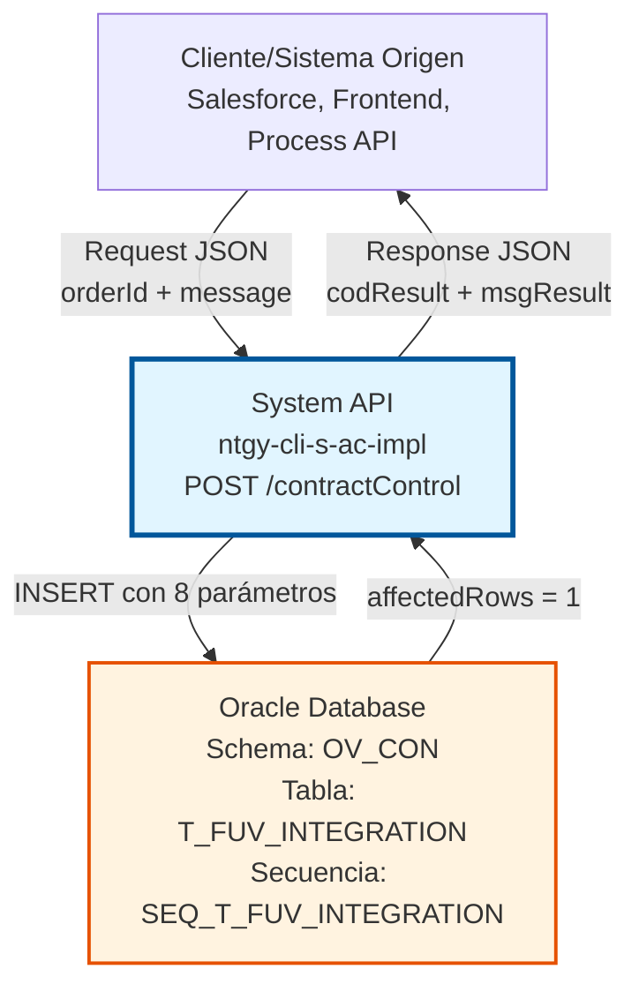
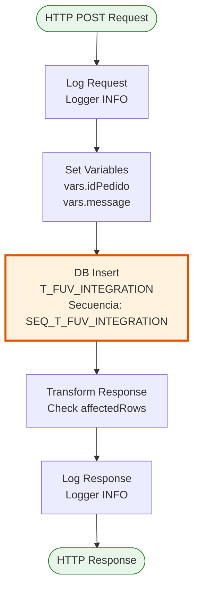
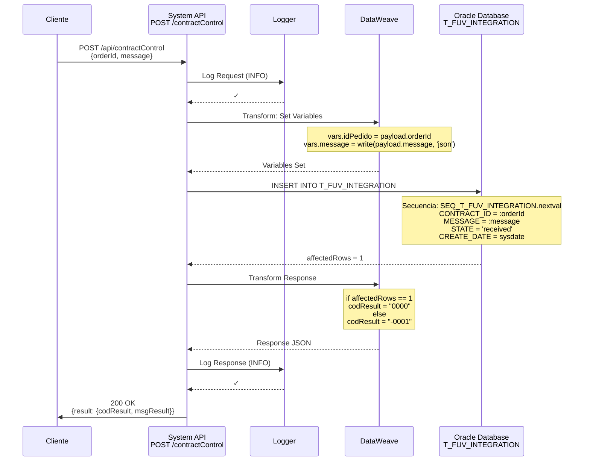

# POST /contractControl

## 📌 Descripción General

### Propósito del Endpoint

Este endpoint registra información de control de contratos en la tabla de integración FUV (`T_FUV_INTEGRATION`) de Oracle Database. Actúa como punto de entrada para el seguimiento y trazabilidad de contratos que requieren sincronización con sistemas externos o procesamiento asíncrono.

El endpoint soporta:
- **Registro de Contratos**: Crea un nuevo registro de control con estado inicial "received"
- **Trazabilidad**: Mantiene un historial completo de intentos y estados de procesamiento
- **Integración FUV**: Facilita la sincronización con sistemas de gestión de contratos
- **Auditoría**: Registra automáticamente fechas de creación y actualización

### Tipo de API

**Capa:** System API (API-Led Connectivity)

**Función:** Integración directa con Oracle Database (schema OV_CON) para registro de control de contratos en tabla de integración FUV.

### Patrón de Integración

**Tipo:** Request-Reply Síncrono con INSERT en Oracle Database

**Descripción:** El endpoint recibe información del contrato, la valida, ejecuta un INSERT en la tabla `T_FUV_INTEGRATION` utilizando una secuencia Oracle para generar el ID, y retorna confirmación de la operación.

### Arquitectura API-Led Connectivity



---

## 💼 Propósito del Negocio

### Casos de Uso Principales

1. **Registro Inicial de Contratos**
   - Un nuevo contrato se crea en el sistema origen (Salesforce, frontend)
   - Se registra en la tabla de integración FUV con estado "received"
   - Permite tracking del contrato a través de su ciclo de vida
   - **Beneficio**: Trazabilidad completa desde el momento de creación

2. **Sincronización con Sistemas Externos**
   - Los contratos registrados pueden ser procesados por sistemas FUV
   - El estado "received" indica que está pendiente de procesamiento
   - Facilita la integración asíncrona con sistemas de backend
   - **Beneficio**: Desacoplamiento entre sistemas y procesamiento asíncrono

3. **Auditoría y Compliance**
   - Cada registro incluye timestamps automáticos (CREATE_DATE, UPDATE_DATE)
   - Se registra el sistema origen (systemMessage: 'Frontal')
   - Mantiene contador de intentos de procesamiento (ATTEMPTS_NUMBER)
   - **Beneficio**: Cumplimiento de requisitos de auditoría y trazabilidad

### Contexto Empresarial

- **Dominio:** Gestión de Contratos y Administración Comercial
- **Sector:** Energía - Utilities
- **División:** Naturgy España - CLI (Clientes)
- **Proceso de Negocio:** Alta y gestión de contratos de suministro energético
- **Sistema:** Oracle Database - Schema OV_CON (Administración Comercial)

### Stakeholders

- **Equipos de Desarrollo Frontend/Salesforce**: Necesitan registrar contratos para procesamiento posterior
- **Equipos de Integración FUV**: Consumen los registros para sincronización con sistemas externos
- **Equipos de Operaciones**: Monitorean el estado y procesamiento de contratos
- **Equipos de Auditoría**: Requieren trazabilidad completa de operaciones

### Valor de Negocio

- **Trazabilidad Completa**: Registro detallado de cada contrato desde su creación
- **Procesamiento Asíncrono**: Permite desacoplar la creación del procesamiento
- **Resiliencia**: Sistema de reintentos mediante contador ATTEMPTS_NUMBER
- **Auditoría**: Cumplimiento de requisitos regulatorios y de compliance

### Consumidores Potenciales

Este endpoint puede ser consumido por:
- Process APIs de gestión de contratos
- Flujos de Salesforce (Platform Events, Flows)
- Aplicaciones frontend de alta de clientes
- Sistemas de integración middleware
- Servicios de sincronización batch

---

## 🔧 Especificación Técnica

### URLs por Ambiente

| Ambiente | URL Completa |
|----------|--------------|
| **Local** | `http://localhost:8081/api/contractControl` |
| **Development** | `https://ntgy-cli-s-ac-impl-dev.us-e2.cloudhub.io/api/contractControl` |
| **QA** | `https://ntgy-cli-s-ac-impl-cc.us-e2.cloudhub.io/api/contractControl` |
| **Pre-Production** | `https://ntgy-cli-s-ac-impl-cl.us-e2.cloudhub.io/api/contractControl` |
| **Production** | `https://ntgy-cli-s-ac-impl-pro.us-e2.cloudhub.io/api/contractControl` |

### Método HTTP

```
POST /api/contractControl
```

### Parámetros de Entrada

#### Headers HTTP

| Header | Tipo | Requerido | Descripción | Ejemplo |
|--------|------|-----------|-------------|---------|
| `Content-Type` | string | ✅ Sí | Tipo de contenido del request | `application/json` |
| `Accept` | string | ❌ No | Tipo de contenido esperado en response | `application/json` |

#### Body Parameters

**Estructura del Request (Campos Requeridos del Usuario):**

```json
{
  "orderId": "string",
  "message": {
    // Objeto JSON con información del contrato
  }
}
```

**Campos Requeridos del Usuario:**

| Campo | Tipo | Requerido | Descripción | Ejemplo |
|-------|------|-----------|-------------|---------|
| `orderId` | string | ✅ Sí | Identificador único del pedido/contrato | `"ORD-2024-001234"` |
| `message` | object | ✅ Sí | Objeto JSON con información detallada del contrato (se serializa automáticamente a JSON string) | `{"contractData": {...}}` |

**Campos Establecidos Automáticamente por el Sistema:**

El endpoint establece automáticamente los siguientes valores al insertar en la base de datos:

| Campo | Valor | Descripción |
|-------|-------|-------------|
| `systemMessage` | `'Frontal'` | Sistema origen del mensaje (hardcoded) |
| `code` | `'received'` | Código de estado inicial (hardcoded) |
| `state` | `'received'` | Estado inicial del procesamiento (hardcoded) |
| `response` | `null` | Respuesta del sistema externo (vacío inicialmente) |
| `error` | `null` | Mensaje de error (vacío inicialmente) |
| `contractATR` | `0` | Atributo del contrato (valor por defecto) |

**Nota Importante:** 
- El usuario **solo debe enviar** `orderId` y `message` en el request
- Los demás campos son **internos del sistema** y se establecen automáticamente durante el INSERT
- El campo `message` se serializa automáticamente a JSON string antes de almacenarse en la base de datos

#### Estructura del Campo `message`

**Según RAML (dataType/createContractControl.raml):**

El campo `message` es de tipo **`any`**, lo que significa que acepta **cualquier estructura JSON válida** sin validación de esquema.

**Definición del Tipo de Dato:**

```yaml
#%RAML 1.0 DataType
type: object
properties:
  orderId:
    type: string
    required: true
  message:
    type: any      # ← Acepta cualquier estructura JSON
    required: true
```

**Características del Campo `message`:**

| Característica | Descripción |
|----------------|-------------|
| **Tipo RAML** | `any` (sin validación de estructura) |
| **Tipo Real** | Object (cualquier estructura JSON válida) |
| **Validación** | Ninguna - el endpoint acepta cualquier objeto JSON |
| **Procesamiento** | Se serializa automáticamente a JSON string mediante `write(payload.message, 'application/json')` |
| **Almacenamiento** | Se guarda como JSON string en campo CLOB de la base de datos (columna `MESSAGE`) |
| **Flexibilidad** | Completamente flexible - la estructura depende de los requisitos del consumidor |
| **Tamaño Máximo** | Limitado por el tipo CLOB de Oracle (hasta 4 GB teóricamente) |

**Ejemplo de Uso (Estructura Genérica):**

```json
{
  "orderId": "ORD-2024-001234",
  "message": {
    // Cualquier estructura JSON válida
    // La estructura específica depende de los requisitos del negocio
    // Ejemplos posibles:
    "campo1": "valor1",
    "campo2": "valor2",
    "campoN": {
      "subcampo": "valor"
    }
  }
}
```

**Notas Importantes:**
- ⚠️ **El código NO valida la estructura** del objeto `message`
- ⚠️ **El RAML define el tipo como `any`** - sin esquema específico
- ✅ La serialización a JSON string es automática (no requiere acción del consumidor)
- ✅ El campo se almacena completo en la base de datos para posterior consulta
- 📋 **Recomendación**: Consultar con el equipo de negocio o revisar documentación funcional para conocer la estructura esperada según el caso de uso específico

### Respuestas

#### Respuesta Exitosa (200 OK)

**Condición:** El registro se insertó correctamente (affectedRows = 1)

```json
{
  "result": {
    "codResult": "0000",
    "msgResult": "No hay error"
  }
}
```

#### Respuesta de Error (200 OK con código de error)

**Condición:** El registro no se pudo insertar (affectedRows != 1)

```json
{
  "result": {
    "codResult": "-0001",
    "msgResult": "Ha habido un error en la creación del registro"
  }
}
```

#### Respuesta de Error Técnico (500)

**Condición:** Error de conexión a base de datos o error interno

```json
{
  "error": "APP_9999",
  "message": "Error en el servicio."
}
```

### Códigos de Estado HTTP

| Código | Descripción | Escenario |
|--------|-------------|-----------|
| `200` | OK | Operación completada (verificar codResult en body) |
| `400` | Bad Request | Request malformado o campos faltantes |
| `500` | Internal Server Error | Error de base de datos o error interno |
| `503` | Service Unavailable | Base de datos no disponible |

### Autenticación y Autorización

- **Tipo:** Client ID & Client Secret (Anypoint Platform)
- **Autorización Oracle:** El usuario de base de datos debe tener permisos para:
  - Ejecutar INSERT en tabla `T_FUV_INTEGRATION`
  - Acceso a secuencia `SEQ_T_FUV_INTEGRATION`
  - Permisos de escritura en schema `OV_CON`

### Timeouts

| Tipo | Valor | Descripción |
|------|-------|-------------|
| **Request Timeout** | 30 segundos | Tiempo máximo de espera para la respuesta |
| **Connection Timeout** | 10 segundos | Tiempo máximo para establecer conexión con Oracle |

---

## 🏗️ Implementación Técnica

### Arquitectura del Flow



### Componentes del Flow

#### 1. Flow Principal
- **Nombre:** `post:\contractControl:application\json:s-ac-config`
- **Ubicación:** `src/main/mule/s-ac.xml`
- **Función:** Recibe el request HTTP y delega al subflow de implementación

#### 2. Subflow de Implementación
- **Nombre:** `s-ac-createContractControl`
- **Ubicación:** `src/main/mule/s-ac-contractControl.xml` (líneas 8-67)
- **Función:** Implementa la lógica de inserción en base de datos

### Operación de Base de Datos

#### Query SQL (INSERT)

**Ubicación:** `src/main/resources/properties/s-ac-pro-config.yaml`

**Query:**
```sql
INSERT INTO T_FUV_INTEGRATION (
  T_FUV_INTEGRATION_ID, 
  CONTRACT_ID, 
  SYSTEM_MESSAGE, 
  CODE, 
  MESSAGE, 
  STATE, 
  RESPONSE, 
  ERROR, 
  CONTRACT_ATR, 
  CREATE_DATE, 
  UPDATE_DATE, 
  UPDATE_USER, 
  UPDATE_PROGRAM, 
  ATTEMPTS_NUMBER
) VALUES (
  SEQ_T_FUV_INTEGRATION.nextval, 
  :orderId, 
  :systemMessage, 
  :code, 
  :message, 
  :state, 
  :response, 
  :error, 
  :contractATR, 
  sysdate, 
  sysdate, 
  'mulesoft', 
  'mulesoft', 
  0
)
```

#### Parámetros de la Query

**Parámetros Dinámicos (del request del usuario):**

| Parámetro | Valor | Origen | Descripción |
|-----------|-------|--------|-------------|
| `:orderId` | `vars.idPedido` | `payload.orderId` | ID del pedido/contrato enviado por el usuario |
| `:message` | `vars.message` | `payload.message` (serializado a JSON) | Información del contrato enviada por el usuario |

**Parámetros Fijos (establecidos automáticamente por el sistema):**

Estos parámetros se establecen automáticamente en el código (líneas 36-44 del XML) y **NO** deben ser enviados por el usuario:

| Parámetro | Valor | Descripción |
|-----------|-------|-------------|
| `:systemMessage` | `'Frontal'` | Sistema origen del mensaje (hardcoded en el flow) |
| `:code` | `'received'` | Código de estado inicial (hardcoded en el flow) |
| `:state` | `'received'` | Estado inicial del contrato (hardcoded en el flow) |
| `:response` | `null` | Respuesta del sistema externo (inicialmente vacío) |
| `:error` | `null` | Error de procesamiento (inicialmente vacío) |
| `:contractATR` | `0` | Atributo del contrato (valor por defecto) |

**Valores Autogenerados:**

| Campo | Valor | Descripción |
|-------|-------|-------------|
| `T_FUV_INTEGRATION_ID` | `SEQ_T_FUV_INTEGRATION.nextval` | ID único generado por secuencia Oracle |
| `CREATE_DATE` | `sysdate` | Fecha/hora de creación (timestamp Oracle) |
| `UPDATE_DATE` | `sysdate` | Fecha/hora de última actualización |
| `UPDATE_USER` | `'mulesoft'` | Usuario que realizó la operación |
| `UPDATE_PROGRAM` | `'mulesoft'` | Programa que realizó la operación |
| `ATTEMPTS_NUMBER` | `0` | Contador de intentos de procesamiento |

### Tabla de Base de Datos

#### T_FUV_INTEGRATION

**Schema:** OV_CON  
**Tipo:** Oracle Database  
**Propósito:** Tabla de integración FUV para control y sincronización de contratos

**Estructura de Campos:**

| Campo | Tipo | Nullable | Descripción |
|-------|------|----------|-------------|
| `T_FUV_INTEGRATION_ID` | NUMBER | NO | PK - ID único del registro (secuencia) |
| `CONTRACT_ID` | VARCHAR2 | NO | ID del contrato/pedido |
| `SYSTEM_MESSAGE` | VARCHAR2 | YES | Sistema origen del mensaje |
| `CODE` | VARCHAR2 | YES | Código de estado |
| `MESSAGE` | CLOB | YES | Mensaje/información del contrato (JSON) |
| `STATE` | VARCHAR2 | YES | Estado actual del procesamiento |
| `RESPONSE` | CLOB | YES | Respuesta del sistema externo |
| `ERROR` | CLOB | YES | Mensaje de error si aplica |
| `CONTRACT_ATR` | NUMBER | YES | Atributo del contrato |
| `CREATE_DATE` | DATE | NO | Fecha de creación |
| `UPDATE_DATE` | DATE | NO | Fecha de última actualización |
| `UPDATE_USER` | VARCHAR2 | YES | Usuario que actualizó |
| `UPDATE_PROGRAM` | VARCHAR2 | YES | Programa que actualizó |
| `ATTEMPTS_NUMBER` | NUMBER | YES | Número de intentos de procesamiento |

### Transformaciones DataWeave

#### 1. Preparación de Variables (líneas 17-30)

```dataweave
%dw 2.0
output application/java
---
// Variable idPedido
payload.orderId

// Variable message (serializado a JSON)
write(payload.message, 'application/json')
```

**Propósito:** Extraer y preparar los datos del request para el INSERT

#### 2. Transformación de Respuesta (líneas 46-58)

```dataweave
%dw 2.0
output application/json
---
{
  "result": {
    "codResult": if (payload.affectedRows == 1) "0000" else "-0001",
    "msgResult": if (payload.affectedRows == 1) 
                   "No hay error" 
                 else 
                   "Ha habido un error en la creación del registro"
  }
}
```

**Propósito:** Construir respuesta basada en el resultado del INSERT

**Lógica:**
- Si `affectedRows == 1` → Éxito (codResult: "0000")
- Si `affectedRows != 1` → Error (codResult: "-0001")

### Diagrama de Secuencia Detallado



### Manejo de Errores

#### Error Handler Global

**Ubicación:** `s-ac-globalErrorHandler.xml`

**Estrategia:**
- Errores de base de datos → HTTP 500 con mensaje estándar
- Errores de validación → HTTP 400 con detalles
- Errores inesperados → HTTP 500 con error genérico

#### Logging

**Nivel:** INFO

**Puntos de Log:**
1. **Inicio:** Request completo (línea 9)
2. **Fin:** Response completo (línea 59)

**Formato:**
```
STARTING createContractControl METHOD. REQUEST: {normalized_json}
FINISHED createContractControl METHOD. RESPONSE: {normalized_json}
```

### Configuración de Base de Datos

**Config Reference:** `Database_Config`

**Parámetros:**
- **Driver:** `oracle.jdbc.driver.OracleDriver`
- **Connection Pooling:** Activo
- **Max Pool Size:** Configurado por ambiente
- **Connection Timeout:** 10 segundos
- **Query Timeout:** 30 segundos

---

## 💻 Ejemplos de Uso

### Ejemplo 1: Request Básico

#### Request

```bash
curl -X POST "http://localhost:8081/api/contractControl" \
  -H "Content-Type: application/json" \
  -H "Accept: application/json" \
  -d '{
    "orderId": "ORD-2024-001234",
    "message": {
      "contractNumber": "CNT-2024-5678",
      "customerId": "CUST-12345",
      "serviceType": "electricity",
      "startDate": "2024-01-15",
      "status": "pending"
    }
  }'
```

#### Response Exitosa

```json
{
  "result": {
    "codResult": "0000",
    "msgResult": "No hay error"
  }
}
```

### Ejemplo 2: Request con Información Completa

#### Request

```bash
curl -X POST "https://ntgy-cli-s-ac-impl-pro.us-e2.cloudhub.io/api/contractControl" \
  -H "Content-Type: application/json" \
  -H "client_id: your-client-id" \
  -H "client_secret: your-client-secret" \
  -d '{
    "orderId": "ORD-2024-002456",
    "message": {
      "contractNumber": "CNT-2024-9012",
      "customerId": "CUST-67890",
      "customerName": "Juan Pérez García",
      "serviceType": "gas",
      "tariff": "2.0TD",
      "cups": "ES0021000000000001JN",
      "startDate": "2024-02-01",
      "endDate": null,
      "status": "pending_activation",
      "createdBy": "salesforce",
      "createdDate": "2024-01-20T10:30:00Z",
      "additionalInfo": {
        "channel": "web",
        "campaign": "winter-2024",
        "referralCode": "REF123"
      }
    }
  }'
```

#### Response Exitosa

```json
{
  "result": {
    "codResult": "0000",
    "msgResult": "No hay error"
  }
}
```

### Ejemplo 3: Error - Registro No Insertado

#### Request

```bash
curl -X POST "http://localhost:8081/api/contractControl" \
  -H "Content-Type: application/json" \
  -d '{
    "orderId": "ORD-INVALID",
    "message": {}
  }'
```

#### Response de Error

```json
{
  "result": {
    "codResult": "-0001",
    "msgResult": "Ha habido un error en la creación del registro"
  }
}
```

### Ejemplo 4: Error Técnico - Base de Datos No Disponible

#### Response (500 Internal Server Error)

```json
{
  "error": "APP_9999",
  "message": "Error en el servicio."
}
```

### Ejemplo 5: Integración desde JavaScript

```javascript
const createContractControl = async (orderId, contractData) => {
  const url = 'https://ntgy-cli-s-ac-impl-pro.us-e2.cloudhub.io/api/contractControl';
  
  const payload = {
    orderId: orderId,
    message: contractData
  };
  
  try {
    const response = await fetch(url, {
      method: 'POST',
      headers: {
        'Content-Type': 'application/json',
        'client_id': process.env.CLIENT_ID,
        'client_secret': process.env.CLIENT_SECRET
      },
      body: JSON.stringify(payload)
    });
    
    const result = await response.json();
    
    if (result.result.codResult === '0000') {
      console.log('Contract control created successfully');
      return { success: true, data: result };
    } else {
      console.error('Error creating contract control:', result.result.msgResult);
      return { success: false, error: result.result.msgResult };
    }
  } catch (error) {
    console.error('Technical error:', error);
    return { success: false, error: error.message };
  }
};

// Uso
const contractData = {
  contractNumber: 'CNT-2024-5678',
  customerId: 'CUST-12345',
  serviceType: 'electricity',
  startDate: '2024-01-15',
  status: 'pending'
};

createContractControl('ORD-2024-001234', contractData)
  .then(result => console.log(result));
```

### Ejemplo 6: Integración desde Python

```python
import requests
import json
import os

def create_contract_control(order_id, contract_data):
    url = 'https://ntgy-cli-s-ac-impl-pro.us-e2.cloudhub.io/api/contractControl'
    
    headers = {
        'Content-Type': 'application/json',
        'client_id': os.getenv('CLIENT_ID'),
        'client_secret': os.getenv('CLIENT_SECRET')
    }
    
    payload = {
        'orderId': order_id,
        'message': contract_data
    }
    
    try:
        response = requests.post(url, headers=headers, json=payload, timeout=30)
        response.raise_for_status()
        
        result = response.json()
        
        if result['result']['codResult'] == '0000':
            print('Contract control created successfully')
            return {'success': True, 'data': result}
        else:
            print(f"Error: {result['result']['msgResult']}")
            return {'success': False, 'error': result['result']['msgResult']}
            
    except requests.exceptions.RequestException as e:
        print(f'Technical error: {e}')
        return {'success': False, 'error': str(e)}

# Uso
contract_data = {
    'contractNumber': 'CNT-2024-5678',
    'customerId': 'CUST-12345',
    'serviceType': 'electricity',
    'startDate': '2024-01-15',
    'status': 'pending'
}

result = create_contract_control('ORD-2024-001234', contract_data)
print(result)
```
