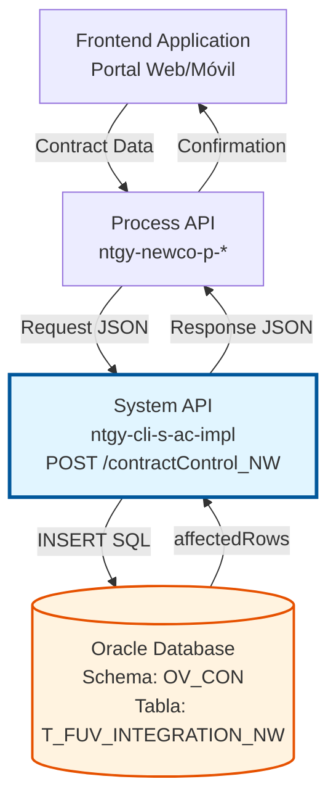
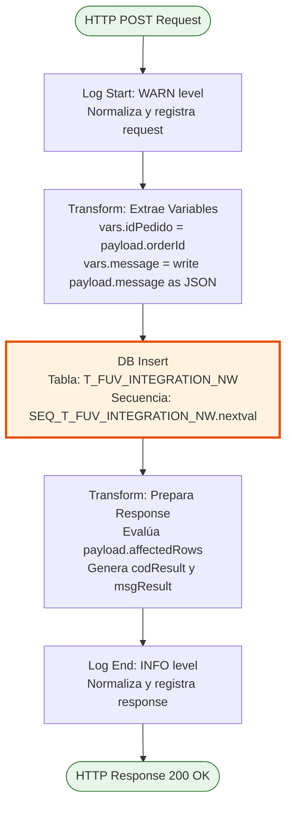
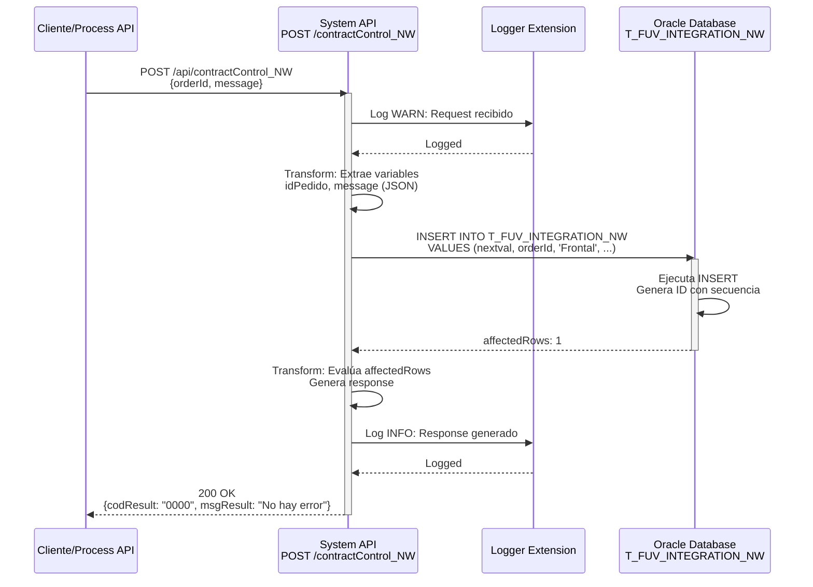

# POST /contractControl_NW

## 📌 Descripción General

### Propósito del Endpoint

Este endpoint crea un registro de control en la tabla de integración de contratos NEWCO (`T_FUV_INTEGRATION_NW`), permitiendo el seguimiento completo del ciclo de vida de un contrato desde su recepción inicial hasta su procesamiento final.

El endpoint soporta:
- **Registro Inicial**: Captura el contrato cuando es recibido desde el frontend
- **Tracking de Estado**: Establece el estado inicial como 'received' para posterior seguimiento
- **Auditoría**: Registra metadatos de creación (fecha, usuario, programa) para trazabilidad
- **Control de Intentos**: Inicializa el contador de intentos de procesamiento en 0

### Tipo de API

**Capa:** System API (API-Led Connectivity)

**Función:** Integración directa con Oracle Database (schema OV_CON) para persistencia de datos de control de contratos NEWCO.

### Patrón de Integración

**Tipo:** Request-Reply Síncrono con INSERT SQL

**Descripción:** El endpoint recibe los datos del contrato desde el frontend, extrae el `orderId` y el `message`, ejecuta un INSERT en la tabla de control, y retorna una confirmación basada en el número de filas afectadas.

### Arquitectura API-Led Connectivity



---

## 💼 Propósito del Negocio

### Casos de Uso Principales

1. **Registro Inicial de Contrato NEWCO**
   - Un cliente completa el proceso de alta de contrato en el portal web
   - El sistema registra el contrato en la tabla de control para iniciar el tracking
   - Se establece el estado inicial 'received' para posterior procesamiento
   - **Beneficio:** Trazabilidad completa desde el momento de recepción

2. **Auditoría de Contratos Recibidos**
   - El equipo de operaciones necesita verificar qué contratos han sido recibidos
   - Consultan la tabla de control filtrando por estado 'received'
   - Identifican contratos pendientes de procesamiento
   - **Beneficio:** Visibilidad en tiempo real del pipeline de contratos

3. **Control de Procesamiento**
   - Un proceso batch necesita procesar contratos pendientes
   - Consulta los registros con estado 'received' y attempts_number < 4
   - Actualiza el estado conforme avanza el procesamiento
   - **Beneficio:** Gestión eficiente de reintentos y estados

### Contexto Empresarial

- **Dominio:** Gestión de Contratos y Alta de Clientes
- **Sector:** Energía - Utilities
- **División:** Naturgy España - NEWCO (Nueva Compañía)
- **Proceso de Negocio:** Onboarding de clientes y activación de contratos
- **Sistema:** Oracle Database - Schema de Administración Comercial (OV_CON)

### Stakeholders

- **Equipos de Ventas**: Necesitan confirmar que los contratos han sido registrados correctamente
- **Operaciones**: Monitorean el estado de procesamiento de contratos
- **Desarrollo**: Utilizan la tabla de control para debugging y troubleshooting
- **Auditoría**: Requieren trazabilidad completa de todos los contratos recibidos

### Valor de Negocio

- **Trazabilidad Completa**: Registro de cada contrato desde su recepción inicial
- **Gestión de Errores**: Control de intentos de procesamiento para reintentos automáticos
- **Auditoría**: Metadatos completos (fecha, usuario, programa) para compliance
- **Visibilidad Operacional**: Estado en tiempo real del pipeline de contratos NEWCO

### Consumidores Potenciales

Este endpoint puede ser consumido por:
- Process APIs de alta de clientes (ntgy-newco-p-*)
- Portales web de autoservicio
- Aplicaciones móviles de ventas
- Sistemas de integración middleware
- Flujos de Salesforce (Platform Events)

---

## 🔧 Especificación Técnica

### URLs por Ambiente

| Ambiente | URL Base | URL Completa |
|----------|----------|--------------|
| **Local** | `http://localhost:8050` | `http://localhost:8050/api/contractControl_NW` |
| **Development** | `https://ntgy-cli-s-ac-impl-dev.us-e2.cloudhub.io` | `https://ntgy-cli-s-ac-impl-dev.us-e2.cloudhub.io/api/contractControl_NW` |
| **QA** | `https://ntgy-cli-s-ac-impl-cc.us-e2.cloudhub.io` | `https://ntgy-cli-s-ac-impl-cc.us-e2.cloudhub.io/api/contractControl_NW` |
| **Pre-Production** | `https://ntgy-cli-s-ac-impl-cl.us-e2.cloudhub.io` | `https://ntgy-cli-s-ac-impl-cl.us-e2.cloudhub.io/api/contractControl_NW` |
| **Production** | `https://ntgy-cli-s-ac-impl-pro.us-e2.cloudhub.io` | `https://ntgy-cli-s-ac-impl-pro.us-e2.cloudhub.io/api/contractControl_NW` |

### Método HTTP

```
POST /api/contractControl_NW
```

### Parámetros de Entrada

#### Headers HTTP

| Header | Tipo | Requerido | Descripción | Ejemplo |
|--------|------|-----------|-------------|---------|
| `Content-Type` | string | ✅ Sí | Tipo de contenido del request | `application/json` |
| `Accept` | string | ❌ No | Tipo de contenido esperado en response | `application/json` |

#### Body Parameters

| Campo | Tipo | Requerido | Descripción | Ejemplo |
|-------|------|-----------|-------------|---------|
| `orderId` | string | ✅ Sí | Identificador único del pedido/contrato | `"ORD-2026-001234"` |
| `message` | object | ✅ Sí | Objeto genérico con información del contrato. La estructura interna es flexible y depende del contexto de negocio. | `{"data": "any"}` |

**Estructura del Body:**

```json
{
  "orderId": "string",
  "message": {
    // Objeto genérico - estructura flexible según contexto
    // Puede contener cualquier información relevante del contrato
  }
}
```

**Notas Importantes:**

1. **Estructura de `message`:** El campo `message` es un objeto genérico sin estructura predefinida. Se convierte a JSON string antes de almacenarse en la base de datos (campo CLOB). La estructura específica depende del contexto de negocio y del sistema que consume el endpoint.

2. **Parámetros Adicionales:** Aunque el endpoint solo recibe 2 campos en el body (`orderId` y `message`), internamente el sistema genera 6 parámetros adicionales con valores fijos antes de ejecutar el INSERT:
   - `systemMessage`: 'Frontal'
   - `code`: 'received'
   - `state`: 'received'
   - `response`: null
   - `error`: null
   - `contractATR`: 0

   Estos valores representan el estado inicial del registro de control y son establecidos automáticamente por la lógica de negocio. Ver sección "Implementación Técnica" para más detalles.

### Respuestas

#### Respuesta Exitosa (200 OK)

**Descripción:** El registro se creó correctamente en la base de datos (1 fila afectada).

```json
{
  "result": {
    "codResult": "0000",
    "msgResult": "No hay error"
  }
}
```

#### Respuesta de Error de Inserción (200 OK)

**Descripción:** El INSERT no afectó ninguna fila o falló la operación.

```json
{
  "result": {
    "codResult": "-0001",
    "msgResult": "Ha habido un error en la creación del registro"
  }
}
```

#### Respuesta de Error Técnico (500)

**Descripción:** Error interno del servidor o de base de datos.

```json
{
  "error": "APP_9999",
  "message": "Error en el servicio."
}
```

### Códigos de Estado HTTP

| Código | Descripción | Cuándo Ocurre |
|--------|-------------|---------------|
| `200` | OK | Operación completada (verificar `codResult` en el body) |
| `400` | Bad Request | Body malformado o campos requeridos faltantes |
| `500` | Internal Server Error | Error de base de datos o error interno |

### Autenticación y Autorización

- **Tipo:** Client ID & Client Secret (Anypoint Platform)
- **Autorización DB:** El usuario de base de datos debe tener permisos para:
  - INSERT en tabla `T_FUV_INTEGRATION_NW`
  - Acceso a secuencia `SEQ_T_FUV_INTEGRATION_NW`
  - Permisos de escritura en schema `OV_CON`

### Timeouts

| Tipo | Valor | Descripción |
|------|-------|-------------|
| **Request Timeout** | 30 segundos | Tiempo máximo de espera para la respuesta |
| **Connection Timeout** | 10 segundos | Tiempo máximo para establecer conexión con DB |
| **Query Timeout** | 30 segundos | Tiempo máximo de ejecución del INSERT |

---

## 🏗️ Implementación Técnica

### Arquitectura del Flow



### Tabla de Base de Datos

#### T_FUV_INTEGRATION_NW

**Propósito:** Tabla de control de integración de contratos NEWCO con seguimiento de estados y reintentos.

**Campos:**

| Campo | Tipo | Descripción | Valor en INSERT |
|-------|------|-------------|-----------------|
| `T_FUV_INTEGRATION_NW_ID` | NUMBER | ID único (PK) | `SEQ_T_FUV_INTEGRATION_NW.nextval` |
| `CONTRACT_ID` | VARCHAR2 | ID del contrato/pedido | `vars.idPedido` (del request) |
| `SYSTEM_MESSAGE` | VARCHAR2 | Sistema origen del mensaje | `'Frontal'` (hardcoded) |
| `CODE` | VARCHAR2 | Código de estado | `'received'` (hardcoded) |
| `MESSAGE` | CLOB | Mensaje completo en JSON | `vars.message` (del request) |
| `STATE` | VARCHAR2 | Estado del registro | `'received'` (hardcoded) |
| `RESPONSE` | CLOB | Respuesta del procesamiento | `null` (inicial) |
| `ERROR` | CLOB | Mensaje de error si aplica | `null` (inicial) |
| `CONTRACT_ATR` | NUMBER | Atributo de contrato | `0` (inicial) |
| `CREATE_DATE` | DATE | Fecha de creación | `sysdate` |
| `UPDATE_DATE` | DATE | Fecha de última actualización | `sysdate` |
| `UPDATE_USER` | VARCHAR2 | Usuario que actualizó | `'mulesoft'` |
| `UPDATE_PROGRAM` | VARCHAR2 | Programa que actualizó | `'mulesoft'` |
| `ATTEMPTS_NUMBER` | NUMBER | Número de intentos de procesamiento | `0` (inicial) |

### Query SQL Completa

```sql
INSERT INTO T_FUV_INTEGRATION_NW (
    T_FUV_INTEGRATION_NW_ID, 
    CONTRACT_ID, 
    SYSTEM_MESSAGE, 
    CODE, 
    MESSAGE, 
    STATE, 
    RESPONSE, 
    ERROR, 
    CONTRACT_ATR, 
    CREATE_DATE, 
    UPDATE_DATE, 
    UPDATE_USER, 
    UPDATE_PROGRAM, 
    ATTEMPTS_NUMBER
) VALUES (
    SEQ_T_FUV_INTEGRATION_NW.nextval, 
    :orderId, 
    :systemMessage, 
    :code, 
    :message, 
    :state, 
    :response, 
    :error, 
    :contractATR, 
    sysdate, 
    sysdate, 
    'mulesoft', 
    'mulesoft', 
    0
)
```

**Parámetros Bindeados:**
- `:orderId` → `vars.idPedido`
- `:systemMessage` → `'Frontal'`
- `:code` → `'received'`
- `:message` → `vars.message`
- `:state` → `'received'`
- `:response` → `null`
- `:error` → `null`
- `:contractATR` → `0`

### Transformaciones DataWeave

#### 1. Extracción de Variables (Líneas 18-26 del XML)

```dataweave
%dw 2.0
output application/java
---
{
  idPedido: payload.orderId,
  message: write(payload.message, "application/json")
}
```

**Propósito:** Extrae el `orderId` y convierte el objeto `message` a string JSON para almacenamiento en CLOB.

**Variables Generadas:**
- `vars.idPedido` → Valor de `payload.orderId`
- `vars.message` → Objeto `payload.message` convertido a JSON string

#### 2. Preparación de Parámetros para INSERT (Líneas 28-35 del XML)

```dataweave
#[{
  orderId : vars.idPedido,
  systemMessage: 'Frontal',
  code: 'received',
  message: vars.message,
  state: 'received',
  response: null,
  error: null,
  contractATR: 0
}]
```

**Propósito:** Construye el objeto con los 8 parámetros que se pasarán al INSERT SQL.

**Mapeo de Parámetros:**

| Parámetro DB | Origen | Valor | Descripción |
|--------------|--------|-------|-------------|
| `orderId` | Request | `vars.idPedido` | ID del pedido desde el body |
| `systemMessage` | Hardcoded | `'Frontal'` | Sistema origen fijo |
| `code` | Hardcoded | `'received'` | Código de estado inicial |
| `message` | Request | `vars.message` | Mensaje en JSON string |
| `state` | Hardcoded | `'received'` | Estado inicial del registro |
| `response` | Hardcoded | `null` | Sin respuesta aún |
| `error` | Hardcoded | `null` | Sin error aún |
| `contractATR` | Hardcoded | `0` | Atributo de contrato inicial |

**Nota Importante:** De los 8 parámetros que se pasan a la base de datos, solo 2 provienen del request del usuario (`orderId` y `message`). Los otros 6 son valores fijos establecidos por la lógica de negocio para el estado inicial del registro.

#### 3. Construcción de Respuesta (Líneas 36-48 del XML)

```dataweave
%dw 2.0
output application/json
---
{
  "result": {
    "codResult": if (payload.affectedRows == 1) "0000" else "-0001",
    "msgResult": if (payload.affectedRows == 1) "No hay error" else "Ha habido un error en la creación del registro"
  }
}
```

**Propósito:** Evalúa el resultado del INSERT basándose en `affectedRows`:
- Si `affectedRows == 1` → Éxito (`codResult: "0000"`)
- Si `affectedRows != 1` → Error (`codResult: "-0001"`)

### Diagrama de Secuencia



### Manejo de Errores

#### Error de Base de Datos

**Escenario:** Fallo en la conexión o ejecución del INSERT.

**Respuesta:**
```json
{
  "error": "APP_9999",
  "message": "Error en el servicio."
}
```

**HTTP Status:** 500 Internal Server Error

#### Error de Validación

**Escenario:** Campos requeridos faltantes o formato incorrecto.

**Respuesta:** APIKit retorna error de validación.

**HTTP Status:** 400 Bad Request

### Logging

#### Log de Inicio (WARN Level)

```
STARTING createContractControl_NW METHOD. REQUEST: {"orderId":"ORD-2026-001234","message":"{\"contractType\":\"gas\"}"}
```

#### Log de Fin (INFO Level)

```
FINISHED createContractControl_NW METHOD. RESPONSE: {"result":{"codResult":"0000","msgResult":"No hay error"}}
```

**Función de Normalización:** `common::commonFunctions::normalizeJSON(payloadStr)`

---

## 💻 Ejemplos de Uso

### Ejemplo 1: Creación Exitosa de Registro

#### Request

```bash
curl -X POST "https://ntgy-cli-s-ac-impl-dev.us-e2.cloudhub.io/api/contractControl_NW" \
  -H "Content-Type: application/json" \
  -H "client_id: your-client-id" \
  -H "client_secret: your-client-secret" \
  -d '{
    "orderId": "ORD-2026-001234",
    "message": {
      "source": "frontend",
      "timestamp": "2026-07-16T13:05:40Z",
      "data": {
        "contractType": "gas",
        "customer": "12345678A"
      }
    }
  }'
```

#### Response (200 OK)

```json
{
  "result": {
    "codResult": "0000",
    "msgResult": "No hay error"
  }
}
```

**Interpretación:** El registro se creó correctamente en la tabla `T_FUV_INTEGRATION_NW` con:
- `CONTRACT_ID`: "ORD-2026-001234"
- `MESSAGE`: JSON string del objeto message
- `STATE`: "received"
- `ATTEMPTS_NUMBER`: 0
- `CREATE_DATE`: Timestamp actual

### Ejemplo 2: Error en la Creación

#### Request

```bash
curl -X POST "https://ntgy-cli-s-ac-impl-dev.us-e2.cloudhub.io/api/contractControl_NW" \
  -H "Content-Type: application/json" \
  -H "client_id: your-client-id" \
  -H "client_secret: your-client-secret" \
  -d '{
    "orderId": "ORD-2026-001234",
    "message": {
      "contractType": "electricity"
    }
  }'
```

#### Response (200 OK - pero con error)

```json
{
  "result": {
    "codResult": "-0001",
    "msgResult": "Ha habido un error en la creación del registro"
  }
}
```

**Interpretación:** El INSERT no afectó ninguna fila. Posibles causas:
- Constraint violation (ej: duplicate key)
- Trigger que previene el INSERT
- Error en la secuencia

### Ejemplo 3: Request con Campos Faltantes

#### Request

```bash
curl -X POST "https://ntgy-cli-s-ac-impl-dev.us-e2.cloudhub.io/api/contractControl_NW" \
  -H "Content-Type: application/json" \
  -H "client_id: your-client-id" \
  -H "client_secret: your-client-secret" \
  -d '{
    "message": {
      "contractType": "gas"
    }
  }'
```

#### Response (400 Bad Request)

```json
{
  "message": "Bad request"
}
```

**Interpretación:** El campo `orderId` es requerido pero no fue proporcionado.

### Ejemplo 4: Consulta del Registro Creado

Después de crear el registro, puedes consultarlo usando el endpoint GET:

```bash
curl -X GET "https://ntgy-cli-s-ac-impl-dev.us-e2.cloudhub.io/api/contractControl_NW?idPedido=ORD-2026-001234" \
  -H "client_id: your-client-id" \
  -H "client_secret: your-client-secret"
```

#### Response

```json
{
  "result": {
    "codResult": "0000",
    "msgResult": "No hay error"
  },
  "record": {
    "T_FUV_INTEGRATION_NW_ID": 12345,
    "CONTRACT_ID": "ORD-2026-001234",
    "SYSTEM_MESSAGE": "Frontal",
    "CODE": "received",
    "MESSAGE": "{\"source\":\"frontend\",\"timestamp\":\"2026-07-16T13:05:40Z\",\"data\":{\"contractType\":\"gas\",\"customer\":\"12345678A\"}}",
    "STATE": "received",
    "RESPONSE": null,
    "ERROR": null,
    "CONTRACT_ATR": 0,
    "CREATE_DATE": "2026-07-16T13:05:40.000Z",
    "UPDATE_DATE": "2026-07-16T13:05:40.000Z",
    "UPDATE_USER": "mulesoft",
    "UPDATE_PROGRAM": "mulesoft",
    "ATTEMPTS_NUMBER": 0
  }
}
```
