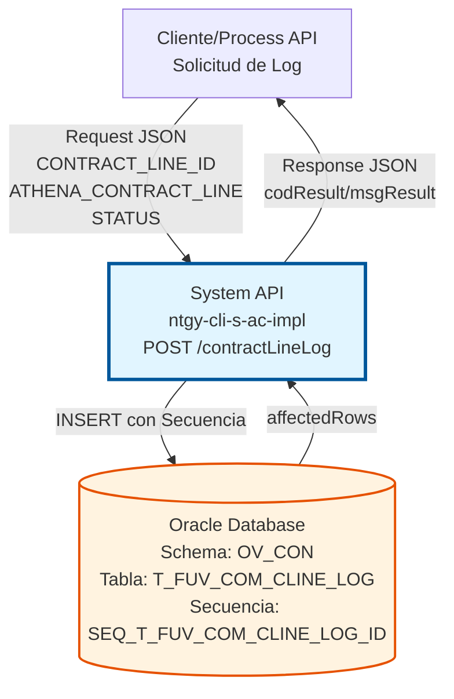
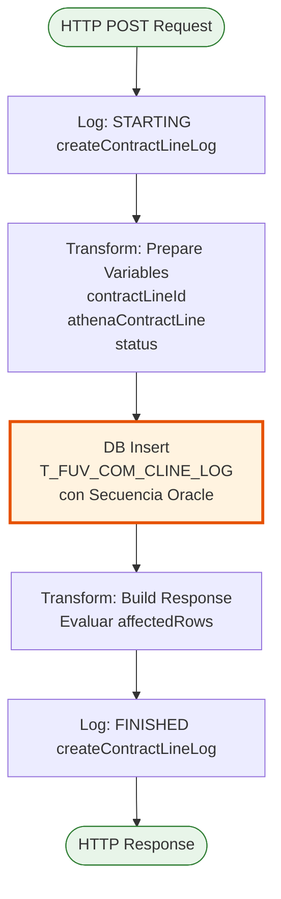
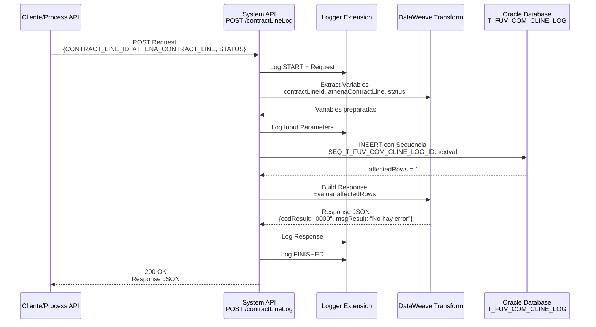
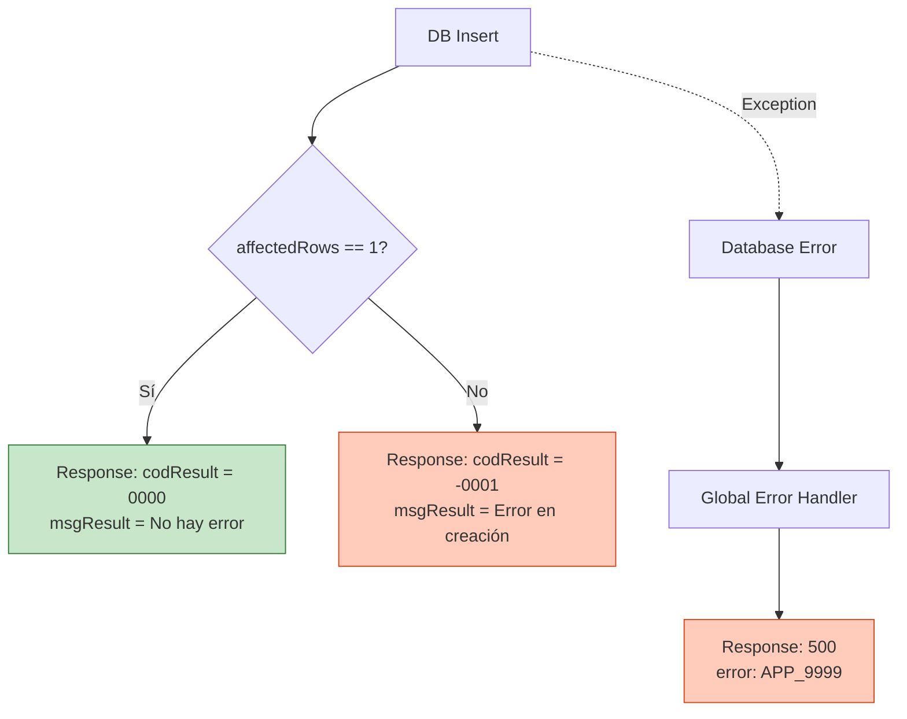

# POST /contractLineLog

## 📌 Descripción General

### Propósito del Endpoint

Este endpoint permite crear registros de log para líneas de contrato en la tabla `T_FUV_COM_CLINE_LOG` de Oracle Database. Su función principal es mantener un registro de auditoría de las sincronizaciones de líneas de contrato con el sistema Athena, incluyendo el estado de procesamiento y los datos completos de la línea de contrato en formato JSON.

El endpoint soporta:
- **Registro de Auditoría**: Almacena información completa de líneas de contrato para trazabilidad
- **Control de Estado**: Registra el estado actual de procesamiento de cada línea de contrato
- **Sincronización con Athena**: Mantiene copia de los datos enviados/recibidos de Athena
- **Gestión de Reintentos**: Inicializa contador de reintentos de procesamiento

### Tipo de API

**Capa:** System API (API-Led Connectivity)

**Función:** Integración directa con Oracle Database (schema OV_CON) para operaciones de logging y auditoría de líneas de contrato.

### Patrón de Integración

**Tipo:** Request-Reply Síncrono con INSERT en Oracle Database

**Descripción:** El endpoint recibe los datos de la línea de contrato, transforma los parámetros necesarios, ejecuta un INSERT en la tabla de logs utilizando una secuencia Oracle para generar el ID, y retorna confirmación de la operación basándose en las filas afectadas.

### Arquitectura API-Led Connectivity



---

## 💼 Propósito del Negocio

### Casos de Uso Principales

1. **Auditoría de Líneas de Contrato**
   - Registrar cada línea de contrato procesada en el sistema
   - Mantener histórico completo de datos de líneas de contrato
   - Facilitar investigación de incidencias y reconciliaciones

2. **Trazabilidad de Sincronizaciones con Athena**
   - Almacenar copia exacta de los datos enviados/recibidos de Athena
   - Permitir comparación entre estados de sincronización
   - Identificar discrepancias entre sistemas

3. **Control de Procesamiento**
   - Registrar estado actual de cada línea de contrato
   - Inicializar contador de reintentos para gestión de errores
   - Preparar datos para procesamiento posterior o reintento

### Contexto Empresarial

- **Dominio:** Gestión de Contratos y Auditoría
- **Sector:** Energía - Utilities
- **División:** Naturgy España - NewCo
- **Proceso de Negocio:** Sincronización y auditoría de líneas de contrato entre sistemas internos y Athena
- **Sistema Backend:** Oracle Database (AC Schema - Administración Comercial)

### Stakeholders

- **Equipos de Operaciones**: Necesitan trazabilidad completa de sincronizaciones
- **Equipos de Soporte**: Requieren logs para investigación de incidencias
- **Auditores Internos**: Utilizan logs para verificación de procesos
- **Desarrolladores**: Consultan logs para debugging y análisis de flujos

### Valor de Negocio

- **Trazabilidad Completa**: Registro detallado de todas las operaciones de líneas de contrato
- **Facilita Auditorías**: Información estructurada y accesible para auditorías internas/externas
- **Soporte a Operaciones**: Permite identificar y resolver problemas rápidamente
- **Cumplimiento Normativo**: Mantiene registro de operaciones según requisitos regulatorios

### Consumidores Potenciales

Este endpoint puede ser consumido por:
- Process APIs de gestión de contratos
- Flujos de sincronización con Athena
- Sistemas de integración middleware
- Procesos batch de reconciliación
- Herramientas de monitoreo y alertas

---

## 🔧 Especificación Técnica

### URLs por Ambiente

| Ambiente | URL Base | URL Completa |
|----------|----------|--------------|
| **Local** | `http://localhost:8081` | `http://localhost:8081/api/contractLineLog` |
| **Development** | `https://ntgy-cli-s-ac-impl-dev.us-e2.cloudhub.io` | `https://ntgy-cli-s-ac-impl-dev.us-e2.cloudhub.io/api/contractLineLog` |
| **QA** | `https://ntgy-cli-s-ac-impl-cc.us-e2.cloudhub.io` | `https://ntgy-cli-s-ac-impl-cc.us-e2.cloudhub.io/api/contractLineLog` |
| **Pre-Production** | `https://ntgy-cli-s-ac-impl-cl.us-e2.cloudhub.io` | `https://ntgy-cli-s-ac-impl-cl.us-e2.cloudhub.io/api/contractLineLog` |
| **Production** | `https://ntgy-cli-s-ac-impl-pro.us-e2.cloudhub.io` | `https://ntgy-cli-s-ac-impl-pro.us-e2.cloudhub.io/api/contractLineLog` |

### Método HTTP

```
POST /api/contractLineLog
```

### Parámetros de Entrada

#### Headers HTTP

| Header | Tipo | Requerido | Descripción | Ejemplo |
|--------|------|-----------|-------------|---------|
| `Content-Type` | string | ✅ Sí | Tipo de contenido del request | `application/json` |
| `Accept` | string | ❌ No | Tipo de contenido esperado en response | `application/json` |

#### Body Parameters

| Campo | Tipo | Requerido | Descripción | Ejemplo |
|-------|------|-----------|-------------|---------|
| `CONTRACT_LINE_ID` | string/number | ✅ Sí | Identificador único de la línea de contrato | `"12345"` |
| `ATHENA_CONTRACT_LINE` | object | ✅ Sí | Objeto JSON con datos de la línea de contrato de Athena. **La estructura es flexible** y depende del sistema Athena. El endpoint no valida campos específicos. | `{"id": "12345", ...}` |
| `STATUS` | string | ✅ Sí | Estado actual de procesamiento de la línea de contrato | `"PENDING"`, `"PROCESSED"`, `"ERROR"` |

> **⚠️ Nota Importante sobre ATHENA_CONTRACT_LINE**: 
> Este campo acepta **cualquier estructura JSON válida**. El endpoint no valida campos específicos, 
> simplemente serializa el objeto completo a JSON y lo almacena en la base de datos Oracle. 
> La estructura exacta depende del sistema Athena y puede variar según el contexto de negocio.

**Estructura del Request Body:**

```json
{
  "CONTRACT_LINE_ID": "12345",
  "ATHENA_CONTRACT_LINE": {
    // Objeto JSON flexible con estructura definida por el sistema Athena
    // Ejemplo genérico - la estructura real puede variar:
    "id": "12345",
    "contractData": { ... },
    "metadata": { ... }
  },
  "STATUS": "PENDING"
}
```

### Respuestas

#### Respuesta Exitosa (200 OK)

Cuando la inserción se realiza correctamente (affectedRows = 1):

```json
{
  "result": {
    "codResult": "0000",
    "msgResult": "No hay error"
  }
}
```

#### Respuesta de Error de Inserción (200 OK)

Cuando la inserción falla (affectedRows ≠ 1):

```json
{
  "result": {
    "codResult": "-0001",
    "msgResult": "Ha habido un error en la creación del registro"
  }
}
```

#### Respuesta de Error Técnico (500)

```json
{
  "error": "APP_9999",
  "message": "Error en el servicio."
}
```

### Códigos de Respuesta HTTP

| Código | Descripción | Escenario |
|--------|-------------|-----------|
| `200` | OK | Operación completada (exitosa o con error de negocio) |
| `400` | Bad Request | Request body inválido o campos requeridos faltantes |
| `500` | Internal Server Error | Error técnico en el servidor o base de datos |

### Autenticación y Autorización

- **Tipo:** Client ID & Client Secret (Anypoint Platform)
- **Autorización Oracle:** El usuario de base de datos debe tener permisos para:
  - Ejecutar INSERT en tabla `T_FUV_COM_CLINE_LOG`
  - Acceso a secuencia `SEQ_T_FUV_COM_CLINE_LOG_ID`
  - Permisos de escritura en schema `OV_CON`

### Timeouts

| Tipo | Valor | Descripción |
|------|-------|-------------|
| **Request Timeout** | 30 segundos | Tiempo máximo de espera para la respuesta |
| **Connection Timeout** | 10 segundos | Tiempo máximo para establecer conexión con Oracle |

---

## 🏗️ Implementación Técnica

### Arquitectura del Flow



### Componentes del Flow

#### 1. Logger de Inicio
```xml
<logger level="INFO" doc:name="request" message="STARTING createContractLineLog METHOD. REQUEST: ..."/>
```
- Registra el inicio de la operación
- Normaliza y registra el payload de entrada

#### 2. Transformación de Variables
```dataweave
%dw 2.0
output application/java
---
{
  contractLineId: payload.CONTRACT_LINE_ID,
  athenaContractLine: write(payload.ATHENA_CONTRACT_LINE, 'application/json'),
  status: payload.STATUS
}
```
- Extrae `CONTRACT_LINE_ID` del payload
- Serializa `ATHENA_CONTRACT_LINE` a JSON string
- Extrae `STATUS` del payload

#### 3. Operación de Base de Datos

**Query SQL:**
```sql
INSERT INTO T_FUV_COM_CLINE_LOG (
  T_FUV_COM_CLINE_LOG_ID,
  CONTRACT_LINE_ID,
  ATHENA_CONTRACT_LINE,
  AC_EXTRA_DATA,
  STATUS,
  PROCESSING_RETRIES,
  ERROR,
  PROCESSING_DATE,
  UPDATE_DATE
) VALUES (
  SEQ_T_FUV_COM_CLINE_LOG_ID.nextval,
  :contractLineId,
  :athenaContractLine,
  null,
  :status,
  1,
  null,
  sysdate,
  null
)
```

**Parámetros de Entrada:**
```dataweave
{
  contractLineId: vars.contractLineId,
  athenaContractLine: write(vars.athenaContractLine, 'application/json'),
  status: vars.status
}
```

**Características Oracle:**
- **Secuencia**: `SEQ_T_FUV_COM_CLINE_LOG_ID.nextval` genera ID único automáticamente
- **Función de Fecha**: `sysdate` registra timestamp actual de Oracle
- **Valores por Defecto**:
  - `AC_EXTRA_DATA`: null (reservado para datos adicionales futuros)
  - `PROCESSING_RETRIES`: 1 (inicializa contador de reintentos)
  - `ERROR`: null (se poblará en caso de error de procesamiento)
  - `UPDATE_DATE`: null (se actualizará en modificaciones posteriores)

#### 4. Construcción de Respuesta
```dataweave
%dw 2.0
output application/json
---
{
  "result": {
    "codResult": if (payload.affectedRows == 1) "0000" else "-0001",
    "msgResult": if (payload.affectedRows == 1) "No hay error" else "Ha habido un error en la creación del registro"
  }
}
```
- Evalúa `affectedRows` del resultado de INSERT
- Retorna código `0000` si se insertó 1 fila (éxito)
- Retorna código `-0001` si no se insertó exactamente 1 fila (error)

### Características del Campo ATHENA_CONTRACT_LINE

**Almacenamiento y Procesamiento:**
- **Tipo de Dato**: Object (JSON)
- **Validación**: Ninguna - acepta cualquier estructura JSON válida
- **Serialización**: Se convierte a JSON string mediante `write(vars.athenaContractLine, 'application/json')`
- **Almacenamiento en Oracle**: Se guarda como CLOB o VARCHAR2 (según definición de tabla)
- **Tamaño Máximo**: Limitado por el tipo de columna en Oracle
- **Propósito**: Almacenar copia exacta de los datos de Athena sin transformación ni validación

**Responsabilidades:**
- ✅ El **consumidor** es responsable de proporcionar la estructura correcta según Athena
- ✅ El **endpoint** solo valida que sea un JSON válido (sintaxis)
- ❌ El **endpoint NO valida** campos específicos, tipos de datos, o estructura semántica

#### 5. Logger de Fin
```xml
<logger level="INFO" doc:name="response" message="FINISHED createContractLineLog METHOD. RESPONSE: ..."/>
```
- Registra el fin de la operación
- Normaliza y registra la respuesta generada

### Diagrama de Secuencia Completo



### Estructura de la Tabla Oracle

**Tabla:** `T_FUV_COM_CLINE_LOG`

| Columna | Tipo | Nullable | Descripción |
|---------|------|----------|-------------|
| `T_FUV_COM_CLINE_LOG_ID` | NUMBER | NO | ID único generado por secuencia |
| `CONTRACT_LINE_ID` | VARCHAR2/NUMBER | NO | ID de la línea de contrato |
| `ATHENA_CONTRACT_LINE` | CLOB/VARCHAR2 | NO | Datos completos de Athena en JSON |
| `AC_EXTRA_DATA` | CLOB/VARCHAR2 | YES | Datos adicionales (reservado) |
| `STATUS` | VARCHAR2 | NO | Estado de procesamiento |
| `PROCESSING_RETRIES` | NUMBER | NO | Contador de reintentos |
| `ERROR` | VARCHAR2 | YES | Mensaje de error si aplica |
| `PROCESSING_DATE` | DATE | NO | Fecha de creación del registro |
| `UPDATE_DATE` | DATE | YES | Fecha de última actualización |

**Secuencia:** `SEQ_T_FUV_COM_CLINE_LOG_ID`
- Genera valores únicos para `T_FUV_COM_CLINE_LOG_ID`
- Incremento automático

### Configuración de Conexión Oracle

```xml
<db:config name="Database_Config">
    <db:generic-connection 
        url="jdbc:oracle:thin:${dbAC.user}/${secure::dbAC.pass}@..."
        driverClassName="oracle.jdbc.driver.OracleDriver">
        <db:pooling-profile 
            maxPoolSize="${dbAC.MaxPoolSize}"
            maxWait="${dbAC.MaxWaitTime}"
            maxIdleTime="${dbAC.MaxIdleTime}"/>
    </db:generic-connection>
</db:config>
```

**Características:**
- **Driver:** Oracle JDBC 19.13.0.0.1
- **Connection Pooling:** Configurado por ambiente
- **Oracle RAC:** Soporte para failover automático
- **Secure Properties:** Credenciales encriptadas

### Manejo de Errores



**Escenarios de Error:**

1. **Inserción Exitosa** (affectedRows = 1)
   - Código: `0000`
   - Mensaje: "No hay error"
   - HTTP Status: 200

2. **Inserción Fallida** (affectedRows ≠ 1)
   - Código: `-0001`
   - Mensaje: "Ha habido un error en la creación del registro"
   - HTTP Status: 200
   - Posibles causas: Constraint violation, datos duplicados

3. **Error de Base de Datos**
   - HTTP Status: 500
   - Error: `APP_9999`
   - Mensaje: "Error en el servicio."
   - Posibles causas: Conexión perdida, timeout, permisos insuficientes

### Performance y Optimización

**Características de Performance:**
- **Connection Pooling**: Reutilización de conexiones Oracle
- **Secuencia Oracle**: Generación eficiente de IDs únicos
- **INSERT Simple**: Operación atómica sin joins
- **Logging Asíncrono**: No bloquea el flujo principal

**Métricas Esperadas:**
- Tiempo de respuesta: < 500ms (p95)
- Throughput: 100+ requests/minuto
- Tasa de error: < 0.1%

---

## 💻 Ejemplos de Uso

### Ejemplo 1: Crear Log de Línea de Contrato Pendiente

**Request:**

```bash
curl -X POST "https://ntgy-cli-s-ac-impl-dev.us-e2.cloudhub.io/api/contractLineLog" \
  -H "Content-Type: application/json" \
  -H "client_id: your-client-id" \
  -H "client_secret: your-client-secret" \
  -d '{
    "CONTRACT_LINE_ID": "CL-2024-12345",
    "ATHENA_CONTRACT_LINE": {
      "lineId": "CL-2024-12345",
      "contractReference": "CON-2024-001",
      "productInfo": {
        "code": "ELEC-001",
        "description": "Electricidad Tarifa 2.0TD"
      },
      "dates": {
        "start": "2024-01-15",
        "end": "2025-01-15"
      },
      "customer": {
        "id": "CUST-789456",
        "type": "residential"
      }
    },
    "STATUS": "PENDING"
  }'
```

> **Nota**: La estructura de `ATHENA_CONTRACT_LINE` mostrada es solo un ejemplo. 
> La estructura real depende del sistema Athena y puede contener campos diferentes.

**Response (200 OK):**

```json
{
  "result": {
    "codResult": "0000",
    "msgResult": "No hay error"
  }
}
```

---

### Ejemplo 2: Crear Log de Línea de Contrato Procesada

**Request:**

```bash
curl -X POST "https://ntgy-cli-s-ac-impl-pro.us-e2.cloudhub.io/api/contractLineLog" \
  -H "Content-Type: application/json" \
  -H "client_id: your-client-id" \
  -H "client_secret: your-client-secret" \
  -d '{
    "CONTRACT_LINE_ID": "CL-2024-67890",
    "ATHENA_CONTRACT_LINE": {
      "lineId": "CL-2024-67890",
      "contractReference": "CON-2024-002",
      "service": {
        "type": "GAS",
        "tariff": "3.1"
      },
      "effectiveDate": "2024-02-01",
      "customerId": "CUST-123789"
    },
    "STATUS": "PROCESSED"
  }'
```

> **Nota**: Este es un ejemplo simplificado. La estructura real puede incluir muchos más campos 
> según los requisitos del sistema Athena.

**Response (200 OK):**

```json
{
  "result": {
    "codResult": "0000",
    "msgResult": "No hay error"
  }
}
```

---

### Ejemplo 3: Error en Creación de Log

**Request:**

```bash
curl -X POST "https://ntgy-cli-s-ac-impl-dev.us-e2.cloudhub.io/api/contractLineLog" \
  -H "Content-Type: application/json" \
  -H "client_id: your-client-id" \
  -H "client_secret: your-client-secret" \
  -d '{
    "CONTRACT_LINE_ID": "CL-INVALID",
    "ATHENA_CONTRACT_LINE": {
      "id": "invalid-data"
    },
    "STATUS": "UNKNOWN"
  }'
```

**Response (200 OK - Error de Negocio):**

```json
{
  "result": {
    "codResult": "-0001",
    "msgResult": "Ha habido un error en la creación del registro"
  }
}
```

---

### Ejemplo 4: Request Inválido (Campos Faltantes)

**Request:**

```bash
curl -X POST "https://ntgy-cli-s-ac-impl-dev.us-e2.cloudhub.io/api/contractLineLog" \
  -H "Content-Type: application/json" \
  -H "client_id: your-client-id" \
  -H "client_secret: your-client-secret" \
  -d '{
    "CONTRACT_LINE_ID": "CL-2024-99999"
  }'
```

**Response (400 Bad Request):**

```json
{
  "message": "Bad request"
}
```

---

### Ejemplo 5: Uso desde JavaScript/Node.js

```javascript
const axios = require('axios');

async function createContractLineLog(contractLineId, athenaData, status) {
  try {
    const response = await axios.post(
      'https://ntgy-cli-s-ac-impl-pro.us-e2.cloudhub.io/api/contractLineLog',
      {
        CONTRACT_LINE_ID: contractLineId,
        ATHENA_CONTRACT_LINE: athenaData,
        STATUS: status
      },
      {
        headers: {
          'Content-Type': 'application/json',
          'client_id': process.env.CLIENT_ID,
          'client_secret': process.env.CLIENT_SECRET
        }
      }
    );

    if (response.data.result.codResult === '0000') {
      console.log('Log creado exitosamente');
      return { success: true, data: response.data };
    } else {
      console.error('Error al crear log:', response.data.result.msgResult);
      return { success: false, error: response.data.result };
    }
  } catch (error) {
    console.error('Error técnico:', error.message);
    return { success: false, error: error.message };
  }
}

// Ejemplo de uso
// NOTA: La estructura de athenaContractLine debe coincidir con lo que espera el sistema Athena
const athenaContractLine = {
  // Estructura flexible definida por Athena
  // Incluir aquí los campos que Athena proporciona
  lineId: "CL-2024-12345",
  contractReference: "CON-2024-001",
  // ... otros campos según Athena
};

createContractLineLog("CL-2024-12345", athenaContractLine, "PENDING")
  .then(result => console.log('Resultado:', result));
```

---

### Ejemplo 6: Uso desde Python

```python
import requests
import json
import os

def create_contract_line_log(contract_line_id, athena_data, status):
    """
    Crea un registro de log de línea de contrato
    
    Args:
        contract_line_id: ID de la línea de contrato
        athena_data: Diccionario con datos de Athena
        status: Estado de procesamiento
    
    Returns:
        dict: Resultado de la operación
    """
    url = "https://ntgy-cli-s-ac-impl-pro.us-e2.cloudhub.io/api/contractLineLog"
    
    headers = {
        "Content-Type": "application/json",
        "client_id": os.getenv("CLIENT_ID"),
        "client_secret": os.getenv("CLIENT_SECRET")
    }
    
    payload = {
        "CONTRACT_LINE_ID": contract_line_id,
        "ATHENA_CONTRACT_LINE": athena_data,
        "STATUS": status
    }
    
    try:
        response = requests.post(url, headers=headers, json=payload, timeout=30)
        response.raise_for_status()
        
        result = response.json()
        
        if result.get("result", {}).get("codResult") == "0000":
            print("Log creado exitosamente")
            return {"success": True, "data": result}
        else:
            print(f"Error al crear log: {result.get('result', {}).get('msgResult')}")
            return {"success": False, "error": result.get("result")}
            
    except requests.exceptions.RequestException as e:
        print(f"Error técnico: {str(e)}")
        return {"success": False, "error": str(e)}

# Ejemplo de uso
# NOTA: La estructura de athena_contract_line debe coincidir con lo que espera el sistema Athena
athena_contract_line = {
    # Estructura flexible definida por Athena
    # Incluir aquí los campos que Athena proporciona
    "lineId": "CL-2024-12345",
    "contractReference": "CON-2024-001",
    # ... otros campos según Athena
}

result = create_contract_line_log("CL-2024-12345", athena_contract_line, "PENDING")
print(f"Resultado: {result}")
```

---

### Notas de Implementación

1. **Estructura Flexible de ATHENA_CONTRACT_LINE**: 
   - El endpoint acepta **cualquier estructura JSON válida**
   - No hay validación de campos específicos
   - La estructura debe ser definida por el sistema Athena
   - Es responsabilidad del consumidor proporcionar la estructura correcta

2. **Serialización JSON**: 
   - El campo `ATHENA_CONTRACT_LINE` se serializa automáticamente a JSON string antes de insertarse en Oracle
   - Se utiliza la función DataWeave: `write(vars.athenaContractLine, 'application/json')`

3. **Generación de ID**: 
   - El ID se genera automáticamente mediante la secuencia Oracle `SEQ_T_FUV_COM_CLINE_LOG_ID.nextval`
   - No es necesario proporcionar el ID en el request

4. **Valores por Defecto**: 
   - `PROCESSING_RETRIES`: Se inicializa en 1
   - `PROCESSING_DATE`: Se establece con `sysdate` (timestamp actual de Oracle)
   - `AC_EXTRA_DATA`, `ERROR`, `UPDATE_DATE`: Se inicializan en null

5. **Idempotencia**: 
   - El endpoint **NO es idempotente**
   - Cada llamada crea un nuevo registro en la tabla
   - No hay verificación de duplicados

6. **Validación**: 
   - Solo se valida que `ATHENA_CONTRACT_LINE` sea un JSON sintácticamente válido
   - No se validan campos específicos, tipos de datos, o estructura semántica

7. **Estados Comunes**: 
   - Los valores típicos de `STATUS` son: `PENDING`, `PROCESSED`, `ERROR`, `RETRY`
   - La lista de estados válidos depende de la lógica de negocio de Athena

8. **Tamaño de Datos**:
   - El tamaño de `ATHENA_CONTRACT_LINE` está limitado por el tipo de columna en Oracle (CLOB/VARCHAR2)
   - Verificar límites de tamaño según la definición de la tabla
