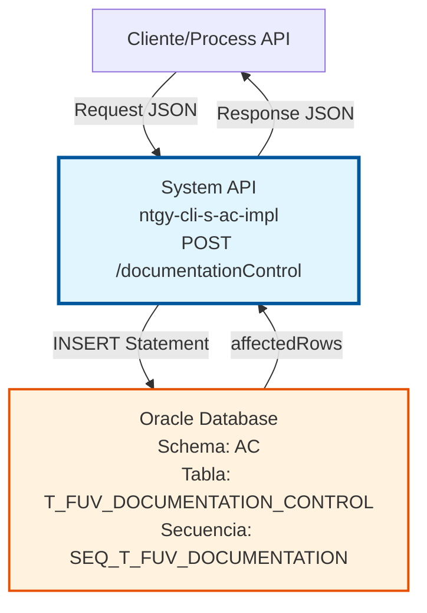
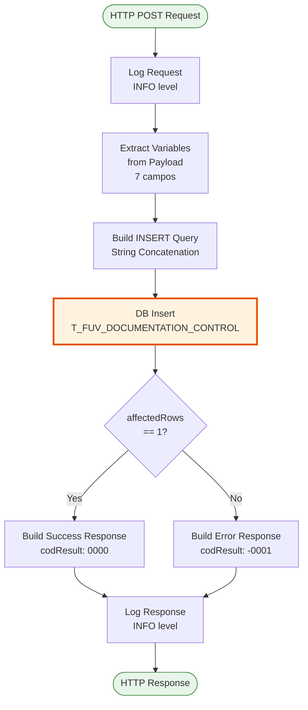
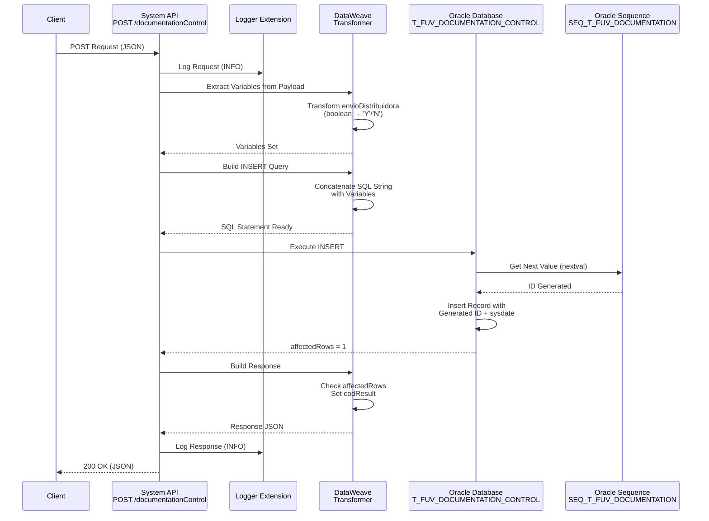
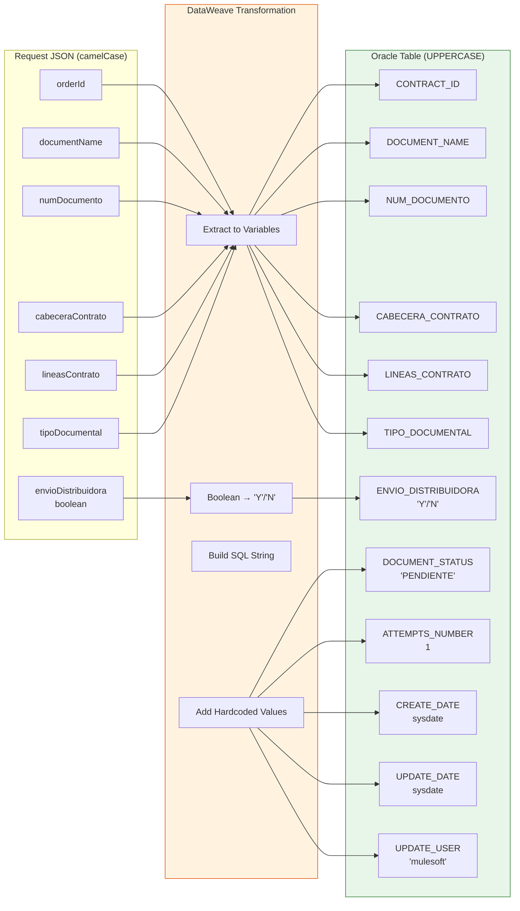

# POST /documentationControl

## 📌 Descripción General

### Propósito del Endpoint

Este endpoint permite crear registros de control de documentación asociados a contratos en el sistema FUV (Facturación Única Virtual). Registra información sobre documentos relacionados con contratos de clientes, incluyendo el tipo de documento, estado, observaciones y metadatos de auditoría.

El endpoint soporta:
- **Registro de Documentación**: Creación de nuevos registros de control documental
- **Trazabilidad**: Almacenamiento de información de auditoría (fechas, usuario, programa)
- **Estado Inicial**: Todos los documentos se crean con estado 'PENDIENTE'
- **Secuenciación Automática**: Generación automática de ID mediante secuencia Oracle

### Tipo de API

**Capa:** System API (API-Led Connectivity)

**Función:** Integración directa con Oracle Database (AC Schema) para operaciones CRUD sobre control de documentación de contratos.

### Patrón de Integración

**Tipo:** Request-Reply Síncrono con INSERT en Oracle

**Descripción:** El endpoint recibe datos del documento en formato JSON, extrae los campos necesarios, construye una sentencia SQL INSERT mediante concatenación de strings, ejecuta la inserción en la tabla `T_FUV_DOCUMENTATION_CONTROL` y retorna el resultado de la operación.

### Arquitectura API-Led Connectivity



---

## 💼 Propósito del Negocio

### Casos de Uso Principales

1. **Registro de Documentación de Contratos**
   - Cuando se genera un nuevo documento relacionado con un contrato (ej: contrato firmado, anexos)
   - Se registra el documento con estado inicial 'PENDIENTE'
   - Permite trazabilidad completa del documento desde su creación

2. **Control de Envío a Distribuidora**
   - Marca si el documento debe ser enviado a la distribuidora eléctrica/gas
   - Facilita el seguimiento de documentos que requieren envío externo
   - Soporta procesos de integración con distribuidoras

3. **Auditoría de Documentación**
   - Registra automáticamente fecha de creación, usuario y programa
   - Mantiene contador de intentos de procesamiento
   - Permite seguimiento histórico de documentos por contrato

### Contexto Empresarial

- **Dominio:** Gestión de Clientes y Contratos
- **Sector:** Energía - Utilities
- **División:** Naturgy España - CLI (Clientes)
- **Proceso de Negocio:** Alta de Clientes y Gestión Documental
- **Sistema:** FUV (Facturación Única Virtual)

### Stakeholders

- **Equipos de Alta de Clientes**: Necesitan registrar documentación de nuevos contratos
- **Equipos de Operaciones**: Requieren trazabilidad de documentos enviados a distribuidoras
- **Equipos de Auditoría**: Necesitan histórico completo de documentación por contrato
- **Sistemas Externos**: Distribuidoras eléctricas y de gas que reciben documentación

### Valor de Negocio

- **Trazabilidad Completa**: Registro detallado de toda la documentación asociada a contratos
- **Automatización**: Generación automática de IDs y metadatos de auditoría
- **Control de Envíos**: Gestión de documentos que requieren envío a distribuidoras
- **Auditoría**: Cumplimiento de requisitos regulatorios de trazabilidad documental

### Consumidores Potenciales

Este endpoint puede ser consumido por:
- Process APIs de gestión de contratos
- Process APIs de alta de clientes
- Flujos de Salesforce (Platform Events, Flows)
- Sistemas de gestión documental
- Aplicaciones de back-office

---

## 🔧 Especificación Técnica

### URLs por Ambiente

| Ambiente | URL Base | URL Completa |
|----------|----------|--------------|
| **Local** | `http://localhost:8081` | `http://localhost:8081/api/documentationControl` |
| **Development** | `https://ntgy-cli-s-ac-impl-dev.us-e2.cloudhub.io` | `https://ntgy-cli-s-ac-impl-dev.us-e2.cloudhub.io/api/documentationControl` |
| **UAT** | `https://ntgy-cli-s-ac-impl-uat.us-e2.cloudhub.io` | `https://ntgy-cli-s-ac-impl-uat.us-e2.cloudhub.io/api/documentationControl` |
| **Production** | `https://ntgy-cli-s-ac-impl-pro.us-e2.cloudhub.io` | `https://ntgy-cli-s-ac-impl-pro.us-e2.cloudhub.io/api/documentationControl` |

### Método HTTP

```
POST /api/documentationControl
```

### Parámetros de Entrada

#### Headers HTTP

| Header | Tipo | Requerido | Descripción | Ejemplo |
|--------|------|-----------|-------------|---------|
| `Content-Type` | string | ✅ Sí | Tipo de contenido del request | `application/json` |
| `Accept` | string | ❌ No | Tipo de contenido esperado en response | `application/json` |

#### Body Parameters

**Estructura del Request Body:**

| Campo | Tipo | Requerido | Descripción | Ejemplo | Validaciones |
|-------|------|-----------|-------------|---------|--------------|
| `orderId` | string | ✅ Sí | ID del pedido/contrato | `"12345"` | No vacío |
| `documentName` | string | ✅ Sí | Nombre del documento | `"Contrato_Firmado.pdf"` | No vacío |
| `numDocumento` | string | ✅ Sí | Número de documento | `"DOC-2024-001"` | No vacío |
| `cabeceraContrato` | string | ✅ Sí | Cabecera del contrato | `"HEADER-001"` | No vacío |
| `lineasContrato` | string | ❌ No | Líneas del contrato (separadas por coma) | `"LINE-001,LINE-002"` | Puede ser null |
| `tipoDocumental` | string | ✅ Sí | Tipo documental | `"CONTRATO"` | No vacío |
| `envioDistribuidora` | boolean | ✅ Sí | Indica si se envía a distribuidora | `true` | true/false |

**Ejemplo de Request Body:**

```json
{
    "orderId": "12345",
    "documentName": "Contrato_Firmado.pdf",
    "numDocumento": "DOC-2024-001",
    "cabeceraContrato": "HEADER-001",
    "lineasContrato": "LINE-001,LINE-002",
    "tipoDocumental": "CONTRATO",
    "envioDistribuidora": true
}
```

### Respuestas

#### Respuesta Exitosa (200 OK)

**Condición:** El registro se insertó correctamente (affectedRows == 1)

```json
{
    "result": {
        "codResult": "0000",
        "msgResult": "No hay error"
    }
}
```

#### Respuesta de Error de Inserción (200 OK)

**Condición:** El registro no se insertó correctamente (affectedRows != 1)

```json
{
    "result": {
        "codResult": "-0001",
        "msgResult": "Ha habido un error en la creación del registro"
    }
}
```

#### Respuesta de Error de Validación (400 Bad Request)

**Condición:** Request body inválido o campos requeridos faltantes

```json
{
    "message": "Bad request"
}
```

#### Respuesta de Error Técnico (500 Internal Server Error)

**Condición:** Error de base de datos o error interno del servidor

```json
{
    "error": "APP_9999",
    "message": "Error en el servicio."
}
```

### Autenticación y Autorización

- **Tipo:** Client ID & Client Secret (Anypoint Platform)
- **Autorización Oracle:** El usuario de base de datos debe tener permisos para:
  - Ejecutar INSERT en tabla `T_FUV_DOCUMENTATION_CONTROL`
  - Acceso a secuencia `SEQ_T_FUV_DOCUMENTATION`
  - Permisos de escritura en schema AC

### Timeouts

| Tipo | Valor | Descripción |
|------|-------|-------------|
| **Request Timeout** | 30 segundos | Tiempo máximo de espera para la respuesta |
| **Connection Timeout** | 10 segundos | Tiempo máximo para establecer conexión con Oracle |

---

## 🏗️ Implementación Técnica

### Arquitectura del Flow



### Subflow: s-ac-createDocumentationControl

**Ubicación:** `src/main/mule/s-ac-documentationControl.xml` (líneas 8-96)

#### Paso 1: Log de Request (Líneas 9-16)

```dataweave
'STARTING createDocumentationControl METHOD. REQUEST: ' ++ request
```

#### Paso 2: Extracción de Variables (Líneas 17-51)

```dataweave
%dw 2.0
output application/java
---
{
    idPedido: payload.orderId,
    documentName: payload.documentName,
    numDocumento: payload.numDocumento,
    cabeceraContrato: payload.cabeceraContrato,
    lineasContrato: payload.lineasContrato,
    tipoDocumental: payload.tipoDocumental,
    envioDistribuidora: if (payload.envioDistribuidora == true) 'Y' else 'N'
}
```

**Transformación Especial:**
- `envioDistribuidora`: Boolean (true/false) → Char ('Y'/'N')

#### Paso 3: Construcción de Query SQL (Líneas 52-71)

```dataweave
%dw 2.0
output application/java

var sentence_1 = "INSERT INTO T_FUV_DOCUMENTATION_CONTROL (
    T_FUV_DOCUMENTATION_CONTROL_ID, 
    CONTRACT_ID, 
    DOCUMENT_NAME, 
    DOCUMENT_STATUS, 
    ATTEMPTS_NUMBER, 
    CREATE_DATE, 
    UPDATE_DATE, 
    UPDATE_USER, 
    UPDATE_PROGRAM, 
    NUM_DOCUMENTO, 
    CABECERA_CONTRATO, 
    TIPO_DOCUMENTAL, 
    ENVIO_DISTRIBUIDORA, 
    LINEAS_CONTRATO
) VALUES (
    SEQ_T_FUV_DOCUMENTATION.nextval, "
---
sentence_1 
++ '\'' ++ vars.idPedido ++ '\'' ++ ', '
++ '\'' ++ vars.documentName ++ '\'' ++ ', '
++ '\'PENDIENTE\'' ++ ', '
++ '1, '
++ 'sysdate, '
++ 'sysdate,'
++ '\'mulesoft\'' ++ ', '
++ '\'mulesoft\''
++ ', ' ++ '\'' ++ vars.numDocumento ++ '\'' ++ ', '
++ '\'' ++ vars.cabeceraContrato ++ '\''
++ ', '  ++ '\'' ++ vars.tipoDocumental ++ '\'' ++ ', '
++ '\'' ++ vars.envioDistribuidora ++ '\''
++ ', ' ++ if (vars.lineasContrato != null) 
           ('\'' ++  vars.lineasContrato  ++ '\''++ ')') 
           else ('\'' ++ '\'' ++ ')')
```

**Valores Hardcoded:**
- `DOCUMENT_STATUS`: 'PENDIENTE' (estado inicial)
- `ATTEMPTS_NUMBER`: 1 (primer intento)
- `UPDATE_USER`: 'mulesoft'
- `UPDATE_PROGRAM`: 'mulesoft'

**Valores Generados por Oracle:**
- `T_FUV_DOCUMENTATION_CONTROL_ID`: `SEQ_T_FUV_DOCUMENTATION.nextval`
- `CREATE_DATE`: `sysdate`
- `UPDATE_DATE`: `sysdate`

#### Paso 4: Ejecución de INSERT (Líneas 72-74)

```xml
<db:insert config-ref="Database_Config">
    <db:sql><![CDATA[#[payload]]]></db:sql>
</db:insert>
```

**Configuración de Base de Datos:**
- **Connector:** Database Connector (Oracle)
- **Config:** Database_Config
- **Driver:** Oracle JDBC 19.13.0.0.1
- **Connection Pooling:** Configurado por ambiente

#### Paso 5: Construcción de Response (Líneas 75-87)

```dataweave
%dw 2.0
output application/json
---
{
    "result": {
        "codResult": if (payload.affectedRows == 1) "0000" else "-0001",
        "msgResult": if (payload.affectedRows == 1) 
                     "No hay error" 
                     else "Ha habido un error en la creación del registro"
    }
}
```

#### Paso 6: Log de Response (Líneas 88-95)

```dataweave
'FINISHED createDocumentationControl METHOD. RESPONSE: ' ++ response
```

### Diagrama de Secuencia Detallado



### Estructura de la Tabla Oracle

**Tabla:** `T_FUV_DOCUMENTATION_CONTROL`

| Campo Oracle | Tipo | Origen | Descripción |
|--------------|------|--------|-------------|
| `T_FUV_DOCUMENTATION_CONTROL_ID` | NUMBER | Secuencia | ID único (autoincremental) |
| `CONTRACT_ID` | VARCHAR2 | `orderId` | ID del contrato/pedido |
| `DOCUMENT_NAME` | VARCHAR2 | `documentName` | Nombre del documento |
| `DOCUMENT_STATUS` | VARCHAR2 | Hardcoded | Estado del documento ('PENDIENTE') |
| `ATTEMPTS_NUMBER` | NUMBER | Hardcoded | Número de intentos (1) |
| `CREATE_DATE` | DATE | Oracle | Fecha de creación (sysdate) |
| `UPDATE_DATE` | DATE | Oracle | Fecha de actualización (sysdate) |
| `UPDATE_USER` | VARCHAR2 | Hardcoded | Usuario ('mulesoft') |
| `UPDATE_PROGRAM` | VARCHAR2 | Hardcoded | Programa ('mulesoft') |
| `NUM_DOCUMENTO` | VARCHAR2 | `numDocumento` | Número de documento |
| `CABECERA_CONTRATO` | VARCHAR2 | `cabeceraContrato` | Cabecera del contrato |
| `TIPO_DOCUMENTAL` | VARCHAR2 | `tipoDocumental` | Tipo documental |
| `ENVIO_DISTRIBUIDORA` | CHAR(1) | `envioDistribuidora` | Envío a distribuidora ('Y'/'N') |
| `LINEAS_CONTRATO` | VARCHAR2 | `lineasContrato` | Líneas del contrato (nullable) |

**Secuencia:** `SEQ_T_FUV_DOCUMENTATION`

### Diagrama de Transformación de Datos



### Manejo de Errores

**Error Handler:** Global Error Handler (`s-ac-globalErrorHandler`)

**Tipos de Errores:**

1. **APP:NOT_FOUND (404)**
   - No aplica para este endpoint (es un INSERT)

2. **APIKIT:BAD_REQUEST (400)**
   - Request body inválido
   - Campos requeridos faltantes
   - Formato JSON incorrecto

3. **Database Errors (500)**
   - Error de conexión a Oracle
   - Violación de constraints
   - Error en secuencia
   - Timeout de query

4. **ANY (500)**
   - Errores no manejados específicamente
   - Errores de transformación DataWeave

### Consideraciones de Seguridad

⚠️ **Importante:** La query SQL se construye mediante **concatenación de strings** en lugar de usar parámetros preparados. Aunque los valores provienen del payload validado por APIKit, es importante asegurar que:

1. La validación del RAML sea estricta
2. No se permitan caracteres especiales SQL en los campos de texto
3. Se implemente sanitización adicional si es necesario

**Recomendación:** Considerar migrar a queries parametrizadas en futuras versiones para mayor seguridad.

---

## 💻 Ejemplos de Uso

### Ejemplo 1: Creación Exitosa de Registro

#### Request

```bash
curl -X POST "http://localhost:8081/api/documentationControl" \
  -H "Content-Type: application/json" \
  -H "Accept: application/json" \
  -d '{
    "orderId": "ORD-2024-12345",
    "documentName": "Contrato_Firmado_Cliente_12345.pdf",
    "numDocumento": "DOC-2024-001",
    "cabeceraContrato": "HEADER-NEWCO-001",
    "lineasContrato": "LINE-001,LINE-002,LINE-003",
    "tipoDocumental": "CONTRATO_FIRMADO",
    "envioDistribuidora": true
  }'
```

#### Response (200 OK)

```json
{
    "result": {
        "codResult": "0000",
        "msgResult": "No hay error"
    }
}
```

**Registro Creado en Oracle:**

```sql
-- Query ejecutada:
INSERT INTO T_FUV_DOCUMENTATION_CONTROL (
    T_FUV_DOCUMENTATION_CONTROL_ID, 
    CONTRACT_ID, 
    DOCUMENT_NAME, 
    DOCUMENT_STATUS, 
    ATTEMPTS_NUMBER, 
    CREATE_DATE, 
    UPDATE_DATE, 
    UPDATE_USER, 
    UPDATE_PROGRAM, 
    NUM_DOCUMENTO, 
    CABECERA_CONTRATO, 
    TIPO_DOCUMENTAL, 
    ENVIO_DISTRIBUIDORA, 
    LINEAS_CONTRATO
) VALUES (
    SEQ_T_FUV_DOCUMENTATION.nextval,  -- Ej: 1001
    'ORD-2024-12345',
    'Contrato_Firmado_Cliente_12345.pdf',
    'PENDIENTE',
    1,
    sysdate,  -- Ej: 2024-01-15 10:30:45
    sysdate,  -- Ej: 2024-01-15 10:30:45
    'mulesoft',
    'mulesoft',
    'DOC-2024-001',
    'HEADER-NEWCO-001',
    'CONTRATO_FIRMADO',
    'Y',
    'LINE-001,LINE-002,LINE-003'
)
```

---

### Ejemplo 2: Registro sin Líneas de Contrato (Campo Opcional)

#### Request

```bash
curl -X POST "http://localhost:8081/api/documentationControl" \
  -H "Content-Type: application/json" \
  -d '{
    "orderId": "ORD-2024-67890",
    "documentName": "Anexo_Modificacion.pdf",
    "numDocumento": "DOC-2024-002",
    "cabeceraContrato": "HEADER-NEWCO-002",
    "tipoDocumental": "ANEXO",
    "envioDistribuidora": false
  }'
```

**Nota:** El campo `lineasContrato` se omite (null)

#### Response (200 OK)

```json
{
    "result": {
        "codResult": "0000",
        "msgResult": "No hay error"
    }
}
```

**Registro Creado:**
- `LINEAS_CONTRATO`: '' (string vacío)
- `ENVIO_DISTRIBUIDORA`: 'N' (false → 'N')

---

### Ejemplo 3: Error de Validación (Campo Requerido Faltante)

#### Request

```bash
curl -X POST "http://localhost:8081/api/documentationControl" \
  -H "Content-Type: application/json" \
  -d '{
    "orderId": "ORD-2024-11111",
    "documentName": "Documento.pdf"
  }'
```

**Nota:** Faltan campos requeridos: `numDocumento`, `cabeceraContrato`, `tipoDocumental`, `envioDistribuidora`

#### Response (400 Bad Request)

```json
{
    "message": "Bad request"
}
```

---

### Ejemplo 4: Error de Base de Datos

#### Request

```bash
curl -X POST "http://localhost:8081/api/documentationControl" \
  -H "Content-Type: application/json" \
  -d '{
    "orderId": "ORD-2024-99999",
    "documentName": "Documento_Muy_Largo_Que_Excede_El_Limite_De_Caracteres_Permitido_En_La_Base_De_Datos_Y_Causara_Un_Error_De_Truncamiento.pdf",
    "numDocumento": "DOC-2024-003",
    "cabeceraContrato": "HEADER-003",
    "tipoDocumental": "CONTRATO",
    "envioDistribuidora": true
  }'
```

**Nota:** El nombre del documento excede el límite de caracteres de la columna

#### Response (200 OK - pero con error)

```json
{
    "result": {
        "codResult": "-0001",
        "msgResult": "Ha habido un error en la creación del registro"
    }
}
```

**O Response (500 Internal Server Error)**

```json
{
    "error": "APP_9999",
    "message": "Error en el servicio."
}
```

---

### Ejemplo 5: Uso desde JavaScript (Frontend)

```javascript
async function createDocumentationControl(documentData) {
    const url = 'https://ntgy-cli-s-ac-impl-pro.us-e2.cloudhub.io/api/documentationControl';
    
    const requestBody = {
        orderId: documentData.orderId,
        documentName: documentData.documentName,
        numDocumento: documentData.numDocumento,
        cabeceraContrato: documentData.cabeceraContrato,
        lineasContrato: documentData.lineasContrato || null,
        tipoDocumental: documentData.tipoDocumental,
        envioDistribuidora: documentData.envioDistribuidora
    };
    
    try {
        const response = await fetch(url, {
            method: 'POST',
            headers: {
                'Content-Type': 'application/json',
                'Accept': 'application/json',
                'client_id': 'your-client-id',
                'client_secret': 'your-client-secret'
            },
            body: JSON.stringify(requestBody)
        });
        
        const data = await response.json();
        
        if (response.ok && data.result.codResult === '0000') {
            console.log('Documento registrado exitosamente');
            return { success: true, data };
        } else {
            console.error('Error al registrar documento:', data.result.msgResult);
            return { success: false, error: data.result.msgResult };
        }
    } catch (error) {
        console.error('Error de red:', error);
        return { success: false, error: error.message };
    }
}

// Ejemplo de uso
const documentData = {
    orderId: 'ORD-2024-12345',
    documentName: 'Contrato_Firmado.pdf',
    numDocumento: 'DOC-2024-001',
    cabeceraContrato: 'HEADER-001',
    lineasContrato: 'LINE-001,LINE-002',
    tipoDocumental: 'CONTRATO',
    envioDistribuidora: true
};

createDocumentationControl(documentData)
    .then(result => {
        if (result.success) {
            console.log('Éxito:', result.data);
        } else {
            console.error('Error:', result.error);
        }
    });
```

---

### Ejemplo 6: Uso desde Python

```python
import requests
import json

def create_documentation_control(document_data):
    """
    Crea un registro de control de documentación
    
    Args:
        document_data (dict): Datos del documento a registrar
        
    Returns:
        dict: Respuesta del API
    """
    url = 'https://ntgy-cli-s-ac-impl-pro.us-e2.cloudhub.io/api/documentationControl'
    
    headers = {
        'Content-Type': 'application/json',
        'Accept': 'application/json',
        'client_id': 'your-client-id',
        'client_secret': 'your-client-secret'
    }
    
    try:
        response = requests.post(url, headers=headers, json=document_data, timeout=30)
        response.raise_for_status()
        
        data = response.json()
        
        if data['result']['codResult'] == '0000':
            print('Documento registrado exitosamente')
            return {'success': True, 'data': data}
        else:
            print(f"Error al registrar documento: {data['result']['msgResult']}")
            return {'success': False, 'error': data['result']['msgResult']}
            
    except requests.exceptions.RequestException as e:
        print(f'Error de red: {e}')
        return {'success': False, 'error': str(e)}

# Ejemplo de uso
document_data = {
    'orderId': 'ORD-2024-12345',
    'documentName': 'Contrato_Firmado.pdf',
    'numDocumento': 'DOC-2024-001',
    'cabeceraContrato': 'HEADER-001',
    'lineasContrato': 'LINE-001,LINE-002',
    'tipoDocumental': 'CONTRATO',
    'envioDistribuidora': True
}

result = create_documentation_control(document_data)
if result['success']:
    print('Éxito:', result['data'])
else:
    print('Error:', result['error'])
```

---

## 📊 Resumen de Campos

### Mapeo Completo: JSON → Oracle

| # | Campo JSON | Variable Mule | Campo Oracle | Transformación |
|---|------------|---------------|--------------|----------------|
| 1 | `orderId` | `idPedido` | `CONTRACT_ID` | Directo |
| 2 | `documentName` | `documentName` | `DOCUMENT_NAME` | Directo |
| 3 | `numDocumento` | `numDocumento` | `NUM_DOCUMENTO` | Directo |
| 4 | `cabeceraContrato` | `cabeceraContrato` | `CABECERA_CONTRATO` | Directo |
| 5 | `lineasContrato` | `lineasContrato` | `LINEAS_CONTRATO` | Nullable → '' si null |
| 6 | `tipoDocumental` | `tipoDocumental` | `TIPO_DOCUMENTAL` | Directo |
| 7 | `envioDistribuidora` | `envioDistribuidora` | `ENVIO_DISTRIBUIDORA` | Boolean → 'Y'/'N' |
| - | - | - | `T_FUV_DOCUMENTATION_CONTROL_ID` | Secuencia Oracle |
| - | - | - | `DOCUMENT_STATUS` | Hardcoded: 'PENDIENTE' |
| - | - | - | `ATTEMPTS_NUMBER` | Hardcoded: 1 |
| - | - | - | `CREATE_DATE` | Oracle: sysdate |
| - | - | - | `UPDATE_DATE` | Oracle: sysdate |
| - | - | - | `UPDATE_USER` | Hardcoded: 'mulesoft' |
| - | - | - | `UPDATE_PROGRAM` | Hardcoded: 'mulesoft' |

---

## 🔍 Notas Técnicas Adicionales

### Construcción de Query SQL

La query se construye mediante concatenación de strings en DataWeave. Ejemplo del código generado:

```sql
INSERT INTO T_FUV_DOCUMENTATION_CONTROL (
    T_FUV_DOCUMENTATION_CONTROL_ID, 
    CONTRACT_ID, 
    DOCUMENT_NAME, 
    DOCUMENT_STATUS, 
    ATTEMPTS_NUMBER, 
    CREATE_DATE, 
    UPDATE_DATE, 
    UPDATE_USER, 
    UPDATE_PROGRAM, 
    NUM_DOCUMENTO, 
    CABECERA_CONTRATO, 
    TIPO_DOCUMENTAL, 
    ENVIO_DISTRIBUIDORA, 
    LINEAS_CONTRATO
) VALUES (
    SEQ_T_FUV_DOCUMENTATION.nextval, 
    'ORD-2024-12345', 
    'Contrato_Firmado.pdf', 
    'PENDIENTE', 
    1, 
    sysdate, 
    sysdate, 
    'mulesoft', 
    'mulesoft', 
    'DOC-2024-001', 
    'HEADER-001', 
    'CONTRATO', 
    'Y', 
    'LINE-001,LINE-002'
)
```

### Manejo de Valores Null

El campo `lineasContrato` es el único campo opcional. Si es null:
- Se inserta como string vacío: `''`
- La lógica en DataWeave: `if (vars.lineasContrato != null) ('\'' ++ vars.lineasContrato ++ '\'' ++ ')') else ('\'' ++ '\'' ++ ')')`

