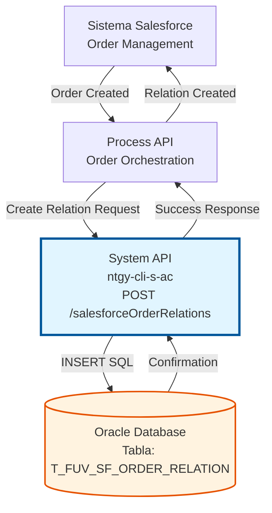
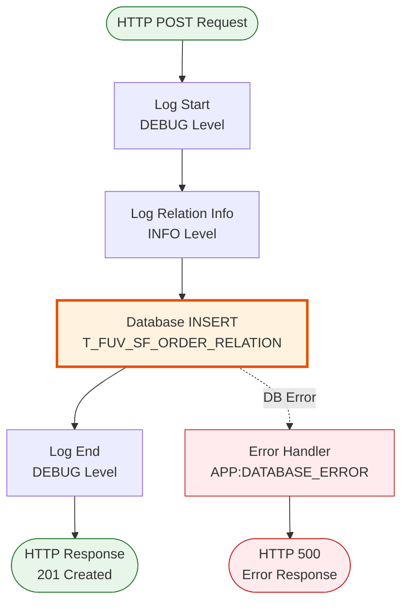

# POST /salesforceOrderRelations

## 📌 Descripción General

### Propósito del Endpoint

Este endpoint crea una nueva relación entre un Order ID de Salesforce y un Order ID de Darwin en la tabla de control `T_FUV_SF_ORDER_RELATION`. Permite mantener la trazabilidad entre órdenes creadas en Salesforce y su correspondiente orden en el sistema Darwin.

El endpoint soporta:
- **Creación de Relación**: Inserta un nuevo registro vinculando ambos identificadores
- **Validación de Datos**: Verifica que ambos IDs estén presentes
- **Manejo de Errores**: Gestiona errores de base de datos y duplicados

### Tipo de API

**Capa:** System API (API-Led Connectivity)

**Función:** Integración directa con Oracle Database (esquema OV_CON) para gestión de relaciones entre sistemas Salesforce y Darwin.

### Patrón de Integración

**Tipo:** Request-Reply Síncrono con SQL INSERT

**Descripción:** Recibe los identificadores de orden de ambos sistemas, valida los datos, ejecuta una inserción en la base de datos Oracle y retorna confirmación de la operación.

### Arquitectura API-Led Connectivity



---

## 💼 Propósito del Negocio

### Casos de Uso Principales

1. **Sincronización de Órdenes Salesforce-Darwin**
   - Cuando se crea una orden en Salesforce, se registra su relación con Darwin
   - Permite rastrear el ciclo de vida completo de la orden
   - Facilita la reconciliación entre sistemas

2. **Trazabilidad de Procesos de Negocio**
   - Mantiene un registro auditable de las relaciones entre sistemas
   - Permite identificar órdenes duplicadas o inconsistencias
   - Soporta procesos de troubleshooting y soporte

3. **Integración Bidireccional**
   - Habilita consultas desde cualquier sistema usando el ID del otro
   - Facilita la sincronización de estados y actualizaciones
   - Mejora la experiencia del usuario al unificar información

### Contexto Empresarial

- **Dominio:** Gestión de Órdenes y Contratos
- **Sector:** Energía - Utilities
- **División:** Naturgy España - Administración Comercial
- **Proceso de Negocio:** Sincronización de órdenes entre Salesforce CRM y sistema Darwin
- **Sistema Backend:** Oracle Database (esquema OV_CON)

### Stakeholders

- **Equipos de Integración**: Necesitan mantener sincronizados los sistemas Salesforce y Darwin
- **Equipos de Soporte**: Requieren trazabilidad para resolver incidencias
- **Analistas de Negocio**: Utilizan las relaciones para reportes y análisis

### Valor de Negocio

- **Trazabilidad Completa**: Seguimiento end-to-end de órdenes entre sistemas
- **Reducción de Errores**: Evita duplicados y pérdida de información
- **Eficiencia Operativa**: Automatiza la sincronización entre plataformas
- **Mejora en Soporte**: Facilita la resolución de incidencias con información completa

### Consumidores Potenciales

Este endpoint puede ser consumido por:
- Process APIs de gestión de órdenes
- Flujos de Salesforce (Platform Events, Flows)
- Sistemas de integración middleware
- Procesos batch de sincronización

---

## 🔧 Especificación Técnica

### URLs por Ambiente

| Ambiente | URL Base | URL Completa |
|----------|----------|--------------|
| **Local** | `http://localhost:8081` | `http://localhost:8081/api/salesforceOrderRelations` |
| **Development** | `https://ntgy-cli-s-ac-dev.us-e2.cloudhub.io` | `https://ntgy-cli-s-ac-dev.us-e2.cloudhub.io/api/salesforceOrderRelations` |
| **UAT** | `https://ntgy-cli-s-ac-uat.us-e2.cloudhub.io` | `https://ntgy-cli-s-ac-uat.us-e2.cloudhub.io/api/salesforceOrderRelations` |
| **Production** | `https://ntgy-cli-s-ac-pro.us-e2.cloudhub.io` | `https://ntgy-cli-s-ac-pro.us-e2.cloudhub.io/api/salesforceOrderRelations` |

### Método HTTP

```
POST /api/salesforceOrderRelations
```

### Parámetros de Entrada

#### Headers HTTP

| Header | Tipo | Requerido | Descripción | Ejemplo |
|--------|------|-----------|-------------|---------|
| `Content-Type` | string | ✅ Sí | Tipo de contenido del request | `application/json` |
| `Accept` | string | ❌ No | Tipo de contenido esperado en response | `application/json` |

#### Body Parameters

| Campo | Tipo | Requerido | Descripción | Ejemplo |
|-------|------|-----------|-------------|---------|
| `salesforceOrderId` | string | ✅ Sí | Identificador único de la orden en Salesforce | `"8001X000000AbCdQAK"` |
| `darwinOrderId` | string | ✅ Sí | Identificador único de la orden en Darwin | `"ORD-2024-001234"` |

**Estructura del Request:**

```json
{
  "salesforceOrderId": "8001X000000AbCdQAK",
  "darwinOrderId": "ORD-2024-001234"
}
```

### Respuestas

#### Respuesta Exitosa (201 Created)

```json
{
  "affectedRows": 1
}
```

**Descripción:** La relación se creó exitosamente en la base de datos.

#### Respuesta de Error - Registro Duplicado (500)

```json
{
  "error": "APP:DATABASE_ERROR",
  "message": "Unique constraint violation - La relación ya existe"
}
```

**Descripción:** Ya existe una relación con el mismo `salesforceOrderId`.

#### Respuesta de Error - Conexión a Base de Datos (500)

```json
{
  "error": "APP:DATABASE_ERROR",
  "message": "Database connectivity error"
}
```

**Descripción:** Error de conectividad con la base de datos Oracle.

#### Respuesta de Error - Validación (400)

```json
{
  "message": "Bad request - Missing required fields"
}
```

**Descripción:** Faltan campos requeridos en el request.

### Autenticación y Autorización

- **Tipo:** Client ID & Client Secret (Anypoint Platform)
- **Autorización DB:** El usuario de base de datos debe tener permisos para:
  - Ejecutar INSERT en tabla `T_FUV_SF_ORDER_RELATION`
  - Acceso al esquema `OV_CON`

### Timeouts

| Tipo | Valor | Descripción |
|------|-------|-------------|
| **Request Timeout** | 30 segundos | Tiempo máximo de espera para la respuesta |
| **Connection Timeout** | 10 segundos | Tiempo máximo para establecer conexión con DB |

---

## 🏗️ Implementación Técnica

### Arquitectura del Flow



### Operación de Base de Datos

#### Query SQL Ejecutada

```sql
INSERT INTO T_FUV_SF_ORDER_RELATION 
  (DARWIN_ORDER_ID, SALESFORCE_ORDER_ID) 
VALUES 
  (:darwinOrderId, :salesforceOrderId)
```

#### Tabla: T_FUV_SF_ORDER_RELATION

| Columna | Tipo | Descripción | Constraint |
|---------|------|-------------|------------|
| `DARWIN_ORDER_ID` | VARCHAR | Identificador de orden en Darwin | NOT NULL |
| `SALESFORCE_ORDER_ID` | VARCHAR | Identificador de orden en Salesforce | PRIMARY KEY |

**Índices:**
- Primary Key en `SALESFORCE_ORDER_ID`
- Posible índice en `DARWIN_ORDER_ID` para búsquedas inversas

### Transformación de Datos

#### Input Mapping (Request → Database)

```dataweave
%dw 2.0
output application/java
---
{
  darwinOrderId: payload.darwinOrderId,
  salesforceOrderId: payload.salesforceOrderId
}
```

**Mapeo de Campos:**
- `payload.darwinOrderId` → `:darwinOrderId` (parámetro SQL)
- `payload.salesforceOrderId` → `:salesforceOrderId` (parámetro SQL)

#### Output (Database → Response)

El endpoint retorna directamente el resultado de la operación de base de datos:

```json
{
  "affectedRows": 1
}
```

### Manejo de Errores

#### Error Mappings Configurados

```xml
<error-mapping sourceType="DB:QUERY_EXECUTION" targetType="APP:DATABASE_ERROR" />
<error-mapping sourceType="DB:CONNECTIVITY" targetType="APP:DATABASE_ERROR" />
```

#### Tipos de Errores

1. **DB:QUERY_EXECUTION** → `APP:DATABASE_ERROR`
   - Violación de constraint (duplicado)
   - Error en sintaxis SQL
   - Violación de integridad referencial

2. **DB:CONNECTIVITY** → `APP:DATABASE_ERROR`
   - Pérdida de conexión con base de datos
   - Timeout de conexión
   - Credenciales inválidas

### Logging

#### Categoría de Log

```
com.naturgy.mule.salesforceOrderRelation-create
```

#### Niveles de Log

1. **DEBUG** - Inicio del flow
   ```
   "Inicio"
   ```

2. **INFO** - Información de la relación a crear
   ```
   "Crear relacion de OrderId Salesforce: {salesforceOrderId} Darwin: {darwinOrderId}"
   ```

3. **DEBUG** - Fin del flow
   ```
   "Fin"
   ```

### Diagrama de Secuencia Completo

```mermaid
sequenceDiagram
    participant Client
    participant API as System API<br/>salesforceOrderRelation-create
    participant DB as Oracle Database<br/>T_FUV_SF_ORDER_RELATION
    
    Client->>API: POST /salesforceOrderRelations<br/>{salesforceOrderId, darwinOrderId}
    activate API
    
    API->>API: Log Start (DEBUG)
    API->>API: Log Relation Info (INFO)
    
    API->>DB: INSERT INTO T_FUV_SF_ORDER_RELATION<br/>VALUES (:darwinOrderId, :salesforceOrderId)
    activate DB
    
    alt Inserción Exitosa
        DB-->>API: affectedRows: 1
        deactivate DB
        API->>API: Log End (DEBUG)
        API-->>Client: 201 Created<br/>{affectedRows: 1}
    else Error de Base de Datos
        DB-->>API: DB:QUERY_EXECUTION Error
        deactivate DB
        API->>API: Map to APP:DATABASE_ERROR
        API-->>Client: 500 Internal Server Error<br/>{error, message}
    end
    
    deactivate API
```

### Configuración de Conexión

```xml
<db:config name="Database_Config">
    <db:generic-connection 
        url="jdbc:oracle:thin:${dbAC.user}/${secure::dbAC.pass}@..."
        driverClassName="oracle.jdbc.driver.OracleDriver">
        <db:pooling-profile 
            maxPoolSize="${dbAC.MaxPoolSize}"
            maxWait="${dbAC.MaxWaitTime}"
            maxIdleTime="${dbAC.MaxIdleTime}"/>
    </db:generic-connection>
</db:config>
```

---

## 💻 Ejemplos de Uso

### Ejemplo 1: Crear Relación Exitosa

#### Request

```bash
curl -X POST "https://ntgy-cli-s-ac-dev.us-e2.cloudhub.io/api/salesforceOrderRelations" \
  -H "Content-Type: application/json" \
  -H "client_id: your-client-id" \
  -H "client_secret: your-client-secret" \
  -d '{
    "salesforceOrderId": "8001X000000AbCdQAK",
    "darwinOrderId": "ORD-2024-001234"
  }'
```

#### Response (201 Created)

```json
{
  "affectedRows": 1
}
```

### Ejemplo 2: Error - Relación Duplicada

#### Request

```bash
curl -X POST "https://ntgy-cli-s-ac-dev.us-e2.cloudhub.io/api/salesforceOrderRelations" \
  -H "Content-Type: application/json" \
  -H "client_id: your-client-id" \
  -H "client_secret: your-client-secret" \
  -d '{
    "salesforceOrderId": "8001X000000AbCdQAK",
    "darwinOrderId": "ORD-2024-001234"
  }'
```

#### Response (500 Internal Server Error)

```json
{
  "error": "APP:DATABASE_ERROR",
  "message": "ORA-00001: unique constraint (OV_CON.PK_SF_ORDER_RELATION) violated"
}
```

### Ejemplo 3: Error - Campos Faltantes

#### Request

```bash
curl -X POST "https://ntgy-cli-s-ac-dev.us-e2.cloudhub.io/api/salesforceOrderRelations" \
  -H "Content-Type: application/json" \
  -H "client_id: your-client-id" \
  -H "client_secret: your-client-secret" \
  -d '{
    "salesforceOrderId": "8001X000000AbCdQAK"
  }'
```

#### Response (400 Bad Request)

```json
{
  "message": "Bad request - Missing required field: darwinOrderId"
}
```

### Ejemplo 4: Uso desde JavaScript

```javascript
const createSalesforceOrderRelation = async (salesforceOrderId, darwinOrderId) => {
  const response = await fetch(
    'https://ntgy-cli-s-ac-dev.us-e2.cloudhub.io/api/salesforceOrderRelations',
    {
      method: 'POST',
      headers: {
        'Content-Type': 'application/json',
        'client_id': 'your-client-id',
        'client_secret': 'your-client-secret'
      },
      body: JSON.stringify({
        salesforceOrderId,
        darwinOrderId
      })
    }
  );

  if (!response.ok) {
    throw new Error(`HTTP error! status: ${response.status}`);
  }

  return await response.json();
};

// Uso
try {
  const result = await createSalesforceOrderRelation(
    '8001X000000AbCdQAK',
    'ORD-2024-001234'
  );
  console.log('Relación creada:', result);
} catch (error) {
  console.error('Error al crear relación:', error);
}