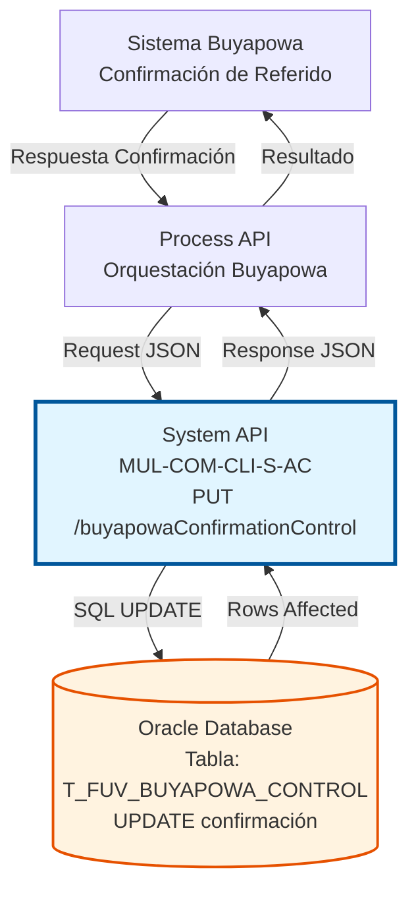
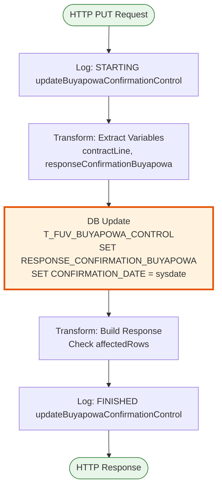
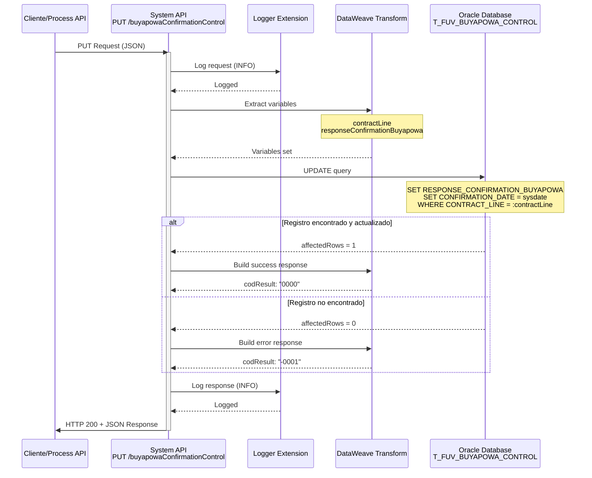

# PUT /buyapowaConfirmationControl

## 📌 Descripción General

### Propósito del Endpoint

Este endpoint actualiza la respuesta de confirmación recibida desde Buyapowa para un contrato específico en la tabla de control. Registra la confirmación del programa de referidos y actualiza la fecha de confirmación automáticamente.

El endpoint soporta:
- **Actualización de Confirmación**: Almacena la respuesta completa de confirmación de Buyapowa
- **Registro de Fecha**: Actualiza automáticamente la fecha de confirmación con `sysdate`
- **Validación de Actualización**: Verifica que el registro existe y fue actualizado correctamente

### Tipo de API

**Capa:** System API (API-Led Connectivity)

**Función:** Integración directa con Oracle Database para actualizar el estado de confirmación de contratos en el programa de referidos Buyapowa.

### Patrón de Integración

**Tipo:** Request-Reply Síncrono con SQL UPDATE

**Descripción:** Recibe los datos de confirmación desde el sistema Buyapowa, extrae los parámetros necesarios, ejecuta una actualización SQL en la tabla de control y retorna el resultado de la operación.

### Arquitectura API-Led Connectivity



---

## 💼 Propósito del Negocio

### Casos de Uso Principales

1. **Confirmación de Referido Exitoso**
   - Buyapowa confirma que el referido ha completado el proceso
   - Se almacena la respuesta completa de confirmación
   - Se registra la fecha exacta de confirmación
   - **Beneficio:** Trazabilidad completa del proceso de referidos

2. **Actualización de Estado de Recompensa**
   - El sistema registra que la recompensa ha sido procesada
   - Se mantiene el historial de confirmaciones
   - Se facilita la reconciliación con Buyapowa
   - **Beneficio:** Control preciso de recompensas otorgadas

3. **Auditoría de Programa de Referidos**
   - Registro detallado de todas las confirmaciones
   - Fecha y hora exacta de cada confirmación
   - Respuesta completa de Buyapowa almacenada
   - **Beneficio:** Cumplimiento normativo y resolución de disputas

### Contexto Empresarial

- **Dominio:** Marketing y Adquisición de Clientes
- **Sector:** Energía - Utilities
- **División:** Naturgy España - NewCo
- **Proceso de Negocio:** Programa de Referidos Buyapowa - Confirmación de Recompensas
- **Impacto:** Gestión de incentivos y fidelización de clientes

### Stakeholders

- **Equipo de Marketing**: Seguimiento de efectividad del programa de referidos
- **Sistema Buyapowa**: Confirmación de procesamiento de recompensas
- **Operaciones**: Reconciliación y auditoría de recompensas
- **Finanzas**: Control de costos del programa de referidos

### Valor de Negocio

- **Trazabilidad Completa**: Registro detallado de cada confirmación de Buyapowa
- **Automatización**: Actualización automática de fecha de confirmación
- **Integridad de Datos**: Validación de existencia del registro antes de actualizar
- **Auditoría**: Historial completo para resolución de disputas

### Consumidores Potenciales

Este endpoint puede ser consumido por:
- Process APIs de gestión de referidos
- Sistema Buyapowa (vía Process API)
- Flujos de reconciliación automática
- Sistemas de auditoría y reporting

---

## 🔧 Especificación Técnica

### URLs por Ambiente

| Ambiente | URL Base | URL Completa |
|----------|----------|--------------|
| **Local** | `http://localhost:8081` | `http://localhost:8081/api/buyapowaConfirmationControl` |
| **Development** | `https://mul-com-cli-s-ac-dev.us-e2.cloudhub.io` | `https://mul-com-cli-s-ac-dev.us-e2.cloudhub.io/api/buyapowaConfirmationControl` |
| **QA** | `https://mul-com-cli-s-ac-cc.us-e2.cloudhub.io` | `https://mul-com-cli-s-ac-cc.us-e2.cloudhub.io/api/buyapowaConfirmationControl` |
| **Pre-Production** | `https://mul-com-cli-s-ac-cl.us-e2.cloudhub.io` | `https://mul-com-cli-s-ac-cl.us-e2.cloudhub.io/api/buyapowaConfirmationControl` |
| **Production** | `https://mul-com-cli-s-ac-pro.us-e2.cloudhub.io` | `https://mul-com-cli-s-ac-pro.us-e2.cloudhub.io/api/buyapowaConfirmationControl` |

### Método HTTP

```
PUT /api/buyapowaConfirmationControl
```

### Parámetros de Entrada

#### Headers HTTP

| Header | Tipo | Requerido | Descripción | Ejemplo |
|--------|------|-----------|-------------|---------|
| `Content-Type` | string | ✅ Sí | Tipo de contenido del request | `application/json` |
| `Accept` | string | ❌ No | Tipo de contenido esperado en response | `application/json` |

#### Body Parameters

| Campo | Tipo | Requerido | Descripción | Ejemplo |
|-------|------|-----------|-------------|---------|
| `contractLine` | string | ✅ Sí | Identificador único de la línea de contrato | `"CL-2024-001234"` |
| `responseConfirmationBuyapowa` | string | ✅ Sí | Respuesta completa de confirmación de Buyapowa (JSON serializado) | `"{\"status\":\"confirmed\",\"rewardId\":\"RW123\"}"` |

**Estructura del Body:**

```json
{
  "contractLine": "string",
  "responseConfirmationBuyapowa": "string"
}
```

### Respuestas

#### Respuesta Exitosa (200 OK)

**Descripción:** El registro fue actualizado correctamente.

```json
{
  "result": {
    "codResult": "0000",
    "msgResult": "No hay error"
  }
}
```

#### Respuesta de Error de Negocio (200 OK)

**Descripción:** El registro no existe o no pudo ser actualizado.

```json
{
  "result": {
    "codResult": "-0001",
    "msgResult": "Ha habido un error en la actualización del registro o el registro no existe"
  }
}
```

#### Respuesta de Error Técnico (400 Bad Request)

**Descripción:** Request malformado o parámetros inválidos.

```json
{
  "message": "Bad request"
}
```

#### Respuesta de Error Técnico (500 Internal Server Error)

**Descripción:** Error interno del servidor.

```json
{
  "error": "APP_9999",
  "message": "Error en el servicio."
}
```

### Códigos de Respuesta

| Código | Descripción | Escenario |
|--------|-------------|-----------|
| `0000` | Éxito | Registro actualizado correctamente (1 fila afectada) |
| `-0001` | Error de Negocio | Registro no existe o no se pudo actualizar (0 filas afectadas) |

### Autenticación y Autorización

- **Tipo:** Client ID & Client Secret (Anypoint Platform)
- **Autorización Oracle:** El usuario de base de datos debe tener permisos para:
  - Ejecutar UPDATE en tabla `T_FUV_BUYAPOWA_CONTROL`
  - Acceso al schema `OV_CON`

### Timeouts

| Tipo | Valor | Descripción |
|------|-------|-------------|
| **Request Timeout** | 30 segundos | Tiempo máximo de espera para la respuesta |
| **Connection Timeout** | 10 segundos | Tiempo máximo para establecer conexión con la base de datos |

---

## 🏗️ Implementación Técnica

### Arquitectura del Flow



### Diagrama de Secuencia Detallado



### Componentes Técnicos

#### 1. Flow Principal

**Ubicación:** `src/main/mule/s-ac.xml` (líneas 290-293)

```xml
<flow name="put:\buyapowaConfirmationControl:s-ac-config">
    <logger level="DEBUG" message="put:\buyapowaConfirmationControl:s-ac-config"/>
    <flow-ref name="s-ac-updateBuyapowaConfirmationControl"/>
</flow>
```

#### 2. Subflow de Implementación

**Ubicación:** `src/main/mule/s-ac-buyapowaControl.xml` (líneas 138-178)

**Componentes:**

1. **Logger de Inicio** (línea 139)
   - Nivel: INFO
   - Mensaje: "STARTING updateBuyapowaConfirmationControl METHOD. REQUEST: \{payload\}"

2. **Transform: Extract Variables** (líneas 140-152)
   ```text
   %dw 2.0
   output application/java
   ---
   {
     contractLine: payload.contractLine,
     responseConfirmationBuyapowa: payload.responseConfirmationBuyapowa
   }
   ```

3. **Database Update** (líneas 153-163)
   - Connector: `Database_Config`
   - Operation: `db:update`
   - Query: `$\{queries.updateBuyapowaConfirmationControl\}`

4. **Transform: Build Response** (líneas 164-176)
   ```text
   %dw 2.0
   output application/json
   ---
   {
     result: {
       codResult: if (payload.affectedRows == 1) "0000" else "-0001",
       msgResult: if (payload.affectedRows == 1) 
         "No hay error" 
         else "Ha habido un error en la actualización del registro o el registro no existe"
     }
   }
   ```

5. **Logger de Fin** (línea 177)
   - Nivel: INFO
   - Mensaje: "FINISHED updateBuyapowaConfirmationControl METHOD. RESPONSE: \{payload\}"

### Query SQL Real

**Ubicación:** Configuración YAML (referenciada como `$\{queries.updateBuyapowaConfirmationControl\}`)

```sql
UPDATE T_FUV_BUYAPOWA_CONTROL 
SET RESPONSE_CONFIRMATION_BUYAPOWA = :responseConfirmationBuyapowa, 
    CONFIRMATION_DATE = sysdate 
WHERE CONTRACT_LINE = :contractLine
```

**Parámetros:**
- `:contractLine` (VARCHAR) - Identificador de la línea de contrato
- `:responseConfirmationBuyapowa` (CLOB) - Respuesta de confirmación de Buyapowa

**Campos Actualizados:**
- `RESPONSE_CONFIRMATION_BUYAPOWA`: Almacena la respuesta completa de Buyapowa
- `CONFIRMATION_DATE`: Se actualiza automáticamente con la fecha/hora actual del servidor

### Tabla de Base de Datos

**Nombre:** `T_FUV_BUYAPOWA_CONTROL`

**Schema:** `OV_CON` (Administración Comercial)

**Campos Relevantes:**

| Campo | Tipo | Descripción |
|-------|------|-------------|
| `CONTRACT_LINE` | VARCHAR | Clave primaria - Identificador de línea de contrato |
| `RESPONSE_CONFIRMATION_BUYAPOWA` | CLOB | Respuesta completa de confirmación de Buyapowa |
| `CONFIRMATION_DATE` | DATE | Fecha y hora de confirmación (actualizada automáticamente) |
| `CONTRACT_STATUS` | VARCHAR | Estado del contrato en el programa |
| `PRODUCT_ID` | VARCHAR | Identificador del producto |

### Transformaciones DataWeave

#### Transformación de Entrada

**Propósito:** Extraer variables del payload

```text
%dw 2.0
output application/java
---
{
  contractLine: payload.contractLine,
  responseConfirmationBuyapowa: payload.responseConfirmationBuyapowa
}
```

#### Transformación de Salida

**Propósito:** Construir respuesta basada en filas afectadas

```text
%dw 2.0
output application/json
---
{
  result: {
    codResult: if (payload.affectedRows == 1) "0000" else "-0001",
    msgResult: if (payload.affectedRows == 1) 
      "No hay error" 
      else "Ha habido un error en la actualización del registro o el registro no existe"
  }
}
```

### Configuración de Conectores

#### Database Connector

```xml
<db:config name="Database_Config">
    <db:generic-connection 
        url="jdbc:oracle:thin:$\{dbAC.user\}/$\{secure::dbAC.pass\}@..."
        driverClassName="oracle.jdbc.driver.OracleDriver">
        <db:pooling-profile 
            maxPoolSize="$\{dbAC.MaxPoolSize\}"
            maxWait="$\{dbAC.MaxWaitTime\}"
            maxIdleTime="$\{dbAC.MaxIdleTime\}"/>
    </db:generic-connection>
</db:config>
```

### Manejo de Errores

- **Error Handler:** Global error handler configurado
- **Validación:** Verificación de filas afectadas (affectedRows)
- **Logging:** Registro completo de request y response para auditoría

---

## 💻 Ejemplos de Uso

### Ejemplo 1: Request Exitoso

**Request:**

```bash
curl -X PUT "https://mul-com-cli-s-ac-pro.us-e2.cloudhub.io/api/buyapowaConfirmationControl" \
  -H "Content-Type: application/json" \
  -H "client_id: your-client-id" \
  -H "client_secret: your-client-secret" \
  -d '{
    "contractLine": "CL-2024-001234",
    "responseConfirmationBuyapowa": "{\"status\":\"confirmed\",\"rewardId\":\"RW123456\",\"amount\":50.00,\"currency\":\"EUR\",\"confirmedAt\":\"2024-07-16T15:30:00Z\"}"
  }'
```

**Response (200 OK):**

```json
{
  "result": {
    "codResult": "0000",
    "msgResult": "No hay error"
  }
}
```

### Ejemplo 2: Registro No Encontrado

**Request:**

```bash
curl -X PUT "https://mul-com-cli-s-ac-pro.us-e2.cloudhub.io/api/buyapowaConfirmationControl" \
  -H "Content-Type: application/json" \
  -H "client_id: your-client-id" \
  -H "client_secret: your-client-secret" \
  -d '{
    "contractLine": "CL-9999-NOEXISTE",
    "responseConfirmationBuyapowa": "{\"status\":\"confirmed\"}"
  }'
```

**Response (200 OK):**

```json
{
  "result": {
    "codResult": "-0001",
    "msgResult": "Ha habido un error en la actualización del registro o el registro no existe"
  }
}
```

### Ejemplo 3: Request con Respuesta Completa de Buyapowa

**Request:**

```json
{
  "contractLine": "CL-2024-005678",
  "responseConfirmationBuyapowa": "{\"transactionId\":\"TXN-BUY-789012\",\"status\":\"confirmed\",\"referrer\":{\"id\":\"REF-001\",\"email\":\"referrer@example.com\"},\"referee\":{\"id\":\"REF-002\",\"email\":\"referee@example.com\"},\"reward\":{\"id\":\"RW-456\",\"type\":\"discount\",\"value\":50.00,\"currency\":\"EUR\"},\"confirmedAt\":\"2024-07-16T15:45:30Z\",\"metadata\":{\"campaign\":\"summer2024\",\"channel\":\"web\"}}"
}
```

**Response (200 OK):**

```json
{
  "result": {
    "codResult": "0000",
    "msgResult": "No hay error"
  }
}
```

### Ejemplo 4: Error de Validación (Bad Request)

**Request:**

```bash
curl -X PUT "https://mul-com-cli-s-ac-pro.us-e2.cloudhub.io/api/buyapowaConfirmationControl" \
  -H "Content-Type: application/json" \
  -H "client_id: your-client-id" \
  -H "client_secret: your-client-secret" \
  -d '{
    "contractLine": "CL-2024-001234"
  }'
```

**Response (400 Bad Request):**

```json
{
  "message": "Bad request"
}
```

### Ejemplo 5: Integración desde JavaScript

```javascript
const updateBuyapowaConfirmation = async (contractLine, confirmationResponse) => {
  const url = 'https://mul-com-cli-s-ac-pro.us-e2.cloudhub.io/api/buyapowaConfirmationControl';
  
  const payload = {
    contractLine: contractLine,
    responseConfirmationBuyapowa: JSON.stringify(confirmationResponse)
  };
  
  try {
    const response = await fetch(url, {
      method: 'PUT',
      headers: {
        'Content-Type': 'application/json',
        'client_id': 'your-client-id',
        'client_secret': 'your-client-secret'
      },
      body: JSON.stringify(payload)
    });
    
    const data = await response.json();
    
    if (data.result.codResult === '0000') {
      console.log('Confirmación actualizada exitosamente');
      return { success: true, data };
    } else {
      console.error('Error al actualizar:', data.result.msgResult);
      return { success: false, error: data.result.msgResult };
    }
  } catch (error) {
    console.error('Error de conexión:', error);
    return { success: false, error: error.message };
  }
};

// Uso
const confirmationData = {
  status: 'confirmed',
  rewardId: 'RW123456',
  amount: 50.00,
  currency: 'EUR',
  confirmedAt: new Date().toISOString()
};

updateBuyapowaConfirmation('CL-2024-001234', confirmationData);
```

### Ejemplo 6: Integración desde Python

```python
import requests
import json
from datetime import datetime

def update_buyapowa_confirmation(contract_line, confirmation_response):
    url = 'https://mul-com-cli-s-ac-pro.us-e2.cloudhub.io/api/buyapowaConfirmationControl'
    
    headers = {
        'Content-Type': 'application/json',
        'client_id': 'your-client-id',
        'client_secret': 'your-client-secret'
    }
    
    payload = {
        'contractLine': contract_line,
        'responseConfirmationBuyapowa': json.dumps(confirmation_response)
    }
    
    try:
        response = requests.put(url, headers=headers, json=payload, timeout=30)
        response.raise_for_status()
        
        data = response.json()
        
        if data['result']['codResult'] == '0000':
            print('Confirmación actualizada exitosamente')
            return {'success': True, 'data': data}
        else:
            print(f"Error al actualizar: {data['result']['msgResult']}")
            return {'success': False, 'error': data['result']['msgResult']}
            
    except requests.exceptions.RequestException as e:
        print(f'Error de conexión: {e}')
        return {'success': False, 'error': str(e)}

# Uso
confirmation_data = {
    'status': 'confirmed',
    'rewardId': 'RW123456',
    'amount': 50.00,
    'currency': 'EUR',
    'confirmedAt': datetime.utcnow().isoformat() + 'Z'
}

result = update_buyapowa_confirmation('CL-2024-001234', confirmation_data)
```
