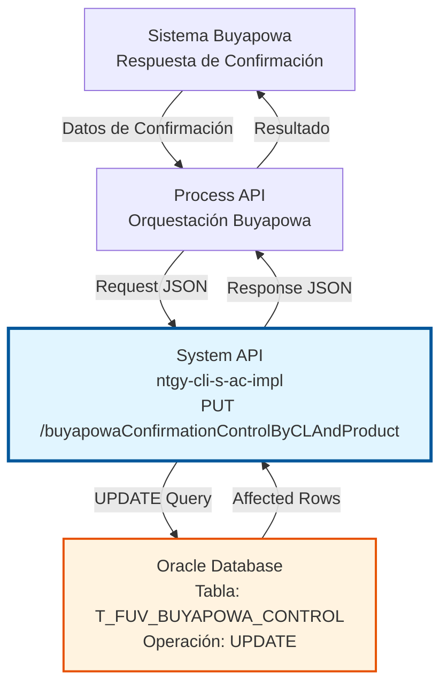
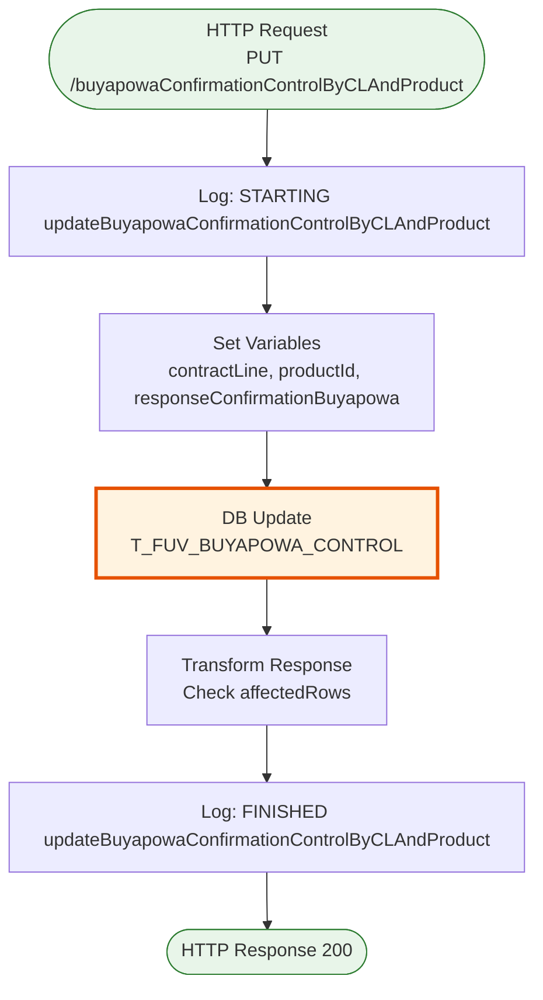
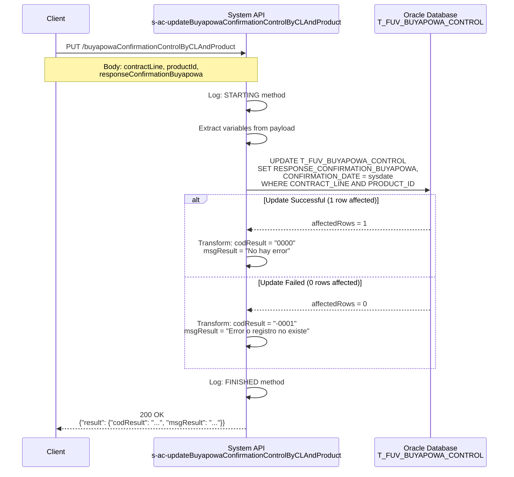

# PUT /buyapowaConfirmationControlByCLAndProduct

## 📌 Descripción General

### Propósito del Endpoint

Este endpoint actualiza la respuesta de confirmación del sistema Buyapowa para un registro de control específico, identificado por la combinación de línea de contrato (`CONTRACT_LINE`) y producto (`PRODUCT_ID`). Registra la respuesta recibida desde Buyapowa tras confirmar un referido y actualiza la fecha de confirmación.

El endpoint soporta:
- **Actualización de Confirmación**: Almacena la respuesta completa de confirmación de Buyapowa
- **Registro de Fecha**: Actualiza automáticamente la fecha de confirmación con la fecha del sistema
- **Identificación Precisa**: Utiliza la combinación de línea de contrato y producto para identificar el registro exacto

### Tipo de API

**Capa:** System API (API-Led Connectivity)

**Función:** Integración directa con Oracle Database (esquema OV_CON) para gestión del programa de referidos Buyapowa.

### Patrón de Integración

**Tipo:** Request-Reply Síncrono con Oracle Database

**Descripción:** Recibe los datos de confirmación de Buyapowa, ejecuta una operación UPDATE en la tabla de control, y retorna el resultado de la operación indicando si la actualización fue exitosa o si hubo algún error.

### Arquitectura API-Led Connectivity



---

## 💼 Propósito del Negocio

### Casos de Uso Principales

1. **Confirmación de Referido Exitoso**
   - Un cliente ha sido referido exitosamente a través del programa Buyapowa
   - El sistema Buyapowa envía una confirmación de que el referido ha sido procesado
   - Se actualiza el registro con la respuesta de confirmación para auditoría y seguimiento

2. **Seguimiento de Programa de Referidos**
   - Permite rastrear qué referidos han sido confirmados por Buyapowa
   - Facilita la reconciliación entre el sistema interno y Buyapowa
   - Proporciona evidencia de las confirmaciones recibidas

3. **Auditoría de Confirmaciones**
   - Registra la fecha exacta de confirmación
   - Almacena la respuesta completa de Buyapowa para referencia futura
   - Permite identificar confirmaciones pendientes vs. completadas

### Contexto Empresarial

- **Dominio:** Gestión de Programas de Referidos y Marketing
- **Sector:** Energía - Utilities
- **División:** Naturgy España - Área de Clientes
- **Proceso de Negocio:** Programa de referidos Buyapowa - Confirmación de participantes
- **Sistema Backend:** Oracle Database (esquema OV_CON)

### Stakeholders

- **Equipo de Marketing**: Necesita confirmar que los referidos han sido procesados correctamente
- **Equipo de Operaciones**: Requiere visibilidad del estado de confirmaciones para reconciliación
- **Equipo de Atención al Cliente**: Necesita información sobre el estado de los referidos de los clientes
- **Equipo de Integración**: Responsable de mantener la sincronización con Buyapowa

### Valor de Negocio

- **Automatización**: Elimina la necesidad de confirmación manual de referidos
- **Trazabilidad**: Proporciona un registro completo de todas las confirmaciones recibidas
- **Reconciliación**: Facilita la comparación entre sistemas internos y Buyapowa
- **Auditoría**: Mantiene evidencia de todas las transacciones con Buyapowa

### Consumidores Potenciales

Este endpoint puede ser consumido por:
- Process APIs de gestión de referidos Buyapowa
- Flujos de integración con sistemas de marketing
- Sistemas de reconciliación y auditoría
- Procesos batch de sincronización con Buyapowa

---

## 🔧 Especificación Técnica

### URLs por Ambiente

| Ambiente | URL Base | URL Completa |
|----------|----------|--------------|
| **Local** | `http://localhost:8050` | `http://localhost:8050/api/buyapowaConfirmationControlByCLAndProduct` |
| **Development** | `https://ntgy-cli-s-ac-dev.us-e2.cloudhub.io` | `https://ntgy-cli-s-ac-dev.us-e2.cloudhub.io/api/buyapowaConfirmationControlByCLAndProduct` |
| **UAT** | `https://ntgy-cli-s-ac-uat.us-e2.cloudhub.io` | `https://ntgy-cli-s-ac-uat.us-e2.cloudhub.io/api/buyapowaConfirmationControlByCLAndProduct` |
| **Production** | `https://ntgy-cli-s-ac-pro.us-e2.cloudhub.io` | `https://ntgy-cli-s-ac-pro.us-e2.cloudhub.io/api/buyapowaConfirmationControlByCLAndProduct` |

### Método HTTP

```
PUT /api/buyapowaConfirmationControlByCLAndProduct
```

### Parámetros de Entrada

#### Headers HTTP

| Header | Tipo | Requerido | Descripción | Ejemplo |
|--------|------|-----------|-------------|---------|
| `Content-Type` | string | ✅ Sí | Tipo de contenido del request | `application/json` |
| `Accept` | string | ❌ No | Tipo de contenido esperado en response | `application/json` |

#### Body Parameters

| Parámetro | Tipo | Requerido | Descripción | Ejemplo |
|-----------|------|-----------|-------------|---------|
| `contractLine` | string | ✅ Sí | Identificador de la línea de contrato | `"LC123456789"` |
| `productId` | string | ✅ Sí | Identificador del producto | `"PROD001"` |
| `responseConfirmationBuyapowa` | string (CLOB) | ✅ Sí | Respuesta completa de confirmación recibida de Buyapowa en formato JSON o texto | `"{\"status\":\"confirmed\",\"referralId\":\"REF123\"}"` |

**Estructura del Body:**

```json
{
  "contractLine": "string",
  "productId": "string",
  "responseConfirmationBuyapowa": "string"
}
```

### Respuestas

#### Respuesta Exitosa (200 OK)

Cuando la actualización se realiza correctamente (1 registro afectado):

```json
{
  "result": {
    "codResult": "0000",
    "msgResult": "No hay error"
  }
}
```

#### Respuesta de Error de Negocio (200 OK)

Cuando no se encuentra el registro o no se actualiza ningún registro:

```json
{
  "result": {
    "codResult": "-0001",
    "msgResult": "Ha habido un error en la actualización del registro o el registro no existe"
  }
}
```

#### Respuesta de Error Técnico (400/500)

```json
{
  "error": "APP_9999",
  "message": "Error en el servicio."
}
```

### Autenticación y Autorización

- **Tipo:** Client ID & Client Secret (Anypoint Platform)
- **Autorización Oracle:** El usuario de base de datos debe tener permisos para:
  - Ejecutar UPDATE en tabla `T_FUV_BUYAPOWA_CONTROL`
  - Acceso al esquema `OV_CON`

### Timeouts

| Tipo | Valor | Descripción |
|------|-------|-------------|
| **Request Timeout** | 30 segundos | Tiempo máximo de espera para la respuesta |
| **Connection Timeout** | 10 segundos | Tiempo máximo para establecer conexión con la base de datos |

---

## 🏗️ Implementación Técnica

### Arquitectura del Flow



### Componentes del Flow

#### 1. Sub-flow Principal
**Nombre:** `s-ac-updateBuyapowaConfirmationControlByCLAndProduct`

**Ubicación:** `src/main/mule/implementation/s-ac-buyapowaControl.xml`

**Componentes:**
1. Logger de inicio (INFO level)
2. Database Update operation
3. DataWeave transformation para respuesta
4. Logger de finalización (INFO level)

### Query SQL Ejecutada

**Ubicación de la Query:** `src/main/resources/s-ac-local-config.yaml` (línea 79)

```sql
UPDATE T_FUV_BUYAPOWA_CONTROL 
SET RESPONSE_CONFIRMATION_BUYAPOWA = :responseConfirmationBuyapowa, 
    CONFIRMATION_DATE = sysdate 
WHERE CONTRACT_LINE = :contractLine 
  AND PRODUCT_ID = :productId
```

**Parámetros:**
- `:responseConfirmationBuyapowa` (CLOB) - Respuesta de confirmación de Buyapowa
- `:contractLine` (VARCHAR) - Línea de contrato
- `:productId` (VARCHAR) - Identificador del producto

**Campos Actualizados:**
- `RESPONSE_CONFIRMATION_BUYAPOWA`: Almacena la respuesta completa de Buyapowa
- `CONFIRMATION_DATE`: Se actualiza automáticamente con `sysdate` (fecha/hora actual del sistema)

### Tabla de Base de Datos

**Nombre:** `T_FUV_BUYAPOWA_CONTROL`

**Esquema:** `OV_CON`

**Propósito:** Tabla de control para el programa de referidos Buyapowa

**Campos Relevantes:**
- `T_FUV_BUYAPOWA_CONTROL_ID`: Identificador único (PK)
- `CONTRACT_LINE`: Línea de contrato (parte de la condición WHERE)
- `PRODUCT_ID`: Identificador del producto (parte de la condición WHERE)
- `RESPONSE_CONFIRMATION_BUYAPOWA`: Respuesta de confirmación (CLOB)
- `CONFIRMATION_DATE`: Fecha de confirmación (actualizada automáticamente)
- `CONTRACT_STATUS`: Estado del contrato
- `RESPONSE_TRACKING_BUYAPOWA`: Respuesta de tracking

### Diagrama de Secuencia



### Transformación de Respuesta

**DataWeave Transformation (inline en XML):**

```dataweave
%dw 2.0
output application/json
---
{
    "result": {
        "codResult": if (payload.affectedRows == 1) "0000" else "-0001",
        "msgResult": if (payload.affectedRows == 1) 
                     "No hay error" 
                     else 
                     "Ha habido un error en la actualización del registro o el registro no existe"
    }
}
```

**Lógica:**
- Si `affectedRows == 1`: Actualización exitosa → `codResult: "0000"`
- Si `affectedRows != 1`: Error o registro no encontrado → `codResult: "-0001"`

### Manejo de Errores

**Error Handler:** `apiErrorHandler` (global)

**Tipos de Error:**
1. **APP:NOT_FOUND** → HTTP 404 (registro no encontrado)
2. **ANY** → HTTP 500 (error técnico del servidor)

**Logging:**
- Nivel INFO para inicio y fin de operación
- Normalización de JSON para logs mediante función `common::commonFunctions::normalizeJSON`

---

## 💻 Ejemplos de Uso

### Ejemplo 1: Request con curl (Actualización Exitosa)

```bash
curl -X PUT "http://localhost:8050/api/buyapowaConfirmationControlByCLAndProduct" \
  -H "Content-Type: application/json" \
  -H "Accept: application/json" \
  -d '{
    "contractLine": "LC123456789",
    "productId": "PROD001",
    "responseConfirmationBuyapowa": "{\"status\":\"confirmed\",\"referralId\":\"REF123\",\"timestamp\":\"2026-07-17T08:00:00Z\"}"
  }'
```

**Response (200 OK):**
```json
{
  "result": {
    "codResult": "0000",
    "msgResult": "No hay error"
  }
}
```

### Ejemplo 2: Request Body JSON

```json
{
  "contractLine": "LC987654321",
  "productId": "PROD002",
  "responseConfirmationBuyapowa": "{\"status\":\"confirmed\",\"referralId\":\"REF456\",\"rewardAmount\":50.00,\"currency\":\"EUR\",\"confirmedAt\":\"2026-07-17T10:30:00Z\"}"
}
```

### Ejemplo 3: Response - Registro No Encontrado

**Request:**
```bash
curl -X PUT "http://localhost:8050/api/buyapowaConfirmationControlByCLAndProduct" \
  -H "Content-Type: application/json" \
  -d '{
    "contractLine": "LC_NO_EXISTE",
    "productId": "PROD999",
    "responseConfirmationBuyapowa": "{\"status\":\"confirmed\"}"
  }'
```

**Response (200 OK):**
```json
{
  "result": {
    "codResult": "-0001",
    "msgResult": "Ha habido un error en la actualización del registro o el registro no existe"
  }
}
```

### Ejemplo 4: Código JavaScript (Node.js)

```javascript
const axios = require('axios');

async function updateBuyapowaConfirmation() {
  try {
    const response = await axios.put(
      'http://localhost:8050/api/buyapowaConfirmationControlByCLAndProduct',
      {
        contractLine: 'LC123456789',
        productId: 'PROD001',
        responseConfirmationBuyapowa: JSON.stringify({
          status: 'confirmed',
          referralId: 'REF123',
          timestamp: new Date().toISOString()
        })
      },
      {
        headers: {
          'Content-Type': 'application/json',
          'Accept': 'application/json'
        }
      }
    );

    console.log('Update successful:', response.data);
    
    if (response.data.result.codResult === '0000') {
      console.log('Confirmación actualizada correctamente');
    } else {
      console.log('Error en actualización:', response.data.result.msgResult);
    }
  } catch (error) {
    console.error('Error:', error.message);
  }
}

updateBuyapowaConfirmation();
```

### Ejemplo 5: Código Python

```python
import requests
import json
from datetime import datetime

def update_buyapowa_confirmation(contract_line, product_id, confirmation_data):
    url = "http://localhost:8050/api/buyapowaConfirmationControlByCLAndProduct"
    
    payload = {
        "contractLine": contract_line,
        "productId": product_id,
        "responseConfirmationBuyapowa": json.dumps(confirmation_data)
    }
    
    headers = {
        "Content-Type": "application/json",
        "Accept": "application/json"
    }
    
    try:
        response = requests.put(url, json=payload, headers=headers)
        response.raise_for_status()
        
        result = response.json()
        
        if result['result']['codResult'] == '0000':
            print(f"✅ Confirmación actualizada: {contract_line}")
            return True
        else:
            print(f"❌ Error: {result['result']['msgResult']}")
            return False
            
    except requests.exceptions.RequestException as e:
        print(f"❌ Error de conexión: {e}")
        return False

# Uso
confirmation_data = {
    "status": "confirmed",
    "referralId": "REF123",
    "timestamp": datetime.now().isoformat()
}

update_buyapowa_confirmation("LC123456789", "PROD001", confirmation_data)
```

### Ejemplo 6: Postman Collection

```json
{
  "info": {
    "name": "Buyapowa Confirmation Control",
    "schema": "https://schema.getpostman.com/json/collection/v2.1.0/collection.json"
  },
  "item": [
    {
      "name": "Update Confirmation by Contract Line and Product",
      "request": {
        "method": "PUT",
        "header": [
          {
            "key": "Content-Type",
            "value": "application/json"
          }
        ],
        "body": {
          "mode": "raw",
          "raw": "{\n  \"contractLine\": \"LC123456789\",\n  \"productId\": \"PROD001\",\n  \"responseConfirmationBuyapowa\": \"{\\\"status\\\":\\\"confirmed\\\",\\\"referralId\\\":\\\"REF123\\\"}\"\n}"
        },
        "url": {
          "raw": "http://localhost:8050/api/buyapowaConfirmationControlByCLAndProduct",
          "protocol": "http",
          "host": ["localhost"],
          "port": "8050",
          "path": ["api", "buyapowaConfirmationControlByCLAndProduct"]
        }
      }
    }
  ]
}