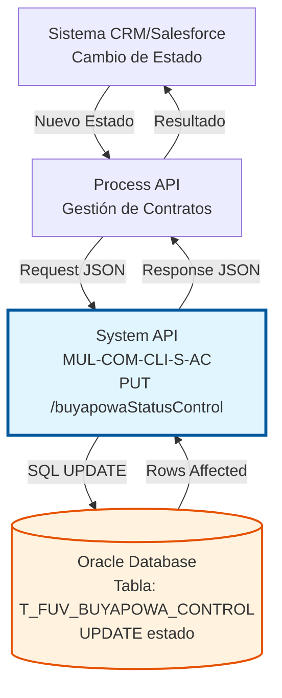
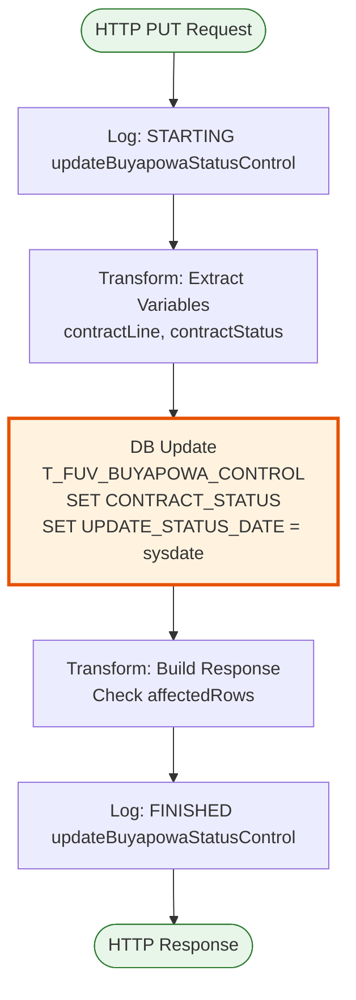
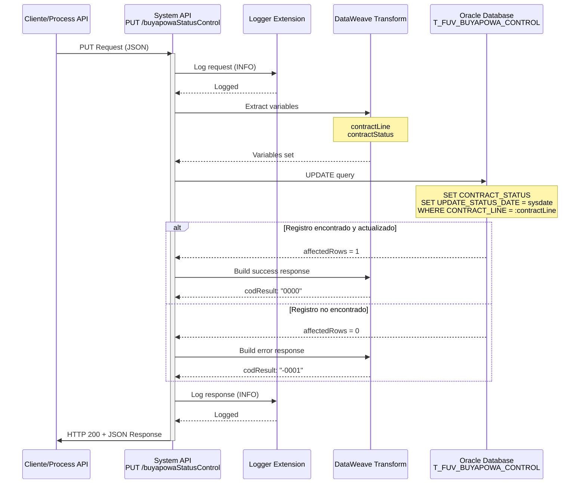

# PUT /buyapowaStatusControl

## 📌 Descripción General

### Propósito del Endpoint

Este endpoint actualiza el estado del contrato en la tabla de control del programa de referidos Buyapowa. Permite registrar cambios en el estado del contrato (activo, pendiente, cancelado, etc.) y actualiza automáticamente la fecha de modificación del estado.

El endpoint soporta:
- **Actualización de Estado**: Modifica el estado actual del contrato en el programa de referidos
- **Registro de Fecha**: Actualiza automáticamente la fecha de cambio de estado con `sysdate`
- **Validación de Actualización**: Verifica que el registro existe y fue actualizado correctamente

### Tipo de API

**Capa:** System API (API-Led Connectivity)

**Función:** Integración directa con Oracle Database para actualizar el estado de contratos en el programa de referidos Buyapowa.

### Patrón de Integración

**Tipo:** Request-Reply Síncrono con SQL UPDATE

**Descripción:** Recibe los datos de cambio de estado, extrae los parámetros necesarios, ejecuta una actualización SQL en la tabla de control y retorna el resultado de la operación.

### Arquitectura API-Led Connectivity



---

## 💼 Propósito del Negocio

### Casos de Uso Principales

1. **Activación de Contrato**
   - El contrato pasa de estado "pendiente" a "activo"
   - Se notifica a Buyapowa para procesar la recompensa
   - Se registra la fecha exacta de activación
   - **Beneficio:** Automatización del proceso de recompensas

2. **Cancelación de Contrato**
   - El contrato se cancela antes de completar el proceso
   - Se actualiza el estado a "cancelado"
   - Se evita el procesamiento de recompensas no válidas
   - **Beneficio:** Control de costos del programa de referidos

3. **Seguimiento de Estados Intermedios**
   - Registro de estados como "en validación", "pendiente de firma"
   - Trazabilidad completa del ciclo de vida del contrato
   - Facilita la reconciliación con Buyapowa
   - **Beneficio:** Visibilidad completa del proceso

### Contexto Empresarial

- **Dominio:** Marketing y Adquisición de Clientes
- **Sector:** Energía - Utilities
- **División:** Naturgy España - NewCo
- **Proceso de Negocio:** Programa de Referidos Buyapowa - Gestión de Estados de Contrato
- **Impacto:** Control del ciclo de vida de contratos referidos

### Stakeholders

- **Equipo de Ventas**: Seguimiento del estado de contratos referidos
- **Sistema Buyapowa**: Sincronización de estados para procesamiento de recompensas
- **Operaciones**: Gestión del ciclo de vida de contratos
- **Atención al Cliente**: Información actualizada sobre estado de contratos

### Valor de Negocio

- **Control del Ciclo de Vida**: Seguimiento completo del estado de cada contrato referido
- **Automatización**: Actualización automática de fecha de cambio de estado
- **Integridad de Datos**: Validación de existencia del registro antes de actualizar
- **Trazabilidad**: Historial de cambios de estado para auditoría

### Consumidores Potenciales

Este endpoint puede ser consumido por:
- Process APIs de gestión de contratos
- Sistema CRM/Salesforce (vía Process API)
- Flujos de activación de contratos
- Sistemas de monitoreo y reporting

---

## 🔧 Especificación Técnica

### URLs por Ambiente

| Ambiente | URL Base | URL Completa |
|----------|----------|--------------|
| **Local** | `http://localhost:8081` | `http://localhost:8081/api/buyapowaStatusControl` |
| **Development** | `https://mul-com-cli-s-ac-dev.us-e2.cloudhub.io` | `https://mul-com-cli-s-ac-dev.us-e2.cloudhub.io/api/buyapowaStatusControl` |
| **QA** | `https://mul-com-cli-s-ac-cc.us-e2.cloudhub.io` | `https://mul-com-cli-s-ac-cc.us-e2.cloudhub.io/api/buyapowaStatusControl` |
| **Pre-Production** | `https://mul-com-cli-s-ac-cl.us-e2.cloudhub.io` | `https://mul-com-cli-s-ac-cl.us-e2.cloudhub.io/api/buyapowaStatusControl` |
| **Production** | `https://mul-com-cli-s-ac-pro.us-e2.cloudhub.io` | `https://mul-com-cli-s-ac-pro.us-e2.cloudhub.io/api/buyapowaStatusControl` |

### Método HTTP

```
PUT /api/buyapowaStatusControl
```

### Parámetros de Entrada

#### Headers HTTP

| Header | Tipo | Requerido | Descripción | Ejemplo |
|--------|------|-----------|-------------|---------|
| `Content-Type` | string | ✅ Sí | Tipo de contenido del request | `application/json` |
| `Accept` | string | ❌ No | Tipo de contenido esperado en response | `application/json` |

#### Body Parameters

| Campo | Tipo | Requerido | Descripción | Ejemplo |
|-------|------|-----------|-------------|---------|
| `contractLine` | string | ✅ Sí | Identificador único de la línea de contrato | `"CL-2024-001234"` |
| `contractStatus` | string | ✅ Sí | Nuevo estado del contrato | `"ACTIVE"`, `"PENDING"`, `"CANCELLED"` |

**Estructura del Body:**

```json
{
  "contractLine": "string",
  "contractStatus": "string"
}
```

**Estados Válidos:**
- `PENDING`: Contrato pendiente de activación
- `ACTIVE`: Contrato activo y elegible para recompensa
- `CANCELLED`: Contrato cancelado
- `IN_VALIDATION`: En proceso de validación
- `REJECTED`: Contrato rechazado

### Respuestas

#### Respuesta Exitosa (200 OK)

**Descripción:** El registro fue actualizado correctamente.

```json
{
  "result": {
    "codResult": "0000",
    "msgResult": "No hay error"
  }
}
```

#### Respuesta de Error de Negocio (200 OK)

**Descripción:** El registro no existe o no pudo ser actualizado.

```json
{
  "result": {
    "codResult": "-0001",
    "msgResult": "Ha habido un error en la actualización del registro o el registro no existe"
  }
}
```

#### Respuesta de Error Técnico (400 Bad Request)

**Descripción:** Request malformado o parámetros inválidos.

```json
{
  "message": "Bad request"
}
```

#### Respuesta de Error Técnico (500 Internal Server Error)

**Descripción:** Error interno del servidor.

```json
{
  "error": "APP_9999",
  "message": "Error en el servicio."
}
```

### Códigos de Respuesta

| Código | Descripción | Escenario |
|--------|-------------|-----------|
| `0000` | Éxito | Registro actualizado correctamente (1 fila afectada) |
| `-0001` | Error de Negocio | Registro no existe o no se pudo actualizar (0 filas afectadas) |

### Autenticación y Autorización

- **Tipo:** Client ID & Client Secret (Anypoint Platform)
- **Autorización Oracle:** El usuario de base de datos debe tener permisos para:
  - Ejecutar UPDATE en tabla `T_FUV_BUYAPOWA_CONTROL`
  - Acceso al schema `OV_CON`

### Timeouts

| Tipo | Valor | Descripción |
|------|-------|-------------|
| **Request Timeout** | 30 segundos | Tiempo máximo de espera para la respuesta |
| **Connection Timeout** | 10 segundos | Tiempo máximo para establecer conexión con la base de datos |

---

## 🏗️ Implementación Técnica

### Arquitectura del Flow



### Diagrama de Secuencia Detallado



### Componentes Técnicos

#### 1. Flow Principal

**Ubicación:** `src/main/mule/s-ac.xml` (líneas 286-289)

```xml
<flow name="put:\buyapowaStatusControl:s-ac-config">
    <logger level="DEBUG" message="put:\buyapowaStatusControl:s-ac-config"/>
    <flow-ref name="s-ac-updateBuyapowaStatusControl"/>
</flow>
```

#### 2. Subflow de Implementación

**Ubicación:** `src/main/mule/s-ac-buyapowaControl.xml` (líneas 68-108)

**Componentes:**

1. **Logger de Inicio** (línea 69)
   - Nivel: INFO
   - Mensaje: "STARTING updateBuyapowaStatusControl METHOD. REQUEST: \{payload\}"

2. **Transform: Extract Variables** (líneas 70-83)
   ```text
   %dw 2.0
   output application/java
   ---
   {
     contractLine: payload.contractLine,
     contractStatus: payload.contractStatus
   }
   ```

3. **Database Update** (líneas 84-93)
   - Connector: `Database_Config`
   - Operation: `db:update`
   - Query: `$\{queries.updateBuyapowaStatusControl\}`

4. **Transform: Build Response** (líneas 94-106)
   ```text
   %dw 2.0
   output application/json
   ---
   {
     result: {
       codResult: if (payload.affectedRows == 1) "0000" else "-0001",
       msgResult: if (payload.affectedRows == 1) 
         "No hay error" 
         else "Ha habido un error en la actualización del registro o el registro no existe"
     }
   }
   ```

5. **Logger de Fin** (línea 107)
   - Nivel: INFO
   - Mensaje: "FINISHED updateBuyapowaStatusControl METHOD. RESPONSE: \{payload\}"

### Query SQL Real

**Ubicación:** Configuración YAML (referenciada como `$\{queries.updateBuyapowaStatusControl\}`)

```sql
UPDATE T_FUV_BUYAPOWA_CONTROL 
SET CONTRACT_STATUS = :contractStatus, 
    UPDATE_STATUS_DATE = sysdate 
WHERE CONTRACT_LINE = :contractLine
```

**Parámetros:**
- `:contractLine` (VARCHAR) - Identificador de la línea de contrato
- `:contractStatus` (VARCHAR) - Nuevo estado del contrato

**Campos Actualizados:**
- `CONTRACT_STATUS`: Estado actual del contrato en el programa de referidos
- `UPDATE_STATUS_DATE`: Se actualiza automáticamente con la fecha/hora actual del servidor

### Tabla de Base de Datos

**Nombre:** `T_FUV_BUYAPOWA_CONTROL`

**Schema:** `OV_CON` (Administración Comercial)

**Campos Relevantes:**

| Campo | Tipo | Descripción |
|-------|------|-------------|
| `CONTRACT_LINE` | VARCHAR | Clave primaria - Identificador de línea de contrato |
| `CONTRACT_STATUS` | VARCHAR | Estado actual del contrato (PENDING, ACTIVE, CANCELLED, etc.) |
| `UPDATE_STATUS_DATE` | DATE | Fecha y hora del último cambio de estado |
| `PRODUCT_ID` | VARCHAR | Identificador del producto |
| `RESPONSE_CONFIRMATION_BUYAPOWA` | CLOB | Respuesta de confirmación de Buyapowa |

### Transformaciones DataWeave

#### Transformación de Entrada

**Propósito:** Extraer variables del payload

```text
%dw 2.0
output application/java
---
{
  contractLine: payload.contractLine,
  contractStatus: payload.contractStatus
}
```

#### Transformación de Salida

**Propósito:** Construir respuesta basada en filas afectadas

```text
%dw 2.0
output application/json
---
{
  result: {
    codResult: if (payload.affectedRows == 1) "0000" else "-0001",
    msgResult: if (payload.affectedRows == 1) 
      "No hay error" 
      else "Ha habido un error en la actualización del registro o el registro no existe"
  }
}
```

### Configuración de Conectores

#### Database Connector

```xml
<db:config name="Database_Config">
    <db:generic-connection 
        url="jdbc:oracle:thin:$\{dbAC.user\}/$\{secure::dbAC.pass\}@..."
        driverClassName="oracle.jdbc.driver.OracleDriver">
        <db:pooling-profile 
            maxPoolSize="$\{dbAC.MaxPoolSize\}"
            maxWait="$\{dbAC.MaxWaitTime\}"
            maxIdleTime="$\{dbAC.MaxIdleTime\}"/>
    </db:generic-connection>
</db:config>
```

### Manejo de Errores

- **Error Handler:** Global error handler configurado
- **Validación:** Verificación de filas afectadas (affectedRows)
- **Logging:** Registro completo de request y response para auditoría

---

## 💻 Ejemplos de Uso

### Ejemplo 1: Activación de Contrato

**Request:**

```bash
curl -X PUT "https://mul-com-cli-s-ac-pro.us-e2.cloudhub.io/api/buyapowaStatusControl" \
  -H "Content-Type: application/json" \
  -H "client_id: your-client-id" \
  -H "client_secret: your-client-secret" \
  -d '{
    "contractLine": "CL-2024-001234",
    "contractStatus": "ACTIVE"
  }'
```

**Response (200 OK):**

```json
{
  "result": {
    "codResult": "0000",
    "msgResult": "No hay error"
  }
}
```

### Ejemplo 2: Cancelación de Contrato

**Request:**

```bash
curl -X PUT "https://mul-com-cli-s-ac-pro.us-e2.cloudhub.io/api/buyapowaStatusControl" \
  -H "Content-Type: application/json" \
  -H "client_id: your-client-id" \
  -H "client_secret: your-client-secret" \
  -d '{
    "contractLine": "CL-2024-001234",
    "contractStatus": "CANCELLED"
  }'
```

**Response (200 OK):**

```json
{
  "result": {
    "codResult": "0000",
    "msgResult": "No hay error"
  }
}
```

### Ejemplo 3: Registro No Encontrado

**Request:**

```bash
curl -X PUT "https://mul-com-cli-s-ac-pro.us-e2.cloudhub.io/api/buyapowaStatusControl" \
  -H "Content-Type: application/json" \
  -H "client_id: your-client-id" \
  -H "client_secret: your-client-secret" \
  -d '{
    "contractLine": "CL-9999-NOEXISTE",
    "contractStatus": "ACTIVE"
  }'
```

**Response (200 OK):**

```json
{
  "result": {
    "codResult": "-0001",
    "msgResult": "Ha habido un error en la actualización del registro o el registro no existe"
  }
}
```

### Ejemplo 4: Estado Pendiente

**Request:**

```json
{
  "contractLine": "CL-2024-005678",
  "contractStatus": "PENDING"
}
```

**Response (200 OK):**

```json
{
  "result": {
    "codResult": "0000",
    "msgResult": "No hay error"
  }
}
```

### Ejemplo 5: Integración desde JavaScript

```javascript
const updateBuyapowaStatus = async (contractLine, newStatus) => {
  const url = 'https://mul-com-cli-s-ac-pro.us-e2.cloudhub.io/api/buyapowaStatusControl';
  
  const payload = {
    contractLine: contractLine,
    contractStatus: newStatus
  };
  
  try {
    const response = await fetch(url, {
      method: 'PUT',
      headers: {
        'Content-Type': 'application/json',
        'client_id': 'your-client-id',
        'client_secret': 'your-client-secret'
      },
      body: JSON.stringify(payload)
    });
    
    const data = await response.json();
    
    if (data.result.codResult === '0000') {
      console.log(`Estado actualizado a ${newStatus} exitosamente`);
      return { success: true, data };
    } else {
      console.error('Error al actualizar:', data.result.msgResult);
      return { success: false, error: data.result.msgResult };
    }
  } catch (error) {
    console.error('Error de conexión:', error);
    return { success: false, error: error.message };
  }
};

// Uso - Activar contrato
updateBuyapowaStatus('CL-2024-001234', 'ACTIVE');

// Uso - Cancelar contrato
updateBuyapowaStatus('CL-2024-001234', 'CANCELLED');
```

### Ejemplo 6: Integración desde Python

```python
import requests
from enum import Enum

class ContractStatus(Enum):
    PENDING = 'PENDING'
    ACTIVE = 'ACTIVE'
    CANCELLED = 'CANCELLED'
    IN_VALIDATION = 'IN_VALIDATION'
    REJECTED = 'REJECTED'

def update_buyapowa_status(contract_line, status):
    url = 'https://mul-com-cli-s-ac-pro.us-e2.cloudhub.io/api/buyapowaStatusControl'
    
    headers = {
        'Content-Type': 'application/json',
        'client_id': 'your-client-id',
        'client_secret': 'your-client-secret'
    }
    
    payload = {
        'contractLine': contract_line,
        'contractStatus': status.value if isinstance(status, ContractStatus) else status
    }
    
    try:
        response = requests.put(url, headers=headers, json=payload, timeout=30)
        response.raise_for_status()
        
        data = response.json()
        
        if data['result']['codResult'] == '0000':
            print(f'Estado actualizado a {payload["contractStatus"]} exitosamente')
            return {'success': True, 'data': data}
        else:
            print(f"Error al actualizar: {data['result']['msgResult']}")
            return {'success': False, 'error': data['result']['msgResult']}
            
    except requests.exceptions.RequestException as e:
        print(f'Error de conexión: {e}')
        return {'success': False, 'error': str(e)}

# Uso
result = update_buyapowa_status('CL-2024-001234', ContractStatus.ACTIVE)
```

### Ejemplo 7: Flujo de Estados

```javascript
// Ejemplo de flujo completo de estados de un contrato
const contractLifecycle = async (contractLine) => {
  console.log('Iniciando ciclo de vida del contrato:', contractLine);
  
  // 1. Estado inicial: PENDING
  await updateBuyapowaStatus(contractLine, 'PENDING');
  console.log('✓ Contrato creado en estado PENDING');
  
  // 2. Validación
  await updateBuyapowaStatus(contractLine, 'IN_VALIDATION');
  console.log('✓ Contrato en validación');
  
  // 3. Activación
  await updateBuyapowaStatus(contractLine, 'ACTIVE');
  console.log('✓ Contrato ACTIVO - Elegible para recompensa');
  
  // En caso de cancelación:
  // await updateBuyapowaStatus(contractLine, 'CANCELLED');
};

contractLifecycle('CL-2024-001234');
```
