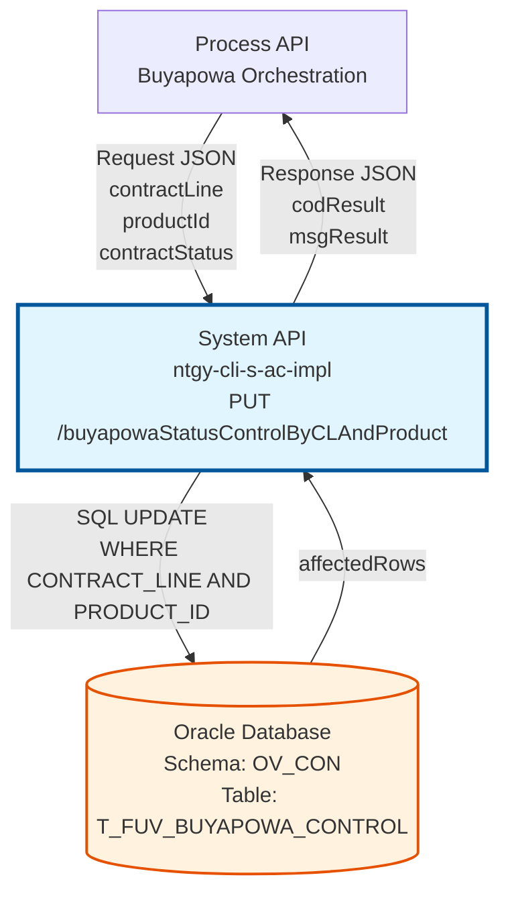
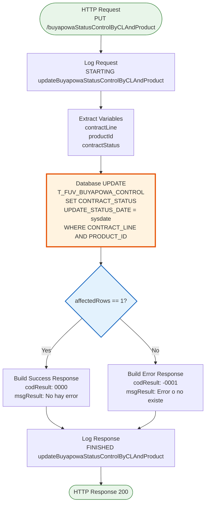
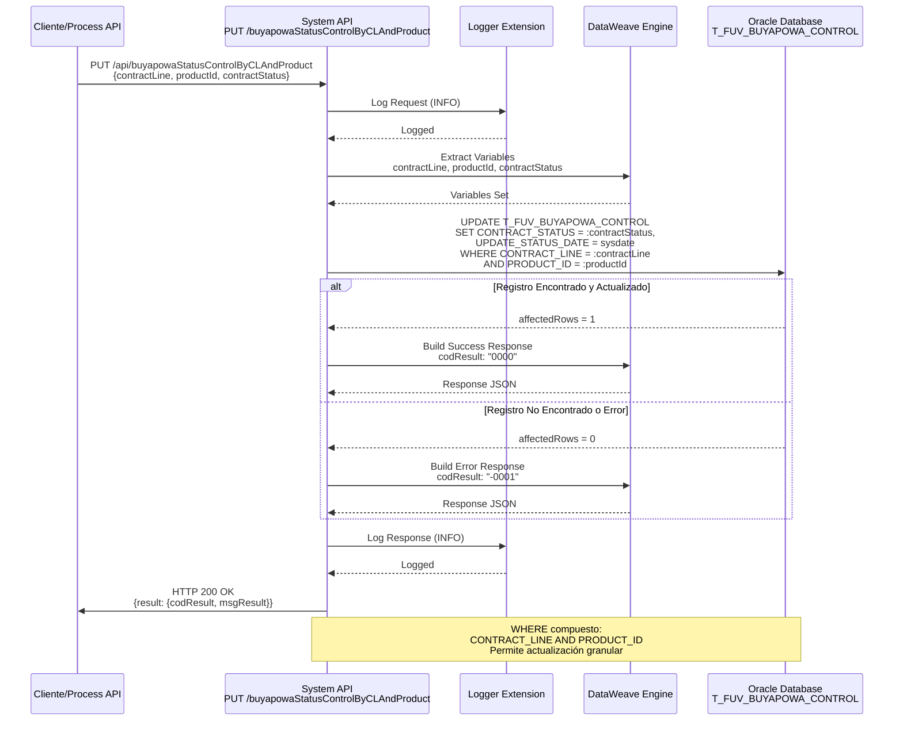
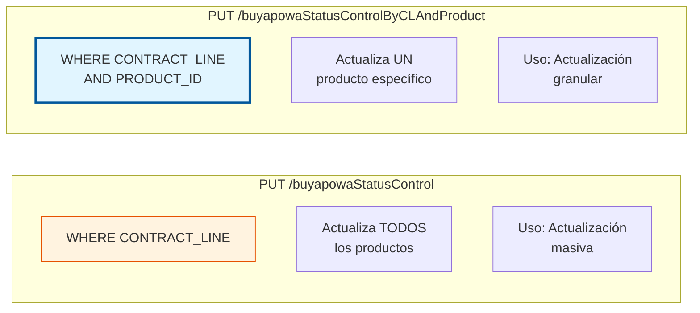
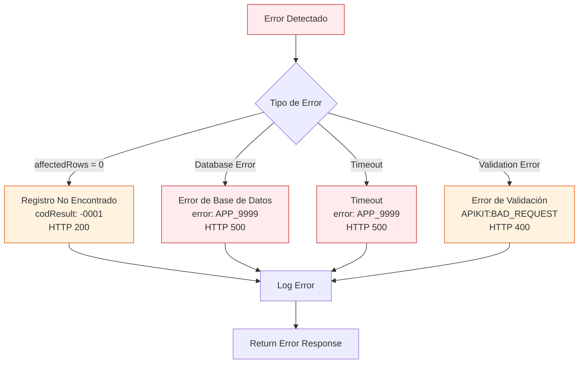
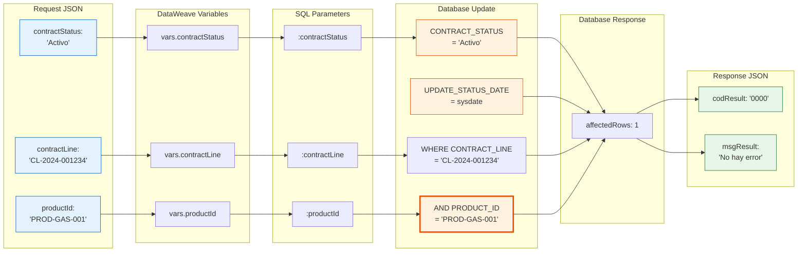
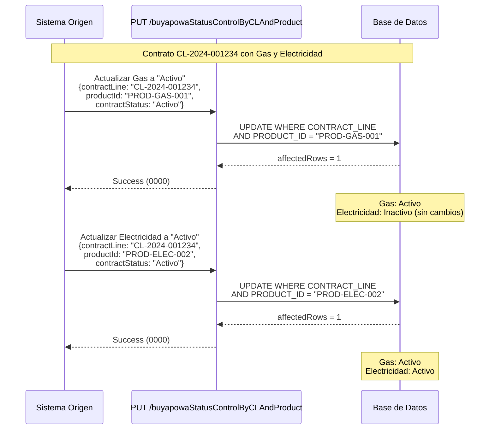
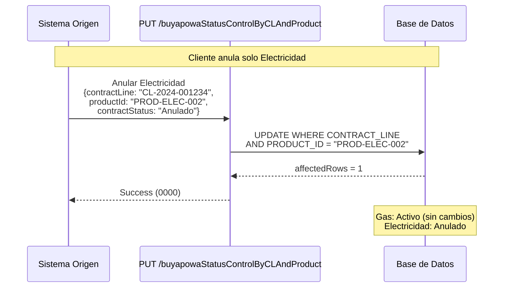

# PUT /buyapowaStatusControlByCLAndProduct

## 📌 Descripción General

### Propósito del Endpoint

Este endpoint actualiza el estado de un contrato (`CONTRACT_STATUS`) y su fecha de actualización (`UPDATE_STATUS_DATE`) en la tabla de control de conciliaciones Buyapowa, identificando el registro por la **combinación de línea de contrato (`CONTRACT_LINE`) y producto (`PRODUCT_ID`)**.

El endpoint soporta:
- **Actualización Granular por Producto**: Modifica el estado de un producto específico dentro de una línea de contrato
- **Timestamp Automático**: Registra automáticamente la fecha de actualización con `sysdate`
- **Validación de Actualización**: Verifica que el registro existe y fue actualizado correctamente
- **Control Independiente por Producto**: Permite gestionar estados de productos de forma independiente

### Tipo de API

**Capa:** System API (API-Led Connectivity)

**Función:** Integración directa con Oracle Database para actualizar estados de contratos por producto en el programa de referidos Buyapowa.

### Patrón de Integración

**Tipo:** Request-Reply Síncrono con SQL UPDATE

**Descripción:** Recibe los datos de actualización (contractLine, productId y contractStatus), ejecuta un UPDATE en la base de datos Oracle con WHERE compuesto, y retorna confirmación de la operación basándose en el número de filas afectadas.

### Arquitectura API-Led Connectivity



---

## 💼 Propósito del Negocio

### Casos de Uso Principales

1. **Actualización de Estado de Producto Específico en Contrato Multi-Producto**
   - Cuando un contrato tiene múltiples productos (gas + electricidad)
   - Se actualiza el estado de un producto específico sin afectar los demás
   - Permite gestión independiente del ciclo de vida de cada producto

2. **Activación Selectiva de Productos en Programa Buyapowa**
   - Cuando solo un producto de la línea de contrato pasa a estado "Activo"
   - Se actualiza únicamente ese producto para confirmación en Buyapowa
   - Evita procesar productos que aún no están activos

3. **Anulación de Producto Individual**
   - Cuando se anula un producto específico pero otros permanecen activos
   - Se actualiza el estado a "Anulado" solo para ese producto
   - Mantiene la integridad del control por producto

4. **Gestión de Estados Independientes por Producto**
   - Permite que cada producto tenga su propio estado en el control Buyapowa
   - Facilita reconciliaciones más precisas con el sistema Buyapowa
   - Mejora la trazabilidad de estados por producto

### Contexto Empresarial

- **Dominio:** Gestión de Programas de Referidos
- **Sector:** Energía - Utilities
- **División:** Naturgy España - NewCo
- **Proceso de Negocio:** Conciliación y seguimiento del programa de referidos Buyapowa con control granular por producto
- **Sistema Externo:** Buyapowa (plataforma de referral marketing)

### Stakeholders

- **Equipo de Marketing**: Necesita seguimiento preciso del estado de cada producto referido
- **Equipo de Ventas**: Requiere visibilidad del estado de productos para gestión de comisiones por producto
- **Equipo de Operaciones**: Necesita reconciliar estados por producto entre sistemas para procesamiento de recompensas
- **Buyapowa (Partner)**: Requiere información actualizada de estados por producto para gestión de referidos

### Valor de Negocio

- **Control Granular**: Permite gestión independiente de estados por producto dentro de una línea de contrato
- **Precisión en Reconciliación**: Evita actualizaciones masivas cuando solo un producto cambia de estado
- **Trazabilidad Mejorada**: Registra automáticamente la fecha de cada actualización de estado por producto
- **Flexibilidad Operativa**: Soporta escenarios complejos de contratos multi-producto
- **Integridad de Datos**: Asegura que solo se procesen confirmaciones de productos con estados válidos

### Consumidores Potenciales

Este endpoint puede ser consumido por:
- Process APIs de gestión de contratos multi-producto
- Flujos de Salesforce (Platform Events, Flows) con lógica por producto
- Sistemas de integración middleware con control granular
- Jobs batch de sincronización de estados por producto
- Servicios de orquestación de Buyapowa con gestión por producto

---

## 🔧 Especificación Técnica

### URLs por Ambiente

| Ambiente | URL Base | URL Completa |
|----------|----------|--------------|
| **Local** | `http://localhost:8081` | `http://localhost:8081/api/buyapowaStatusControlByCLAndProduct` |
| **Development** | `https://ntgy-cli-s-ac-des.us-e2.cloudhub.io` | `https://ntgy-cli-s-ac-des.us-e2.cloudhub.io/api/buyapowaStatusControlByCLAndProduct` |
| **QA** | `https://ntgy-cli-s-ac-cc.us-e2.cloudhub.io` | `https://ntgy-cli-s-ac-cc.us-e2.cloudhub.io/api/buyapowaStatusControlByCLAndProduct` |
| **Pre-Production** | `https://ntgy-cli-s-ac-cl.us-e2.cloudhub.io` | `https://ntgy-cli-s-ac-cl.us-e2.cloudhub.io/api/buyapowaStatusControlByCLAndProduct` |
| **Production** | `https://ntgy-cli-s-ac-pro.us-e2.cloudhub.io` | `https://ntgy-cli-s-ac-pro.us-e2.cloudhub.io/api/buyapowaStatusControlByCLAndProduct` |

### Método HTTP

```
PUT /api/buyapowaStatusControlByCLAndProduct
```

### Parámetros de Entrada

#### Headers HTTP

| Header | Tipo | Requerido | Descripción | Ejemplo |
|--------|------|-----------|-------------|---------|
| `Content-Type` | string | ✅ Sí | Tipo de contenido del request | `application/json` |
| `Accept` | string | ❌ No | Tipo de contenido esperado en response | `application/json` |

#### Body Parameters

| Campo | Tipo | Requerido | Descripción | Ejemplo |
|-------|------|-----------|-------------|---------|
| `contractLine` | string | ✅ Sí | Identificador único de la línea de contrato | `"CL-2024-001234"` |
| `productId` | string | ✅ Sí | Identificador del producto específico | `"PROD-GAS-001"`, `"PROD-ELEC-002"` |
| `contractStatus` | string | ✅ Sí | Nuevo estado del contrato para este producto | `"Activo"`, `"Anulado"`, `"Inactivo"` |

**Estructura del Request Body:**

```json
{
  "contractLine": "string",
  "productId": "string",
  "contractStatus": "string"
}
```

### Respuestas

#### Respuesta Exitosa (200 OK) - Registro Actualizado

```json
{
  "result": {
    "codResult": "0000",
    "msgResult": "No hay error"
  }
}
```

**Descripción:** El registro fue actualizado correctamente (affectedRows = 1).

#### Respuesta de Error de Negocio (200 OK) - Registro No Encontrado

```json
{
  "result": {
    "codResult": "-0001",
    "msgResult": "Ha habido un error en la actualización del registro o el registro no existe"
  }
}
```

**Descripción:** No se encontró ningún registro con la combinación de contractLine y productId especificada, o hubo un error en la actualización (affectedRows != 1).

#### Respuesta de Error Técnico (500)

```json
{
  "error": "APP_9999",
  "message": "Error en el servicio."
}
```

**Descripción:** Error técnico durante la ejecución (error de base de datos, timeout, etc.).

### Autenticación y Autorización

- **Tipo:** Client ID & Client Secret (Anypoint Platform)
- **Autorización DB:** El usuario de base de datos debe tener permisos para:
  - UPDATE en tabla `T_FUV_BUYAPOWA_CONTROL`
  - Acceso al schema `OV_CON`

### Timeouts

| Tipo | Valor | Descripción |
|------|-------|-------------|
| **Request Timeout** | 30 segundos | Tiempo máximo de espera para la respuesta |
| **Connection Timeout** | 10 segundos | Tiempo máximo para establecer conexión con la base de datos |
| **Query Timeout** | 30 segundos | Tiempo máximo de ejecución de la query SQL |

---

## 🏗️ Implementación Técnica

### Arquitectura del Flow



### Componentes del Flow

#### 1. HTTP Listener
- **Config:** `HTTP_Listener_config`
- **Path:** `/api/*`
- **Método:** PUT
- **Puerto:** 8081 (configurable por ambiente)

#### 2. APIKit Router
- **Config:** `s-ac-config`
- **RAML:** `s-ac.raml`
- **Flow:** `put:\buyapowaStatusControlByCLAndProduct:s-ac-config` (línea 302 de s-ac.xml)

#### 3. Logger - Request
```dataweave
%dw 2.0
output application/java

var payloadStr = write(payload,'application/json')
var request = common::commonFunctions::normalizeJSON(payloadStr)
---
'STARTING updateBuyapowaStatusControlByCLAndProduct METHOD. REQUEST: ' ++ request
```

#### 4. DataWeave Transformation - Extract Variables

**Ubicación:** Flow principal en s-ac.xml (líneas 304-320)

```dataweave
%dw 2.0
output application/java
---
{
  contractLine: payload.contractLine,
  productId: payload.productId,
  contractStatus: payload.contractStatus
}
```

**Variables creadas:**
- `vars.contractLine`: Identificador de la línea de contrato
- `vars.productId`: Identificador del producto específico
- `vars.contractStatus`: Nuevo estado del contrato

#### 5. Database Update Operation

**Configuración:**
- **Connector:** `Database_Config`
- **Operation:** `db:update`
- **Query:** `${queries.updateBuyapowaStatusControlByCLAndProduct}`
- **Ubicación en XML:** s-ac-buyapowaControl.xml, líneas 112-122

**Query SQL Real:**
```sql
UPDATE T_FUV_BUYAPOWA_CONTROL 
SET CONTRACT_STATUS = :contractStatus, 
    UPDATE_STATUS_DATE = sysdate 
WHERE CONTRACT_LINE = :contractLine 
  AND PRODUCT_ID = :productId
```

**Parámetros:**
- `:contractLine` (VARCHAR): Identificador de la línea de contrato
- `:productId` (VARCHAR): Identificador del producto
- `:contractStatus` (VARCHAR): Nuevo estado del contrato

**Ubicación de la Query:**
- Archivos: `src/main/resources/s-ac-{env}-config.yaml` (todos los ambientes)
- Propiedad: `queries.updateBuyapowaStatusControlByCLAndProduct`
- Verificado en: s-ac-des-config.yaml, s-ac-cc-config.yaml, s-ac-cl-config.yaml, s-ac-local-config.yaml, s-ac-pro-config.yaml

#### 6. DataWeave Transformation - Build Response

**Ubicación:** s-ac-buyapowaControl.xml, líneas 123-135

```dataweave
%dw 2.0
output application/json
---
{
  "result": {
    "codResult": if (payload.affectedRows == 1) "0000" else "-0001",
    "msgResult": if (payload.affectedRows == 1) 
                   "No hay error" 
                 else 
                   "Ha habido un error en la actualización del registro o el registro no existe"
  }
}
```

**Lógica de Validación:**
- `affectedRows == 1`: Actualización exitosa → codResult "0000"
- `affectedRows != 1`: Error o registro no existe → codResult "-0001"

#### 7. Logger - Response
```dataweave
%dw 2.0
output application/java

var payloadStr = write(payload,'application/json')
var response = common::commonFunctions::normalizeJSON(payloadStr)
---
'FINISHED updateBuyapowaStatusControlByCLAndProduct METHOD. RESPONSE: ' ++ response
```

### Diagrama de Secuencia Completo



### Tabla de Control Buyapowa

**Nombre:** `T_FUV_BUYAPOWA_CONTROL`

**Campos Relevantes:**

| Campo | Tipo | Descripción |
|-------|------|-------------|
| `T_FUV_BUYAPOWA_CONTROL_ID` | NUMBER | ID único del registro (PK) |
| `CONTRACT_ID` | VARCHAR2 | ID del contrato |
| `CONTRACT_LINE` | VARCHAR2 | **Línea de contrato (usado en WHERE)** |
| `PRODUCT_ID` | VARCHAR2 | **ID del producto (usado en WHERE)** |
| `CODIGO_AMIGO` | VARCHAR2 | Código del referido |
| `CONTRACT_STATUS` | VARCHAR2 | **Estado del contrato (actualizado)** |
| `UPDATE_STATUS_DATE` | DATE | **Fecha de actualización (sysdate automático)** |
| `RESPONSE_TRACKING_BUYAPOWA` | CLOB | Respuesta de tracking de Buyapowa |
| `RESPONSE_CONFIRMATION_BUYAPOWA` | CLOB | Respuesta de confirmación de Buyapowa |
| `TRACKING_DATE` | DATE | Fecha de tracking inicial |
| `CONFIRMATION_DATE` | DATE | Fecha de confirmación |

**Estados Típicos de CONTRACT_STATUS:**
- `"Activo"`: Contrato activo, listo para confirmar en Buyapowa
- `"Anulado"`: Contrato anulado, no procesar
- `"Inactivo"`: Contrato inactivo
- `null`: Estado inicial, pendiente de actualización

**Clave de Búsqueda:**
- WHERE compuesto: `CONTRACT_LINE = :contractLine AND PRODUCT_ID = :productId`
- Permite múltiples registros por CONTRACT_LINE (uno por producto)

### Diferencia con PUT /buyapowaStatusControl



**Comparación:**

| Aspecto | buyapowaStatusControl | buyapowaStatusControlByCLAndProduct |
|---------|----------------------|-------------------------------------|
| **WHERE Clause** | Solo `CONTRACT_LINE` | `CONTRACT_LINE AND PRODUCT_ID` |
| **Alcance** | Todos los productos de la línea | Un producto específico |
| **Parámetros** | 2 (contractLine, contractStatus) | 3 (contractLine, productId, contractStatus) |
| **Uso** | Actualización masiva | Actualización granular |
| **Escenario** | Cambio de estado global | Cambio de estado por producto |

### Manejo de Errores



**Estrategia de Manejo de Errores:**

1. **Registro No Encontrado (affectedRows = 0)**
   - HTTP Status: 200 OK
   - codResult: "-0001"
   - msgResult: "Ha habido un error en la actualización del registro o el registro no existe"
   - Causa: No existe registro con la combinación contractLine + productId
   - Acción: Cliente debe verificar que ambos identificadores existen

2. **Error de Base de Datos**
   - HTTP Status: 500 Internal Server Error
   - error: "APP_9999"
   - message: "Error en el servicio."
   - Acción: Revisar logs, verificar conectividad con BD

3. **Error de Validación**
   - HTTP Status: 400 Bad Request
   - Acción: Verificar estructura del JSON y campos requeridos

### Configuración de Base de Datos

**Database Config:** `Database_Config`

```xml
<db:config name="Database_Config">
    <db:generic-connection 
        url="jdbc:oracle:thin:${dbAC.user}/${secure::dbAC.pass}@..."
        driverClassName="oracle.jdbc.driver.OracleDriver">
        <db:pooling-profile 
            maxPoolSize="${dbAC.MaxPoolSize}"
            maxWait="${dbAC.MaxWaitTime}"
            maxIdleTime="${dbAC.MaxIdleTime}"/>
    </db:generic-connection>
</db:config>
```

**Propiedades por Ambiente:**
- `dbAC.MaxPoolSize`: 10 conexiones
- `dbAC.MaxWaitTime`: 30000 ms
- `dbAC.MaxIdleTime`: 60000 ms

---

## 💻 Ejemplos de Uso

### Ejemplo 1: Actualización Exitosa de Producto Gas a "Activo"

#### Request

```bash
curl -X PUT "https://ntgy-cli-s-ac-des.us-e2.cloudhub.io/api/buyapowaStatusControlByCLAndProduct" \
  -H "Content-Type: application/json" \
  -H "client_id: your-client-id" \
  -H "client_secret: your-client-secret" \
  -d '{
    "contractLine": "CL-2024-001234",
    "productId": "PROD-GAS-001",
    "contractStatus": "Activo"
  }'
```

#### Response (200 OK)

```json
{
  "result": {
    "codResult": "0000",
    "msgResult": "No hay error"
  }
}
```

**Resultado en Base de Datos:**
```sql
-- Registro actualizado:
CONTRACT_LINE: "CL-2024-001234"
PRODUCT_ID: "PROD-GAS-001"
CONTRACT_STATUS: "Activo"
UPDATE_STATUS_DATE: 2024-07-16 17:00:45  -- sysdate automático

-- Otros productos de la misma línea NO se actualizan:
CONTRACT_LINE: "CL-2024-001234"
PRODUCT_ID: "PROD-ELEC-002"
CONTRACT_STATUS: "Inactivo"  -- Sin cambios
```

---

### Ejemplo 2: Actualización de Producto Electricidad a "Anulado"

#### Request

```bash
curl -X PUT "https://ntgy-cli-s-ac-pro.us-e2.cloudhub.io/api/buyapowaStatusControlByCLAndProduct" \
  -H "Content-Type: application/json" \
  -H "client_id: your-client-id" \
  -H "client_secret: your-client-secret" \
  -d '{
    "contractLine": "CL-2024-005678",
    "productId": "PROD-ELEC-002",
    "contractStatus": "Anulado"
  }'
```

#### Response (200 OK)

```json
{
  "result": {
    "codResult": "0000",
    "msgResult": "No hay error"
  }
}
```

**Escenario:** Cliente anula solo el producto de electricidad, pero mantiene el gas activo.

---

### Ejemplo 3: Error - Combinación contractLine + productId No Encontrada

#### Request

```bash
curl -X PUT "https://ntgy-cli-s-ac-des.us-e2.cloudhub.io/api/buyapowaStatusControlByCLAndProduct" \
  -H "Content-Type: application/json" \
  -H "client_id: your-client-id" \
  -H "client_secret: your-client-secret" \
  -d '{
    "contractLine": "CL-2024-001234",
    "productId": "PROD-NOEXISTE-999",
    "contractStatus": "Activo"
  }'
```

#### Response (200 OK)

```json
{
  "result": {
    "codResult": "-0001",
    "msgResult": "Ha habido un error en la actualización del registro o el registro no existe"
  }
}
```

**Causa:** No existe ningún registro con `CONTRACT_LINE = "CL-2024-001234"` Y `PRODUCT_ID = "PROD-NOEXISTE-999"` en la tabla.

---

### Ejemplo 4: Error de Validación - Campo productId Faltante

#### Request

```bash
curl -X PUT "https://ntgy-cli-s-ac-des.us-e2.cloudhub.io/api/buyapowaStatusControlByCLAndProduct" \
  -H "Content-Type: application/json" \
  -H "client_id: your-client-id" \
  -H "client_secret: your-client-secret" \
  -d '{
    "contractLine": "CL-2024-001234",
    "contractStatus": "Activo"
  }'
```

#### Response (400 Bad Request)

```json
{
  "message": "Bad request"
}
```

**Causa:** Falta el campo requerido `productId` en el body.

---

### Ejemplo 5: Integración desde JavaScript - Actualización por Producto

```javascript
const updateBuyapowaStatusByProduct = async (contractLine, productId, contractStatus) => {
  const url = 'https://ntgy-cli-s-ac-pro.us-e2.cloudhub.io/api/buyapowaStatusControlByCLAndProduct';
  
  const requestBody = {
    contractLine: contractLine,
    productId: productId,
    contractStatus: contractStatus
  };
  
  try {
    const response = await fetch(url, {
      method: 'PUT',
      headers: {
        'Content-Type': 'application/json',
        'client_id': process.env.CLIENT_ID,
        'client_secret': process.env.CLIENT_SECRET
      },
      body: JSON.stringify(requestBody)
    });
    
    const data = await response.json();
    
    if (data.result.codResult === '0000') {
      console.log(`Estado actualizado correctamente para producto ${productId}`);
      return { success: true, data };
    } else {
      console.error('Error al actualizar:', data.result.msgResult);
      return { success: false, error: data.result.msgResult };
    }
  } catch (error) {
    console.error('Error de conexión:', error);
    return { success: false, error: error.message };
  }
};

// Uso: Actualizar solo el producto de gas
updateBuyapowaStatusByProduct('CL-2024-001234', 'PROD-GAS-001', 'Activo')
  .then(result => {
    if (result.success) {
      console.log('✓ Producto Gas actualizado a Activo');
    } else {
      console.log('✗ Error:', result.error);
    }
  });

// Actualizar solo el producto de electricidad
updateBuyapowaStatusByProduct('CL-2024-001234', 'PROD-ELEC-002', 'Inactivo')
  .then(result => {
    if (result.success) {
      console.log('✓ Producto Electricidad actualizado a Inactivo');
    }
  });
```

---

### Ejemplo 6: Integración desde Python - Gestión Multi-Producto

```python
import requests
import os
from typing import Dict, Any, List

def update_buyapowa_status_by_product(
    contract_line: str, 
    product_id: str, 
    contract_status: str
) -> Dict[str, Any]:
    """
    Actualiza el estado de un producto específico en el control Buyapowa.
    
    Args:
        contract_line: Identificador de la línea de contrato
        product_id: Identificador del producto específico
        contract_status: Nuevo estado del contrato (Activo, Anulado, Inactivo)
    
    Returns:
        Dict con el resultado de la operación
    """
    url = 'https://ntgy-cli-s-ac-pro.us-e2.cloudhub.io/api/buyapowaStatusControlByCLAndProduct'
    
    headers = {
        'Content-Type': 'application/json',
        'client_id': os.getenv('CLIENT_ID'),
        'client_secret': os.getenv('CLIENT_SECRET')
    }
    
    payload = {
        'contractLine': contract_line,
        'productId': product_id,
        'contractStatus': contract_status
    }
    
    try:
        response = requests.put(url, json=payload, headers=headers, timeout=30)
        response.raise_for_status()
        
        data = response.json()
        
        if data['result']['codResult'] == '0000':
            return {
                'success': True,
                'message': f'Estado actualizado correctamente para producto {product_id}',
                'data': data
            }
        else:
            return {
                'success': False,
                'message': data['result']['msgResult'],
                'data': data
            }
    
    except requests.exceptions.RequestException as e:
        return {
            'success': False,
            'message': f'Error de conexión: {str(e)}',
            'data': None
        }

# Uso: Actualizar múltiples productos de forma independiente
products = [
    {'line': 'CL-2024-001234', 'id': 'PROD-GAS-001', 'status': 'Activo'},
    {'line': 'CL-2024-001234', 'id': 'PROD-ELEC-002', 'status': 'Inactivo'}
]

for product in products:
    result = update_buyapowa_status_by_product(
        product['line'], 
        product['id'], 
        product['status']
    )
    
    if result['success']:
        print(f"✓ {product['id']}: {product['status']}")
    else:
        print(f"✗ {product['id']}: {result['message']}")
```

---

## 📊 Diagrama de Transformación de Datos



---

## 🔄 Comparación de Escenarios de Uso

### Escenario 1: Contrato Multi-Producto con Estados Independientes



### Escenario 2: Anulación Selectiva de Producto


