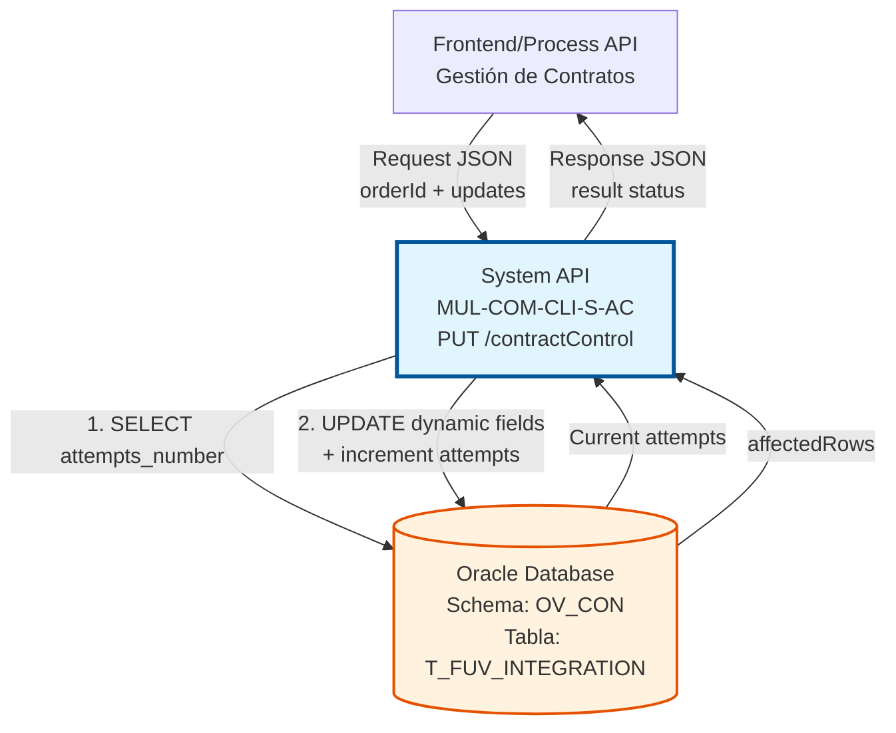
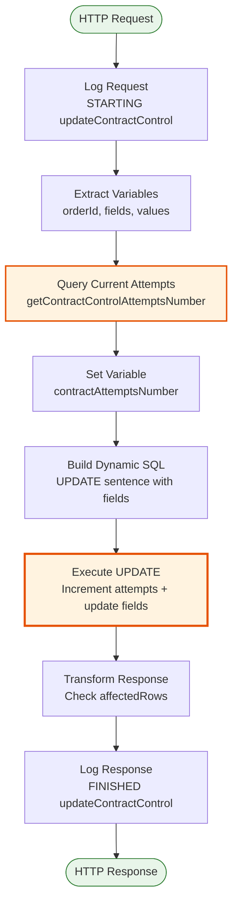
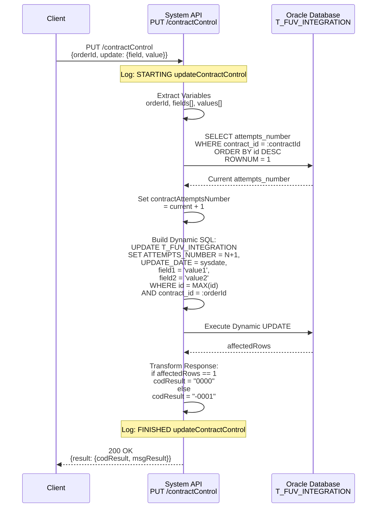
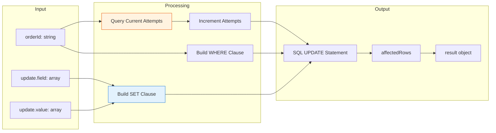

# PUT /contractControl

## 📌 Descripción General

### Propósito del Endpoint

Este endpoint actualiza registros de control de integración de contratos en la tabla `T_FUV_INTEGRATION`. Su función principal es incrementar el contador de intentos de integración y actualizar campos específicos del registro más reciente asociado a un contrato.

El endpoint soporta:
- **Incremento Automático de Intentos**: Consulta el número actual de intentos y lo incrementa en 1
- **Actualización Dinámica de Campos**: Permite actualizar múltiples campos mediante un array de field/value
- **Actualización Selectiva**: Solo actualiza el registro más reciente del contrato (MAX T_FUV_INTEGRATION_ID)

### Tipo de API

**Capa:** System API (API-Led Connectivity)

**Función:** Integración directa con Oracle Database para gestión de control de intentos de integración de contratos.

### Patrón de Integración

**Tipo:** Request-Reply Síncrono con Oracle Database

**Descripción:** El endpoint recibe el ID del contrato y un array de campos a actualizar, consulta el número actual de intentos, construye dinámicamente una sentencia UPDATE SQL, ejecuta la actualización incrementando el contador de intentos, y retorna el resultado de la operación.

### Arquitectura API-Led Connectivity



---

## 💼 Propósito del Negocio

### Casos de Uso Principales

1. **Control de Reintentos de Integración**
   - Un contrato falla en su integración con sistemas externos
   - El sistema incrementa el contador de intentos automáticamente
   - Se previenen loops infinitos mediante límite de intentos (< 4)

2. **Actualización de Estado de Integración**
   - El proceso de integración actualiza el estado del contrato
   - Se registran códigos de respuesta y mensajes de error
   - Se mantiene trazabilidad completa del proceso

3. **Gestión de Errores de Integración**
   - Se capturan errores durante la integración
   - Se almacenan mensajes de error para análisis
   - Se facilita la resolución de problemas

### Contexto Empresarial

- **Dominio:** Gestión de Contratos e Integraciones
- **Sector:** Energía - Utilities
- **División:** Naturgy España - CLI (Clientes)
- **Proceso de Negocio:** Control de integraciones de contratos con sistemas externos
- **Sistema:** Oracle Database - Schema OV_CON (Administración Comercial)

### Stakeholders

- **Equipos de Integración**: Necesitan seguimiento de intentos fallidos
- **Soporte Técnico**: Requieren visibilidad de errores de integración
- **Operaciones**: Monitorean la salud de las integraciones

### Valor de Negocio

- **Prevención de Loops Infinitos**: Control automático de reintentos
- **Trazabilidad Completa**: Registro detallado de cada intento
- **Resolución Proactiva**: Identificación rápida de problemas recurrentes
- **Optimización de Recursos**: Evita procesamiento innecesario de contratos problemáticos

### Consumidores Potenciales

Este endpoint puede ser consumido por:
- Process APIs de gestión de contratos
- Flujos de integración con sistemas externos
- Procesos batch de sincronización
- Sistemas de monitoreo y alertas

---

## 🔧 Especificación Técnica

### URLs por Ambiente

| Ambiente | URL Base | URL Completa |
|----------|----------|--------------|
| **Local** | `http://localhost:8081` | `http://localhost:8081/api/contractControl` |
| **Development** | `https://mul-com-cli-s-ac-dev.us-e2.cloudhub.io` | `https://mul-com-cli-s-ac-dev.us-e2.cloudhub.io/api/contractControl` |
| **UAT** | `https://mul-com-cli-s-ac-uat.us-e2.cloudhub.io` | `https://mul-com-cli-s-ac-uat.us-e2.cloudhub.io/api/contractControl` |
| **Production** | `https://mul-com-cli-s-ac-pro.us-e2.cloudhub.io` | `https://mul-com-cli-s-ac-pro.us-e2.cloudhub.io/api/contractControl` |

### Método HTTP

```
PUT /api/contractControl
```

### Parámetros de Entrada

#### Headers HTTP

| Header | Tipo | Requerido | Descripción | Ejemplo |
|--------|------|-----------|-------------|---------|
| `Content-Type` | string | ✅ Sí | Tipo de contenido del request | `application/json` |
| `Accept` | string | ❌ No | Tipo de contenido esperado en response | `application/json` |

#### Body Parameters

```json
{
  "orderId": "string",
  "update": {
    "field": ["string"],
    "value": ["string"]
  }
}
```

| Campo | Tipo | Requerido | Descripción | Ejemplo |
|-------|------|-----------|-------------|---------|
| `orderId` | string | ✅ Sí | ID del contrato a actualizar | `"12345678"` |
| `update.field` | array[string] | ✅ Sí | Array de nombres de campos a actualizar | `["STATE", "CODE"]` |
| `update.value` | array[string] | ✅ Sí | Array de valores correspondientes a los campos | `["processing", "200"]` |

**Nota:** Los arrays `field` y `value` deben tener la misma longitud y los valores se corresponden por índice.

### Respuestas

#### Respuesta Exitosa (200 OK)

```json
{
  "result": {
    "codResult": "0000",
    "msgResult": "No hay error"
  }
}
```

#### Respuesta de Error - Registro No Existe (200 OK)

```json
{
  "result": {
    "codResult": "-0001",
    "msgResult": "Ha habido un error en la actualización del registro o el registro no existe"
  }
}
```

#### Respuesta de Error Técnico (500)

```json
{
  "error": "APP_9999",
  "message": "Error en el servicio."
}
```

### Códigos de Estado HTTP

| Código | Descripción | Escenario |
|--------|-------------|-----------|
| `200` | OK | Actualización exitosa o registro no encontrado |
| `400` | Bad Request | Request malformado o parámetros inválidos |
| `500` | Internal Server Error | Error en base de datos o error técnico |

### Autenticación y Autorización

- **Tipo:** Client ID & Client Secret (Anypoint Platform)
- **Autorización DB:** El usuario debe tener permisos para:
  - Acceso de lectura a tabla `T_FUV_INTEGRATION`
  - Acceso de escritura (UPDATE) a tabla `T_FUV_INTEGRATION`

### Timeouts

| Tipo | Valor | Descripción |
|------|-------|-------------|
| **Request Timeout** | 30 segundos | Tiempo máximo de espera para la respuesta |
| **Connection Timeout** | 10 segundos | Tiempo máximo para establecer conexión con DB |
| **Query Timeout** | 6000 segundos | Timeout configurado para operaciones de base de datos |

---

## 🏗️ Implementación Técnica

### Arquitectura del Flow



### Flujo de Ejecución Detallado



### Transformación de Datos



### Operaciones de Base de Datos

#### 1. Query de Consulta de Intentos Actuales

**Ubicación:** `s-ac-pro-config.yaml` línea 82

```sql
select * from (
  select attempts_number 
  from t_fuv_integration 
  where contract_id = :contractId 
  order by t_fuv_integration_id desc
) WHERE rownum=1
```

**Propósito:** Obtener el número actual de intentos del registro más reciente del contrato.

**Parámetros:**
- `:contractId` - ID del contrato (string)

**Resultado:** Registro con el campo `attempts_number` (número actual de intentos)

#### 2. Query de Actualización Dinámica

**Construcción:** Generada dinámicamente en DataWeave (líneas 101-126 del XML)

```sql
UPDATE T_FUV_INTEGRATION 
SET ATTEMPTS_NUMBER = :newAttemptsNumber, 
    UPDATE_DATE = sysdate, 
    :dynamicFields
WHERE T_FUV_INTEGRATION_ID = (
  SELECT MAX(T_FUV_INTEGRATION_ID) 
  FROM T_FUV_INTEGRATION 
  WHERE CONTRACT_ID = :contractId
)
```

**Ejemplo de Query Generada:**

```sql
UPDATE T_FUV_INTEGRATION 
SET ATTEMPTS_NUMBER = 2, 
    UPDATE_DATE = sysdate, 
    STATE = 'processing', 
    CODE = '200', 
    MESSAGE = 'Integration in progress'
WHERE T_FUV_INTEGRATION_ID = (
  SELECT MAX(T_FUV_INTEGRATION_ID) 
  FROM T_FUV_INTEGRATION 
  WHERE CONTRACT_ID = '12345678'
)
```

**Propósito:** Actualizar el registro más reciente del contrato con nuevos valores e incrementar intentos.

**Lógica de Construcción:**
1. Incrementa `ATTEMPTS_NUMBER` en 1
2. Actualiza `UPDATE_DATE` a fecha actual
3. Construye cláusula SET dinámica con pares field=value
4. Actualiza solo el registro con MAX(T_FUV_INTEGRATION_ID) del contrato

### Lógica de Construcción de SQL Dinámico

**Ubicación:** `s-ac-contractControl.xml` líneas 101-126

```dataweave
%dw 2.0
output application/java

var sentence_1 = "UPDATE T_FUV_INTEGRATION SET ATTEMPTS_NUMBER = " ++ 
                 ((vars.contractAttemptsNumber default 1) + 1) as String ++ 
                 ", UPDATE_DATE = sysdate, "

var sentence_2 = " WHERE T_FUV_INTEGRATION_ID = (SELECT MAX (T_FUV_INTEGRATION_ID) " ++
                 "FROM T_FUV_INTEGRATION WHERE CONTRACT_ID = "

// 1. Construir pares field = 'value' para cada campo a actualizar
fun setFieldsValuesSentence(listFields) = listFields map (field, findex) -> {
    printString : field ++ " = '" ++ 
                  (vars.values filter ((item, vindex) -> (findex == vindex)) map $)[0] ++ 
                  "'"
}

// 2. Aplicar función y guardar resultado
var fieldsValuesSentence = setFieldsValuesSentence(vars.fields)

// 3. Unir strings con comas
fun buildSentence(listfieldsValuesSentence) = listfieldsValuesSentence joinBy ", "

// 4. Construir sentencia SET completa
var SETSentenceGenerated = buildSentence(fieldsValuesSentence.printString)

---
// 5. Construir query completa
sentence_1 ++ SETSentenceGenerated ++ sentence_2 ++ "'" ++ vars.orderId ++ "')"
```

**Ejemplo de Transformación:**

**Input:**
```json
{
  "orderId": "12345678",
  "update": {
    "field": ["STATE", "CODE", "MESSAGE"],
    "value": ["processing", "200", "Integration in progress"]
  }
}
```

**Output SQL:**
```sql
UPDATE T_FUV_INTEGRATION 
SET ATTEMPTS_NUMBER = 2, 
    UPDATE_DATE = sysdate, 
    STATE = 'processing', 
    CODE = '200', 
    MESSAGE = 'Integration in progress' 
WHERE T_FUV_INTEGRATION_ID = (
  SELECT MAX(T_FUV_INTEGRATION_ID) 
  FROM T_FUV_INTEGRATION 
  WHERE CONTRACT_ID = '12345678'
)
```

### Estructura de la Tabla T_FUV_INTEGRATION

| Campo | Tipo | Descripción |
|-------|------|-------------|
| `T_FUV_INTEGRATION_ID` | NUMBER | ID único del registro (PK, secuencia) |
| `CONTRACT_ID` | VARCHAR2 | ID del contrato |
| `SYSTEM_MESSAGE` | VARCHAR2 | Sistema origen del mensaje |
| `CODE` | VARCHAR2 | Código de estado/respuesta |
| `MESSAGE` | CLOB | Mensaje de integración |
| `STATE` | VARCHAR2 | Estado del contrato |
| `RESPONSE` | CLOB | Respuesta de la integración |
| `ERROR` | VARCHAR2 | Mensaje de error si aplica |
| `CONTRACT_ATR` | NUMBER | Indicador ATR |
| `CREATE_DATE` | DATE | Fecha de creación |
| `UPDATE_DATE` | DATE | Fecha de última actualización |
| `UPDATE_USER` | VARCHAR2 | Usuario que actualizó |
| `UPDATE_PROGRAM` | VARCHAR2 | Programa que actualizó |
| `ATTEMPTS_NUMBER` | NUMBER | Número de intentos de integración |

### Configuración de Conectores

#### Database Connector

```xml
<db:config name="Database_Config">
    <db:generic-connection 
        url="jdbc:oracle:thin:${dbAC.user}/${secure::dbAC.pass}@..."
        driverClassName="oracle.jdbc.driver.OracleDriver">
        <db:pooling-profile 
            maxPoolSize="${dbAC.MaxPoolSize}"
            maxWait="${dbAC.MaxWaitTime}"
            maxIdleTime="${dbAC.MaxIdleTime}"/>
    </db:generic-connection>
</db:config>
```

**Configuración de Pool:**
- Max Pool Size: 5 conexiones
- Max Wait Time: 300 segundos
- Max Idle Time: 300 segundos
- Timeout: 6000 segundos

### Manejo de Errores

#### Errores de Negocio

| Escenario | Código | Mensaje | HTTP Status |
|-----------|--------|---------|-------------|
| Actualización exitosa | `0000` | No hay error | 200 |
| Registro no existe | `-0001` | Ha habido un error en la actualización del registro o el registro no existe | 200 |

#### Errores Técnicos

| Escenario | Respuesta | HTTP Status |
|-----------|-----------|-------------|
| Error de conexión DB | `{error: "APP_9999", message: "Error en el servicio."}` | 500 |
| Query timeout | `{error: "APP_9999", message: "Error en el servicio."}` | 500 |
| Error de sintaxis SQL | `{error: "APP_9999", message: "Error en el servicio."}` | 500 |

### Logging

**Ubicación:** `s-ac-contractControl.xml` líneas 70-77 y 143-150

#### Log de Inicio
```
STARTING updateContractControl METHOD. REQUEST: {orderId, update}
```

#### Log de Fin
```
FINISHED updateContractControl METHOD. RESPONSE: {result}
```

**Nivel de Log:** INFO

**Formato:** JSON normalizado mediante función `common::commonFunctions::normalizeJSON`

---

## 💻 Ejemplos de Uso

### Ejemplo 1: Actualización de Estado y Código

#### Request

```bash
curl -X PUT "http://localhost:8081/api/contractControl" \
  -H "Content-Type: application/json" \
  -H "Accept: application/json" \
  -d '{
    "orderId": "12345678",
    "update": {
      "field": ["STATE", "CODE"],
      "value": ["processing", "200"]
    }
  }'
```

#### Response (200 OK)

```json
{
  "result": {
    "codResult": "0000",
    "msgResult": "No hay error"
  }
}
```

### Ejemplo 2: Actualización con Mensaje de Error

#### Request

```bash
curl -X PUT "http://localhost:8081/api/contractControl" \
  -H "Content-Type: application/json" \
  -d '{
    "orderId": "87654321",
    "update": {
      "field": ["STATE", "CODE", "ERROR"],
      "value": ["failed", "500", "Connection timeout to external system"]
    }
  }'
```

#### Response (200 OK)

```json
{
  "result": {
    "codResult": "0000",
    "msgResult": "No hay error"
  }
}
```

### Ejemplo 3: Actualización de Múltiples Campos

#### Request

```bash
curl -X PUT "http://localhost:8081/api/contractControl" \
  -H "Content-Type: application/json" \
  -d '{
    "orderId": "11223344",
    "update": {
      "field": ["STATE", "CODE", "MESSAGE", "RESPONSE"],
      "value": [
        "completed", 
        "200", 
        "Integration successful", 
        "{\"status\":\"ok\",\"contractId\":\"11223344\"}"
      ]
    }
  }'
```

#### Response (200 OK)

```json
{
  "result": {
    "codResult": "0000",
    "msgResult": "No hay error"
  }
}
```

### Ejemplo 4: Error - Contrato No Existe

#### Request

```bash
curl -X PUT "http://localhost:8081/api/contractControl" \
  -H "Content-Type: application/json" \
  -d '{
    "orderId": "99999999",
    "update": {
      "field": ["STATE"],
      "value": ["processing"]
    }
  }'
```

#### Response (200 OK)

```json
{
  "result": {
    "codResult": "-0001",
    "msgResult": "Ha habido un error en la actualización del registro o el registro no existe"
  }
}
```

### Ejemplo 5: Ejemplo con Postman

```javascript
// Postman Pre-request Script
pm.environment.set("orderId", "12345678");

// Postman Request Body
{
  "orderId": "{{orderId}}",
  "update": {
    "field": ["STATE", "CODE"],
    "value": ["processing", "200"]
  }
}

// Postman Tests
pm.test("Status code is 200", function () {
    pm.response.to.have.status(200);
});

pm.test("Update successful", function () {
    var jsonData = pm.response.json();
    pm.expect(jsonData.result.codResult).to.eql("0000");
});
```

### Ejemplo 6: Ejemplo con JavaScript/Node.js

```javascript
const axios = require('axios');

async function updateContractControl(orderId, fields, values) {
  try {
    const response = await axios.put(
      'http://localhost:8081/api/contractControl',
      {
        orderId: orderId,
        update: {
          field: fields,
          value: values
        }
      },
      {
        headers: {
          'Content-Type': 'application/json'
        }
      }
    );
    
    console.log('Update Result:', response.data);
    return response.data;
  } catch (error) {
    console.error('Error updating contract:', error.response?.data || error.message);
    throw error;
  }
}

// Uso
updateContractControl(
  '12345678',
  ['STATE', 'CODE', 'MESSAGE'],
  ['processing', '200', 'Integration in progress']
);
```

### Ejemplo 7: Ejemplo con Python

```python
import requests
import json

def update_contract_control(order_id, fields, values):
    url = "http://localhost:8081/api/contractControl"
    
    payload = {
        "orderId": order_id,
        "update": {
            "field": fields,
            "value": values
        }
    }
    
    headers = {
        "Content-Type": "application/json"
    }
    
    try:
        response = requests.put(url, json=payload, headers=headers)
        response.raise_for_status()
        
        result = response.json()
        print(f"Update Result: {json.dumps(result, indent=2)}")
        return result
    except requests.exceptions.RequestException as e:
        print(f"Error updating contract: {e}")
        raise

# Uso
update_contract_control(
    "12345678",
    ["STATE", "CODE", "MESSAGE"],
    ["processing", "200", "Integration in progress"]
)
```

---

**Última Actualización:** 2026-07-15  
**Versión del API:** 2.0.0  
**Mantenido por:** Naturgy Integration Team