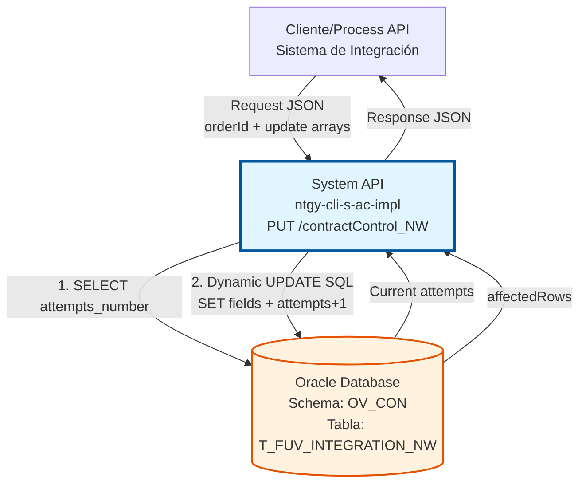
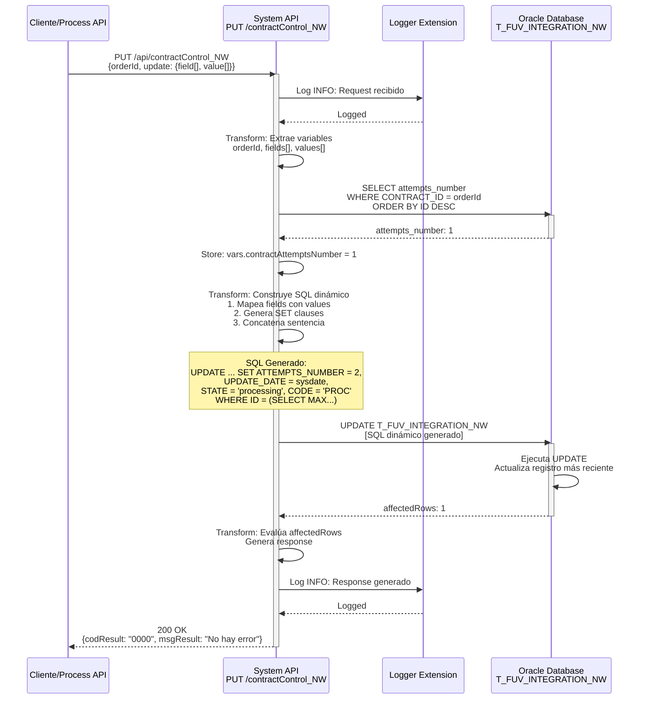

# PUT /contractControl_NW

## 📌 Descripción General

### Propósito del Endpoint

Este endpoint actualiza registros de control de contratos NEWCO en la tabla `T_FUV_INTEGRATION_NW`, permitiendo modificar campos específicos de forma dinámica mientras incrementa automáticamente el contador de intentos de procesamiento.

El endpoint soporta:
- **Actualización Dinámica de Campos**: Permite actualizar cualquier campo de la tabla mediante arrays `field[]` y `value[]`
- **Incremento Automático de Intentos**: Incrementa `ATTEMPTS_NUMBER` en 1 con cada actualización
- **Actualización de Timestamp**: Actualiza `UPDATE_DATE` a la fecha actual (sysdate)
- **Construcción SQL Dinámica**: Genera la sentencia UPDATE basándose en los campos recibidos

### Tipo de API

**Capa:** System API (API-Led Connectivity)

**Función:** Integración directa con Oracle Database (schema OV_CON) para actualización de datos de control de contratos NEWCO.

### Patrón de Integración

**Tipo:** Request-Reply Síncrono con UPDATE SQL Dinámico

**Descripción:** El endpoint recibe el `orderId` y arrays de campos/valores a actualizar, consulta el número de intentos actual, construye dinámicamente una sentencia UPDATE SQL, ejecuta la actualización incrementando el contador de intentos, y retorna una confirmación basada en el número de filas afectadas.

### Arquitectura API-Led Connectivity



---

## 💼 Propósito del Negocio

### Casos de Uso Principales

1. **Actualización de Estado de Contrato**
   - Un proceso batch procesa contratos pendientes y actualiza su estado
   - El sistema actualiza el campo `STATE` de 'received' a 'processing'
   - Se incrementa automáticamente el contador de intentos
   - **Beneficio:** Trazabilidad del progreso de procesamiento

2. **Registro de Respuestas de Sistemas Externos**
   - Un contrato es procesado por un sistema externo (SAP, Salesforce)
   - El sistema actualiza el campo `RESPONSE` con la respuesta recibida
   - Se actualiza el campo `CODE` con el código de resultado
   - **Beneficio:** Auditoría completa de interacciones con sistemas externos

3. **Gestión de Errores y Reintentos**
   - Un proceso falla al procesar un contrato
   - El sistema actualiza el campo `ERROR` con el mensaje de error
   - El contador de intentos se incrementa automáticamente
   - Si `ATTEMPTS_NUMBER` < 4, el contrato será reintentado
   - **Beneficio:** Control automático de reintentos con límite de 4 intentos

4. **Actualización de Múltiples Campos Simultáneamente**
   - Un proceso necesita actualizar varios campos a la vez (STATE, CODE, RESPONSE)
   - El sistema construye dinámicamente el UPDATE con todos los campos
   - Se ejecuta una sola transacción atómica
   - **Beneficio:** Eficiencia y consistencia de datos

### Contexto Empresarial

- **Dominio:** Gestión de Contratos y Alta de Clientes
- **Sector:** Energía - Utilities
- **División:** Naturgy España - NEWCO (Nueva Compañía)
- **Proceso de Negocio:** Procesamiento y seguimiento de contratos NEWCO
- **Sistema:** Oracle Database - Schema de Administración Comercial (OV_CON)

### Stakeholders

- **Equipos de Integración**: Actualizan estados de contratos durante el procesamiento
- **Procesos Batch**: Ejecutan actualizaciones masivas de contratos pendientes
- **Sistemas de Monitoreo**: Registran errores y respuestas de sistemas externos
- **Equipos de Soporte**: Consultan el número de intentos para troubleshooting

### Valor de Negocio

- **Flexibilidad**: Actualización dinámica de cualquier campo sin modificar código
- **Control de Reintentos**: Gestión automática de intentos con límite de 4
- **Auditoría**: Registro de cada actualización con timestamp y número de intento
- **Eficiencia**: Actualización de múltiples campos en una sola transacción

### Consumidores Potenciales

Este endpoint puede ser consumido por:
- Process APIs de procesamiento de contratos
- Procesos batch de sincronización
- Sistemas de integración middleware
- Flujos de error handling y retry logic
- Servicios de monitoreo y alertas

---

## 🔧 Especificación Técnica

### URLs por Ambiente

| Ambiente | URL Base | URL Completa |
|----------|----------|--------------|
| **Local** | `http://localhost:8050` | `http://localhost:8050/api/contractControl_NW` |
| **Development** | `https://ntgy-cli-s-ac-impl-dev.us-e2.cloudhub.io` | `https://ntgy-cli-s-ac-impl-dev.us-e2.cloudhub.io/api/contractControl_NW` |
| **QA** | `https://ntgy-cli-s-ac-impl-cc.us-e2.cloudhub.io` | `https://ntgy-cli-s-ac-impl-cc.us-e2.cloudhub.io/api/contractControl_NW` |
| **Pre-Production** | `https://ntgy-cli-s-ac-impl-cl.us-e2.cloudhub.io` | `https://ntgy-cli-s-ac-impl-cl.us-e2.cloudhub.io/api/contractControl_NW` |
| **Production** | `https://ntgy-cli-s-ac-impl-pro.us-e2.cloudhub.io` | `https://ntgy-cli-s-ac-impl-pro.us-e2.cloudhub.io/api/contractControl_NW` |

### Método HTTP

```
PUT /api/contractControl_NW
```

### Parámetros de Entrada

#### Headers HTTP

| Header | Tipo | Requerido | Descripción | Ejemplo |
|--------|------|-----------|-------------|---------|
| `Content-Type` | string | ✅ Sí | Tipo de contenido del request | `application/json` |
| `Accept` | string | ❌ No | Tipo de contenido esperado en response | `application/json` |

#### Body Parameters

| Campo | Tipo | Requerido | Descripción | Ejemplo |
|-------|------|-----------|-------------|---------|
| `orderId` | string | ✅ Sí | Identificador único del pedido/contrato | `"ORD-2026-001234"` |
| `update` | object | ✅ Sí | Objeto con arrays de campos y valores a actualizar | Ver estructura abajo |
| `update.field` | array[string] | ✅ Sí | Array de nombres de campos a actualizar | `["STATE", "CODE"]` |
| `update.value` | array[string] | ✅ Sí | Array de valores correspondientes a cada campo | `["processing", "PROC"]` |

**Estructura del Body:**

```json
{
  "orderId": "string",
  "update": {
    "field": ["FIELD1", "FIELD2", "FIELD3"],
    "value": ["value1", "value2", "value3"]
  }
}
```

**Notas Importantes:**

1. **Correspondencia de Arrays:** Los arrays `field` y `value` deben tener la misma longitud. Cada posición en `field` corresponde a la misma posición en `value`.

2. **Campos Actualizables:** Cualquier campo de la tabla `T_FUV_INTEGRATION_NW` puede ser actualizado, excepto:
   - `T_FUV_INTEGRATION_NW_ID` (clave primaria)
   - `CONTRACT_ID` (identificador del contrato)
   - `ATTEMPTS_NUMBER` (se incrementa automáticamente)
   - `UPDATE_DATE` (se actualiza automáticamente a sysdate)

3. **Campos Comunes a Actualizar:**
   - `STATE`: Estado del contrato (ej: 'received', 'processing', 'completed', 'error')
   - `CODE`: Código de estado (ej: 'PROC', 'OK', 'ERR')
   - `RESPONSE`: Respuesta del sistema externo (CLOB)
   - `ERROR`: Mensaje de error si aplica (CLOB)
   - `SYSTEM_MESSAGE`: Sistema que procesó el contrato
   - `CONTRACT_ATR`: Atributo de contrato

4. **Construcción SQL Dinámica:** El sistema construye la sentencia UPDATE dinámicamente:
   ```sql
   UPDATE T_FUV_INTEGRATION_NW 
   SET ATTEMPTS_NUMBER = [current+1], 
       UPDATE_DATE = sysdate, 
       FIELD1 = 'value1', 
       FIELD2 = 'value2'
   WHERE T_FUV_INTEGRATION_NW_ID = (
     SELECT MAX(T_FUV_INTEGRATION_NW_ID) 
     FROM T_FUV_INTEGRATION_NW 
     WHERE CONTRACT_ID = 'orderId'
   )
   ```

### Respuestas

#### Respuesta Exitosa (200 OK)

**Descripción:** El registro se actualizó correctamente (1 fila afectada).

```json
{
  "result": {
    "codResult": "0000",
    "msgResult": "No hay error"
  }
}
```

#### Respuesta de Error de Actualización (200 OK)

**Descripción:** El UPDATE no afectó ninguna fila o el registro no existe.

```json
{
  "result": {
    "codResult": "-0001",
    "msgResult": "Ha habido un error en la actualización del registro o el registro no existe"
  }
}
```

#### Respuesta de Error Técnico (500)

**Descripción:** Error interno del servidor o de base de datos.

```json
{
  "error": "APP_9999",
  "message": "Error en el servicio."
}
```

### Códigos de Estado HTTP

| Código | Descripción | Cuándo Ocurre |
|--------|-------------|---------------|
| `200` | OK | Operación completada (verificar `codResult` en el body) |
| `400` | Bad Request | Body malformado, campos requeridos faltantes, o arrays de diferente longitud |
| `500` | Internal Server Error | Error de base de datos o error interno |

### Autenticación y Autorización

- **Tipo:** Client ID & Client Secret (Anypoint Platform)
- **Autorización DB:** El usuario de base de datos debe tener permisos para:
  - SELECT en tabla `T_FUV_INTEGRATION_NW`
  - UPDATE en tabla `T_FUV_INTEGRATION_NW`
  - Permisos de escritura en schema `OV_CON`

### Timeouts

| Tipo | Valor | Descripción |
|------|-------|-------------|
| **Request Timeout** | 30 segundos | Tiempo máximo de espera para la respuesta |
| **Connection Timeout** | 10 segundos | Tiempo máximo para establecer conexión con DB |
| **Query Timeout** | 30 segundos | Tiempo máximo de ejecución del UPDATE |

---

## 🏗️ Implementación Técnica

### Arquitectura del Flow

```mermaid
flowchart TD
    Start([HTTP PUT Request]) --> LogStart[Log Start: INFO level<br/>Normaliza y registra request]
    LogStart --> ExtractVars[Transform: Extrae Variables<br/>vars.orderId = payload.orderId<br/>vars.fields = payload.update.field<br/>vars.values = payload.update.value]
    ExtractVars --> QueryAttempts[DB Query Single<br/>SELECT attempts_number<br/>WHERE CONTRACT_ID = orderId<br/>ORDER BY ID DESC]
    QueryAttempts --> StoreAttempts[Set Variable<br/>vars.contractAttemptsNumber = payload[0]]
    StoreAttempts --> BuildSQL[Transform: Construye SQL Dinámico<br/>1. Mapea fields con values<br/>2. Genera SET clauses<br/>3. Concatena sentencia completa]
    BuildSQL --> Update[DB Update<br/>Ejecuta SQL dinámico<br/>Actualiza registro más reciente]
    Update --> PrepareResp[Transform: Prepara Response<br/>Evalúa payload.affectedRows<br/>Genera codResult y msgResult]
    PrepareResp --> LogEnd[Log End: INFO level<br/>Normaliza y registra response]
    LogEnd --> End([HTTP Response 200 OK])
    
    QueryAttempts -.->|Error| ErrorHandler[Error Handler<br/>Return 500]
    Update -.->|Error| ErrorHandler
    ErrorHandler --> EndError([HTTP Response 500])
    
    style Start fill:#e8f5e9,stroke:#2e7d32
    style QueryAttempts fill:#fff3e0,stroke:#e65100,stroke-width:2px
    style BuildSQL fill:#e3f2fd,stroke:#1565c0,stroke-width:2px
    style Update fill:#fff3e0,stroke:#e65100,stroke-width:3px
    style End fill:#e8f5e9,stroke:#2e7d32
    style ErrorHandler fill:#ffebee,stroke:#c62828
```

### Tabla de Base de Datos

#### T_FUV_INTEGRATION_NW

**Propósito:** Tabla de control de integración de contratos NEWCO con seguimiento de estados y reintentos.

**Campos Relevantes para UPDATE:**

| Campo | Tipo | Descripción | Actualización |
|-------|------|-------------|---------------|
| `T_FUV_INTEGRATION_NW_ID` | NUMBER | ID único (PK) | ❌ No actualizable |
| `CONTRACT_ID` | VARCHAR2 | ID del contrato/pedido | ❌ No actualizable (usado en WHERE) |
| `ATTEMPTS_NUMBER` | NUMBER | Número de intentos | ✅ Auto-incrementado (+1) |
| `UPDATE_DATE` | DATE | Fecha de actualización | ✅ Auto-actualizado (sysdate) |
| `STATE` | VARCHAR2 | Estado del registro | ✅ Actualizable dinámicamente |
| `CODE` | VARCHAR2 | Código de estado | ✅ Actualizable dinámicamente |
| `RESPONSE` | CLOB | Respuesta del procesamiento | ✅ Actualizable dinámicamente |
| `ERROR` | CLOB | Mensaje de error | ✅ Actualizable dinámicamente |
| `SYSTEM_MESSAGE` | VARCHAR2 | Sistema origen | ✅ Actualizable dinámicamente |
| `CONTRACT_ATR` | NUMBER | Atributo de contrato | ✅ Actualizable dinámicamente |
| `MESSAGE` | CLOB | Mensaje completo | ✅ Actualizable dinámicamente |

### Query SQL - Paso 1: Obtener Intentos Actuales

**Query Configurada:**
```sql
select * from (
  select attempts_number 
  from T_FUV_INTEGRATION_NW 
  where contract_id = :contractId 
  order by T_FUV_INTEGRATION_NW_ID desc
) WHERE rownum=1
```

**Ubicación en Código:** Líneas 92-95 del XML

**Propósito:** Obtener el número de intentos actual del registro más reciente del contrato.

**Parámetros:**
- `:contractId` → `vars.orderId`

**Resultado:** Un solo registro con el campo `ATTEMPTS_NUMBER`

### Query SQL - Paso 2: UPDATE Dinámico

**Estructura de la Sentencia:**
```sql
UPDATE T_FUV_INTEGRATION_NW 
SET ATTEMPTS_NUMBER = [current_attempts + 1], 
    UPDATE_DATE = sysdate, 
    [FIELD1] = '[value1]', 
    [FIELD2] = '[value2]',
    ...
WHERE T_FUV_INTEGRATION_NW_ID = (
  SELECT MAX(T_FUV_INTEGRATION_NW_ID) 
  FROM T_FUV_INTEGRATION_NW 
  WHERE CONTRACT_ID = '[orderId]'
)
```

**Ubicación en Código:** Líneas 97-125 del XML

**Características:**
- Sentencia construida dinámicamente en DataWeave
- Incrementa `ATTEMPTS_NUMBER` en 1 automáticamente
- Actualiza `UPDATE_DATE` a sysdate
- Actualiza solo el registro más reciente (MAX ID)
- Número de campos SET variable según el request

### Transformaciones DataWeave

#### 1. Extracción de Variables (Líneas 74-91)

```dataweave
%dw 2.0
output application/java
---
{
  orderId: payload.orderId,
  fields: payload.update.field,
  values: payload.update.value
}
```

**Propósito:** Extrae el `orderId` y los arrays de campos/valores del request.

**Variables Generadas:**
- `vars.orderId` → ID del contrato a actualizar
- `vars.fields` → Array de nombres de campos
- `vars.values` → Array de valores correspondientes

#### 2. Construcción Dinámica de SQL (Líneas 97-122)

```dataweave
%dw 2.0
output application/java

var sentence_1 = "UPDATE T_FUV_INTEGRATION_NW SET ATTEMPTS_NUMBER = " ++ 
                 ((vars.contractAttemptsNumber default 1) + 1) as String ++ 
                 ", UPDATE_DATE = sysdate, "

var sentence_2 = " WHERE T_FUV_INTEGRATION_NW_ID = (SELECT MAX (T_FUV_INTEGRATION_NW_ID) FROM T_FUV_INTEGRATION_NW WHERE CONTRACT_ID = "

// 1. Recorro las variables fields y values para montar el string "field = value"
fun setFieldsValuesSentence(listFields) = listFields map (field, findex) -> {
  printString : field ++ " = '" ++ 
                (vars.values filter ((item, vindex) -> (findex == vindex)) map $)[0] ++ 
                "'"
}

// 2. Aplico la función 1 y guardo el resultado
var fieldsValuesSentence = setFieldsValuesSentence(vars.fields)

// 3. Uno los strings de tipo "field = value", concatenando una "," entre ellos
fun buildSentence(listfieldsValuesSentence) = listfieldsValuesSentence joinBy ", "

// 4. Aplico la función 3 y guardo el resultado
var SETSentenceGenerated = buildSentence(fieldsValuesSentence.printString)
---

sentence_1 ++ SETSentenceGenerated ++ sentence_2 ++ "'" ++ vars.orderId ++ "'" ++ ")"
```

**Propósito:** Construye dinámicamente la sentencia UPDATE SQL completa.

**Proceso:**
1. **Función `setFieldsValuesSentence`**: Mapea cada campo con su valor correspondiente
   - Recorre el array `vars.fields`
   - Para cada campo, busca el valor en la misma posición en `vars.values`
   - Genera string: `"FIELD = 'value'"`

2. **Función `buildSentence`**: Une todos los pares campo=valor con comas
   - Recibe el array de strings generados
   - Los concatena con ", " entre ellos
   - Resultado: `"FIELD1 = 'value1', FIELD2 = 'value2'"`

3. **Construcción Final**: Concatena las 3 partes de la sentencia
   - Parte 1: `UPDATE ... SET ATTEMPTS_NUMBER = X, UPDATE_DATE = sysdate, `
   - Parte 2: Campos dinámicos generados
   - Parte 3: `WHERE ... (SELECT MAX ... WHERE CONTRACT_ID = 'orderId')`

**Ejemplo de SQL Generado:**
```sql
UPDATE T_FUV_INTEGRATION_NW 
SET ATTEMPTS_NUMBER = 2, 
    UPDATE_DATE = sysdate, 
    STATE = 'processing', 
    CODE = 'PROC' 
WHERE T_FUV_INTEGRATION_NW_ID = (
  SELECT MAX(T_FUV_INTEGRATION_NW_ID) 
  FROM T_FUV_INTEGRATION_NW 
  WHERE CONTRACT_ID = 'ORD-2026-001234'
)
```

#### 3. Construcción de Respuesta (Líneas 126-138)

```dataweave
%dw 2.0
output application/json
---
{
  "result": {
    "codResult": if (payload.affectedRows == 1) "0000" else "-0001",
    "msgResult": if (payload.affectedRows == 1) 
                    "No hay error" 
                 else 
                    "Ha habido un error en la actualización del registro o el registro no existe"
  }
}
```

**Propósito:** Evalúa el resultado del UPDATE basándose en `affectedRows`:
- Si `affectedRows == 1` → Éxito (`codResult: "0000"`)
- Si `affectedRows != 1` → Error (`codResult: "-0001"`)

### Diagrama de Secuencia



### Manejo de Errores

#### Error de Base de Datos

**Escenario:** Fallo en la conexión o ejecución del SELECT/UPDATE.

**Respuesta:**
```json
{
  "error": "APP_9999",
  "message": "Error en el servicio."
}
```

**HTTP Status:** 500 Internal Server Error

#### Error de Validación

**Escenario:** Arrays de diferente longitud o campos requeridos faltantes.

**Respuesta:** APIKit retorna error de validación.

**HTTP Status:** 400 Bad Request

#### Registro No Encontrado

**Escenario:** No existe ningún registro con el `orderId` proporcionado.

**Respuesta:**
```json
{
  "result": {
    "codResult": "-0001",
    "msgResult": "Ha habido un error en la actualización del registro o el registro no existe"
  }
}
```

**HTTP Status:** 200 OK (pero con error de negocio)

### Logging

#### Log de Inicio (INFO Level)

```
STARTING updateContractControl_NW METHOD. REQUEST: {"orderId":"ORD-2026-001234","update":{"field":["STATE","CODE"],"value":["processing","PROC"]}}
```

#### Log de Fin (INFO Level)

```
FINISHED updateContractControl_NW METHOD. RESPONSE: {"result":{"codResult":"0000","msgResult":"No hay error"}}
```

**Función de Normalización:** `common::commonFunctions::normalizeJSON(payloadStr)`

### Performance y Optimización

**Estrategias Implementadas:**
- Query optimizada con índice en `CONTRACT_ID`
- Uso de `MAX(ID)` para obtener registro más reciente
- Construcción SQL dinámica en memoria (no múltiples queries)
- Connection pooling para reutilización de conexiones

**Métricas Esperadas:**
- Tiempo de respuesta: < 2 segundos (p95)
- Throughput: 50+ requests/minuto
- Connection pool utilization: < 80%

---

## 💻 Ejemplos de Uso

### Ejemplo 1: Actualización de Estado a "Processing"

#### Request

```bash
curl -X PUT "https://ntgy-cli-s-ac-impl-dev.us-e2.cloudhub.io/api/contractControl_NW" \
  -H "Content-Type: application/json" \
  -H "client_id: your-client-id" \
  -H "client_secret: your-client-secret" \
  -d '{
    "orderId": "ORD-2026-001234",
    "update": {
      "field": ["STATE", "CODE"],
      "value": ["processing", "PROC"]
    }
  }'
```

#### Response (200 OK)

```json
{
  "result": {
    "codResult": "0000",
    "msgResult": "No hay error"
  }
}
```

**Interpretación:** 
- El registro se actualizó correctamente
- `STATE` cambió a 'processing'
- `CODE` cambió a 'PROC'
- `ATTEMPTS_NUMBER` se incrementó de 0 a 1
- `UPDATE_DATE` se actualizó a la fecha actual

### Ejemplo 2: Registro de Error con Múltiples Campos

#### Request

```bash
curl -X PUT "https://ntgy-cli-s-ac-impl-dev.us-e2.cloudhub.io/api/contractControl_NW" \
  -H "Content-Type: application/json" \
  -H "client_id: your-client-id" \
  -H "client_secret: your-client-secret" \
  -d '{
    "orderId": "ORD-2026-001234",
    "update": {
      "field": ["STATE", "CODE", "ERROR"],
      "value": ["error", "ERR", "Connection timeout to SAP system"]
    }
  }'
```

#### Response (200 OK)

```json
{
  "result": {
    "codResult": "0000",
    "msgResult": "No hay error"
  }
}
```

**Interpretación:**
- El registro se actualizó con información de error
- `STATE` cambió a 'error'
- `CODE` cambió a 'ERR'
- `ERROR` se llenó con el mensaje de error
- `ATTEMPTS_NUMBER` se incrementó (ej: de 1 a 2)
- El contrato será reintentado si `ATTEMPTS_NUMBER` < 4

### Ejemplo 3: Registro de Respuesta Exitosa

#### Request

```bash
curl -X PUT "https://ntgy-cli-s-ac-impl-dev.us-e2.cloudhub.io/api/contractControl_NW" \
  -H "Content-Type: application/json" \
  -H "client_id: your-client-id" \
  -H "client_secret: your-client-secret" \
  -d '{
    "orderId": "ORD-2026-001234",
    "update": {
      "field": ["STATE", "CODE", "RESPONSE"],
      "value": ["completed", "OK", "{\"sapContractId\":\"12345\",\"status\":\"active\"}"]
    }
  }'
```

#### Response (200 OK)

```json
{
  "result": {
    "codResult": "0000",
    "msgResult": "No hay error"
  }
}
```

**Interpretación:**
- El contrato se procesó exitosamente
- `STATE` cambió a 'completed'
- `CODE` cambió a 'OK'
- `RESPONSE` contiene la respuesta del sistema externo en JSON
- `ATTEMPTS_NUMBER` se incrementó (registro final del procesamiento)

### Ejemplo 4: Error - Contrato No Encontrado

#### Request

```bash
curl -X PUT "https://ntgy-cli-s-ac-impl-dev.us-e2.cloudhub.io/api/contractControl_NW" \
  -H "Content-Type: application/json" \
  -H "client_id: your-client-id" \
  -H "client_secret: your-client-secret" \
  -d '{
    "orderId": "ORD-9999-NOEXISTE",
    "update": {
      "field": ["STATE"],
      "value": ["processing"]
    }
  }'
```

#### Response (200 OK)

```json
{
  "result": {
    "codResult": "-0001",
    "msgResult": "Ha habido un error en la actualización del registro o el registro no existe"
  }
}
```

**Interpretación:** El contrato con ID "ORD-9999-NOEXISTE" no existe en la tabla, por lo que el UPDATE no afectó ninguna fila.

### Ejemplo 5: Uso desde JavaScript/Node.js

```javascript
const axios = require('axios');

async function updateContractControl(orderId, fieldsToUpdate) {
  try {
    const response = await axios.put(
      'https://ntgy-cli-s-ac-impl-dev.us-e2.cloudhub.io/api/contractControl_NW',
      {
        orderId: orderId,
        update: fieldsToUpdate
      },
      {
        headers: {
          'Content-Type': 'application/json',
          'client_id': 'your-client-id',
          'client_secret': 'your-client-secret'
        }
      }
    );
    
    if (response.data.result.codResult === '0000') {
      console.log('Contrato actualizado exitosamente');
      return true;
    } else {
      console.error('Error al actualizar:', response.data.result.msgResult);
      return false;
    }
  } catch (error) {
    console.error('Error en la petición:', error.message);
    throw error;
  }
}

// Uso: Actualizar estado a processing
updateContractControl('ORD-2026-001234', {
  field: ['STATE', 'CODE'],
  value: ['processing', 'PROC']
})
.then(success => {
  if (success) {
    console.log('Actualización completada');
  }
})
.catch(err => console.error(err));

// Uso: Registrar error
updateContractControl('ORD-2026-001234', {
  field: ['STATE', 'CODE', 'ERROR'],
  value: ['error', 'ERR', 'Connection timeout']
})
.then(success => {
  if (success) {
    console.log('Error registrado');
  }
});
```

### Ejemplo 6: Uso desde Python

```python
import requests
import json

def update_contract_control(order_id, fields_to_update):
    """
    Actualiza un registro de control de contrato NEWCO
    
    Args:
        order_id (str): ID del contrato a actualizar
        fields_to_update (dict): Diccionario con 'field' y 'value' arrays
        
    Returns:
        bool: True si la actualización fue exitosa, False en caso contrario
    """
    url = "https://ntgy-cli-s-ac-impl-dev.us-e2.cloudhub.io/api/contractControl_NW"
    
    payload = {
        "orderId": order_id,
        "update": fields_to_update
    }
    
    headers = {
        "Content-Type": "application/json",
        "client_id": "your-client-id",
        "client_secret": "your-client-secret"
    }
    
    try:
        response = requests.put(url, json=payload, headers=headers)
        response.raise_for_status()
        
        data = response.json()
        
        if data['result']['codResult'] == '0000':
            print(f"Contrato {order_id} actualizado exitosamente")
            return True
        else:
            print(f"Error: {data['result']['msgResult']}")
            return False
            
    except requests.exceptions.RequestException as e:
        print(f"Error en la petición: {e}")
        raise

# Uso: Actualizar estado a processing
update_contract_control(
    "ORD-2026-001234",
    {
        "field": ["STATE", "CODE"],
        "value": ["processing", "PROC"]
    }
)

# Uso: Registrar respuesta exitosa
update_contract_control(
    "ORD-2026-001234",
    {
        "field": ["STATE", "CODE", "RESPONSE"],
        "value": ["completed", "OK", '{"sapContractId":"12345"}']
    }
)
```

### Ejemplo 7: Flujo Completo de Procesamiento

Este ejemplo muestra cómo un proceso batch podría usar el endpoint para gestionar el ciclo de vida completo de un contrato:

```bash
# 1. Marcar contrato como "en procesamiento"
curl -X PUT "https://ntgy-cli-s-ac-impl-dev.us-e2.cloudhub.io/api/contractControl_NW" \
  -H "Content-Type: application/json" \
  -d '{
    "orderId": "ORD-2026-001234",
    "update": {
      "field": ["STATE", "CODE", "SYSTEM_MESSAGE"],
      "value": ["processing", "PROC", "BatchProcessor"]
    }
  }'

# 2. Si el procesamiento falla, registrar error
curl -X PUT "https://ntgy-cli-s-ac-impl-dev.us-e2.cloudhub.io/api/contractControl_NW" \
  -H "Content-Type: application/json" \
  -d '{
    "orderId": "ORD-2026-001234",
    "update": {
      "field": ["STATE", "CODE", "ERROR"],
      "value": ["error", "ERR", "SAP RFC timeout after 30 seconds"]
    }
  }'
# Nota: ATTEMPTS_NUMBER se incrementa automáticamente a 2

# 3. Reintento exitoso, registrar éxito
curl -X PUT "https://ntgy-cli-s-ac-impl-dev.us-e2.cloudhub.io/api/contractControl_NW" \
  -H "Content-Type: application/json" \
  -d '{
    "orderId": "ORD-2026-001234",
    "update": {
      "field": ["STATE", "CODE", "RESPONSE", "ERROR"],
      "value": ["completed", "OK", "{\"sapContractId\":\"12345\",\"status\":\"active\"}", "null"]
    }
  }'
# Nota: ATTEMPTS_NUMBER se incrementa a 3 (registro final)
```
