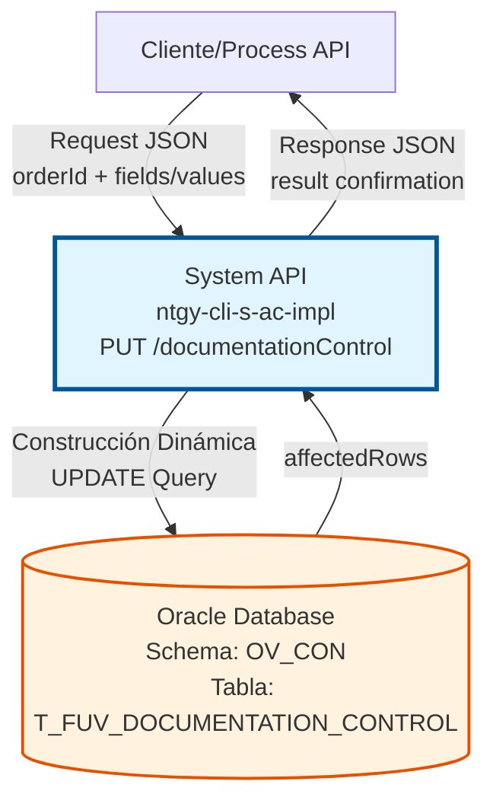
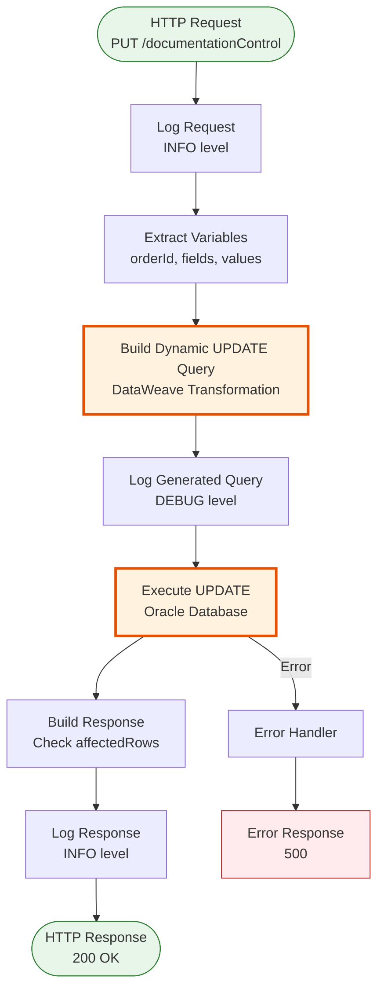

# PUT /documentationControl

## 📌 Descripción General

### Propósito del Endpoint

Este endpoint actualiza registros existentes en la tabla de control de documentación de contratos (`T_FUV_DOCUMENTATION_CONTROL`) en Oracle Database. Implementa un patrón de **actualización flexible** que permite modificar uno o múltiples campos simultáneamente mediante la construcción dinámica de la cláusula SET de SQL.

El endpoint soporta:
- **Actualización Flexible**: Permite actualizar cualquier combinación de campos mediante arrays dinámicos
- **Construcción Dinámica de Query**: Genera la sentencia SQL UPDATE en tiempo de ejecución basándose en los campos solicitados
- **Validación de Existencia**: Verifica que el registro exista antes de actualizar
- **Respuesta Estandarizada**: Retorna confirmación con código de resultado y mensaje descriptivo

### Tipo de API

**Capa:** System API (API-Led Connectivity)

**Función:** Integración directa con Oracle Database (Schema OV_CON) para actualización flexible de registros de control de documentación.

### Patrón de Integración

**Tipo:** Request-Reply Síncrono con Oracle Database

**Descripción:** Recibe un objeto JSON con el ID del contrato y arrays de campos/valores a actualizar, construye dinámicamente la sentencia SQL UPDATE usando DataWeave, ejecuta la actualización en Oracle Database y retorna confirmación del resultado.

### Arquitectura API-Led Connectivity



---

## 💼 Propósito del Negocio

### Casos de Uso Principales

1. **Actualización de Estado de Documentación**
   - Cambiar el estado de procesamiento de documentos (PENDIENTE → PROCESADO → COMPLETADO)
   - Registrar intentos de procesamiento
   - Actualizar fechas de procesamiento

2. **Modificación de Metadatos de Documentos**
   - Actualizar observaciones sobre el documento
   - Modificar información de envío a distribuidora
   - Corregir datos de cabecera o líneas de contrato

3. **Actualización Masiva de Campos**
   - Actualizar múltiples campos en una sola operación
   - Sincronizar información desde sistemas externos
   - Aplicar correcciones o ajustes en lote

### Contexto Empresarial

- **Dominio:** Gestión de Documentación de Contratos
- **Sector:** Energía - Utilities
- **División:** Naturgy España - Administración Comercial
- **Proceso de Negocio:** Control y seguimiento del ciclo de vida de documentos contractuales
- **Sistema Backend:** Oracle Database (AC Schema)

### Stakeholders

- **Equipos de Procesamiento de Documentos**: Necesitan actualizar estados y metadatos de documentos
- **Sistemas de Integración**: Requieren sincronizar información de documentos desde múltiples fuentes
- **Equipos de Operaciones**: Necesitan corregir o ajustar información de documentos
- **Sistemas de Auditoría**: Requieren rastrear cambios en el estado de documentos

### Valor de Negocio

- **Flexibilidad**: Permite actualizar cualquier combinación de campos sin necesidad de múltiples endpoints
- **Eficiencia**: Reduce el número de llamadas al actualizar múltiples campos simultáneamente
- **Trazabilidad**: Mantiene registro de actualizaciones con usuario y fecha
- **Integridad**: Valida existencia del registro antes de actualizar

### Consumidores Potenciales

Este endpoint puede ser consumido por:
- Process APIs de gestión documental
- Sistemas de procesamiento de documentos (AWS Lambda, batch jobs)
- Flujos de Salesforce para sincronización de estados
- Sistemas de integración middleware
- Aplicaciones de back-office para correcciones manuales

---

## 🔧 Especificación Técnica

### URLs por Ambiente

| Ambiente | URL Base | URL Completa |
|----------|----------|--------------|
| **Local** | `http://localhost:8081` | `http://localhost:8081/api/documentationControl` |
| **Development** | `https://ntgy-cli-s-ac-dev.us-e2.cloudhub.io` | `https://ntgy-cli-s-ac-dev.us-e2.cloudhub.io/api/documentationControl` |
| **UAT** | `https://ntgy-cli-s-ac-uat.us-e2.cloudhub.io` | `https://ntgy-cli-s-ac-uat.us-e2.cloudhub.io/api/documentationControl` |
| **Production** | `https://ntgy-cli-s-ac-pro.us-e2.cloudhub.io` | `https://ntgy-cli-s-ac-pro.us-e2.cloudhub.io/api/documentationControl` |

### Método HTTP

```
PUT /api/documentationControl
```

### Parámetros de Entrada

#### Headers HTTP

| Header | Tipo | Requerido | Descripción | Ejemplo |
|--------|------|-----------|-------------|---------|
| `Content-Type` | string | ✅ Sí | Tipo de contenido del request | `application/json` |
| `Accept` | string | ❌ No | Tipo de contenido esperado en response | `application/json` |

#### Body Parameters

**Estructura del Request:**

```json
{
  "orderId": "string",
  "update": {
    "field": ["string", "string", ...],
    "value": ["string", "string", ...]
  }
}
```

**Descripción de Campos:**

| Campo | Tipo | Requerido | Descripción | Ejemplo |
|-------|------|-----------|-------------|---------|
| `orderId` | string | ✅ Sí | ID del contrato/pedido asociado al documento | `"12345"` |
| `update.field` | array[string] | ✅ Sí | Array de nombres de campos a actualizar | `["DOCUMENT_STATUS", "UPDATE_DATE"]` |
| `update.value` | array[string] | ✅ Sí | Array de valores correspondientes a cada campo | `["PROCESADO", "2024-01-15"]` |

**Campos Actualizables:**

| Campo en BD | Descripción | Tipo | Ejemplo |
|-------------|-------------|------|---------|
| `DOCUMENT_STATUS` | Estado del documento | string | `"PENDIENTE"`, `"PROCESADO"`, `"COMPLETADO"` |
| `ATTEMPTS_NUMBER` | Número de intentos de procesamiento | number | `"1"`, `"2"`, `"3"` |
| `UPDATE_DATE` | Fecha de actualización | date | `"2024-01-15"` o `"sysdate"` |
| `UPDATE_USER` | Usuario que realiza la actualización | string | `"mulesoft"`, `"admin"` |
| `UPDATE_PROGRAM` | Programa que realiza la actualización | string | `"mulesoft"`, `"batch_job"` |
| `NUM_DOCUMENTO` | Número de documento | string | `"DOC-12345"` |
| `CABECERA_CONTRATO` | Cabecera del contrato | string | `"HEADER-001"` |
| `TIPO_DOCUMENTAL` | Tipo documental | string | `"CONTRATO"`, `"FACTURA"` |
| `ENVIO_DISTRIBUIDORA` | Indicador de envío a distribuidora | string | `"Y"`, `"N"` |
| `LINEAS_CONTRATO` | Líneas del contrato | string | `"LINE-001,LINE-002"` |

**⚠️ Importante:**
- Los arrays `field` y `value` deben tener la misma longitud
- El orden de los valores debe corresponder al orden de los campos
- Los valores se envían como strings y se insertan directamente en la query SQL

### Respuestas

#### Respuesta Exitosa (200 OK)

**Cuando se actualiza 1 registro:**

```json
{
  "result": {
    "codResult": "0000",
    "msgResult": "No hay error"
  }
}
```

#### Respuesta de Error (200 OK con código de error)

**Cuando no se actualiza ningún registro (no existe o no hay cambios):**

```json
{
  "result": {
    "codResult": "-0001",
    "msgResult": "Ha habido un error en la actualización del registro o el registro no existe"
  }
}
```

#### Respuesta de Error Técnico (500)

```json
{
  "error": "APP_9999",
  "message": "Error en el servicio."
}
```

### Códigos de Estado HTTP

| Código | Descripción | Escenario |
|--------|-------------|-----------|
| `200` | OK | Actualización exitosa o registro no encontrado |
| `400` | Bad Request | Request malformado o campos inválidos |
| `500` | Internal Server Error | Error en la base de datos o error técnico |

### Autenticación y Autorización

- **Tipo:** Client ID & Client Secret (Anypoint Platform)
- **Autorización Oracle:** El usuario de base de datos debe tener permisos para:
  - Ejecutar UPDATE en tabla `T_FUV_DOCUMENTATION_CONTROL`
  - Ejecutar SELECT en tabla `T_FUV_DOCUMENTATION_CONTROL` (para la subconsulta WHERE)
  - Acceso al schema `OV_CON`

### Timeouts

| Tipo | Valor | Descripción |
|------|-------|-------------|
| **Request Timeout** | 30 segundos | Tiempo máximo de espera para la respuesta |
| **Connection Timeout** | 10 segundos | Tiempo máximo para establecer conexión con Oracle |

---

## 🏗️ Implementación Técnica

### Arquitectura del Flow



### Subflow: s-ac-updateDocumentationControl

**Ubicación:** `src/main/mule/s-ac-documentationControl.xml` (líneas 83-147)

**Componentes del Flow:**

1. **Logger (Request)** - Línea 84
   - Registra el request completo
   - Nivel: INFO
   - Normaliza JSON para logging

2. **Transform: Extract Variables** - Líneas 85-102
   - Extrae `orderId` del payload
   - Extrae array `fields` de `payload.update.field`
   - Extrae array `values` de `payload.update.value`

3. **Transform: Build Dynamic Query** - Líneas 103-129
   - **Construcción dinámica de la sentencia UPDATE**
   - Implementa lógica compleja de generación de SQL

4. **Database Update** - Líneas 130-132
   - Ejecuta la query dinámica en Oracle
   - Config: `Database_Config`
   - Retorna `affectedRows`

5. **Transform: Build Response** - Líneas 133-145
   - Evalúa `affectedRows`
   - Si = 1: `codResult: "0000"`, `msgResult: "No hay error"`
   - Si ≠ 1: `codResult: "-0001"`, `msgResult: "Error..."`

6. **Logger (Response)** - Línea 146
   - Registra la respuesta
   - Nivel: INFO

### Construcción Dinámica de Query SQL

**Algoritmo de Construcción (DataWeave):**

```dataweave
%dw 2.0
output application/java

var sentence_1 = "UPDATE T_FUV_DOCUMENTATION_CONTROL SET "
var sentence_2 = " WHERE T_FUV_DOCUMENTATION_CONTROL_ID IN (SELECT T_FUV_DOCUMENTATION_CONTROL_ID FROM T_FUV_DOCUMENTATION_CONTROL WHERE CONTRACT_ID = '"

// 1. Función para crear pares "field = value"
fun setFieldsValuesSentence(listFields) = listFields map (field, findex) -> {
    printString : field ++ " = '" ++ (vars.values filter ((item, vindex) -> (findex == vindex)) map $)[0] ++ "'"
}

// 2. Aplicar función y obtener array de pares
var fieldsValuesSentence = setFieldsValuesSentence(vars.fields)

// 3. Función para unir pares con comas
fun buildSentence(listfieldsValuesSentence) = listfieldsValuesSentence joinBy ", "

// 4. Generar cláusula SET completa
var SETSentenceGenerated = buildSentence(fieldsValuesSentence.printString)

---
// 5. Construir query completa
sentence_1 ++ SETSentenceGenerated ++ sentence_2 ++ vars.orderId ++ "')"
```

**Ejemplo de Query Generada:**

**Input:**
```json
{
  "orderId": "12345",
  "update": {
    "field": ["DOCUMENT_STATUS", "ATTEMPTS_NUMBER", "UPDATE_DATE"],
    "value": ["PROCESADO", "2", "2024-01-15"]
  }
}
```

**Query Generada:**
```sql
UPDATE T_FUV_DOCUMENTATION_CONTROL 
SET DOCUMENT_STATUS = 'PROCESADO', ATTEMPTS_NUMBER = '2', UPDATE_DATE = '2024-01-15' 
WHERE T_FUV_DOCUMENTATION_CONTROL_ID IN (
    SELECT T_FUV_DOCUMENTATION_CONTROL_ID 
    FROM T_FUV_DOCUMENTATION_CONTROL 
    WHERE CONTRACT_ID = '12345'
)
```

### Diagrama de Transformación de Datos

```mermaid
graph LR
    Input[Request JSON<br/>orderId + arrays] --> Extract[Extract Variables<br/>orderId, fields, values]
    Extract --> Build[Build Dynamic Query<br/>DataWeave Logic]
    Build --> Query[SQL UPDATE Query<br/>Dynamic SET clause]
    Query --> Execute[Execute in Oracle]
    Execute --> Result[affectedRows: 0 or 1]
    Result --> Response[Response JSON<br/>codResult + msgResult]
    
    style Input fill:#e3f2fd,stroke:#1565c0
    style Build fill:#fff3e0,stroke:#e65100,stroke-width:2px
    style Query fill:#fff3e0,stroke:#e65100,stroke-width:2px
    style Response fill:#e8f5e9,stroke:#2e7d32
```



### Configuración de Base de Datos

**Database Config:** `Database_Config`

```xml
<db:config name="Database_Config">
    <db:generic-connection 
        url="jdbc:oracle:thin:${dbAC.user}/${secure::dbAC.pass}@..."
        driverClassName="oracle.jdbc.driver.OracleDriver">
        <db:pooling-profile 
            maxPoolSize="${dbAC.MaxPoolSize}"
            maxWait="${dbAC.MaxWaitTime}"
            maxIdleTime="${dbAC.MaxIdleTime}"/>
    </db:generic-connection>
</db:config>
```

**Características:**
- Connection pooling habilitado
- Credenciales seguras (encrypted)
- Oracle JDBC Driver 19.13.0.0.1
- Failover automático (Oracle RAC)

### Tabla de Base de Datos

**Tabla:** `T_FUV_DOCUMENTATION_CONTROL`

**Schema:** `OV_CON` (Administración Comercial)

**Campos Principales:**

| Campo | Tipo | Descripción |
|-------|------|-------------|
| `T_FUV_DOCUMENTATION_CONTROL_ID` | NUMBER | Primary Key (generado por secuencia) |
| `CONTRACT_ID` | VARCHAR2 | ID del contrato/pedido (usado en WHERE) |
| `DOCUMENT_NAME` | VARCHAR2 | Nombre del documento |
| `DOCUMENT_STATUS` | VARCHAR2 | Estado del documento |
| `ATTEMPTS_NUMBER` | NUMBER | Número de intentos |
| `CREATE_DATE` | DATE | Fecha de creación |
| `UPDATE_DATE` | DATE | Fecha de última actualización |
| `UPDATE_USER` | VARCHAR2 | Usuario que actualizó |
| `UPDATE_PROGRAM` | VARCHAR2 | Programa que actualizó |
| `NUM_DOCUMENTO` | VARCHAR2 | Número de documento |
| `CABECERA_CONTRATO` | VARCHAR2 | Cabecera del contrato |
| `TIPO_DOCUMENTAL` | VARCHAR2 | Tipo documental |
| `ENVIO_DISTRIBUIDORA` | VARCHAR2(1) | Y/N - Envío a distribuidora |
| `LINEAS_CONTRATO` | VARCHAR2 | Líneas del contrato |

### Manejo de Errores

**Error Handler:** `apiErrorHandler` (global)

**Tipos de Error:**

1. **APP:NOT_FOUND** → HTTP 404
   - Registro no encontrado
   - Response: `null`

2. **ANY** → HTTP 500
   - Error de base de datos
   - Error de conexión
   - Error en transformación
   - Response: `{"error": "APP_9999", "message": "Error en el servicio."}`

### Logging

**Niveles de Log:**

- **INFO**: Request, Response, operaciones exitosas
- **DEBUG**: Query SQL generada (útil para troubleshooting)
- **ERROR**: Errores de base de datos, excepciones

**Formato de Log:**

```
STARTING updateDocumentationControl METHOD. REQUEST: {"orderId":"12345",...}
FINISHED updateDocumentationControl METHOD. RESPONSE: {"result":{"codResult":"0000",...}}
```

---

## 💻 Ejemplos de Uso

### Ejemplo 1: Actualizar Estado de Documento

**Request:**

```bash
curl -X PUT "http://localhost:8081/api/documentationControl" \
  -H "Content-Type: application/json" \
  -d '{
    "orderId": "12345",
    "update": {
      "field": ["DOCUMENT_STATUS"],
      "value": ["PROCESADO"]
    }
  }'
```

**Response (200 OK):**

```json
{
  "result": {
    "codResult": "0000",
    "msgResult": "No hay error"
  }
}
```

---

### Ejemplo 2: Actualizar Múltiples Campos

**Request:**

```bash
curl -X PUT "http://localhost:8081/api/documentationControl" \
  -H "Content-Type: application/json" \
  -d '{
    "orderId": "67890",
    "update": {
      "field": [
        "DOCUMENT_STATUS",
        "ATTEMPTS_NUMBER",
        "UPDATE_DATE",
        "UPDATE_USER"
      ],
      "value": [
        "COMPLETADO",
        "3",
        "2024-01-15",
        "admin"
      ]
    }
  }'
```

**Response (200 OK):**

```json
{
  "result": {
    "codResult": "0000",
    "msgResult": "No hay error"
  }
}
```

**Query SQL Generada:**

```sql
UPDATE T_FUV_DOCUMENTATION_CONTROL 
SET DOCUMENT_STATUS = 'COMPLETADO', 
    ATTEMPTS_NUMBER = '3', 
    UPDATE_DATE = '2024-01-15', 
    UPDATE_USER = 'admin' 
WHERE T_FUV_DOCUMENTATION_CONTROL_ID IN (
    SELECT T_FUV_DOCUMENTATION_CONTROL_ID 
    FROM T_FUV_DOCUMENTATION_CONTROL 
    WHERE CONTRACT_ID = '67890'
)
```

---

### Ejemplo 3: Actualizar Metadatos de Documento

**Request:**

```bash
curl -X PUT "http://localhost:8081/api/documentationControl" \
  -H "Content-Type: application/json" \
  -d '{
    "orderId": "ABC123",
    "update": {
      "field": [
        "TIPO_DOCUMENTAL",
        "ENVIO_DISTRIBUIDORA",
        "CABECERA_CONTRATO"
      ],
      "value": [
        "CONTRATO",
        "Y",
        "HEADER-001"
      ]
    }
  }'
```

**Response (200 OK):**

```json
{
  "result": {
    "codResult": "0000",
    "msgResult": "No hay error"
  }
}
```

---

### Ejemplo 4: Error - Registro No Existe

**Request:**

```bash
curl -X PUT "http://localhost:8081/api/documentationControl" \
  -H "Content-Type: application/json" \
  -d '{
    "orderId": "NOEXISTE",
    "update": {
      "field": ["DOCUMENT_STATUS"],
      "value": ["PROCESADO"]
    }
  }'
```

**Response (200 OK con error):**

```json
{
  "result": {
    "codResult": "-0001",
    "msgResult": "Ha habido un error en la actualización del registro o el registro no existe"
  }
}
```

---

### Ejemplo 5: Código JavaScript (Node.js)

```javascript
const axios = require('axios');

async function updateDocumentationControl(orderId, fieldsToUpdate) {
  try {
    const response = await axios.put(
      'http://localhost:8081/api/documentationControl',
      {
        orderId: orderId,
        update: {
          field: Object.keys(fieldsToUpdate),
          value: Object.values(fieldsToUpdate)
        }
      },
      {
        headers: {
          'Content-Type': 'application/json'
        }
      }
    );

    if (response.data.result.codResult === '0000') {
      console.log('✅ Actualización exitosa');
      return true;
    } else {
      console.error('❌ Error:', response.data.result.msgResult);
      return false;
    }
  } catch (error) {
    console.error('❌ Error técnico:', error.message);
    return false;
  }
}

// Uso
updateDocumentationControl('12345', {
  'DOCUMENT_STATUS': 'PROCESADO',
  'ATTEMPTS_NUMBER': '2',
  'UPDATE_DATE': '2024-01-15'
});
```

---

### Ejemplo 6: Código Python

```python
import requests
import json

def update_documentation_control(order_id, fields_to_update):
    """
    Actualiza un registro de control de documentación
    
    Args:
        order_id (str): ID del contrato/pedido
        fields_to_update (dict): Diccionario con campos y valores a actualizar
    
    Returns:
        bool: True si la actualización fue exitosa
    """
    url = "http://localhost:8081/api/documentationControl"
    
    payload = {
        "orderId": order_id,
        "update": {
            "field": list(fields_to_update.keys()),
            "value": list(fields_to_update.values())
        }
    }
    
    headers = {
        "Content-Type": "application/json"
    }
    
    try:
        response = requests.put(url, json=payload, headers=headers)
        response.raise_for_status()
        
        result = response.json()
        
        if result['result']['codResult'] == '0000':
            print(f"✅ Actualización exitosa para orderId: {order_id}")
            return True
        else:
            print(f"❌ Error: {result['result']['msgResult']}")
            return False
            
    except requests.exceptions.RequestException as e:
        print(f"❌ Error técnico: {str(e)}")
        return False

# Uso
update_documentation_control('12345', {
    'DOCUMENT_STATUS': 'PROCESADO',
    'ATTEMPTS_NUMBER': '2',
    'UPDATE_DATE': '2024-01-15',
    'UPDATE_USER': 'python_script'
})
```
