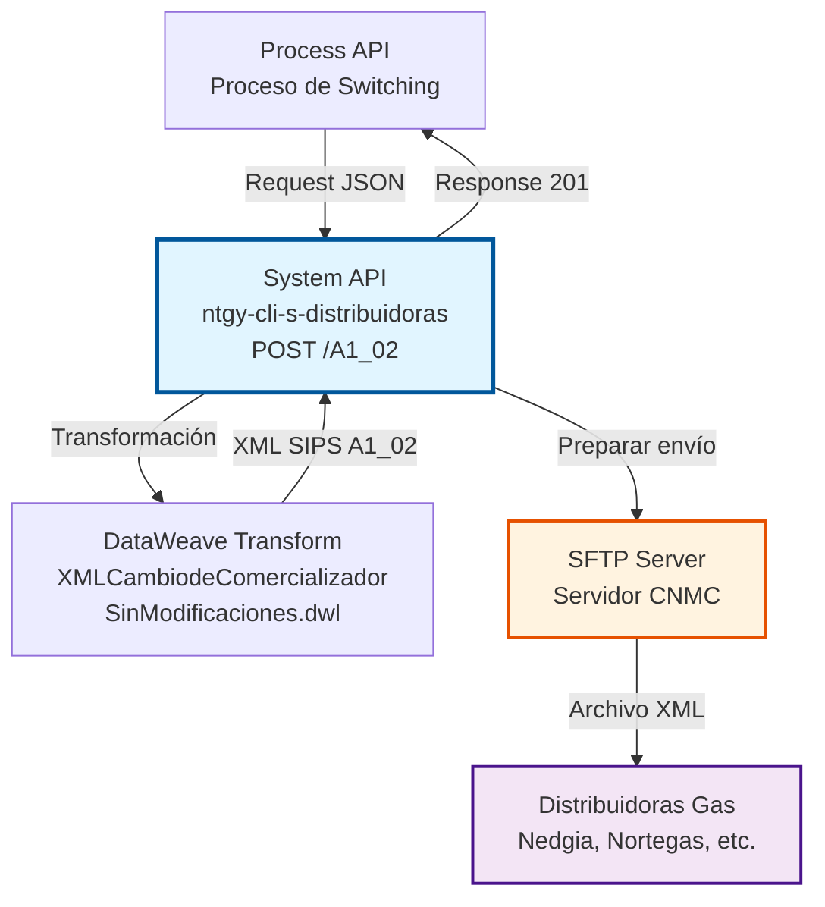
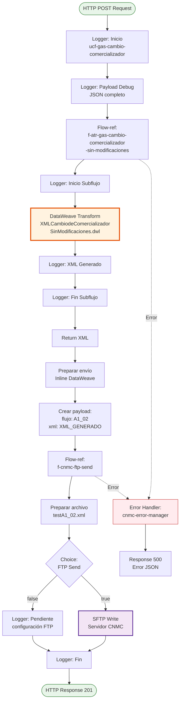
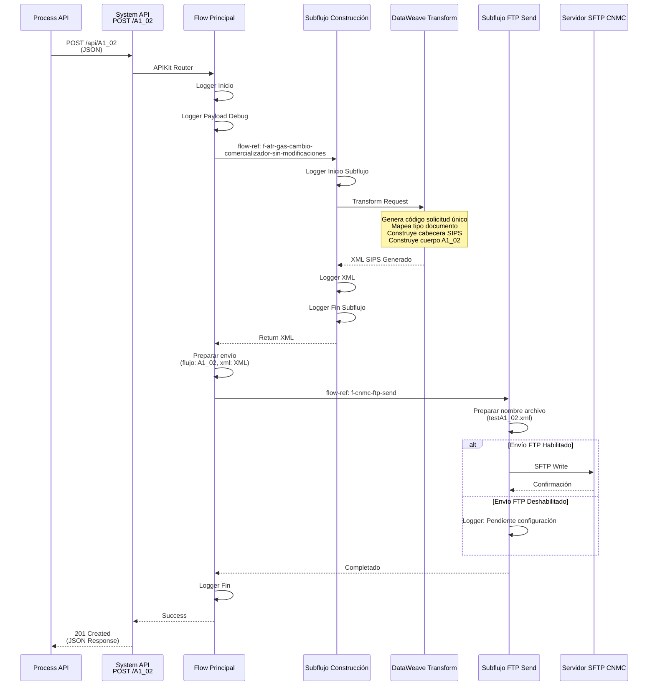

# POST /A1_02

## 📌 Descripción General

### Propósito del Endpoint

Este endpoint genera y envía archivos XML en formato SIPS (Sistema de Intercambio de Información de Puntos de Suministro) para el proceso **A1_02 - Cambio de Comercializador Sin Modificaciones en el Contrato de Acceso** de gas natural.

El endpoint soporta:
- **Generación automática de XML SIPS**: Transforma datos JSON en formato XML según especificación CNMC
- **Validación de datos**: Verifica estructura y campos obligatorios del mensaje A1_02
- **Preparación para envío**: Empaqueta el XML para transmisión a distribuidoras
- **Respuesta inmediata**: Confirma la generación del XML (proceso asíncrono)

### Tipo de API

**Capa:** System API (API-Led Connectivity)

**Función:** Integración directa con el sistema de intercambio de archivos CNMC para procesos ATR (Acceso de Terceros a la Red) de gas natural.

### Patrón de Integración

**Tipo:** Fire-and-Forget Asíncrono con Generación de Archivo

**Descripción:** El endpoint recibe datos del cambio de comercializadora en formato JSON, genera un archivo XML en formato SIPS según especificación CNMC, prepara el archivo para envío vía SFTP al servidor de la distribuidora, y retorna confirmación inmediata. El procesamiento real por parte de la distribuidora ocurre de forma asíncrona.

### Arquitectura API-Led Connectivity



---

## 💼 Propósito del Negocio

### Casos de Uso Principales

1. **Cambio de Comercializadora de Gas**
   - Cliente decide contratar suministro de gas con Naturgy
   - Mantiene el mismo punto de suministro (CUPS)
   - No modifica condiciones técnicas (caudal, presión)
   - Proceso regulado por CNMC con plazos establecidos

2. **Proceso de Switching Automático**
   - Generación automática de solicitud en formato SIPS
   - Envío a distribuidora correspondiente
   - Cumplimiento de normativa CNMC
   - Trazabilidad completa del proceso

3. **Integración con Sistemas Comerciales**
   - Recepción de datos desde sistemas de ventas
   - Validación de información del cliente
   - Generación de documentación regulatoria
   - Confirmación de procesamiento

### Contexto Empresarial

- **Dominio:** Gestión de Contratos de Suministro de Gas
- **Sector:** Energía - Utilities (Gas Natural)
- **División:** Naturgy España - Comercializadora de Gas
- **Proceso de Negocio:** Switching de Comercializadora (Cambio sin Modificaciones)
- **Regulación:** CNMC - Protocolo ATR Gas

### Stakeholders

- **Comercializadora (Naturgy)**: Empresa que solicita el cambio de comercializadora (código 0762)
- **Distribuidoras de Gas**: Propietarias de la red que gestionan el cambio (Nedgia, Nortegas, Gas Extremadura, etc.)
- **CNMC**: Comisión Nacional de los Mercados y la Competencia - Regulador del proceso
- **Cliente Final**: Consumidor de gas natural que cambia de comercializadora
- **Equipos de Ventas**: Generan las solicitudes de cambio desde sistemas comerciales

### Valor de Negocio

- **Automatización del Proceso ATR**: Reduce tiempo de procesamiento de días a horas
- **Cumplimiento Regulatorio**: Garantiza formato correcto según especificación CNMC
- **Reducción de Errores**: Validación automática de datos antes del envío
- **Trazabilidad**: Registro completo de todas las solicitudes generadas
- **Escalabilidad**: Capacidad de procesar múltiples solicitudes simultáneamente

### Consumidores Potenciales

Este endpoint puede ser consumido por:
- Process APIs de gestión de contratos
- Sistemas de ventas y CRM (Salesforce)
- Portales de autoservicio web
- Aplicaciones móviles de agentes comerciales
- Sistemas de integración middleware

---

## 🔧 Especificación Técnica

### URLs por Ambiente

| Ambiente | URL Base | URL Completa |
|----------|----------|--------------|
| **Local** | `http://localhost:8081` | `http://localhost:8081/api/A1_02` |
| **Development** | `https://ntgy-cli-s-distribuidoras-dev.us-e2.cloudhub.io` | `https://ntgy-cli-s-distribuidoras-dev.us-e2.cloudhub.io/api/A1_02` |
| **UAT** | `https://ntgy-cli-s-distribuidoras-uat.us-e2.cloudhub.io` | `https://ntgy-cli-s-distribuidoras-uat.us-e2.cloudhub.io/api/A1_02` |
| **Production** | `https://ntgy-cli-s-distribuidoras-pro.us-e2.cloudhub.io` | `https://ntgy-cli-s-distribuidoras-pro.us-e2.cloudhub.io/api/A1_02` |

### Método HTTP

```
POST /api/A1_02
```

### Parámetros de Entrada

#### Headers HTTP

| Header | Tipo | Requerido | Descripción | Ejemplo |
|--------|------|-----------|-------------|---------|
| `Content-Type` | string | ✅ Sí | Tipo de contenido del request | `application/json` |
| `Accept` | string | ❌ No | Tipo de contenido esperado en response | `application/json` |

#### Body Parameters

El body debe contener un objeto JSON con la siguiente estructura:

| Campo | Tipo | Requerido | Descripción |
|-------|------|-----------|-------------|
| `comercializadora` | string | ✅ Sí | Código de la comercializadora solicitante |
| `cliente` | object | ✅ Sí | Información del cliente titular |
| `cliente.tipoDocumento` | string | ✅ Sí | Tipo de documento (NIF, CIF, Pasaporte, NIE) |
| `cliente.documento` | string | ✅ Sí | Número de documento de identificación |
| `suministroGas` | object | ✅ Sí | Información del punto de suministro de gas |
| `suministroGas.cups` | string | ✅ Sí | CUPS del punto de suministro (20-22 caracteres) |
| `suministroGas.consumoAnual` | number | ✅ Sí | Consumo anual estimado en kWh |
| `pedido` | object | ✅ Sí | Información del pedido |
| `pedido.productos` | array | ✅ Sí | Lista de productos contratados |
| `pedido.productos[].fechaAccion` | string | ✅ Sí | Fecha de efecto solicitada (formato: YYYY-MM-DD) |
| `pedido.productos[].fechaDirectriz` | string | ❌ No | Fecha directriz alternativa |
| `PedidoNum` | integer | ✅ Sí | Índice del producto activo en el array de productos |
| `codDistribuidora` | string | ❌ No | Código de la distribuidora destino |

**Nota sobre tipos de documento:**
- `NIF`: Número de Identificación Fiscal (código CNMC: "01")
- `CIF`: Código de Identificación Fiscal (código CNMC: "02")
- `Pasaporte`: Pasaporte (código CNMC: "03")
- `NIE`: Número de Identidad de Extranjero (código CNMC: "04")

### Respuestas

#### Respuesta Exitosa (201 Created)

Indica que el XML se ha generado correctamente y está listo para envío.

```json
{
  "result": {
    "codResult": "0000",
    "msgResult": "No hay error"
  },
  "creationResult": {
    "message": "Contrato Procesado correctamente"
  }
}
```

#### Respuesta de Error Técnico (500 Internal Server Error)

```json
{
  "codResult": "-1",
  "msgResult": "Error",
  "reason": "Descripción del error específico"
}
```

**Códigos de Error Comunes:**
- `-1`: Error general de procesamiento
- Error de transformación DataWeave
- Error de validación de campos obligatorios
- Error de configuración SFTP

### Autenticación y Autorización

- **Tipo:** Client ID & Client Secret (Anypoint Platform)
- **Scope:** Acceso a operaciones de generación de archivos ATR
- **Permisos Requeridos:**
  - Acceso al System API de distribuidoras
  - Permisos de escritura en servidor SFTP CNMC (configuración de backend)

### Timeouts

| Tipo | Valor | Descripción |
|------|-------|-------------|
| **Request Timeout** | 30 segundos | Tiempo máximo de espera para la respuesta |
| **Connection Timeout** | 10 segundos | Tiempo máximo para establecer conexión |
| **SFTP Timeout** | 60 segundos | Tiempo máximo para operaciones SFTP (configurado en backend) |

---

## 🏗️ Implementación Técnica

### Arquitectura del Flow



### Flujo de Transformación de Datos

```mermaid
flowchart LR
    JSON[Request JSON<br/>Datos del Cliente] --> Validate[Validación<br/>Campos Obligatorios]
    Validate --> Extract[Extracción<br/>Producto Activo]
    Extract --> Generate[Generación<br/>Código Solicitud]
    Generate --> MapDoc[Mapeo Tipo<br/>Documento]
    MapDoc --> BuildHeader[Construcción<br/>Cabecera SIPS]
    BuildHeader --> BuildBody[Construcción<br/>Cuerpo A1_02]
    BuildBody --> XML[XML SIPS<br/>Formato CNMC]
    
    style JSON fill:#e3f2fd,stroke:#1565c0
    style XML fill:#f3e5f5,stroke:#4a148c
    style Generate fill:#fff3e0,stroke:#e65100
```



### Diagrama de Secuencia Completo



### Detalles de la Transformación DataWeave

**Archivo:** `modules/cnmc/xml/gas/XMLCambiodeComercializadorSinModificaciones.dwl`

**Ubicación:** `src/main/resources/modules/cnmc/xml/gas/XMLCambiodeComercializadorSinModificaciones.dwl`

#### Generación de Código de Solicitud Único

```dataweave
var codSolicitud = ((now() as Number) as String ++ now().milliseconds)[0 to 11]
```

**Descripción:** Genera un código único de 12 dígitos combinando timestamp actual y milisegundos.

**Ejemplo:** `163221281716`

#### Mapeo de Tipo de Documento

```dataweave
documenttype: helpers::tipoDocumentoFiscalGas(payload.cliente.tipoDocumento default "")
```

**Mapeo:**
- `NIF` → `"01"`
- `CIF` → `"02"`
- `Pasaporte` → `"03"`
- `NIE` → `"04"`

#### Construcción de Cabecera SIPS

```dataweave
heading: XMLComun::Cabecera(codigoEmpresaEmisora, codigoDistribuidora, "02", "A1")
```

**Parámetros:**
- `codigoEmpresaEmisora`: `"0762"` (Naturgy Gas - configurado en properties)
- `codigoDistribuidora`: `"0000"` (hardcoded actualmente)
- `processcode`: `"02"` (Cambio de comercializador)
- `messagetype`: `"A1"` (ATR Gas)

#### Campos del Mensaje A1_02

| Campo XML | Origen | Descripción |
|-----------|--------|-------------|
| `comreferencenum` | Generado | Código único de solicitud (12 dígitos) |
| `reqdate` | `now()` | Fecha de solicitud (formato: YYYY-MM-DD) |
| `reqhour` | `now()` | Hora de solicitud (formato: HH:mm:ss) |
| `nationality` | Fijo | Nacionalidad (siempre "ES") |
| `documenttype` | `cliente.tipoDocumento` | Tipo de documento (mapeado a código CNMC) |
| `documentnum` | `cliente.documento` | Número de documento |
| `cups` | `suministroGas.cups` | CUPS del punto de suministro |
| `reqestimatedqa` | `suministroGas.consumoAnual` | Caudal estimado anual |
| `modeffectdate` | Fijo | Modelo de fecha efecto ("04") |
| `reqtransferdate` | `productos[].fechaAccion` | Fecha de efecto solicitada |
| `disconnectedserviceaccepted` | Fijo | Acepta servicio desconectado ("S") |

### Configuración SFTP

**Archivo:** `cnmc/f-cnmc-ftp-send.xml`

**Configuración:**
```xml
<sftp:config name="SFTP_CNMC_Config">
    <sftp:connection 
        host="${backends.FTPCNMC.host}" 
        port="${backends.FTPCNMC.port}" 
        username="${backends.FTPCNMC.username}" 
        password="${backends.FTPCNMC.password}" 
        workingDir="${backends.FTPCNMC.basePath}"/>
</sftp:config>
```

**Propiedades (s-distribuidoras-global-config.yaml):**
- `backends.FTPCNMC.host`: Host del servidor SFTP CNMC
- `backends.FTPCNMC.port`: Puerto SFTP (típicamente 22)
- `backends.FTPCNMC.username`: Usuario de autenticación
- `backends.FTPCNMC.password`: Contraseña (secure property)
- `backends.FTPCNMC.basePath`: Directorio base en servidor

**⚠️ Estado Actual del Envío FTP:**

El envío SFTP está actualmente **DESHABILITADO** en el código:

```xml
<when expression="#[false]">
    <sftp:write path="#[payload.fileName]" config-ref="SFTP_CNMC_Config">
        <sftp:content>#[payload.payload]</sftp:content>
    </sftp:write>
</when>
<otherwise>
    <logger message="Pendiente de configuración de FTP de destino"/>
</otherwise>
```

**Implicaciones:**
- El XML se genera correctamente
- El archivo NO se envía realmente al servidor SFTP
- Se registra un log indicando que está pendiente de configuración
- Para habilitar el envío, cambiar `expression="#[false]"` a `expression="#[true]"`

### Error Handling

**Error Handler:** `cnmc-error-manager-error-handler`

**Archivo:** `cnmc/cnmc-error-manager.xml`

**Estrategia:**

1. **On Error Continue (EXPRESSION):**
   - Captura errores de expresiones DataWeave
   - Genera respuesta JSON con código `-1`
   - Extrae primera línea del error
   - Retorna HTTP 500

2. **On Error Propagate (ANY):**
   - Captura cualquier otro tipo de error
   - Genera respuesta JSON con descripción completa
   - Propaga el error al nivel superior
   - Retorna HTTP 500

**Formato de Error:**
```json
{
  "codResult": "-1",
  "msgResult": "Error",
  "reason": "Descripción del error"
}
```

### Códigos de Comercializadora

**Configuración:** `s-distribuidoras-global-config.yaml`

```yaml
origenes:
  electrico: "1646"
  gas: "0762"  # Usado en este endpoint
```

**Código Naturgy Gas:** `0762`

---

## 💻 Ejemplos de Uso

### Ejemplo 1: Request Completo

```json
{
  "usuarioGrabador": "AGENTE001",
  "codigoAgente": "AG12345",
  "comercializadora": "0762",
  "canalDarwin": "WEB",
  "cliente": {
    "nombre": "Juan",
    "apellido1": "García",
    "apellido2": "López",
    "email": "juan.garcia@example.com",
    "telefono": "612345678",
    "tipoDocumento": "NIF",
    "documento": "12345678A",
    "idioma": "ES",
    "fechaNacimiento": "1980-05-15",
    "direccionSuministro": {
      "tipoVia": "CL",
      "via": "Gran Vía",
      "numero": "123",
      "codigoPostal": "28013",
      "provincia": "28",
      "municipio": "28079",
      "localidad": "28079000100"
    }
  },
  "suministroGas": {
    "cups": "ES0227070007401453WB",
    "tarifaAtr": "RL.1",
    "consumoAnual": 8500,
    "cambioTitular": false,
    "cambioTarifaAtr": false
  },
  "pedido": {
    "idPedido": "PED-2026-001234",
    "fechaFirma": "2026-09-07",
    "productos": [
      {
        "id": "PROD-GAS-001",
        "nombre": "Tarifa Gas Estable",
        "tarifaAtr": "RL.1",
        "tipoContratacion": "CAMBIO_COMERCIALIZADOR",
        "fechaAccion": "2026-10-01",
        "fechaDirectriz": "2026-10-01"
      }
    ]
  },
  "PedidoNum": 0,
  "codDistribuidora": "0207"
}
```

### Ejemplo 2: Response Exitoso (201 Created)

```json
{
  "result": {
    "codResult": "0000",
    "msgResult": "No hay error"
  },
  "creationResult": {
    "message": "Contrato Procesado correctamente"
  }
}
```

### Ejemplo 3: Comando curl

```bash
curl -X POST "https://ntgy-cli-s-distribuidoras-dev.us-e2.cloudhub.io/api/A1_02" \
  -H "Content-Type: application/json" \
  -H "client_id: YOUR_CLIENT_ID" \
  -H "client_secret: YOUR_CLIENT_SECRET" \
  -d '{
    "comercializadora": "0762",
    "cliente": {
      "tipoDocumento": "NIF",
      "documento": "12345678A"
    },
    "suministroGas": {
      "cups": "ES0227070007401453WB",
      "consumoAnual": 8500
    },
    "pedido": {
      "productos": [
        {
          "fechaAccion": "2026-10-01"
        }
      ]
    },
    "PedidoNum": 0
  }'
```

### Ejemplo 4: XML SIPS Generado

```xml
<?xml version="1.0" encoding="UTF-8"?>
<sctdapplication xmlns="http://localhost/sctd/A102">
  <heading>
    <dispatchingcode>GML</dispatchingcode>
    <dispatchingcompany>0762</dispatchingcompany>
    <destinycompany>0000</destinycompany>
    <communicationsdate>2026-09-07</communicationsdate>
    <communicationshour>13:15:30</communicationshour>
    <processcode>02</processcode>
    <messagetype>A1</messagetype>
  </heading>
  <a102>
    <comreferencenum>172578933045</comreferencenum>
    <reqdate>2026-09-07</reqdate>
    <reqhour>13:15:30</reqhour>
    <nationality>ES</nationality>
    <documenttype>01</documenttype>
    <documentnum>12345678A</documentnum>
    <cups>ES0227070007401453WB</cups>
    <reqestimatedqa>8500</reqestimatedqa>
    <modeffectdate>04</modeffectdate>
    <reqtransferdate>2026-10-01</reqtransferdate>
    <disconnectedserviceaccepted>S</disconnectedserviceaccepted>
  </a102>
</sctdapplication>
```

### Ejemplo 5: Response de Error (500)

```json
{
  "codResult": "-1",
  "msgResult": "Error",
  "reason": "Required field 'cups' is missing in suministroGas"
}
```

### Ejemplo 6: Error de Validación de CUPS

```json
{
  "codResult": "-1",
  "msgResult": "Error",
  "reason": "Invalid CUPS format: must be 20-22 characters"
}
```

### Ejemplo 7: Request con Múltiples Productos

```json
{
  "comercializadora": "0762",
  "cliente": {
    "tipoDocumento": "CIF",
    "documento": "B12345678"
  },
  "suministroGas": {
    "cups": "ES0227070007401453WB",
    "consumoAnual": 15000
  },
  "pedido": {
    "productos": [
      {
        "id": "PROD-001",
        "fechaAccion": "2026-10-01"
      },
      {
        "id": "PROD-002",
        "fechaAccion": "2026-11-01"
      }
    ]
  },
  "PedidoNum": 1
}
```

**Nota:** El campo `PedidoNum: 1` indica que se procesará el segundo producto del array (índice 1).

---

## 📊 Notas Técnicas Adicionales

### Consideraciones Importantes

1. **⚠️ Envío SFTP Deshabilitado:**
   - Actualmente el envío al servidor SFTP está deshabilitado en el código
   - El XML se genera correctamente pero NO se transmite
   - Para habilitar, modificar la condición en `f-cnmc-ftp-send.xml`

2. **🔒 Código Distribuidora Hardcoded:**
   - El código de distribuidora está fijo en `"0000"` en el DataWeave
   - Debería ser dinámico según el campo `codDistribuidora` del payload
   - Línea 14 de `XMLCambiodeComercializadorSinModificaciones.dwl`

3. **📋 Campos Opcionales:**
   - Algunos campos del mensaje A1_02 están comentados (TODO)
   - `reqqd`: Caudal Diario Qd (no implementado)
   - `extrainfo`: Observaciones (no implementado)
   - `titulartype`: Solo se incluye para ciertos tipos de documento

4. **🔄 Proceso Asíncrono:**
   - El endpoint retorna 201 Created inmediatamente
   - El procesamiento real por la distribuidora es asíncrono
   - La respuesta de la distribuidora llega por otro canal (fuera del alcance)

5. **📅 Modelo de Fecha Efecto:**
   - Actualmente usa modelo "04" (fecha solicitada)
   - Campo `reqtransferdate` es obligatorio con este modelo
   - Usa `fechaAccion` del producto, o `fechaDirectriz` como fallback

### Validaciones Implementadas

- ✅ Validación de campos obligatorios en RAML
- ✅ Validación de formato CUPS (20-22 caracteres)
- ✅ Validación de tipo de documento (enum)
- ✅ Validación de estructura JSON
- ✅ Generación de código de solicitud único

### Mejoras Futuras Sugeridas

1. **Habilitar Envío SFTP:**
   - Configurar correctamente el servidor SFTP CNMC
   - Cambiar condición de envío a `true`
   - Implementar retry policy para fallos de conexión

2. **Código Distribuidora Dinámico:**
   - Usar `payload.codDistribuidora` en lugar de valor hardcoded
   - Validar