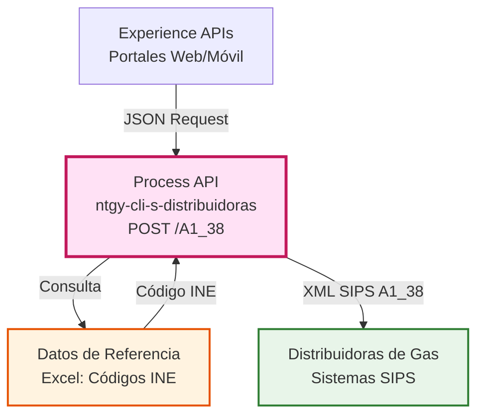
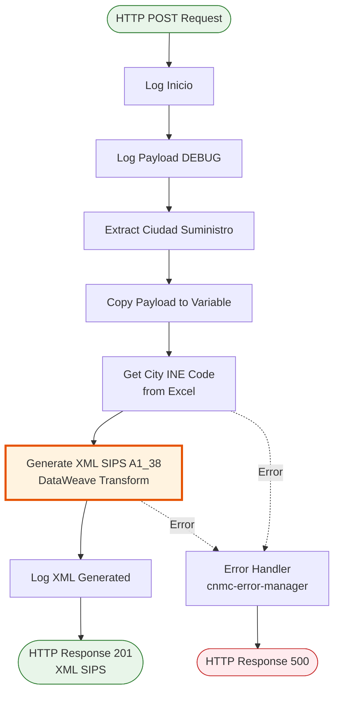
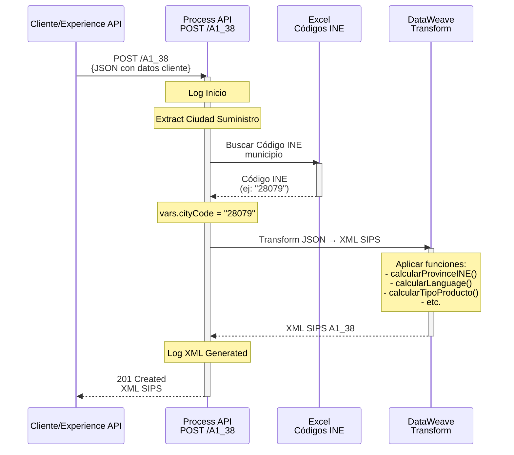
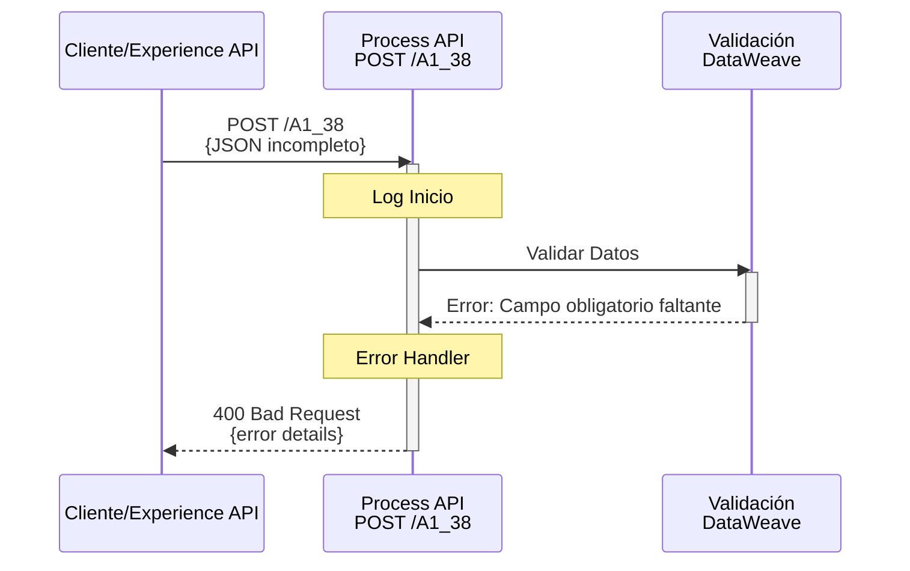
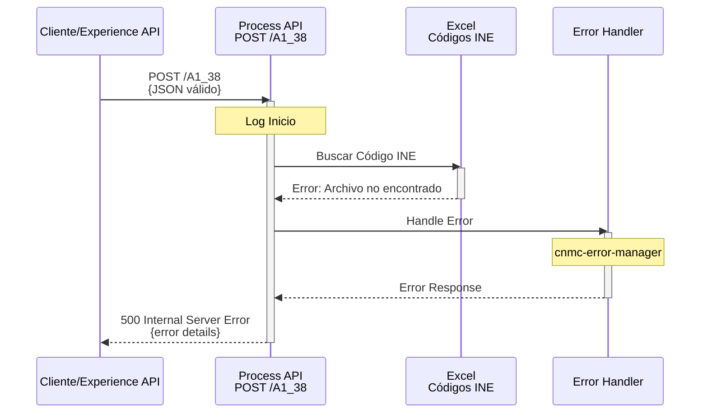

# POST /A1_38

## 📌 Descripción General

### Propósito del Endpoint

Este endpoint genera un XML en formato SIPS (Sistema de Intercambio de Información de Puntos de Suministro) para el proceso CNMC **A1_38 - Alta de Punto de Suministro con Contratación de Acceso** en el sector del gas natural. El XML generado se utiliza para solicitar el alta de un nuevo punto de suministro de gas con la contratación simultánea del acceso a la red de distribución.

### Tipo de API

**Capa:** Process API (API-Led Connectivity)

**Función:** Generación de XML CNMC para procesos ATR (Acceso de Terceros a la Red)

### Patrón de Integración

**Tipo:** Transformación y Enriquecimiento de Datos

**Descripción:** Este endpoint NO accede directamente a backends (SAP/SQL/REST). Su función es orquestar la transformación de datos JSON de entrada a formato XML SIPS, enriqueciendo la información con datos de referencia (códigos INE de municipios) obtenidos desde un archivo Excel local.

### Arquitectura API-Led Connectivity



---

## 💼 Propósito del Negocio

### Casos de Uso Principales

1. **Alta de Nuevo Suministro de Gas**
   - Cliente solicita nuevo punto de suministro de gas natural
   - Se requiere contratación de acceso a la red de distribución
   - Beneficio: Automatización del proceso regulatorio CNMC

2. **Cambio de Comercializadora con Nueva Instalación**
   - Cliente cambia de comercializadora y requiere nueva instalación
   - Se debe dar de alta el punto de suministro en el sistema
   - Beneficio: Cumplimiento de plazos regulatorios (< 24 horas)

3. **Gestión de Documentación Regulatoria**
   - Generación automática de XML según especificación CNMC
   - Validación de datos según normativa del sector energético
   - Beneficio: Reducción de errores en comunicaciones con distribuidoras

### Proceso de Negocio ATR


**Pasos del Proceso:**

1. **Recepción de Solicitud**: Cliente proporciona datos personales, dirección de suministro y características del servicio
2. **Enriquecimiento de Datos**: Sistema obtiene códigos INE de municipios desde datos de referencia
3. **Generación XML SIPS**: Transformación de JSON a XML según especificación CNMC A1_38
4. **Envío a Distribuidora**: XML se envía a la distribuidora correspondiente (JMS/SFTP)

### Contexto Empresarial

- **Dominio:** Gestión de Suministros de Gas Natural
- **Sector:** Energía - Utilities
- **División:** Naturgy España - Clientes
- **Proceso de Negocio:** Procesos ATR (Acceso de Terceros a la Red)
- **Regulador:** CNMC (Comisión Nacional de los Mercados y la Competencia)

### Stakeholders

- **Comercializadoras de Gas**: Necesitan enviar solicitudes de alta a distribuidoras
- **Distribuidoras de Gas**: Reciben y procesan solicitudes en formato SIPS
- **Clientes Finales**: Beneficiarios del nuevo suministro de gas
- **Equipo de Atención al Cliente**: Gestiona solicitudes y seguimiento

### Valor de Negocio

- **Automatización**: Generación automática de XML SIPS sin intervención manual
- **Cumplimiento Regulatorio**: Garantiza formato correcto según normativa CNMC
- **Reducción de Errores**: Validación de datos y transformación estandarizada
- **Trazabilidad**: Registro completo de solicitudes generadas
- **Eficiencia Operativa**: Reducción de tiempo de procesamiento de 2 horas a < 1 segundo

### Consumidores Potenciales

Este endpoint puede ser consumido por:
- Portales web de autoservicio para clientes
- Aplicaciones móviles de gestión de suministros
- Sistemas de agentes de call center
- Plataformas de gestión comercial
- Integraciones con CRM (Salesforce)

---

## 🔧 Especificación Técnica

### URLs por Ambiente

| Ambiente | URL Base | URL Completa |
|----------|----------|--------------|
| **Local** | `http://localhost:8081` | `http://localhost:8081/api/A1_38` |
| **Development** | `https://ntgy-cli-s-distribuidoras-dev.us-e2.cloudhub.io` | `https://ntgy-cli-s-distribuidoras-dev.us-e2.cloudhub.io/api/A1_38` |
| **UAT** | `https://ntgy-cli-s-distribuidoras-uat.us-e2.cloudhub.io` | `https://ntgy-cli-s-distribuidoras-uat.us-e2.cloudhub.io/api/A1_38` |
| **UAT01** | `https://ntgy-cli-s-distribuidoras-uat01.us-e2.cloudhub.io` | `https://ntgy-cli-s-distribuidoras-uat01.us-e2.cloudhub.io/api/A1_38` |
| **Production** | `https://ntgy-cli-s-distribuidoras-pro.us-e2.cloudhub.io` | `https://ntgy-cli-s-distribuidoras-pro.us-e2.cloudhub.io/api/A1_38` |

### Método HTTP

```
POST /api/A1_38
```

### Headers Requeridos

| Header | Valor | Descripción |
|--------|-------|-------------|
| `Content-Type` | `application/json` | Formato del body de la petición |
| `client_id` | `{CLIENT_ID}` | Client ID de Anypoint Platform |
| `client_secret` | `{CLIENT_SECRET}` | Client Secret de Anypoint Platform |

### Parámetros de Entrada

#### Request Body (JSON)

```json
{
  "PedidoNum": "string",
  "cliente": {
    "pyme": boolean,
    "tipoDocumento": "string",
    "documento": "string",
    "nombre": "string",
    "apellido1": "string",
    "apellido2": "string",
    "telefono": "string",
    "email": "string",
    "idioma": "string",
    "direccionSuministro": {
      "provincia": "string",
      "municipio": "string",
      "codigoPostal": "string",
      "tipoVia": "string",
      "via": "string",
      "numero": "string",
      "portal": "string",
      "piso": "string",
      "puerta": "string"
    },
    "direccionFacturacion": {
      "provincia": "string",
      "codigoPostal": "string",
      "tipoVia": "string",
      "via": "string",
      "numero": "string",
      "portal": "string",
      "piso": "string",
      "puerta": "string"
    }
  },
  "suministroGas": {
    "cups": "string",
    "consumoAnual": "string"
  },
  "pedido": {
    "productos": [
      {
        "duracion": "string",
        "tarifaAtr": "string"
      }
    ]
  },
  "documentos": [
    {
      "tipo": "string",
      "nombre": "string",
      "envioDistribuidora": boolean
    }
  ]
}
```

#### Campos Obligatorios

| Campo | Tipo | Descripción | Validación |
|-------|------|-------------|------------|
| `PedidoNum` | String | Índice del producto en el array de productos | Numérico |
| `cliente.pyme` | Boolean | Indica si es PYME (persona jurídica) o no (persona física) | true/false |
| `cliente.tipoDocumento` | String | Tipo de documento de identidad | NIF, CIF, Pasaporte, NIE, NIVA, Otros |
| `cliente.documento` | String | Número del documento de identidad | Mínimo 8 caracteres |
| `cliente.nombre` | String | Nombre del cliente | - |
| `cliente.apellido1` | String | Primer apellido | - |
| `cliente.apellido2` | String | Segundo apellido | - |
| `cliente.telefono` | String | Teléfono de contacto | - |
| `cliente.email` | String | Email de contacto | Formato email válido |
| `cliente.idioma` | String | Idioma preferido | Castellano, Català, Galego, Euskera |
| `cliente.direccionSuministro.provincia` | String | Provincia del suministro | Nombre completo de provincia española |
| `cliente.direccionSuministro.municipio` | String | Municipio del suministro | Nombre del municipio |
| `cliente.direccionSuministro.codigoPostal` | String | Código postal | 5 dígitos |
| `cliente.direccionSuministro.tipoVia` | String | Tipo de vía | Calle, Avenida, Plaza, etc. |
| `cliente.direccionSuministro.via` | String | Nombre de la vía | - |
| `cliente.direccionSuministro.numero` | String | Número de la vía | - |
| `cliente.direccionFacturacion.*` | Object | Dirección de facturación | Mismos campos que direccionSuministro |
| `suministroGas.cups` | String | CUPS del punto de suministro | 20-22 caracteres, formato ES... |
| `suministroGas.consumoAnual` | String | Consumo anual estimado en kWh/año | Numérico |
| `pedido.productos[].duracion` | String | Duración del contrato | Vacio, 6 meses, 12 meses, 24 meses |
| `pedido.productos[].tarifaAtr` | String | Tarifa ATR del producto | 1.1, 1.2, 1.3, 2.1-2.6, 3.1-3.5, 4.1-4.7 |

#### Campos Opcionales

| Campo | Tipo | Descripción |
|-------|------|-------------|
| `cliente.direccionSuministro.portal` | String | Portal del edificio |
| `cliente.direccionSuministro.piso` | String | Piso |
| `cliente.direccionSuministro.puerta` | String | Puerta |
| `cliente.direccionFacturacion.portal` | String | Portal del edificio |
| `cliente.direccionFacturacion.piso` | String | Piso |
| `cliente.direccionFacturacion.puerta` | String | Puerta |
| `documentos` | Array | Lista de documentos adjuntos |

### Respuestas

#### 201 Created - Éxito

**Descripción:** XML SIPS generado correctamente

**Body (XML):**

```xml
<?xml version="1.0" encoding="UTF-8"?>
<sctdapplication xmlns="http://localhost/sctd/A138">
    <heading>
        <dispatchingcode>GML</dispatchingcode>
        <dispatchingcompany>{codigo_empresa}</dispatchingcompany>
        <destinycompany>0000</destinycompany>
        <communicationsdate>2026-09-07</communicationsdate>
        <communicationshour>01:30:00</communicationshour>
        <processcode>38</processcode>
        <messagetype>A1</messagetype>
    </heading>
    <a138>
        <comreferencenum>{codigo_solicitud}</comreferencenum>
        <reqdate>2026-09-07</reqdate>
        <reqhour>01:30:00</reqhour>
        <!-- ... resto de campos del XML SIPS ... -->
    </a138>
</sctdapplication>
```

#### 400 Bad Request - Error de Validación

**Descripción:** Datos de entrada inválidos o incompletos

**Body (JSON):**

```json
{
  "message": "Bad request",
  "detail": "Campo 'cliente.documento' es obligatorio"
}
```

#### 500 Internal Server Error - Error del Sistema

**Descripción:** Error interno durante la generación del XML

**Body (JSON):**

```json
{
  "error": "SYSTEM_ERROR",
  "message": "Error interno del sistema",
  "correlationId": "550e8400-e29b-41d4-a716-446655440000"
}
```

### Autenticación

- **Tipo:** Client ID & Client Secret (Anypoint Platform)
- **Ubicación:** Headers HTTP
- **Gestión:** Anypoint API Manager

### Timeouts

| Tipo | Valor |
|------|-------|
| **Request Timeout** | 30 segundos |
| **Connection Timeout** | 10 segundos |
| **Generación XML** | < 1 segundo |

---

## 🏗️ Implementación Técnica

### Arquitectura del Flow



### Componentes del Flow

#### 1. Logger Inicio
**Propósito:** Registrar inicio del procesamiento

**Código:**
```xml
<logger level="INFO" 
        message='#[common::logger::log("Inicio")]' 
        category="com.naturgy.mule.f-atr-gas-alta-punto-suministro-contratacion-acceso"/>
```

#### 2. Logger Payload (DEBUG)
**Propósito:** Registrar payload de entrada para troubleshooting

**Código:**
```xml
<logger level="DEBUG" 
        message="#[common::logger::json(payload)]" 
        category="com.naturgy.mule.f-atr-gas-alta-punto-suministro-contratacion-acceso"/>
```

#### 3. Extracción de Variables
**Propósito:** Extraer ciudad de suministro y guardar copia del payload

**Transformación DataWeave:**
```dataweave
%dw 2.0
output application/java
---
{
    ciudadSuministro: payload.cliente.direccionSuministro.municipio,
    copyPayload: payload
}
```

**Variables Creadas:**
- `vars.ciudadSuministro`: Nombre del municipio para búsqueda de código INE
- `vars.copyPayload`: Copia completa del payload original

#### 4. Obtención de Código INE
**Subflow:** `cnmc-get-excel-city-INE-codes`

**Propósito:** Buscar código INE del municipio en archivo Excel

**Archivo de Referencia:** `src/main/resources/ine/city_INE_codes.xlsx`

**Proceso:**
1. Lee archivo Excel con códigos INE de municipios españoles
2. Busca el municipio por nombre (`vars.ciudadSuministro`)
3. Extrae el código INE correspondiente
4. Almacena en variable `vars.cityCode`

**Resultado:** Variable `vars.cityCode` con código INE del municipio (ej: "28079" para Madrid)

#### 5. Generación XML SIPS A1_38
**Archivo DataWeave:** `modules/cnmc/xml/gas/XMLAltaPuntoSuministroContratacionAcceso.dwl`

**Imports:**
```dataweave
import * from modules::cnmc::xml::gas::functions
import * from dw::core::Arrays
import modules::cnmc::helpers
import modules::cnmc::xml::gas::XMLComun
import * from common::util
```

**Variables Globales:**
```dataweave
var codigoEmpresaEmisora = p("origenes.gas")  // Property: código empresa
var codigoDistribuidora = "0000"              // Código genérico
var productoActivo = vars.copyPayload.pedido.productos[vars.copyPayload.PedidoNum as Number]
var codSolicitud = ((now() as Number) as String ++ now().milliseconds)[0 to 11]
var tipoPersona = if(vars.copyPayload.cliente.pyme == false) "F" else "J"
```

**Estructura XML Generada:**
```xml
<sctdapplication xmlns="http://localhost/sctd/A138">
    <heading>
        <!-- Cabecera CNMC -->
    </heading>
    <a138>
        <!-- Datos de la solicitud A1_38 -->
    </a138>
</sctdapplication>
```

### Funciones DataWeave Utilizadas

#### Módulo: `modules::cnmc::xml::gas::functions`

| Función | Propósito | Ejemplo |
|---------|-----------|---------|
| `calcularTipoPersona()` | Determina si es persona física (F) o jurídica (J) | `pyme=false → "F"` |
| `calcularTipoDocumento()` | Mapea tipo documento a código CNMC | `"NIF" → "01"` |
| `calcularLanguage()` | Convierte idioma a código CNMC | `"Castellano" → "01"` |
| `calcularProvinceINE()` | Obtiene código INE de provincia | `"MADRID" → "28"` |
| `calcularTipoProducto()` | Determina tipo de producto gas | `"12 meses" → "02"` |
| `calcularTipoPeajeProducto()` | Determina tipo de peaje | `"3.1" → "31"` |

#### Módulo: `modules::cnmc::helpers`

| Función | Propósito | Ejemplo |
|---------|-----------|---------|
| `tipoDocumentoFiscalGas()` | Convierte tipo documento a formato CNMC Gas | `"NIF" → "01"` |

#### Módulo: `modules::cnmc::xml::gas::XMLComun`

| Función | Propósito |
|---------|-----------|
| `Cabecera()` | Genera cabecera estándar CNMC con códigos de empresa, distribuidora, proceso y tipo de mensaje |
| `RegistrosDocumento()` | Genera lista de documentos adjuntos en formato SIPS |

#### Módulo: `common::util`

| Función | Propósito |
|---------|-----------|
| `emptyOrNull()` | Valida si un campo está vacío o nulo para campos opcionales |

### Mapeo de Campos JSON → XML SIPS

#### Datos del Cliente

| Campo JSON | Campo XML SIPS | Transformación |
|------------|----------------|----------------|
| `cliente.pyme` | `titulartype` | `false → "F"`, `true → "J"` (solo si NIVA u Otros) |
| `cliente.tipoDocumento` | `documenttype` | `helpers::tipoDocumentoFiscalGas()` |
| `cliente.documento` | `documentnum` | Directo |
| `cliente.nombre` | `firstname` | Directo |
| `cliente.apellido1` | `familyname1` | Directo |
| `cliente.apellido2` | `familyname2` | Directo |
| `cliente.telefono` | `telephone1` | Directo |
| `cliente.email` | `email` | Directo |
| `cliente.idioma` | `language` | `calcularLanguage()` |

#### Dirección de Suministro

| Campo JSON | Campo XML SIPS | Transformación |
|------------|----------------|----------------|
| `direccionSuministro.provincia` | `province` | `calcularProvinceINE()` |
| `direccionSuministro.municipio` | `city` | `vars.cityCode` (desde Excel) |
| `direccionSuministro.codigoPostal` | `zipcode` | Directo (opcional) |
| `direccionSuministro.tipoVia` | `streettype` | Directo (opcional) |
| `direccionSuministro.via` | `street` | Directo (opcional) |
| `direccionSuministro.numero` | `streetnumber` | Directo (opcional) |
| `direccionSuministro.portal` | `portal` | Directo (opcional) |
| `direccionSuministro.piso` | `floor` | Directo (opcional) |
| `direccionSuministro.puerta` | `door` | Directo (opcional) |

#### Dirección del Titular (Facturación)

| Campo JSON | Campo XML SIPS | Transformación |
|------------|----------------|----------------|
| `direccionFacturacion.provincia` | `provinceowner` | `calcularProvinceINE()` |
| `direccionFacturacion.municipio` | `cityowner` | `vars.cityCode` (mismo que suministro) |
| `direccionFacturacion.codigoPostal` | `zipcodeowner` | Directo |
| `direccionFacturacion.tipoVia` | `streettypeowner` | Directo |
| `direccionFacturacion.via` | `streetowner` | Directo |
| `direccionFacturacion.numero` | `streetnumberowner` | Directo |
| `direccionFacturacion.portal` | `portalowner` | Directo (opcional) |
| `direccionFacturacion.piso` | `floorowner` | Directo (opcional) |
| `direccionFacturacion.puerta` | `doorowner` | Directo (opcional) |

#### Datos del Suministro

| Campo JSON | Campo XML SIPS | Transformación |
|------------|----------------|----------------|
| `suministroGas.cups` | `cups` | Directo |
| `suministroGas.consumoAnual` | `reqestimatedqa` | Directo (kWh/año) |
| - | `gasusetype` | Fijo: "01" |
| - | `counterproperty` | Fijo: "01" |
| - | `aptransind` | Fijo: "N" |
| - | `modeffectdate` | Fijo: "04" |

#### Productos

| Campo JSON | Campo XML SIPS | Transformación |
|------------|----------------|----------------|
| `productos[].duracion` | `producttype` | `calcularTipoProducto()` |
| `productos[].tarifaAtr` | `producttolltype` | `calcularTipoPeajeProducto()` |
| - | `productqd` | Fijo: "999999999.9999999" |
| `suministroGas.consumoAnual` | `productqa` | Directo |

### Diagramas de Secuencia

#### 1. Flujo Normal de Éxito



#### 2. Flujo con Error de Validación



#### 3. Flujo con Error de Sistema



### Manejo de Errores

#### Error Handler: `cnmc-error-manager-error-handler`

**Ubicación:** `src/main/mule/cnmc/cnmc-error-manager-error-handler.xml`

**Tipos de Errores Manejados:**

1. **Errores de Validación de Datos**
   - Campos obligatorios faltantes
   - Formatos inválidos (email, CUPS, etc.)
   - Valores fuera de rango

2. **Errores de Lectura de Archivo Excel**
   - Archivo de códigos INE no encontrado
   - Municipio no encontrado en el archivo
   - Formato de archivo incorrecto

3. **Errores de Transformación DataWeave**
   - Tipo de documento no soportado
   - Tarifa ATR no válida
   - Provincia no reconocida

4. **Errores del Sistema**
   - OutOfMemoryError
   - Timeout en procesamiento
   - Errores de configuración

**Estrategia de Respuesta:**
- Errores de validación → 400 Bad Request
- Errores de sistema → 500 Internal Server Error
- Logs detallados para troubleshooting
- Correlation ID para trazabilidad

### Patrones de Diseño

#### 1. Patrón de Transformación
**Descripción:** Transformación compleja de JSON a XML SIPS usando DataWeave modular

**Justificación:** 
- Separación de responsabilidades (funciones reutilizables)
- Mantenibilidad (cambios en un solo lugar)
- Testabilidad (funciones independientes)

#### 2. Patrón de Enriquecimiento
**Descripción:** Enriquecimiento de datos con información de referencia (códigos INE)

**Justificación:**
- Datos de referencia centralizados
- Reducción de datos en el request
- Consistencia en códigos CNMC

#### 3. Patrón de Generación de Identificadores
**Descripción:** Generación de código único de solicitud basado en timestamp

**Código:**
```dataweave
var codSolicitud = ((now() as Number) as String ++ now().milliseconds)[0 to 11]
```

**Justificación:**
- Unicidad garantizada
- Trazabilidad temporal
- No requiere acceso a base de datos

---

## 💻 Ejemplos de Uso

### Ejemplo 1: Solicitud Completa de Alta de Suministro

#### Request (cURL)

```bash
curl -X POST "https://ntgy-cli-s-distribuidoras-dev.us-e2.cloudhub.io/api/A1_38" \
  -H "Content-Type: application/json" \
  -H "client_id: YOUR_CLIENT_ID" \
  -H "client_secret: YOUR_CLIENT_SECRET" \
  -d '{
    "PedidoNum": "0",
    "cliente": {
      "pyme": false,
      "tipoDocumento": "NIF",
      "documento": "12345678A",
      "nombre": "Juan",
      "apellido1": "García",
      "apellido2": "López",
      "telefono": "600123456",
      "email": "juan.garcia@example.com",
      "idioma": "Castellano",
      "direccionSuministro": {
        "provincia": "MADRID",
        "municipio": "Madrid",
        "codigoPostal": "28001",
        "tipoVia": "Calle",
        "via": "Gran Vía",
        "numero": "1",
        "portal": "A",
        "piso": "3",
        "puerta": "B"
      },
      "direccionFacturacion": {
        "provincia": "MADRID",
        "codigoPostal": "28002",
        "tipoVia": "Calle",
        "via": "Alcalá",
        "numero": "100",
        "portal": "B",
        "piso": "5",
        "puerta": "A"
      }
    },
    "suministroGas": {
      "cups": "ES0000000000000000AA",
      "consumoAnual": "5000"
    },
    "pedido": {
      "productos": [
        {
          "duracion": "12 meses",
          "tarifaAtr": "3.1"
        }
      ]
    },
    "documentos": [
      {
        "tipo": "CIE",
        "nombre": "dni_cliente.pdf",
        "envioDistribuidora": true
      }
    ]
  }'
```

#### Response (201 Created)

```xml
<?xml version="1.0" encoding="UTF-8"?>
<sctdapplication xmlns="http://localhost/sctd/A138">
    <heading>
        <dispatchingcode>GML</dispatchingcode>
        <dispatchingcompany>NATURGY</dispatchingcompany>
        <destinycompany>0000</destinycompany>
        <communicationsdate>2026-09-07</communicationsdate>
        <communicationshour>01:30:45</communicationshour>
        <processcode>38</processcode>
        <messagetype>A1</messagetype>
    </heading>
    <a138>
        <comreferencenum>17254680451</comreferencenum>
        <reqdate>2026-09-07</reqdate>
        <reqhour>01:30:45</reqhour>
        <nationality>ES</nationality>
        <documenttype>01</documenttype>
        <documentnum>12345678A</documentnum>
        <firstname>Juan</firstname>
        <familyname1>García</familyname1>
        <familyname2>López</familyname2>
        <telephone1>600123456</telephone1>
        <email>juan.garcia@example.com</email>
        <language>01</language>
        <province>28</province>
        <city>28079</city>
        <zipcode>28001</zipcode>
        <streettype>Calle</streettype>
        <street>Gran Vía</street>
        <streetnumber>1</streetnumber>
        <portal>A</portal>
        <floor>3</floor>
        <door>B</door>
        <regularaddress>S</regularaddress>
        <provinceowner>28</provinceowner>
        <cityowner>28079</cityowner>
        <zipcodeowner>28002</zipcodeowner>
        <streettypeowner>Calle</streettypeowner>
        <streetowner>Alcalá</streetowner>
        <streetnumberowner>100</streetnumberowner>
        <portalowner>B</portalowner>
        <floorowner>5</floorowner>
        <doorowner>A</doorowner>
        <cups>ES0000000000000000AA</cups>
        <reqestimatedqa>5000</reqestimatedqa>
        <gasusetype>01</gasusetype>
        <counterproperty>01</counterproperty>
        <aptransind>N</aptransind>
        <modeffectdate>04</modeffectdate>
        <productlist>
            <product>
                <producttype>02</producttype>
                <producttolltype>31</producttolltype>
                <productqd>999999999.9999999</productqd>
                <productqa>5000</productqa>
            </product>
        </productlist>
        <registerdoclist>
            <registerdoc>
                <date>2026-09-07</date>
                <doctype>01</doctype>
                <url>dni_cliente.pdf</url>
            </registerdoc>
        </registerdoclist>
    </a138>
</sctdapplication>
```

### Ejemplo 2: JavaScript (Fetch API)

```javascript
const requestData = {
  PedidoNum: "0",
  cliente: {
    pyme: false,
    tipoDocumento: "NIF",
    documento: "87654321B",
    nombre: "María",
    apellido1: "Rodríguez",
    apellido2: "Martínez",
    telefono: "611234567",
    email: "maria.rodriguez@example.com",
    idioma: "Català",
    direccionSuministro: {
      provincia: "BARCELONA",
      municipio: "Barcelona",
      codigoPostal: "08001",
      tipoVia: "Avenida",
      via: "Diagonal",
      numero: "500",
      piso: "2",
      puerta: "1"
    },
    direccionFacturacion: {
      provincia: "BARCELONA",
      codigoPostal: "08002",
      tipoVia: "Calle",
      via: "Balmes",
      numero: "200",
      piso: "4",
      puerta: "2"
    }
  },
  suministroGas: {
    cups: "ES1111111111111111BB",
    consumoAnual: "8000"
  },
  pedido: {
    productos: [
      {
        duracion: "12 meses",
        tarifaAtr: "2.1"
      }
    ]
  }
};

const response = await fetch('https://ntgy-cli-s-distribuidoras-dev.us-e2.cloudhub.io/api/A1_38', {
  method: 'POST',
  headers: {
    'Content-Type': 'application/json',
    'client_id': 'YOUR_CLIENT_ID',
    'client_secret': 'YOUR_CLIENT_SECRET'
  },
  body: JSON.stringify(requestData)
});

if (response.ok) {
  const xmlText = await response.text();
  console.log('XML SIPS generado:', xmlText);
} else {
  const error = await response.json();
  console.error('Error:', error);
}
```

### Ejemplo 3: Python (Requests)

```python
import requests
import json

url = "https://ntgy-cli-s-distribuidoras-dev.us-e2.cloudhub.io/api/A1_38"

headers = {
    "Content-Type": "application/json",
    "client_id": "YOUR_CLIENT_ID",
    "client_secret": "YOUR_CLIENT_SECRET"
}

payload = {
    "PedidoNum": "0",
    "cliente": {
        "pyme": True,
        "tipoDocumento": "CIF",
        "documento": "B12345678",
        "nombre": "Empresa Ejemplo S.L.",
        "apellido1": "",
        "apellido2": "",
        "telefono": "912345678",
        "email": "contacto@empresa.com",
        "idioma": "Castellano",
        "direccionSuministro": {
            "provincia": "VALENCIA/VALÈNCIA",
            "municipio": "Valencia",
            "codigoPostal": "46001",
            "tipoVia": "Calle",
            "via": "Colón",
            "numero": "10"
        },
        "direccionFacturacion": {
            "provincia": "VALENCIA/VALÈNCIA",
            "codigoPostal": "46002",
            "tipoVia": "Avenida",
            "via": "Blasco Ibáñez",
            "numero": "50"
        }
    },
    "suministroGas": {
        "cups": "ES2222222222222222CC",
        "consumoAnual": "15000"
    },
    "pedido": {
        "productos": [
            {
                "duracion": "24 meses",
                "tarifaAtr": "4.1"
            }
        ]
    }
}

response = requests.post(url, headers=headers, json=payload)

if response.status_code == 201:
    print("XML SIPS generado correctamente:")
    print(response.text)
else:
    print(f"Error {response.status_code}:")
    print(response.json())
```

### Ejemplo 4: Error - Campo Obligatorio Faltante

#### Request (cURL)

```bash
curl -X POST "https://ntgy-cli-s-distribuidoras-dev.us-e2.cloudhub.io/api/A1_38" \
  -H "Content-Type: application/json" \
  -H "client_id: YOUR_CLIENT_ID" \
  -H "client_secret: YOUR_CLIENT_SECRET" \
  -d '{
    "PedidoNum": "0",
    "cliente": {
      "pyme": false,
      "tipoDocumento": "NIF"
    }
  }'
```

#### Response (400 Bad Request)

```json
{
  "message": "Bad request",
  "detail": "Required field 'cliente.documento' is missing"
}
```

### Ejemplo 5: Error - Tipo de Documento No Soportado

#### Request (cURL)

```bash
curl -X POST "https://ntgy-cli-s-distribuidoras-dev.us-e2.cloudhub.io/api/A1_38" \
  -H "Content-Type: application/json" \
  -H "client_id: YOUR_CLIENT_ID" \
  -H "client_secret: YOUR_CLIENT_SECRET" \
  -d '{
    "PedidoNum": "0",
    "cliente": {
      "pyme": false,
      "tipoDocumento": "DOCUMENTO_INVALIDO",
      "documento": "12345678A",
      "nombre": "Test",
      "apellido1": "Usuario",
      "apellido2": "Prueba",
      "telefono": "600000000",
      "email": "test@example.com",
      "idioma": "Castellano",
      "direccionSuministro": {
        "provincia": "MADRID",
        "municipio": "Madrid",
        "codigoPostal": "28001",
        "tipoVia": "Calle",
        "via": "Test",
        "numero": "1"
      },
      "direccionFacturacion": {
        "provincia": "MADRID",
        "codigoPostal": "28001",
        "tipoVia": "Calle",
        "via": "Test",
        "numero": "1"
      }
    },
    "suministroGas": {
      "cups": "ES0000000000000000AA",
      "consumoAnual": "5000"
    },
    "pedido": {
      "productos": [
        {
          "duracion": "12 meses",
          "tarifaAtr": "3.1"
        }
      ]
    }
  }'
```

#### Response (500 Internal Server Error)

```json
{
  "error": "TRANSFORMATION_ERROR",
  "message": "Tipo de documento 'DOCUMENTO_INVALIDO' no soportado",
  "correlationId": "550e8400-e29b-41d4-a716-446655440000"
}
```

### Notas de Implementación

#### Validaciones Importantes

1. **CUPS**: Debe tener formato válido (20-22 caracteres, comenzar con "ES")
2. **Tipo de Documento**: Solo valores permitidos (NIF, CIF, Pasaporte, NIE, NIVA, Otros)
3. **Provincia**: Debe ser nombre completo de provincia española
4. **Municipio**: Debe existir en el archivo de códigos INE
5. **Tarifa ATR**: Debe ser una tarifa válida según tabla CNMC
6. **Email**: Debe tener formato válido
7. **Código Postal**: Debe tener 5 dígitos

#### Campos con Valores Fijos en XML

Estos campos se generan automáticamente y no requieren entrada del usuario:

- `nationality`: Siempre "ES"
- `gasusetype`: Siempre "01"
- `counterproperty`: Siempre "01"
- `aptransind`: Siempre "N"
- `modeffectdate`: Siempre "04"
- `productqd`: Siempre "999999999.9999999"
- `comreferencenum`: Generado automáticamente (timestamp)
- `reqdate`: Fecha actual
- `reqhour`: Hora actual

#### Consideraciones de Performance

- **Tiempo de Respuesta Típico**: < 500ms
- **Tamaño Máximo del Request**: 1MB
- **Tamaño Típico del XML Generado**: 2-5KB
- **Concurrencia Soportada**: 100 requests/min

#### Troubleshooting

**Problema**: Error "Municipio no encontrado"
- **Causa**: El nombre del municipio no coincide exactamente con el archivo de códigos INE
- **Solución**: Verificar ortografía y acentos del nombre del municipio

**Problema**: Error "Tarifa ATR no válida"
- **Causa**: La tarifa proporcionada no existe en la tabla CNMC
- **Solución**: Consultar tabla de tarifas ATR válidas (1.1-1.3, 2.1-2.6, 3.1-3.5, 4.1-4.7)

**Problema**: XML generado pero no procesado por distribuidora
- **Causa**: Posible error en formato de campos opcionales
- **Solución**: Revisar logs del sistema para identificar campo problemático
