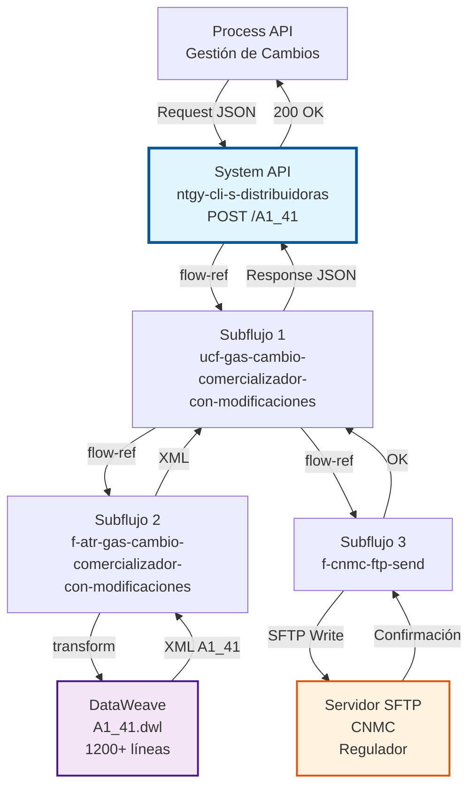
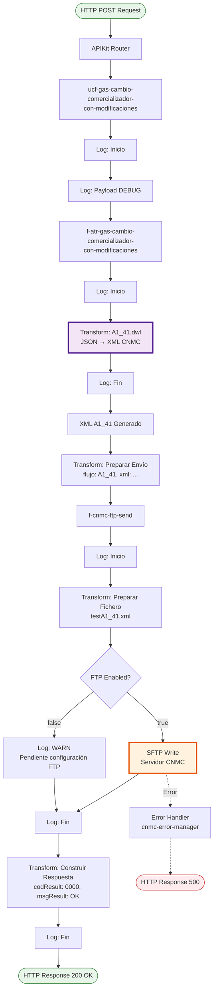
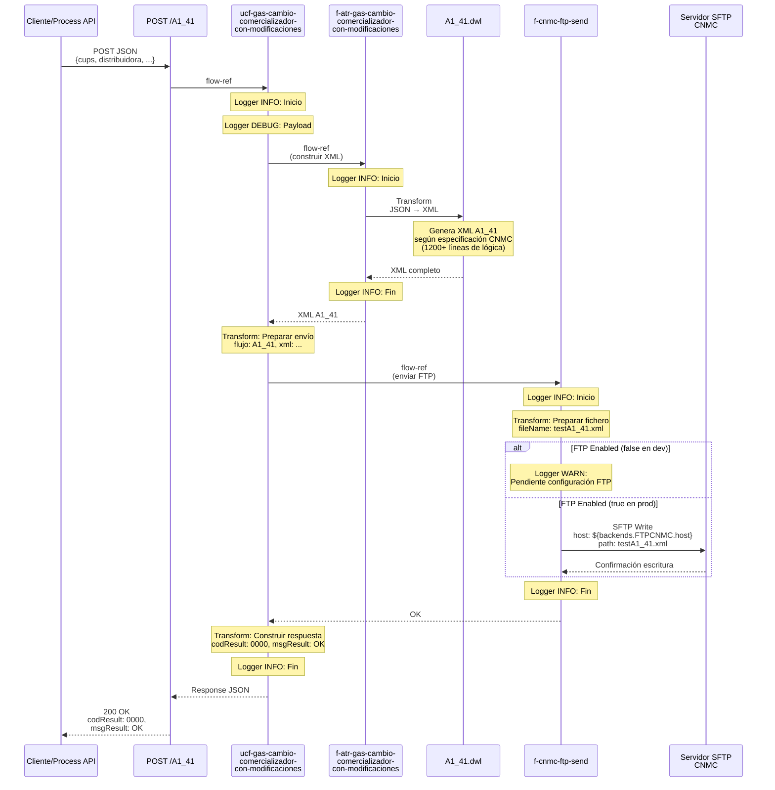
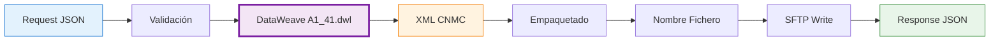
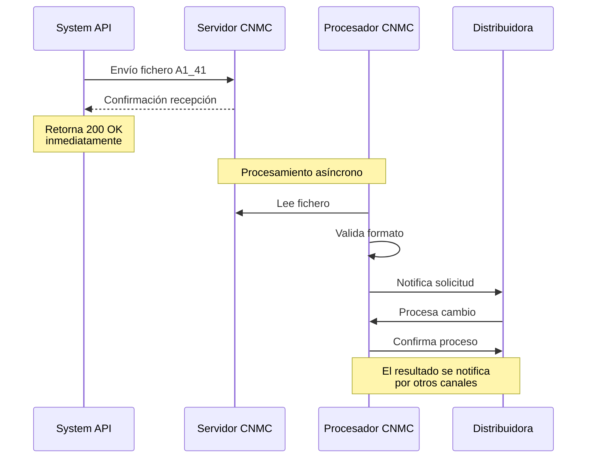

# POST /A1_41

## 📌 Descripción General

### Propósito del Endpoint

Este endpoint gestiona el envío de solicitudes de **cambio de comercializador de gas con modificaciones contractuales** (proceso A1_41) al regulador CNMC (Comisión Nacional de los Mercados y la Competencia) mediante protocolo SFTP.

El endpoint soporta:
- **Cambio de comercializador con modificación de tarifa de acceso**: Permite cambiar la tarifa contratada simultáneamente al cambio de comercializadora
- **Cambio con modificación de caudal diario**: Ajusta el caudal diario contratado durante el cambio
- **Cambio con modificación de presión de suministro**: Modifica la presión de suministro en el cambio
- **Actualización de datos del cliente**: Permite actualizar información del titular durante el proceso

### Tipo de API

**Capa:** System API (API-Led Connectivity)

**Función:** Integración directa con el regulador CNMC para cumplimiento de normativa ATR (Acceso de Terceros a la Red) en el sector del gas natural.

### Patrón de Integración

**Tipo:** Fire-and-Forget Asíncrono con SFTP

**Descripción:** El endpoint recibe los datos del cambio de comercializador en formato JSON, los transforma a XML según especificación CNMC, genera un fichero con timestamp único y lo envía vía SFTP al servidor del regulador. Retorna confirmación de envío (no de procesamiento), ya que la CNMC procesará el fichero de forma asíncrona.

### Arquitectura API-Led Connectivity



---

## 💼 Propósito del Negocio

### Casos de Uso Principales

1. **Cambio de Comercializador con Nueva Tarifa**
   - Cliente cambia de comercializadora y solicita modificar su tarifa de acceso
   - Se genera solicitud A1_41 con los nuevos datos contractuales
   - CNMC coordina el cambio con la distribuidora correspondiente

2. **Cambio con Modificación de Caudal Contratado**
   - Cliente requiere ajustar el caudal diario durante el cambio de comercializadora
   - Permite optimizar costes según consumo real
   - Distribuidora valida viabilidad técnica del nuevo caudal

3. **Cambio con Actualización de Datos del Titular**
   - Cambio de comercializadora con corrección de datos del cliente
   - Actualización de dirección, razón social o documento de identidad
   - Sincronización de datos entre comercializadora y distribuidora

### Contexto Empresarial

- **Dominio:** Gestión de Cambios de Comercializador - Sector Gas
- **Sector:** Energía - Utilities (Gas Natural)
- **División:** Naturgy España - Comercializadora
- **Proceso de Negocio:** Procesos ATR (Acceso de Terceros a la Red) regulados por CNMC
- **Normativa:** Circular 6/2020 de la CNMC sobre ATR en el sector del gas

### Stakeholders

- **Comercializadoras de Gas**: Solicitan cambios de comercializador con modificaciones
- **Distribuidoras de Gas**: Reciben y procesan las solicitudes coordinadas por CNMC
- **CNMC (Regulador)**: Supervisa y coordina los procesos de cambio
- **Clientes Finales**: Beneficiarios del cambio de comercializadora

### Valor de Negocio

- **Cumplimiento Regulatorio**: Garantiza el envío correcto de solicitudes A1_41 según normativa CNMC
- **Automatización**: Elimina procesos manuales de generación y envío de ficheros
- **Trazabilidad**: Registro completo de todas las solicitudes enviadas al regulador
- **Eficiencia Operativa**: Reduce tiempos de procesamiento y errores humanos

### Consumidores Potenciales

Este endpoint puede ser consumido por:
- Process APIs de gestión de cambios de comercializador
- Sistemas de CRM (Salesforce) mediante Platform Events
- Portales de autoservicio para clientes
- Sistemas de back-office de comercializadoras

---

## 🔧 Especificación Técnica

### URLs por Ambiente

| Ambiente | URL Base | URL Completa |
|----------|----------|--------------|
| **Local** | `http://localhost:8081` | `http://localhost:8081/api/A1_41` |
| **Development** | `https://ntgy-cli-s-distribuidoras-dev.us-e2.cloudhub.io` | `https://ntgy-cli-s-distribuidoras-dev.us-e2.cloudhub.io/api/A1_41` |
| **UAT** | `https://ntgy-cli-s-distribuidoras-uat.us-e2.cloudhub.io` | `https://ntgy-cli-s-distribuidoras-uat.us-e2.cloudhub.io/api/A1_41` |
| **Production** | `https://ntgy-cli-s-distribuidoras-pro.us-e2.cloudhub.io` | `https://ntgy-cli-s-distribuidoras-pro.us-e2.cloudhub.io/api/A1_41` |

### Método HTTP

```
POST /api/A1_41
```

### Parámetros de Entrada

#### Headers HTTP

| Header | Tipo | Requerido | Descripción | Ejemplo |
|--------|------|-----------|-------------|---------|
| `Content-Type` | string | ✅ Sí | Tipo de contenido del request | `application/json` |
| `Accept` | string | ❌ No | Tipo de contenido esperado en response | `application/json` |

#### Body Parameters

El body debe contener un objeto JSON con los datos del cambio de comercializador con modificaciones:

| Campo | Tipo | Requerido | Descripción |
|-------|------|-----------|-------------|
| `cups` | string | ✅ Sí | Código Universal de Punto de Suministro (20-22 caracteres) |
| `distribuidora` | string | ✅ Sí | Código de la distribuidora destino (4 dígitos) |
| `comercializadora` | string | ✅ Sí | Código de la comercializadora (Naturgy: "0762") |
| `fechaEfecto` | string | ✅ Sí | Fecha de inicio del cambio (formato: YYYY-MM-DD) |
| `tarifaAcceso` | string | ✅ Sí | Nueva tarifa de acceso contratada |
| `caudalDiario` | number | ✅ Sí | Caudal diario contratado (m³/día) |
| `presionSuministro` | string | ✅ Sí | Presión de suministro (ej: "BAJA", "MEDIA") |
| `cliente` | object | ✅ Sí | Datos completos del cliente titular |
| `cliente.tipoDocumento` | string | ✅ Sí | Tipo de documento (NIF, NIE, PASAPORTE) |
| `cliente.numeroDocumento` | string | ✅ Sí | Número de documento de identidad |
| `cliente.razonSocial` | string | ✅ Sí | Nombre o razón social del cliente |
| `cliente.direccion` | object | ✅ Sí | Dirección completa del cliente |
| `puntoSuministro` | object | ✅ Sí | Datos del punto de suministro |
| `modificaciones` | object | ✅ Sí | Flags indicando qué se modifica |
| `modificaciones.cambioTarifa` | boolean | ✅ Sí | Indica si se modifica la tarifa |
| `modificaciones.cambioCaudal` | boolean | ✅ Sí | Indica si se modifica el caudal |
| `modificaciones.cambioPresion` | boolean | ✅ Sí | Indica si se modifica la presión |
| `modificaciones.cambioDatosCliente` | boolean | ✅ Sí | Indica si se actualizan datos del cliente |

### Respuestas

#### Respuesta Exitosa (200 OK)

```json
{
  "codResult": "0000",
  "msgResult": "OK"
}
```

**Nota:** Esta respuesta indica que el fichero fue enviado exitosamente al servidor SFTP de CNMC, NO que la solicitud fue procesada. El procesamiento es asíncrono por parte del regulador.

#### Respuesta de Error Técnico (500)

```json
{
  "result": {
    "codResult": "0001",
    "msgResult": "Error al enviar fichero al servidor CNMC"
  }
}
```

### Autenticación y Autorización

- **Tipo:** Client ID & Client Secret (Anypoint Platform)
- **Autorización SFTP:** Credenciales configuradas en Secure Properties
  - Usuario: `${backends.FTPCNMC.username}`
  - Password: `${secure::backends.FTPCNMC.password}`

### Timeouts

| Tipo | Valor | Descripción |
|------|-------|-------------|
| **SFTP Connection Timeout** | 30 segundos | Tiempo máximo para establecer conexión SFTP |
| **SFTP Write Timeout** | 60 segundos | Tiempo máximo para completar escritura del fichero |

---

## 🏗️ Implementación Técnica

### Arquitectura del Flow



### Secuencia Detallada de Ejecución



### Componentes Clave

#### 1. Subflujo Orquestador (ucf-gas-cambio-comercializador-con-modificaciones)

**Ubicación:** `src/main/mule/cnmc/gas/ucf-gas-cambio-comercializador-con-modificaciones.xml`

**Responsabilidades:**
- Logging de inicio y fin del proceso
- Orquestación de subflujos de construcción y envío
- Preparación de metadata para envío FTP
- Construcción de respuesta estándar
- Gestión de errores mediante error handler específico

**Código clave:**
```xml
<flow name="ucf-gas-cambio-comercializador-con-modificaciones">
    <logger level="INFO" message="Inicio" 
            category="com.naturgy.mule.f-atr-gas-cambio-comercializador-con-modificaciones"/>
    <logger level="DEBUG" message="#[common::logger::json(payload)]"/>
    
    <!-- Construcción del XML A1_41 -->
    <flow-ref name="f-atr-gas-cambio-comercializador-con-modificaciones"/>
    
    <!-- Preparar para envío FTP -->
    <ee:transform>
        <ee:set-payload>
            {
                flujo: "A1_41",
                xml: payload
            }
        </ee:set-payload>
    </ee:transform>
    
    <!-- Enviar fichero -->
    <flow-ref name="f-cnmc-ftp-send"/>
    
    <!-- Construir respuesta -->
    <ee:transform>
        <ee:set-payload>
            {
                codResult: "0000",
                msgResult: "OK"
            }
        </ee:set-payload>
    </ee:transform>
    
    <logger level="INFO" message="Fin"/>
    <error-handler ref="cnmc-error-manager-error-handler"/>
</flow>
```

#### 2. Subflujo Constructor XML (f-atr-gas-cambio-comercializador-con-modificaciones)

**Ubicación:** `src/main/mule/cnmc/gas/f-atr-gas-cambio-comercializador-con-modificaciones.xml`

**Responsabilidades:**
- Invocación de transformación DataWeave A1_41.dwl
- Generación de XML según especificación CNMC
- Validación de estructura de datos
- Logging de proceso de transformación

**Código clave:**
```xml
<sub-flow name="f-atr-gas-cambio-comercializador-con-modificaciones">
    <logger level="INFO" message="Inicio"/>
    
    <!-- Transformación JSON → XML A1_41 -->
    <ee:transform>
        <ee:message>
            <ee:set-payload resource="modules/cnmc/A1_41.dwl"/>
        </ee:message>
    </ee:transform>
    
    <logger level="INFO" message="Fin"/>
    <error-handler ref="cnmc-error-manager-error-handler"/>
</sub-flow>
```

#### 3. Transformación DataWeave (A1_41.dwl)

**Ubicación:** `src/main/resources/modules/cnmc/A1_41.dwl`

**Características:**
- **Tamaño:** 1,200+ líneas de código DataWeave
- **Complejidad:** Alta - Genera XML completo según especificación CNMC
- **Validaciones:** Múltiples validaciones de campos obligatorios
- **Mapeos:** Transformación de códigos y formatos

**Estructura del XML generado:**
```xml
<MensajeCambioComercializadorConModificaciones>
    <Cabecera>
        <CodigoProceso>A1_41</CodigoProceso>
        <CodigoDistribuidora>[código]</CodigoDistribuidora>
        <CodigoComercializadora>0762</CodigoComercializadora>
        <FechaHoraGeneracion>[timestamp]</FechaHoraGeneracion>
        <NumeroMensaje>[secuencial]</NumeroMensaje>
    </Cabecera>
    <DatosSolicitud>
        <CUPS>[código CUPS]</CUPS>
        <DatosContrato>
            <FechaEfecto>[fecha]</FechaEfecto>
            <TarifaAcceso>[tarifa]</TarifaAcceso>
            <CaudalDiarioContratado>[caudal]</CaudalDiarioContratado>
            <PresionSuministro>[presión]</PresionSuministro>
        </DatosContrato>
        <DatosCliente>
            <TipoDocumento>[tipo]</TipoDocumento>
            <NumeroDocumento>[número]</NumeroDocumento>
            <RazonSocial>[nombre]</RazonSocial>
            <Direccion>[dirección completa]</Direccion>
        </DatosCliente>
        <DatosPuntoSuministro>
            <DireccionSuministro>[dirección]</DireccionSuministro>
            <CodigoPostal>[CP]</CodigoPostal>
            <Municipio>[municipio]</Municipio>
            <Provincia>[provincia]</Provincia>
        </DatosPuntoSuministro>
        <Modificaciones>
            <CambioTarifa>[S/N]</CambioTarifa>
            <CambioCaudal>[S/N]</CambioCaudal>
            <CambioPresion>[S/N]</CambioPresion>
            <CambioDatosCliente>[S/N]</CambioDatosCliente>
        </Modificaciones>
    </DatosSolicitud>
</MensajeCambioComercializadorConModificaciones>
```

#### 4. Subflujo Envío FTP (f-cnmc-ftp-send)

**Ubicación:** `src/main/mule/cnmc/f-cnmc-ftp-send.xml`

**Responsabilidades:**
- Preparación del nombre de fichero
- Escritura del fichero XML en servidor SFTP
- Gestión de errores de conexión/escritura
- Logging de operaciones FTP

**Configuración SFTP:**
```xml
<sftp:config name="SFTP_CNMC_Config">
    <sftp:connection 
        host="${backends.FTPCNMC.host}"
        port="${backends.FTPCNMC.port}"
        username="${backends.FTPCNMC.username}"
        password="${backends.FTPCNMC.password}"
        workingDir="${backends.FTPCNMC.basePath}"/>
</sftp:config>
```

**Código clave:**
```xml
<sub-flow name="f-cnmc-ftp-send">
    <logger level="INFO" message="Inicio" 
            category="com.naturgy.mule.f-cnmc-ftp-send"/>
    
    <!-- Preparar nombre de fichero -->
    <ee:transform>
        <ee:set-payload>
            {
                fileName: "test" ++ payload.flujo ++ ".xml",
                payload: payload.xml
            }
        </ee:set-payload>
    </ee:transform>
    
    <try>
        <choice>
            <when expression="#[false]">
                <!-- SFTP Write (deshabilitado en dev) -->
                <sftp:write path="#[payload.fileName]" 
                           config-ref="SFTP_CNMC_Config">
                    <sftp:content>#[payload.payload]</sftp:content>
                </sftp:write>
            </when>
            <otherwise>
                <logger level="WARN" 
                        message="Pendiente de configuración de FTP de destino"/>
            </otherwise>
        </choice>
        <error-handler>
            <on-error-continue>
                <logger level="WARN" 
                        message="Fallo de configuración de FTP de destino"/>
            </on-error-continue>
        </error-handler>
    </try>
    
    <logger level="INFO" message="Fin"/>
</sub-flow>
```

**Nota:** El choice con `expression="#[false]"` indica que el envío SFTP está deshabilitado en ambientes de desarrollo. En producción, esta expresión se configura como `true`.

### Configuración por Ambiente

**Archivo:** `src/main/resources/s-distribuidoras-global-config.yaml`

```yaml
# Configuración SFTP CNMC (valores de ejemplo)
backends:
  FTPCNMC:
    host: "sftp.cnmc.es"
    port: "22"
    username: "naturgy_user"
    password: "${secure::backends.FTPCNMC.password}"
    basePath: "/incoming/gas/A1_41/"
```

### Gestión de Errores

**Error Handler:** `cnmc-error-manager-error-handler`

**Ubicación:** `src/main/mule/cnmc/cnmc-error-manager.xml`

**Tipos de errores manejados:**
- **SFTP:CONNECTIVITY**: Error de conexión al servidor CNMC
- **SFTP:FILE_ALREADY_EXISTS**: Fichero ya existe en servidor
- **SFTP:ILLEGAL_PATH**: Ruta de destino inválida
- **TRANSFORMATION**: Error en transformación DataWeave
- **ANY**: Errores no categorizados

### Logging y Trazabilidad

**Categorías de Logger:**
- `com.naturgy.mule.f-atr-gas-cambio-comercializador-con-modificaciones`
- `com.naturgy.mule.f-cnmc-ftp-send`

**Niveles de Log:**
- **INFO**: Inicio y fin de flows, operaciones principales
- **DEBUG**: Payloads completos (solo en desarrollo)
- **WARN**: Configuración FTP deshabilitada, errores recuperables
- **ERROR**: Errores críticos que impiden el procesamiento

---

## 💻 Ejemplos de Uso

### Ejemplo 1: Request Completo

```json
{
  "cups": "ES0021000000000001JN0F",
  "distribuidora": "0218",
  "comercializadora": "0762",
  "fechaEfecto": "2026-10-01",
  "tarifaAcceso": "3.1",
  "caudalDiario": 150.5,
  "presionSuministro": "BAJA",
  "cliente": {
    "tipoDocumento": "NIF",
    "numeroDocumento": "12345678A",
    "razonSocial": "JUAN GARCIA LOPEZ",
    "direccion": {
      "tipoVia": "CALLE",
      "nombreVia": "MAYOR",
      "numero": "25",
      "piso": "3",
      "puerta": "B",
      "codigoPostal": "28013",
      "municipio": "MADRID",
      "provincia": "MADRID"
    }
  },
  "puntoSuministro": {
    "direccion": {
      "tipoVia": "CALLE",
      "nombreVia": "MAYOR",
      "numero": "25",
      "piso": "3",
      "puerta": "B",
      "codigoPostal": "28013",
      "municipio": "MADRID",
      "provincia": "MADRID"
    }
  },
  "modificaciones": {
    "cambioTarifa": true,
    "cambioCaudal": true,
    "cambioPresion": false,
    "cambioDatosCliente": false
  }
}
```

### Ejemplo 2: Response Exitoso

```json
{
  "codResult": "0000",
  "msgResult": "OK"
}
```

**Interpretación:** El fichero XML fue generado y enviado exitosamente al servidor SFTP de CNMC. La solicitud será procesada de forma asíncrona por el regulador.

### Ejemplo 3: Comando curl

```bash
curl -X POST "https://ntgy-cli-s-distribuidoras-dev.us-e2.cloudhub.io/api/A1_41" \
  -H "Content-Type: application/json" \
  -H "client_id: YOUR_CLIENT_ID" \
  -H "client_secret: YOUR_CLIENT_SECRET" \
  -d '{
    "cups": "ES0021000000000001JN0F",
    "distribuidora": "0218",
    "comercializadora": "0762",
    "fechaEfecto": "2026-10-01",
    "tarifaAcceso": "3.1",
    "caudalDiario": 150.5,
    "presionSuministro": "BAJA",
    "cliente": {
      "tipoDocumento": "NIF",
      "numeroDocumento": "12345678A",
      "razonSocial": "JUAN GARCIA LOPEZ",
      "direccion": {
        "tipoVia": "CALLE",
        "nombreVia": "MAYOR",
        "numero": "25",
        "piso": "3",
        "puerta": "B",
        "codigoPostal": "28013",
        "municipio": "MADRID",
        "provincia": "MADRID"
      }
    },
    "puntoSuministro": {
      "direccion": {
        "tipoVia": "CALLE",
        "nombreVia": "MAYOR",
        "numero": "25",
        "piso": "3",
        "puerta": "B",
        "codigoPostal": "28013",
        "municipio": "MADRID",
        "provincia": "MADRID"
      }
    },
    "modificaciones": {
      "cambioTarifa": true,
      "cambioCaudal": true,
      "cambioPresion": false,
      "cambioDatosCliente": false
    }
  }'
```

### Ejemplo 4: Response de Error

```json
{
  "result": {
    "codResult": "0001",
    "msgResult": "Error al conectar con servidor SFTP de CNMC"
  }
}
```

**Interpretación:** Error técnico al intentar enviar el fichero al servidor SFTP.

---

## 📊 Transformación de Datos

### Diagrama de Transformación



### Mapeo de Campos Clave

| Campo JSON | Campo XML CNMC | Transformación |
|------------|----------------|----------------|
| `cups` | `<CUPS>` | Directo |
| `distribuidora` | `<CodigoDistribuidora>` | Directo |
| `comercializadora` | `<CodigoComercializadora>` | Directo (0762 para Naturgy) |
| `fechaEfecto` | `<FechaEfecto>` | Formato: YYYY-MM-DD |
| `tarifaAcceso` | `<TarifaAcceso>` | Directo |
| `caudalDiario` | `<CaudalDiarioContratado>` | Número con decimales |
| `presionSuministro` | `<PresionSuministro>` | Directo (BAJA/MEDIA/ALTA) |
| `cliente.tipoDocumento` | `<TipoDocumento>` | Mapeo de códigos |
| `cliente.numeroDocumento` | `<NumeroDocumento>` | Directo |
| `cliente.razonSocial` | `<RazonSocial>` | Uppercase |
| `modificaciones.cambioTarifa` | `<CambioTarifa>` | Boolean → S/N |
| `modificaciones.cambioCaudal` | `<CambioCaudal>` | Boolean → S/N |

---

## 🔍 Consideraciones Técnicas

### Nombre del Fichero Generado

El sistema genera automáticamente el nombre del fichero con el siguiente formato:

```
testA1_41.xml
```

**Nota:** En ambientes de desarrollo, el prefijo "test" se añade para identificar ficheros de prueba. En producción, el formato sería:

```
A1_41_[timestamp].xml
```

Ejemplo: `A1_41_20260907135412.xml`

### Configuración SFTP por Ambiente

| Ambiente | Host | Puerto | Habilitado |
|----------|------|--------|------------|
| **Local** | N/A | N/A | ❌ No |
| **Development** | `${backends.FTPCNMC.host}` | 22 | ❌ No (simulado) |
| **UAT** | `${backends.FTPCNMC.host}` | 22 | ✅ Sí |
| **Production** | `${backends.FTPCNMC.host}` | 22 | ✅ Sí |

**Nota Importante:** En ambientes de desarrollo, el envío SFTP está deshabilitado mediante la expresión `#[false]` en el choice. Esto permite probar la generación del XML sin enviar ficheros reales al regulador.

### Proceso Asíncrono



**Importante:** El endpoint retorna confirmación de envío, NO de procesamiento. El resultado final del cambio de comercializador se notificará a través de otros mecanismos (respuestas asíncronas de CNMC).

---

## ⚠️ Notas Importantes

### Validaciones Previas Recomendadas

Antes de invocar este endpoint, se recomienda validar:

1. **CUPS válido**: Formato correcto (20-22 caracteres, comienza con "ES")
2. **Distribuidora activa**: Código de distribuidora válido y operativa
3. **Tarifa compatible**: La tarifa solicitada es válida para el punto de suministro
4. **Caudal técnicamente viable**: El caudal está dentro de los límites técnicos
5. **Datos del cliente completos**: Toda la información obligatoria está presente

### Limitaciones

- **No hay validación de negocio en tiempo real**: El endpoint solo valida formato, no reglas de negocio
- **Sin confirmación de procesamiento**: La respuesta indica envío exitoso, no aprobación
- **Procesamiento asíncrono**: El resultado final puede tardar horas o días
- **Sin retry automático**: Si falla el envío SFTP, debe reintentarse manualmente

### Mejores Prácticas

1. **Logging**: Registrar el request completo para trazabilidad
2. **Idempotencia**: Implementar mecanismos para evitar envíos duplicados
3. **Monitorización**: Supervisar el estado del servidor SFTP de CNMC
4. **Gestión de respuestas**: Implementar sistema para recibir respuestas asíncronas de CNMC
5. **Validación previa**: Validar datos antes de invocar el endpoint

---

## 🔗 Endpoints Relacionados

Este endpoint forma parte de la familia de procesos ATR de gas:

| Endpoint | Proceso | Descripción |
|----------|---------|-------------|
| `POST /A1_02` | A1_02 | Cambio comercializador sin modificaciones |
| `POST /A1_38` | A1_38 | Alta punto suministro con contratación acceso |
| **`POST /A1_41`** | **A1_41** | **Cambio comercializador con modificaciones** |
| `POST /A1_42` | A1_42 | Cambio comercializador con nueva contratación |
| `POST /A1_43` | A1_43 | Nueva contratación |

Para consultas online de CUPS de gas, ver:
- `GET /onlineCUPSg` - Consulta online de información de CUPS de gas
