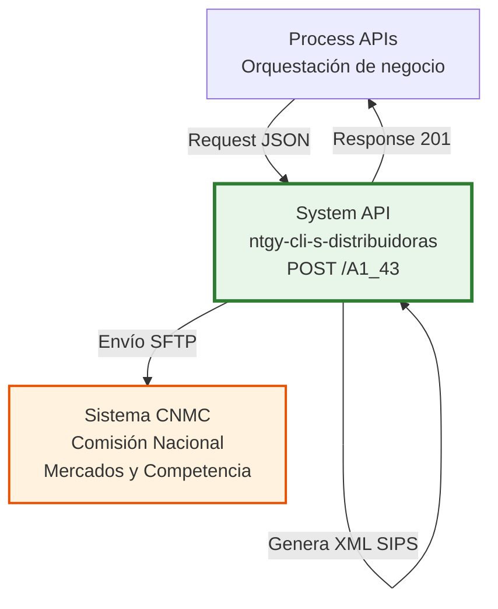
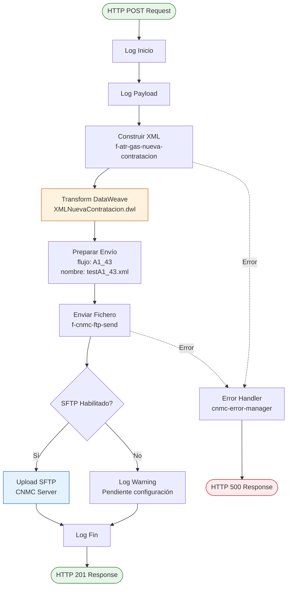
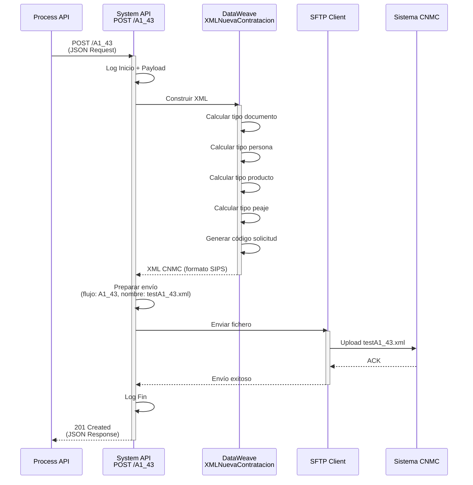
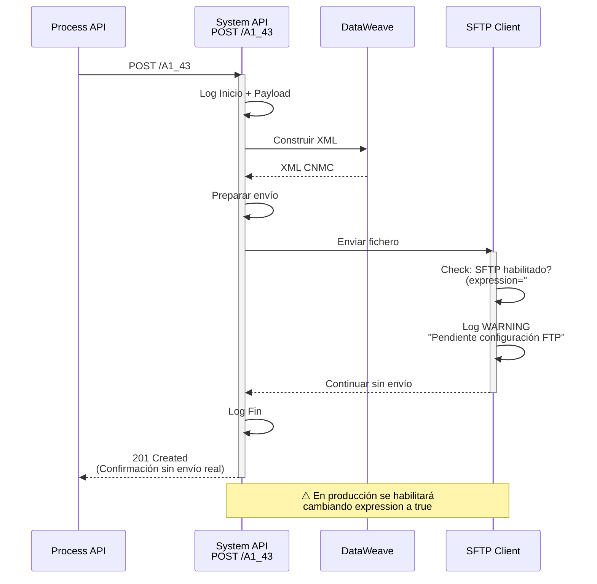
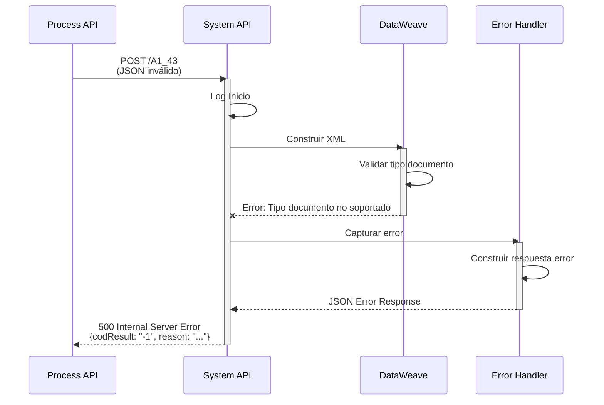

# POST /A1_43

## 📌 Descripción General

### Propósito del Endpoint

Este endpoint implementa el **proceso A1_43 de ATR Gas** (Nueva Contratación del Acceso) que permite generar y enviar solicitudes de nueva contratación de acceso a la red de distribución de gas natural al sistema CNMC (Comisión Nacional de los Mercados y la Competencia) mediante transferencia de archivos SFTP.

### Tipo de API

**Capa:** System API (API-Led Connectivity)

**Función:** Generación de XML según formato SIPS y envío a sistema regulatorio CNMC

### Patrón de Integración

**Tipo:** Fire-and-Forget (Asíncrono)

**Descripción:** El endpoint recibe la solicitud en formato JSON, genera un archivo XML según la especificación CNMC para el proceso A1_43, y lo envía al sistema CNMC vía SFTP. La respuesta confirma el envío, no el procesamiento final por parte de CNMC.

### Arquitectura API-Led Connectivity



---

## 💼 Propósito del Negocio

### Casos de Uso Principales

1. **Nueva Contratación de Suministro de Gas**
   - Cliente solicita nuevo suministro de gas natural
   - Requiere contratación de acceso a la red de distribución
   - Cumplimiento de normativa CNMC para procesos ATR

2. **Automatización de Solicitudes Regulatorias**
   - Generación automática de XML según formato SIPS
   - Envío automatizado a sistema CNMC
   - Trazabilidad completa del proceso

3. **Integración con Distribuidoras**
   - Comunicación estandarizada con sistema regulatorio
   - Cumplimiento de plazos establecidos por CNMC
   - Gestión centralizada de solicitudes ATR

### Contexto Empresarial

- **Dominio:** Gestión de Acceso a Redes de Distribución de Gas
- **Sector:** Energía - Utilities (Gas Natural)
- **División:** Naturgy España - Comercialización
- **Proceso de Negocio:** ATR (Acceso de Terceros a la Red) - Proceso A1_43

### Stakeholders

- **Comercializadoras de Gas**: Solicitan acceso a red para nuevos clientes
- **CNMC**: Regula y supervisa procesos ATR
- **Distribuidoras de Gas**: Reciben solicitudes vía sistema CNMC
- **Clientes Finales**: Beneficiarios del nuevo suministro

### Valor de Negocio

- **Cumplimiento Normativo**: Garantiza adherencia a regulación CNMC
- **Eficiencia Operativa**: Automatiza proceso manual de generación de XML
- **Reducción de Errores**: Validaciones automáticas de datos
- **Trazabilidad**: Registro completo de solicitudes enviadas

### Normativa Aplicable

- **CNMC**: Comisión Nacional de los Mercados y la Competencia
- **Formato SIPS**: Sistema de Intercambio de Información de Puntos de Suministro
- **Proceso A1_43**: Nueva Contratación del Acceso (Gas)
- **Regulación**: Circular 6/2020 de la CNMC

---

## 🔧 Especificación Técnica

### URLs por Ambiente

| Ambiente | URL Base | URL Completa |
|----------|----------|--------------|
| **Local** | `http://localhost:8052` | `http://localhost:8052/api/A1_43` |
| **Development** | `https://ntgy-cli-s-distribuidoras-dev.us-e2.cloudhub.io` | `https://ntgy-cli-s-distribuidoras-dev.us-e2.cloudhub.io/api/A1_43` |
| **UAT** | `https://ntgy-cli-s-distribuidoras-uat.us-e2.cloudhub.io` | `https://ntgy-cli-s-distribuidoras-uat.us-e2.cloudhub.io/api/A1_43` |
| **Production** | `https://ntgy-cli-s-distribuidoras-pro.us-e2.cloudhub.io` | `https://ntgy-cli-s-distribuidoras-pro.us-e2.cloudhub.io/api/A1_43` |

### Método HTTP

```
POST /api/A1_43
```

### Parámetros de Entrada

#### Request Body (application/json)

**Estructura Principal:**

| Campo | Tipo | Requerido | Descripción |
|-------|------|-----------|-------------|
| `usuarioGrabador` | String | Sí | Usuario que registra la solicitud |
| `codigoAgente` | String | Sí | Código del agente comercial |
| `comercializadora` | String | Sí | Código de la comercializadora |
| `canalDarwin` | String | Sí | Canal de origen de la solicitud |
| `cliente` | Object | Sí | Datos del titular del suministro |
| `suministroGas` | Object | Sí | Datos del suministro de gas |
| `pedido` | Object | Sí | Información del pedido y productos |
| `documentos` | Array | No | Documentos adjuntos para distribuidora |
| `PedidoNum` | Number | Sí | Índice del producto a procesar (base 0) |
| `codDistribuidora` | String | No | Código de distribuidora destino |

**Objeto `cliente`:**

| Campo | Tipo | Requerido | Descripción |
|-------|------|-----------|-------------|
| `nombre` | String | Sí | Nombre del titular |
| `apellido1` | String | Sí | Primer apellido |
| `apellido2` | String | No | Segundo apellido |
| `email` | String | Sí | Correo electrónico |
| `telefono` | String | Sí | Teléfono de contacto |
| `tipoDocumento` | String | Sí | Tipo: NIF, CIF, Pasaporte, NIE, NIVA, Otros |
| `documento` | String | Sí | Número de documento |
| `idioma` | String | Sí | Idioma preferido |
| `fechaNacimiento` | Date | Sí | Fecha de nacimiento (YYYY-MM-DD) |
| `iban` | String | Sí | IBAN para domiciliación |
| `pyme` | Boolean | Sí | Indica si es PYME (persona jurídica) |
| `direccionSuministro` | Object | Sí | Dirección del punto de suministro |
| `direccionFacturacion` | Object | Sí | Dirección de facturación |

**Objeto `suministroGas`:**

| Campo | Tipo | Requerido | Descripción |
|-------|------|-----------|-------------|
| `cups` | String | Sí | CUPS del suministro (20-22 caracteres) |
| `tarifaAtr` | String | Sí | Tarifa ATR (ej: "1.1", "2.1", "3.1") |
| `potenciaP1` - `potenciaP6` | Number | No | Potencias contratadas por periodo |
| `consumoAnual` | Number | Sí | Consumo anual estimado |
| `cambioTitular` | Boolean | Sí | Indica si hay cambio de titular |
| `cambioTarifaAtr` | Boolean | Sí | Indica si hay cambio de tarifa |

**Objeto `pedido`:**

| Campo | Tipo | Requerido | Descripción |
|-------|------|-----------|-------------|
| `idPedido` | String | Sí | Identificador único del pedido |
| `fechaFirma` | Date | Sí | Fecha de firma del contrato |
| `productos` | Array | Sí | Lista de productos contratados |
| `servicios` | Array | No | Servicios adicionales contratados |

**Objeto `productos[]`:**

| Campo | Tipo | Requerido | Descripción |
|-------|------|-----------|-------------|
| `id` | String | Sí | Identificador del producto |
| `nombre` | String | Sí | Nombre del producto |
| `tarifaAtr` | String | Sí | Tarifa ATR del producto |
| `tipoContratacion` | String | Sí | Tipo: ALTA, CAMBIO, etc. |
| `fechaAccion` | Date | Sí | Fecha efectiva de la acción |
| `duracion` | String | Sí | Duración: "Vacio", "12 meses", "24 meses" |

**Objeto `documentos[]`:**

| Campo | Tipo | Requerido | Descripción |
|-------|------|-----------|-------------|
| `tipo` | String | Sí | Tipo de documento (ej: "CTX") |
| `nombre` | String | Sí | Ruta/nombre del archivo |
| `envioDistribuidora` | Boolean | Sí | Si se envía a distribuidora |

### Respuestas

#### 201 Created - Solicitud Enviada Correctamente

```json
{
  "result": {
    "codResult": "0000",
    "msgResult": "No hay error"
  },
  "creationResult": {
    "message": "Contrato Procesado correctamente"
  }
}
```

**Campos de Respuesta:**

| Campo | Tipo | Descripción |
|-------|------|-------------|
| `result.codResult` | String | "0000" = Éxito, "-1" = Error |
| `result.msgResult` | String | Mensaje descriptivo del resultado |
| `creationResult.message` | String | Confirmación de procesamiento |

#### 500 Internal Server Error

```json
{
  "result": {
    "codResult": "-1",
    "msgResult": "Error",
    "reason": "Descripción del error"
  }
}
```

### Autenticación

- **Tipo:** Client ID & Client Secret (Anypoint Platform)
- **Headers Requeridos:**
  - `client_id`: ID de la aplicación cliente
  - `client_secret`: Secret de la aplicación cliente
  - `Content-Type`: application/json

### Timeouts

| Tipo | Valor |
|------|-------|
| **Request Timeout** | 60 segundos |
| **Connection Timeout** | 10 segundos |
| **SFTP Timeout** | 30 segundos |

---

## 🏗️ Implementación Técnica

### Arquitectura del Flow



### Flujos Implementados

#### 1. Flow Principal: `ucf-gas-nueva-contratacion`

**Ubicación:** `src/main/mule/cnmc/gas/gas-nueva-contratacion.xml` (líneas 7-25)

**Responsabilidades:**
- Logging de inicio y payload
- Orquestación de subflujos
- Preparación de datos para envío SFTP
- Manejo de errores centralizado

**Código Clave:**
```xml
<flow name="ucf-gas-nueva-contratacion">
    <logger level="INFO" message='#[common::logger::log("Inicio")]'/>
    <logger level="INFO" message="#[common::logger::json(payload)]"/>
    <flow-ref name="f-atr-gas-nueva-contratacion"/>
    <ee:transform>
        <ee:set-payload>
            {
                flujo: "A1_43",
                xml: payload
            }
        </ee:set-payload>
    </ee:transform>
    <flow-ref name="f-cnmc-ftp-send"/>
    <logger level="INFO" message='#[common::logger::log("Fin")]'/>
    <error-handler ref="cnmc-error-manager-error-handler"/>
</flow>
```

#### 2. Subflow: `f-atr-gas-nueva-contratacion`

**Ubicación:** `src/main/mule/cnmc/gas/gas-nueva-contratacion.xml` (líneas 26-36)

**Responsabilidades:**
- Construcción del XML según formato CNMC
- Aplicación de transformación DataWeave
- Logging del XML generado

**Transformación DataWeave:**
```xml
<ee:transform>
    <ee:set-payload resource="modules/cnmc/xml/gas/XMLNuevaContratacion.dwl"/>
</ee:transform>
```

#### 3. Subflow: `f-cnmc-ftp-send`

**Ubicación:** `src/main/mule/cnmc/f-cnmc-ftp-send.xml` (líneas 12-43)

**Responsabilidades:**
- Preparación del nombre de archivo
- Envío vía SFTP al servidor CNMC
- Manejo de errores de conexión

**Configuración SFTP:**
```xml
<sftp:config name="SFTP_CNMC_Config">
    <sftp:connection 
        host="${backends.FTPCNMC.host}" 
        port="${backends.FTPCNMC.port}"
        username="${backends.FTPCNMC.username}" 
        password="${backends.FTPCNMC.password}"
        workingDir="${backends.FTPCNMC.basePath}"/>
</sftp:config>
```

**⚠️ Estado Actual:** El envío SFTP está actualmente deshabilitado en el código (línea 27: `expression="#[false]"`). En producción se habilitará cuando se configure el servidor SFTP de CNMC.

### Transformaciones DataWeave

#### Transformación Principal: `XMLNuevaContratacion.dwl`

**Ubicación:** `src/main/resources/modules/cnmc/xml/gas/XMLNuevaContratacion.dwl`

**Estructura del XML Generado:**

```dataweave
%dw 2.0
output application/xml

var codigoEmpresaEmisora = p("origenes.gas")  // "0762"
var codigoDistribuidora = "0000"
var codigoSolicitud = floor((now() as Number * 1000 + now().milliseconds) / 10) as String
var productoActivo = payload.pedido.productos[payload.PedidoNum as Number]
var suministroActivo = payload.suministroGas

---
sctdapplication @(xmlns: "http://localhost/sctd/A143"): {
    heading: XMLComun::Cabecera(codigoEmpresaEmisora, codigoDistribuidora, "43", "A1"),
    a143: {
        comreferencenum: codigoSolicitud,
        reqdate: now() as String {format: "y-MM-dd"},
        reqhour: now() as String {format: "hh:mm:ss"},
        nationality: "ES",
        documenttype: calcularTipoDocumento(payload),
        documentnum: payload.cliente.documento,
        cups: suministroActivo.cups,
        modeffectdate: "04",
        reqtransferdate: productoActivo.fechaAccion,
        productlist: {
            product: {
                reqtype: tipoSolicitudProducto,
                producttype: calcularTipoProducto(productoActivo),
                producttolltype: calcularTipoPeajeProducto(productoActivo)
            }
        },
        (registerdoclist: RegistrosDocumentoGas(payload.documentos filter $.envioDistribuidora)) 
            if (sizeOf(payload.documentos filter $.envioDistribuidora) > 0)
    }
}
```

**Funciones de Cálculo Utilizadas:**

1. **`calcularTipoDocumento(payload)`** - Mapea tipo de documento a código CNMC
   - NIF → "01"
   - Pasaporte → "03"
   - NIE → "04"
   - NIVA → "07"
   - Otros → "08"

2. **`calcularTipoPersona(payload)`** - Determina si es persona física o jurídica
   - No PYME → "F" (Física)
   - PYME → "J" (Jurídica)

3. **`calcularTipoProducto(producto)`** - Mapea duración a código CNMC
   - "Vacio" → "01"
   - "12 meses" → "02"

4. **`calcularTipoPeajeProducto(producto)`** - Mapea tarifa ATR a código CNMC
   - "1.1" → "11"
   - "2.1" → "21"
   - "3.1" → "31"
   - etc.

#### Cabecera Común: `XMLComun.dwl`

**Ubicación:** `src/main/resources/modules/cnmc/xml/gas/XMLComun.dwl`

```dataweave
fun Cabecera(origen: String, destino: String, proceso: String, tipoMensaje: String): Any = {
    dispatchingcode: "GML",
    dispatchingcompany: origen,
    destinycompany: destino,
    communicationsdate: now() as String {format: "y-MM-dd"},
    communicationshour: now() as String {format: "hh:mm:ss"},
    processcode: proceso,
    messagetype: tipoMensaje
}
```

### Configuración por Ambiente

**Archivo:** `s-distribuidoras-{env}-config.yaml`

```yaml
backends:
  FTPCNMC:
    host: "sftp.cnmc.es"
    port: "22"
    username: "naturgy_user"
    password: "![encrypted]"
    basePath: "/upload"

origenes:
  gas: "0762"  # Código comercializadora Naturgy Gas
```

### Manejo de Errores

#### Error Handler: `cnmc-error-manager-error-handler`

**Ubicación:** `src/main/mule/cnmc/cnmc-error-manager.xml`

**Estrategia:**

1. **On Error Continue** (Errores de expresión):
```xml
<on-error-continue type="EXPRESSION">
    <ee:transform>
        <ee:set-payload>
            {
                codResult: "-1",
                msgResult: "Error",
                reason: (error.description default "" splitBy ("\n"))[0]
            }
        </ee:set-payload>
    </ee:transform>
</on-error-continue>
```

2. **On Error Propagate** (Otros errores):
```xml
<on-error-propagate>
    <ee:transform>
        <ee:set-payload>
            {
                codResult: "-1",
                msgResult: "Error",
                reason: error.description
            }
        </ee:set-payload>
    </ee:transform>
</on-error-propagate>
```

### Diagramas de Secuencia

#### 1. Flujo Normal de Éxito



#### 2. Flujo con SFTP Deshabilitado (Estado Actual)



#### 3. Flujo con Error



### Patrones de Diseño

**Patrón:** Fire-and-Forget con Transformación

**Justificación:** 
- El proceso ATR es asíncrono por naturaleza
- CNMC procesa solicitudes en batch
- La respuesta confirma envío, no procesamiento
- Permite desacoplamiento entre comercializadora y sistema regulatorio

**Patrón:** Content-Based Router (Futuro)

**Justificación:**
- Diferentes distribuidoras pueden requerir formatos específicos
- Permite enrutamiento según código de distribuidora
- Facilita extensibilidad para nuevos procesos ATR

---

## 💻 Ejemplos de Uso

### Ejemplo 1: Solicitud Completa de Nueva Contratación

#### Request (cURL)

```bash
curl -X POST "https://ntgy-cli-s-distribuidoras-pro.us-e2.cloudhub.io/api/A1_43" \
  -H "Content-Type: application/json" \
  -H "client_id: YOUR_CLIENT_ID" \
  -H "client_secret: YOUR_CLIENT_SECRET" \
  -d '{
  "usuarioGrabador": "AGENTE001",
  "codigoAgente": "AG12345",
  "comercializadora": "0762",
  "canalDarwin": "WEB",
  "cliente": {
    "nombre": "Juan",
    "apellido1": "García",
    "apellido2": "López",
    "email": "juan.garcia@example.com",
    "telefono": "612345678",
    "tipoDocumento": "NIF",
    "documento": "12345678A",
    "idioma": "Castellano",
    "fechaNacimiento": "1985-03-15",
    "iban": "ES7921000813610123456789",
    "pyme": false,
    "direccionSuministro": {
      "codigoPostal": "28001",
      "provincia": "28",
      "municipio": "28079",
      "localidad": "28079000100",
      "tipoVia": "CL",
      "via": "Gran Vía",
      "numero": "25",
      "piso": "3",
      "puerta": "A"
    },
    "direccionFacturacion": {
      "codigoPostal": "28001",
      "provincia": "28",
      "municipio": "28079",
      "localidad": "28079000100",
      "tipoVia": "CL",
      "via": "Gran Vía",
      "numero": "25",
      "piso": "3",
      "puerta": "A"
    }
  },
  "suministroGas": {
    "cups": "ES0227070007401453WB",
    "tarifaAtr": "2.1",
    "consumoAnual": 5000,
    "cambioTitular": false,
    "cambioTarifaAtr": false
  },
  "pedido": {
    "idPedido": "PED-2026-001234",
    "fechaFirma": "2026-09-07",
    "idCampana": "CAMP-GAS-2026",
    "nombreCampana": "Tarifa Gas Fija 12 meses",
    "productos": [
      {
        "id": "PROD-GAS-001",
        "nombre": "Tarifa Gas Fija",
        "tarifaAtr": "2.1",
        "tipoContratacion": "ALTA",
        "fechaAccion": "2026-10-01",
        "eco": true,
        "online": true,
        "duracion": "12 meses",
        "fechaDirectriz": "2026-09-07",
        "fechaReservaPrecios": "2026-09-07"
      }
    ]
  },
  "documentos": [
    {
      "tipo": "CTX",
      "nombre": "/files/contrato-12345.pdf",
      "envioDistribuidora": true
    }
  ],
  "PedidoNum": 0,
  "codDistribuidora": "0207"
}'
```

#### Response (201 Created)

```json
{
  "result": {
    "codResult": "0000",
    "msgResult": "No hay error"
  },
  "creationResult": {
    "message": "Contrato Procesado correctamente"
  }
}
```

### Ejemplo 2: JavaScript (Fetch API)

```javascript
const requestData = {
  usuarioGrabador: "AGENTE001",
  codigoAgente: "AG12345",
  comercializadora: "0762",
  canalDarwin: "WEB",
  cliente: {
    nombre: "María",
    apellido1: "Rodríguez",
    apellido2: "Sánchez",
    email: "maria.rodriguez@example.com",
    telefono: "654321987",
    tipoDocumento: "NIE",
    documento: "X1234567Y",
    idioma: "Castellano",
    fechaNacimiento: "1990-07-22",
    iban: "ES1234567890123456789012",
    pyme: false,
    direccionSuministro: {
      codigoPostal: "08001",
      provincia: "08",
      municipio: "08019",
      localidad: "08019000100",
      tipoVia: "AV",
      via: "Diagonal",
      numero: "500",
      piso: "5",
      puerta: "B"
    },
    direccionFacturacion: {
      codigoPostal: "08001",
      provincia: "08",
      municipio: "08019",
      localidad: "08019000100",
      tipoVia: "AV",
      via: "Diagonal",
      numero: "500",
      piso: "5",
      puerta: "B"
    }
  },
  suministroGas: {
    cups: "ES0230070007401453WB",
    tarifaAtr: "3.1",
    consumoAnual: 8000,
    cambioTitular: false,
    cambioTarifaAtr: false
  },
  pedido: {
    idPedido: "PED-2026-005678",
    fechaFirma: "2026-09-07",
    productos: [
      {
        id: "PROD-GAS-002",
        nombre: "Tarifa Gas Premium",
        tarifaAtr: "3.1",
        tipoContratacion: "ALTA",
        fechaAccion: "2026-10-15",
        duracion: "12 meses"
      }
    ]
  },
  documentos: [],
  PedidoNum: 0
};

fetch('https://ntgy-cli-s-distribuidoras-pro.us-e2.cloudhub.io/api/A1_43', {
  method: 'POST',
  headers: {
    'Content-Type': 'application/json',
    'client_id': 'YOUR_CLIENT_ID',
    'client_secret': 'YOUR_CLIENT_SECRET'
  },
  body: JSON.stringify(requestData)
})
.then(response => response.json())
.then(data => {
  console.log('Solicitud enviada:', data);
  if (data.result.codResult === "0000") {
    console.log('✅ Éxito:', data.creationResult.message);
  } else {
    console.error('❌ Error:', data.result.reason);
  }
})
.catch(error => console.error('Error de red:', error));
```

### Ejemplo 3: Python (Requests)

```python
import requests
import json

url = "https://ntgy-cli-s-distribuidoras-pro.us-e2.cloudhub.io/api/A1_43"

headers = {
    "Content-Type": "application/json",
    "client_id": "YOUR_CLIENT_ID",
    "client_secret": "YOUR_CLIENT_SECRET"
}

payload = {
    "usuarioGrabador": "AGENTE001",
    "codigoAgente": "AG12345",
    "comercializadora": "0762",
    "canalDarwin": "MOBILE",
    "cliente": {
        "nombre": "Carlos",
        "apellido1": "Martínez",
        "apellido2": "Fernández",
        "email": "carlos.martinez@example.com",
        "telefono": "698765432",
        "tipoDocumento": "NIF",
        "documento": "87654321B",
        "idioma": "Castellano",
        "fechaNacimiento": "1978-11-30",
        "iban": "ES9876543210987654321098",
        "pyme": True,
        "direccionSuministro": {
            "codigoPostal": "46001",
            "provincia": "46",
            "municipio": "46250",
            "localidad": "46250000100",
            "tipoVia": "CL",
            "via": "Colón",
            "numero": "15",
            "piso": "2",
            "puerta": "C"
        },
        "direccionFacturacion": {
            "codigoPostal": "46001",
            "provincia": "46",
            "municipio": "46250",
            "localidad": "46250000100",
            "tipoVia": "CL",
            "via": "Colón",
            "numero": "15",
            "piso": "2",
            "puerta": "C"
        }
    },
    "suministroGas": {
        "cups": "ES0237070007401453WB",
        "tarifaAtr": "1.1",
        "consumoAnual": 3000,
        "cambioTitular": False,
        "cambioTarifaAtr": False
    },
    "pedido": {
        "idPedido": "PED-2026-009999",
        "fechaFirma": "2026-09-07",
        "productos": [
            {
                "id": "PROD-GAS-003",
                "nombre": "Tarifa Gas Básica",
                "tarifaAtr": "1.1",
                "tipoContratacion": "ALTA",
                "fechaAccion": "2026-11-01",
                "duracion": "Vacio"
            }
        ]
    },
    "documentos": [
        {
            "tipo": "CTX",
            "nombre": "/files/contrato-empresa-9999.pdf",
            "envioDistribuidora": True
        }
    ],
    "PedidoNum": 0,
    "codDistribuidora": "0218"
}

try:
    response = requests.post(url, headers=headers, json=payload, timeout=30)
    response.raise_for_status()
    
    result = response.json()
    
    if result['result']['codResult'] == "0000":
        print(f"✅ Éxito: {result['creationResult']['message']}")
    else:
        print(f"❌ Error: {result['result'].get('reason', 'Error desconocido')}")
        
except requests.exceptions.RequestException as e:
    print(f"Error de conexión: {e}")
except json.JSONDecodeError as e:
    print(f"Error al parsear respuesta: {e}")
```

### Ejemplo 4: Respuesta de Error - Tipo de Documento No Soportado

#### Request

```bash
curl -X POST "https://ntgy-cli-s-distribuidoras-uat.us-e2.cloudhub.io/api/A1_43" \
  -H "Content-Type: application/json" \
  -H "client_id: YOUR_CLIENT_ID" \
  -H "client_secret: YOUR_CLIENT_SECRET" \
  -d '{
  "usuarioGrabador": "AGENTE001",
  "codigoAgente": "AG12345",
  "comercializadora": "0762",
  "canalDarwin": "WEB",
  "cliente": {
    "nombre": "Test",
    "apellido1": "Usuario",
    "tipoDocumento": "CIF",
    "documento": "B12345678",
    "email": "test@example.com",
    "telefono": "600000000",
    "idioma": "Castellano",
    "fechaNacimiento": "1980-01-01",
    "iban": "ES1234567890123456789012",
    "pyme": true,
    "direccionSuministro": {
      "codigoPostal": "28001",
      "provincia": "28",
      "municipio": "28079",
      "localidad": "28079000100",
      "tipoVia": "CL",
      "via": "Test",
      "numero": "1"
    },
    "direccionFacturacion": {
      "codigoPostal": "28001",
      "provincia": "28",
      "municipio": "28079",
      "localidad": "28079000100",
      "tipoVia": "CL",
      "via": "Test",
      "numero": "1"
    }
  },
  "suministroGas": {
    "cups": "ES0227070007401453WB",
    "tarifaAtr": "2.1",
    "consumoAnual": 5000,
    "cambioTitular": false,
    "cambioTarifaAtr": false
  },
  "pedido": {
    "idPedido": "PED-TEST-001",
    "fechaFirma": "2026-09-07",
    "productos": [
      {
        "id": "PROD-001",
        "nombre": "Test",
        "tarifaAtr": "2.1",
        "tipoContratacion": "ALTA",
        "fechaAccion": "2026-10-01",
        "duracion": "12 meses"
      }
    ]
  },
  "PedidoNum": 0
}'
```

#### Response (500 Internal Server Error)

```json
{
  "result": {
    "codResult": "-1",
    "msgResult": "Error",
    "reason": "Tipo de documento CIF no soportado"
  }
}
```

### Ejemplo 5: XML Generado (Formato CNMC)

Este es un ejemplo del XML que se genera internamente y se envía al sistema CNMC:

```xml
<?xml version='1.0' encoding='UTF-8'?>
<sctdapplication xmlns="http://localhost/sctd/A143">
  <heading>
    <dispatchingcode>GML</dispatchingcode>
    <dispatchingcompany>0762</dispatchingcompany>
    <destinycompany>0000</destinycompany>
    <communicationsdate>2026-09-07</communicationsdate>
    <communicationshour>14:30:45</communicationshour>
    <processcode>43</processcode>
    <messagetype>A1</messagetype>
  </heading>
  <a143>
    <comreferencenum>172589464500</comreferencenum>
    <reqdate>2026-09-07</reqdate>
    <reqhour>14:30:45</reqhour>
    <nationality>ES</nationality>
    <documenttype>01</documenttype>
    <documentnum>12345678A</documentnum>
    <cups>ES0227070007401453WB</cups>
    <modeffectdate>04</modeffectdate>
    <reqtransferdate>2026-10-01</reqtransferdate>
    <productlist>
      <product>
        <reqtype>01</reqtype>
        <producttype>02</producttype>
        <producttolltype>21</producttolltype>
      </product>
    </productlist>
    <registerdoclist>
      <registerdoc>
        <date>2026-09-07</date>
        <doctype>CC</doctype>
        <url>/files/contrato-12345.pdf</url>
      </registerdoc>
    </registerdoclist>
  </a143>
</sctdapplication>
```

**Campos Clave del XML:**
- `comreferencenum`: Código único de solicitud (timestamp)
- `documenttype`: "01" = NIF
- `cups`: CUPS del suministro de gas
- `modeffectdate`: "04" = Fecha de efecto concreta
- `reqtransferdate`: Fecha efectiva solicitada
- `producttype`: "02" = Producto de 12 meses
- `producttolltype`: "21" = Tarifa 2.1
