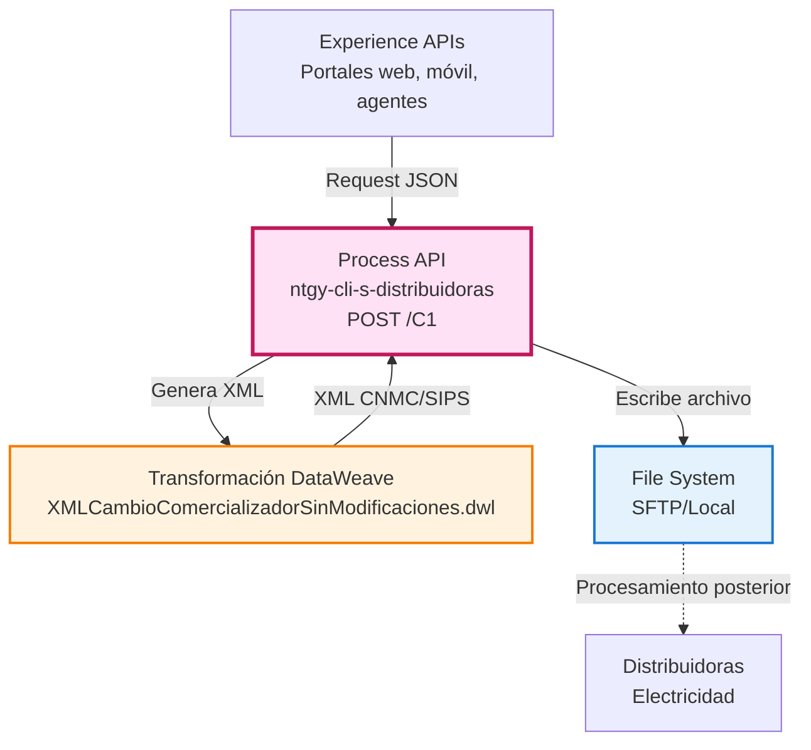
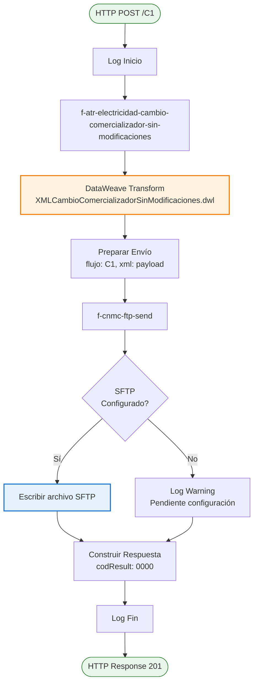
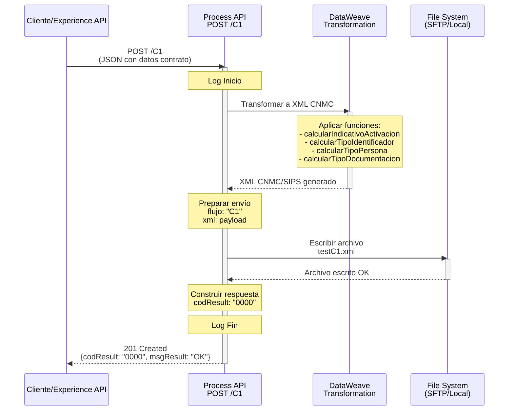
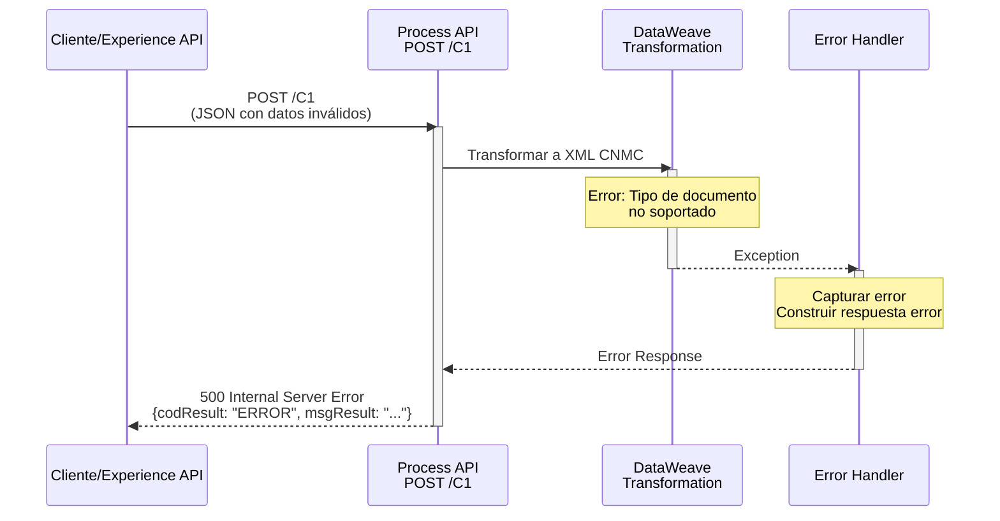
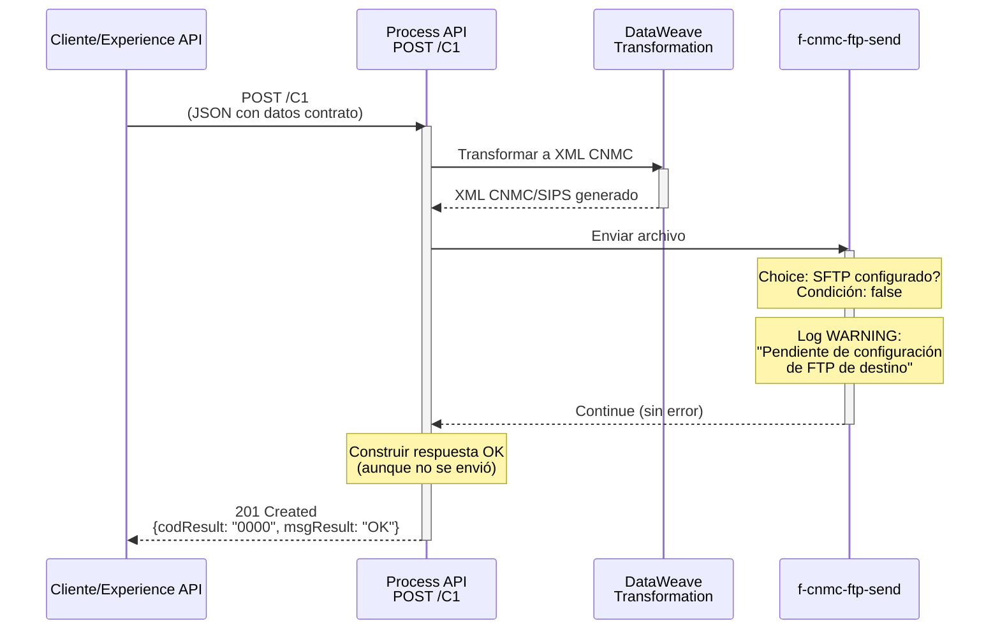

# POST /C1

## 📌 Descripción General

### Propósito del Endpoint

Este endpoint implementa el **proceso C1 de la CNMC** (Comisión Nacional de los Mercados y la Competencia) para gestionar cambios de comercializador de electricidad sin modificaciones en el contrato de acceso. El endpoint recibe los datos del contrato en formato JSON, genera un XML conforme al formato SIPS (Sistema de Intercambio de Información de Puntos de Suministro) y lo envía al sistema de archivos configurado (SFTP o local) para su posterior procesamiento por las distribuidoras.

### Tipo de API

**Capa:** Process API (API-Led Connectivity)

**Función:** Transformación y generación de documentos regulatorios

### Patrón de Integración

**Tipo:** Transformación + File Output

**Descripción:** Este endpoint NO consume System APIs downstream. En su lugar, realiza una transformación compleja de JSON a XML según el formato CNMC y escribe el resultado directamente en el sistema de archivos (SFTP o local) para su envío a las distribuidoras.

### Arquitectura API-Led Connectivity



---

## 💼 Propósito del Negocio

### Casos de Uso Principales

1. **Cambio de Comercializador sin Modificaciones**
   - Cliente decide cambiar de comercializadora manteniendo las mismas condiciones de suministro
   - No hay cambios en potencia contratada, tarifa ATR o titular
   - Proceso regulado por CNMC con plazos establecidos

2. **Cumplimiento Normativo CNMC**
   - Generación de XML en formato SIPS según especificaciones CNMC
   - Envío de documentación requerida a distribuidoras
   - Trazabilidad completa del proceso

3. **Automatización de Procesos ATR**
   - Eliminación de procesos manuales de generación de XMLs
   - Reducción de errores en formato y contenido
   - Aceleración del proceso de cambio de comercializador

### Proceso de Negocio C1


**Pasos del Proceso:**

1. **Recepción de Solicitud**: El endpoint recibe los datos completos del contrato y cliente
2. **Generación de XML**: Transforma los datos JSON a formato XML CNMC/SIPS
3. **Preparación de Envío**: Empaqueta el XML con metadatos (flujo: "C1", nombre archivo)
4. **Escritura de Archivo**: Escribe el XML en el sistema de archivos configurado
5. **Confirmación**: Retorna confirmación de envío exitoso al consumidor

### Transformaciones Aplicadas

Este Process API realiza una **transformación compleja** de JSON a XML:

| Aspecto | Transformación |
|---------|----------------|
| **Formato** | JSON → XML CNMC/SIPS |
| **Estructura** | Datos planos → Estructura jerárquica regulatoria |
| **Validaciones** | Aplicación de reglas de negocio CNMC |
| **Enriquecimiento** | Generación de códigos de solicitud, timestamps, secuenciales |
| **Mapeo de Códigos** | Tipos de documento, indicativos de activación, tipos de persona |

**Funciones de Transformación Aplicadas:**

- `calcularIndicativoActivacion()`: Determina tipo de activación (L = cuanto antes)
- `calcularTipoIdentificador()`: Mapea NIF/NIE/Pasaporte a códigos CNMC
- `calcularTipoPersona()`: Determina si es persona física (F) o jurídica (J)
- `calcularTipoDocumentacion()`: Mapea tipos de documentos adjuntos a códigos CNMC

### Contexto Empresarial

- **Dominio:** Gestión de Contratos de Energía
- **Sector:** Energía - Utilities (Electricidad)
- **División:** Naturgy España - Clientes
- **Proceso de Negocio:** Procesos ATR (Acceso de Terceros a la Red)
- **Regulador:** CNMC (Comisión Nacional de los Mercados y la Competencia)

### Stakeholders

- **Comercializadoras**: Necesitan enviar solicitudes de cambio de comercializador
- **Distribuidoras**: Reciben y procesan las solicitudes C1
- **Clientes Finales**: Beneficiarios del cambio de comercializador
- **CNMC**: Regulador que establece el formato y proceso
- **Equipos de Atención al Cliente**: Gestionan el proceso con los clientes

### Valor de Negocio

- **Automatización**: Eliminación de procesos manuales de generación de XMLs
- **Cumplimiento**: Garantiza formato correcto según normativa CNMC
- **Trazabilidad**: Registro completo de todas las solicitudes enviadas
- **Eficiencia**: Reducción de tiempos de procesamiento
- **Calidad**: Minimización de errores en formato y contenido

### Consumidores Potenciales

Este endpoint puede ser consumido por:
- Portales web de contratación de energía
- Aplicaciones móviles de gestión de contratos
- Sistemas de agentes de call center
- Plataformas de gestión comercial
- Sistemas de CRM y gestión de clientes

---

## 🔧 Especificación Técnica

### URLs por Ambiente

| Ambiente | URL Base | URL Completa |
|----------|----------|--------------|
| **Local** | `http://localhost:8081` | `http://localhost:8081/api/C1` |
| **Development** | `https://ntgy-cli-s-distribuidoras-dev.us-e2.cloudhub.io` | `https://ntgy-cli-s-distribuidoras-dev.us-e2.cloudhub.io/api/C1` |
| **UAT** | `https://ntgy-cli-s-distribuidoras-uat.us-e2.cloudhub.io` | `https://ntgy-cli-s-distribuidoras-uat.us-e2.cloudhub.io/api/C1` |
| **Production** | `https://ntgy-cli-s-distribuidoras-pro.us-e2.cloudhub.io` | `https://ntgy-cli-s-distribuidoras-pro.us-e2.cloudhub.io/api/C1` |

### Método HTTP

```
POST /api/C1
```

### Parámetros de Entrada

#### Headers

| Header | Tipo | Requerido | Descripción |
|--------|------|-----------|-------------|
| `Content-Type` | string | ✅ | Debe ser `application/json` |
| `client_id` | string | ✅ | Client ID de Anypoint Platform |
| `client_secret` | string | ✅ | Client Secret de Anypoint Platform |

#### Body (application/json)

**Estructura completa del request:**

```json
{
  "usuarioGrabador": "string",
  "codigoAgente": "string",
  "comercializadora": "string",
  "canalDarwin": "string",
  "cliente": {
    "nombre": "string",
    "apellido1": "string",
    "apellido2": "string",
    "email": "string",
    "telefono": "string",
    "tipoDocumento": "NIF|NIE|Pasaporte",
    "documento": "string",
    "idioma": "string",
    "gdpr": {
      "aceptaCesion": boolean,
      "aceptaConservacion": boolean,
      "aceptaPublicidad": boolean
    },
    "fechaNacimiento": "YYYY-MM-DD",
    "titularIban": "string",
    "iban": "string",
    "facturaOnline": boolean,
    "pyme": boolean,
    "planMensual": boolean,
    "cnae": "string",
    "direccionSuministro": {
      "idVia": "string",
      "codigoPostal": "string",
      "provincia": "string",
      "municipio": "string",
      "localidad": "string",
      "tipoVia": "string",
      "via": "string",
      "numero": "string",
      "portal": "string",
      "escalera": "string",
      "piso": "string",
      "puerta": "string"
    },
    "direccionFacturacion": {
      "idVia": "string",
      "codigoPostal": "string",
      "provincia": "string",
      "municipio": "string",
      "localidad": "string",
      "tipoVia": "string",
      "via": "string",
      "numero": "string",
      "portal": "string",
      "escalera": "string",
      "piso": "string",
      "puerta": "string"
    }
  },
  "suministroLuz": {
    "cups": "string (20-22 caracteres)",
    "tarifaAtr": "string",
    "potenciaP1": number,
    "potenciaP2": number,
    "potenciaP3": number,
    "potenciaP4": number,
    "potenciaP5": number,
    "potenciaP6": number,
    "consumoAnual": number,
    "cambioTitular": boolean,
    "cambioTarifaAtr": boolean
  },
  "pedido": {
    "idPedido": "string",
    "fechaFirma": "YYYY-MM-DD",
    "idCampana": "string",
    "nombreCampana": "string",
    "productos": [
      {
        "id": "string",
        "nombre": "string",
        "tarifaAtr": "string",
        "tipoContratacion": "string",
        "fechaAccion": "YYYY-MM-DD",
        "eco": boolean,
        "online": boolean,
        "duracion": "string",
        "fechaDirectriz": "YYYY-MM-DD",
        "fechaReservaPrecios": "YYYY-MM-DD"
      }
    ],
    "servicios": [
      {
        "id": "string",
        "nombre": "string",
        "tipoEnergia": "string",
        "termostato": "string"
      }
    ]
  },
  "documentos": [
    {
      "tipo": "string",
      "nombre": "string",
      "envioDistribuidora": boolean
    }
  ],
  "PedidoNum": number,
  "codDistribuidora": "string"
}
```

**Campos Clave:**

- `cliente.tipoDocumento`: Valores permitidos: "NIF", "NIE", "Pasaporte"
- `cliente.pyme`: Determina si se usa Nombre/Apellidos o RazonSocial en el XML
- `suministroLuz.cups`: CUPS de electricidad (20-22 caracteres, formato ES...)
- `documentos[].envioDistribuidora`: Solo se incluyen en XML los documentos con `true`
- `PedidoNum`: Índice del producto activo en el array de productos

### Respuestas

#### 201 Created - Envío Exitoso

```json
{
  "codResult": "0000",
  "msgResult": "OK"
}
```

**Descripción:** El XML se generó correctamente y se escribió en el sistema de archivos. Esto NO garantiza que la distribuidora haya procesado la solicitud, solo confirma el envío.

#### 500 Internal Server Error

```json
{
  "result": {
    "codResult": "ERROR_CODE",
    "msgResult": "Descripción del error"
  }
}
```

**Causas comunes:**
- Error en transformación DataWeave (datos inválidos)
- Error de escritura en sistema de archivos
- Configuración de SFTP incorrecta
- Tipo de documento no soportado

### Autenticación

- **Tipo:** Client ID & Client Secret (Anypoint Platform)
- **Headers requeridos:** `client_id`, `client_secret`

### Timeouts

| Tipo | Valor |
|------|-------|
| **Request Timeout** | 30 segundos |
| **Connection Timeout** | 10 segundos |
| **File Write Timeout** | 15 segundos |

---

## 🏗️ Implementación Técnica

### Arquitectura del Flow



### Flows Implementados

#### 1. Flow Principal: `ucf-electricidad-cambio-comercializador-sin-modificaciones`

**Ubicación:** Código proporcionado en el XML principal

**Responsabilidades:**
- Orquestación del proceso completo
- Logging de inicio y fin
- Construcción de respuesta estándar

**Código clave:**
```xml
<flow name="ucf-electricidad-cambio-comercializador-sin-modificaciones">
    <logger level="INFO" message="Inicio" />
    <flow-ref name="f-atr-electricidad-cambio-comercializador-sin-modificaciones"/>
    <ee:transform>
        <!-- Prepara payload con flujo: "C1" y xml: payload -->
    </ee:transform>
    <flow-ref name="f-cnmc-ftp-send" />
    <ee:transform>
        <!-- Construye respuesta: codResult: "0000", msgResult: "OK" -->
    </ee:transform>
    <logger level="INFO" message="Fin" />
</flow>
```

#### 2. Subflow: `f-atr-electricidad-cambio-comercializador-sin-modificaciones`

**Ubicación:** Mismo archivo XML

**Responsabilidades:**
- Generación del XML CNMC/SIPS
- Aplicación de transformación DataWeave

**Transformación aplicada:**
```
src/main/resources/modules/cnmc/xml/electricidad/XMLCambioComercializadorSinModificaciones.dwl
```

#### 3. Subflow: `f-cnmc-ftp-send`

**Ubicación:** `src/main/mule/cnmc/f-cnmc-ftp-send.xml`

**Responsabilidades:**
- Preparación del nombre de archivo
- Escritura en SFTP o sistema local
- Manejo de errores de escritura

**Configuración SFTP:**
```yaml
backends:
  FTPCNMC:
    host: ${backends.FTPCNMC.host}
    port: ${backends.FTPCNMC.port}
    username: ${backends.FTPCNMC.username}
    password: ${backends.FTPCNMC.password}
    basePath: ${backends.FTPCNMC.basePath}
```

### Transformación DataWeave Principal

**Archivo:** `XMLCambioComercializadorSinModificaciones.dwl`

**Estructura del XML generado:**

```xml
<MensajeCambiodeComercializadorSinCambios xmlns="http://localhost/elegibilidad">
    <Cabecera>
        <CodigoREEEmpresaEmisora>1646</CodigoREEEmpresaEmisora>
        <CodigoREEEmpresaDestino>0000</CodigoREEEmpresaDestino>
        <CodigoDelProceso>C1</CodigoDelProceso>
        <CodigoDePaso>01</CodigoDePaso>
        <CodigoDeSolicitud>[12 dígitos generados]</CodigoDeSolicitud>
        <SecuencialDeSolicitud>01</SecuencialDeSolicitud>
        <FechaSolicitud>[YYYY-MM-DDThh:mm:ss]</FechaSolicitud>
        <CUPS>[CUPS del suministro]</CUPS>
    </Cabecera>
    <CambiodeComercializadorSinCambios>
        <DatosSolicitud>
            <IndActivacion>L</IndActivacion>
            <ContratacionIncondicionalPS>S</ContratacionIncondicionalPS>
            <ContratacionIncondicionalBS>S</ContratacionIncondicionalBS>
        </DatosSolicitud>
        <Cliente>
            <IdCliente>
                <TipoIdentificador>[NI|NE|PS]</TipoIdentificador>
                <Identificador>[documento]</Identificador>
                <TipoPersona>[F|J]</TipoPersona>
            </IdCliente>
            <!-- Si NO es PYME -->
            <Nombre>
                <NombreDePila>[nombre]</NombreDePila>
                <PrimerApellido>[apellido1]</PrimerApellido>
                <SegundoApellido>[apellido2]</SegundoApellido>
            </Nombre>
            <!-- Si es PYME -->
            <RazonSocial>[nombre]</RazonSocial>
            <Telefono>
                <PrefijoPais>34</PrefijoPais>
                <Numero>[telefono]</Numero>
            </Telefono>
            <CorreoElectronico>[email]</CorreoElectronico>
        </Cliente>
        <!-- Solo si hay documentos con envioDistribuidora: true -->
        <RegistrosDocumento>
            <RegistroDoc>
                <TipoDocAportado>[código CNMC]</TipoDocAportado>
                <DireccionUrl>[nombre archivo]</DireccionUrl>
            </RegistroDoc>
        </RegistrosDocumento>
    </CambiodeComercializadorSinCambios>
</MensajeCambiodeComercializadorSinCambios>
```

### Módulos DataWeave Auxiliares

#### XMLComun.dwl

**Función:** Genera la cabecera estándar CNMC

```dataweave
fun Cabecera(origen: String, destino: String, proceso: String, CUPS: String): Any = {
    CodigoREEEmpresaEmisora: origen,
    CodigoREEEmpresaDestino: destino,
    CodigoDelProceso: proceso,
    CodigoDeSolicitud: [12 dígitos generados dinámicamente],
    FechaSolicitud: [timestamp actual],
    CUPS: CUPS
}
```

**Generación de Código de Solicitud:**
- Basado en timestamp actual en milisegundos
- 12 dígitos numéricos únicos
- Garantiza unicidad de cada solicitud

#### functions.dwl

**Funciones de Mapeo:**

1. **calcularIndicativoActivacion()**
   - Retorna: "L" (activación cuanto antes)
   - Según tabla 8 de CNMC

2. **calcularTipoIdentificador()**
   - NIF → "NI"
   - NIE → "NE"
   - Pasaporte → "PS"
   - Según tabla 6 de CNMC

3. **calcularTipoPersona()**
   - Si NO es CIF → "F" (Física)
   - Si es CIF → "J" (Jurídica)
   - Según tabla 115 de CNMC

4. **calcularTipoDocumentacion()**
   - Mapea tipos de documentos adjuntos
   - CTX/LOC/LOT → "01"
   - Según tabla 61 de CNMC

### Configuración Global

**Archivo:** `s-distribuidoras-global-config.yaml`

**Códigos de Comercializadora:**
```yaml
origenes:
  electrico: "1646"  # Código Naturgy electricidad
  gas: "0762"        # Código Naturgy gas
```

**Nota:** El código de distribuidora destino está hardcodeado como "0000" en la transformación.

### Patrones de Diseño

**Patrón:** Transformation + File Output

**Justificación:** 
- No hay System APIs downstream que consultar
- La transformación es compleja y requiere múltiples funciones auxiliares
- El output es un archivo XML que debe escribirse en file system
- Separación clara de responsabilidades entre generación y envío

### Diagramas de Secuencia

#### 1. Flujo Normal de Éxito



#### 2. Flujo con Error de Transformación



#### 3. Flujo con SFTP No Configurado



### Manejo de Errores

**Error Handler:** `cnmc-error-manager-error-handler`

**Estrategia:**

1. **Errores de Transformación DataWeave:**
   - Capturados por error handler global
   - Retornan 500 con mensaje descriptivo
   - Ejemplos: tipo de documento no soportado, campos requeridos faltantes

2. **Errores de Escritura SFTP:**
   - Capturados por `on-error-continue` en `f-cnmc-ftp-send`
   - Log de WARNING pero NO falla el flow
   - Retorna respuesta exitosa (comportamiento actual)

3. **SFTP No Configurado:**
   - Choice con condición `false` (hardcoded)
   - Log de WARNING
   - Continúa sin error
   - **Nota:** En producción, la condición debería evaluarse dinámicamente

**Códigos de Error:**

| Código | Descripción | HTTP Status |
|--------|-------------|-------------|
| `0000` | Operación exitosa | 201 |
| `ERROR` | Error genérico de transformación | 500 |
| `SFTP_ERROR` | Error de escritura SFTP | 500 |

---

## 💻 Ejemplos de Uso

### Ejemplo 1: Llamada Exitosa - Cliente Persona Física

#### cURL

```bash
curl -X POST "https://ntgy-cli-s-distribuidoras-dev.us-e2.cloudhub.io/api/C1" \
  -H "Content-Type: application/json" \
  -H "client_id: YOUR_CLIENT_ID" \
  -H "client_secret: YOUR_CLIENT_SECRET" \
  -d '{
    "usuarioGrabador": "AGENTE001",
    "codigoAgente": "AG123",
    "comercializadora": "1646",
    "canalDarwin": "WEB",
    "cliente": {
      "nombre": "Juan",
      "apellido1": "García",
      "apellido2": "López",
      "email": "juan.garcia@example.com",
      "telefono": "612345678",
      "tipoDocumento": "NIF",
      "documento": "12345678A",
      "idioma": "ES",
      "gdpr": {
        "aceptaCesion": true,
        "aceptaConservacion": true,
        "aceptaPublicidad": false
      },
      "fechaNacimiento": "1980-05-15",
      "titularIban": "Juan García López",
      "iban": "ES7921000813610123456789",
      "facturaOnline": true,
      "pyme": false,
      "planMensual": false,
      "cnae": "",
      "direccionSuministro": {
        "idVia": "VIA001",
        "codigoPostal": "28001",
        "provincia": "28",
        "municipio": "28079",
        "localidad": "28079000100",
        "tipoVia": "CL",
        "via": "Gran Vía",
        "numero": "25",
        "portal": "A",
        "escalera": "1",
        "piso": "3",
        "puerta": "B"
      },
      "direccionFacturacion": {
        "idVia": "VIA001",
        "codigoPostal": "28001",
        "provincia": "28",
        "municipio": "28079",
        "localidad": "28079000100",
        "tipoVia": "CL",
        "via": "Gran Vía",
        "numero": "25",
        "portal": "A",
        "escalera": "1",
        "piso": "3",
        "puerta": "B"
      }
    },
    "suministroLuz": {
      "cups": "ES0021000000000001JN0F",
      "tarifaAtr": "2.0TD",
      "potenciaP1": 4.6,
      "potenciaP2": 4.6,
      "potenciaP3": 0,
      "potenciaP4": 0,
      "potenciaP5": 0,
      "potenciaP6": 0,
      "consumoAnual": 3500,
      "cambioTitular": false,
      "cambioTarifaAtr": false
    },
    "pedido": {
      "idPedido": "PED-2026-001",
      "fechaFirma": "2026-09-01",
      "idCampana": "CAMP-001",
      "nombreCampana": "Tarifa Plana Luz",
      "productos": [
        {
          "id": "5-230003",
          "nombre": "Tarifa Plana Luz",
          "tarifaAtr": "2.0TD",
          "tipoContratacion": "CC",
          "fechaAccion": "2026-09-15",
          "eco": true,
          "online": true,
          "duracion": "12 meses",
          "fechaDirectriz": "2026-09-15",
          "fechaReservaPrecios": "2026-09-15"
        }
      ],
      "servicios": []
    },
    "documentos": [
      {
        "tipo": "CTX",
        "nombre": "/files/contrato-461abf3b.pdf",
        "envioDistribuidora": true
      }
    ],
    "PedidoNum": 0,
    "codDistribuidora": "0021"
  }'
```

#### Respuesta (201 Created)

```json
{
  "codResult": "0000",
  "msgResult": "OK"
}
```

**Interpretación:**
- El XML se generó correctamente
- El archivo se escribió en el sistema de archivos
- Nombre del archivo: `testC1.xml`
- La distribuidora procesará el archivo posteriormente

---

### Ejemplo 2: Llamada Exitosa - Cliente PYME

#### cURL

```bash
curl -X POST "https://ntgy-cli-s-distribuidoras-uat.us-e2.cloudhub.io/api/C1" \
  -H "Content-Type: application/json" \
  -H "client_id: YOUR_CLIENT_ID" \
  -H "client_secret: YOUR_CLIENT_SECRET" \
  -d '{
    "usuarioGrabador": "AGENTE002",
    "codigoAgente": "AG456",
    "comercializadora": "1646",
    "canalDarwin": "CALL_CENTER",
    "cliente": {
      "nombre": "Comercial López SL",
      "apellido1": "",
      "apellido2": "",
      "email": "info@comerciallopez.com",
      "telefono": "915551234",
      "tipoDocumento": "NIF",
      "documento": "B12345678",
      "idioma": "ES",
      "gdpr": {
        "aceptaCesion": true,
        "aceptaConservacion": true,
        "aceptaPublicidad": true
      },
      "fechaNacimiento": "2010-01-15",
      "titularIban": "Comercial López SL",
      "iban": "ES7921000813610987654321",
      "facturaOnline": true,
      "pyme": true,
      "planMensual": false,
      "cnae": "4711",
      "direccionSuministro": {
        "idVia": "VIA002",
        "codigoPostal": "08001",
        "provincia": "08",
        "municipio": "08019",
        "localidad": "08019000100",
        "tipoVia": "AV",
        "via": "Diagonal",
        "numero": "500",
        "portal": "B",
        "escalera": "",
        "piso": "2",
        "puerta": "1"
      },
      "direccionFacturacion": {
        "idVia": "VIA002",
        "codigoPostal": "08001",
        "provincia": "08",
        "municipio": "08019",
        "localidad": "08019000100",
        "tipoVia": "AV",
        "via": "Diagonal",
        "numero": "500",
        "portal": "B",
        "escalera": "",
        "piso": "2",
        "puerta": "1"
      }
    },
    "suministroLuz": {
      "cups": "ES0021000000000002AB1C",
      "tarifaAtr": "3.0TD",
      "potenciaP1": 15.0,
      "potenciaP2": 15.0,
      "potenciaP3": 10.0,
      "potenciaP4": 0,
      "potenciaP5": 0,
      "potenciaP6": 0,
      "consumoAnual": 25000,
      "cambioTitular": false,
      "cambioTarifaAtr": false
    },
    "pedido": {
      "idPedido": "PED-2026-002",
      "fechaFirma": "2026-09-02",
      "idCampana": "CAMP-PYME-001",
      "nombreCampana": "Tarifa Empresas",
      "productos": [
        {
          "id": "5-230010",
          "nombre": "Tarifa Empresas",
          "tarifaAtr": "3.0TD",
          "tipoContratacion": "CC",
          "fechaAccion": "2026-09-20",
          "eco": false,
          "online": true,
          "duracion": "24 meses",
          "fechaDirectriz": "2026-09-20",
          "fechaReservaPrecios": "2026-09-20"
        }
      ],
      "servicios": []
    },
    "documentos": [
      {
        "tipo": "CTX",
        "nombre": "/files/contrato-empresa-789xyz.pdf",
        "envioDistribuidora": true
      },
      {
        "tipo": "LOC",
        "nombre": "/files/licencia-actividad.pdf",
        "envioDistribuidora": true
      }
    ],
    "PedidoNum": 0,
    "codDistribuidora": "0022"
  }'
```

#### Respuesta (201 Created)

```json
{
  "codResult": "0000",
  "msgResult": "OK"
}
```

**Diferencias en el XML generado para PYME:**
- Se usa `<RazonSocial>` en lugar de `<Nombre>` con apellidos
- El tipo de persona será "J" (Jurídica) si el documento es CIF

---

### Ejemplo 3: JavaScript (Node.js)

```javascript
const axios = require('axios');

async function enviarSolicitudC1() {
  try {
    const response = await axios.post(
      'https://ntgy-cli-s-distribuidoras-dev.us-e2.cloudhub.io/api/C1',
      {
        usuarioGrabador: "AGENTE001",
        codigoAgente: "AG123",
        comercializadora: "1646",
        canalDarwin: "WEB",
        cliente: {
          nombre: "María",
          apellido1: "Fernández",
          apellido2: "Ruiz",
          email: "maria.fernandez@example.com",
          telefono: "622334455",
          tipoDocumento: "NIF",
          documento: "87654321B",
          pyme: false,
          direccionSuministro: {
            codigoPostal: "28002",
            provincia: "28",
            municipio: "28079",
            localidad: "28079000100",
            tipoVia: "CL",
            via: "Alcalá",
            numero: "100"
          },
          direccionFacturacion: {
            codigoPostal: "28002",
            provincia: "28",
            municipio: "28079",
            localidad: "28079000100",
            tipoVia: "CL",
            via: "Alcalá",
            numero: "100"
          }
        },
        suministroLuz: {
          cups: "ES0021000000000003CD2E",
          tarifaAtr: "2.0TD",
          potenciaP1: 5.75,
          potenciaP2: 5.75,
          consumoAnual: 4200
        },
        pedido: {
          idPedido: "PED-2026-003",
          fechaFirma: "2026-09-03",
          productos: [
            {
              id: "5-230003",
              nombre: "Tarifa Plana Luz",
              tarifaAtr: "2.0TD",
              tipoContratacion: "CC",
              fechaAccion: "2026-09-18"
            }
          ]
        },
        documentos: [
          {
            tipo: "CTX",
            nombre: "/files/contrato-maria.pdf",
            envioDistribuidora: true
          }
        ],
        PedidoNum: 0,
        codDistribuidora: "0021"
      },
      {
        headers: {
          'Content-Type': 'application/json',
          'client_id': process.env.CLIENT_ID,
          'client_secret': process.env.CLIENT_SECRET
        }
      }
    );

    console.log('✅ Solicitud C1 enviada exitosamente');
    console.log('Respuesta:', response.data);
    return response.data;

  } catch (error) {
    console.error('❌ Error al enviar solicitud C1:', error.response?.data || error.message);
    throw error;
  }
}

// Ejecutar
enviarSolicitudC1();
```

---

### Ejemplo 4: Python

```python
import requests
import os
from datetime import datetime

def enviar_solicitud_c1():
    """
    Envía una solicitud de cambio de comercializador (C1) a la API
    """
    url = "https://ntgy-cli-s-distribuidoras-dev.us-e2.cloudhub.io/api/C1"
    
    headers = {
        "Content-Type": "application/json",
        "client_id": os.getenv("CLIENT_ID"),
        "client_secret": os.getenv("CLIENT_SECRET")
    }
    
    payload = {
        "usuarioGrabador": "AGENTE001",
        "codigoAgente": "AG123",
        "comercializadora": "1646",
        "canalDarwin": "MOBILE_APP",
        "cliente": {
            "nombre": "Carlos",
            "apellido1": "Martínez",
            "apellido2": "Sánchez",
            "email": "carlos.martinez@example.com",
            "telefono": "633445566",
            "tipoDocumento": "NIE",
            "documento": "X1234567Y",
            "pyme": False,
            "direccionSuministro": {
                "codigoPostal": "46001",
                "provincia": "46",
                "municipio": "46250",
                "localidad": "46250000100",
                "tipoVia": "CL",
                "via": "Colón",
                "numero": "15"
            },
            "direccionFacturacion": {
                "codigoPostal": "46001",
                "provincia": "46",
                "municipio": "46250",
                "localidad": "46250000100",
                "tipoVia": "CL",
                "via": "Colón",
                "numero": "15"
            }
        },
        "suministroLuz": {
            "cups": "ES0021000000000004EF3G",
            "tarifaAtr": "2.0TD",
            "potenciaP1": 3.45,
            "potenciaP2": 3.45,
            "consumoAnual": 2800
        },
        "pedido": {
            "idPedido": "PED-2026-004",
            "fechaFirma": datetime.now().strftime("%Y-%m-%d"),
            "productos": [
                {
                    "id": "5-230003",
                    "nombre": "Tarifa Plana Luz",
                    "tarifaAtr": "2.0TD",
                    "tipoContratacion": "CC",
                    "fechaAccion": "2026-09-25"
                }
            ]
        },
        "documentos": [
            {
                "tipo": "CTX",
                "nombre": "/files/contrato-carlos.pdf",
                "envioDistribuidora": True
            }
        ],
        "PedidoNum": 0,
        "codDistribuidora": "0021"
    }
    
    try:
        response = requests.post(url, json=payload, headers=headers, timeout=30)
        response.raise_for_status()
        
        print("✅ Solicitud C1 enviada exitosamente")
        print(f"Respuesta: {response.json()}")
        return response.json()
        
    except requests.exceptions.HTTPError as e:
        print(f"❌ Error HTTP: {e.response.status_code}")
        print(f"Detalle: {e.response.text}")
        raise
    except requests.exceptions.Timeout:
        print("❌ Error: Timeout en la solicitud")
        raise
    except Exception as e:
        print(f"❌ Error inesperado: {str(e)}")
        raise

# Ejecutar
if __name__ == "__main__":
    enviar_solicitud_c1()
```

---

### Ejemplo 5: Error - Tipo de Documento No Soportado

#### Request

```bash
curl -X POST "https://ntgy-cli-s-distribuidoras-dev.us-e2.cloudhub.io/api/C1" \
  -H "Content-Type: application/json" \
  -H "client_id: YOUR_CLIENT_ID" \
  -H "client_secret: YOUR_CLIENT_SECRET" \
  -d '{
    "cliente": {
      "tipoDocumento": "DNI_EXTRANJERO",
      "documento": "ABC123456"
    }
  }'
```

#### Respuesta (500 Internal Server Error)

```json
{
  "result": {
    "codResult": "TRANSFORM_ERROR",
    "msgResult": "Tipo de documento 'DNI_EXTRANJERO' no soportado"
  }
}
```

**Causa:** El tipo de documento no está en la lista de valores permitidos (NIF, NIE, Pasaporte).

**Solución:** Usar uno de los tipos de documento soportados.

---

### Ejemplo 6: XML Generado (Fragmento)

**Para referencia, este es un fragmento del XML que se genera internamente:**

```xml
<?xml version="1.0" encoding="UTF-8"?>
<MensajeCambiodeComercializadorSinCambios xmlns="http://localhost/elegibilidad">
    <Cabecera>
        <CodigoREEEmpresaEmisora>1646</CodigoREEEmpresaEmisora>
        <CodigoREEEmpresaDestino>0000</CodigoREEEmpresaDestino>
        <CodigoDelProceso>C1</CodigoDelProceso>
        <CodigoDePaso>01</CodigoDePaso>
        <CodigoDeSolicitud>172589234567</CodigoDeSolicitud>
        <SecuencialDeSolicitud>01</SecuencialDeSolicitud>
        <FechaSolicitud>2026-09-07T15:30:45</FechaSolicitud>
        <CUPS>ES0021000000000001JN0F</CUPS>
    </Cabecera>
    <CambiodeComercializadorSinCambios>
        <DatosSolicitud>
            <IndActivacion>L</IndActivacion>
            <ContratacionIncondicionalPS>S</ContratacionIncondicionalPS>
            <ContratacionIncondicionalBS>S</ContratacionIncondicionalBS>
        </DatosSolicitud>
        <Cliente>
            <IdCliente>
                <TipoIdentificador>NI</TipoIdentificador>
                <Identificador>12345678A</Identificador>
                <TipoPersona>F</TipoPersona>
            </IdCliente>
            <Nombre>
                <NombreDePila>Juan</NombreDePila>
                <PrimerApellido>García</PrimerApellido>
                <SegundoApellido>López</SegundoApellido>
            </Nombre>
            <Telefono>
                <PrefijoPais>34</PrefijoPais>
                <Numero>612345678</Numero>
            </Telefono>
            <CorreoElectronico>juan.garcia@example.com</CorreoElectronico>
        </Cliente>
        <RegistrosDocumento>
            <RegistroDoc>
                <TipoDocAportado>01</TipoDocAportado>
                <DireccionUrl>/files/contrato-461abf3b.pdf</DireccionUrl>
            </RegistroDoc>
        </RegistrosDocumento>
    </CambiodeComercializadorSinCambios>
</MensajeCambiodeComercializadorSinCambios>
```

**Nota:** Este XML se escribe en el archivo `testC1.xml` en el sistema de archivos configurado (SFTP o local).
